# Java for JavaScript Developers: The Complete Master Guide

> A comprehensive, prerequisite-driven master curriculum designed for JavaScript developers.
> Covers core Java mechanics, memory architecture, LeetCode data structures & algorithmic patterns,
> and enterprise application design principles with hands-on challenges and commented solutions.

## Table of Contents

### Part 1: Core Master Curriculum (Modules 1–14)
- [**Module 1: Foundations & The Mental Model**](#module-1-foundations-the-mental-model)
  - [1.1 How Java Executes: The JVM, Bytecode & The JIT Compiler](#11-how-java-executes-the-jvm-bytecode-the-jit-compiler)
  - [1.2 Anatomy of a Java Program](#12-anatomy-of-a-java-program)
  - [1.3 Strict Rules: File Naming & Semicolons](#13-strict-rules-file-naming-semicolons)
  - [1.4 Console Output & Comments](#14-console-output-comments)
  - [1.5 Console Input with `java.util.Scanner`](#15-console-input-with-javautilscanner)
- [**Module 2: Variables, Types & The Memory Model**](#module-2-variables-types-the-memory-model)
  - [2.1 Static Typing vs. Dynamic Typing](#21-static-typing-vs-dynamic-typing)
  - [2.2 The 8 Primitive Types](#22-the-8-primitive-types)
  - [2.3 Type Inference with `var` (Java 10+)](#23-type-inference-with-var-java-10)
  - [2.4 Type Casting: Widening vs. Narrowing](#24-type-casting-widening-vs-narrowing)
  - [2.5 Variable Initialization Rules: Local vs. Instance Variables](#25-variable-initialization-rules-local-vs-instance-variables)
  - [2.6 Operators Breakdown](#26-operators-breakdown)
  - [2.7 Stack vs. Heap Memory: The Core Mental Model](#27-stack-vs-heap-memory-the-core-mental-model)
  - [2.8 Garbage Collection & GC Roots (How Memory Is Freed)](#28-garbage-collection-gc-roots-how-memory-is-freed)
  - [2.9 Wrapper Classes & Autoboxing](#29-wrapper-classes-autoboxing)
  - [2.10 Pass-by-Value Mechanics (The Reference Pointer)](#210-pass-by-value-mechanics-the-reference-pointer)
- [**Module 3: Strings & Text Manipulation**](#module-3-strings-text-manipulation)
  - [3.1 `String` is an Immutable Object](#31-string-is-an-immutable-object)
  - [3.2 The String Constant Pool & Equality](#32-the-string-constant-pool-equality)
  - [3.3 Essential LeetCode String Methods](#33-essential-leetcode-string-methods)
  - [3.4 Common String Utility Methods](#34-common-string-utility-methods)
  - [3.5 High-Performance Text Assembly: `StringBuilder`](#35-high-performance-text-assembly-stringbuilder)
  - [3.6 Modern Text Blocks (Java 15+)](#36-modern-text-blocks-java-15)
- [**Module 4: Control Flow & Logic**](#module-4-control-flow-logic)
  - [4.1 Conditionals (`if`, `else if`, `else`)](#41-conditionals-if-else-if-else)
  - [4.2 Switch Statements & Modern Switch Expressions](#42-switch-statements-modern-switch-expressions)
  - [4.3 Loops](#43-loops)
  - [4.4 Loop Controls (`break`, `continue`, Labels)](#44-loop-controls-break-continue-labels)
- [**Module 5: Methods (Functions in Java)**](#module-5-methods-functions-in-java)
  - [5.1 Method Anatomy & Call Stack Mechanics](#51-method-anatomy-call-stack-mechanics)
  - [5.2 Method Overloading](#52-method-overloading)
  - [5.3 Varargs (Variable-Length Arguments)](#53-varargs-variable-length-arguments)
  - [5.5 Early Returns in `void` Methods](#55-early-returns-in-void-methods)
  - [5.4 Null Safety & `Optional<T>` (Java 8+)](#54-null-safety-optionalt-java-8)
- [**Module 6: Arrays & Core Data Structures**](#module-6-arrays-core-data-structures)
  - [6.1 Fixed-Size Arrays & Memory Allocation](#61-fixed-size-arrays-memory-allocation)
  - [6.2 2D Arrays & Matrices](#62-2d-arrays-matrices)
  - [6.3 Array Utilities (`java.util.Arrays`)](#63-array-utilities-javautilarrays)
  - [6.4 Dynamic Arrays: `ArrayList<T>` vs. Primitive Arrays](#64-dynamic-arrays-arraylistt-vs-primitive-arrays)
  - [6.5 Canonical LeetCode Data Structures: `ListNode` & `TreeNode`](#65-canonical-leetcode-data-structures-listnode-treenode)
- [**Module 7: Object-Oriented Programming Foundations**](#module-7-object-oriented-programming-foundations)
  - [7.1 Classes, Fields, Constructors & `this`](#71-classes-fields-constructors-this)
  - [7.2 Access Modifiers & Encapsulation](#72-access-modifiers-encapsulation)
  - [7.3 `static` Context vs. Instance Context](#73-static-context-vs-instance-context)
  - [7.4 Modern Data Carriers: Records (Java 16+)](#74-modern-data-carriers-records-java-16)
  - [7.5 The `equals()` and `hashCode()` Contract](#75-the-equals-and-hashcode-contract)
  - [7.6 'final' Reference Immutability vs. Object State Mutability](#76-final-reference-immutability-vs-object-state-mutability)
  - [7.7 The `toString()` Contract & Object Identity](#77-the-tostring-contract-object-identity)
  - [7.8 Java Enums: Type-Safe Classes with Behavior](#78-java-enums-type-safe-classes-with-behavior)
  - [7.9 Nested, Inner & Anonymous Classes](#79-nested-inner-anonymous-classes)
- [**Module 8: Advanced OOP, Polymorphism & Design**](#module-8-advanced-oop-polymorphism-design)
  - [8.1 Inheritance (`extends`, `super`, `@Override`)](#81-inheritance-extends-super-override)
  - [8.2 Polymorphism & Dynamic Method Dispatch](#82-polymorphism-dynamic-method-dispatch)
  - [8.3 Abstract Classes vs. Interfaces](#83-abstract-classes-vs-interfaces)
  - [8.4 Composition over Inheritance](#84-composition-over-inheritance)
  - [8.5 Annotations: Compiler & Runtime Metadata](#85-annotations-compiler-runtime-metadata)
  - [8.6 Sealed Classes & Interfaces (Java 17 LTS: Discriminated Unions)](#86-sealed-classes-interfaces-java-17-lts-discriminated-unions)
- [**Module 9: Generics (Type-Safe Reusability)**](#module-9-generics-type-safe-reusability)
  - [9.1 Why Generics?](#91-why-generics)
  - [9.2 Generic Classes & Generic Methods](#92-generic-classes-generic-methods)
  - [9.3 Bounded Generics & The PECS Rule](#93-bounded-generics-the-pecs-rule)
  - [9.4 Type Erasure](#94-type-erasure)
- [**Module 10: The Java Collections Framework (JCF)**](#module-10-the-java-collections-framework-jcf)
  - [10.1 The Collections Architecture](#101-the-collections-architecture)
  - [10.2 Big-O Complexity Comparison Table](#102-big-o-complexity-comparison-table)
  - [10.3 Stacks & Queues: Use `ArrayDeque` (Not `java.util.Stack`!)](#103-stacks-queues-use-arraydeque-not-javautilstack)
  - [10.4 Heaps (`PriorityQueue`) in Java](#104-heaps-priorityqueue-in-java)
  - [10.5 Collection Pitfalls & How to Iterate Maps](#105-collection-pitfalls-how-to-iterate-maps)
  - [10.6 Sorting with `Comparable` vs `Comparator`](#106-sorting-with-comparable-vs-comparator)
- [**Module 11: Exception Handling & Robust Code**](#module-11-exception-handling-robust-code)
  - [11.1 The Exception Hierarchy](#111-the-exception-hierarchy)
  - [11.2 `try`, `catch`, `finally` & Multi-Catch](#112-try-catch-finally-multi-catch)
  - [11.3 Try-with-Resources & `AutoCloseable`](#113-try-with-resources-autocloseable)
- [**Module 12: Functional Java: Lambdas & Streams**](#module-12-functional-java-lambdas-streams)
  - [12.1 Lambdas & Single Abstract Method (SAM) Interfaces](#121-lambdas-single-abstract-method-sam-interfaces)
  - [12.2 Standard Functional Interfaces (`java.util.function`)](#122-standard-functional-interfaces-javautilfunction)
  - [12.3 Method References (`::`)](#123-method-references-)
  - [12.4 The Stream API Pipeline](#124-the-stream-api-pipeline)
- [**Module 13: Packages, Date/Time & Modern File I/O**](#module-13-packages-datetime-modern-file-io)
  - [13.1 Packages & Imports](#131-packages-imports)
  - [13.2 Modern Date & Time (`java.time`)](#132-modern-date-time-javatime)
  - [13.3 Modern File I/O (`java.nio.file.Files`)](#133-modern-file-io-javaniofilefiles)
- [**Module 14: Java Ecosystem, Build Tools & Frameworks**](#module-14-java-ecosystem-build-tools-frameworks)
  - [14.1 Build Systems: Maven & Gradle](#141-build-systems-maven-gradle)
  - [14.2 What is a JAR File Physically?](#142-what-is-a-jar-file-physically)
  - [14.3 Database Persistence: JDBC, JPA & Hibernate](#143-database-persistence-jdbc-jpa-hibernate)
  - [14.4 Enterprise Frameworks: Spring Boot](#144-enterprise-frameworks-spring-boot)

### Part 2: Java Testing with JUnit
- [**1. What is Java Testing?**](#1-what-is-java-testing)
- [**JUnit Environment and Setup**](#junit-environment-and-setup)
  - [The Non-Trivial Part: Build Tools (Maven)](#2-the-non-trivial-part-build-tools-maven)
  - [Running Your First Test](#4-running-your-first-test)
- [**Vanilla JUnit Setup Without a Build Tool**](#vanilla-junit-setup-without-a-build-tool)
  - [The Classpath and The Standalone JAR](#1-the-non-trivial-concept-the-classpath-and-the-standalone-jar)
  - [Manual Compilation & Execution](#3-how-to-compile-translating-to-bytecode)
- [**Test Framework and Basic Usage**](#test-framework-and-basic-usage)
  - [Test Fixtures, Suites & Runners](#2-test-fixtures-the-non-trivial-concept)
- [**JUnit API Architecture**](#junit-api)
  - [The Assert, TestCase, TestResult & TestSuite Classes](#1-the-assert-class-the-judge)
- [**Writing and Executing Tests**](#writing-and-executing-tests)
  - [Execution Sequences & Static Fixtures](#bringing-it-all-together)
- [**Suite Tests**](#suite-tests)
- [**Test Tags & Test Filtering**](#test-tags)
- [**Specialized Test Types**](#type-of-test---ignore-test-disabled)
  - [Ignored Tests (`@Disabled`)](#type-of-test---ignore-test-disabled)
  - [Timeout Tests](#type-of-test---time-test-timeouts)
  - [Exception Testing](#type-of-test---exceptions-test-testing-for-intended-crashes)
  - [Parameterized Tests (Data-Driven Testing)](#type-of-test---parameterized-tests-the-data-driven-magic)
- [**Spies, Stubs, and Mocking**](#spies-stubs-and-mocking)
- [**Using Mockito for Mocking with JUnit**](#using-mockito-for-mocking-with-junit)
- [**JUnit Best Practices**](#junit-best-practices)
- [**Code Coverage & JaCoCo**](#code-coverage)
- [**Extending JUnit for Integration Testing**](#extending-junit-for-integration-testing)

### Part 3: Java Handling of User Input and File Access
- [**1. User Input & The Scanner Mental Model**](#1-user-input)
  - [Comparison: Java vs. JavaScript vs. Node.js](#2-comparison-java-vs-javascript-vs-nodejs)
- [**Understanding Buffers & The Waiting Room Analogy**](#understanding-buffers)
  - [The Scanner Trap & Flushing Buffers](#2-the-scanner-trap-the-non-trivial-part)
- [**Reading from and Writing to Files**](#reading-from-and-writing-to-files)
  - [Synchronous File Access & Async NIO](#step-1-accessing-the-file-system-and-access-levels)
- [**Using `BufferedReader` Streams to Deal with Large Files**](#using-bufferedreader-streams-to-deal-with-large-files)
  - [The "Firehose vs. The Cup" Concept](#1-the-non-trivial-concept-the-firehose-vs-the-cup)

### Part 4: Nested Classes and Their Scope
- [**1. The "Invisible Umbilical Cord" (Inner vs Static Nested)**](#1-the-non-trivial-concept-the-invisible-umbilical-cord)
- [**2. Why Do We Need Them? (Practical Use Cases)**](#2-why-do-we-need-them-practical-use-cases)
- [**3. How It Works: Java Code Examples & Scope**](#3-how-it-works-java-code-examples--scope)
- [**4. Comparison: Java vs. JavaScript & Node.js Closures**](#4-comparison-java-vs-javascript--nodejs)
- [**Nested Classes Interacting with Siblings (The Family Trust Rule)**](#nested-classes-interacting-with-siblings)

### Part 5: Generating Random Values in Java
- [**The `Random` Class**](#the-random-class)
  - [1. "Pseudo" Randomness and The Seed](#1-the-non-trivial-part-pseudo-randomness-and-the-seed)
  - [2. How to Use the `Random` Class & The Bounds Trap](#2-java-how-to-use-the-random-class)
  - [3. Comparison: Java vs. JavaScript & Node.js](#3-comparison-java-vs-javascript)
  - [4. Code Comparison for Common Use Cases](#4-code-comparison-for-common-use-cases)
  - [5. Picking a Random Item from an Array or List](#6-picking-a-random-item-from-an-array-or-list)

### Part 6: Advanced Number Data Types and Var Keyword
- [**Long, BigInteger and BigDecimal**](#long-biginteger-and-bigdecimal)
  - [1. The "Odometer" Overflow Problem](#1-the-non-trivial-problem-the-odometer-overflow)
  - [2. Java's Escalation Ladder (long -> BigInteger -> BigDecimal)](#2-javas-escalation-ladder-what--how)
  - [3. Conversions: When and How](#3-conversions-when-and-how)
- [**Using a BigInteger as a Loop Counter**](#using-a-biginteger-as-a-loop-counter)
- [**How `compareTo` Works: The 3 Magic Numbers**](#how-compareto-works-the-3-magic-numbers)
- [**The `var` Keyword (Type Inference Rules)**](#the-var-keyword)
  - [Comparison: Java `var` vs. JavaScript `var`/`let`](#5-comparison-java-var-vs-javascript--nodejs-var)

### Part 7: Method Reference Operator in Java (`::`)
- [**1. How It Works (The Transformation)**](#1-how-it-works-the-transformation)
- [**2. The Four Types of Method References**](#2-the-four-types-of-method-references)
- [**3. Practical Code Examples**](#3-code-examples)
- [**4. Why Use `::` Instead of Lambdas?**](#4-why-use--instead-of-lambdas)

---

<!-- TOC --><a name="part-1-core-master-curriculum-modules-114"></a>
# Part 1: Core Master Curriculum (Modules 1–14)

## Module 1: Foundations & The Mental Model

Welcome to Java! If you are coming from JavaScript, you are stepping from a dynamically typed, interpreted/JIT-compiled, single-threaded event-driven environment into a strongly typed, class-centric, multi-threaded virtual machine ecosystem.

### 1.1 How Java Executes: The JVM, Bytecode & The JIT Compiler

In JavaScript (Node.js or browsers), the engine (like Google's V8) ingests raw `.js` text files directly, parses them into an Abstract Syntax Tree (AST), and interprets/JIT-compiles them on the fly.

Java does not run your `.java` source code directly. It uses a **two-phase execution pipeline**:

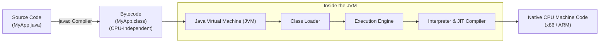

1. **Compilation Phase (`javac`):** The Java Compiler (`javac`) checks your code for syntax and strict type correctness. If successful, it emits binary **bytecode** files with a `.class` extension. Bytecode is not machine code for your Intel, AMD, or Apple Silicon CPU; it is machine code for an idealized software computer: the **Java Virtual Machine (JVM)**.
2. **Execution Phase (`java`):** When you run `java MyApp`, the JVM starts up:
   - **Class Loader:** Reads the `.class` files into memory.
   - **Bytecode Verifier:** Validates that the bytecode adheres to memory-safety constraints (no buffer overflows, illegal pointer operations).
   - **Interpreter:** Begins executing bytecode instruction-by-instruction immediately for fast startup.
   - **JIT (Just-In-Time) Compiler:** Monitors "hot spots" (frequently executed loops and methods). Once identified, it compiles those hot bytecode blocks directly into high-speed native CPU machine instructions, caching them so they run as fast as compiled C/C++.

> [!NOTE]
> **The "Write Once, Run Anywhere" (WORA) Promise:**
> Because bytecode targets the JVM rather than physical hardware, you can compile a `.java` file on a Mac, send the `.class` file to an Ubuntu server or Windows machine, and it runs identically as long as a JVM is installed.

### 1.2 Anatomy of a Java Program

In Java, **everything belongs inside a class**. Unlike JavaScript, you cannot write loose statements or top-level functions outside of a class structure.

```java
// File: HelloWorld.java
public class HelloWorld {

    // The universal application entry point
    public static void main(String[] args) {
        System.out.println("Hello, World!");
    }
}
```

Let's dissect every single keyword in `public static void main(String[] args)`:
- `public`: An access modifier meaning this method can be called by code outside its package—specifically by the external JVM runtime.
- `static`: Means the method belongs directly to the `HelloWorld` class blueprint itself, not to any individual instance object. The JVM can call `HelloWorld.main()` without needing to construct an instance (`new HelloWorld()`) first.
- `void`: The return type. The `main` method performs work but returns no data back to the JVM caller.
- `main`: The exact name that the JVM searches for to begin execution.
- `String[] args`: An array of Strings representing command-line arguments passed when launching the program (e.g. `java HelloWorld foo bar` passes `["foo", "bar"]`).

### 1.3 Strict Rules: File Naming & Semicolons

1. **Class-to-File Name Matching:** If your file contains a `public class Foo`, the physical file on your hard drive **must** be named `Foo.java` (exact matching case). A `.java` file can have only **one** `public` class.
2. **Mandatory Semicolons:** In JavaScript, Automatic Semicolon Insertion (ASI) forgives missing semicolons. In Java, semicolons (`;`) are **strictly mandatory**. If you omit even one semicolon, compilation fails immediately.

### 1.4 Console Output & Comments

Java interacts with the system console through the `java.lang.System` class:

```java
// Prints text and automatically moves to a new line (equivalent to console.log)
System.out.println("Hello with newline");

// Prints text but keeps the cursor on the same line
System.out.print("Part 1 - ");
System.out.print("Part 2\n");

// Formatted printing (similar to C's printf or template strings)
String name = "Alex";
int rank = 1;
System.out.printf("User %s achieved rank #%d%n", name, rank);
```

#### Format Specifiers Explained (`System.out.printf`)
- `%s`: Replaces with a `String`.
- `%d`: Replaces with an integer (`int`, `long`, `byte`, `short`).
- `%.2f`: Replaces with a floating-point number (`double`, `float`) rounded to 2 decimal places.
- `%-25s`: Left-aligns text within a 25-character wide field (ideal for table columns).
- `%5d`: Right-aligns an integer within a 5-character wide field.
- `%n`: A **platform-independent newline** (handles Windows `\r\n` vs Unix `\n` automatically).

#### Standard Java Project Structure
Java projects follow a universally standard directory layout:
```text
my-project/
├── pom.xml                     <-- Maven dependencies and build configuration
└── src/
    ├── main/
    │   ├── java/               <-- Production Java source code (.java files)
    │   └── resources/          <-- Application config, static assets, SQL files
    └── test/
        └── java/               <-- Automated tests (JUnit)
```
```java
```

**Types of Comments:**
```java
// 1. Single-line comment

/*
   2. Multi-line comment
*/

/**
 * 3. Javadoc comment: The compiler extracts these comments to generate
 * standard HTML API documentation (like official Oracle docs).
 * @param query The search keyword.
 * @return The number of results found.
 */
public int search(String query) {
    return 0;
}
```

### 1.5 Console Input with `java.util.Scanner`

While `System.out.println` prints to the terminal, reading user input from the console uses **`java.util.Scanner`** wrapping `System.in`:

```java
import java.util.Scanner;

public class ConsoleInputDemo {
    public static void main(String[] args) {
        // Create scanner connected to standard input stream
        Scanner scanner = new Scanner(System.in);

        System.out.print("Enter your name: ");
        String name = scanner.nextLine(); // Reads full line of text

        System.out.print("Enter your age: ");
        int age = scanner.nextInt();       // Reads an integer

        System.out.printf("Hello %s, next year you will be %d!%n", name, age + 1);

        scanner.close(); // Clean up resource
    }
}
```

> [!WARNING]
> **⚠️ The Scanner `nextInt()` Newline Trap:**
> When a user types `25` and presses Enter, the input stream receives `25\n`.
> - `scanner.nextInt()` consumes `25` but leaves the newline `\n` sitting in the buffer!
> - If you subsequently call `scanner.nextLine()`, it immediately consumes that leftover `\n` and returns an empty string without waiting for user input!
> - **The Fix:** Always consume the leftover newline by calling an extra `scanner.nextLine()` right after `nextInt()`, `nextDouble()`, or `next()`.


---

### Module 1 Practice Challenges

#### Challenge 1.1: Command-Line Argument Greeter
**Problem:** Write a program that reads the first command-line argument passed to it. If an argument is provided, print `"Hello, <name>! Welcome to Java."`. If no arguments are provided, print `"Hello, Guest! Welcome to Java."`.

**Thought Process & Strategy (Step-by-Step):**
1. **Identify the Input Source:** Command-line words typed after `java ProgramName` are passed into the `String[] args` array.
2. **Handle Empty Input Safely:** If the user runs `java Greeter` with zero inputs, accessing `args[0]` throws an `ArrayIndexOutOfBoundsException`! We must check `args.length > 0` first.
3. **Branch Decision:** If `args.length > 0`, extract `args[0]`; otherwise use fallback `"Guest"`.

```java
public class Greeter {
    public static void main(String[] args) {
        // args is never null, but its length may be 0 if no arguments are passed
        if (args.length > 0) {
            // Access the first command-line argument at index 0
            String userName = args[0];
            System.out.println("Hello, " + userName + "! Welcome to Java.");
        } else {
            // Default fallback when the user runs just: java Greeter
            System.out.println("Hello, Guest! Welcome to Java.");
        }
    }
}
// Time Complexity: O(1)
// Space Complexity: O(1)
```

#### Challenge 1.2: Formatted Invoice Summary
**Problem:** Write a program that prints a formatted invoice receipt for 3 items with fixed names, quantities, and unit prices, formatted neatly into columns using `System.out.printf`.

**Thought Process & Strategy (Step-by-Step):**
1. **Define Fixed Column Widths:** To ensure columns align regardless of item name length, allocate 25 characters for item name, 5 characters for quantity, and 10 characters for price.
2. **Choose Alignment:** Use left-alignment (`%-25s`) for text and right-alignment (`%5d`, `%10.2f`) for numbers and currency.
3. **Calculate and Print:** Compute subtotal $\sum (qty \times price)$ and print the totals divider.

```java
public class InvoicePrinter {
    public static void main(String[] args) {
        String item1 = "Mechanical Keyboard";
        int qty1 = 1;
        double price1 = 120.50;

        String item2 = "USB-C Cable";
        int qty2 = 2;
        double price2 = 15.25;

        // Print header with column widths: %-25s = left-aligned 25 chars, %5s = right-aligned 5 chars
        System.out.printf("%-25s %5s %10s%n", "Item", "Qty", "Price");
        System.out.println("---------------------------------------------");

        // Print each item row: %-25s for string, %5d for int, %10.2f for currency float
        System.out.printf("%-25s %5d %10.2f%n", item1, qty1, price1);
        System.out.printf("%-25s %5d %10.2f%n", item2, qty2, price2);

        double total = (qty1 * price1) + (qty2 * price2);
        System.out.println("---------------------------------------------");
        System.out.printf("%-31s %10.2f%n", "Total Due:", total);
    }
}
// Time Complexity: O(1)
// Space Complexity: O(1)
```


---

## Module 2: Variables, Types & The Memory Model

### 2.1 Static Typing vs. Dynamic Typing

In JavaScript, types belong to the *values*, not the variables:
```javascript
let data = 42;       // data holds a number
data = "now a string"; // completely valid in JS
```
In Java, types belong to the **variable container itself**. Once declared, a variable's type is immutable:
```java
int count = 42;
// count = "hello"; // COMPILE ERROR: incompatible types: String cannot be converted to int
```

### 2.2 The 8 Primitive Types

Java separates all data into two categories: **Primitives** and **Objects**.
Primitives represent raw, foundational numbers, characters, and booleans. They store their value directly in binary format without object overhead:

| Primitive | Size in Memory | Range / Value | Suffix / Notes |
|---|---|---|---|
| `byte` | 8 bits (1 byte) | -128 to 127 | For raw binary streams / networking |
| `short` | 16 bits (2 bytes) | -32,768 to 32,767 | Rarely used |
| `int` | 32 bits (4 bytes) | -2,147,483,648 to 2,147,483,647 (~2.14B) | Default for integer arithmetic |
| `long` | 64 bits (8 bytes) | -9 quintillion to +9 quintillion | Must append `L`: `10000000000L` |
| `float` | 32 bits (4 bytes) | ~7 decimal digits of precision | Must append `f`: `3.1415f` |
| `double` | 64 bits (8 bytes) | ~15-17 decimal digits of precision | Default for floating-point numbers |
| `boolean` | 1 bit (virtual) | `true` or `false` only | Strict: No truthy/falsy conversions |
| `char` | 16 bits (2 bytes) | Single UTF-16 character (`'a'`, `'Z'`, `'\u0041'`) | Must use **single quotes** |

> [!WARNING]
> **⚠️ Suffix Gotchas for Beginners:**
> 1. **Floating-point default:** Java treats decimal numbers as `double` by default. Writing `float price = 19.99;` causes a compile error. You must explicitly write `19.99f`.
> 2. **Integer literal default:** Java treats all whole numbers as `int`. A number larger than 2.14 billion requires an `L` suffix: `long population = 8000000000L;`.
> 3. **Integer division trap:** `int result = 5 / 2;` evaluates to `2`, NOT `2.5`. Java truncates the remainder in integer division. To get a decimal, cast or write a floating-point literal: `double result = 5.0 / 2;` (`2.5`).

### 2.3 Type Inference with `var` (Java 10+)

For local variables where the initializer makes the type obvious, Java allows the `var` keyword:

```java
var score = 100;                 // Compiler infers 'int'
var greeting = "Hello";          // Compiler infers 'String'
var list = new ArrayList<String>(); // Cleaner than repeating ArrayList<String>
```

> [!NOTE]
> `var` in Java is **NOT** dynamic typing like JavaScript's `let` or `var`. It is compile-time syntactic sugar. Once inferred, the type is permanently locked. `var` cannot be used for method parameters or class fields.


### 2.4 Type Casting: Widening vs. Narrowing

Converting data between compatible types is called **type casting**:

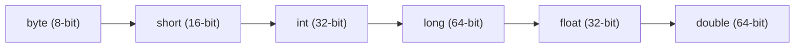

1. **Widening Casting (Automatic / Implicit):**
   Converting a smaller type to a larger type size. No precision is lost, so Java does this automatically:
   ```java
   int small = 42;
   double large = small; // Automatic widening: 42.0
   ```
2. **Narrowing Casting (Manual / Explicit):**
   Converting a larger type to a smaller type size. Decimal truncation or numeric overflow can occur, so the compiler requires an explicit cast with `(TargetType)`:
   ```java
   double pi = 3.14159;
   int truncated = (int) pi; // Explicit narrowing: 3 (decimals dropped!)
   ```

### 2.5 Variable Initialization Rules: Local vs. Instance Variables

> [!IMPORTANT]
> **Initialization Rules Depend on Scope:**
> - **Instance Fields (Inside a class):** The JVM automatically initializes them to defaults (`0` for numbers, `false` for booleans, `null` for objects).
> - **Local Variables (Inside a method):** The JVM **never** initializes local variables. Reading an uninitialized local variable causes a compile-time error: `variable might not have been initialized`.

### 2.6 Operators Breakdown

- **Arithmetic:** `+`, `-`, `*`, `/`, `%` (modulo).
- **Unary:** `++` (increment), `--` (decrement).
  - Prefix (`++i`): increments *before* expression evaluation.
  - Postfix (`i++`): evaluates first, then increments.
- **Relational:** `==`, `!=`, `<`, `>`, `<=`, `>=`.
- **Logical:** `&&` (short-circuit AND), `||` (short-circuit OR), `!` (NOT).
  - *Short-circuit:* In `false && someMethod()`, `someMethod()` is never executed.
- **Bitwise:** `&` (AND), `|` (OR), `^` (XOR), `~` (NOT), `<<` (left shift), `>>` (signed right shift), `>>>` (unsigned right shift).
- **Ternary:** `condition ? valueIfTrue : valueIfFalse`.

### 2.7 Stack vs. Heap Memory: The Core Mental Model

The relationship between variables and memory is the cornerstone of Java:

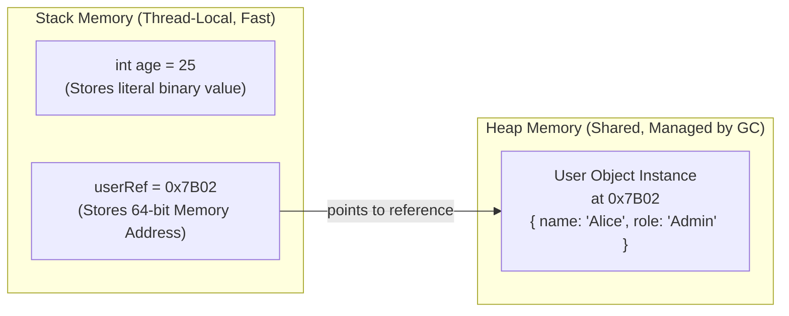

- **Stack Memory:**
  - Fast, thread-safe memory.
  - Holds local primitive variables and method call stack frames.
  - When a method finishes, its entire stack frame is instantly popped and cleared.
- **Heap Memory:**
  - Shared memory pool where **all Objects** reside.
  - Variables on the stack do not hold the object itself; they hold a **reference pointer** (memory address) pointing to the heap object.
  - Objects remain on the heap until the **Garbage Collector (GC)** determines that no active references point to them.

### 2.8 Garbage Collection & GC Roots (How Memory Is Freed)

In C/C++, developers must manually manage and free memory (`malloc` / `free`). In JavaScript and Python, memory is collected automatically. Java also manages memory automatically via the **Garbage Collector (GC)**.

Unlike naive runtimes that use simple reference counting (which fails on circular references), Java uses **Tracing Reachability from GC Roots**:

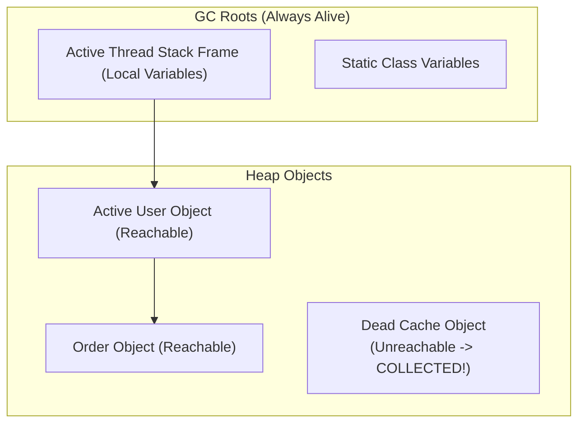

- **What is a GC Root?** An anchor point known to be alive:
  1. Local variables currently on any thread's execution stack frame.
  2. `static` fields of loaded classes.
  3. Active thread instances.
- **The Reachability Algorithm:** The GC traverses the object graph starting at all GC Roots. Any object that cannot be reached through a chain of references from a GC Root is marked as **garbage** and its memory is reclaimed during the next GC cycle.

> [!WARNING]
> **⚠️ Java Memory Leaks Still Happen:**
> If you append objects to a `public static List<User> cache` and never remove them, the static field acts as a permanent GC Root. Those objects will **never** be garbage collected, eventually crashing your application with an `OutOfMemoryError: Java heap space`!


### 2.9 Wrapper Classes & Autoboxing

Each primitive has an object wrapper in `java.lang`:
`int` $\leftrightarrow$ `Integer`, `double` $\leftrightarrow$ `Double`, `boolean` $\leftrightarrow$ `Boolean`, `char` $\leftrightarrow$ `Character`, `long` $\leftrightarrow$ `Long`, `byte` $\leftrightarrow$ `Byte`, `short` $\leftrightarrow$ `Short`, `float` $\leftrightarrow$ `Float`.

Java automatically boxes and unboxes between primitives and wrappers:
```java
Integer boxed = 42; // Autoboxing: compiler converts to Integer.valueOf(42)
int primitive = boxed; // Unboxing: compiler calls boxed.intValue()
```

> [!WARNING]
> **⚠️ The Integer Cache Bug (-128 to 127):**
> Java caches `Integer` object instances for values between `-128` and `127` to optimize memory.
> ```java
> Integer a = 100;
> Integer b = 100;
> System.out.println(a == b); // TRUE: Both point to the same cached object!
>
> Integer x = 200;
> Integer y = 200;
> System.out.println(x == y); // FALSE: Distinct heap objects!
> System.out.println(x.equals(y)); // TRUE: Checks actual value
> ```
> **Never compare objects (including wrapper classes) with `==`. Always use `.equals()`.**

### 2.10 Pass-by-Value Mechanics (The Reference Pointer)

> [!IMPORTANT]
> **Java is 100% Pass-By-Value.**
> When you pass an argument to a method, Java **always copies the value**.
> - For primitives, Java copies the raw literal number.
> - For objects, Java copies the **reference pointer address**, NOT the object itself.

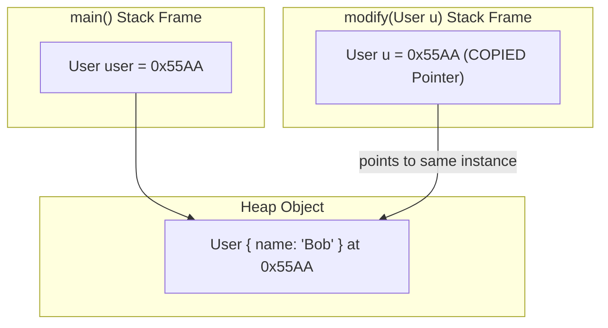

```java
public class PassByValueDemo {
    public static void modifyPrimitive(int x) {
        x = 999; // Only modifies local stack copy; caller's value is unchanged
    }

    public static void modifyObjectState(User u) {
        u.name = "Alice"; // Mutates the shared object at address 0x55AA on the Heap!
    }

    public static void reassignObject(User u) {
        u = new User("Charlie"); // Overwrites local pointer 'u'; caller still points to 0x55AA!
    }
}
```

---

### Module 2 Practice Challenges

#### Challenge 2.1: Temperature Precision Converter
**Problem:** Write a function `double fahrenheitToCelsius(double fahrenheit)` that accurately converts temperature without precision loss. Formula: $C = (F - 32) 	imes rac{5}{9}$.

```java
public class TemperatureConverter {
    public static double fahrenheitToCelsius(double fahrenheit) {
        // Notice we write 5.0 / 9.0 instead of 5 / 9 to prevent integer truncation to 0!
        return (fahrenheit - 32.0) * (5.0 / 9.0);
    }

    public static void main(String[] args) {
        double f = 98.6;
        double c = fahrenheitToCelsius(f);
        System.out.printf("%.1f F is %.2f C%n", f, c); // Output: 98.6 F is 37.00 C
    }
}
// Time Complexity: O(1)
// Space Complexity: O(1)
```

#### Challenge 2.2 (LeetCode Warmup): Bitwise In-Place Variable Swap
**Problem:** Given two integer variables `a` and `b`, swap their values without using any third temporary variable using bitwise XOR (`^`).

**Thought Process & Strategy (Step-by-Step):**
1. **Leverage XOR Properties:**
   - $x \oplus x = 0$ (A number XORed with itself cancels out to 0).
   - $x \oplus 0 = x$ (A number XORed with 0 stays unchanged).
   - Commutative: Order of operations does not matter.
2. **Step 1:** Set `a = a ^ b`. Now `a` holds the combined bitmask.
3. **Step 2:** Set `b = a ^ b`. Substituting `a` gives `(a ^ b) ^ b = a ^ 0 = a`. Now `b` holds original `a`.
4. **Step 3:** Set `a = a ^ b`. Substituting gives `(a ^ b) ^ a = b ^ 0 = b`. Now `a` holds original `b`.

```java
public class BitwiseSwap {
    public static void main(String[] args) {
        int a = 15; // Binary: 00001111
        int b = 27; // Binary: 00011011

        System.out.println("Before swap: a = " + a + ", b = " + b);

        // Step 1: a becomes the combined bitmask of both numbers
        a = a ^ b;
        // Step 2: XORing the mask with b cancels out b, leaving original a in b!
        b = a ^ b;
        // Step 3: XORing the mask with new b (original a) leaves original b in a!
        a = a ^ b;

        System.out.println("After swap:  a = " + a + ", b = " + b);
    }
}
// Time Complexity: O(1)
// Space Complexity: O(1)
```


---

## Module 3: Strings & Text Manipulation

### 3.1 `String` is an Immutable Object

In JavaScript, strings are primitive values with wrapper methods.
In Java, `String` is a reference class (`java.lang.String`). Strings are strictly **immutable**. Once a `String` instance is allocated on the heap, its character array cannot be modified.

```java
String str = "Hello";
str.concat(", World!"); // Returns a NEW String object; does not mutate 'str'
System.out.println(str); // Still prints "Hello"

str = str.concat(", World!"); // Reassigns 'str' variable to point to the new object
```

### 3.2 The String Constant Pool & Equality

Because strings are ubiquitous, Java allocates string literals in a dedicated heap zone called the **String Constant Pool (Internment Pool)**:

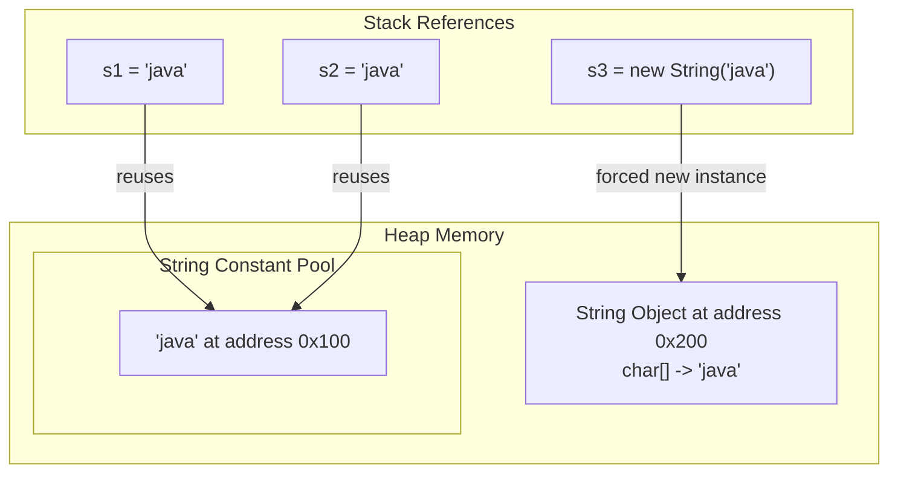

> [!WARNING]
> **⚠️ The String `==` Trap:**
> - `s1 == s2` is `true` because both literal declarations share the exact same interned memory address `0x100`.
> - `s1 == s3` is **`false`** because `new String()` forces a brand new object on the heap at `0x200`.
> - `s1.equals(s3)` is **`true`** because `.equals()` compares character contents.
> **Always use `.equals()` or `.equalsIgnoreCase()` for string comparisons.**

### 3.3 Essential LeetCode String Methods

Mastering these methods is critical for solving coding interview questions in Java:

```java
String s = "LeetCode Java";

// 1. Character at index (0-indexed)
char c = s.charAt(0); // 'L'

// 2. Length of the string (Method call with parentheses, unlike array .length!)
int len = s.length(); // 13

// 3. Convert to char array (crucial for in-place two-pointer problems!)
char[] chars = s.toCharArray();

// 4. Substring extraction: substring(startIndex, endIndexExclusive)
String sub = s.substring(0, 4); // "Leet"

// 5. Index search
int idx = s.indexOf("Code"); // 4 (-1 if not found)

// 6. Trimming & Case conversion
String trimmed = "  abc  ".trim(); // "abc"
String lower = s.toLowerCase();

// 7. Converting numbers/chars to String
String strVal = String.valueOf(123); // "123"
```


### 3.4 Common String Utility Methods

```java
String text = "Java,Python,JavaScript";

// 1. Splitting by delimiter (returns a String array)
String[] parts = text.split(","); // ["Java", "Python", "JavaScript"]

// 2. Joining elements with a delimiter (Java 8+)
String joined = String.join(" | ", parts); // "Java | Python | JavaScript"

// 3. Substring existence checks
boolean hasJava = text.contains("Java");      // true
boolean starts = text.startsWith("Java");     // true
boolean ends = text.endsWith("Script");       // true

// 4. Replacing characters or substrings (returns a new String)
String replaced = text.replace("Python", "Go"); // "Java,Go,JavaScript"
```

> [!NOTE]
> **Regex Warning with `.split()`:**
> `split()` takes a regular expression. To split on a period `.` or pipe `|` (special regex characters), escape them with double backslashes: `text.split("\\.")`.

### 3.5 High-Performance Text Assembly: `StringBuilder`

Because Strings are immutable, concatenating strings in a loop with `+` has an $O(n^2)$ time complexity due to creating a new copy at every step:

```java
// SLOW (Anti-pattern): Allocates 10,000 temporary String objects on Heap
String s = "";
for (int i = 0; i < 10000; i++) {
    s += i;
}

// FAST (Best Practice): O(n) time, single dynamically resizing mutable buffer
StringBuilder sb = new StringBuilder();
for (int i = 0; i < 10000; i++) {
    sb.append(i);
}
String result = sb.toString();
```

**Common `StringBuilder` Operations:**
- `sb.append("text")`: Appends to the end.
- `sb.insert(0, "prefix")`: Inserts at index.
- `sb.deleteCharAt(i)`: Deletes char at index.
- `sb.reverse()`: Reverses the sequence in-place (LeetCode favorite).
- `sb.setCharAt(i, 'c')`: Modifies char at index.

### 3.6 Modern Text Blocks (Java 15+)

Similar to JavaScript template literals (backticks `` ` ``), Java 15 provides **Text Blocks** using triple double quotes:

```java
String json = """
    {
        "name": "Alex",
        "role": "Engineer",
        "active": true
    }
    """;
```
The compiler detects the indentation of the closing delimiter and automatically strips incidental leading whitespace.

---

### Module 3 Practice Challenges

#### Challenge 3.1 (LeetCode 125): Valid Palindrome
**Problem:** A phrase is a palindrome if, after converting all uppercase letters into lowercase letters and removing all non-alphanumeric characters, it reads the same forward and backward. Implement `isPalindrome(String s)`.

**Thought Process & Strategy (Step-by-Step):**
1. **Optimize Space:** Avoid regex copying (`s.replaceAll(...)`) which allocates $O(n)$ extra memory. Use an in-place two-pointer approach ($O(1)$ space).
2. **Two Pointers:** Place `left = 0` at the start and `right = s.length() - 1` at the end.
3. **Skip Irrelevant Characters:** Advance `left` forward until it points to a letter or digit (via `Character.isLetterOrDigit()`). Decrement `right` backward similarly.
4. **Compare Characters:** Convert both to lowercase (`Character.toLowerCase()`). If they mismatch, return `false`. If they match, advance both pointers inward until they meet.

```java
public class ValidPalindrome {
    public static boolean isPalindrome(String s) {
        // Two-pointer approach: one starting from head, one from tail
        int left = 0;
        int right = s.length() - 1;

        while (left < right) {
            // Skip non-alphanumeric characters on the left
            while (left < right && !Character.isLetterOrDigit(s.charAt(left))) {
                left++;
            }
            // Skip non-alphanumeric characters on the right
            while (left < right && !Character.isLetterOrDigit(s.charAt(right))) {
                right--;
            }

            // Compare lowercased characters
            char leftChar = Character.toLowerCase(s.charAt(left));
            char rightChar = Character.toLowerCase(s.charAt(right));

            if (leftChar != rightChar) {
                return false; // Mismatch found
            }

            left++;
            right--;
        }

        return true; // All characters matched
    }

    public static void main(String[] args) {
        String test = "A man, a plan, a canal: Panama";
        System.out.println("Is palindrome: " + isPalindrome(test)); // true
    }
}
// Time Complexity: O(n) - Single pass over string of length n
// Space Complexity: O(1) - Constant auxiliary space
```

#### Challenge 3.2 (LeetCode 242): Valid Anagram
**Problem:** Given two strings `s` and `t`, return `true` if `t` is an anagram of `s` (contains the exact same characters in any order), and `false` otherwise. Assume strings contain only lowercase English letters.

**Thought Process & Strategy (Step-by-Step):**
1. **Initial Guard Check:** If `s.length() != t.length()`, they cannot be anagrams. Return `false` immediately.
2. **Choose the Frequency Array:** Since characters are restricted to lowercase English letters (`a` to `z`), an `int[26]` array is faster and uses less memory than a `HashMap`.
3. **Increment and Decrement:** In a single pass, increment counts for characters in `s` and decrement counts for characters in `t`.
4. **Verify Zero Counts:** If `t` is a valid anagram, every index in `counts` must be `0`.

```java
public class ValidAnagram {
    public static boolean isAnagram(String s, String t) {
        // Anagrams must have identical length
        if (s.length() != t.length()) {
            return false;
        }

        // Fixed-size frequency bucket for 26 lowercase English letters ('a' through 'z')
        int[] counts = new int[26];

        // Increment for characters in s, decrement for characters in t
        for (int i = 0; i < s.length(); i++) {
            counts[s.charAt(i) - 'a']++;
            counts[t.charAt(i) - 'a']--;
        }

        // If all character frequencies canceled out to 0, it is a valid anagram
        for (int count : counts) {
            if (count != 0) {
                return false;
            }
        }

        return true;
    }

    public static void main(String[] args) {
        System.out.println(isAnagram("anagram", "nagaram")); // true
        System.out.println(isAnagram("rat", "car"));         // false
    }
}
// Time Complexity: O(n) - Linear pass through strings
// Space Complexity: O(1) - Array of size 26 is constant space
```


---

## Module 4: Control Flow & Logic

### 4.1 Conditionals (`if`, `else if`, `else`)

In Java, conditional expressions **must strictly evaluate to a `boolean`**. There are no implicit truthy/falsy coercions (unlike JavaScript where `0`, `""`, `null`, `undefined`, and `NaN` are falsy):

```java
int count = 5;
// if (count) { ... } // COMPILE ERROR: Type mismatch: cannot convert from int to boolean

if (count > 0) {
    System.out.println("Count is positive");
} else if (count < 0) {
    System.out.println("Count is negative");
} else {
    System.out.println("Count is zero");
}
```

### 4.2 Switch Statements & Modern Switch Expressions

#### Traditional Switch (Java 7 and earlier)
Traditional switch statements require explicit `break` statements to prevent fall-through bugs:
```java
int code = 2;
switch (code) {
    case 1:
        System.out.println("Started");
        break;
    case 2:
        System.out.println("In Progress");
        break;
    default:
        System.out.println("Unknown");
        break;
}
```

#### Modern Switch Expression (Java 14+)
Modern switch expressions use arrows (`->`), prevent fall-through automatically, and can return values directly:
```java
int code = 2;
String status = switch (code) {
    case 1 -> "Started";
    case 2 -> "In Progress";
    case 3, 4 -> "Review or Completed"; // Multi-case match
    default -> "Unknown";
};
```

If a branch requires multiple lines of logic before returning a value, use the **`yield`** keyword:
```java
String result = switch (code) {
    case 1 -> {
        System.out.println("Logging initial event...");
        yield "Started";
    }
    default -> "Other";
};
```

#### Pattern Matching for Switch (Java 21+)
You can switch directly on object types and handle `null` safely without pre-checking:
```java
public static String describe(Object obj) {
    return switch (obj) {
        case Integer i -> "Integer with value " + i;
        case String s  -> "String of length " + s.length();
        case null      -> "Null pointer passed!";
        default        -> "Unknown object: " + obj.toString();
    };
}
```

### 4.3 Loops

Java supports four standard loop constructs:

```java
// 1. Classic for-loop (ideal when tracking an index)
for (int i = 0; i < 5; i++) {
    System.out.print(i + " ");
}

// 2. While loop (runs while condition is true)
int target = 10;
while (target > 0) {
    target /= 2;
}

// 3. Do-While loop (guaranteed to execute at least once)
int attempts = 0;
do {
    attempts++;
} while (attempts < 1);

// 4. Enhanced for-each loop (equivalent to JS 'for...of')
String[] languages = {"Java", "JavaScript", "Python"};
for (String lang : languages) {
    System.out.println(lang);
}
```

### 4.4 Loop Controls (`break`, `continue`, Labels)

- `break`: Immediately terminates the innermost loop.
- `continue`: Skips the remaining statements in the current iteration and evaluates the next loop condition.
- **Labeled Loops:** In 2D grid/matrix algorithms (common in LeetCode), you frequently need to break out of both inner and outer loops simultaneously:

```java
searchMatrix:
for (int r = 0; r < matrix.length; r++) {
    for (int c = 0; c < matrix[r].length; c++) {
        if (matrix[r][c] == target) {
            System.out.println("Found at row " + r + ", col " + c);
            break searchMatrix; // Breaks BOTH loops instantly!
        }
    }
}
```

---

### Module 4 Practice Challenges

#### Challenge 4.1 (LeetCode 136): Single Number
**Problem:** Given a non-empty array of integers `nums`, every element appears twice except for one unique element. Find that single one in $O(n)$ time and $O(1)$ extra space.

**Thought Process & Strategy (Step-by-Step):**
1. **Recognize Duplicate Cancellation:** In an array where every duplicate appears twice, XORing all elements together cancels out all pairs ($x \oplus x = 0$).
2. **Retain the Unique Value:** Because $x \oplus 0 = x$, the single unique element remains in the accumulator.
3. **Iterate in Linear Time:** Loop through `nums` with an accumulator `result = 0` applying `result ^= num`.

```java
public class SingleNumber {
    public static int findSingleNumber(int[] nums) {
        int result = 0;

        // XOR property 1: x ^ x = 0 (identical numbers cancel each other out)
        // XOR property 2: x ^ 0 = x
        // XOR is commutative: order of operations does not matter!
        for (int num : nums) {
            result ^= num;
        }

        return result; // All duplicates cancel out, leaving only the unique number
    }

    public static void main(String[] args) {
        int[] nums = {4, 1, 2, 1, 2};
        System.out.println("Single number: " + findSingleNumber(nums)); // 4
    }
}
// Time Complexity: O(n) - Single pass through array
// Space Complexity: O(1) - Single variable storage
```

#### Challenge 4.2: Modern FizzBuzz Generator
**Problem:** Implement a method `fizzBuzz(int n)` that prints numbers from 1 to `n`. For multiples of 3, print `"Fizz"`; for multiples of 5, print `"Buzz"`; for multiples of both, print `"FizzBuzz"`; otherwise print the number. Use a modern switch expression.

**Thought Process & Strategy (Step-by-Step):**
1. **Identify Multiples:** Check divisibility with `i % 3` and `i % 5`.
2. **Switch Expression Branching:** Switch on `i % 3`. If `0`, check `i % 5 == 0` for `"FizzBuzz"`, otherwise `"Fizz"`. For default, check `i % 5 == 0` for `"Buzz"`, otherwise convert `i` to string.
3. **Print Sequentially:** Loop from 1 to `n`.

```java
public class FizzBuzzDemo {
    public static void fizzBuzz(int n) {
        for (int i = 1; i <= n; i++) {
            int mod3 = i % 3;
            int mod5 = i % 5;

            // Pattern matching / record simulation or structured evaluation
            String output = switch (mod3) {
                case 0 -> (mod5 == 0) ? "FizzBuzz" : "Fizz";
                default -> (mod5 == 0) ? "Buzz" : String.valueOf(i);
            };

            System.out.println(output);
        }
    }

    public static void main(String[] args) {
        fizzBuzz(15);
    }
}
// Time Complexity: O(n)
// Space Complexity: O(1)
```


---

## Module 5: Methods (Functions in Java)

### 5.1 Method Anatomy & Call Stack Mechanics

A method represents an encapsulated unit of behavior. When a method is called, the JVM pushes an **Activation Record (Stack Frame)** onto the thread's call stack:

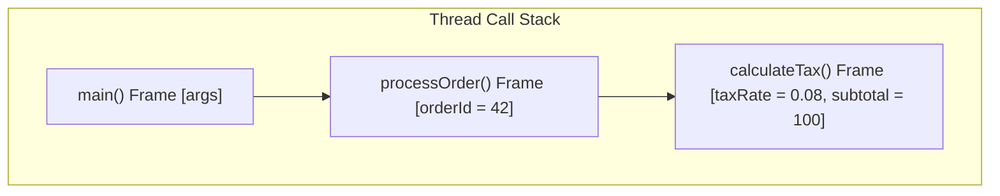

When `calculateTax()` returns, its stack frame is instantly destroyed, returning control and the return value to `processOrder()`.
- **StackOverflowError:** Occurs if a recursive method calls itself indefinitely without hitting a base case, exhausting stack memory.

### 5.2 Method Overloading

In JavaScript, you cannot define two functions with the same name (the second overwrites the first). You simulate different signatures by checking `arguments.length` or optional undefined parameters.

In Java, **Method Overloading** is a core compile-time feature. Multiple methods in the same class can share the exact same name, as long as their parameter lists differ in count or types:

```java
public class Calculator {
    // Overload 1: Two integers
    public int add(int a, int b) {
        return a + b;
    }

    // Overload 2: Three integers
    public int add(int a, int b, int c) {
        return a + b + c;
    }

    // Overload 3: Two doubles
    public double add(double a, double b) {
        return a + b;
    }
}
```

### 5.3 Varargs (Variable-Length Arguments)

Similar to JavaScript rest parameters (`...args`), Java provides **Varargs** (`Type... name`):

```java
public class MathUtils {
    // 'int... nums' is treated as 'int[] nums' inside the method body
    public static int sum(int... nums) {
        int total = 0;
        for (int n : nums) {
            total += n;
        }
        return total;
    }

    public static void main(String[] args) {
        sum(1, 2, 3);    // 6
        sum(10, 20);      // 30
        sum();            // 0 (nums is an empty array int[0])
    }
}
```

> [!IMPORTANT]
> **Varargs Rules:**
> 1. A method can have only **one** varargs parameter.
> 2. The varargs parameter **must be the last parameter** in the signature (`void log(String tag, int level, String... messages)`).


### 5.5 Early Returns in `void` Methods

In a `void` method, you do not return a value, but you can use **`return;`** to terminate method execution early as a guard clause:

```java
public void processTransaction(double amount) {
    if (amount <= 0) {
        System.err.println("Invalid amount. Aborting.");
        return; // Exits the method immediately
    }
    System.out.println("Processing payment of $" + amount);
}
```

### 5.4 Null Safety & `Optional<T>` (Java 8+)

In Java, returning `null` from a method forces the caller to write defensive `if (res != null)` guards everywhere. Forgetting to do so results in a runtime `NullPointerException` (NPE).

To make missing values explicit in method signatures, modern Java uses **`Optional<T>`**:

```java
import java.util.Optional;

public class UserRepository {
    public Optional<String> findEmailById(String userId) {
        if ("user123".equals(userId)) {
            return Optional.of("user@example.com"); // Value present
        }
        return Optional.empty(); // Explicit empty container
    }
}
```

**Consuming `Optional` Elegantly:**
```java
Optional<String> emailOpt = repo.findEmailById("user123");

// 1. Fallback default if absent:
String email = emailOpt.orElse("default@example.com");

// 2. Compute fallback lazily (only executed if absent):
String emailLazy = emailOpt.orElseGet(() -> fetchDefaultFromConfig());

// 3. Throw custom exception if absent:
String userEmail = emailOpt.orElseThrow(() -> new IllegalArgumentException("User not found"));

// 4. Functional transformation:
emailOpt.map(String::toUpperCase)
        .ifPresent(System.out::println);
```

---

### Module 5 Practice Challenges

#### Challenge 5.1 (LeetCode 704): Binary Search with Midpoint Overflow Protection
**Problem:** Given a sorted array of integers `nums` and a `target` value, write a method `search(int[] nums, int target)` that returns the index of target if found, or `-1` if not found, in $O(\log n)$ runtime.

**Thought Process & Strategy (Step-by-Step):**
1. **Precondition:** Input array is sorted in ascending order.
2. **Maintain Boundaries:** Use `left = 0` and `right = nums.length - 1`.
3. **Midpoint Overflow Protection:** In Java, writing `(left + right) / 2` causes integer overflow if `left + right > 2,147,483,647`. Writing `left + (right - left) / 2` avoids overflow.
4. **Halve Search Range:** Compare `nums[mid]` to target:
   - If equal: return `mid`.
   - If smaller: target is in right half (`left = mid + 1`).
   - If larger: target is in left half (`right = mid - 1`).
5. **Exit Condition:** If `left > right`, target is absent; return `-1`.

```java
public class BinarySearch {
    public static int search(int[] nums, int target) {
        int left = 0;
        int right = nums.length - 1;

        while (left <= right) {
            // CRITICAL: Writing (left + right) / 2 can OVERFLOW the 32-bit int limit if both are large!
            // Using left + (right - left) / 2 is mathematically identical and overflow-safe.
            int mid = left + (right - left) / 2;

            if (nums[mid] == target) {
                return mid; // Target located
            } else if (nums[mid] < target) {
                left = mid + 1; // Discard left half
            } else {
                right = mid - 1; // Discard right half
            }
        }

        return -1; // Target not present
    }

    public static void main(String[] args) {
        int[] sorted = {-1, 0, 3, 5, 9, 12};
        System.out.println("Index of 9: " + search(sorted, 9)); // 4
        System.out.println("Index of 2: " + search(sorted, 2)); // -1
    }
}
// Time Complexity: O(log n) - Search space halved at each iteration
// Space Complexity: O(1) - Constant auxiliary pointers
```

#### Challenge 5.2: Safe Configuration Lookup Pipeline
**Problem:** Implement a service that retrieves a user's role from a configuration map, strips surrounding whitespace, transforms it to uppercase, and returns a fallback `"GUEST"` if the role is missing or empty.

```java
import java.util.Map;
import java.util.Optional;

public class ConfigService {
    private final Map<String, String> userRoles = Map.of(
        "admin_user", "  administrator ",
        "editor_user", " editor "
    );

    public String resolveUserRole(String userId) {
        return Optional.ofNullable(userRoles.get(userId)) // Wraps potential null in Optional
            .map(String::trim)                            // Trim leading/trailing whitespace
            .filter(role -> !role.isEmpty())              // Discard if empty string
            .map(String::toUpperCase)                     // Convert to uppercase
            .orElse("GUEST");                             // Safe default fallback
    }

    public static void main(String[] args) {
        ConfigService svc = new ConfigService();
        System.out.println(svc.resolveUserRole("admin_user"));   // "ADMINISTRATOR"
        System.out.println(svc.resolveUserRole("unknown_user")); // "GUEST"
    }
}
// Time Complexity: O(1) map lookup
// Space Complexity: O(1)
```


---

## Module 6: Arrays & Core Data Structures

### 6.1 Fixed-Size Arrays & Memory Allocation

In JavaScript, arrays are flexible dynamic lists that can hold heterogeneous items (`[1, "two", true]`).
In Java, primitive arrays are **fixed in capacity** and **strictly homogeneous**:

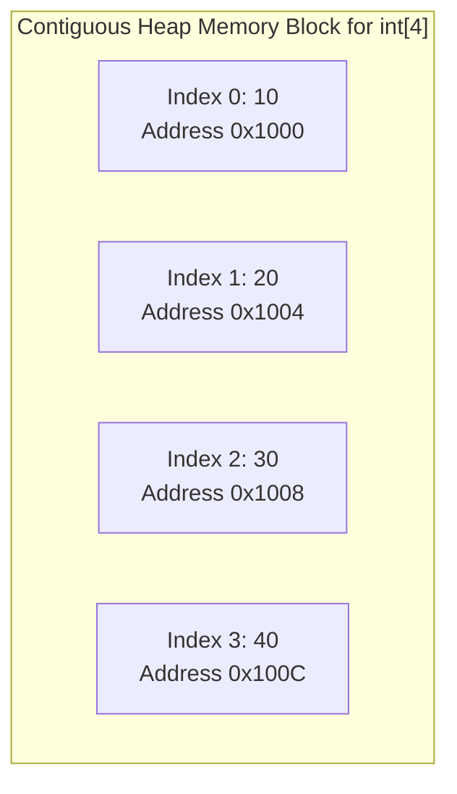

Because elements are stored in a **contiguous block of memory**, accessing any index is a constant-time $O(1)$ calculation:
$$\text{MemoryAddress}(i) = \text{BaseAddress} + (i \times \text{ElementSize})$$

```java
// Allocation: specifies size; elements initialize to type defaults (0 for int)
int[] scores = new int[4];
scores[0] = 10;
scores[1] = 20;

// Literal initialization:
String[] days = {"Mon", "Tue", "Wed", "Thu", "Fri"};
int totalDays = days.length; // Array length is a public final field, NOT a method!
```

### 6.2 2D Arrays & Matrices

Matrices are arrays of arrays. In LeetCode (grid traversal, dynamic programming), 2D arrays are fundamental:

```java
// 3 rows, 4 columns matrix
int[][] grid = new int[3][4];

int rowCount = grid.length;       // 3
int colCount = grid[0].length;    // 4

// Initializing with data:
int[][] matrix = {
    {1, 2, 3},
    {4, 5, 6},
    {7, 8, 9}
};
int cell = matrix[1][2]; // Row 1, Col 2 -> 6
```

### 6.3 Array Utilities (`java.util.Arrays`)

Directly printing an array (`System.out.println(matrix)`) prints its internal class hash (e.g. `[[I@28d93b30`). Always use the static helper methods in `java.util.Arrays`:

```java
import java.util.Arrays;

int[] arr = {5, 3, 8, 1, 2};

// 1. In-place sorting (Dual-Pivot Quicksort: O(n log n))
Arrays.sort(arr); // [1, 2, 3, 5, 8]

// 2. Readable string representation:
System.out.println(Arrays.toString(arr)); // "[1, 2, 3, 5, 8]"

// 3. Deep string representation for multidimensional arrays:
int[][] grid = {{1, 2}, {3, 4}};
System.out.println(Arrays.deepToString(grid)); // "[[1, 2], [3, 4]]"

// 4. Binary search (array MUST be sorted first!):
int index = Arrays.binarySearch(arr, 5); // 3

// 5. Fill array with a specific value:
Arrays.fill(arr, -1); // [-1, -1, -1, -1, -1]

// 6. Deep copy:
int[] copy = Arrays.copyOf(arr, arr.length);
```

### 6.4 Dynamic Arrays: `ArrayList<T>` vs. Primitive Arrays

When you need an array that grows and shrinks dynamically, use **`ArrayList<T>`**:

| Feature | Primitive Array (`int[]`) | `ArrayList<T>` |
|---|---|---|
| **Capacity** | Fixed at creation | Dynamically resizes automatically ($1.5\times$ growth) |
| **Primitives** | Stores raw primitives directly (`int`) | Requires Wrapper classes (`Integer`) |
| **Performance** | Maximum speed, zero object overhead | Slight overhead due to object wrappers |
| **Length** | `arr.length` (field) | `list.size()` (method) |
| **Element Access** | `arr[i]` | `list.get(i)` and `list.set(i, val)` |

```java
import java.util.ArrayList;
import java.util.List;

// Always code to the interface 'List':
List<String> fruits = new ArrayList<>();
fruits.add("Apple");
fruits.add("Banana");
fruits.add(0, "Mango"); // Insert at index 0 (shifts elements right: O(n))

fruits.remove(1); // Removes "Apple"
String item = fruits.get(0); // "Mango"
boolean exists = fruits.contains("Banana"); // true
```

### 6.5 Canonical LeetCode Data Structures: `ListNode` & `TreeNode`

On LeetCode, nearly every Linked List and Binary Tree question requires working with self-referential class definitions. In JavaScript, you can manipulate raw object literals `{ val: 1, next: null }`. In Java, you must understand their exact recursive class models:

#### 1. Singly-Linked List: `ListNode`
```java
public class ListNode {
    public int val;
    public ListNode next;

    public ListNode() {}
    public ListNode(int val) { this.val = val; }
    public ListNode(int val, ListNode next) { this.val = val; this.next = next; }
}
```

**The Sentinel / Dummy Head Pattern (LeetCode Essential):**
When building or modifying linked lists (e.g. LeetCode 21: Merge Two Sorted Lists), always initialize a **Dummy Head** to avoid edge-case checks for empty lists:
```java
ListNode dummy = new ListNode(0); // Placeholder start
ListNode current = dummy;
// current.next = new ListNode(value); current = current.next;
return dummy.next; // Returns the real head of the new list
```

#### 2. Binary Tree: `TreeNode`
```java
public class TreeNode {
    public int val;
    public TreeNode left;
    public TreeNode right;

    public TreeNode() {}
    public TreeNode(int val) { this.val = val; }
    public TreeNode(int val, TreeNode left, TreeNode right) {
        this.val = val;
        this.left = left;
        this.right = right;
    }
}
```

**Standard Level-Order Traversal (BFS) using a Queue:**
```java
import java.util.ArrayDeque;
import java.util.Queue;

public void levelOrder(TreeNode root) {
    if (root == null) return;

    Queue<TreeNode> queue = new ArrayDeque<>();
    queue.offer(root);

    while (!queue.isEmpty()) {
        int levelSize = queue.size();
        for (int i = 0; i < levelSize; i++) {
            TreeNode node = queue.poll();
            System.out.print(node.val + " ");

            if (node.left != null) queue.offer(node.left);
            if (node.right != null) queue.offer(node.right);
        }
        System.out.println(); // Next level
    }
}
```

---

### Module 6 Practice Challenges

#### Challenge 6.1 (LeetCode 1): Two Sum
**Problem:** Given an array of integers `nums` and an integer `target`, return indices of the two numbers such that they add up to `target`. Assume exactly one solution exists, and you cannot use the same element twice.

**Thought Process & Strategy (Step-by-Step):**
1. **Complement Formulation:** For any number $x$, we require $complement = target - x$.
2. **Hash Table Lookup:** Rather than checking all pairs in $O(n^2)$ time, store visited numbers in a `HashMap<Integer, Integer>` (mapping number $\rightarrow$ index).
3. **One-Pass Scan:** For each element at index `i`:
   - Check if `complement` is already in the map.
   - If found: return `[map.get(complement), i]` immediately.
   - If not found: record `map.put(nums[i], i)`.

```java
import java.util.HashMap;
import java.util.Map;

public class TwoSum {
    public static int[] twoSum(int[] nums, int target) {
        // Map to store: number -> index
        Map<Integer, Integer> complementMap = new HashMap<>();

        for (int i = 0; i < nums.length; i++) {
            int currentNum = nums[i];
            int complement = target - currentNum;

            // Check if complement was already seen in our forward pass
            if (complementMap.containsKey(complement)) {
                return new int[] { complementMap.get(complement), i };
            }

            // Record current number and its index
            complementMap.put(currentNum, i);
        }

        throw new IllegalArgumentException("No two sum solution found");
    }

    public static void main(String[] args) {
        int[] nums = {2, 7, 11, 15};
        int[] result = twoSum(nums, 9);
        System.out.println("Indices: [" + result[0] + ", " + result[1] + "]"); // [0, 1]
    }
}
// Time Complexity: O(n) - Single linear pass
// Space Complexity: O(n) - Stores up to n elements in HashMap
```

#### Challenge 6.2 (LeetCode 53): Maximum Subarray (Kadane's Algorithm)
**Problem:** Given an integer array `nums`, find the subarray with the largest sum, and return its sum.

**Thought Process & Strategy (Step-by-Step):**
1. **Dynamic Programming Decision:** At each element `nums[i]`, decide whether to:
   - Add `nums[i]` to the existing running subarray sum.
   - Or discard the previous negative sum and start a fresh subarray at `nums[i]`.
   - Formula: `currentSum = Math.max(nums[i], currentSum + nums[i])`.
2. **Maintain Global Max:** Update `maxSoFar = Math.max(maxSoFar, currentSum)` at each iteration.

```java
public class MaxSubarray {
    public static int maxSubArray(int[] nums) {
        int maxSoFar = nums[0];
        int currentRunningSum = nums[0];

        // Traverse starting from second element
        for (int i = 1; i < nums.length; i++) {
            // Decision: Start a fresh subarray at nums[i], or extend the existing subarray?
            currentRunningSum = Math.max(nums[i], currentRunningSum + nums[i]);

            // Update overall global maximum
            maxSoFar = Math.max(maxSoFar, currentRunningSum);
        }

        return maxSoFar;
    }

    public static void main(String[] args) {
        int[] nums = {-2, 1, -3, 4, -1, 2, 1, -5, 4};
        System.out.println("Max subarray sum: " + maxSubArray(nums)); // 6 (Subarray [4, -1, 2, 1])
    }
}
// Time Complexity: O(n) - One pass over array
// Space Complexity: O(1) - Two tracking integer variables
```


---

## Module 7: Object-Oriented Programming Foundations

### 7.1 Classes, Fields, Constructors & `this`

A **Class** is an architectural blueprint. An **Object** is a concrete instance allocated on the Heap.

```java

> [!NOTE]
> **The Default 0-Argument Constructor Rule:**
> If you write **no constructors** in your class, the Java compiler automatically inserts an invisible `public ClassName() {}` constructor.
> However, the moment you declare **any constructor with parameters**, Java **removes** that default constructor! If you still need a 0-arg constructor (e.g. for JSON serialization frameworks like Jackson), you must declare it explicitly.

public class BankAccount {
    // 1. State (Fields / Instance Variables)
    private String accountNumber;
    private double balance;

    // 2. Constructor: Executes when 'new BankAccount(...)' is called
    public BankAccount(String accountNumber, double initialDeposit) {
        // 'this' refers to the current object instance, disambiguating field from parameter
        this.accountNumber = accountNumber;
        this.balance = initialDeposit;
    }

    // 3. Overloaded Constructor (Constructor Chaining using this(...))
    public BankAccount(String accountNumber) {
        this(accountNumber, 0.0); // Calls the two-argument constructor above!
    }

    // 4. Methods (Behavior)
    public void deposit(double amount) {
        if (amount > 0) {
            this.balance += amount;
        }
    }

    public double getBalance() {
        return this.balance;
    }
}
```

### 7.2 Access Modifiers & Encapsulation

Encapsulation hides the internal state of an object and enforces invariants through method boundaries. Java provides four access levels:

| Modifier | Visibility Scope | Best Used For |
|---|---|---|
| **`private`** | Inside the class only | All instance fields, private helpers |
| *(default / package-private)* | Inside the same folder/package | Package-internal utilities |
| **`protected`** | Same package + Subclasses | Methods intended to be customized by children |
| **`public`** | Everywhere across the application | API contracts, DTOs, public services |

### 7.3 `static` Context vs. Instance Context

- **`static` members:** Belong to the **Class Blueprint** itself. Stored in Metaspace. Shared across all instances.
- **Instance members:** Belong to individual **Objects** on the Heap.

```java
public class Session {
    public static int activeSessionCount = 0; // Shared counter
    public String sessionId;                   // Unique per instance

    public Session(String id) {
        this.sessionId = id;
        activeSessionCount++; // Increments shared global counter
    }
}
```

> [!NOTE]
> **Why `static` methods cannot access `this` or instance fields:**
> Static methods run without any object instance. Since no instance exists, calling `this.sessionId` from a static method produces a compile error: *"non-static variable cannot be referenced from a static context"*.

### 7.4 Modern Data Carriers: Records (Java 16+)

In JavaScript, creating a data holder is as easy as `{ id: 1, name: "Alex" }`. In traditional Java, creating a simple Data Transfer Object (DTO) required writing:
- `private final` fields
- Constructor
- Getters for every field
- `equals()` and `hashCode()`
- `toString()`

Modern Java introduces **`record`**, eliminating this boilerplate:

```java
// One single line defines an immutable data carrier!
public record UserDto(String id, String name, String email) {}

// Usage:
UserDto user = new UserDto("101", "Alex", "alex@mail.com");
System.out.println(user.name());  // Accessor method (omits 'get' prefix)
System.out.println(user.email());
System.out.println(user);         // UserDto[id=101, name=Alex, email=alex@mail.com]
```
Records are automatically `final`, provide value-based `.equals()` and `.hashCode()`, and prevent field mutation.

### 7.5 The `equals()` and `hashCode()` Contract

Every class in Java inherits from `java.lang.Object`. By default:
- `equals()` checks if two references share the same memory address (`this == obj`).
- `hashCode()` returns an integer derived from the object's internal memory address.

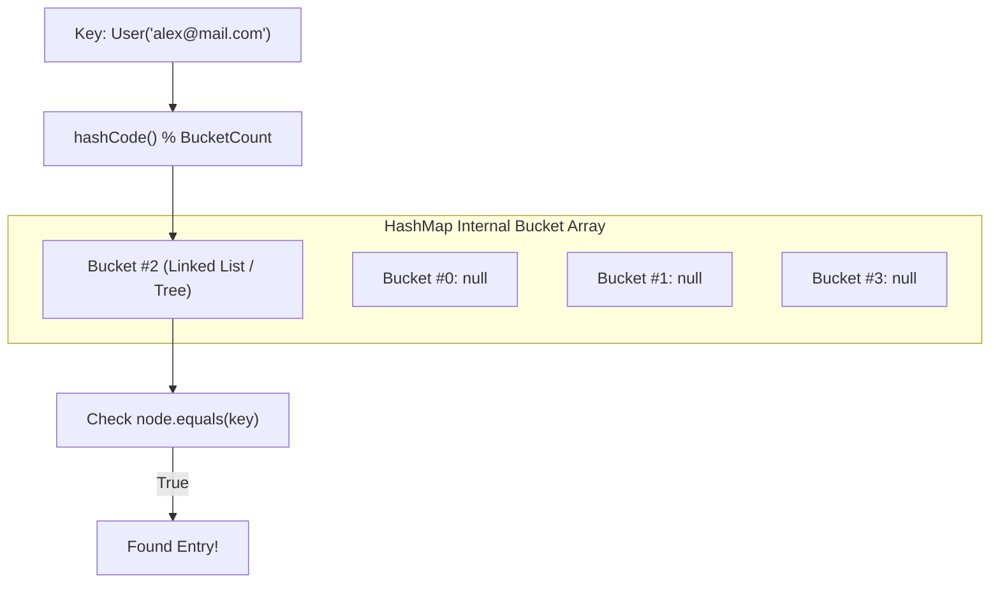

> [!WARNING]
> **⚠️ The Golden Hash Contract:**
> 1. **If `a.equals(b)` is `true`, then `a.hashCode() == b.hashCode()` MUST be true.**
> 2. If you override `equals()`, you **MUST always override `hashCode()`**.
> If you violate this contract, `HashSet` and `HashMap` will calculate different bucket indexes for two identical objects, causing `map.get(existingKey)` to return `null`!

**Idiomatic Implementation using `java.util.Objects`:**
```java
import java.util.Objects;

public class Employee {
    private String id;
    private String department;

    @Override
    public boolean equals(Object o) {
        // 1. Same memory reference check (fast path)
        if (this == o) return true;
        // 2. Null check & exact class comparison
        if (o == null || getClass() != o.getClass()) return false;
        // 3. Cast and compare significant fields
        Employee employee = (Employee) o;
        return Objects.equals(id, employee.id) &&
               Objects.equals(department, employee.department);
    }

    @Override
    public int hashCode() {
        // Generates hash from the exact same fields compared in equals()
        return Objects.hash(id, department);
    }
}
```


### 7.6 'final' Reference Immutability vs. Object State Mutability

One of the most common beginner misunderstandings in Java is assuming `final` makes an object immutable:

```java
// 'final' on a reference variable:
final List<String> shoppingList = new ArrayList<>();

// 1. MUTATION IS ALLOWED: The object on the Heap is NOT frozen!
shoppingList.add("Milk");
shoppingList.add("Eggs");
System.out.println(shoppingList); // [Milk, Eggs]

// 2. REASSIGNMENT IS FORBIDDEN: The reference pointer on the stack cannot change
// shoppingList = new ArrayList<>(); // COMPILE ERROR: cannot assign a value to final variable
```

> [!NOTE]
> **Reference vs. State:**
> - `final` locks the **pointer variable on the Stack** (it can never point to a different heap address).
> - `final` does **not** freeze the internal state of the object residing on the Heap.

### 7.7 The `toString()` Contract & Object Identity

Whenever you pass an object to `System.out.println(myObject)` or concatenate it with a String (`"User: " + myObject`), Java automatically invokes its `.toString()` method.

By default, `java.lang.Object` implements `toString()` as:
`getClass().getName() + "@" + Integer.toHexString(hashCode())`

```java
public class User {
    private String name = "Alex";
}

User u = new User();
System.out.println(u); // Prints something like: User@1b6d3586 (Unhelpful!)
```

Always override `toString()` in your domain classes for clean debugging and logging:
```java
@Override
public String toString() {
    return "User{name='" + name + "'}";
}
// Now System.out.println(u) prints: User{name='Alex'}
```

### 7.8 Java Enums: Type-Safe Classes with Behavior

In TypeScript or C#, an `enum` is merely a numeric or string lookup table. In Java, **an `enum` is a specialized, full-fledged Class**:
- It can have fields, constructors, and methods.
- It can implement interfaces.
- The JVM guarantees that only one instance of each enum constant ever exists in memory (making them ideal for singletons and state machines).

```java
public enum OrderStatus {
    // Enum constants (each invokes the private constructor below)
    PENDING(100, "Order Placed"),
    PROCESSING(200, "In Warehouse"),
    SHIPPED(300, "On the Way"),
    DELIVERED(400, "Completed");

    private final int code;
    private final String description;

    // Enum constructors are strictly private
    OrderStatus(int code, String description) {
        this.code = code;
        this.description = description;
    }

    public int getCode() { return code; }
    public String getDescription() { return description; }

    public boolean isFinished() {
        return this == DELIVERED;
    }
}

// Usage in code and modern switch:
OrderStatus status = OrderStatus.SHIPPED;
System.out.println(status.getDescription()); // "On the Way"

String nextAction = switch (status) {
    case PENDING -> "Review payment";
    case PROCESSING, SHIPPED -> "Track delivery";
    case DELIVERED -> "Send feedback survey";
};
```

### 7.9 Nested, Inner & Anonymous Classes

Java allows defining a class inside another class:

#### 1. Static Nested Class (Independent helper)
Does not need an instance of the outer class. Commonly used for DTOs or the **Builder Pattern**:
```java
public class HttpRequest {
    private String url;

    public static class Builder { // Static Nested Class
        private String url;
        public Builder url(String url) { this.url = url; return this; }
        public HttpRequest build() { return new HttpRequest(); }
    }
}
// Instantiation:
HttpRequest.Builder b = new HttpRequest.Builder();
```

#### 2. Inner Class (Non-static: tightly coupled)
Has an implicit reference to the enclosing outer instance and can directly access outer private fields (`OuterClass.this.field`).

#### 3. Anonymous Class (On-the-fly implementation)
Instantiates an interface or abstract class inline without declaring a formal subclass:
```java
// Pre-lambda style (still common for multi-method interfaces):
Runnable r = new Runnable() {
    @Override
    public void run() {
        System.out.println("Running in anonymous class");
    }
};
```

---

### Module 7 Practice Challenges

#### Challenge 7.1: Immutable Value Object Pattern
**Problem:** Build an immutable `Money` value object representing a currency and amount. Enforce that:
1. Two `Money` instances with the same currency and amount are equal via `.equals()`.
2. Amounts cannot be negative.
3. Adding two `Money` instances returns a *new* `Money` instance and throws an exception if currencies do not match.

**Thought Process & Strategy (Step-by-Step):**
1. **Enforce Immutability:** Declare class `final` and all fields `private final`.
2. **Defensive Validation in Constructor:** Reject negative amounts with `IllegalArgumentException` and ensure `currency` is not null via `Objects.requireNonNull()`.
3. **Return New Instances on Mutation:** In `add()`, calculate sum and return `new Money(this.amount + other.amount, this.currency)`.
4. **Override `equals()` and `hashCode()`:** Compare amounts using `Double.compare()` and currencies using `.equals()`.

```java
import java.util.Objects;

public final class Money {
    private final double amount;
    private final String currency;

    public Money(double amount, String currency) {
        if (amount < 0) {
            throw new IllegalArgumentException("Amount cannot be negative: " + amount);
        }
        this.amount = amount;
        this.currency = Objects.requireNonNull(currency, "Currency cannot be null");
    }

    public Money add(Money other) {
        if (!this.currency.equals(other.currency)) {
            throw new IllegalArgumentException("Cannot add distinct currencies: " + this.currency + " vs " + other.currency);
        }
        return new Money(this.amount + other.amount, this.currency);
    }

    public double getAmount() { return amount; }
    public String getCurrency() { return currency; }

    @Override
    public boolean equals(Object o) {
        if (this == o) return true;
        if (o == null || getClass() != o.getClass()) return false;
        Money money = (Money) o;
        return Double.compare(money.amount, amount) == 0 &&
               currency.equals(money.currency);
    }

    @Override
    public int hashCode() {
        return Objects.hash(amount, currency);
    }

    @Override
    public String toString() {
        return String.format("%.2f %s", amount, currency);
    }

    public static void main(String[] args) {
        Money m1 = new Money(50.0, "USD");
        Money m2 = new Money(25.0, "USD");
        Money total = m1.add(m2);

        System.out.println("Total: " + total); // 75.00 USD
        System.out.println("Equality: " + m1.equals(new Money(50.0, "USD"))); // true
    }
}
// Time Complexity: O(1) for all operations
// Space Complexity: O(1)
```


---

## Module 8: Advanced OOP, Polymorphism & Design

### 8.1 Inheritance (`extends`, `super`, `@Override`)

Inheritance allows a subclass to inherit fields and methods from a parent superclass. Java supports **single inheritance** for classes (a class can only `extend` one superclass).

```java
public class Employee {
    protected String name;
    protected double baseSalary;

    public Employee(String name, double baseSalary) {
        this.name = name;
        this.baseSalary = baseSalary;
    }

    public double calculateCompensation() {
        return this.baseSalary;
    }
}

public class Manager extends Employee {
    private double bonus;

    public Manager(String name, double baseSalary, double bonus) {
        super(name, baseSalary); // Calls parent constructor (MUST be first line)
        this.bonus = bonus;
    }

    @Override // Compiler verifies this method actually overrides a parent method
    public double calculateCompensation() {
        return super.calculateCompensation() + this.bonus;
    }
}
```

### 8.2 Polymorphism & Dynamic Method Dispatch

Polymorphism allows a superclass reference to transparently point to any subclass object at runtime:

```java
Employee emp1 = new Employee("Alice", 70000);
Employee emp2 = new Manager("Bob", 90000, 20000); // Upcasting to Employee

// The JVM resolves the method at RUNTIME based on the actual Heap object (Dynamic Dispatch):
System.out.println(emp1.calculateCompensation()); // 70000.0 (Calls Employee method)
System.out.println(emp2.calculateCompensation()); // 110000.0 (Calls Manager method!)
```

**Pattern Matching for `instanceof` (Java 16+):**
```java
// Traditional Java:
if (emp2 instanceof Manager) {
    Manager m = (Manager) emp2; // Clumsy manual casting
    System.out.println("Manager bonus: " + m.calculateCompensation());
}

// Modern Java 16+:
if (emp2 instanceof Manager m) {
    // 'm' is automatically cast and in scope here!
    System.out.println("Manager bonus: " + m.calculateCompensation());
}
```

### 8.3 Abstract Classes vs. Interfaces

- **Abstract Class (`abstract`):** An incomplete class that cannot be instantiated directly. Represents an **"IS-A"** relationship with shared state and default implementations.
- **Interface (`interface`):** A contract defining what an object **"CAN-DO"**. A class can implement **multiple** interfaces.

| Feature | Abstract Class | Interface |
|---|---|---|
| **Multiple Inheritance** | No (Single `extends` only) | **Yes** (Can `implements` multiple) |
| **State / Fields** | Can have instance variables (`private int x;`) | Only `public static final` constants |
| **Constructors** | Yes (called via `super()`) | No constructors |
| **Default Methods** | Standard instance methods | `default` keyword (Java 8+) |

```java
public interface Drivable {
    void drive(); // Implicitly public abstract
}

public interface Flyable {
    void fly();

    // Default method (provides optional shared behavior without breaking implementers):
    default void hover() {
        System.out.println("Hovering in mid-air");
    }
}

// FlyingCar implements multiple interfaces:
public class FlyingCar implements Drivable, Flyable {
    @Override
    public void drive() { System.out.println("Driving on road"); }

    @Override
    public void fly() { System.out.println("Flying in sky"); }
}
```

### 8.4 Composition over Inheritance

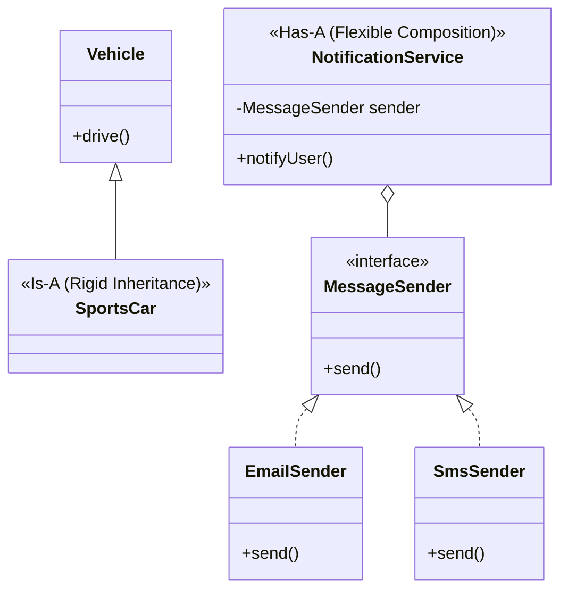

### 8.5 Annotations: Compiler & Runtime Metadata

Annotations (prefixed with `@`) attach metadata to classes, methods, or fields without altering their core logic.

```java
// Common Built-in Annotations:
@Override        // Compiler check: ensures method actually overrides superclass
@Deprecated      // Warning: informs developers that the method is obsolete
@SuppressWarnings("unchecked") // Suppresses specific compiler lint warnings
```

**How Annotations Work:**
1. **Compile-time annotations (e.g. `@Override`):** Examined by `javac` during compilation and discarded.
2. **Runtime annotations (e.g. `@Entity`, `@RestController`, `@Test`):** Retained in `.class` bytecode and inspected at runtime via **Java Reflection** by frameworks like Spring Boot, Jackson, or JUnit.

### 8.6 Sealed Classes & Interfaces (Java 17 LTS: Discriminated Unions)

In TypeScript, you represent a finite set of types with discriminated unions:
`type Shape = Circle | Rectangle;`

In Java 17+, you accomplish this with **`sealed`** classes and interfaces using the **`permits`** keyword:

```java
// Only Circle and Rectangle are permitted to implement Shape!
public sealed interface Shape permits Circle, Rectangle {}

public final class Circle implements Shape {
    private final double radius;
    public Circle(double radius) { this.radius = radius; }
    public double radius() { return radius; }
}

public final class Rectangle implements Shape {
    private final double width, height;
    public Rectangle(double width, double height) { this.width = width; this.height = height; }
    public double width() { return width; }
    public double height() { return height; }
}
```

**Compiler-Exhaustive Pattern Matching:**
Because the compiler knows all permitted subtypes of `Shape`, you can switch over it **without needing a `default` branch**:
```java
public static double calculateArea(Shape shape) {
    // Compiler verifies that Circle and Rectangle are fully handled!
    return switch (shape) {
        case Circle c    -> Math.PI * c.radius() * c.radius();
        case Rectangle r -> r.width() * r.height();
    };
}
```


> [!TIP]
> **Favor Composition Over Inheritance:**
> Inheritance creates tight coupling. If a superclass changes its implementation, subclasses can break unexpectedly ("Fragile Base Class problem").
> Composition ("Has-A") injects dependencies via interfaces, making implementations modular, swappable, and effortlessly mockable for unit testing.

---

### Module 8 Practice Challenges

#### Challenge 8.1 (Design Pattern): Strategy Pattern for Pricing Discounts
**Problem:** Build a dynamic checkout system where different discount algorithms (`NoDiscount`, `PercentageDiscount`, `FlatDiscount`) can be selected and applied at runtime using an interface.

**Thought Process & Strategy (Step-by-Step):**
1. **Strategy Interface:** Create `DiscountStrategy` with `double applyDiscount(double originalPrice)`.
2. **Implementations:** Create `PercentageDiscount` and `FlatDiscount` classes implementing the interface.
3. **Context Class (Composition):** `CheckoutService` holds a `DiscountStrategy` reference and delegates calculation.
4. **Runtime Swapping:** Provide a `setStrategy()` setter to alter pricing behavior dynamically.

```java
// 1. The Strategy Interface
interface DiscountStrategy {
    double applyDiscount(double originalPrice);
}

// 2. Concrete Strategy A: Percentage off
class PercentageDiscount implements DiscountStrategy {
    private final double percent; // e.g. 0.20 for 20%
    public PercentageDiscount(double percent) { this.percent = percent; }

    @Override
    public double applyDiscount(double originalPrice) {
        return originalPrice * (1.0 - percent);
    }
}

// 3. Concrete Strategy B: Flat dollar off
class FlatDiscount implements DiscountStrategy {
    private final double amount;
    public FlatDiscount(double amount) { this.amount = amount; }

    @Override
    public double applyDiscount(double originalPrice) {
        return Math.max(0.0, originalPrice - amount);
    }
}

// 4. Context class utilizing composition
class CheckoutService {
    private DiscountStrategy strategy;

    public CheckoutService(DiscountStrategy strategy) {
        this.strategy = strategy;
    }

    // Allows changing strategy dynamically at runtime
    public void setStrategy(DiscountStrategy strategy) {
        this.strategy = strategy;
    }

    public double calculateTotal(double subtotal) {
        return strategy.applyDiscount(subtotal);
    }

    public static void main(String[] args) {
        CheckoutService checkout = new CheckoutService(new PercentageDiscount(0.15)); // 15% off
        System.out.println("Total (15% off $100): " + checkout.calculateTotal(100.0)); // 85.0

        checkout.setStrategy(new FlatDiscount(25.0)); // Switch to $25 off
        System.out.println("Total ($25 off $100): " + checkout.calculateTotal(100.0));  // 75.0
    }
}
// Time Complexity: O(1)
// Space Complexity: O(1)
```


---

## Module 9: Generics (Type-Safe Reusability)

### 9.1 Why Generics?

Before Generics (pre-Java 5), collections stored raw `Object` references. You had to manually cast objects, leading to frequent runtime crashes:

```java
// Pre-Generics (DANGEROUS):
List oldList = new ArrayList();
oldList.add("Hello");
Integer num = (Integer) oldList.get(0); // Crashes at RUNTIME: ClassCastException!

// With Generics (TYPE-SAFE):
List<String> modernList = new ArrayList<>();
modernList.add("Hello");
// modernList.add(100); // FAILS AT COMPILE TIME!
```

### 9.2 Generic Classes & Generic Methods

You can parameterize classes and methods with placeholder types `<T>`, `<E>` (Element), `<K, V>` (Key, Value):

```java
// Generic Box container

> [!NOTE]
> **Standard Generic Type Parameter Conventions:**
> - `T`: General Type
> - `E`: Element (used in Collections like `List<E>`)
> - `K`, `V`: Key and Value (used in Maps)
> - `N`: Number
> - `R`: Return type (used in functions)

public class Box<T> {
    private T item;

    public void set(T item) { this.item = item; }
    public T get() { return this.item; }
}

// Generic Method: Operates on any type
public class ArrayPrinter {
    public static <E> void printArray(E[] array) {
        for (E element : array) {
            System.out.print(element + " ");
        }
        System.out.println();
    }
}
```

### 9.3 Bounded Generics & The PECS Rule

- **Upper Bound (`<T extends Number>`):** Restricts `T` to a specific class or interface hierarchy.
- **Wildcard (`?`):** Represents an unknown type.
  - `? extends T` (Upper bounded wildcard - Producer): You can safely **read** elements as `T`, but cannot write into it.
  - `? super T` (Lower bounded wildcard - Consumer): You can safely **write** `T` into it.

> [!NOTE]
> **PECS Mnemonic:** **P**roducer **E**xtends, **C**onsumer **S**uper.
> - If you only read data out of a collection, use `? extends T`.
> - If you only insert data into a collection, use `? super T`.

### 9.4 Type Erasure

To maintain backward compatibility with older JVM bytecode, Java uses **Type Erasure**. At compile-time, the compiler verifies all type safety checks and then **erases** generic types to their raw bounds (`Object` or the upper bound).
- At runtime on the JVM, `List<String>` and `List<Integer>` are both simply raw `List` objects.
- This is why you cannot write `new T()` or `new T[10]` directly.

---

### Module 9 Practice Challenges

#### Challenge 9.1: Type-Safe Generic `Pair<K, V>`
**Problem:** Build an immutable, generic `Pair<K, V>` data structure with accessor methods and a static factory method `Pair.of(k, v)`.

**Thought Process & Strategy (Step-by-Step):**
1. **Class Declaration:** Define `public final class Pair<K, V>` with two generic type parameters.
2. **Immutable Fields:** Make fields `private final K first;` and `private final V second;`.
3. **Static Factory Method:** Provide `<K, V> Pair<K, V> of(K first, V second)` for concise instantiation without `new`.
4. **Value Equality:** Implement `equals()` and `hashCode()` using `Objects.equals()` and `Objects.hash()`.

```java
import java.util.Objects;

public final class Pair<K, V> {
    private final K first;
    private final V second;

    public Pair(K first, V second) {
        this.first = first;
        this.second = second;
    }

    public static <K, V> Pair<K, V> of(K first, V second) {
        return new Pair<>(first, second);
    }

    public K getFirst() { return first; }
    public V getSecond() { return second; }

    @Override
    public boolean equals(Object o) {
        if (this == o) return true;
        if (o == null || getClass() != o.getClass()) return false;
        Pair<?, ?> pair = (Pair<?, ?>) o;
        return Objects.equals(first, pair.first) &&
               Objects.equals(second, pair.second);
    }

    @Override
    public int hashCode() {
        return Objects.hash(first, second);
    }

    @Override
    public String toString() {
        return "(" + first + ", " + second + ")";
    }

    public static void main(String[] args) {
        Pair<String, Integer> student = Pair.of("Alice", 98);
        System.out.println("Student: " + student); // (Alice, 98)
    }
}
// Time Complexity: O(1)
// Space Complexity: O(1)
```


---

## Module 10: The Java Collections Framework (JCF)

### 10.1 The Collections Architecture

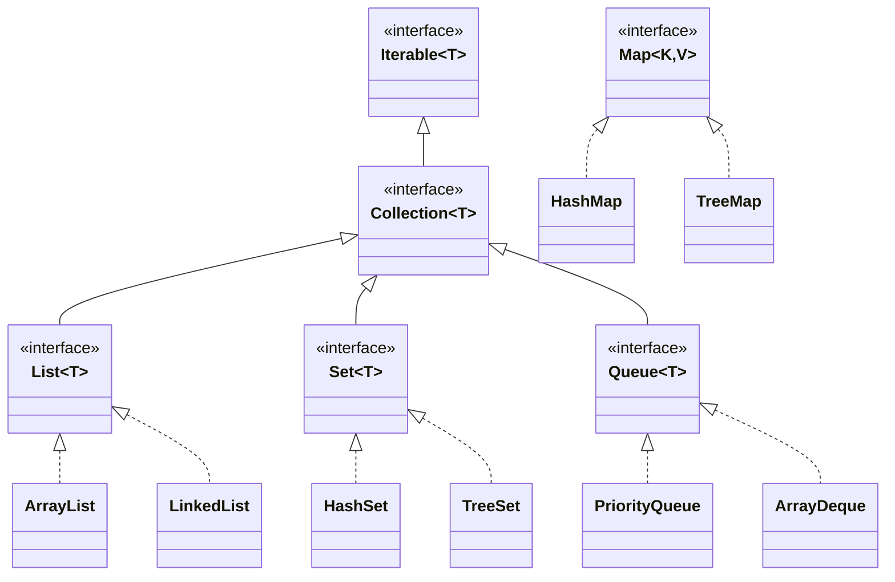

### 10.2 Big-O Complexity Comparison Table

| Collection | Underlying Data Structure | Access | Search | Insert | Delete | Ordering |
|---|---|---|---|---|---|---|
| **`ArrayList`** | Dynamically resizing array | **$O(1)$** | $O(n)$ | $O(1)$ amortized | $O(n)$ | Insertion order |
| **`LinkedList`** | Doubly-linked list | $O(n)$ | $O(n)$ | **$O(1)$** at head/tail | **$O(1)$** at node | Insertion order |
| **`HashSet`** | Hash Table (Buckets) | N/A | **$O(1)$** | **$O(1)$** | **$O(1)$** | Unordered |
| **`TreeSet`** | Red-Black Self-Balancing Tree | N/A | $O(\log n)$ | $O(\log n)$ | $O(\log n)$ | Sorted natural/comparator |
| **`HashMap`** | Hash Table + Linked Lists/Trees | **$O(1)$** key | $O(1)$ key | **$O(1)$** | **$O(1)$** | Unordered |
| **`TreeMap`** | Red-Black Tree | $O(\log n)$ key | $O(\log n)$ | $O(\log n)$ | $O(\log n)$ | Sorted by key |
| **`PriorityQueue`**| Binary Min-Heap (Array-backed) | $O(1)$ peek | $O(n)$ | **$O(\log n)$** offer | **$O(\log n)$** poll | Priority order |
| **`ArrayDeque`** | Circular array buffer | $O(1)$ ends | $O(n)$ | **$O(1)$** ends | **$O(1)$** ends | Insertion order |

### 10.3 Stacks & Queues: Use `ArrayDeque` (Not `java.util.Stack`!)

> [!WARNING]
> **⚠️ LeetCode Pro-Tip:**
> Never use `java.util.Stack`. It is a legacy class from Java 1.0 that extends `Vector` and synchronizes all methods, incurring severe performance overhead.
> **Always use `ArrayDeque` as your Stack and Queue:**
> ```java
> Deque<Integer> stack = new ArrayDeque<>();
> stack.push(10);        // Push to top
> int top = stack.pop(); // Pop from top
> int peek = stack.peek();
>
> Queue<Integer> queue = new ArrayDeque<>();
> queue.offer(10);       // Enqueue to tail
> int head = queue.poll(); // Dequeue from head
> ```

### 10.4 Heaps (`PriorityQueue`) in Java

By default, Java's `PriorityQueue` is a **Min-Heap** (smallest element at the head).

```java
import java.util.PriorityQueue;
import java.util.Collections;

// 1. Min-Heap (Default)
PriorityQueue<Integer> minHeap = new PriorityQueue<>();
minHeap.offer(10);
minHeap.offer(5);
minHeap.offer(20);
System.out.println(minHeap.poll()); // 5 (smallest removed first)

// 2. Max-Heap (Reversed)
PriorityQueue<Integer> maxHeap = new PriorityQueue<>(Collections.reverseOrder());
maxHeap.offer(10);
maxHeap.offer(5);
maxHeap.offer(20);
System.out.println(maxHeap.poll()); // 20 (largest removed first)
```


### 10.5 Collection Pitfalls & How to Iterate Maps

#### 1. How to Iterate Over a `Map`
The most efficient and idiomatic pattern to loop over key-value pairs is **`map.entrySet()`**:

```java
Map<String, Integer> stock = Map.of("Apples", 50, "Oranges", 30);

for (Map.Entry<String, Integer> entry : stock.entrySet()) {
    System.out.println(entry.getKey() + " -> " + entry.getValue());
}
```

#### 2. The `ConcurrentModificationException` Trap
> [!WARNING]
> **Never modify a Collection while iterating over it with a for-each loop!**
> ```java
> List<String> list = new ArrayList<>(List.of("A", "B", "C"));
> for (String s : list) {
>     if (s.equals("B")) list.remove(s); // CRASHES: ConcurrentModificationException!
> }
> ```
> **The Fix:** Use modern `removeIf()`:
> ```java
> list.removeIf(s -> s.equals("B")); // Safe and clean
> ```

#### 3. Queue & Heap Method Differences
| Operation | Throws Exception if Empty/Full | Returns Special Value (`false` / `null`) |
|---|---|---|
| **Insert** | `add(e)` | `offer(e)` (Best practice) |
| **Remove** | `remove()` | `poll()` (Best practice) |
| **Examine**| `element()` | `peek()` (Best practice) |

### 10.6 Sorting with `Comparable` vs `Comparator`

- **`Comparable<T>`:** Implemented on the class itself (`compareTo(T o)`). Defines natural default order.
- **`Comparator<T>`:** Passed as a lambda or helper factory (`(a, b) -> ...`). Defines custom or multi-level sorting.

```java
// 2D Array Sorting (LeetCode Interval pattern):
int[][] intervals = {{1, 3}, {8, 10}, {2, 6}};

// Sort intervals by start time ascending:
Arrays.sort(intervals, (a, b) -> Integer.compare(a[0], b[0]));

// Sort by start time ascending; break ties by end time descending:
Arrays.sort(intervals, (a, b) -> {
    if (a[0] != b[0]) return Integer.compare(a[0], b[0]);
    return Integer.compare(b[1], a[1]);
});
```

---

### Module 10 Practice Challenges

#### Challenge 10.1 (LeetCode 20): Valid Parentheses
**Problem:** Given a string `s` containing just the characters `'('`, `')'`, `'{'`, `'}'`, `'['` and `']'`, determine if the input string is valid.

**Thought Process & Strategy (Step-by-Step):**
1. **Choose Data Structure:** Matching nested brackets follows Last-In, First-Out (LIFO), making a **Stack** (`ArrayDeque`) the optimal choice.
2. **Push Expected Matches:** When an opening bracket is seen, push its corresponding *closing bracket* onto the stack (`'('` $\rightarrow$ `')'`, etc.).
3. **Match on Closing Brackets:** When a closing bracket appears, pop the top of the stack. If the stack is empty or the popped character does not match, return `false`.
4. **Final Check:** If the stack is empty after processing the entire string, all brackets were properly matched.

```java
import java.util.ArrayDeque;
import java.util.Deque;

public class ValidParentheses {
    public static boolean isValid(String s) {
        // Use ArrayDeque as a fast, unsynchronized stack
        Deque<Character> stack = new ArrayDeque<>();

        for (char c : s.toCharArray()) {
            // Push expected closing bracket onto stack when open bracket is seen
            if (c == '(') stack.push(')');
            else if (c == '{') stack.push('}');
            else if (c == '[') stack.push(']');
            else {
                // If closing bracket matches nothing or stack is empty, invalid!
                if (stack.isEmpty() || stack.pop() != c) {
                    return false;
                }
            }
        }

        return stack.isEmpty(); // Valid if all opened brackets were closed
    }

    public static void main(String[] args) {
        System.out.println(isValid("()[]{}")); // true
        System.out.println(isValid("(]"));     // false
    }
}
// Time Complexity: O(n) - Single scan over string
// Space Complexity: O(n) - Stack stores up to n/2 brackets
```

#### Challenge 10.2 (LeetCode 347): Top K Frequent Elements
**Problem:** Given an integer array `nums` and an integer `k`, return the `k` most frequent elements using a Min-Heap.

**Thought Process & Strategy (Step-by-Step):**
1. **Frequency Counting:** Count frequencies in a `HashMap<Integer, Integer>` via `countMap.put(num, countMap.getOrDefault(num, 0) + 1)`.
2. **Min-Heap of Size k:** Use a Min-Heap sorted by frequency (`Comparator.comparingInt(countMap::get)`). Keeping only $k$ elements in the heap reduces time complexity to $O(n \log k)$ (faster than sorting all $n$ elements in $O(n \log n)$).
3. **Evict Infrequent Elements:** For every unique number, add it to the heap. If heap size exceeds $k$, `poll()` evicts the least frequent element.
4. **Extract Results:** The $k$ remaining elements in the heap are the top $k$ frequent elements.

```java
import java.util.*;

public class TopKFrequent {
    public static int[] topKFrequent(int[] nums, int k) {
        // Step 1: Count element frequencies
        Map<Integer, Integer> countMap = new HashMap<>();
        for (int num : nums) {
            countMap.put(num, countMap.getOrDefault(num, 0) + 1);
        }

        // Step 2: Min-Heap storing elements based on frequency count
        PriorityQueue<Integer> minHeap = new PriorityQueue<>(
            Comparator.comparingInt(countMap::get)
        );

        // Step 3: Maintain heap of size k
        for (int num : countMap.keySet()) {
            minHeap.offer(num);
            if (minHeap.size() > k) {
                minHeap.poll(); // Evicts least frequent element
            }
        }

        // Step 4: Extract k elements from heap
        int[] result = new int[k];
        for (int i = 0; i < k; i++) {
            result[i] = minHeap.poll();
        }

        return result;
    }

    public static void main(String[] args) {
        int[] nums = {1, 1, 1, 2, 2, 3};
        System.out.println(Arrays.toString(topKFrequent(nums, 2))); // [2, 1]
    }
}
// Time Complexity: O(n log k) - Maintaining a heap of size k
// Space Complexity: O(n) - Frequency map storage
```


---

## Module 11: Exception Handling & Robust Code

### 11.1 The Exception Hierarchy

In Java, all errors and exceptions inherit from `java.lang.Throwable`:

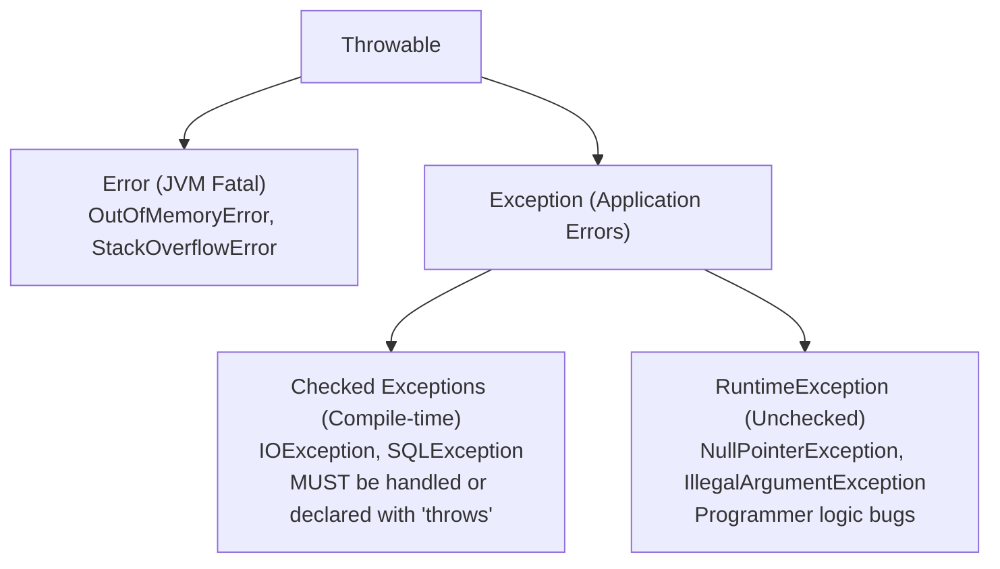

- **`Error`:** Fatal conditions from which a program cannot recover (e.g., `OutOfMemoryError`). Never catch `Error`.
- **`RuntimeException` (Unchecked):** Bugs resulting from programmer error (e.g. `NullPointerException`, `IndexOutOfBoundsException`). Handling is optional.
- **Checked `Exception`:** Anticipated environmental errors (e.g., `IOException`, `FileNotFoundException`). The compiler **forces** you to wrap them in `try-catch` or declare `throws` on the method signature.

### 11.2 `try`, `catch`, `finally` & Multi-Catch

```java
try {
    String input = "abc";
    int num = Integer.parseInt(input); // Throws NumberFormatException
} catch (NumberFormatException e) {
    System.err.println("Failed to parse number: " + e.getMessage());
} catch (NullPointerException | ArrayIndexOutOfBoundsException e) {
    // Multi-catch: Pipe '|' operator handles multiple unrelated exceptions
    System.err.println("Reference or index flaw: " + e.getMessage());
} finally {
    // ALWAYS executes, even if a return statement or exception occurred
    System.out.println("Execution block completed");
}
```

### 11.3 Try-with-Resources & `AutoCloseable`

Opening files, sockets, or database connections requires closing them to avoid memory and file handle leaks.
Any class that implements **`java.lang.AutoCloseable`** placed inside parentheses `try (...)` is **guaranteed to be closed automatically**:

```java
import java.io.BufferedReader;
import java.io.FileReader;
import java.io.IOException;

// 'reader' will be closed automatically when exiting the block!
try (BufferedReader reader = new BufferedReader(new FileReader("config.txt"))) {
    String line = reader.readLine();
    System.out.println(line);
} catch (IOException e) {
    System.err.println("File read failed: " + e.getMessage());
}
```

---

### Module 11 Practice Challenges

#### Challenge 11.1: Custom Business Exception Hierarchy
**Problem:** Build a banking transfer method `transfer(Account from, Account to, double amount)` that validates funds. If insufficient funds exist, throw a custom checked exception `InsufficientFundsException` containing the missing balance.

**Thought Process & Strategy (Step-by-Step):**
1. **Checked Exception Design:** Extend `Exception` (not `RuntimeException`) so the compiler enforces that callers must anticipate and handle insufficient funds.
2. **Attach Error Metadata:** Store `shortfall = amount - balance` inside the exception to provide context to the caller.
3. **Validate Before Mutating:** Check balance first. If inadequate, throw immediately before altering account balances.
4. **Handle with Try-Catch:** Wrap the withdrawal call in a `try-catch` block inspecting `e.getShortfall()`.

```java
// Custom Checked Exception (extends Exception)
class InsufficientFundsException extends Exception {
    private final double shortfall;

    public InsufficientFundsException(String message, double shortfall) {
        super(message);
        this.shortfall = shortfall;
    }

    public double getShortfall() { return shortfall; }
}

class BankAccount {
    private double balance;

    public BankAccount(double balance) { this.balance = balance; }

    public void withdraw(double amount) throws InsufficientFundsException {
        if (amount > balance) {
            double diff = amount - balance;
            throw new InsufficientFundsException("Insufficient account balance", diff);
        }
        balance -= amount;
    }

    public double getBalance() { return balance; }
}

public class BankTransferDemo {
    public static void main(String[] args) {
        BankAccount account = new BankAccount(100.0);

        try {
            System.out.println("Attempting to withdraw $150...");
            account.withdraw(150.0);
        } catch (InsufficientFundsException e) {
            System.err.println("Transaction Failed: " + e.getMessage());
            System.err.println("Shortfall: $" + e.getShortfall());
        }
    }
}
// Time Complexity: O(1)
// Space Complexity: O(1)
```


---

## Module 12: Functional Java: Lambdas & Streams

### 12.1 Lambdas & Single Abstract Method (SAM) Interfaces

In JavaScript, functions are first-class values. In Java, a lambda is an instance of a **Functional Interface** (an interface with exactly one abstract method):

```java
// Lambda syntax: (parameters) -> expression
Runnable task = () -> System.out.println("Async work");
```

### 12.2 Standard Functional Interfaces (`java.util.function`)

| Interface | Method Signature | Purpose | JavaScript Equivalent |
|---|---|---|---|
| **`Predicate<T>`** | `boolean test(T t)` | Filtering / Evaluation | `(x) => boolean` |
| **`Function<T, R>`**| `R apply(T t)` | Transforming / Mapping | `(x) => y` |
| **`Consumer<T>`** | `void accept(T t)` | Side effects (Printing, logging) | `(x) => void` |
| **`Supplier<T>`** | `T get()` | Factory / Lazy supplier | `() => x` |
| **`BiFunction<T, U, R>`**| `R apply(T t, U u)`| Combining two arguments | `(a, b) => c` |

### 12.3 Method References (`::`)

Concise syntax when a lambda simply passes its arguments straight to an existing method:
```java
// Static method: (s) -> Integer.parseInt(s)
Function<String, Integer> parser = Integer::parseInt;

// Instance method of arbitrary object: (s) -> s.toUpperCase()
Function<String, String> upper = String::toUpperCase;

// Instance method of specific instance: (s) -> System.out.println(s)
Consumer<String> printer = System.out::println;

// Constructor: () -> new ArrayList<>()
Supplier<List<String>> listMaker = ArrayList::new;
```

### 12.4 The Stream API Pipeline

A **Stream** is a sequence of elements supporting lazy functional transformations without mutating the backing collection:

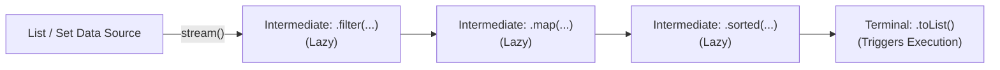

> [!NOTE]
> **Streams are Lazy:** Intermediate operations (`filter`, `map`, `distinct`, `sorted`) execute zero work until an eager **Terminal Operation** (`toList()`, `collect()`, `reduce()`, `count()`, `forEach()`) is invoked!

```java
List<String> names = List.of("alex", "bob", "alice", "charlie");

List<String> result = names.stream()
    .filter(n -> n.startsWith("a"))
    .map(String::toUpperCase)
    .sorted()
    .toList(); // Java 16+ shortcut for Collectors.toList()

System.out.println(result); // [ALEX, ALICE]
```

---

### Module 12 Practice Challenges

#### Challenge 12.1: Transaction Aggregation by Category
**Problem:** Given a list of `Transaction(String category, double amount)` records, compute the total spending for each category using Java Streams.

**Thought Process & Strategy (Step-by-Step):**
1. **Data Modeling:** Represent records with `record Transaction(String category, double amount) {}`.
2. **Stream Collector Selection:** To group entries by a field and aggregate values, use `Collectors.groupingBy()`.
3. **Downstream Summing:** Provide `Transaction::category` as the classifier function and `Collectors.summingDouble(Transaction::amount)` as the downstream reduction collector.
4. **Output:** The terminal `collect()` operation returns `Map<String, Double>`.

```java
import java.util.*;
import java.util.stream.Collectors;

record Transaction(String category, double amount) {}

public class TransactionAggregator {
    public static Map<String, Double> totalPerCategory(List<Transaction> transactions) {
        return transactions.stream()
            .collect(Collectors.groupingBy(
                Transaction::category, // Group key
                Collectors.summingDouble(Transaction::amount) // Downstream collector
            ));
    }

    public static void main(String[] args) {
        List<Transaction> list = List.of(
            new Transaction("Food", 25.50),
            new Transaction("Electronics", 120.00),
            new Transaction("Food", 14.50),
            new Transaction("Transport", 30.00)
        );

        Map<String, Double> totals = totalPerCategory(list);
        System.out.println(totals); // {Transport=30.0, Food=40.0, Electronics=120.0}
    }
}
// Time Complexity: O(n) - Single pass stream grouping
// Space Complexity: O(k) - Map of unique categories
```


---

## Module 13: Packages, Date/Time & Modern File I/O

### 13.1 Packages & Imports

Packages group related classes into namespaces and map directly to physical folder hierarchies:
```java
// File: src/main/java/com/mycompany/app/service/OrderService.java
package com.mycompany.app.service; // Must be the first non-comment line

import java.util.List;               // Explicit import
import java.util.*;                  // Wildcard import
import static java.lang.Math.PI;     // Static import
```

### 13.2 Modern Date & Time (`java.time`)

Java 8 replaced legacy `java.util.Date` with immutable, thread-safe classes:
- **`LocalDate`:** Date only (`2026-09-17`).
- **`LocalTime`:** Time only (`14:30:00`).
- **`LocalDateTime`:** Date and Time combined (`2026-09-17T14:30:00`).
- **`Instant`:** UTC timestamp since Unix Epoch.
- **`ZonedDateTime`:** Timezone-aware date and time.

```java
import java.time.*;
import java.time.format.DateTimeFormatter;

LocalDateTime now = LocalDateTime.now();
DateTimeFormatter formatter = DateTimeFormatter.ofPattern("yyyy-MM-dd HH:mm:ss");
String formatted = now.format(formatter);
```

### 13.3 Modern File I/O (`java.nio.file.Files`)

In Node.js, you use `fs.promises`. In Java 11+, **NIO.2 (`Path` and `Files`)** provides high-level static methods:

```java
import java.nio.file.Files;
import java.nio.file.Path;
import java.nio.file.StandardOpenOption;
import java.io.IOException;
import java.util.stream.Stream;

Path path = Path.of("app.log");

// 1. Write text to file
Files.writeString(path, "INFO: System started\n");

// 2. Append text to file
Files.writeString(path, "WARN: High memory\n", StandardOpenOption.APPEND);

// 3. Read entire file into a String
String content = Files.readString(path);

// 4. Memory-safe line streaming for massive multi-gigabyte log files:
try (Stream<String> lines = Files.lines(path)) {
    long errorCount = lines.filter(l -> l.contains("ERROR")).count();
    System.out.println("Error count: " + errorCount);
}
```

---

### Module 13 Practice Challenges

#### Challenge 13.1: Log File Error Frequency Counter
**Problem:** Write a method that reads a file path, filters for lines starting with `"ERROR:"`, extracts the error message, and writes the distinct error messages to an output file.

**Thought Process & Strategy (Step-by-Step):**
1. **Memory-Safe Streaming:** Large server logs can exceed RAM. Use `Files.lines(path)` to lazily stream lines one-by-one with $O(1)$ memory.
2. **Transformations:** Filter lines with `.filter(line -> line.startsWith("ERROR:"))` and extract the message via `.map(line -> line.substring(6).trim())`.
3. **Deduplicate:** Apply `.distinct()` to keep only unique messages.
4. **Resource Management:** Wrap in Try-with-Resources to ensure the underlying OS file handle is closed upon completion.
5. **Persist Output:** Write the resulting list to disk using `Files.write(outputReport, list)`.

```java
import java.nio.file.*;
import java.io.IOException;
import java.util.List;
import java.util.stream.Stream;

public class LogProcessor {
    public static void extractErrors(Path inputLog, Path outputReport) throws IOException {
        try (Stream<String> lines = Files.lines(inputLog)) {
            List<String> errorMessages = lines
                .filter(line -> line.startsWith("ERROR:"))
                .map(line -> line.substring(6).trim())
                .distinct()
                .toList();

            Files.write(outputReport, errorMessages);
        }
    }
}
// Time Complexity: O(n) line-by-line streaming
// Space Complexity: O(m) where m is number of unique errors
```


---

## Module 14: Java Ecosystem, Build Tools & Frameworks

### 14.1 Build Systems: Maven & Gradle

Java applications manage third-party dependencies and build lifecycles using Maven or Gradle (analogous to `npm` and `package.json` in JavaScript).

#### Maven (`pom.xml`):
```xml
<dependencies>
    <!-- GAV Coordinates: GroupId, ArtifactId, Version -->
    <dependency>
        <groupId>com.google.code.gson</groupId>
        <artifactId>gson</artifactId>
        <version>2.10.1</version>
    </dependency>
</dependencies>
```

#### Gradle (`build.gradle`):
```groovy
dependencies {
    implementation 'com.google.code.gson:gson:2.10.1'
}
```


### 14.2 What is a JAR File Physically?

A **JAR (Java ARchive)** file is physically a standard **ZIP compression file** containing:
1. Compiled `.class` bytecode files arranged in folders matching their package names.
2. Static resources (JSON configs, application properties, HTML/CSS assets).
3. A `META-INF/MANIFEST.MF` file that tells the JVM which class contains the `public static void main` entry point:
   ```text
   Manifest-Version: 1.0
   Main-Class: com.mycompany.app.Main
   ```
When you execute `java -jar myapp.jar`, the JVM unzips the manifest, locates the `Main-Class`, and starts execution.

### 14.3 Database Persistence: JDBC, JPA & Hibernate

- **JDBC:** Low-level standard for connecting to SQL databases and executing queries.
- **JPA (Jakarta Persistence API):** Specification defining Object-Relational Mapping (ORM).
- **Hibernate:** The dominant implementation of JPA, automatically synchronizing Java entities with SQL tables:

```java
import jakarta.persistence.*;

@Entity
@Table(name = "customers")
public class Customer {
    @Id
    @GeneratedValue(strategy = GenerationType.IDENTITY)
    private Long id;

    @Column(nullable = false, unique = true)
    private String email;
}
```

### 14.4 Enterprise Frameworks: Spring Boot

**Spring Boot** is the industry standard for Java web microservices and enterprise applications. It relies on **Inversion of Control (IoC)** and **Dependency Injection (DI)** via annotations:

```java
import org.springframework.web.bind.annotation.*;
import org.springframework.beans.factory.annotation.Autowired;

@RestController
@RequestMapping("/api/tasks")
public class TaskController {

    @Autowired // Framework automatically injects the TaskService bean
    private TaskService taskService;

    @GetMapping("/{id}")
    public TaskDto getTask(@PathVariable Long id) {
        return taskService.findTaskById(id); // Automatically serialized to JSON
    }
}
```

---

### Module 14 Practice Challenges

#### Challenge 14.1: Spring Boot REST API Architecture Design
**Problem:** Construct the complete skeleton (Record DTO, Service, and Controller) for a Spring Boot REST API that handles creating and retrieving `Product` records.

**Thought Process & Strategy (Step-by-Step):**
1. **Three-Layer Architecture Separation:**
   - **DTO / Record Layer:** Immutable data representation for network payload serialization.
   - **Service Layer:** Business rules, entity state manipulation, and database access.
   - **Controller Layer:** HTTP request mapping and response dispatching.
2. **DTO:** Declare `record ProductDto(Long id, String name, double price) {}`.
3. **Service:** Maintain state with an in-memory `Map<Long, ProductDto>` and atomic ID counter.
4. **Controller:** Route requests to service methods using Spring Web annotations.

```java
// 1. The DTO Record
record ProductDto(Long id, String name, double price) {}

// 2. The Service Layer (Business Logic)
class ProductService {
    private final Map<Long, ProductDto> database = new HashMap<>();
    private long idSequence = 1;

    public ProductDto createProduct(String name, double price) {
        Long id = idSequence++;
        ProductDto product = new ProductDto(id, name, price);
        database.put(id, product);
        return product;
    }

    public ProductDto getById(Long id) {
        return database.get(id);
    }
}

// 3. The REST Controller
// (In Spring Boot, annotated with @RestController and @RequestMapping("/api/products"))
class ProductController {
    private final ProductService productService = new ProductService();

    // Handles POST /api/products
    public ProductDto create(String name, double price) {
        return productService.createProduct(name, price);
    }

    // Handles GET /api/products/{id}
    public ProductDto getOne(Long id) {
        ProductDto p = productService.getById(id);
        if (p == null) {
            throw new NoSuchElementException("Product not found with id: " + id);
        }
        return p;
    }
}
```

---

<!-- TOC --><a name="part-2-java-testing-with-junit"></a><a name="java-testing-with-junit"></a>
# Part 2: Java Testing with JUnit

<!-- TOC start (generated with https://github.com/derlin/bitdowntoc) -->

- [Java Testing with JUnit](#java-testing-with-junit)
   * [1. What is Java Testing?](#1-what-is-java-testing)
      + [2. Why is it Needed?](#2-why-is-it-needed)
      + [3. How is it Implemented? (The Non-Trivial Parts Explained)](#3-how-is-it-implemented-the-non-trivial-parts-explained)
      + [4. A Simple Example](#4-a-simple-example)
      + [5. Practical Use-Cases](#5-practical-use-cases)
      + [6. When NOT to use it](#6-when-not-to-use-it)
   * [JUnit environment and setup](#junit-environment-and-setup)
      + [1. Overview: What exactly *is* JUnit?](#1-overview-what-exactly-is-junit)
      + [2. The Non-Trivial Part: Build Tools (Maven)](#2-the-non-trivial-part-build-tools-maven)
      + [3. Environment Setup (Step-by-Step)](#3-environment-setup-step-by-step)
         - [Step 1: Create a Maven Project](#step-1-create-a-maven-project)
         - [Step 2: Add JUnit to the Shopping List](#step-2-add-junit-to-the-shopping-list)
         - [Step 3: Understand the Folder Structure](#step-3-understand-the-folder-structure)
      + [4. Running Your First Test](#4-running-your-first-test)
   * [Vanilla JUnit setup without a build tool](#vanilla-junit-setup-without-a-build-tool)
      + [1. The Non-Trivial Concept: The Classpath and The Standalone JAR](#1-the-non-trivial-concept-the-classpath-and-the-standalone-jar)
      + [2. Step-by-Step Manual Setup](#2-step-by-step-manual-setup)
         - [Step 1: Download the JAR](#step-1-download-the-jar)
         - [Step 2: Write your Code](#step-2-write-your-code)
      + [3. How to Compile (Translating to Bytecode)](#3-how-to-compile-translating-to-bytecode)
      + [4. How to Run the Tests (The Console Launcher)](#4-how-to-run-the-tests-the-console-launcher)
   * [Test Framework and basic usage](#test-framework-and-basic-usage)
      + [1. JUnit Classes & Features (The Basics)](#1-junit-classes-features-the-basics)
      + [2. Test Fixtures (The Non-Trivial Concept)](#2-test-fixtures-the-non-trivial-concept)
      + [3. Test Suites (The Playlist)](#3-test-suites-the-playlist)
      + [4. Test Runners (The Engine)](#4-test-runners-the-engine)
   * [JUnit API](#junit-api)
      + [1. The `Assert` Class (The Judge)](#1-the-assert-class-the-judge)
      + [2. The `TestCase` Class (The Blueprint)](#2-the-testcase-class-the-blueprint)
      + [3. The `TestResult` Class (The Scorecard)](#3-the-testresult-class-the-scorecard)
      + [4. The `TestSuite` Class (The Playlist)](#4-the-testsuite-class-the-playlist)
   * [Writing and executing tests](#writing-and-executing-tests)
      + [1. Creating the Target Class (The Code to Test)](#1-creating-the-target-class-the-code-to-test)
      + [2. Writing the Test (Annotations & Assertions)](#2-writing-the-test-annotations-assertions)
      + [3. The Execution Sequence / Procedure](#3-the-execution-sequence-procedure)
      + [4. Creating a TestRunner Class (Executing the Tests)](#4-creating-a-testrunner-class-executing-the-tests)
      + [Bringing it all together](#bringing-it-all-together)
         - [1. The Non-Trivial Concept: The `static` Keyword](#1-the-non-trivial-concept-the-static-keyword)
         - [2. The Code Example (The Database Simulator)](#2-the-code-example-the-database-simulator)
         - [3. The Execution Sequence (The Complete Picture)](#3-the-execution-sequence-the-complete-picture)
         - [Why is this sequence so brilliant?](#why-is-this-sequence-so-brilliant)
   * [Suite tests](#suite-tests)
      + [1. Why is a Test Suite Needed?](#1-why-is-a-test-suite-needed)
      + [2. The Non-Trivial Concept: Empty Classes](#2-the-non-trivial-concept-empty-classes)
      + [3. Step-by-Step Code Implementation](#3-step-by-step-code-implementation)
         - [Step 1: The Target Classes (Your App)](#step-1-the-target-classes-your-app)
         - [Step 2: The Test Case Classes](#step-2-the-test-case-classes)
         - [Step 3: The Test Suite Class (The Playlist)](#step-3-the-test-suite-class-the-playlist)
      + [4. The Execution Sequence](#4-the-execution-sequence)
   * [Test tags](#test-tags)
      + [1. The Problem: The "Slow Test" Nightmare](#1-the-problem-the-slow-test-nightmare)
      + [2. The Solution: The `@Tag` Annotation](#2-the-solution-the-tag-annotation)
      + [3. The Execution Architecture (Visualized)](#3-the-execution-architecture-visualized)
      + [4. How do you actually trigger the filter?](#4-how-do-you-actually-trigger-the-filter)
      + [5. Triggering the filter when not using Maven](#5-triggering-the-filter-when-not-using-maven)
         - [1. The Refresher: The Standalone JAR](#1-the-refresher-the-standalone-jar)
         - [2. The Setup: Our Tagged Code](#2-the-setup-our-tagged-code)
         - [3. The Magic Commands: Filtering via Terminal](#3-the-magic-commands-filtering-via-terminal)
            * [Scenario A: Run ONLY the "fast" tests](#scenario-a-run-only-the-fast-tests)
            * [Scenario B: Avoid the "slow" tests](#scenario-b-avoid-the-slow-tests)
   * [Type of test - Ignore Test (`@Disabled`)](#type-of-test-ignore-test-disabled)
   * [Type of test - Time Test (Timeouts)](#type-of-test-time-test-timeouts)
   * [Type of test - Exceptions Test (Testing for intended crashes)](#type-of-test-exceptions-test-testing-for-intended-crashes)
   * [Type of test - Parameterized Tests (The Data-Driven Magic)](#type-of-test-parameterized-tests-the-data-driven-magic)
   * [Spies, Stubs, and Mocking](#spies-stubs-and-mocking)
      + [The Non-Trivial Problem: "Dependencies"](#the-non-trivial-problem-dependencies)
      + [1. Stubs (The Scripted Actor)](#1-stubs-the-scripted-actor)
      + [2. Mocks (The Behavior Checker)](#2-mocks-the-behavior-checker)
      + [3. Spies (The Undercover Agent)](#3-spies-the-undercover-agent)
      + [Summary Cheat Sheet](#summary-cheat-sheet)
   * [Using Mockito for mocking with JUnit](#using-mockito-for-mocking-with-junit)
      + [The Non-Trivial Concept: The "When -> Then" Syntax](#the-non-trivial-concept-the-when-then-syntax)
      + [Scenario 1: The "Happy Path" (Stubbing Fake Data)](#scenario-1-the-happy-path-stubbing-fake-data)
      + [Scenario 2: The "Disaster Path" (Simulating Crashes)](#scenario-2-the-disaster-path-simulating-crashes)
      + [Scenario 3: Verifying Actions (Did you do your job?)](#scenario-3-verifying-actions-did-you-do-your-job)
      + [Scenario 4: Argument Matchers (The "I don't care" scenario)](#scenario-4-argument-matchers-the-i-dont-care-scenario)
      + [Scenario 5: The Pro Setup (Using Annotations)](#scenario-5-the-pro-setup-using-annotations)
   * [JUnit best practices](#junit-best-practices)
      + [1. The AAA Pattern (Arrange, Act, Assert)](#1-the-aaa-pattern-arrange-act-assert)
      + [2. Name Tests Like a Sentence](#2-name-tests-like-a-sentence)
      + [3. Test One Logical Concept Per Method](#3-test-one-logical-concept-per-method)
      + [4. Total Independence (No Domino Effects)](#4-total-independence-no-domino-effects)
      + [5. Test the Public API, Not Private Methods](#5-test-the-public-api-not-private-methods)
   * [Code coverage](#code-coverage)
      + [1. The Non-Trivial Concept: Execution Branches](#1-the-non-trivial-concept-execution-branches)
      + [2. Generating Coverage: Meet JaCoCo](#2-generating-coverage-meet-jacoco)
      + [3. Visualizing a Coverage Report](#3-visualizing-a-coverage-report)
      + [4. The Great Debate: Is 100% Coverage Good?](#4-the-great-debate-is-100-coverage-good)
      + [5. Setting Strict Enforcement Percentages](#5-setting-strict-enforcement-percentages)
         - [Tier 1: 0% - 30% (The Startup / Prototype Phase)](#tier-1-0-30-the-startup-prototype-phase)
         - [Tier 2: 60% - 70% (The Legacy Rescue)](#tier-2-60-70-the-legacy-rescue)
         - [Tier 3: 80% - 85% (The Industry "Sweet Spot")](#tier-3-80-85-the-industry-sweet-spot)
         - [Tier 4: 95% - 100% (Mission-Critical Systems)](#tier-4-95-100-mission-critical-systems)
   * [Additional concepts on code coverage](#additional-concepts-on-code-coverage)
      + [1. The Non-Trivial Concept: The "Java Agent"](#1-the-non-trivial-concept-the-java-agent)
      + [2. Vanilla Java Setup: Step-by-Step](#2-vanilla-java-setup-step-by-step)
         - [Step 1: Compile your code](#step-1-compile-your-code)
         - [Step 2: Run tests WITH the Wiretap attached](#step-2-run-tests-with-the-wiretap-attached)
         - [Step 3: Generate the HTML Report](#step-3-generate-the-html-report)
      + [3. Can we generate reports WITHOUT JaCoCo?](#3-can-we-generate-reports-without-jacoco)
         - [Alternative A: IDE Built-in Engines (The Easy Way)](#alternative-a-ide-built-in-engines-the-easy-way)
         - [Alternative B: Source Code Instrumentation (The Legacy Way - OpenClover/Cobertura)](#alternative-b-source-code-instrumentation-the-legacy-way-openclovercobertura)       
   * [Extending JUnit for integration testing](#extending-junit-for-integration-testing)

<!-- TOC end -->

Welcome to the world of Java Testing! It might sound a bit intimidating at first, but at its core, testing is just writing a small piece of code to check if your main code behaves exactly the way you want it to. 

Let's break this down step-by-step, making it as intuitive as possible.


<!-- TOC --><a name="1-what-is-java-testing"></a>
## 1. What is Java Testing?

Imagine you build a robot to make coffee. Before you let it loose in your kitchen, you would probably test it by giving it beans and water to see if coffee comes out. 

In Java, **testing** means writing automated scripts that feed inputs into your Java methods and check if the output matches your expectations. Instead of manually running your app every time you make a change, you let the computer do the checking.

Here is a visual representation of how a test works:

```text
  [Input Data]  ------>  [Your Java Method]  ------>  [Actual Output]
   (e.g., 2, 3)              (add)                           (5)
                                                              |
                                                       (Compares with)
                                                              |
                                                              v
                                                     [Expected Output]
                                                            (5)
                                                           /   \
                                                 [MATCH = PASS] [MISMATCH = FAIL]
```

<!-- TOC --><a name="2-why-is-it-needed"></a>
### 2. Why is it Needed?

You might wonder why you should spend time writing code to check your code. Here is why testing is a superpower for developers:

* **Catches bugs early:** Finding a bug while writing code is cheap. Finding a bug after the customer has the software is a disaster.
* **Fearless refactoring:** If you want to clean up or improve old code, tests act as a safety net. If your tests still pass, you know you didn't break anything.
* **Living documentation:** Tests show exactly how a piece of code is supposed to be used. 


[Image of software testing pyramid]


To understand the scope of testing, developers use the **Testing Pyramid**:

```text
              /\
             /  \    <--- UI / End-to-End Tests 
            /----\        (Simulates a real user clicking buttons. Slow, but thorough.)
           /      \  
          /--------\ <--- Integration Tests 
         /          \     (Tests if the database and your Java code talk correctly.)
        /------------\
       /              \ <--- Unit Tests 
      /----------------\     (Tests a single Java method in isolation. Very fast!)
```
*Note: We will focus mostly on Unit Tests here, as they are the foundation of Java testing.*


<!-- TOC --><a name="3-how-is-it-implemented-the-non-trivial-parts-explained"></a>
### 3. How is it Implemented? (The Non-Trivial Parts Explained)

To write tests in Java, we use testing frameworks. The most popular one is **JUnit**. JUnit provides special tools to make testing easy. 

Before we look at the code, you need to understand two key concepts that often trip beginners up:

**Concept A: Annotations (The `@Test` tag)**
Java needs to know which methods are standard app logic and which are tests. We use an annotation, specifically `@Test`, placed right above a method. Think of it as a sticky note that tells the JUnit framework, "Hey, run this method as a test!"

**Concept B: Assertions**
An assertion is the "judge" in your test. It is a command that says, "I assert that X equals Y." If X does equal Y, the test passes silently. If they don't match, the assertion throws a massive error, failing the test. The most common one is `assertEquals(expected, actual)`.

Here is how a single test runs behind the scenes:

```text
+-------------------+      +-------------------+      +-------------------+
|    @BeforeEach    | ---> |       @Test       | ---> |    @AfterEach     |
| (Setup dummy data)|      | (Run code & Judge)|      | (Clean up memory) |
+-------------------+      +-------------------+      +-------------------+
```


<!-- TOC --><a name="4-a-simple-example"></a>
### 4. A Simple Example

Let's look at a highly practical, simple example. 

**The Main Code (What we want to test):**
Imagine we have a simple Calculator class.

```java
public class Calculator {
    public int add(int a, int b) {
        return a + b; 
    }
}
```

**The Test Code (How we test it):**
Now, we write a separate class just for testing.

```java
import org.junit.jupiter.api.Test;
import static org.junit.jupiter.api.Assertions.assertEquals;

public class CalculatorTest {

    @Test // The sticky note!
    public void testAddition() {
        // 1. Setup
        Calculator calc = new Calculator();
        
        // 2. Execute
        int actualResult = calc.add(10, 5);
        
        // 3. Assert (The Judge)
        int expectedResult = 15;
        assertEquals(expectedResult, actualResult); 
    }
}
```
If someone accidentally changes the `add` method in the future to `return a - b`, the next time the tests are run, `actualResult` will be 5, `expectedResult` is 15. The `assertEquals` will fail, triggering an alarm before that bad code ever reaches a user!


<!-- TOC --><a name="5-practical-use-cases"></a>
### 5. Practical Use-Cases

Testing isn't just for calculators. Here is how it is used in the real world:

* **Banking Applications:** You write a test to ensure that `transferMoney(accountA, accountB, amount)` strictly fails if the amount is greater than the balance in account A.
* **E-Commerce Carts:** You write a test to guarantee that adding two items worth $10 each, plus a $5 shipping fee, exactly calculates a total of $25.
* **String Manipulation:** If you build a search bar, you write tests to ensure that searching for "  apple  " automatically removes the extra spaces before hitting the database.


<!-- TOC --><a name="6-when-not-to-use-it"></a>
### 6. When NOT to use it

While testing is crucial, there are times when it is a waste of effort:

* **Throwaway Scripts:** If you are writing a quick 20-line Java program to parse a text file once and never use it again, don't bother writing tests.
* **Rapid Prototyping:** If you are building a quick prototype just to see if an idea visually looks good, and you know you will throw the code away tomorrow, testing will slow you down.
* **Simple Getters and Setters:** You generally do not need to test methods that just return a variable (like `getName()`). Trust that Java knows how to return a variable. Test the complex logic, not the language itself.

<!-- TOC --><a name="junit-environment-and-setup"></a>
## JUnit environment and setup

Let's get your environment set up! Since we already understand the *theory* of testing, let's look at **JUnit**, the absolute industry standard for doing this in Java. 

Here is a simple, intuitive guide to getting JUnit running on your machine.


<!-- TOC --><a name="1-overview-what-exactly-is-junit"></a>
### 1. Overview: What exactly *is* JUnit?

JUnit is a **testing framework**. It is essentially a library of pre-written Java code that gives you the tools to write tests easily. It provides:
1. **Annotations:** Like the `@Test` sticky note we discussed earlier.
2. **Assertions:** The "judges" like `assertEquals(5, actual)`.
3. **A Test Runner:** An engine that finds all your `@Test` methods, runs them one by one, and generates a clean report.

**Visualizing the JUnit Engine:**
```text
 +------------------+       +-----------------------+       +------------------------+
 | Your Test Code   |       |      JUnit Engine     |       |      Test Report       |
 |------------------|       |-----------------------|       |------------------------|
 | @Test add()      | ----> | 1. Finds @Test tags   | ----> |  [GREEN Check] add()   |
 | @Test subtract() |       | 2. Executes methods   |       |  [RED X] subtract()    |
 |                  |       | 3. Catches errors     |       |    (Expected 4, got 5) |
 +------------------+       +-----------------------+       +------------------------+
```


<!-- TOC --><a name="2-the-non-trivial-part-build-tools-maven"></a>
### 2. The Non-Trivial Part: Build Tools (Maven)

Before we set up the environment, we need to address a hurdle that trips up almost every beginner: **How do I actually get JUnit into my project?**

In the old days, you had to scour the internet, download a `.jar` file (a bundle of Java code), and manually paste it into your project folder. This was messy.

Today, we use **Build Tools**, the most popular being **Maven**. 
Think of Maven as a personal shopper for your code. Instead of downloading JUnit manually, you give Maven a shopping list. Maven goes to the internet, downloads JUnit, and connects it to your project automatically.

This shopping list is a simple text file called `pom.xml`.


<!-- TOC --><a name="3-environment-setup-step-by-step"></a>
### 3. Environment Setup (Step-by-Step)

Let's set up a project using an IDE (Integrated Development Environment) like IntelliJ IDEA or Eclipse.

<!-- TOC --><a name="step-1-create-a-maven-project"></a>
#### Step 1: Create a Maven Project
When you open your IDE and click "New Project," select **Maven** as the build system. The IDE will automatically generate the basic folders and your `pom.xml` shopping list.

<!-- TOC --><a name="step-2-add-junit-to-the-shopping-list"></a>
#### Step 2: Add JUnit to the Shopping List
Open the `pom.xml` file. You will tell Maven to fetch **JUnit 5** (the latest version, also called JUnit Jupiter) by pasting this specific code block inside the `<dependencies>` section:

```xml
<dependencies>
    <dependency>
        <groupId>org.junit.jupiter</groupId>
        <artifactId>junit-jupiter-api</artifactId>
        <version>5.10.0</version>
        <scope>test</scope> 
    </dependency>
</dependencies>
```
*Note: The `<scope>test</scope>` tag is brilliant. It tells Maven, "Only use this tool when I am testing. Do NOT pack this into the final app I give to my customers."*

<!-- TOC --><a name="step-3-understand-the-folder-structure"></a>
#### Step 3: Understand the Folder Structure
When Maven creates your project, it enforces a very strict, specific folder structure. This is designed to keep your actual application code completely separate from your testing code.

Here is what your project tree will look like:

```text
MyAwesomeProject/
 |-- pom.xml                        <--- Your Maven shopping list
 |
 |-- src/
     |
     |-- main/                      <--- YOUR ACTUAL APP LIVES HERE
     |   `-- java/
     |       `-- com/mycorp/
     |           `-- Calculator.java  (The code you are building)
     |
     `-- test/                      <--- YOUR TESTS LIVE HERE
         `-- java/
             `-- com/mycorp/
                 `-- CalculatorTest.java (The code checking the builder)
```


**Why separate them?** Because when you finally compile your app to sell or deploy, Maven will *only* package the `src/main` folder. The `src/test` folder is left behind so your final app is small, fast, and doesn't contain bulky testing scripts!


<!-- TOC --><a name="4-running-your-first-test"></a>
### 4. Running Your First Test

Once your folders are set up and Maven has downloaded JUnit, you simply write your `CalculatorTest.java` file (just like the example in our previous conversation).

To run it:
1. Open `CalculatorTest.java` in your IDE.
2. Look for the little green play button (usually next to the `@Test` annotation on the left side of the screen).
3. Click it! 

A panel will pop up at the bottom of your screen showing a green bar if everything passed, or a red bar pointing out exactly which test failed.

<!-- TOC --><a name="vanilla-junit-setup-without-a-build-tool"></a>
## Vanilla JUnit setup without a build tool

Going under the hood and dropping Maven is a fantastic way to actually understand how Java works! When you use tools like Maven or an IDE, they hide the messy details. Doing it manually makes you a stronger developer.

To do this without Maven, we rely entirely on the **Terminal (Command Line)** and the basic Java tools: `javac` (the compiler) and `java` (the runner).

Before we start, we need to understand the big non-trivial concept that Maven usually handles for us: **The Classpath.**


<!-- TOC --><a name="1-the-non-trivial-concept-the-classpath-and-the-standalone-jar"></a>
### 1. The Non-Trivial Concept: The Classpath and The Standalone JAR

When you type `@Test`, Java has no idea what that means. It's not built into standard Java. It lives inside JUnit. 

Since we don't have Maven to download JUnit automatically, we have to download it manually as a **JAR file** (Java ARchive - basically a zip file full of Java code). Then, we have to use the **Classpath (`-cp`)**, which is a flag we pass to the compiler that acts as a bridge, telling Java where to find the JUnit tools.

```text
                                  The Classpath (-cp) Bridge
                                 ============================
 [Your Code]                                                               [JUnit.jar]
 CalculatorTest.java  ------------------------------------------------>  Contains @Test,
 "I need the @Test tool!"       "Hey compiler, look in this JAR file       assertEquals, etc.
                                 for tools I don't recognize!"
```

Because modern JUnit 5 is actually split into dozens of tiny pieces, the JUnit team kindly provides a massive "all-in-one" file for people doing it manually. It's called the **JUnit Platform Console Standalone**.


<!-- TOC --><a name="2-step-by-step-manual-setup"></a>
### 2. Step-by-Step Manual Setup

Let's keep the folder structure as flat and simple as possible to avoid getting lost in directories.

<!-- TOC --><a name="step-1-download-the-jar"></a>
#### Step 1: Download the JAR
Go to the internet (a site like Maven Central) and manually download the `junit-platform-console-standalone.jar` file. Save it in a brand new folder called `ManualTesting`.

<!-- TOC --><a name="step-2-write-your-code"></a>
#### Step 2: Write your Code
Inside that exact same `ManualTesting` folder, create your two Java files.

**Your Folder Structure Now:**
```text
ManualTesting/
 |-- junit-platform-console-standalone.jar  <-- The all-in-one JUnit tool
 |-- Calculator.java                        <-- Your app
 `-- CalculatorTest.java                    <-- Your test
```

**Calculator.java**
```java
public class Calculator {
    public int add(int a, int b) {
        return a + b;
    }
}
```

**CalculatorTest.java**
```java
import org.junit.jupiter.api.Test;
import static org.junit.jupiter.api.Assertions.assertEquals;

public class CalculatorTest {
    @Test
    public void testAddition() {
        Calculator calc = new Calculator();
        assertEquals(15, calc.add(10, 5));
    }
}
```


<!-- TOC --><a name="3-how-to-compile-translating-to-bytecode"></a>
### 3. How to Compile (Translating to Bytecode)

Now we open our Terminal/Command Prompt, navigate into our `ManualTesting` folder, and compile. 

We use `javac`, but we *must* include the `-cp` (classpath) flag so it can read the JAR file to understand what `@Test` is.


**The Command:**
*(Note: If you are on Windows, use a semicolon `;` instead of a colon `:` in the classpath).*

```bash
javac -cp .:junit-platform-console-standalone.jar Calculator.java CalculatorTest.java
```

**What is happening here?**
```text
  [Calculator.java]               [CalculatorTest.java]           [JUnit JAR file]
          \                                |                             /
           \                               | (-cp bridge)               /
            \                              V                           /
             +-----------------------( javac )------------------------+
                                           |
                                      (Translates)
                                           |
                                           V
                  [Calculator.class]  +  [CalculatorTest.class]
                         (These are the compiled files Java can actually run)
```

If it works, the terminal will say nothing, but if you look in your folder, you will see your new `.class` files!


<!-- TOC --><a name="4-how-to-run-the-tests-the-console-launcher"></a>
### 4. How to Run the Tests (The Console Launcher)

We cannot just run `java CalculatorTest` because a test class doesn't have a `public static void main(String[] args)` method! It needs a special engine to run it.

Remember that Standalone JAR file? It has a built-in program called the **Console Launcher**. We are going to tell Java to run *that* JAR file, and ask the JAR file to scan our folder for tests.

**The Command:**
```bash
java -jar junit-platform-console-standalone.jar -cp . --scan-classpath
```

**What is happening here?**
```text
               (java -jar)
                    |
     [junit-platform-console-standalone.jar] <--- We launch the JUnit Engine itself!
                    |
                    V
        +-------------------------+
        |  JUnit Console Launcher |
        |                         |
        | 1. Looks at current     |
        |    folder (-cp .)       |
        | 2. Scans for .class     |  <-- (--scan-classpath)
        |    files with @Test     |
        | 3. Runs them            |
        | 4. Prints a report      |
        +-------------------------+
                    |
                    V
          [Output to Terminal: 1 test successful!]
```


When you hit enter, you will see a bunch of text print out in your terminal, culminating in a nice little text-based report showing exactly how many tests passed and failed. 


Doing this manually is a bit tedious to type out every time, which is exactly why build tools like Maven were invented! But knowing how the `-cp` bridge connects your code to external tools is a master-level Java skill. 

<!-- TOC --><a name="test-framework-and-basic-usage"></a>
## Test Framework and basic usage

Now that we know how to set JUnit up, let's look at how to actually use the JUnit **Test Framework**. 

Think of a "Framework" like a fully equipped kitchen. It provides the ovens, knives, and prep stations; you just bring the recipe (your code). JUnit gives you specific tools to structure, run, and group your tests.

Here is a breakdown of the core concepts: **JUnit Classes, Features, Fixtures, Test Suites, and Test Runners**.


<!-- TOC --><a name="1-junit-classes-features-the-basics"></a>
### 1. JUnit Classes & Features (The Basics)

A **JUnit Class** is simply a regular Java class, but it is entirely dedicated to testing another class. 

The **Features** of JUnit are accessed using **Annotations** (the `@` symbols). These are special labels that give your standard Java methods superpowers.

Here are the most common features:
* `@Test`: Tells JUnit, "This method is a test, run it!"
* `@DisplayName("Custom Name")`: Replaces the boring method name with a readable sentence in your final report.
* `@Disabled`: Tells JUnit, "Skip this test for now, it's broken and I'll fix it later."

```java
public class UserTest { // <--- This is the JUnit Class

    @Test // <--- Feature: Marks as a test
    @DisplayName("User should be over 18 to register") // <--- Feature: Makes report pretty
    public void checkAgeLimit() {
        // Test logic goes here...
    }
}
```


<!-- TOC --><a name="2-test-fixtures-the-non-trivial-concept"></a>
### 2. Test Fixtures (The Non-Trivial Concept)

**What is a Fixture?** Imagine you are testing a frying pan by cooking 5 different recipes. You need to heat the pan *before* every recipe, and wash it *after* every recipe. 

In Java, if you have 10 tests that all need a fresh `User` object or a database connection, you don't want to copy-paste the "setup" and "cleanup" code into all 10 tests. 

**Fixtures** are annotations that automatically run code *before* or *after* your tests. They ensure every test runs in a clean, consistent environment.

**The 4 Main Fixtures:**
1.  `@BeforeEach`: Runs before *every single* `@Test`. (e.g., creating a fresh User).
2.  `@AfterEach`: Runs after *every single* `@Test`. (e.g., deleting that User).
3.  `@BeforeAll`: Runs exactly ONCE before any tests start. (e.g., booting up a test database).
4.  `@AfterAll`: Runs exactly ONCE when all tests are finished. (e.g., shutting down the database).


**Visualizing the Fixture Lifecycle:**

```text
=========================================================
            [ @BeforeAll ] (Boot up Database)
=========================================================
                  |
                  v
    +-----------------------------------------------+
    |       [ @BeforeEach ] (Create clean User)     |
    |                     |                         |
    |                     v                         |
    |            [ @Test method 1 ]                 |
    |                     |                         |
    |                     v                         |
    |       [ @AfterEach ]  (Delete the User)       |
    +-----------------------------------------------+
                  |
                  v
    +-----------------------------------------------+
    |       [ @BeforeEach ] (Create clean User)     |
    |                     |                         |
    |                     v                         |
    |            [ @Test method 2 ]                 |
    |                     |                         |
    |                     v                         |
    |       [ @AfterEach ]  (Delete the User)       |
    +-----------------------------------------------+
                  |
                  v
=========================================================
            [ @AfterAll ]  (Shut down Database)
=========================================================
```


<!-- TOC --><a name="3-test-suites-the-playlist"></a>
### 3. Test Suites (The Playlist)

As your application grows, you might end up with 50 different JUnit Classes (e.g., `CalculatorTest`, `LoginTest`, `DatabaseTest`). 

You don't want to manually click "Run" on 50 different files. A **Test Suite** allows you to group multiple JUnit classes together into a single "playlist." When you run the Suite, it runs everything inside it.

You can group them by feature, or by speed (e.g., a "Fast Tests Suite" that runs in seconds, and a "Nightly Suite" that takes an hour and runs while you sleep).

**Visualizing a Test Suite:**

```text
                       [ "Security Test Suite" ]
                       (Runs with one click!)
                                  |
            +---------------------+---------------------+
            |                     |                     |
            v                     v                     v
     [LoginTest.class]    [PasswordTest.class]   [FirewallTest.class]
       - testValidUser()    - testEncryption()     - testBlockHacker()
       - testBadData()      - testLength()
```


<!-- TOC --><a name="4-test-runners-the-engine"></a>
### 4. Test Runners (The Engine)

We touched on this when we did the manual setup! A **Test Runner** is the invisible engine that actually powers the framework. 

Java on its own doesn't know how to execute an `@Test`. The Test Runner:
1. Scans your code for JUnit features and annotations.
2. Manages the Test Fixtures (making sure `@BeforeEach` runs at the correct time).
3. Executes the code.
4. Gathers the results and builds the final Pass/Fail report.

**The Big Picture Workflow:**

```text
  1. THE BLUEPRINTS                 2. THE ENGINE                  3. THE OUTPUT
 (Your JUnit Classes)              (Test Runner)                 (The Test Report)

  @Test                          +---------------+           -------------------------
  public void testA() {    --->  |   JUNIT 5     |   --->    | [PASS] testA()        |
     // code                     |   PLATFORM    |           | [FAIL] testB()        |
  }                              +---------------+           |        (Expected 5)   |
                                                             -------------------------
```

By combining these concepts, you can build highly organized, automated safety nets for your applications. 

<!-- TOC --><a name="junit-api"></a>
## JUnit API

Let's dive into the classic JUnit API! 

To be completely candid and ground this in reality, these specific classes (`Assert`, `TestCase`, `TestResult`, and `TestSuite`) are the architectural foundation of **JUnit 3**. Modern Java (JUnit 5) uses the annotations we discussed earlier (like `@Test`). 

However, learning these classic classes is actually a brilliant move. It shows you the raw, Object-Oriented programming mechanics of *how* a testing framework is actually built behind the scenes. 

Let's break down these four pillars with simple code and visualizations.


<!-- TOC --><a name="1-the-assert-class-the-judge"></a>
### 1. The `Assert` Class (The Judge)

The `Assert` class is a utility class filled with strict mathematical "rules." If your code breaks the rule, the `Assert` class throws a special error that stops the test.

**The Non-Trivial Concept:** These methods are `static`, meaning you don't need to create an `Assert` object (like `new Assert()`). You just call the rule directly.

**Simple Code Example:**
```java
import junit.framework.Assert;

public class MathChecker {
    public void checkMath() {
        int sum = 5 + 5;
        
        // Rule 1: Is it exactly 10?
        Assert.assertEquals(10, sum); 
        
        // Rule 2: Is the statement true?
        Assert.assertTrue(sum > 0);   
    }
}
```

**The ASCII Diagram:**
```text
  [Your Code Output: 10]       [Expected Outcome: 10]
           \                            /
            \                          /
             v                        v
    +------------------------------------------+
    |         Assert.assertEquals()            |
    +------------------------------------------+
                         |
           (Do they match? YES -> Silent Pass)
           (Do they match? NO  -> Throw Failure Error!)
```


<!-- TOC --><a name="2-the-testcase-class-the-blueprint"></a>
### 2. The `TestCase` Class (The Blueprint)

Before `@Test` annotations existed, the framework needed a way to recognize which of your Java files were tests. 
The rule was simple: **If you want to be a test, you must inherit from (`extend`) the `TestCase` class.**

By extending `TestCase`, your class automatically inherits the setup, teardown, and running abilities of the framework. Also, your test methods *had* to start with the word `test`.


**Simple Code Example:**
```java
import junit.framework.TestCase;

// 1. We MUST 'extend TestCase'
public class LoginTest extends TestCase {

    // 2. Inherited Fixture: Runs before every test
    protected void setUp() {
        System.out.println("Opening Browser...");
    }

    // 3. The Test (Must start with the word 'test')
    public void testValidLogin() {
        boolean isLoggedIn = true;
        assertTrue(isLoggedIn); 
        // Note: We don't need Assert.assertTrue because TestCase inherits it!
    }

    // 4. Inherited Fixture: Runs after every test
    protected void tearDown() {
        System.out.println("Closing Browser...");
    }
}
```

**The ASCII Diagram (Inheritance):**
```text
  +------------------------------------+
  | junit.framework.TestCase (Parent)  |
  |------------------------------------|
  | + setUp()                          |
  | + tearDown()                       |
  | + run()                            |
  | + assertTrue()                     |
  +------------------------------------+
                  ^
                  | (extends / inherits)
                  |
  +------------------------------------+
  | LoginTest (Your Child Class)       |
  |------------------------------------|
  | + setUp() (You override this)      |
  | + testValidLogin() (Your code)     |
  | + tearDown() (You override this)   |
  +------------------------------------+
```


<!-- TOC --><a name="3-the-testresult-class-the-scorecard"></a>
### 3. The `TestResult` Class (The Scorecard)

If you run 50 tests and test #2 fails, you don't want the entire program to crash instantly. You want it to finish the other 48 tests and give you a final score.

**The Non-Trivial Concept:** `TestResult` acts like a clipboard. When a `TestCase` runs, it is handed the `TestResult` clipboard. If the test fails, it silently writes the failure onto the clipboard and moves on, preventing a full system crash.

**Simple Code Example:**
```java
import junit.framework.TestCase;
import junit.framework.TestResult;

public class ManualRunner {
    public static void main(String[] args) {
        // 1. Create the test
        LoginTest loginTest = new LoginTest();
        
        // 2. Create the blank scorecard
        TestResult scorecard = new TestResult();
        
        // 3. Run the test, and hand it the scorecard
        loginTest.run(scorecard);
        
        // 4. Check the results!
        System.out.println("Tests run: " + scorecard.runCount());
        System.out.println("Did we pass? " + scorecard.wasSuccessful());
    }
}
```

**The ASCII Diagram:**
```text
                               +-----------------------------+
                               |        TestResult           |
 [testLogin] ---(Pass)--->     |-----------------------------|
                               | Run Count: 3                |
 [testLogout] --(Fail)---> ==> | Failures: 1 (testLogout)    |
                               | Errors: 0                   |
 [testProfile] -(Pass)--->     | Successful: FALSE           |
                               +-----------------------------+
```


<!-- TOC --><a name="4-the-testsuite-class-the-playlist"></a>
### 4. The `TestSuite` Class (The Playlist)

A `TestSuite` is a master container. It can hold multiple `TestCase` objects. 
Even cooler, because of the "Composite Design Pattern," a `TestSuite` can hold *other* `TestSuite` objects, allowing you to build massive trees of tests.


**Simple Code Example:**
```java
import junit.framework.TestSuite;
import junit.framework.TestResult;

public class MasterSuiteRunner {
    public static void main(String[] args) {
        // 1. Create a new suite (The Playlist)
        TestSuite mySuite = new TestSuite("All App Tests");
        
        // 2. Add entire classes full of tests to the suite
        mySuite.addTestSuite(LoginTest.class);
        mySuite.addTestSuite(ShoppingCartTest.class);
        
        // 3. Create our scorecard
        TestResult scorecard = new TestResult();
        
        // 4. Run the ENTIRE suite at once
        mySuite.run(scorecard);
        
        System.out.println("Total tests run: " + scorecard.runCount());
    }
}
```

**The ASCII Diagram (The Composite Tree):**
```text
                         [ TestSuite: "All App Tests" ]
                         (Runs everything below it)
                                     |
               +---------------------+---------------------+
               |                                           |
               v                                           v
    [ TestSuite: LoginTest ]                   [ TestSuite: ShoppingCartTest ]
               |                                           |
        +------+------+                             +------+------+
        |             |                             |             |
        v             v                             v             v
 [testValid()]  [testInvalid()]              [testAdd()]   [testRemove()]
  (TestCase)     (TestCase)                   (TestCase)    (TestCase)
```

By understanding how `TestCase` passes its results to a `TestResult` object, and how `TestSuite` bundles them all together, you now understand the exact logic that powers almost every testing framework in the world today!

<!-- TOC --><a name="writing-and-executing-tests"></a>
## Writing and executing tests

Let's put everything we have learned into one clear, practical workflow. We are going to write a real application, write the tests for it, understand exactly how the computer reads those tests, and then build a "Runner" to execute them.

Here is your complete guide to **Writing and Executing JUnit Tests**.


<!-- TOC --><a name="1-creating-the-target-class-the-code-to-test"></a>
### 1. Creating the Target Class (The Code to Test)

Before we can test anything, we need something to test! Let's build a simple `BankAccount` class. 

**The Code:**
```java
public class BankAccount {
    private int balance;

    public BankAccount(int initialBalance) {
        this.balance = initialBalance;
    }

    public void deposit(int amount) {
        this.balance = this.balance + amount;
    }

    public void withdraw(int amount) {
        this.balance = this.balance - amount;
    }

    public int getBalance() {
        return this.balance;
    }
}
```


<!-- TOC --><a name="2-writing-the-test-annotations-assertions"></a>
### 2. Writing the Test (Annotations & Assertions)

Now we write our test class. To do this, we use **Annotations** (the `@` symbols that act as instructions for JUnit) and **Assertions** (the mathematical judges that determine Pass/Fail).


**The Code:**
```java
import org.junit.Before;
import org.junit.Test;
import static org.junit.Assert.assertEquals;

public class BankAccountTest {
    
    // We declare the account here so all tests can see it
    private BankAccount account;

    // ANNOTATION: @Before (Runs before every single test)
    @Before
    public void setUpEnvironment() {
        // We create a brand new account with 100 dollars before EACH test.
        account = new BankAccount(100); 
    }

    // ANNOTATION: @Test (Tells JUnit this is a test to execute)
    @Test
    public void testDeposit() {
        account.deposit(50);
        
        // ASSERTION: We expect 150. If account.getBalance() is not 150, FAIL!
        assertEquals(150, account.getBalance()); 
    }

    @Test
    public void testWithdraw() {
        account.withdraw(40);
        
        // ASSERTION: We expect 60.
        assertEquals(60, account.getBalance()); 
    }
}
```


<!-- TOC --><a name="3-the-execution-sequence-procedure"></a>
### 3. The Execution Sequence / Procedure

**The Non-Trivial Concept: Test Isolation**
You might wonder: *"If `testDeposit` adds 50 dollars, doesn't `testWithdraw` start with 150 dollars?"* **NO!** This is the most brilliant part of JUnit. JUnit is designed for **Test Isolation**. To guarantee that one test doesn't ruin the data for the next test, JUnit automatically runs your `@Before` method (or `@BeforeEach` in JUnit 5) over and over again.

Here is the exact procedure JUnit follows when executing the code above:


**The ASCII Diagram (Execution Sequence):**
```text
 =======================================================================
  START RUNNING BankAccountTest.class
 =======================================================================
 
       [ 1. PREP ]    -> JUnit looks for @Before. 
                         Executes setUpEnvironment(). 
                         (Balance is now 100)
                              |
                              v
       [ 2. TEST A ]  -> JUnit looks for the first @Test.
                         Executes testDeposit().
                         (Adds 50. Asserts 150 == 150. PASS!)
                              |
                              v
       [ 3. PREP ]    -> JUnit looks for @Before AGAIN! 
                         Executes setUpEnvironment(). 
                         (Balance is OVERWRITTEN back to 100!)
                              |
                              v
       [ 4. TEST B ]  -> JUnit looks for the next @Test.
                         Executes testWithdraw().
                         (Subtracts 40. Asserts 60 == 60. PASS!)
 
 =======================================================================
  END OF RUN: 2 Tests Passed, 0 Failed.
 =======================================================================
```


<!-- TOC --><a name="4-creating-a-testrunner-class-executing-the-tests"></a>
### 4. Creating a TestRunner Class (Executing the Tests)

We have our app code, and we have our test code. But how do we actually tell Java to hit the "Go" button? 

While modern IDEs (like IntelliJ or Eclipse) have invisible, built-in runners that let you just click a green "Play" button, you can absolutely write your own **TestRunner Class** using code. 

A TestRunner is just a standard Java class with a `public static void main` method that acts as the engine. We use a built-in JUnit tool called `JUnitCore` to execute the tests and compile a `Result` object.

**The Code:**
```java
import org.junit.runner.JUnitCore;
import org.junit.runner.Result;
import org.junit.runner.notification.Failure;

public class MyCustomTestRunner {
    
    public static void main(String[] args) {
        System.out.println("--- Starting Test Engine ---");

        // 1. Tell JUnitCore to run our specific test class
        Result scorecard = JUnitCore.runClasses(BankAccountTest.class);

        // 2. Loop through the scorecard to see if anything broke
        for (Failure failure : scorecard.getFailures()) {
            System.out.println("Uh oh, a test failed: " + failure.toString());
        }

        // 3. Print the final summary
        System.out.println("Did all tests pass? " + scorecard.wasSuccessful());
        System.out.println("Total tests run: " + scorecard.getRunCount());
        System.out.println("--- Engine Shutting Down ---");
    }
}
```

**The ASCII Diagram (The Architecture):**

```text
       [ MyCustomTestRunner.java ]  <--- You run this file!
                  |
             (main method)
                  |
                  v
       +-----------------------+
       |   JUnitCore Engine    |  <--- The engine takes over
       |-----------------------|
       | 1. Finds test class   |
       | 2. Manages sequence   |  ===> [BankAccountTest.class]
       | 3. Tallies Pass/Fail  |
       +-----------------------+
                  |
                  v
       [ Result (Scorecard) ] <--- Engine returns the data back to main()
       - wasSuccessful: true
       - getRunCount: 2
                  |
                  v
      [ Terminal Output Printed ]
```

By compiling and running `MyCustomTestRunner`, Java boots up, JUnitCore takes the wheel, runs all the setup and teardown steps safely in isolation, and hands you a beautiful, clean summary of your code's health!

<!-- TOC --><a name="bringing-it-all-together"></a>
### Bringing it all together

This is the grand finale of understanding how JUnit works! To get the complete picture of the execution sequence, we need to look at the **Test Lifecycle**. In modern Java (JUnit 5), there are four main annotations that control the flow of time around your tests: `@BeforeAll`, `@BeforeEach`, `@AfterEach`, and `@AfterAll`. 

Here is the complete picture.

<!-- TOC --><a name="1-the-non-trivial-concept-the-static-keyword"></a>
#### 1. The Non-Trivial Concept: The `static` Keyword

Before we look at the code, there is one major rule that trips up almost every beginner:

* `@BeforeEach` and `@AfterEach` run for *every single test*. They are normal methods.
* `@BeforeAll` and `@AfterAll` run only *once per class*. Because they run before the test class is even fully built by Java, **they must be marked as `static`**. 

Think of `static` as saying: "This method belongs to the whole factory, not just one specific product."

<!-- TOC --><a name="2-the-code-example-the-database-simulator"></a>
#### 2. The Code Example (The Database Simulator)

To see the exact sequence, let's write a test that simulates connecting to a database. We will put print statements in every method so we can watch exactly what Java does.


```java
import org.junit.jupiter.api.*;

public class DatabaseTest {

    // 1. Runs exactly ONCE before anything else happens. Must be static!
    @BeforeAll
    public static void bootUpDatabase() {
        System.out.println(">>> @BeforeAll: Booting up the Database Server...");
    }

    // 2. Runs before EVERY SINGLE @Test method
    @BeforeEach
    public void connectAndClean() {
        System.out.println("  -> @BeforeEach: Connecting to DB & wiping old data clean.");
    }

    // 3. Our first actual test
    @Test
    public void testInsertUser() {
        System.out.println("     [TEST 1]: Inserting a new user into the database.");
        Assertions.assertTrue(true); // Pretend the test passes
    }

    // 4. Our second actual test
    @Test
    public void testDeleteUser() {
        System.out.println("     [TEST 2]: Deleting a user from the database.");
        Assertions.assertTrue(true); // Pretend the test passes
    }

    // 5. Runs after EVERY SINGLE @Test method
    @AfterEach
    public void disconnect() {
        System.out.println("  -> @AfterEach: Disconnecting from DB safely.");
    }

    // 6. Runs exactly ONCE when all tests are completely finished. Must be static!
    @AfterAll
    public static void shutDownDatabase() {
        System.out.println(">>> @AfterAll: Shutting down the Database Server...");
    }
}
```


<!-- TOC --><a name="3-the-execution-sequence-the-complete-picture"></a>
#### 3. The Execution Sequence (The Complete Picture)

If you compile and run that exact code using a Test Runner, here is exactly what your computer will print out. Follow the arrows to see how JUnit orchestrates the entire process:

```text
=============================================================================
                          THE COMPLETE EXECUTION SEQUENCE
=============================================================================

 [CLASS STARTS]
       |
       v
 +--------------------------------------------------------------------------+
 | >>> @BeforeAll: Booting up the Database Server...                        |
 +--------------------------------------------------------------------------+
       |
       |  (JUnit finds the first @Test)
       |
       +---> +--------------------------------------------------------------+
             |   -> @BeforeEach: Connecting to DB & wiping old data clean.  |
             +--------------------------------------------------------------+
             |      [TEST 1]: Inserting a new user into the database.       |
             +--------------------------------------------------------------+
             |   -> @AfterEach: Disconnecting from DB safely.               |
             +--------------------------------------------------------------+
       |
       |  (JUnit finds the second @Test)
       |
       +---> +--------------------------------------------------------------+
             |   -> @BeforeEach: Connecting to DB & wiping old data clean.  |
             +--------------------------------------------------------------+
             |      [TEST 2]: Deleting a user from the database.            |
             +--------------------------------------------------------------+
             |   -> @AfterEach: Disconnecting from DB safely.               |
             +--------------------------------------------------------------+
       |
       |  (No more @Test methods left!)
       v
 +--------------------------------------------------------------------------+
 | >>> @AfterAll: Shutting down the Database Server...                      |
 +--------------------------------------------------------------------------+
       |
       v
 [CLASS FINISHES]
```

<!-- TOC --><a name="why-is-this-sequence-so-brilliant"></a>
#### Why is this sequence so brilliant?

Imagine if `testInsertUser` crashed horribly and threw a massive error. 

Because of this specific sequence, JUnit guarantees that `@AfterEach` will *still run anyway*. It will safely disconnect from the database, wipe the slate clean, and allow `testDeleteUser` to run perfectly without being affected by the previous test's crash. This is the ultimate power of **Test Isolation**.


<!-- TOC --><a name="suite-tests"></a>
## Suite tests

Let's build a **Test Suite**! 

If you understand the concept of a music playlist, you already understand Test Suites. A Test Suite is simply a container that groups multiple test classes together so they can be executed as a single batch.


<!-- TOC --><a name="1-why-is-a-test-suite-needed"></a>
### 1. Why is a Test Suite Needed?

**The Problem: The Scaling Nightmare**
When you start a project, you might have one test file: `CalculatorTest.java`. You click "Run" and you are done. 
But a real-world application has hundreds of features. You will quickly end up with `LoginTest.java`, `DatabaseTest.java`, `PaymentTest.java`, and 50 others. 

If you want to check if the whole system works, clicking "Run" on 50 separate files one by one is a massive waste of time.

**The Solution: The Master Playlist**
A Test Suite solves this by letting you create a "Master File." You tell this master file which test classes belong to it. When you run the master file, it automatically triggers everything inside it.


**Visualizing the Problem vs. The Solution:**

```text
    WITHOUT A SUITE (Chaos)                    WITH A SUITE (Organized)
    =======================                    ========================
    
  [Run] -> LoginTest.class                      [Run] -> MASTER_SUITE.class
  [Run] -> PaymentTest.class                                    |
  [Run] -> DatabaseTest.class                                   |
  [Run] -> EmailTest.class                                      |
                                         +----------------------+--------------------+
                                         |                      |                    |
                                         v                      v                    v
                                 LoginTest.class       PaymentTest.class    DatabaseTest.class
```


<!-- TOC --><a name="2-the-non-trivial-concept-empty-classes"></a>
### 2. The Non-Trivial Concept: Empty Classes

The most confusing part of a Test Suite for beginners is that **the Test Suite class contains absolutely no Java code inside its curly braces.** It is completely empty! 

How does it work, then? All the magic happens using **Annotations** placed *above* the class name. These annotations act as a configuration menu for the JUnit Engine, telling it exactly which files to go find and run.


<!-- TOC --><a name="3-step-by-step-code-implementation"></a>
### 3. Step-by-Step Code Implementation

Let's build a tiny system with two separate features, write tests for both, and then bundle them into a Suite. (We will use the modern JUnit 5 `@Suite` syntax).

<!-- TOC --><a name="step-1-the-target-classes-your-app"></a>
#### Step 1: The Target Classes (Your App)
Imagine we have two utility classes in our app: one for Math, one for text Strings.

```java
// File 1: MathUtil.java
public class MathUtil {
    public int add(int a, int b) { return a + b; }
}

// File 2: StringUtil.java
public class StringUtil {
    public String makeUppercase(String word) { return word.toUpperCase(); }
}
```

<!-- TOC --><a name="step-2-the-test-case-classes"></a>
#### Step 2: The Test Case Classes
Now, we write separate test files for each class to keep our code organized.

```java
// File 1: MathUtilTest.java
import org.junit.jupiter.api.Test;
import static org.junit.jupiter.api.Assertions.assertEquals;

public class MathUtilTest {
    @Test
    public void testAddition() {
        MathUtil math = new MathUtil();
        assertEquals(10, math.add(5, 5));
    }
}
```

```java
// File 2: StringUtilTest.java
import org.junit.jupiter.api.Test;
import static org.junit.jupiter.api.Assertions.assertEquals;

public class StringUtilTest {
    @Test
    public void testUppercase() {
        StringUtil stringTool = new StringUtil();
        assertEquals("HELLO", stringTool.makeUppercase("hello"));
    }
}
```

<!-- TOC --><a name="step-3-the-test-suite-class-the-playlist"></a>
#### Step 3: The Test Suite Class (The Playlist)
Finally, we create our Master Suite. We need two special annotations:
1. `@Suite`: Tells JUnit "This is not a normal class, it is a playlist."
2. `@SelectClasses`: Tells JUnit exactly which test files to put in the playlist.

```java
// File 3: MasterTestSuite.java
import org.junit.platform.suite.api.SelectClasses;
import org.junit.platform.suite.api.Suite;

// 1. Mark it as a Suite
@Suite

// 2. Add your Test Classes to the array
@SelectClasses({
    MathUtilTest.class,
    StringUtilTest.class
})

// 3. The class itself is completely empty!
public class MasterTestSuite {
    // Look! No code here! 
}
```


<!-- TOC --><a name="4-the-execution-sequence"></a>
### 4. The Execution Sequence

When you right-click `MasterTestSuite.java` and hit "Run", here is exactly what the JUnit engine does behind the scenes:

```text
=============================================================================
                          SUITE EXECUTION SEQUENCE
=============================================================================

 1. JUnit reads [MasterTestSuite.class]
      |
      |-- Sees @Suite tag. Realizes it's a playlist.
      |-- Reads @SelectClasses list.
      v
 2. JUnit goes to the first file in the list: [MathUtilTest.class]
      |
      |-- Finds @Test methods.
      |-- Executes testAddition().
      |-- Records result (Pass).
      v
 3. JUnit goes to the next file in the list: [StringUtilTest.class]
      |
      |-- Finds @Test methods.
      |-- Executes testUppercase().
      |-- Records result (Pass).
      v
 4. No more files in the list!
      |
      v
 [ GENERATE FINAL REPORT: 2 Tests Run. 2 Tests Passed. ]
=============================================================================
```

By grouping tests like this, you can create a `FastTestSuite` for tests that run in milliseconds, and a `HeavyTestSuite` for tests that require a database and take 10 minutes to run. It gives you total control over how you verify your system.

<!-- TOC --><a name="test-tags"></a>
## Test tags

If you understand how hashtags work on social media, you already understand exactly how **Test Tags** work in JUnit!

While Test Suites (which we looked at previously) are like creating rigid, permanent playlists, **Tags** allow for dynamic filtering. 

Let's break down why this is incredibly powerful and how to use it.


<!-- TOC --><a name="1-the-problem-the-slow-test-nightmare"></a>
### 1. The Problem: The "Slow Test" Nightmare

In a real-world application, not all tests are created equal:
* **Unit Tests:** Testing a simple math calculation takes 1 millisecond. You want to run these every single time you press save.
* **Integration Tests:** Testing if your app correctly saves data to a real database might take 10 seconds.
* **End-to-End Tests:** Testing if a web browser can open your site and click a button might take 2 minutes.

**The Non-Trivial Concept:** If you bundle everything together, running your tests will take 15 minutes. Developers will get frustrated, stop running the tests, and bugs will slip through. We need a way to tell Java: *"I am just doing quick coding right now. Please ONLY run the fast tests and ignore the slow ones."*


<!-- TOC --><a name="2-the-solution-the-tag-annotation"></a>
### 2. The Solution: The `@Tag` Annotation

In JUnit 5, you simply slap a label on your test method or your entire test class using the `@Tag("your-custom-name")` annotation. 

You can name the tag absolutely anything you want: `"fast"`, `"slow"`, `"database"`, `"nightly-build"`, `"api"`.

**Simple Code Example:**

```java
import org.junit.jupiter.api.Tag;
import org.junit.jupiter.api.Test;
import static org.junit.jupiter.api.Assertions.assertTrue;

public class UserRegistrationTest {

    // 1. A super fast test we want to run all the time
    @Test
    @Tag("fast")
    public void testPasswordLength() {
        System.out.println("Running fast password check...");
        assertTrue(true);
    }

    // 2. A slow test that connects to a database
    @Test
    @Tag("slow")
    @Tag("database") // You can add multiple tags to one test!
    public void testSaveUserToDatabase() {
        System.out.println("Running slow database save...");
        assertTrue(true);
    }
}
```


<!-- TOC --><a name="3-the-execution-architecture-visualized"></a>
### 3. The Execution Architecture (Visualized)

When you run your tests, you configure your Test Runner (like your IDE or a build tool like Maven) to filter by a specific tag. 


Here is exactly what happens when you tell your system: **"Only run tests tagged as 'fast'."**

```text
                        [ All Tests in the Project ]
                                      |
       UserRegistrationTest.class     |     PaymentTest.class
       - testPasswordLength()         |     - testCreditCardAPI()
       - testSaveUserToDatabase()     |     - testMath()
                                      |
                                      v
  ========================================================================
   THE JUNIT FILTER ENGINE: "Looking for @Tag("fast")"
  ========================================================================
                                      |
      (Scans testPasswordLength) ---> Does it have "fast"? YES! -> [ KEEP ]
      (Scans testSaveUser) ---------> Does it have "fast"? NO.  -> [ IGNORE ]
      (Scans testCreditCardAPI) ----> Does it have "fast"? NO.  -> [ IGNORE ]
      (Scans testMath) -------------> Does it have "fast"? YES! -> [ KEEP ]
                                      |
                                      v
                      [ FINAL EXECUTION QUEUE ]
                      1. testPasswordLength()
                      2. testMath()
```
The framework completely skips the heavy, slow database and API tests, giving you your results in milliseconds!


<!-- TOC --><a name="4-how-do-you-actually-trigger-the-filter"></a>
### 4. How do you actually trigger the filter?

Writing the tags is easy, but how do you tell the computer to filter them? 

* **In an IDE (like IntelliJ/Eclipse):** Instead of clicking "Run Class," you edit the "Run Configuration" menu. There is a dropdown box that says "Test Kind". You change it from "Class" to "Tags" and type `fast` in the text box.
* **In the Terminal (using Maven):** You use the command line to pass instructions directly to the Maven build tool:
    ```bash
    # This tells Maven to only run the 'fast' tests
    mvn test -Dgroups="fast"
    
    # This tells Maven to run EVERYTHING EXCEPT the 'slow' tests
    mvn test -DexcludedGroups="slow"
    ```

<!-- TOC --><a name="5-triggering-the-filter-when-not-using-maven"></a>
### 5. Triggering the filter when not using Maven

This is a brilliant question! It ties together two concepts we just learned: **Manual Setup (Vanilla Java)** and **Test Tags**. 

When you drop Maven, you don't have that handy `mvn test -Dgroups="fast"` command. Instead, you have to speak directly to the JUnit Engine using the Terminal.

Here is exactly how you trigger specific tags using pure, vanilla Java.


<!-- TOC --><a name="1-the-refresher-the-standalone-jar"></a>
#### 1. The Refresher: The Standalone JAR

Remember when we set up JUnit manually? We downloaded that massive "all-in-one" file called `junit-platform-console-standalone.jar`. 

**The Non-Trivial Concept:** This JAR file isn't just a library of code; it is an actual, runnable program called the **Console Launcher**. When you run this JAR from your terminal, you can pass it special "flags" (instructions) to tell it exactly how to behave. Two of those flags are designed specifically for tags!


<!-- TOC --><a name="2-the-setup-our-tagged-code"></a>
#### 2. The Setup: Our Tagged Code

Let's assume you have a single file called `MyAppTest.java` in your folder.

```java
import org.junit.jupiter.api.Tag;
import org.junit.jupiter.api.Test;
import static org.junit.jupiter.api.Assertions.assertTrue;

public class MyAppTest {

    @Test
    @Tag("fast")
    public void testSimpleMath() {
        System.out.println(">>> Running FAST Math Test!");
        assertTrue(true);
    }

    @Test
    @Tag("slow")
    public void testHeavyDatabase() {
        System.out.println(">>> Running SLOW Database Test...");
        assertTrue(true);
    }
}
```

First, you compile it exactly like we did before (using the `-cp` classpath bridge so Java knows what `@Test` and `@Tag` mean):

```bash
javac -cp .:junit-platform-console-standalone.jar MyAppTest.java
```
*(Remember: Use a semicolon `;` instead of a colon `:` if you are on Windows).*


<!-- TOC --><a name="3-the-magic-commands-filtering-via-terminal"></a>
#### 3. The Magic Commands: Filtering via Terminal

Now you have your compiled `MyAppTest.class` file. It's time to run it. 

Instead of just telling the Console Launcher to scan everything, we add filtering flags to the end of our terminal command:
* `--include-tag="your-tag"` (Run ONLY this tag)
* `--exclude-tag="your-tag"` (Run everything EXCEPT this tag)

<!-- TOC --><a name="scenario-a-run-only-the-fast-tests"></a>
##### Scenario A: Run ONLY the "fast" tests

**The Command:**
```bash
java -jar junit-platform-console-standalone.jar -cp . --scan-classpath --include-tag="fast"
```

**The Output You Will See:**
```text
>>> Running FAST Math Test!

Test run finished after 15 ms
[         2 containers found      ]
[         0 containers skipped    ]
[         2 containers started    ]
[         0 containers aborted    ]
[         2 containers successful ]
[         0 containers failed     ]
[         1 tests found           ]  <-- Notice it only found 1 test!
[         0 tests skipped         ]
[         1 tests started         ]  <-- The slow test was completely ignored.
[         0 tests aborted         ]
[         1 tests successful      ]
[         0 tests failed          ]
```

<!-- TOC --><a name="scenario-b-avoid-the-slow-tests"></a>
##### Scenario B: Avoid the "slow" tests

If you have tests tagged as "fast", "medium", and "api", and you want to run all of them but skip the "slow" ones, you use the exclude flag.

**The Command:**
```bash
java -jar junit-platform-console-standalone.jar -cp . --scan-classpath --exclude-tag="slow"
```

By passing these simple text flags directly into the Standalone JAR, you get all the powerful filtering capabilities of a massive build tool like Maven, but with the raw, under-the-hood control of vanilla Java!

By mastering tags, you keep your development speed lightning-fast without ever sacrificing the safety of your heavy, thorough tests.

<!-- TOC --><a name="type-of-test-ignore-test-disabled"></a>
## Type of test - Ignore Test (`@Disabled`)

**What is it?** Sometimes, you are in the middle of writing a new feature, or a test is currently broken because of a known bug. If you run your suite, it will fail and cause a red alarm. But you don't want to delete the test code entirely! 

You use the `@Disabled` annotation to tell JUnit: *"I know this exists, but please skip it for now."*

**The Non-Trivial Concept:** When you disable a test, JUnit doesn't just make it invisible. It explicitly prints "IGNORED" or "SKIPPED" in your final report. This acts as a nagging reminder so you don't forget to fix it later!

**The Code Example:**
```java
import org.junit.jupiter.api.Test;
import org.junit.jupiter.api.Disabled;
import static org.junit.jupiter.api.Assertions.assertTrue;

public class BrokenFeatureTest {

    @Test
    public void testWorkingFeature() {
        assertTrue(true); // This runs normally
    }

    @Disabled("Skipping until the database bug is fixed by Bob")
    @Test
    public void testBrokenFeature() {
        // This code is completely skipped!
        assertTrue(false); 
    }
}
```

**The ASCII Diagram (The Detour):**
```text
  [ JUNIT RUNNER ]
         |
         v
  [ testWorkingFeature() ] ---> (Executes) ---> [ PASS ]
         |
         v
  [ testBrokenFeature() ]
    |-- Sees @Disabled
    |-- Reads reason: "Skipping until..."
         |
         +----------------(Detour)------------> [ SKIPPED ]
         |
         v
  [ FINAL REPORT: 1 Pass, 0 Fail, 1 Skipped ]
```


<!-- TOC --><a name="type-of-test-time-test-timeouts"></a>
## Type of test - Time Test (Timeouts)

**What is it?**
Code shouldn't just be correct; it must be fast. If you write a sorting algorithm and it accidentally gets stuck in an infinite loop, your test will hang forever. A **Time Test** puts a strict stopwatch on your code. If it takes too long, the test is instantly killed and marked as a failure.

**The Non-Trivial Concept:** We use a tool called `assertTimeout`. It requires two things: a time limit, and the *code you want to run*. To pass the code, we use a Java feature called a "Lambda Expression" `() -> {}`. Just think of `() -> {}` as a little cardboard box that you pack your code inside, so JUnit can hold onto it and time it.

**The Code Example:**
```java
import org.junit.jupiter.api.Test;
import java.time.Duration;
import static org.junit.jupiter.api.Assertions.assertTimeout;

public class PerformanceTest {

    @Test
    public void testFastAlgorithm() {
        // Rule: This code MUST finish within 2 seconds.
        assertTimeout(Duration.ofSeconds(2), () -> {
            
            // --- The Code Inside The Box ---
            int sum = 0;
            for(int i = 0; i < 1000; i++) {
                sum = sum + i;
            }
            // -------------------------------
            
        });
    }
}
```

**The ASCII Diagram (The Stopwatch):**
```text
       [ assertTimeout: 2 Seconds Limit ]
                  |
    +-------------+-------------+
    |                           |
  [START]                    [TIMER]
  Running loop...           1 sec...
  Done!                     2 sec... (If not done, FAIL!)
    |                           |
  (Did it beat the clock?) -> YES -> [ PASS ]
```


<!-- TOC --><a name="type-of-test-exceptions-test-testing-for-intended-crashes"></a>
## Type of test - Exceptions Test (Testing for intended crashes)

**What is it?**
Sometimes, the correct behavior of a program is to throw an error! For example, if someone tries to set their age to -5, your system *should* crash and throw an `IllegalArgumentException`. If it doesn't crash, that is a severe bug!


**The Non-Trivial Concept:** Normally, an error crashes the test and causes a failure. We use `assertThrows` to act like a baseball catcher's mitt. It tells JUnit: *"I am expecting a specific error to be thrown. Catch it. If the error does NOT happen, fail the test!"*

**The Code Example:**
```java
import org.junit.jupiter.api.Test;
import static org.junit.jupiter.api.Assertions.assertThrows;

public class BankTest {

    public void withdrawMoney(int amount) {
        if (amount < 0) {
            throw new IllegalArgumentException("Cannot withdraw negative money!");
        }
    }

    @Test
    public void testNegativeWithdrawalCrashes() {
        // We tell JUnit to strictly expect an IllegalArgumentException
        assertThrows(IllegalArgumentException.class, () -> {
            
            // We intentionally do something illegal!
            withdrawMoney(-500); 
            
        });
    }
}
```

**The ASCII Diagram (The Catcher's Mitt):**
```text
 [ Your Illegal Code ]  -------(Throws Error)-------> [ assertThrows Mitt ]
    withdraw(-500)                                            |
                                            Did it catch the exact error we expected?
                                                              |
                                                    YES! ---> [ PASS ]
                                                    NO! ----> [ FAIL ] 
                                           (e.g., it let the user withdraw negative money!)
```


<!-- TOC --><a name="type-of-test-parameterized-tests-the-data-driven-magic"></a>
## Type of test - Parameterized Tests (The Data-Driven Magic)

**What is it?**
Imagine you want to test a method that checks if a word is a palindrome (spelled the same backward and forward). You want to test "racecar", "radar", and "madam". 
Instead of copy-pasting the same `@Test` method three times, you write **one** test and feed it a list of inputs. 


**The Non-Trivial Concept:** You must replace `@Test` with `@ParameterizedTest`. Then, you provide a "Source" of data (like `@ValueSource`). Finally, your test method must accept a variable (like `String word`) so JUnit knows where to plug the data in.

**The Code Example:**
*(Note: Requires the `junit-jupiter-params` library in your build tool).*

```java
import org.junit.jupiter.params.ParameterizedTest;
import org.junit.jupiter.params.provider.ValueSource;
import static org.junit.jupiter.api.Assertions.assertTrue;

public class WordTest {

    public boolean isPalindrome(String text) {
        String reversed = new StringBuilder(text).reverse().toString();
        return text.equals(reversed);
    }

    // 1. Tell JUnit this is a parameterized test
    @ParameterizedTest
    
    // 2. Provide the conveyor belt of data
    @ValueSource(strings = {"racecar", "radar", "madam"})
    
    // 3. Add a parameter variable to the method
    public void testPalindromes(String word) {
        
        System.out.println("Testing word: " + word);
        assertTrue(isPalindrome(word));
        
    }
}
```

**The ASCII Diagram (The Conveyor Belt):**
```text
  [ @ValueSource Data ]
       "racecar"
       "radar"
       "madam"
          |
          v
   (Conveyor Belt)
          |
          |   +---------------------------------------+
          +-> | Run 1: testPalindromes("racecar")     | -> [ PASS ]
          |   +---------------------------------------+
          |
          |   +---------------------------------------+
          +-> | Run 2: testPalindromes("radar")       | -> [ PASS ]
          |   +---------------------------------------+
          |
          |   +---------------------------------------+
          +-> | Run 3: testPalindromes("madam")       | -> [ PASS ]
              +---------------------------------------+
```

With these four tools, you can handle almost any logic scenario thrown at you! 

<!-- TOC --><a name="spies-stubs-and-mocking"></a>
## Spies, Stubs, and Mocking

Welcome to the final boss of Unit Testing: **Test Doubles**! 

To understand Stubs, Mocks, and Spies, we first have to understand the massive problem they solve.

<!-- TOC --><a name="the-non-trivial-problem-dependencies"></a>
### The Non-Trivial Problem: "Dependencies"

Imagine you are building an Amazon-style checkout system. Your `OrderService` class has to calculate the total, and then call a `CreditCardAPI` to charge the user.

**The Problem:** If you run a Unit Test on `OrderService`, you do **NOT** want it to actually charge your real credit card! Furthermore, what if the `CreditCardAPI` servers are offline? Your test will fail, even if your `OrderService` code is perfect. 

To do a true Unit Test, we must isolate our class and cut the wires to the outside world. We replace the real external systems with "props" or "stunt doubles."

In Java, we use a separate library alongside JUnit (usually **Mockito**) to create these props.

**Visualizing the Problem vs. The Solution:**

```text
      THE REAL WORLD (Dangerous for testing)
      ======================================
      [ OrderService ] -----> [ REAL CreditCard API ] -----> (Charges Real Money!)
           (Test)


      THE TESTING WORLD (Safe and Isolated)
      =====================================
      [ OrderService ] --//-- [ REAL CreditCard API ] (Wire Cut!)
             |
             +--------------> [ FAKE CreditCard API ] (Our Test Double)
```

Now, let's look at the three main types of "Test Doubles": **Stubs, Mocks, and Spies**.


<!-- TOC --><a name="1-stubs-the-scripted-actor"></a>
### 1. Stubs (The Scripted Actor)

**What is it?** A Stub is a dumb, fake object. You give it a script before the test starts. It doesn't do any real logic; it just replies with whatever hardcoded answer you told it to give.

**When to use it:** When your code needs to *read* data from an outside system (like getting a user from a database) to finish its job.

**The ASCII Diagram (The Script):**
```text
                     [ THE STUB ]
                          |
   (Code asks:)     "Get user ID 5"
                          |
   (Stub reads      [ IF ID 5 -> RETURN "Alice" ]
    its script)           |
                          v
   (Stub replies:)  "Here is Alice!"
```

**The Code Example (using Mockito):**
```java
import static org.mockito.Mockito.*;
import org.junit.jupiter.api.Test;
import static org.junit.jupiter.api.Assertions.assertEquals;

public class UserServiceTest {

    @Test
    public void testGetUserName() {
        // 1. Create the Stub (A fake database)
        Database mockDb = mock(Database.class); 
        
        // 2. Give it a script: "When someone asks for ID 5, return 'Alice'"
        when(mockDb.getUser(5)).thenReturn("Alice");
        
        // 3. Run our actual code, handing it the fake database
        UserService service = new UserService(mockDb);
        String result = service.findUser(5);
        
        // 4. Check the result
        assertEquals("Alice", result);
    }
}
```


<!-- TOC --><a name="2-mocks-the-behavior-checker"></a>
### 2. Mocks (The Behavior Checker)

**What is it?** A Mock is a smart fake object. While a Stub is used to feed data *into* your system, a Mock is used to check data coming *out* of your system. You don't care what the Mock returns; you just want to know: *"Did my code actually talk to you correctly?"*

**When to use it:** When your code needs to *do* something to an outside system, but you don't want it to actually happen (like sending an email, or deleting a file). You want to verify the action was attempted.

**The ASCII Diagram (The Interrogation):**
```text
                     [ THE MOCK ]
                          |
   (Code acts:)    "Send Email to Bob!"
                          |
   (Mock silently         | (Writes in logbook: "Email to Bob requested")
    absorbs it)           |
                          v
   (Test asks      "Did the code tell you to email Bob exactly 1 time?"
    the Mock:)            |
                          v
                   [ YES -> PASS THE TEST ]
```

**The Code Example:**
```java
import static org.mockito.Mockito.*;
import org.junit.jupiter.api.Test;

public class NotificationTest {

    @Test
    public void testUserRegistrationEmails() {
        // 1. Create the Mock (A fake Email Sender)
        EmailServer mockEmail = mock(EmailServer.class);
        
        // 2. Run our actual code
        UserRegistration reg = new UserRegistration(mockEmail);
        reg.register("Bob"); 
        
        // 3. The Interrogation! We VERIFY the mock was called correctly.
        // Did the code attempt to call sendEmail("Bob") exactly 1 time?
        verify(mockEmail, times(1)).sendEmail("Bob"); 
    }
}
```

<!-- TOC --><a name="3-spies-the-undercover-agent"></a>
### 3. Spies (The Undercover Agent)

**What is it?** This is the most complex of the three. Stubs and Mocks are 100% fake. A **Spy** is a "wrapper" around a 100% *real* object. 

When you use a Spy, the real methods are actually executed. However, the Spy sits on top of the object with a notepad, recording everything that happens. It also gives you the power to "override" just one specific method while leaving the rest of the object real.

**When to use it:** Use this rarely. It is mostly used for testing legacy code where you can't easily replace the whole object with a Mock, but you need to track what it is doing or fake one tiny piece of it.

**The ASCII Diagram (The Wiretap):**
```text
                     [ THE SPY (Wrapper) ]
                              |
   (Code acts:)          "List.add('Apple')"
                              |
   (Spy records           [ Logbook: add('Apple') called! ]
    it, then passes           |
    it down...)               v
                     [ THE REAL OBJECT ]
                     (Actually adds 'Apple' to the real list in memory)
```

**The Code Example:**
```java
import static org.mockito.Mockito.*;
import org.junit.jupiter.api.Test;
import java.util.ArrayList;
import java.util.List;
import static org.junit.jupiter.api.Assertions.assertEquals;

public class SpyTest {

    @Test
    public void testListSpy() {
        // 1. Create a REAL list
        List<String> realList = new ArrayList<>();
        
        // 2. Put a Spy wrapper around it
        List<String> spyList = spy(realList);
        
        // 3. Do a real action
        spyList.add("Apple");
        spyList.add("Banana");
        
        // 4. The real object actually works! Size is really 2.
        assertEquals(2, spyList.size());
        
        // 5. BUT we can also interrogate the Spy like a Mock!
        verify(spyList).add("Apple"); 
        verify(spyList).add("Banana");
    }
}
```

<!-- TOC --><a name="summary-cheat-sheet"></a>
### Summary Cheat Sheet

To keep it straight in your head, memorize this simple guide:
* **Stub:** "I need to feed fake data *into* my code." (Uses `when().thenReturn()`)
* **Mock:** "I need to check what my code threw *out*." (Uses `verify()`)
* **Spy:** "I need to run the *real* code, but secretly watch it." (Uses `spy()`)

<!-- TOC --><a name="using-mockito-for-mocking-with-junit"></a>
## Using Mockito for mocking with JUnit

You have reached the ultimate tool in a Java tester's toolbelt: **Mockito**. 

If JUnit is the factory where we test our cars, Mockito is the tool we use to build the crash-test dummies. It allows us to perfectly simulate the unpredictable outside world (databases, internet APIs, file systems) so we can test our core logic in complete, safe isolation.

Let's break down the most common real-world scenarios you will face, how Mockito solves them, and how to write the code.

<!-- TOC --><a name="the-non-trivial-concept-the-when-then-syntax"></a>
### The Non-Trivial Concept: The "When -> Then" Syntax

Before we start, you must understand Mockito's unique language. Mockito reads exactly like a plain English sentence. 

When you create a fake object, its brain is completely empty. You have to program its brain using this exact formula:
`when( fakeObject.doesSomething() ).thenReturn( fakeAnswer );`

Let's see this in action across different scenarios.

<!-- TOC --><a name="scenario-1-the-happy-path-stubbing-fake-data"></a>
### Scenario 1: The "Happy Path" (Stubbing Fake Data)

**The Problem:** You have a `WeatherApp` that needs to fetch data from a real `TemperatureSensor`. You don't want your test to fail just because the real sensor is broken or disconnected.

**The Solution:** Create a fake sensor, and tell it to always return a comfortable 75 degrees.

**The ASCII Diagram:**
```text
  [ Your Test ]
        |
        | 1. "Hey Mock, if anyone asks, the temp is 75."
        v
  [ MOCK Sensor ] <-----------------------+
        |                                 | 2. "What's the temp?"
        | 3. (Reads script)               |
        |    "Return 75!"                 |
        v                                 |
  [ WeatherApp (The code being tested) ] -+
```

**The Code:**
```java
import static org.mockito.Mockito.*;
import org.junit.jupiter.api.Test;
import static org.junit.jupiter.api.Assertions.assertEquals;

public class WeatherTest {

    @Test
    public void testWeatherDisplay() {
        // 1. Create the dummy
        TemperatureSensor mockSensor = mock(TemperatureSensor.class);
        
        // 2. Program its brain (The When -> Then statement)
        when(mockSensor.getTemperature()).thenReturn(75);
        
        // 3. Hand the dummy to your real app
        WeatherApp app = new WeatherApp(mockSensor);
        
        // 4. Test your app! It should print what the dummy told it.
        assertEquals("It is 75 degrees today.", app.getDisplayMessage());
    }
}
```

<!-- TOC --><a name="scenario-2-the-disaster-path-simulating-crashes"></a>
### Scenario 2: The "Disaster Path" (Simulating Crashes)

**The Problem:** Your code is supposed to show a nice "Oops, please try again" message if the Database crashes. But how do you test that without actually blowing up your real company database?

**The Solution:** You tell your Mockito dummy to intentionally throw a massive error the second your code touches it!

**The ASCII Diagram:**
```text
                     [ Code being tested ]
                              |
                     "Save this user data!"
                              |
                              v
 [ MOCK Database ] -----(EXPLODES ON PURPOSE)-----> [ Throws Exception ]
                                                             |
                                                             v
                     [ Code catches the error ] <------------+
                     [ Returns: "Oops, try again!" ]
```

**The Code:**
```java
import static org.mockito.Mockito.*;
import org.junit.jupiter.api.Test;
import static org.junit.jupiter.api.Assertions.assertEquals;

public class DatabaseTest {

    @Test
    public void testDatabaseCrashRecovery() {
        Database mockDb = mock(Database.class);
        
        // Program the brain: "When they try to save, CRASH!"
        when(mockDb.saveUser("Alice")).thenThrow(new RuntimeException("DB Offline!"));
        
        UserRegistration app = new UserRegistration(mockDb);
        
        // Test how our app handles the explosion
        String result = app.registerUser("Alice");
        
        assertEquals("Oops, please try again", result);
    }
}
```

<!-- TOC --><a name="scenario-3-verifying-actions-did-you-do-your-job"></a>
### Scenario 3: Verifying Actions (Did you do your job?)

**The Problem:** Sometimes methods don't return anything (they are `void` methods). For example, a method that sends an email. You can't use `assertEquals` because there is no output to check!

**The Solution:** You use Mockito's `verify()` command. You interrogate the dummy *after* the test and ask: *"Did my app tell you to send an email? How many times?"*

**The ASCII Diagram:**
```text
  [ Code ] ---> "Send email to Bob!" ---> [ MOCK Email Server ]
                                                | (Jots down in notepad:
                                                |  "Code told me to email Bob")
  
  [ Test ] ---> "Hey Mock, did the code tell you to email Bob exactly 1 time?"
                                                |
                                                v
                                         [ PASS / FAIL ]
```

**The Code:**
```java
import static org.mockito.Mockito.*;
import org.junit.jupiter.api.Test;

public class EmailTest {

    @Test
    public void testWelcomeEmailSent() {
        EmailServer mockServer = mock(EmailServer.class);
        UserRegistration app = new UserRegistration(mockServer);
        
        // 1. Run the code
        app.registerUser("Bob");
        
        // 2. Interrogate the dummy!
        // "I verify that mockServer had the 'send' method called exactly 1 time with 'Bob'"
        verify(mockServer, times(1)).sendWelcomeEmail("Bob");
    }
}
```

<!-- TOC --><a name="scenario-4-argument-matchers-the-i-dont-care-scenario"></a>
### Scenario 4: Argument Matchers (The "I don't care" scenario)

**The Problem:** What if your app generates a random ID every time it saves a user? You can't program your mock with `when(db.save(12345))` because the ID will be different every time!

**The Solution:** Mockito has "Matchers" like `anyInt()` or `anyString()`. It tells the mock: *"If you get ANY number, just say yes."*

**The Code:**
```java
import static org.mockito.ArgumentMatchers.*; // Import the matchers!
import static org.mockito.Mockito.*;
import org.junit.jupiter.api.Test;

public class MatcherTest {

    @Test
    public void testRandomId() {
        Database mockDb = mock(Database.class);
        
        // Program the brain: "If they save ANY string, return TRUE"
        when(mockDb.saveUser(anyString())).thenReturn(true);
        
        UserRegistration app = new UserRegistration(mockDb);
        boolean success = app.registerUser("RandomName999");
        
        assertTrue(success);
    }
}
```

<!-- TOC --><a name="scenario-5-the-pro-setup-using-annotations"></a>
### Scenario 5: The Pro Setup (Using Annotations)

**The Problem:** Writing `mock(Class.class)` over and over for 10 different fake objects makes your test file huge and messy.

**The Solution:** We use Annotations to auto-wire everything! 
* `@Mock`: Creates the dummy.
* `@InjectMocks`: Looks at your real class, and automatically shoves all your `@Mock` dummies inside it!

**The ASCII Diagram (Auto-Wiring):**
```text
  [ @Mock Database ] --------+
                             | (InjectMocks automatically pushes
                             |  the dummies into the real app)
  [ @Mock EmailServer ] -----+
                             v
                  [ @InjectMocks UserRegistration ]
```

**The Code:**
```java
import org.junit.jupiter.api.Test;
import org.junit.jupiter.api.extension.ExtendWith;
import org.mockito.Mock;
import org.mockito.InjectMocks;
import org.mockito.junit.jupiter.MockitoExtension;
import static org.mockito.Mockito.*;

// 1. Tell JUnit to let Mockito read the @ annotations
@ExtendWith(MockitoExtension.class) 
public class ProRegistrationTest {

    // 2. Create the dummies instantly
    @Mock
    Database mockDb;

    @Mock
    EmailServer mockEmail;

    // 3. Create the real app, and Mockito will auto-inject the dummies above into it!
    @InjectMocks
    UserRegistration app;

    @Test
    public void testEverything() {
        // Now you just write your test! Clean and simple.
        when(mockDb.saveUser(anyString())).thenReturn(true);
        
        app.registerUser("Charlie");
        
        verify(mockEmail, times(1)).sendWelcomeEmail("Charlie");
    }
}
```

<!-- TOC --><a name="junit-best-practices"></a>
## JUnit best practices

You have learned the syntax, the tools, the annotations, and the fakes. Now, we reach the final step: **How to write code like a professional.**

Just because a test *runs* doesn't mean it is a *good* test. Bad tests are brittle, hard to read, and break every time you change a single line of your app. Good tests act as a permanent, reliable safety net.

Here are the 5 Golden Rules of Java Testing.

<!-- TOC --><a name="1-the-aaa-pattern-arrange-act-assert"></a>
### 1. The AAA Pattern (Arrange, Act, Assert)

**What is it?** This is the most famous rule in all of software testing. Every single test method you write should be visually divided into three clear blocks of code.

* **Arrange:** Setup the data, the mocks, and the objects.
* **Act:** Call the *one specific method* you are testing.
* **Assert:** Check the results mathematically.

**The ASCII Diagram (The Factory Line):**
```text
  [ 1. ARRANGE ] ---> Gather the raw materials (Create variables, mocks)
         |
         v
  [ 2. ACT ] -------> Turn the machine on! (Call the method)
         |
         v
  [ 3. ASSERT ] ----> Inspect the final product (Does it match expectations?)
```

**The Code Example:**
```java
@Test
public void testCalculateDiscount() {
    // 1. ARRANGE (Setup)
    Store store = new Store();
    Item shirt = new Item("Shirt", 100); // 100 dollars
    
    // 2. ACT (Execution - Usually just ONE line of code!)
    int discountedPrice = store.applyTenPercentDiscount(shirt);
    
    // 3. ASSERT (Verification)
    assertEquals(90, discountedPrice);
}
```
*Pro Tip: Literally leave blank lines between the three sections in your code so other developers can read it instantly.*


<!-- TOC --><a name="2-name-tests-like-a-sentence"></a>
### 2. Name Tests Like a Sentence

**What is it?** When a test fails on a server at 3:00 AM, the only thing the developer sees is the name of the test. If it is named `test1()` or `testLogic()`, they have to dig through the code to figure out what broke.

Name your tests exactly what they are doing. A popular format is: `methodName_stateUnderTest_expectedBehavior`.

**The ASCII Diagram:**
```text
 [ BAD TEST FAILS ]                      [ GOOD TEST FAILS ]
 
 Error: testUser() FAILED!               Error: register_AgeUnder18_ThrowsError() FAILED!
 
 Developer: ¯\_(ツ)_/¯                   Developer: "Ah! The age check is broken!"
 "What part of the user failed?!"        (Fixes it in 5 seconds)
```

**The Code Example:**
```java
// BAD: Vague and useless
@Test
public void testWithdraw() { ... }

// GOOD: Tells a complete story
@Test
public void withdraw_AmountGreaterThanBalance_ThrowsException() { ... }
```

<!-- TOC --><a name="3-test-one-logical-concept-per-method"></a>
### 3. Test One Logical Concept Per Method

**What is it?** Do not put 20 assertions inside a single `@Test`. If the first assertion fails, the test stops completely, and you will never know if the other 19 things were working or not.

**The ASCII Diagram (The Tangled Wires):**
```text
   BAD: The Tangled Test                GOOD: Isolated Tests
   ====================                 ====================
   [ testEverything() ]                 [ testAddition() ] -> PASS
   - Assert Add (PASS)                  
   - Assert Subtract (FAILS) <-- Crash! [ testSubtraction() ] -> FAIL!
   - Assert Multiply (???)   <-- Never  
   - Assert Divide (???)     <-- runs   [ testMultiply() ] -> PASS
```

**The Code Example:**
```java
// BAD: Testing too many things
@Test
public void testMath() {
    Calculator calc = new Calculator();
    assertEquals(10, calc.add(5, 5));
    assertEquals(0, calc.subtract(5, 5)); // If this fails, multiply is never checked!
    assertEquals(25, calc.multiply(5, 5));
}

// GOOD: Split them up!
@Test
public void testAddition() {
    assertEquals(10, new Calculator().add(5, 5));
}

@Test
public void testSubtraction() {
    assertEquals(0, new Calculator().subtract(5, 5));
}
```

<!-- TOC --><a name="4-total-independence-no-domino-effects"></a>
### 4. Total Independence (No Domino Effects)

**What is it?** Tests should be able to run in *any order*. Test B should never, ever rely on the data left behind by Test A. If you run Test B by itself, it should pass.

**The Non-Trivial Concept:** Beginners often try to save time by creating a single list and having Test 1 add an item, and Test 2 remove the item. This is called "Shared State" and it is a nightmare. Use `@BeforeEach` to build a fresh universe for every test.

**The ASCII Diagram:**
```text
 BAD: The Domino Effect                 GOOD: Isolated Pillars
 
 [Test 1] (Sets balance to 100)         [ @BeforeEach ] (Creates fresh account = 0)
    |                                         |
    v                                   [Test 1] (Sets to 100, Asserts 100) -> Done!
 [Test 2] (Assumes balance is 100)      
    |                                   [ @BeforeEach ] (Creates fresh account = 0)
    v                                         |
 [Test 3] (Fails if Test 1 crashed!)    [Test 2] (Sets to 50, Asserts 50) -> Done!
```

<!-- TOC --><a name="5-test-the-public-api-not-private-methods"></a>
### 5. Test the Public API, Not Private Methods

**What is it?** Let's say you build a car. Do you test the steering wheel by turning it and seeing if the tires move? Yes. Do you test it by opening the dashboard, cutting wires, and measuring the electrical current? No.


In Java, only test your `public` methods. Do not try to hack into your `private` helper methods to test them. If a `private` method is broken, it will naturally cause your `public` method to fail its test anyway.

**The ASCII Diagram:**
```text
           [ THE CAR (Your Java Class) ]
 
 (Test Here!) -> [ Public Steering Wheel ]
                          |
                          v
 (DO NOT Test Here!) -> [ Private Gearbox ]
                          |
                          v
                      [ Tires Turn ] <- (Assert Here!)
```

If you test the private gearbox, and later decide to upgrade the gearbox to a newer model, your tests will all break, even if the steering wheel still successfully turns the tires. Testing only public methods allows you to safely change the internal wiring later (Refactoring) without rewriting all your tests!

<!-- TOC --><a name="code-coverage"></a>
## Code coverage

Welcome to the ultimate metric of software testing: **Code Coverage**. 

You know how to write tests, but how do you know if you wrote *enough*? Did you forget to test what happens when a user types a negative number? Code coverage is the exact percentage of your application's lines of code that were actually executed while your tests were running.

Let's break down how it works, how to generate it, and the massive industry debate surrounding it.

<!-- TOC --><a name="1-the-non-trivial-concept-execution-branches"></a>
### 1. The Non-Trivial Concept: Execution Branches

Before we look at tools, we have to understand how code is read. Code is not a straight highway; it is a branching river. 

When you write an `if / else` statement, you create two separate paths. If your test only sends data that triggers the `if` block, the `else` block is completely ignored. The code inside the `else` block has **0% coverage**.

**The ASCII Diagram (The Branching River):**
```text
                  [ START: buyTicket(age) ]
                             |
                   (Is age < 18?) 
                             |
            +----------------+----------------+
            |                                 |
         [ YES ]                           [ NO ]
            |                                 |
 [ return "Child Ticket" ]         [ return "Adult Ticket" ]
            |                                 |
            +----------------+----------------+
                             |
                         [ END ]
```
If you only write a test for a 10-year-old, the right side of that tree is completely blind!


<!-- TOC --><a name="2-generating-coverage-meet-jacoco"></a>
### 2. Generating Coverage: Meet JaCoCo

In the Java world, the undisputed king of coverage is **JaCoCo** (Java Code Coverage). 

JaCoCo acts like a security camera. You attach it to your Maven Build Tool. When Maven runs your JUnit tests, JaCoCo watches quietly. When the tests finish, JaCoCo prints out a highly detailed HTML report.


**How to set it up (The Code):**
You don't write Java code to start JaCoCo; you just add a "plugin" to your Maven `pom.xml` file.

```xml
<plugin>
    <groupId>org.jacoco</groupId>
    <artifactId>jacoco-maven-plugin</artifactId>
    <version>0.8.10</version>
    <executions>
        <execution>
            <goals>
                <goal>prepare-agent</goal>
            </goals>
        </execution>
        <execution>
            <id>report</id>
            <phase>test</phase>
            <goals>
                <goal>report</goal> 
            </goals>
        </execution>
    </executions>
</plugin>
```
Now, when you type `mvn test` in your terminal, it runs your tests AND generates a coverage report!


<!-- TOC --><a name="3-visualizing-a-coverage-report"></a>
### 3. Visualizing a Coverage Report

Let's look at exactly what JaCoCo sees when you write an incomplete test.

**The Application Code:**
```java
public class TicketMachine {
    public String getTicket(int age) {
        if (age < 18) {
            return "Child Ticket";
        } else {
            return "Adult Ticket"; 
        }
    }
}
```

**The Incomplete Test:**
```java
@Test
public void testChildTicket() {
    TicketMachine machine = new TicketMachine();
    assertEquals("Child Ticket", machine.getTicket(10)); 
}
```

**The ASCII Diagram (How JaCoCo marks your file):**
JaCoCo reads your Java file line by line and highlights it with green (hit) or red (missed).

```text
  [ JaCoCo Report for TicketMachine.java ]
  [ Total Coverage: 66% ]

  Line 1:  public class TicketMachine {
  Line 2:      public String getTicket(int age) {
🟩Line 3:          if (age < 18) {                    [HIT: Test passed age 10]
🟩Line 4:              return "Child Ticket";         [HIT: 10 is < 18]
  Line 5:          } else {
🟥Line 6:              return "Adult Ticket";         [MISSED: No test ever reached this!]
  Line 7:          }
  Line 8:      }
  Line 9:  }
```
To get to 100%, you must write a second `@Test` method passing an age like `25` so the engine is forced to walk down the `else` path!


<!-- TOC --><a name="4-the-great-debate-is-100-coverage-good"></a>
### 4. The Great Debate: Is 100% Coverage Good?

You might look at that red line and think: *"I must achieve 100% coverage everywhere!"* **Do not do this.** Chasing 100% coverage is one of the biggest rookie traps in software engineering. Here is why:

1.  **Diminishing Returns:** Getting from 0% to 80% coverage is easy and catches 90% of your massive, app-breaking bugs. Getting from 80% to 100% requires writing exhausting, complicated tests for incredibly rare edge cases that might never happen.
2.  **Meaningless Code:** Java requires you to write `getters` and `setters` (e.g., `public String getName() { return name; }`). Writing tests just to prove that Java can return a variable takes hours and provides absolutely zero safety value.
3.  **The Illusion of Safety:** 100% code coverage *only* means every line was executed. It does **not** mean the code is bug-free. If your logic is entirely wrong, but you executed every line of the wrong logic, you still get 100% coverage!

**The ASCII Graph (Diminishing Returns):**
```text
  Value/Safety
    ^
    |                                 _-- (100% - Wasting time on getters/setters)
    |                             _--^
    |                         _--^ (85% - The Sweet Spot!)
    |                      _-^  
    |                   _-^     
    |               _--^        
    |           _--^            
    |       _--^  (Finding the big bugs)             
    |   _--^                    
    |_-^                        
    +-----------------------------------------> Effort/Time Spent
       0%      40%      60%      85%     100%
```


<!-- TOC --><a name="5-setting-strict-enforcement-percentages"></a>
### 5. Setting Strict Enforcement Percentages

When you manage a large team, you can configure JaCoCo to instantly fail the build and block developers from saving their code if the coverage drops below a strict number. 

How do you choose that number? It depends entirely on your business goals:

<!-- TOC --><a name="tier-1-0-30-the-startup-prototype-phase"></a>
#### Tier 1: 0% - 30% (The Startup / Prototype Phase)
* **Why choose this?** You are building a quick prototype for an investor over the weekend. The code will likely be thrown in the trash next month. 
* **Decision:** Move fast, break things. Tests slow you down right now.

<!-- TOC --><a name="tier-2-60-70-the-legacy-rescue"></a>
#### Tier 2: 60% - 70% (The Legacy Rescue)
* **Why choose this?** You just took over a 10-year-old codebase with zero tests. You cannot magically get to 80% overnight.
* **Decision:** Set the bar at 60% to force the team to start writing tests for *new* features, slowly turning the ship around over the next year.

<!-- TOC --><a name="tier-3-80-85-the-industry-sweet-spot"></a>
#### Tier 3: 80% - 85% (The Industry "Sweet Spot")
* **Why choose this?** This is the gold standard for standard web apps, e-commerce stores, and enterprise software.
* **Decision:** It forces developers to test their core business logic (calculating prices, database saves) but forgives them from testing simple `getters`, `setters`, and generic configuration files. It perfectly balances safety with developer speed.

<!-- TOC --><a name="tier-4-95-100-mission-critical-systems"></a>
#### Tier 4: 95% - 100% (Mission-Critical Systems)
* **Why choose this?** You are writing the software that controls an airplane engine, an MRI machine, or the core transaction ledger of a global bank. 
* **Decision:** If a bug occurs, people could literally die or lose millions of dollars. You accept that development will be incredibly slow and expensive because every single possible edge case *must* be mathematically proven to work.

You now possess a complete, end-to-end understanding of Java testing, from the simplest `@Test` to architecting team-wide quality control metrics! 

<!-- TOC --><a name="additional-concepts-on-code-coverage"></a>
## Additional concepts on code coverage

Going under the hood again! Removing Maven and setting up JaCoCo using pure, vanilla Java is a fantastic way to understand how the JVM (Java Virtual Machine) actually works. 

To do this, we have to learn about a massive, advanced Java concept: **The Java Agent**.

Here is how you generate coverage reports manually, followed by the alternatives to JaCoCo.

<!-- TOC --><a name="1-the-non-trivial-concept-the-java-agent"></a>
### 1. The Non-Trivial Concept: The "Java Agent"

When you use Maven, it feels like magic. But in vanilla Java, how does JaCoCo actually watch your code run without you putting `System.out.println("Line 5 hit!")` on every single line?

It uses a **Java Agent**. 
Think of a Java Agent as a wiretap or a parasite. You attach it to the Java engine *before* your program even starts. As your program loads into memory, the Agent silently injects invisible tracking code (instrumentation) into your compiled `.class` files on the fly.


**The ASCII Diagram (The Wiretap):**
```text
  [ Your Compiled Code ]        [ jacocoagent.jar (The Wiretap) ]
  BankAccount.class                       |
          \                               | (Injects tracking code into memory)
           \                              v
            +=================================================+
            |               JAVA VIRTUAL MACHINE              |
            |                                                 |
            |  Running: BankAccount.class (Now being tracked) |
            |                                                 |
            +=================================================+
                                  |
               (When the JVM shuts down, the Agent saves the data)
                                  v
                       [ jacoco.exec (Binary Data File) ]
```


<!-- TOC --><a name="2-vanilla-java-setup-step-by-step"></a>
### 2. Vanilla Java Setup: Step-by-Step

To do this manually, you need to download two separate JAR files from the JaCoCo website:
1.  `jacocoagent.jar` (The wiretap that watches the code).
2.  `jacococli.jar` (The Command Line Interface that turns the binary data into a pretty HTML website).

Let's assume you have your code, your tests, the standalone JUnit JAR, and the two JaCoCo JARs all in one folder.

<!-- TOC --><a name="step-1-compile-your-code"></a>
#### Step 1: Compile your code
Exactly like before, we use the `-cp` bridge to compile.
```bash
javac -cp .:junit-platform-console-standalone.jar BankAccount.java BankAccountTest.java
```

<!-- TOC --><a name="step-2-run-tests-with-the-wiretap-attached"></a>
#### Step 2: Run tests WITH the Wiretap attached
We run our JUnit Standalone launcher, but we add a new flag: `-javaagent`. We pass the path to the JaCoCo agent and tell it to save the results to a file called `jacoco.exec`.

```bash
java -javaagent:jacocoagent.jar=destfile=jacoco.exec -jar junit-platform-console-standalone.jar -cp . --scan-classpath
```
*What happens:* Your tests run normally in the terminal, but if you look in your folder afterward, a new file magically appeared: `jacoco.exec`. This file is completely unreadable to humans; it is pure binary data.

<!-- TOC --><a name="step-3-generate-the-html-report"></a>
#### Step 3: Generate the HTML Report
Now, we use the second JaCoCo tool (`jacococli.jar`) to translate that binary data into a website.

```bash
java -jar jacococli.jar report jacoco.exec --classfiles . --sourcefiles . --html ./MyReport
```
*What happens:* JaCoCo reads the `.exec` file, matches it against your `.class` files, and generates a folder called `MyReport`. If you open `index.html` inside that folder, you will see the exact same beautiful visual report that Maven generates!


<!-- TOC --><a name="3-can-we-generate-reports-without-jacoco"></a>
### 3. Can we generate reports WITHOUT JaCoCo?

Absolutely. JaCoCo is just the current reigning champion. There are two main alternatives you can use to generate coverage without touching JaCoCo.

<!-- TOC --><a name="alternative-a-ide-built-in-engines-the-easy-way"></a>
####  Alternative A: IDE Built-in Engines (The Easy Way)
If you are using an IDE like IntelliJ IDEA, you don't need JaCoCo at all. IntelliJ actually has its own proprietary, custom-built coverage engine hardcoded into the editor.

Instead of clicking the green "Play" button to run your tests, you click the button right next to it: **"Run with Coverage"** (It usually looks like a play button with a little shield or grid behind it). 

IntelliJ skips the `.exec` files and HTML generation entirely and just highlights the lines of code right there in your editor screen—green for hit, red for missed.

<!-- TOC --><a name="alternative-b-source-code-instrumentation-the-legacy-way-openclovercobertura"></a>
#### Alternative B: Source Code Instrumentation (The Legacy Way - OpenClover/Cobertura)
JaCoCo tracks code *at runtime* inside the JVM (Bytecode Instrumentation). Older tools, like **Cobertura** or **OpenClover**, do something entirely different: **Source Code Instrumentation**.

Instead of a wiretap in the engine, these tools actually rewrite your Java text files *before* they are compiled! 

**The ASCII Diagram (Source Instrumentation):**

```text
  [ Original Code ]
  public void add() {
      int x = 5;
  }
          |
          v
  [ OpenClover Tool runs... ]
          |
          v
  [ Mutated Code (Sent to Compiler) ]
  public void add() {
      CloverLogger.log("Line 1 Hit!");  <-- The tool physically typed this!
      int x = 5;
      CloverLogger.log("Line 2 Hit!");  <-- And this!
  }
```

**Why don't we use this much anymore?**
Because modifying the actual source code is dangerous. It makes compiling incredibly slow, and if the tool messes up, your code won't compile at all. JaCoCo's "invisible wiretap" approach is much cleaner and safer, which is why it became the industry standard.

## Extending JUnit for integration testing

You have mastered testing your code in complete isolation. But here is a harsh truth in software engineering: **Unit tests can all pass perfectly, and the app can still instantly crash in the real world.**

Why? Because Unit Tests use "Mocks" (fakes). If your code perfectly asks a fake database to save a user, the test passes. But what if the *real* database requires a password you forgot to include? What if the SQL table doesn't even exist?

This is where **Integration Testing** comes in.

### 1. What is Integration Testing?

If a Unit Test proves that a steering wheel works, and a separate Unit Test proves that the tires work, an **Integration Test** connects the steering wheel to the tires to prove that turning the wheel *actually turns the tires*.

In Java, Integration Testing means you stop using Mockito. You cut the fake wires and connect your code to **real external systems** (like a real Database, a real File System, or a real Internet API) to see if they talk to each other correctly.

**The ASCII Diagram (The Big Difference):**
```text
  [ UNIT TEST (Using Mocks) ]
  Java Code ---> "Save User" ---> [ Fake Database ] 
                                     (Always says "Yes!" even if your SQL is broken)
                                     RESULT: PASS (But dangerously misleading)


  [ INTEGRATION TEST (Real Systems) ]
  Java Code ---> "Save User" ---> [ REAL Database Engine ]
                                     (Actually tries to parse your SQL, checks
                                      passwords, and writes data to a table)
                                     RESULT: The TRUTH.
```

### 2. The Non-Trivial Concept: The "Disposable" Database

**The Problem:** If Integration Tests use a *real* database, what happens if your test deletes a user, and it accidentally deletes a real customer from your company's live production database? That is a disaster!

**The Solution:** We use an **In-Memory Database** (like H2). 
This is a lightweight, fully-functional SQL database that lives entirely inside your computer's RAM. It is born the exact millisecond you run your test, your Java code interacts with it like a real database, and the moment the test is over, it completely vanishes into thin air.


### 3. The Code Example (Connecting Java to a Database)

Let's write an Integration Test where our Java code connects to an actual database, creates a table, inserts a user, and reads it back. 

We will use basic Java SQL (`java.sql`) and standard JUnit.

```java
import org.junit.jupiter.api.*;
import static org.junit.jupiter.api.Assertions.assertEquals;
import java.sql.*;

public class DatabaseIntegrationTest {

    // The connection to our real (but disposable) database
    private Connection databaseConnection;

    // 1. SETUP: Create a fresh database and table before the test
    @BeforeEach
    public void setupDatabase() throws SQLException {
        // Connect to a temporary H2 In-Memory Database
        databaseConnection = DriverManager.getConnection("jdbc:h2:mem:testdb", "sa", "");
        
        // Execute real SQL to create a table!
        Statement stmt = databaseConnection.createStatement();
        stmt.execute("CREATE TABLE users (id INT, name VARCHAR(50))");
    }

    // 2. THE TEST: Prove Java and the Database talk to each other
    @Test
    public void testJavaCanSaveAndReadFromDatabase() throws SQLException {
        
        // --- ACT: Insert data using Java ---
        PreparedStatement insertStmt = databaseConnection.prepareStatement(
            "INSERT INTO users (id, name) VALUES (1, 'Alice')"
        );
        insertStmt.executeUpdate(); // Actually writes to the DB!

        // --- ACT: Read it back using Java ---
        Statement readStmt = databaseConnection.createStatement();
        ResultSet results = readStmt.executeQuery("SELECT name FROM users WHERE id = 1");
        
        // --- ASSERT: Did the database actually give us 'Alice' back? ---
        results.next(); // Move to the first row
        String savedName = results.getString("name");
        
        assertEquals("Alice", savedName);
    }

    // 3. TEARDOWN: Destroy the database so the next test is totally clean
    @AfterEach
    public void destroyDatabase() throws SQLException {
        Statement stmt = databaseConnection.createStatement();
        stmt.execute("DROP TABLE users");
        databaseConnection.close();
    }
}
```


### 4. The Execution Sequence (Visualized)

Here is exactly what happens when you hit "Run" on an Integration Test. Notice how much "heavier" and more realistic this is compared to a simple Unit Test.

```text
=============================================================================
                  INTEGRATION TEST EXECUTION FLOW
=============================================================================

 [ @BeforeEach ]
       |
       |-- 1. Boot up H2 Database Engine in RAM.
       |-- 2. Java sends SQL: "CREATE TABLE users"
       v
 [ @Test runs ]
       |
       |-- 3. Java sends SQL: "INSERT INTO users ('Alice')"
       |      (Database writes this to its internal memory)
       |
       |-- 4. Java sends SQL: "SELECT name FROM users"
       |      (Database searches its tables, packages the result)
       |
       |-- 5. Database sends "Alice" back to Java.
       |
       |-- 6. JUnit Asserts: Does "Alice" == "Alice"? ---> PASS!
       v
 [ @AfterEach ]
       |
       |-- 7. Java sends SQL: "DROP TABLE users"
       |-- 8. Disconnect. RAM is cleared. Database ceases to exist.
       v
=============================================================================
```


### 5. When to use Unit vs. Integration?

Because Integration Tests have to boot up external tools (like databases, web servers, or file systems), they are **slow**. A Unit Test takes 1 millisecond. An Integration Test might take 100 milliseconds or even a full second.

**The Golden Rule:**
* Use **Unit Tests** (with Mockito) for 80% of your code. Test your heavy math, your `if/else` logic, and your loops in isolation so they run at lightning speed.
* Use **Integration Tests** for the remaining 20% of your code. Only use them at the exact "borders" of your app—the files that directly talk to the Database, or directly talk to an Internet API. 

This gives you a perfect balance of blazing-fast execution speed and real-world safety!

---

<!-- TOC --><a name="part-3-java-handling-of-user-input-and-file-access"></a><a name="java-handling-of-user-input-and-file-access"></a>
# Part 3: Java Handling of User Input and File Access

## 1. User Input

Reading from user input is essentially creating a "pipe" between what a person types on their keyboard and your program's memory. In Java, this is a bit more formal than in other languages because Java likes everything to be explicitly defined.

### 1. The Java Way: The Scanner

In Java, the most common tool for this is the `Scanner` class. Think of it like a specialized "translator" that sits between the raw data coming from the keyboard and your variables.

#### The Mental Model

```text
  [ KEYBOARD ]  ----(Raw Bytes)----> [ System.in ] ----(Translator)----> [ Scanner ] ----(Clean Data)----> [ Your Variable ]
      "Hi"                           01001000...                          .nextLine()                        String s = "Hi"
```

#### Simple Java Example

```java
import java.util.Scanner; // 1. Import the tool

public class Main {
    public static void main(String[] args) {
        Scanner myObj = new Scanner(System.in); // 2. Create the reader

        System.out.println("Enter username:");
        String userName = myObj.nextLine(); // 3. Read the text

        System.out.println("Username is: " + userName);
    }
}
```

### 2. Comparison: Java vs. JavaScript vs. Node.js

The biggest difference is **Blocking** vs. **Non-Blocking**. Java stops and waits for you to hit Enter. JavaScript (in the browser) usually uses pop-ups. Node.js is asynchronous, meaning it prefers to do other things while waiting for you to type.

| Feature        | Java (Scanner)     | JavaScript (Browser) | Node.js (readline)      |
| :------------- | :----------------- | :------------------- | :---------------------- |
| **Style**      | Synchronous (Wait) | Synchronous (Wait)   | Asynchronous (Callback) |
| **Complexity** | Medium             | Very Easy            | High                    |
| **Mechanism**  | Objects/Streams    | Built-in UI          | Events/Interfaces       |

### 3. Visualizing the Mechanics

#### JavaScript (Browser)

It’s a simple "Stop Everything" command.

```javascript
let name = prompt("What is your name?");
console.log(name);
```

**ASCII Flow:**

```text
[ Browser ] -> (Freezes Page) -> [ Popup Box ] -> (User Types) -> [ Variable ]
```

#### Node.js (Terminal)

Node doesn't like to wait. You have to tell it: "When the user hits enter, run this specific function."

```javascript
const readline = require("readline").createInterface({
  input: process.stdin,
  output: process.stdout,
});

readline.question("Who are you?", (name) => {
  console.log(`Hi ${name}!`);
  readline.close();
});
```

**ASCII Flow:**

```text
[ Program Runs ]
      |
[ Sets up Listener ] ----> [ Keeps doing other work? Yes ]
      |
[ User hits Enter ] ----> [ Callback Function Triggers ]
```

### 4. Why Java is "Non-Trivial"

In Java, `System.in` is just a "Stream" of raw bytes. It’s like a firehose of water. The `Scanner` is the "Filter" that turns that water into something drinkable (like an Integer or a String).

**The Buffer Problem:**
If you read a number (`nextInt()`) and then try to read a line (`nextLine()`), the "Enter" key you pressed after the number is still sitting in the "pipe."

```text
[ Input Pipe ]
[ 2 ][ 5 ][ \n ]  <-- \n is the "Enter" key
   ^
Scanner.nextInt() takes the 25, but leaves the \n!

Next Scanner.nextLine() sees the \n and thinks "Oh, the user already hit enter!" and returns an empty string.
```

**Solution:** You usually need to add an extra `myObj.nextLine()` just to "flush" that leftover Enter key.

## Understanding buffers

Think of a **buffer** as a "waiting room" for data.

When you type on your keyboard, the computer and the program don't always move at the same speed. If the program had to stop and process every single microscopic electrical signal from your keyboard the instant it happened, it would be incredibly inefficient.

Instead, the computer puts those keystrokes into a small area of memory (the buffer) until the program is ready to deal with them.

### 1. The "Waiting Room" Analogy

Imagine a fast-food restaurant.

- **The User** is the customer placing orders.
- **The Buffer** is the heat lamp/tray where the burgers sit.
- **The Program** is the server handing them to you.

Without a buffer, the cook would have to hold the burger in their hand until the server was ready to grab it. With a buffer, the cook can keep cooking, and the server can grab three burgers at once when they are free.

#### ASCII Visualization: The Input Pipe

```text
USER TYPES: 'H', 'e', 'l', 'l', 'o', [ENTER]

[ KEYBOARD ]  --->  [ BUFFER (The Pipe) ]  --->  [ JAVA PROGRAM ]
                      | H | e | l | l | o | \n |
                                            ^
                                            The "New Line" character
```

### 2. The "Scanner" Trap (The Non-Trivial Part)

In Java, different `Scanner` methods "consume" different parts of the buffer. This is where most beginners get stuck.

- `nextInt()`: Looks into the buffer, finds the digits, and stops. It **leaves** the `\n` (the Enter key) behind.
- `nextLine()`: Looks into the buffer and grabs everything until it hits a `\n`, then it **throws away** the `\n`.

#### The "Leftover Enter" Problem

Imagine you enter your age (25) and then your name (Alice).

**Step 1: You type "25" and hit Enter.**

```text
Buffer contains: [ 2 ][ 5 ][ \n ]
```

**Step 2: You call `nextInt()`.**
The program sees the 25. It takes it.

```text
Buffer now contains: [ \n ]
```

**Step 3: You call `nextLine()` to get the name.**
`nextLine()` looks at the buffer. It sees `\n` immediately. It thinks, "Oh! The user already hit Enter!"
It returns an **empty string** and moves on. You never even got to type "Alice."

### 3. How to "Flush" the Buffer

To fix this, you have to manually "clear out" that leftover newline character.

```java
Scanner sc = new Scanner(System.in);

System.out.println("Enter age:");
int age = sc.nextInt(); // Reads 25, leaves \n

sc.nextLine(); // THE FIX: This "eats" the leftover \n so the buffer is empty!

System.out.println("Enter name:");
String name = sc.nextLine(); // Now it actually waits for you to type!
```

#### Visualizing the Fix

```text
1. After nextInt():      [ \n ]  <-- Stuck!
2. Call sc.nextLine():   [    ]  <-- Buffer cleared.
3. User types "Alice":   [ A ][ l ][ i ][ c ][ e ][ \n ]
4. Next nextLine():      "Alice" <-- Success!
```

### 4. Comparison with Node.js

In **Node.js**, the buffer is handled by the "Stream" system (`process.stdin`). Because Node.js is event-driven, it usually waits for the "line" event to trigger. It hides this "leftover newline" logic from you by splitting the data into chunks automatically whenever an Enter key is detected.

**Java** gives you more control over the "pipe," but that means you are responsible for making sure the pipe doesn't have old "water" (data) left in it.

## Reading from and writing to files

Working with files is how your program remembers things after it is turned off. It involves moving data between your computer's temporary brain (RAM) and its permanent storage (Hard Drive/SSD).

Because the Hard Drive is a physical device (or a totally separate piece of hardware), your program has to ask the Operating System (Windows, macOS, Linux) for permission to talk to it.

Let's break this down step-by-step, comparing Java and Node.js along the way.

### Step 1: Accessing the File System and Access Levels

Before you can read or write, you need a "map" to the file (the Path) and the "keys" to open it (Access Levels).

#### The Packages Needed & Why

- **Java:** You will use the `java.nio.file` package (specifically `Path`, `Paths`, and `Files`). "NIO" stands for New I/O. Java introduced this to replace the older, clunkier `java.io.File` system. It is safer, faster, and handles errors better.
- **Node.js:** You use the built-in `fs` (File System) and `path` modules. Node.js was built for the web, so it keeps things highly centralized in these modules.

#### Access Levels (Permissions)

When you find a file, the Operating System checks your "ID badge":

1.  **Read (R):** Can you look at the data?
2.  **Write (W):** Can you change the data?
3.  **Execute (X):** Can you run it like a program?

#### ASCII Diagram: Path and Permissions

```text
[ YOUR PROGRAM ]
       |
       v (Requests Path: "C:/data/log.txt")
[ OPERATING SYSTEM ]
       |
       +---> Check 1: Does path exist? ---> (Yes)
       |
       +---> Check 2: Access Levels?
             |-- Read?  [GRANTED]
             |-- Write? [DENIED]  <-- Program will crash if it tries to write!
             |-- Exec?  [DENIED]
       |
       v
[ HARD DRIVE (File) ]
```

#### Comparing Java and Node.js

**Java (Checking access):**

```java
import java.nio.file.Path;
import java.nio.file.Paths;
import java.nio.file.Files;

Path myFile = Paths.get("data.txt");
boolean canRead = Files.isReadable(myFile);
boolean canWrite = Files.isWritable(myFile);
```

**Node.js (Checking access):**

```javascript
const fs = require("fs");
// fs.constants.R_OK checks for Read permission
try {
  fs.accessSync("data.txt", fs.constants.R_OK | fs.constants.W_OK);
  console.log("Can read and write");
} catch (err) {
  console.error("No access!");
}
```

### Step 2: Synchronous Reading from a File

"Synchronous" means **Stop and Wait**. Your program pauses completely until the hard drive fetches the data.

#### ASCII Diagram: Synchronous Reading

```text
TIME -------->
Program: [ RUNNING ] -> [ PAUSED (Waiting for disk...) ] -> [ RUNNING with Data ]
Hard Drive:             [ SPINNING / FETCHING DATA ] -> (Sends Data)
```

#### Comparing Java and Node.js

**Java:** Uses `Files.readString()` (a modern, simple utility introduced in Java 11).

```java
import java.nio.file.*;
import java.io.IOException;

public class ReadExample {
    public static void main(String[] args) {
        Path path = Paths.get("hello.txt");
        try {
            // Program freezes here until reading is done
            String content = Files.readString(path);
            System.out.println("File says: " + content);
        } catch (IOException e) {
            System.out.println("Error reading: " + e.getMessage());
        }
    }
}
```

**Node.js:** Uses `fs.readFileSync()`.

```javascript
const fs = require("fs");

try {
  // Program freezes here until reading is done
  const content = fs.readFileSync("hello.txt", "utf8");
  console.log("File says: " + content);
} catch (err) {
  console.error("Error reading: " + err.message);
}
```

### Step 3: Synchronous Writing and Appending

When writing, you must make a crucial choice:

- **Write (Overwrite):** Erase everything currently in the file and put the new stuff in.
- **Append:** Keep everything currently in the file and add the new stuff to the very bottom.

#### ASCII Diagram: Overwrite vs. Append

```text
Starting File:
[ Line 1: Apple  ]
[ Line 2: Banana ]

Action: Write "Cherry"
Result (OVERWRITE):      Result (APPEND):
[ Line 1: Cherry ]       [ Line 1: Apple  ]
                         [ Line 2: Banana ]
                         [ Line 3: Cherry ]
```

#### Comparing Java and Node.js

**Java:** Uses `StandardOpenOption` to tell the OS exactly how to open the door.

```java
import java.nio.file.*;
import java.io.IOException;

public class WriteExample {
    public static void main(String[] args) throws IOException {
        Path path = Paths.get("list.txt");

        // 1. OVERWRITE (Default behavior)
        Files.writeString(path, "Cherry\n");

        // 2. APPEND (Adding to the end)
        // We pass StandardOpenOption.APPEND to explicitly ask to add, not replace.
        Files.writeString(path, "Date\n", StandardOpenOption.CREATE, StandardOpenOption.APPEND);
    }
}
```

**Node.js:** Uses "flags" (like `'a'` for append).

```javascript
const fs = require("fs");

// 1. OVERWRITE
fs.writeFileSync("list.txt", "Cherry\n");

// 2. APPEND (flag: 'a')
fs.writeFileSync("list.txt", "Date\n", { flag: "a" });
```

### Step 4: The Non-Trivial Concept - Asynchronous I/O

Before showing the code, we must understand _why_ Asynchronous programming exists.
The CPU inside your computer operates in nanoseconds (billionths of a second). A hard drive operates in milliseconds (thousandths of a second).

If a CPU waits for a hard drive, it's like you waiting 10 years for a letter to arrive in the mail, doing absolutely nothing else while you wait.

**Asynchronous** means: "Hey Hard Drive, start fetching this file. I'm going to go do other math and run other code. Tap me on the shoulder when you have the data."

#### ASCII Diagram: Asynchronous Flow

```text
TIME -------->
Program:    [ REQUESTS FILE ] -> [ KEEPS DOING OTHER WORK ] -> [ GETS NOTIFIED ] -> [ PROCESSES FILE ]
Hard Drive:                      [ FETCHING DATA... ] -------> (Sends Data)
```

### Step 5: Asynchronous Reading and Writing

This is where Java and Node.js look very different because of how their engines are built.

- **Node.js:** Was built entirely around Asynchronous behavior. It uses an "Event Loop" and Callbacks/Promises.
- **Java:** Was originally built to be Synchronous. Asynchronous file handling was added later using `AsynchronousFileChannel` and background worker Threads.

#### Comparing Java and Node.js (Asynchronous)

**Node.js (The easy way - using Promises):**

```javascript
const fs = require("fs").promises; // Note the .promises

async function processFile() {
  console.log("1. Asking for file...");

  // The program doesn't freeze! It waits nicely, letting other Node web requests happen.
  const content = await fs.readFile("data.txt", "utf8");

  console.log("3. File content is: " + content);
}

processFile();
console.log("2. Doing other things while waiting...");
```

**Java (The heavy-duty way - using AsynchronousFileChannel):**
Java requires you to set up a channel and provide a `CompletionHandler`—essentially a set of instructions on what to do when it succeeds or fails.

```java
import java.nio.file.*;
import java.nio.channels.*;
import java.nio.ByteBuffer;
import java.io.IOException;

public class AsyncExample {
    public static void main(String[] args) throws Exception {
        Path path = Paths.get("data.txt");

        // Open an async channel
        AsynchronousFileChannel channel = AsynchronousFileChannel.open(path, StandardOpenOption.READ);

        // Create a buffer (a temporary bucket to hold the data coming from the disk)
        ByteBuffer buffer = ByteBuffer.allocate(1024);

        System.out.println("1. Asking for file...");

        // Start reading. Parameters: bucket, starting position, attachment (null), what to do when done.
        channel.read(buffer, 0, null, new CompletionHandler<Integer, Void>() {
            @Override
            public void completed(Integer result, Void attachment) {
                // This block runs ONLY when the disk is finished reading!
                System.out.println("3. Read " + result + " bytes.");
            }

            @Override
            public void failed(Throwable exc, Void attachment) {
                System.out.println("Read failed!");
            }
        });

        System.out.println("2. Doing other things while waiting...");

        // Keep the main program alive long enough for the async task to finish
        Thread.sleep(1000);
    }
}
```

## Using `BufferedReader` streams to deal with large files

Reading incredibly massive files is where **Streams** come to the rescue.

If you try to read a 10 Gigabyte (GB) log file using the standard methods we just talked about (like `Files.readString()`), your program will try to load all 10 GBs into your computer's RAM (Memory) at the exact same time. If your program only has 2 GB of RAM allowed, it will instantly crash with an `OutOfMemoryError`.

## 1. The Non-Trivial Concept: The "Firehose vs. The Cup"

Imagine the massive file on your hard drive is a **firehose** turned on full blast. Your program's RAM is a **small drinking cup**.

If you put the cup directly in front of the firehose, the cup overflows instantly and makes a mess (a crash).

**The Stream Solution:** A stream acts like a valve. It fills your small cup (a "Buffer"), lets you drink it (process the data), empties the cup, and then fills it with the next splash of water. You repeat this until the firehose is turned off.

### ASCII Diagram: The Memory Crash vs. The Stream

```text
THE CRASH (Reading all at once):
[ 10 GB FILE ] =======================> [ 2 GB RAM ]
                                        *BOOM! OVERFLOW!*

THE STREAM (Reading chunk by chunk):
[ 10 GB FILE ]  -> (valve) -> [ 1 MB BUFFER ] -> [ YOUR PROGRAM ]
  [Chunk 1] ----------------> [ Holds Ch. 1 ] -> (Counts words, throws away Ch. 1)
  [Chunk 2] ----------------> [ Holds Ch. 2 ] -> (Counts words, throws away Ch. 2)
  ...and so on...
```

Because you only ever hold 1 Megabyte (MB) at a time, your memory never overflows, even if the file is 1000 GB!

## 2. Java: Reading Huge Files with `BufferedReader`

In Java, the most common and robust way to stream text files is using a `BufferedReader`. It reads the file line-by-line.

#### Java Example

```java
import java.io.BufferedReader;
import java.nio.file.Files;
import java.nio.file.Path;
import java.nio.file.Paths;
import java.io.IOException;

public class StreamExample {
    public static void main(String[] args) {
        Path path = Paths.get("massive_logs.txt");

        // We use "try-with-resources" (the parentheses after 'try').
        // This automatically closes the file when we are done, even if it crashes!
        try (BufferedReader reader = Files.newBufferedReader(path)) {

            String line;
            long lineCount = 0;

            // Read one line into our "cup".
            // If the cup isn't empty (null), process it, then loop.
            while ((line = reader.readLine()) != null) {
                // We process the line (e.g., just counting them here to save time)
                lineCount = lineCount + 1;

                // As soon as the loop restarts, the old 'line' is thrown in the trash,
                // freeing up our memory for the next line!
            }

            System.out.println("Total lines processed: " + lineCount);

        } catch (IOException e) {
            System.out.println("Something went wrong: " + e.getMessage());
        }
    }
}
```

### 3. Node.js: Reading Huge Files with `ReadStream`

Node.js handles streams beautifully using its event-driven nature. Instead of a `while` loop pulling data, Node.js "pushes" chunks of data to a function whenever a new chunk is ready.

#### Node.js Example

```javascript
const fs = require("fs");

// Create the stream (the valve)
const stream = fs.createReadStream("massive_logs.txt", "utf8");

let chunkCount = 0;

// Event: Whenever the valve lets a splash of water through (a 'data' chunk)
stream.on("data", (chunk) => {
  chunkCount = chunkCount + 1;
  // Process the chunk here. A chunk in Node is usually 64 Kilobytes (KB).
  // Once this function finishes, Node throws the chunk away automatically!
});

// Event: When the file is completely finished
stream.on("end", () => {
  console.log("Finished reading! Total chunks processed: " + chunkCount);
});

// Event: If something goes wrong
stream.on("error", (err) => {
  console.error("Uh oh: " + err.message);
});
```

### 4. Comparing the Approaches

Both languages achieve the exact same goal (saving RAM), but their philosophies are slightly different:

| Feature          | Java (`BufferedReader`)                                            | Node.js (`ReadStream`)                                                    |
| :--------------- | :----------------------------------------------------------------- | :------------------------------------------------------------------------ |
| **How it flows** | **Pull:** You actively ask for the next line using a `while` loop. | **Push:** Node.js triggers an event and shoves a chunk at you.            |
| **Chunk Size**   | Usually reads exactly **One Line** (until it sees an Enter key).   | Usually reads **64 KB of raw text**, regardless of where the lines break. |
| **Complexity**   | Very straightforward to read line-by-line.                         | A bit tricky if a 64KB chunk cuts a word in half!                         |

#### ASCII Diagram: Pull vs. Push

**Java (Pulling):**

```text
Program: "Give me the next line." -> Buffer: "Here is Line 1."
Program: "Give me the next line." -> Buffer: "Here is Line 2."
```

**Node.js (Pushing):**

```text
Buffer: "Hey! I have 64KB of data! Catch!" -> Program: (Catches and processes)
Buffer: "Hey! Another 64KB! Catch!"       -> Program: (Catches and processes)
```

---

<!-- TOC --><a name="part-4-nested-classes-and-their-scope"></a><a name="nested-classes-and-their-scope"></a>
# Part 4: Nested Classes and Their Scope

<!-- TOC start (generated with https://github.com/derlin/bitdowntoc) -->

- [Nested classes and their scope](#nested-classes-and-their-scope)
   * [1. The Non-Trivial Concept: The "Invisible Umbilical Cord"](#1-the-non-trivial-concept-the-invisible-umbilical-cord)
      + [ASCII Diagram: The Umbilical Cord](#ascii-diagram-the-umbilical-cord)
   * [2. Why do we need them? (Practical Use Cases)](#2-why-do-we-need-them-practical-use-cases)
      + [When NOT to use them:](#when-not-to-use-them)
   * [3. How it works: Java Code Examples & Scope](#3-how-it-works-java-code-examples-scope)
      + [Type 1: The Inner Class (Non-Static)](#type-1-the-inner-class-non-static)
      + [Type 2: The Static Nested Class](#type-2-the-static-nested-class)
   * [4. Comparison: Java vs. JavaScript & Node.js](#4-comparison-java-vs-javascript-nodejs)
      + [ASCII Diagram: Java Nesting vs JS Closures](#ascii-diagram-java-nesting-vs-js-closures)
      + [Node.js Equivalent (Module Exporting)](#nodejs-equivalent-module-exporting)
   * [Nested classes interacting with siblings](#nested-classes-interacting-with-siblings)
      + [1. The Non-Trivial Concept: The "Family Trust" Rule](#1-the-non-trivial-concept-the-family-trust-rule)
         - [ASCII Diagram: The Family House](#ascii-diagram-the-family-house)
      + [2. Java: How Siblings Interact](#2-java-how-siblings-interact)
         - [The Java Code Example](#the-java-code-example)
      + [3. Comparison: Java vs. JavaScript & Node.js](#3-comparison-java-vs-javascript-nodejs)
         - [ASCII Diagram: JavaScript's "Locked Safes"](#ascii-diagram-javascripts-locked-safes)
         - [The JavaScript / Node.js Code Example](#the-javascript-nodejs-code-example)
      + [4. Summary Table](#4-summary-table)

<!-- TOC end -->

Nested classes in Java are exactly what they sound like: a class written completely inside the curly braces of another class. 

Think of it like a **Russian Matryoshka doll**, or a **Car and its Engine**. An Engine is a complex object on its own (so it deserves its own class), but it really only makes sense in the context of a Car.

<!-- TOC --><a name="1-the-non-trivial-concept-the-invisible-umbilical-cord"></a>
## 1. The Non-Trivial Concept: The "Invisible Umbilical Cord"

Before looking at code, we must understand the biggest hurdle in Java nested classes: **Static vs. Non-Static**. 

When you put a class inside another class, Java gives you two ways to do it.

1.  **Inner Class (Non-Static):** The inner class is born physically attached to a specific instance of the outer class. It has an invisible "umbilical cord" connecting it to the outer object, allowing it to see all of the outer object's private secrets.
2.  **Static Nested Class:** The inner class is just "parked" inside the outer class for organizational purposes. There is no umbilical cord. It doesn't belong to any specific outer object.

<!-- TOC --><a name="ascii-diagram-the-umbilical-cord"></a>
### ASCII Diagram: The Umbilical Cord

**1. Inner Class (Non-Static):**
```text
[ OUTER CLASS OBJECT (e.g., MyCar) ]
      |
      |-- private String VIN = "12345";
      |
      +========= (Invisible Umbilical Cord) =========+
                                                     |
                                        [ INNER CLASS OBJECT (e.g., MyEngine) ]
                                          - Can read MyCar's VIN easily!
```

**2. Static Nested Class:**
```text
[ OUTER CLASS BLUEPRINT (e.g., MathUtils) ]
      |
      |-- static double PI = 3.14;
      |
      x   <-- NO CORD!
      |
[ STATIC NESTED CLASS (e.g., Calculator) ]
  - Can only see static stuff like PI. 
  - Cannot see instance variables because it's not attached to an object!
```


<!-- TOC --><a name="2-why-do-we-need-them-practical-use-cases"></a>
## 2. Why do we need them? (Practical Use Cases)

1.  **Logical Grouping:** If Class B is *only* ever useful to Class A, keep them together. (e.g., A `Node` inside a `LinkedList`).
2.  **Encapsulation (Hiding):** You can make a nested class `private`. This means the outside world doesn't even know it exists. 
3.  **Readability:** It keeps related code right next to each other instead of scattered across dozens of files.

<!-- TOC --><a name="when-not-to-use-them"></a>
### When NOT to use them:
* If the nested class could be useful to *other* classes (e.g., if you build a `Tire` class inside `Car`, but later realize your `Bicycle` class also needs Tires).
* If your outer class is getting massive (thousands of lines long). It becomes too hard to read.


<!-- TOC --><a name="3-how-it-works-java-code-examples-scope"></a>
## 3. How it works: Java Code Examples & Scope

Let's look at the two main types with clear examples of how their "Scope" (what they can see and access) works.

<!-- TOC --><a name="type-1-the-inner-class-non-static"></a>
### Type 1: The Inner Class (Non-Static)
Notice how the `Engine` can access the `carModel` variable, even though `carModel` is strictly `private` to the `Car`.

```java
public class Car {
    private String carModel = "Mustang"; // Outer property

    // 1. Define the Inner Class
    public class Engine {
        private int horsepower = 400; // Inner property
        
        public void start() {
            // It can access its own properties AND the parent's properties!
            System.out.println("Starting the " + horsepower + "HP engine of the " + carModel);
        }
    }

    public void testDrive() {
        // 2. The Outer class can create the Inner class easily
        Engine myEngine = new Engine();
        myEngine.start();
    }
}
```

<!-- TOC --><a name="type-2-the-static-nested-class"></a>
### Type 2: The Static Nested Class
Usually used for "Helpers" or the famous **Builder Pattern**.

```java
public class User {
    private String name;

    // A static nested class
    public static class Builder {
        private String bName;
        
        public Builder setName(String n) {
            this.bName = n;
            return this;
        }
        
        public User build() {
            User u = new User();
            u.name = this.bName; // Can access private members of outer class!
            return u;
        }
    }
}

// Usage in another file:
// We don't need a User object to create a Builder object!
User.Builder myVault = new User.Builder(); 
```


<!-- TOC --><a name="4-comparison-java-vs-javascript-nodejs"></a>
## 4. Comparison: Java vs. JavaScript & Node.js

JavaScript approaches this completely differently. Because JavaScript functions are "First-Class Citizens," JS developers usually nest *functions* (creating Closures) or just use standard JavaScript Objects, rather than strictly nesting formal classes.

While ES6 (Modern JS) *does* technically allow you to write a `class` inside another `class`'s method, it is highly unidiomatic (nobody does it).

<!-- TOC --><a name="ascii-diagram-java-nesting-vs-js-closures"></a>
### ASCII Diagram: Java Nesting vs JS Closures
**Java (Class inside Class):**
```text
[ Class: BankAccount ]
      |
      +-- [ Class: TransactionHistory ]
```

**JavaScript / Node.js (Function Closure):**
```text
[ Function: createBankAccount() ]
      |
      |-- let balance = 100; (Private state)
      |
      +-- [ Function: addTransaction() ]
            - Forms a "Closure", remembering the 'balance' variable.
```

<!-- TOC --><a name="nodejs-equivalent-module-exporting"></a>
### Node.js Equivalent (Module Exporting)
Instead of nesting classes to hide them, Node.js developers usually put multiple classes in one file, but only `export` the main one. The other class becomes effectively "private" to that file.

```javascript
// This acts like a private inner class because we DO NOT export it.
class Engine {
    constructor() { this.hp = 400; }
    start() { console.log(`Vroom! ${this.hp} HP`); }
}

// This acts like the Outer class
class Car {
    constructor(model) {
        this.model = model;
        this.engine = new Engine(); // Can use Engine here
    }
}

// We only expose Car to the rest of the app. Engine remains hidden!
module.exports = Car; 
```

| Feature | Java | JavaScript / Node.js |
| :--- | :--- | :--- |
| **Concept** | Nested Classes (Inner, Static) | Closures / Module Scoping |
| **Accessing Parent Data** | Automatic (via invisible cord) | Lexical Scoping (Inner functions see outer variables) |
| **Privacy** | Strict (`private class Engine`) | File-level (Don't `module.exports` it) |


<!-- TOC --><a name="nested-classes-interacting-with-siblings"></a>
## Nested classes interacting with siblings

When you have multiple nested classes sitting at the same level inside an Outer class, they act like siblings living in the same house. 

<!-- TOC --><a name="1-the-non-trivial-concept-the-family-trust-rule"></a>
### 1. The Non-Trivial Concept: The "Family Trust" Rule

The most surprising thing about sibling nested classes in Java is how they handle **privacy**. 

Normally, if a variable is marked `private`, nobody outside that specific class can see it. However, Java’s rule for privacy is actually based on the **top-level outer class** (the file level). 

Because Sibling A and Sibling B are born inside the exact same Outer class, they completely trust each other. **Sibling A can directly read and change Sibling B's `private` variables!**

<!-- TOC --><a name="ascii-diagram-the-family-house"></a>
#### ASCII Diagram: The Family House
```text
  [ THE OUTER CLASS: Computer ]  <-- The "House" boundary
               |
               |======( The Family Trust Zone )======|
               |                                     |
    [ Sibling 1: CPU ]                  [ Sibling 2: RAM ]
    - private int speed = 5;            - private int memory = 16;
               |                                     |
               +<------- Can read 'memory' --------->+
               +<------- Can read 'speed'  --------->+
```


<!-- TOC --><a name="2-java-how-siblings-interact"></a>
### 2. Java: How Siblings Interact

For one sibling to talk to another, it just needs to create an instance (an object) of its sibling.

<!-- TOC --><a name="the-java-code-example"></a>
#### The Java Code Example
Let's build a `Computer` that has a `CPU` and `RAM`. Notice how the CPU reaches right into the RAM's private stuff.

```java
public class Computer {

    // SIBLING 1
    public class CPU {
        private String cpuSecret = "Calculations";

        public void askRam() {
            // 1. CPU creates an instance of its sibling
            RAM myRam = new RAM();
            
            // 2. CPU accesses RAM's STRICTLY PRIVATE variable!
            System.out.println("CPU grabbed from RAM: " + myRam.ramSecret);
        }
    }

    // SIBLING 2
    public class RAM {
        private String ramSecret = "Stored User Data";
    }

    // Outer class testing it out
    public void runTest() {
        CPU myCpu = new CPU();
        myCpu.askRam(); 
    }
}
```
**Output:** `CPU grabbed from RAM: Stored User Data`


<!-- TOC --><a name="3-comparison-java-vs-javascript-nodejs"></a>
### 3. Comparison: Java vs. JavaScript & Node.js

This is where Java and modern JavaScript (ES6/Node.js) are completely opposite. 

In JavaScript, if you put two classes in the same file (the equivalent of being siblings in a module), they **do not** share a "Family Trust" zone when it comes to true private fields (variables starting with `#`).

In JS, `#private` means *strictly* private to that exact class block. Siblings cannot see each other's private data, even if they live in the same file.

<!-- TOC --><a name="ascii-diagram-javascripts-locked-safes"></a>
#### ASCII Diagram: JavaScript's "Locked Safes"
```text
  [ THE MODULE / FILE: computer.js ]  <-- The Neighborhood
               |
    [ Class 1: CPU ]                    [ Class 2: RAM ]
    - #speed = 5;                       - #memory = 16;
    (Locked Safe)                       (Locked Safe)
               |                                     |
               x <----- BLOCKED! Access Denied -----> x
```

<!-- TOC --><a name="the-javascript-nodejs-code-example"></a>
#### The JavaScript / Node.js Code Example
If you try to replicate the Java behavior in JS, your program will crash.

```javascript
class RAM {
    // Modern JS true private field
    #ramSecret = "Stored User Data"; 
}

class CPU {
    askRam() {
        const myRam = new RAM();
        
        // CRASH! SyntaxError: Private field '#ramSecret' must be declared in an enclosing class
        console.log("CPU grabbed from RAM: " + myRam.#ramSecret); 
    }
}
```
*Fix for JS:* You would have to build a public "getter" method inside `RAM` (like `getSecret()`) so the CPU can ask for it politely.


<!-- TOC --><a name="4-summary-table"></a>
### 4. Summary Table

| Feature | Java (Nested Siblings) | JavaScript / Node.js (Same File Classes) |
| :--- | :--- | :--- |
| **Can they instantiate each other?**| Yes | Yes |
| **Can they access each other's `public` data?**| Yes | Yes |
| **Can they access each other's `private` data?**| **Yes** (They share Outer Class scope) | **No** (Strict class-level encapsulation) |
| **Why?** | Java treats the Outer Class as the ultimate security boundary. | JS treats the individual Class as the ultimate security boundary. |

---

<!-- TOC --><a name="part-5-generating-random-values-in-java"></a><a name="generating-random-values-in-java"></a>
# Part 5: Generating Random Values in Java

<!-- TOC start (generated with https://github.com/derlin/bitdowntoc) -->

- [Generating Random Values in Java](#generating-random-values-in-java)
   * [The `Random` class](#the-random-class)
      + [1. The Non-Trivial Part: "Pseudo" Randomness and The Seed](#1-the-non-trivial-part-pseudo-randomness-and-the-seed)
         - [ASCII Diagram: The Random Machine](#ascii-diagram-the-random-machine)
      + [2. Java: How to Use the `Random` Class](#2-java-how-to-use-the-random-class)
         - [Step 1: Import and Create](#step-1-import-and-create)
         - [The "Bounds" Trap (Crucial Concept)](#the-bounds-trap-crucial-concept)
         - [ASCII Diagram: The Bounds of nextInt(6)](#ascii-diagram-the-bounds-of-nextint6)
      + [3. Comparison: Java vs. JavaScript](#3-comparison-java-vs-javascript)
         - [ASCII Diagram: The Toolboxes](#ascii-diagram-the-toolboxes)
      + [4. Code Comparison for Common Use Cases](#4-code-comparison-for-common-use-cases)
         - [Use Case 1: Flipping a Coin (True / False)](#use-case-1-flipping-a-coin-true-false)
         - [Use Case 2: Picking a Random Number from 0 to 99](#use-case-2-picking-a-random-number-from-0-to-99)
      + [5. What about Node.js?](#5-what-about-nodejs)
      + [6. Picking a random item from an array or list](#6-picking-a-random-item-from-an-array-or-list)
      + [Java: Arrays vs. Lists](#java-arrays-vs-lists)
         - [Example A: Using a standard Array](#example-a-using-a-standard-array)
         - [Example B: Using an ArrayList](#example-b-using-an-arraylist)
      + [3. Comparison: JavaScript & Node.js](#3-comparison-javascript-nodejs)
         - [ASCII Diagram: The JavaScript Math](#ascii-diagram-the-javascript-math)
         - [JavaScript / Node.js Code](#javascript-nodejs-code)
      + [4. Summary Table](#4-summary-table)

<!-- TOC end -->

<!-- TOC --><a name="the-random-class"></a>
## The `Random` class

The `Random` class in Java is like a virtual dice-roller, coin-flipper, or card-shuffler. Whenever your program needs an element of surprise or unpredictability, you use this tool.

<!-- TOC --><a name="1-the-non-trivial-part-pseudo-randomness-and-the-seed"></a>
### 1. The Non-Trivial Part: "Pseudo" Randomness and The Seed

Before we write code, we must understand a massive quirk about computers: **Computers cannot be truly random.** They are perfectly logical machines; they only do exactly what they are told.

To fake randomness, they use a massive, complex mathematical formula. 
But every formula needs a starting number to begin calculating. This starting number is called the **Seed**. By default, Java uses the current time on your computer's clock (down to the nanosecond) as the seed.

<!-- TOC --><a name="ascii-diagram-the-random-machine"></a>
#### ASCII Diagram: The Random Machine
```text
[ CURRENT TIME ] ---> (The Seed: 1711048... )
                             |
                             v
                 [ THE MATH FORMULA MACHINE ] 
                             |
                             +---> [ Number 1: 42 ] ---> (Becomes new seed)
                             |
                 [ THE MATH FORMULA MACHINE ]
                             |
                             +---> [ Number 2: 7 ]  ---> (Becomes new seed)
```
*Note: If you give the machine the exact same Seed twice, it will spit out the exact same sequence of numbers forever!*


<!-- TOC --><a name="2-java-how-to-use-the-random-class"></a>
### 2. Java: How to Use the `Random` Class

In Java, `Random` is an object. You have to build the "machine" before you can ask it for numbers.

<!-- TOC --><a name="step-1-import-and-create"></a>
#### Step 1: Import and Create
```java
import java.util.Random; // 1. Bring in the blueprint

public class Game {
    public static void main(String[] args) {
        Random diceMachine = new Random(); // 2. Build the machine
        
        // 3. Ask for a number
        int roll = diceMachine.nextInt(6); 
        System.out.println("You rolled: " + roll);
    }
}
```

<!-- TOC --><a name="the-bounds-trap-crucial-concept"></a>
#### The "Bounds" Trap (Crucial Concept)
When you ask Java for `nextInt(6)`, it does **not** give you a number from 1 to 6. Computers start counting at 0. It gives you a number from 0 to 5. The number you provide (6) is the **ceiling**, and it is exclusively blocked.

<!-- TOC --><a name="ascii-diagram-the-bounds-of-nextint6"></a>
#### ASCII Diagram: The Bounds of nextInt(6)
```text
  [0]   [1]   [2]   [3]   [4]   [5] |  [6]
   ^     ^     ^     ^     ^     ^  |   ^
   |----- CAN BE CHOSEN ----------- | BLOCKED!
```
**To get a real dice roll (1 to 6), you must do simple math:**
`int realRoll = diceMachine.nextInt(6) + 1;`


<!-- TOC --><a name="3-comparison-java-vs-javascript"></a>
### 3. Comparison: Java vs. JavaScript

This is where the languages take very different approaches. 

* **Java** gives you a dedicated object with many convenient buttons: "Give me an integer," "Give me a boolean (true/false)," "Give me a decimal."
* **JavaScript** gives you exactly *one* tool: `Math.random()`. It only ever gives you a long decimal number between 0.0 and 0.999... It is up to you to do the math to turn that decimal into whatever you actually need.

<!-- TOC --><a name="ascii-diagram-the-toolboxes"></a>
#### ASCII Diagram: The Toolboxes
**Java's Toolbox (`new Random()`):**
```text
[ BUTTON: nextInt(10) ]   -----> Outputs: 7
[ BUTTON: nextBoolean() ] -----> Outputs: true
[ BUTTON: nextDouble() ]  -----> Outputs: 0.4582...
```

**JavaScript's Toolbox (`Math`):**
```text
[ BUTTON: Math.random() ] -----> Outputs: 0.7491...
   (Wait, I wanted a whole number from 1 to 10?)
   -> You must build it: Math.floor(Math.random() * 10) + 1
```


<!-- TOC --><a name="4-code-comparison-for-common-use-cases"></a>
### 4. Code Comparison for Common Use Cases

<!-- TOC --><a name="use-case-1-flipping-a-coin-true-false"></a>
#### Use Case 1: Flipping a Coin (True / False)
**Java:** Clean and built-in.
```java
Random rand = new Random();
boolean heads = rand.nextBoolean();
```
**JavaScript:** You have to invent it using math.
```javascript
// If the decimal is bigger than 0.5, call it true.
let heads = Math.random() > 0.5; 
```

<!-- TOC --><a name="use-case-2-picking-a-random-number-from-0-to-99"></a>
#### Use Case 2: Picking a Random Number from 0 to 99
**Java:**
```java
Random rand = new Random();
int enemyHealth = rand.nextInt(100); 
```
**JavaScript:**
```javascript
// 1. Get decimal (e.g., 0.428)
// 2. Multiply by 100 (e.g., 42.8)
// 3. Chop off the decimal using Math.floor (e.g., 42)
let enemyHealth = Math.floor(Math.random() * 100);
```

<!-- TOC --><a name="5-what-about-nodejs"></a>
### 5. What about Node.js?

Node.js uses the exact same `Math.random()` as standard browser JavaScript. 

However, because Node.js is often used for backend servers and security (like generating passwords or secure login tokens), it includes a special module called `crypto`. Standard pseudo-randomness is easy for hackers to predict. `crypto` pulls randomness from the actual physical hardware of the server to be completely unpredictable.

**Node.js Secure Random:**
```javascript
const crypto = require('crypto');

// Gives a cryptographically secure random number from 0 to 99
const secureNum = crypto.randomInt(0, 100); 
```

*(Note: Java also has a secure version for this exact same reason, called `SecureRandom`, which works exactly like the `Random` class but is unhackable).*

<!-- TOC --><a name="6-picking-a-random-item-from-an-array-or-list"></a>
### 6. Picking a random item from an array or list

Picking a random item from a collection (like a deck of cards) is one of the most common things you will do with the `Random` class. 

To understand how to do this, we have to realize that the computer doesn't actually pick a random *item*. It picks a random **slot number** (an index), and then you look inside that slot.

<!-- TOC --><a name="java-arrays-vs-lists"></a>
### Java: Arrays vs. Lists

In Java, you store multiple items in either an **Array** (fixed size) or an **ArrayList** (flexible size). The logic is exactly the same for both, but the words you use to get the size and fetch the item are slightly different.

<!-- TOC --><a name="example-a-using-a-standard-array"></a>
#### Example A: Using a standard Array
Arrays use `.length` to find out how many items exist, and square brackets `[]` to open the slot.

```java
import java.util.Random;

public class CardGame {
    public static void main(String[] args) {
        // 1. Create the deck
        String[] deck = {"Ace", "King", "Queen", "Jack"};
        
        // 2. Build the random machine
        Random rand = new Random();
        
        // 3. Pick a random slot from 0 to 3. 
        // We use deck.length (which is 4) as the ceiling limit.
        int randomIndex = rand.nextInt(deck.length); 
        
        // 4. Open that slot
        String drawnCard = deck[randomIndex];
        
        System.out.println("You drew the: " + drawnCard);
    }
}
```

<!-- TOC --><a name="example-b-using-an-arraylist"></a>
#### Example B: Using an ArrayList
Lists use `.size()` to find out how many items exist, and `.get()` to open the slot.

```java
import java.util.ArrayList;
import java.util.Random;

public class ListGame {
    public static void main(String[] args) {
        ArrayList<String> deck = new ArrayList<>();
        deck.add("Ace");
        deck.add("King");
        deck.add("Queen");
        
        Random rand = new Random();
        
        // Use .size() for ArrayLists
        int randomIndex = rand.nextInt(deck.size()); 
        
        // Use .get() to pull the item out
        String drawnCard = deck.get(randomIndex); 
    }
}
```


<!-- TOC --><a name="3-comparison-javascript-nodejs"></a>
### 3. Comparison: JavaScript & Node.js

Because JavaScript uses `Math.random()` (which only gives decimals like `0.345...`), getting a random item from an array requires combining three different Math tools.

1. `Math.random()` to get the decimal.
2. Multiply it by the `array.length` to scale it up.
3. `Math.floor()` to chop off the decimal points and turn it into a clean slot number.

<!-- TOC --><a name="ascii-diagram-the-javascript-math"></a>
#### ASCII Diagram: The JavaScript Math
```text
Goal: Pick from an array of 4 items.

Step 1: Math.random()            ====> 0.621
Step 2: 0.621 * deck.length (4)  ====> 2.484
Step 3: Math.floor(2.484)        ====> 2  (This is our random slot!)
```

<!-- TOC --><a name="javascript-nodejs-code"></a>
#### JavaScript / Node.js Code
JavaScript only has Arrays (they act like Java's flexible ArrayLists by default).

```javascript
let deck = ["Ace", "King", "Queen", "Jack"];

// The standard formula for picking a random JS array item
let randomIndex = Math.floor(Math.random() * deck.length);

let drawnCard = deck[randomIndex];
console.log("You drew the: " + drawnCard);
```

<!-- TOC --><a name="4-summary-table"></a>
### 4. Summary Table

| Step | Java (Array) | Java (ArrayList) | JavaScript / Node.js |
| :--- | :--- | :--- | :--- |
| **Find Size** | `deck.length` | `deck.size()` | `deck.length` |
| **Get Random Slot** | `rand.nextInt(size)` | `rand.nextInt(size)` | `Math.floor(Math.random() * size)` |
| **Fetch Item** | `deck[index]` | `deck.get(index)` | `deck[index]` |

---

<!-- TOC --><a name="part-6-advanced-number-data-types-and-var-keyword"></a><a name="advanced-number-data-types-and-var"></a>
# Part 6: Advanced Number Data Types and Var Keyword

<!-- TOC start (generated with https://github.com/derlin/bitdowntoc) -->

- [Advanced number data types and var](#advanced-number-data-types-and-var)
   * [Long, BigInteger and BigDecimal](#long-biginteger-and-bigdecimal)
      + [1. The Non-Trivial Problem: The "Odometer" Overflow](#1-the-non-trivial-problem-the-odometer-overflow)
         - [ASCII Diagram: The Odometer Rollover](#ascii-diagram-the-odometer-rollover)
      + [2. Java's Escalation Ladder (What & How)](#2-javas-escalation-ladder-what-how)
         - [Step 1: `long` (The Bigger Primitive Box)](#step-1-long-the-bigger-primitive-box)
         - [Step 2: `BigInteger` (The Infinite Train)](#step-2-biginteger-the-infinite-train)
         - [Step 3: `BigDecimal` (The Money Saver)](#step-3-bigdecimal-the-money-saver)
         - [ASCII Diagram: The Memory Boxes](#ascii-diagram-the-memory-boxes)
      + [3. Conversions: When and How](#3-conversions-when-and-how)
         - [ASCII Diagram: The Conversion Bridge](#ascii-diagram-the-conversion-bridge)
         - [The Code: Converting Back and Forth](#the-code-converting-back-and-forth)
      + [4. Comparison: JavaScript & Node.js](#4-comparison-javascript-nodejs)
         - [JavaScript's Solution: `BigInt`](#javascripts-solution-bigint)
         - [The Missing Piece in JS: Decimals](#the-missing-piece-in-js-decimals)
         - [Common methods of BigInteger and BigDecimal](#common-methods-of-biginteger-and-bigdecimal)
   * [Using a BigInteger as a loop counter](#using-a-biginteger-as-a-loop-counter)
      + [ASCII Diagram: Translating the Loop](#ascii-diagram-translating-the-loop)
         - [The 3 Rules of the BigInteger Loop:](#the-3-rules-of-the-biginteger-loop)
         - [The Java Code Example (For Loop)](#the-java-code-example-for-loop)
         - [The Java Code Example (While Loop - Often Cleaner)](#the-java-code-example-while-loop-often-cleaner)
      + [Comparison: JavaScript & Node.js](#comparison-javascript-nodejs)
         - [ASCII Diagram: JS BigInt Loop](#ascii-diagram-js-bigint-loop)
         - [The JavaScript / Node.js Code](#the-javascript-nodejs-code)
      + [Summary Table](#summary-table)
   * [How `compareTo` Works: The 3 Magic Numbers](#how-compareto-works-the-3-magic-numbers)
      + [ASCII Diagram: The Weighing Scale](#ascii-diagram-the-weighing-scale)
      + [Translating the Loop Conditional](#translating-the-loop-conditional)
      + [ASCII Diagram: The Translation](#ascii-diagram-the-translation)
   * [The `var` keyword](#the-var-keyword)
      + [1. The Non-Trivial Concept: `var` is NOT a Type!](#1-the-non-trivial-concept-var-is-not-a-type)
         - [ASCII Diagram: The Compiler at Work](#ascii-diagram-the-compiler-at-work)
      + [2. Why do we need it? (The Boilerplate Problem)](#2-why-do-we-need-it-the-boilerplate-problem)
         - [The Problem vs. The Solution](#the-problem-vs-the-solution)
      + [3. How to use it (and the strict rules)](#3-how-to-use-it-and-the-strict-rules)
         - [ASCII Diagram: The "Guessing" Rule](#ascii-diagram-the-guessing-rule)
      + [4. Primitives, Conversions, and `var`](#4-primitives-conversions-and-var)
         - [Code Example: Primitives and Casting](#code-example-primitives-and-casting)
      + [5. Comparison: Java `var` vs. JavaScript / Node.js `var`](#5-comparison-java-var-vs-javascript-nodejs-var)
         - [ASCII Diagram: The Rigid Box vs. The Flexible Bucket](#ascii-diagram-the-rigid-box-vs-the-flexible-bucket)
         - [Table Comparison](#table-comparison)

<!-- TOC end -->

<!-- TOC --><a name="long-biginteger-and-bigdecimal"></a>
## Long, BigInteger and BigDecimal

Advanced data types in Java exist for one simple reason: **standard memory boxes are too small for extreme math, and standard decimals are famously bad at exact math.**

When you write software for a bank, a scientific lab, or cryptography, being "close enough" or running out of room is catastrophic.

<!-- TOC --><a name="1-the-non-trivial-problem-the-odometer-overflow"></a>
### 1. The Non-Trivial Problem: The "Odometer" Overflow

Before understanding `long` or `BigInteger`, you must understand **Integer Overflow**. 

A standard Java `int` is a box made of exactly 32 bits (1s and 0s). The absolute maximum number you can fit in that box is exactly **2,147,483,647** (about 2 billion). 

If you have 2 billion dollars, and you add 1 more dollar, the computer doesn't crash. Instead, it acts like an old car's mechanical odometer that runs out of numbers. It rolls over completely backward into the negative numbers!

<!-- TOC --><a name="ascii-diagram-the-odometer-rollover"></a>
#### ASCII Diagram: The Odometer Rollover
```text
  [ 2,147,483,647 ]  <-- The absolute maximum 'int' limit
+ [             1 ]
-------------------
  [-2,147,483,648 ]  <-- BOOM! You suddenly have negative 2 billion dollars.
```
*This exact bug has caused rockets to crash and video games to break.*


<!-- TOC --><a name="2-javas-escalation-ladder-what-how"></a>
### 2. Java's Escalation Ladder (What & How)

To solve the Odometer problem, Java provides bigger boxes. 


<!-- TOC --><a name="step-1-long-the-bigger-primitive-box"></a>
#### Step 1: `long` (The Bigger Primitive Box)
If `int` isn't enough, you use `long`. It is a 64-bit box. It holds up to **~9 quintillion**. 
* **How:** You must put an `L` at the end of the number so Java knows to use the bigger box.
```java
long distanceToStar = 9460730472580800L; 
```

<!-- TOC --><a name="step-2-biginteger-the-infinite-train"></a>
#### Step 2: `BigInteger` (The Infinite Train)
What if you are calculating the mass of the universe, and 9 quintillion is too small? You use `BigInteger`. 
* **What:** It is an Object, not a primitive. It doesn't use a fixed box. It links memory blocks together like train cars. It can hold a number literally millions of digits long, limited only by your computer's total RAM.
* **How:** Because it's an Object, you cannot use the `+` or `*` keys. You must use methods.
```java
import java.math.BigInteger;

BigInteger hugeNum = new BigInteger("999999999999999999999999999999");
BigInteger anotherNum = new BigInteger("2");

// You can't do: hugeNum * anotherNum
BigInteger result = hugeNum.multiply(anotherNum); 
```

<!-- TOC --><a name="step-3-bigdecimal-the-money-saver"></a>
#### Step 3: `BigDecimal` (The Money Saver)
Standard decimals in Java (`double` and `float`) are built for speed, not accuracy. If you do `0.1 + 0.2` with a `double`, Java often spits out `0.30000000000000004`. If you are writing software for a bank, you will be fired.
* **What:** `BigDecimal` is an infinite-precision decimal. It does math perfectly exactly, down to the thousandth decimal place if needed.
```java
import java.math.BigDecimal;

BigDecimal price = new BigDecimal("0.1");
BigDecimal tax = new BigDecimal("0.2");

BigDecimal total = price.add(tax); // Exactly 0.3. Perfect.
```

<!-- TOC --><a name="ascii-diagram-the-memory-boxes"></a>
#### ASCII Diagram: The Memory Boxes
```text
[ int  ] -> Fits: 2 Billion
[ long ] -> Fits: 9 Quintillion
[ BigInteger ] -> Fits: [ 9 ]-[ 9 ]-[ 9 ]-[ 9 ]... (Keeps adding train cars forever)
```


<!-- TOC --><a name="3-conversions-when-and-how"></a>
### 3. Conversions: When and How

**Why convert?** Objects like `BigInteger` and `BigDecimal` are incredibly slow to calculate compared to raw primitives like `int` and `long`. You only want to use the heavy machinery when absolutely necessary. If a calculation results in a small number, you convert it back down to save computer processing power.

<!-- TOC --><a name="ascii-diagram-the-conversion-bridge"></a>
#### ASCII Diagram: The Conversion Bridge
```text
  (Fast but limited)                        (Slow but infinite)
  [ PRIMITIVES: int, long ]  <==========>  [ OBJECTS: BigInteger ]
          |                                          |
    int myInt = 5;                                   |
          |----------> ( Going UP ) ---------------->|
                            BigInteger.valueOf(myInt)

          |<--------- ( Going DOWN ) <---------------|
    hugeObject.intValue()                          BigInteger hugeObject
```

<!-- TOC --><a name="the-code-converting-back-and-forth"></a>
#### The Code: Converting Back and Forth
```java
// 1. Primitive to Object (Going Up)
long normalLong = 500L;
BigInteger heavyObject = BigInteger.valueOf(normalLong);

// 2. String to Object (Going Up - very common for user input)
BigDecimal exactMoney = new BigDecimal("49.99");

// 3. Object to Primitive (Going Down)
// DANGER: If the BigInteger is bigger than an 'int' can hold, the data gets corrupted!
int normalInt = heavyObject.intValue(); 
long normalLongAgain = heavyObject.longValue();
```

<!-- TOC --><a name="4-comparison-javascript-nodejs"></a>
### 4. Comparison: JavaScript & Node.js

Historically, JavaScript was terrible at this. It only had one number type: `Number`. It was a double-precision float, meaning JS couldn't safely count integers past about **9 quadrillion** (`9007199254740991`). After that limit, JS literally starts guessing the numbers!

<!-- TOC --><a name="javascripts-solution-bigint"></a>
#### JavaScript's Solution: `BigInt`
Modern JS and Node.js introduced `BigInt` to solve the integer problem.
* **How:** You just add an `n` to the end of the number.

```javascript
// A standard Number
let normalNum = 9007199254740991;

// A JS BigInt (Notice the 'n')
let massiveNum = 9007199254740991999999n; 
let result = massiveNum * 2n; 
```

<!-- TOC --><a name="the-missing-piece-in-js-decimals"></a>
#### The Missing Piece in JS: Decimals
JavaScript **does not have a built-in `BigDecimal`**. If you need exact financial math in Node.js, you absolutely must download a third-party library like `decimal.js` or `big.js`. 

| Feature | Java | JavaScript / Node.js |
| :--- | :--- | :--- |
| **Standard Integer** | `int` (up to ~2 Bil) | `Number` (up to ~9 Quad) |
| **Large Integer** | `long` (up to ~9 Quin) | N/A (Uses `Number`) |
| **Infinite Integer**| `BigInteger` (Object) | `BigInt` (Primitive, append `n`) |
| **Exact Decimals** | `BigDecimal` (Object) | **None!** (Requires 3rd party package) |

<!-- TOC --><a name="common-methods-of-biginteger-and-bigdecimal"></a>
#### Common methods of BigInteger and BigDecimal

|Method        |Description                                                              |Code Example                                       |Result                  |
|--------------|-------------------------------------------------------------------------|---------------------------------------------------|------------------------|
|add(val)      |Adds two BigIntegers together.                                           |new BigInteger("10").add(new BigInteger("5"))      |15                      |
|subtract(val) |Subtracts the value.                                                     |new BigInteger("10").subtract(new BigInteger("5")) |5                       |
|multiply(val) |Multiplies the values.                                                   |new BigInteger("10").multiply(new BigInteger("5")) |50                      |
|divide(val)   |Divides the values. (It chops off remainders, just like normal integers).|new BigInteger("10").divide(new BigInteger("3"))   |3 (No decimals allowed!)|
|remainder(val)|Gives you what is left over after a division (the modulo % operator).    |new BigInteger("10").remainder(new BigInteger("3"))|1                       |
|pow(int)      |Raises the number to a power (exponents). The power must be a normal int.|new BigInteger("2").pow(3)                         |8 (Which is 2 * 2 * 2)  |
|abs()         |Absolute value. Turns negatives into positives.                          |new BigInteger("-50").abs()                        |50                      |


<!-- TOC --><a name="using-a-biginteger-as-a-loop-counter"></a>
## Using a BigInteger as a loop counter

Looping over a `BigInteger` in Java is a classic "gotcha" moment for developers. It looks intimidating at first because you suddenly lose all your favorite programming symbols!

When you write a normal `for` loop with an `int`, you rely heavily on operators like `<` (less than) and `++` (plus one). 

Because `BigInteger` is an **Object** and not a primitive box, Java absolutely refuses to let you use those symbols. You have to translate those symbols into **Method Calls**.

<!-- TOC --><a name="ascii-diagram-translating-the-loop"></a>
### ASCII Diagram: Translating the Loop
```text
NORMAL INT LOOP:   for ( int i = 0;             i < max;                   i++ )
                             |                     |                        |
                          (Start)               (Stop)                   (Step)
                             |                     |                        |
BIGINTEGER LOOP:   for ( BigInteger i = ZERO;   i.compareTo(max) < 0;      i = i.add(ONE) )
```

Let's break down the three parts of the loop (Start, Stop, and Step) to see exactly how Java expects them to be written.

<!-- TOC --><a name="the-3-rules-of-the-biginteger-loop"></a>
#### The 3 Rules of the BigInteger Loop:
1.  **Start:** Use `BigInteger.ZERO` or `BigInteger.ONE` instead of typing `new BigInteger("0")`. Java provides these as built-in shortcuts to save memory.
2.  **Stop:** Use `.compareTo()`. Remember, `A.compareTo(B) < 0` means "A is less than B".
3.  **Step:** Use `i = i.add(BigInteger.ONE)`. **CRITICAL:** `BigInteger` is immutable (unchangeable). Doing `i.add(ONE)` does nothing unless you save the result back into the `i` variable!

<!-- TOC --><a name="the-java-code-example-for-loop"></a>
#### The Java Code Example (For Loop)
```java
import java.math.BigInteger;

public class BigLoop {
    public static void main(String[] args) {
        
        // Let's loop 5 times, but using BigInteger
        BigInteger limit = new BigInteger("5");
        
        // START                 // STOP                   // STEP
        for (BigInteger i = BigInteger.ZERO; i.compareTo(limit) < 0; i = i.add(BigInteger.ONE)) {
            
            System.out.println("Current loop count: " + i);
            
        }
    }
}
```

<!-- TOC --><a name="the-java-code-example-while-loop-often-cleaner"></a>
#### The Java Code Example (While Loop - Often Cleaner)
Because the `for` loop gets very long and hard to read with all those words, many Java developers prefer a `while` loop for `BigInteger`.

```java
BigInteger limit = new BigInteger("5");
BigInteger count = BigInteger.ZERO;

while (count.compareTo(limit) < 0) {
    System.out.println("While loop count: " + count);
    count = count.add(BigInteger.ONE); // The step happens inside the loop
}
```


<!-- TOC --><a name="comparison-javascript-nodejs"></a>
### Comparison: JavaScript & Node.js

This is where JavaScript developers get to laugh at Java developers. 

Because modern JavaScript uses `BigInt` as a **primitive** data type (by adding an `n` to the end of the number), the JS engine perfectly understands standard math symbols! You can just write a normal loop.

<!-- TOC --><a name="ascii-diagram-js-bigint-loop"></a>
#### ASCII Diagram: JS BigInt Loop
```text
[ JS ENGINE ] ---> Sees '0n' ---> "Ah, a BigInt primitive!"
      |
      +---> Allows normal operators: < , <= , ++ , --
```

<!-- TOC --><a name="the-javascript-nodejs-code"></a>
#### The JavaScript / Node.js Code
```javascript
// The limit is a BigInt (notice the 'n')
let limit = 5n;

// You can use standard < and ++ just like a normal number!
for (let i = 0n; i < limit; i++) {
    console.log("Current loop count: " + i);
}
```

<!-- TOC --><a name="summary-table"></a>
### Summary Table

| Action | Java `int` | Java `BigInteger` | Node.js `BigInt` |
| :--- | :--- | :--- | :--- |
| **Start Variable** | `int i = 0;` | `BigInteger i = BigInteger.ZERO;` | `let i = 0n;` |
| **Check Condition**| `i < limit;` | `i.compareTo(limit) < 0;` | `i < limit;` |
| **Increment** | `i++` | `i = i.add(BigInteger.ONE)` | `i++` |

<!-- TOC --><a name="how-compareto-works-the-3-magic-numbers"></a>
## How `compareTo` Works: The 3 Magic Numbers

In Java, `compareTo()` is a built-in method used to figure out which of two Objects is "bigger," "smaller," or if they are "equal." 

When you call `A.compareTo(B)`, you are asking Object A to weigh itself against Object B. 
It will always return one of three simple integer numbers: **-1**, **0**, or **1**.

<!-- TOC --><a name="ascii-diagram-the-weighing-scale"></a>
### ASCII Diagram: The Weighing Scale

Let's say we do: `result = A.compareTo(B)`

**Scenario 1: Returns `-1` (A is smaller)**
```text
    [ B ]
      |
      |          [ A ]
      |            |
------------------------  <-- A is lighter/smaller than B. Result is -1.
```

**Scenario 2: Returns `0` (A and B are equal)**
```text
    [ B ]        [ A ]
      |            |
------------------------  <-- Perfectly balanced! Result is 0.
```

**Scenario 3: Returns `1` (A is bigger)**
```text
                 [ A ]
                   |
    [ B ]          |
      |            |
------------------------  <-- A is heavier/bigger than B. Result is 1.
```
*(Note: Sometimes Java returns any negative or positive number, like -5 or +2, but the logic is exactly the same: negative means smaller, positive means bigger).*


<!-- TOC --><a name="translating-the-loop-conditional"></a>
### Translating the Loop Conditional

Now, let's look at your loop question. In a normal loop, you write:
`i < limit`

Because `i` and `limit` are BigIntegers, we must use `compareTo`. We want the loop to keep running as long as `i` is smaller than `limit`. 

If `i` is smaller than `limit`, what does `i.compareTo(limit)` return? **It returns a negative number (like -1).**

So, to ask Java "Is 'i' smaller than 'limit'?", we literally ask: **"Does comparing 'i' to 'limit' result in a number less than 0?"**

<!-- TOC --><a name="ascii-diagram-the-translation"></a>
### ASCII Diagram: The Translation
```text
THE NORMAL WAY:       Is 'i' less than 'limit'?
                      [ i < limit ]

THE BIGINTEGER WAY:   Does weighing 'i' against 'limit' give us a negative number?
                      [ i.compareTo(limit) < 0 ]
```

**Other translations to memorize:**
* `i == limit`  translates to `i.compareTo(limit) == 0`
* `i > limit`   translates to `i.compareTo(limit) > 0`
* `i <= limit`  translates to `i.compareTo(limit) <= 0`

<!-- TOC --><a name="the-var-keyword"></a>
## The `var` keyword

In older versions of Java, you had to explicitly tell the computer exactly what type of box to build for your data before you could put anything inside it. Starting in Java 10, Java introduced the `var` keyword. It is a feature called **Local Variable Type Inference**. Think of `var` as telling the Java compiler: *"Look at what I'm putting on the right side of the equals sign, and just figure out the box size yourself."*

<!-- TOC --><a name="1-the-non-trivial-concept-var-is-not-a-type"></a>
### 1. The Non-Trivial Concept: `var` is NOT a Type!

Before we write code, we must clear up the biggest misunderstanding about Java's `var`. 

In Java, `var` is **not a data type**. It is a shortcut for the compiler. Java is still perfectly, strictly typed (Static Typing). Once the compiler guesses the type on line 1, that box is locked forever. You cannot put a text string into a box that the compiler decided was an integer.

<!-- TOC --><a name="ascii-diagram-the-compiler-at-work"></a>
#### ASCII Diagram: The Compiler at Work
```text
WHAT YOU WRITE:
var age = 25; 

WHAT THE COMPILER DOES BEHIND THE SCENES:
[ Compiler sees "25" ] --> [ Knows "25" is an 'int' ] --> [ Translates 'var' to 'int' ]

WHAT THE PROGRAM ACTUALLY RUNS:
int age = 25; 
```


<!-- TOC --><a name="2-why-do-we-need-it-the-boilerplate-problem"></a>
### 2. Why do we need it? (The Boilerplate Problem)

Java is famous for being incredibly wordy. Often, you find yourself typing the exact same massive word on both sides of the equals sign. `var` was created to save your fingers and make the code easier to read.

<!-- TOC --><a name="the-problem-vs-the-solution"></a>
#### The Problem vs. The Solution
**The Old Way (Repetitive and hard to read):**
```java
// We have to say 'HashMap' twice!
HashMap<String, ArrayList<Integer>> myMap = new HashMap<String, ArrayList<Integer>>();
```

**The New Way (Clean and simple):**
```java
// The compiler sees the right side and says "Ah, I know what myMap is."
var myMap = new HashMap<String, ArrayList<Integer>>();
```


<!-- TOC --><a name="3-how-to-use-it-and-the-strict-rules"></a>
### 3. How to use it (and the strict rules)

Because Java is strict, you can't just use `var` everywhere. 

**Rule 1: It only works for Local Variables.** (Variables inside a method). You cannot use it for class-level properties.
**Rule 2: You MUST give it a value immediately.** If you don't, the compiler has nothing to look at to guess the type!

<!-- TOC --><a name="ascii-diagram-the-guessing-rule"></a>
#### ASCII Diagram: The "Guessing" Rule
```text
  var name;                 <--- ERROR! Compiler says: "I can't guess nothing!"
  name = "John";            

  var name = "John";        <--- SUCCESS! Compiler says: "Ah, it's a String!"
```


<!-- TOC --><a name="4-primitives-conversions-and-var"></a>
### 4. Primitives, Conversions, and `var`

You asked how we convert `var` to primitives or other types. 
The trick is: **You don't convert `var`. You convert the *value*, and `var` just adapts.**

By default, if you type a whole number, `var` makes an `int`. If you type a decimal, `var` makes a `double`. 

If you want a different primitive (like a `byte` or a `float`), you must explicitly cast the number, or use Java's letter suffixes (`F` for float, `L` for long).

<!-- TOC --><a name="code-example-primitives-and-casting"></a>
#### Code Example: Primitives and Casting
```java
// 1. Standard Primitives
var age = 30;          // Compiler makes an 'int'
var price = 19.99;     // Compiler makes a 'double'

// 2. Forcing a different primitive
var hugeNumber = 5000L;          // The 'L' forces a 'long'
var tinyNumber = (byte) 5;       // The cast '(byte)' forces a 'byte'

// 3. Converting later (Standard Java casting)
var myDouble = 9.99;             // It's a double
var myInt = (int) myDouble;      // We cast it to an int (becomes 9)
```


<!-- TOC --><a name="5-comparison-java-var-vs-javascript-nodejs-var"></a>
### 5. Comparison: Java `var` vs. JavaScript / Node.js `var`

This is where developers coming from JavaScript to Java get completely blindsided. 

* **Java's `var`:** Locks the type permanently based on the first value.
* **JavaScript's `var`:** Is a completely lawless, flexible bucket. It can hold a number on line 1, and text on line 2. (This is called Dynamic Typing).

<!-- TOC --><a name="ascii-diagram-the-rigid-box-vs-the-flexible-bucket"></a>
#### ASCII Diagram: The Rigid Box vs. The Flexible Bucket

**Java (Rigid Box):**
```text
var score = 100;    --> [ INT BOX created ] --> Put 100 inside.
score = "Winner";   --> [ INT BOX ] <---------- ERROR! Cannot fit text into an Int box!
```

**JavaScript / Node.js (Flexible Bucket):**
```text
var score = 100;    --> [ BUCKET ] -----------> Put 100 inside.
score = "Winner";   --> [ BUCKET ] -----------> Dumps out 100, puts "Winner" inside. SUCCESS!
```

<!-- TOC --><a name="table-comparison"></a>
#### Table Comparison

| Feature | Java `var` | JavaScript / Node.js `var` |
| :--- | :--- | :--- |
| **Typing** | **Static** (Type is permanently locked) | **Dynamic** (Type can change anytime) |
| **Scope** | Strictly block-scoped (only lives inside the `{ }` where it was made) | Function-scoped (can cause weird bugs where it leaks outside of loops) |
| **Modern Usage**| Highly recommended for local variables to reduce clutter. | **Avoid in JS!** Modern Node.js developers use `let` and `const` instead. |

---

<!-- TOC --><a name="part-7-method-reference-operator-in-java-"></a><a name="method-reference-operator-in-java"></a>
# Part 7: Method Reference Operator in Java (`::`)

The `::` operator in Java is called the **Method Reference**. It is a shorthand way to write a lambda expression that simply calls an existing method. 

Think of it as a way to point to a method by its name instead of describing how to call it.

---

## 1. How it Works (The Transformation)
If a lambda expression does nothing but pass its arguments to an existing method, you can replace the lambda with a method reference.

**Lambda Style:**
```java
// "Take a string 's' and print it"
list.forEach(s -> System.out.println(s));
```

**Method Reference Style:**
```java
// "Use the println method of System.out"
list.forEach(System.out::println);
```

### ASCII Diagram: The Shortcut
```text
[ Lambda Expression ]            [ Method Reference ]
(args) -> Class.method(args)  ==>  Class::method
        ^                                ^
    Manual wiring                  Direct pointer
```

---

## 2. The Four Types of Method References

| Type | Syntax | Lambda Equivalent |
| :--- | :--- | :--- |
| **Static Method** | `Class::staticMethod` | `(args) -> Class.staticMethod(args)` |
| **Instance Method (Specific Object)** | `obj::instanceMethod` | `(args) -> obj.instanceMethod(args)` |
| **Instance Method (Arbitrary Object)**| `Class::method` | `(arg1, rest) -> arg1.method(rest)` |
| **Constructor** | `Class::new` | `(args) -> new Class(args)` |

---

## 3. Code Examples

### A. Static Method Reference
Useful for utility functions like parsing integers.
```java
// Lambda: str -> Integer.parseInt(str)
List<Integer> ints = strings.stream()
                            .map(Integer::parseInt)
                            .toList();
```

### B. Instance Method (Arbitrary Object)
This is common when you want to call a method belonging to the objects inside a stream.
```java
// Lambda: s -> s.toLowerCase()
List<String> lower = strings.stream()
                            .map(String::toLowerCase)
                            .toList();
```

### C. Constructor Reference
Perfect for factories or creating new collections.
```java
// Lambda: () -> new ArrayList<>()
Supplier<List<String>> listSupplier = ArrayList::new;
```

---

## 4. Why use `::` instead of Lambdas?

1.  **Readability:** It’s cleaner and more "declarative." You are saying *what* method to use rather than *how* to invoke it.
2.  **Conciseness:** It removes "boilerplate" variable names like `(s -> ...)` which can clutter the code.
3.  **Compiler Optimization:** In some cases, the compiler can handle method references slightly more efficiently than anonymous lambdas.
