# Apache JMeter Guide: Performance, Load & Stress Testing

A comprehensive, beginner-friendly guide to performance and load testing Spring Boot applications using **Apache JMeter**. This guide breaks down core concepts, testing types, step-by-step test plan construction, UI diagrams, correlation, dynamic data, non-GUI execution, and Spring Boot bottleneck diagnosis using simple terminology, real-world analogies, and actionable **What / Why / How** workflows.

---

## Table of Contents

- [1. Performance Testing Foundations](#1-performance-testing-foundations)
  - [1.1 Beginner Jargon Buster: Essential Terminology](#11-beginner-jargon-buster-essential-terminology)
  - [1.2 What is Performance Testing & Why Does It Matter?](#12-what-is-performance-testing--why-does-it-matter)
  - [1.3 Real-World Analogy: The Coffee Drive-Through](#13-real-world-analogy-the-coffee-drive-through)
  - [1.4 The 4 Key Performance Testing Flavors](#14-the-4-key-performance-testing-flavors)
  - [1.5 Essential Performance Metrics Explained Simply](#15-essential-performance-metrics-explained-simply)
- [2. JMeter Architecture & Mental Model](#2-jmeter-architecture--mental-model)
  - [2.1 Crucial Mental Model: Protocol-Level vs Browser-Level Testing](#21-crucial-mental-model-protocol-level-vs-browser-level-testing)
  - [2.2 How JMeter Simulates Users (Sequence Diagram)](#22-how-jmeter-simulates-users-sequence-diagram)
  - [2.3 The 8 Core JMeter Building Blocks (What, Why, Analogy)](#23-the-8-core-jmeter-building-blocks-what-why-analogy)
  - [2.4 Component Execution Order & Scoping Rules](#24-component-execution-order--scoping-rules)
- [3. Getting Started & Visual Guide to the JMeter UI](#3-getting-started--visual-guide-to-the-jmeter-ui)
  - [3.1 Installation & Launching JMeter (Mac, Windows, Linux)](#31-installation--launching-jmeter-mac-windows-linux)
  - [3.2 Main JMeter Window & Test Plan Tree](#32-main-jmeter-window--test-plan-tree)
  - [3.3 The Thread Group Panel](#33-the-thread-group-panel)
  - [3.4 HTTP Request Defaults Panel](#34-http-request-defaults-panel)
  - [3.5 HTTP Request Sampler Panel](#35-http-request-sampler-panel)
  - [3.6 View Results Tree Listener Panel (Debugging Tool)](#36-view-results-tree-listener-panel-debugging-tool)
  - [3.7 Aggregate Report Listener Panel (Metrics Summary)](#37-aggregate-report-listener-panel-metrics-summary)
- [4. Step-by-Step Tutorial: Testing a Spring Boot REST API](#4-step-by-step-tutorial-testing-a-spring-boot-rest-api)
  - [4.1 Target API Overview](#41-target-api-overview)
  - [4.2 Step 1: Create Test Plan & Global Defaults](#42-step-1-create-test-plan--global-defaults)
  - [4.3 Step 2: Configure the Thread Group (Users & Ramp-up)](#43-step-2-configure-the-thread-group-users--ramp-up)
  - [4.4 Step 3: Add HTTP Header Manager](#44-step-3-add-http-header-manager)
  - [4.5 Step 4: Add HTTP Request Samplers (GET & POST)](#45-step-4-add-http-request-samplers-get--post)
  - [4.6 Step 5: Realistic User Pacing with Timers (Think Time)](#46-step-5-realistic-user-pacing-with-timers-think-time)
  - [4.7 Step 6: Validating Responses with Assertions](#47-step-6-validating-responses-with-assertions)
  - [4.8 Step 7: Running the Test in GUI & Inspecting Debug Results](#48-step-7-running-the-test-in-gui--inspecting-debug-results)
  - [4.9 Beginner Troubleshooting: Common Errors & Fixes](#49-beginner-troubleshooting-common-errors--fixes)
- [5. Advanced JMeter Workflows](#5-advanced-jmeter-workflows)
  - [5.1 Parameterization with CSV Data Set Config (Dynamic Test Data)](#51-parameterization-with-csv-data-set-config-dynamic-test-data)
  - [5.2 Dynamic Correlation: JSON Extractor (Chaining Requests)](#52-dynamic-correlation-json-extractor-chaining-requests)
  - [5.3 End-to-End Correlation Flow (Diagram)](#53-end-to-end-correlation-flow-diagram)
  - [5.4 Regular Expression Extractor (Extracting from Headers or HTML)](#54-regular-expression-extractor-extracting-from-headers-or-html)
- [6. The Golden Rule: Running JMeter in Non-GUI Mode](#6-the-golden-rule-running-jmeter-in-non-gui-mode)
  - [6.1 Why the GUI Must Never Run Heavy Tests](#61-why-the-gui-must-never-run-heavy-tests)
  - [6.2 The CLI Command & Flags](#62-the-cli-command--flags)
  - [6.3 Generating and Reading HTML Dashboard Reports](#63-generating-and-reading-html-dashboard-reports)
  - [6.4 Demystifying the APDEX Score](#64-demystifying-the-apdex-score)
- [7. Analyzing Spring Boot Bottlenecks under Load](#7-analyzing-spring-boot-bottlenecks-under-load)
  - [7.1 Tomcat Thread Pool Saturation](#71-tomcat-thread-pool-saturation)
  - [7.2 HikariCP Database Connection Pool Starvation](#72-hikaricp-database-connection-pool-starvation)
  - [7.3 JVM Heap & Garbage Collection Pauses](#73-jvm-heap--garbage-collection-pauses)
  - [7.4 Bottleneck Triage Decision Tree](#74-bottleneck-triage-decision-tree)
- [8. Quick Reference & Cheat Sheet](#8-quick-reference--cheat-sheet)
  - [8.1 Common Built-in Functions](#81-common-built-in-functions)
  - [8.2 JMeter GUI Keyboard Shortcuts](#82-jmeter-gui-keyboard-shortcuts)
  - [8.3 Best Practices Checklist](#83-best-practices-checklist)

---

## 1. Performance Testing Foundations

### 1.1 Beginner Jargon Buster: Essential Terminology

Before opening any testing tool, familiarize yourself with these common terms:

| Term | What It Means | Everyday Translation |
| :--- | :--- | :--- |
| **Virtual User (VU) / Thread** | An independent worker simulated by JMeter that executes steps in sequence. | A simulated shopper browsing an online store on their phone. |
| **Thread Group** | A collection of virtual users configured with concurrency, ramp-up, and iteration counts. | The entire crowd of shoppers visiting the website. |
| **Ramp-Up** | The time JMeter takes to start all configured threads. | Opening the store doors gradually so 100 people don't slam the entrance simultaneously. |
| **Sampler** | The specific action JMeter takes (HTTP GET, POST, JDBC SQL, etc.). | Making a request to the server: *"Give me product #10"*. |
| **Think Time (Timer)** | An artificial pause inserted between user actions. | The 2 seconds a customer takes to read product specs before clicking "Add to Cart". |
| **Assertion** | A test condition verifying whether the response matches expectations. | Checking the receipt: *"Did the server return status 200 and say 'Order Confirmed'?"* |
| **Correlation** | Capturing dynamic data returned by one request to pass into a subsequent request. | Taking the customer order ID generated at Step 1 to look up invoice status in Step 2. |
| **Parameterization** | Feeding external dynamic values (e.g., CSV files) into requests. | Using different usernames and passwords for each simulated user instead of the same hardcoded one. |
| **Throughput (RPS / TPS)** | How many requests or transactions the system handles per second. | How many cups of coffee the barista serves per minute. |
| **Latency / TTFB** | Time To First Byte: how long before the server starts sending back data. | How long after ordering you wait before hearing the coffee grinder start. |
| **JMX File** | Java Management eXtension XML file format used by JMeter to save test plans. | The saved test script file (e.g., `LoadTest.jmx`). |
| **JTL File** | JMeter Text Log file storing raw test results (CSV/XML). | The raw log recording every single request timestamp, latency, and status. |

---

### 1.2 What is Performance Testing & Why Does It Matter?

#### What is it?
Performance testing evaluates how a system performs in terms of **responsiveness**, **throughput**, **resource utilization**, and **stability** under a particular workload.

#### Why does it matter?
Functional unit and integration tests prove that your code works **correctly for 1 user**. However, production servers handle **hundreds or thousands of concurrent users**. Under high concurrency:
- A database query that finishes in $10\text{ ms}$ for 1 user might take $15\text{ seconds}$ when 500 users execute it simultaneously due to table row locks.
- Web server worker threads (like Tomcat threads) can be completely exhausted, causing incoming connections to be dropped (`HTTP 504 Gateway Timeout`).
- Memory allocations can build up faster than the JVM Garbage Collector can free them, crashing the application with `java.lang.OutOfMemoryError`.

Performance testing answers three fundamental business questions:
1. **Capacity**: How many concurrent users can our application support before response times exceed our Service Level Agreement (SLA)?
2. **Stability**: Can our system run under moderate load for 12 hours without leaking memory or crashing?
3. **Bottlenecks**: When requests slow down, what is the weakest link? Is it the CPU, RAM, database connections, or downstream third-party APIs?

---

### 1.3 Real-World Analogy: The Coffee Drive-Through

To grasp the difference between **Latency**, **Throughput**, and **Concurrency**, imagine a drive-through coffee shop:

```
[ Car 1 ] -> [ Car 2 ] -> [ Car 3 ] -----> [ Barista Counter ] -----> [ Window: Receive Coffee ]
  (Concurrent Customers in Line)               (Processing Time)           (Full Response Time)
```

1. **Response Time (Latency)**:
   - The time from when you place your order at the speaker until you receive your cup at the pickup window (e.g., **2 minutes**).
2. **Throughput (RPS / Transactions per Minute)**:
   - If the drive-through has 2 baristas working in parallel, they might complete **30 orders every 10 minutes** (Throughput = **3 orders/min**).
3. **Concurrency**:
   - The number of cars currently waiting or ordering at the exact same moment (e.g., **10 cars in line**).
4. **The Bottleneck**:
   - If the espresso machine breaks or the cashier runs out of change, the line backs up onto the street. Cars wait 25 minutes instead of 2 minutes, even though the ordering process itself didn't change!

---

### 1.4 The 4 Key Performance Testing Flavors

Different testing types simulate different real-world scenarios:

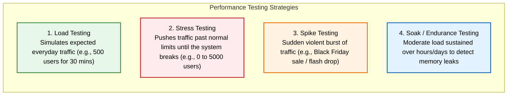

```
Traffic Load Profiles Over Time:

Load Testing:        Stress Testing:       Spike Testing:        Soak / Endurance:
Users                Users                 Users                 Users
  ^                   ^   (Break Point!)     ^   |--|              ^  
  |   +-------+       |         /\           |   |  |              |  +-------------+
  |  /         \      |       /    \         |  /|  |\             | /               \
  | /           \     |     /        \       | / |  | \            |/                 \
  +-------------->    +---------------->     +----------->         +------------------->
       Time                Time                  Time                      Time (Hours)
```

| Type | What It Does | Why You Run It | How You Configure It in JMeter |
| :--- | :--- | :--- | :--- |
| **Load Test** | Simulates expected normal and peak traffic. | Verify the system meets SLAs (e.g., $< 200\text{ ms}$) under standard load. | 100–500 threads, 30s ramp-up, steady duration of 15–30 minutes. |
| **Stress Test** | Increases load continuously past normal limits until failure. | Find the breaking point and observe how gracefully the system fails (does it recover?). | Step-up threads: 100 $\rightarrow$ 500 $\rightarrow$ 1000 $\rightarrow$ 2500 until errors spike. |
| **Spike Test** | Sends an instantaneous surge of traffic. | Test resiliency during sudden events (flash sales, viral posts, ticket drops). | Ramp-up = 1–2 seconds with 1000 threads, hold for 1 minute, drop to 0. |
| **Soak Test** | Sustains moderate load over a long period (8–48 hours). | Discover slow resource leaks: unclosed DB connections, JVM heap bloat, file handle leaks. | 50–100 threads, hold for 12–24 hours, monitor memory graphs. |

---

### 1.5 Essential Performance Metrics Explained Simply

When reviewing JMeter graphs and HTML reports, you will encounter these core metrics:

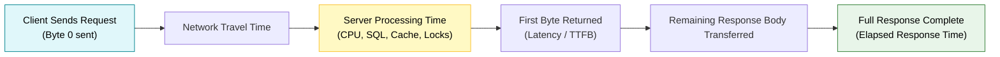

#### 1. Throughput (RPS / TPS)
- **What**: Requests per second or Transactions per second completed by the server.
- **Why it matters**: Higher is better. If throughput levels off while you continue adding users, your application has hit max capacity.

#### 2. Response Time (Elapsed Time)
- **What**: Total time from sending the first byte of the request until receiving the last byte of the response.
- **Why it matters**: Lower is better. Users drop off websites if page loads exceed 2–3 seconds.

#### 3. Latency (Time To First Byte - TTFB)
- **What**: Time spent waiting before the server starts sending back its first byte of response data.
- **Why it matters**: High latency with quick total response indicates slow server-side calculation (e.g., heavy database query or waiting for locks).

#### 4. Percentiles ($P_{50}$, $P_{90}$, $P_{95}$, $P_{99}$) — The "Average" Trap!
> [!WARNING]
> **Why the Arithmetic Mean (Average) is Misleading**:
> Imagine 99 shoppers experience a lightning-fast response of $10\text{ ms}$, but 1 shopper experiences a $10\text{ second}$ database timeout ($10000\text{ ms}$).
> 
> $$\text{Average} = \frac{(99 \times 10) + 10000}{100} = \frac{990 + 10000}{100} = 109.9\text{ ms}$$
> 
> An average of $\sim 110\text{ ms}$ looks excellent on a dashboard, completely hiding the fact that a user suffered a 10-second freeze!

- **Median ($P_{50}$)**: $50\%$ of users were faster than this value.
- **$P_{90}$ ($90\text{th}$ Percentile)**: $90\%$ of requests were faster than this value; only $10\%$ were slower.
- **$P_{95}$ ($95\text{th}$ Percentile)**: Industry standard benchmark for Service Level Objectives (SLOs).
- **$P_{99}$ ($99\text{th}$ Percentile)**: Represents the worst $1\%$ of user experiences (the unhappiest customers).

#### 5. Error Rate (%)
- **What**: Percentage of failed requests out of total requests sent.
- **Target**: Under normal expected load, the error rate should be **$0.00\%$**. Any value $> 1\%$ requires immediate investigation.

---

## 2. JMeter Architecture & Mental Model

### 2.1 Crucial Mental Model: Protocol-Level vs Browser-Level Testing

A common beginner misconception is expecting JMeter to act like Selenium, Cypress, or Puppeteer.

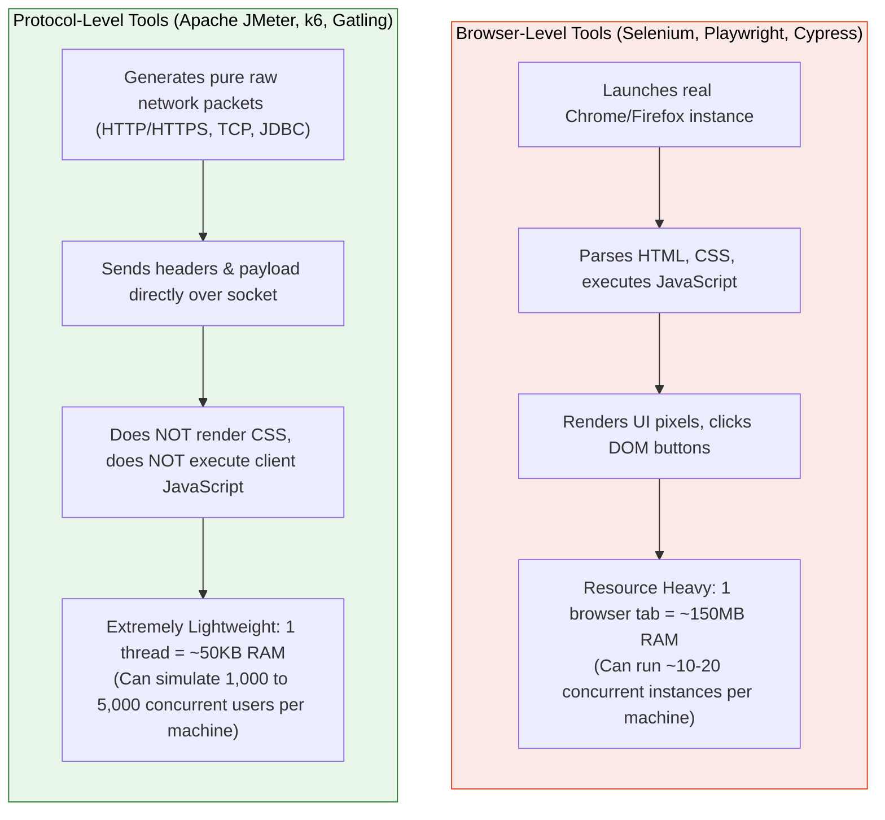

> [!NOTE]
> **Key Takeaway**: JMeter sends HTTP requests directly to your backend APIs and measures wire-level response times. It does not run client-side JavaScript (like React or Angular scripts) or load CSS animations unless specifically instructed to download embedded resources.

---

### 2.2 How JMeter Simulates Users (Sequence Diagram)

JMeter operates as a pure Java multi-threaded application:

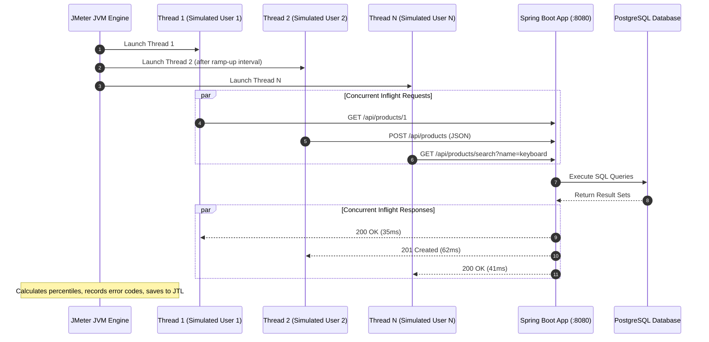

---

### 2.3 The 8 Core JMeter Building Blocks (What, Why, Analogy)

Every JMeter test script (`.jmx` file) is constructed using these 8 primary building blocks:

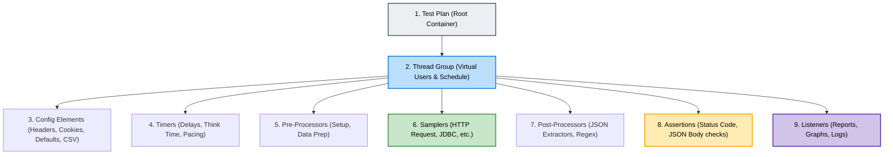

| Element | Everyday Analogy | What is it? | Why do we need it? | Example in Action |
| :--- | :--- | :--- | :--- | :--- |
| **1. Test Plan** | 📁 The Binder | Root folder of the test script. | Houses global variables and all test execution logic. | `ECommerce_Load_Test.jmx` |
| **2. Thread Group** | 👥 The Crowd | Defines the simulated virtual users. | Controls user count, ramp-up speed, and loop count. | 100 users, 20s ramp-up, loop 10 times |
| **3. Config Elements** | ⚙️ Shared Settings | Supplies shared defaults to all samplers. | Avoids repeating host, port, or headers on every sampler. | `HTTP Request Defaults (localhost:8080)` |
| **4. Samplers** | 🚀 The Actions | The workhorse that triggers actual network requests. | Generates real HTTP traffic against your backend endpoints. | `HTTP Request: GET /api/products` |
| **5. Timers** | ⏳ Breathing Room | Pauses between requests to simulate human thinking. | Prevents simulated users from hammering the server like a DDoS attack. | `Uniform Random Timer: 1000ms - 2000ms` |
| **6. Assertions** | 🔍 Quality Inspector | Verifies response codes and response data. | Confirms the server returned valid data, not silent errors. | Assert Response Code = `200` |
| **7. Post-Processors** | ✂️ Data Snips | Extracts data from responses into variables. | Enables dynamic chaining (correlation) between requests. | JSON Extractor: extract `$.id` into `productId` |
| **8. Listeners** | 📊 Scoreboard | Collects and displays test results and metrics. | Lets engineers observe response times, errors, and throughput. | `View Results Tree`, `Aggregate Report` |

---

### 2.4 Component Execution Order & Scoping Rules

When a virtual user runs an iteration, JMeter follows a strict execution hierarchy:

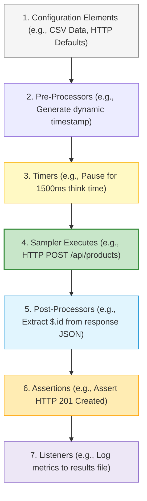

> [!IMPORTANT]
> **The Scoping Rule (Parent vs Child)**:
> - If a Timer, Assertion, or Pre/Post-Processor is placed **directly under a Sampler** (as a child node), it applies **ONLY to that specific sampler**.
> - If placed **directly under the Thread Group** (as a sibling to samplers), it applies **to EVERY sampler in that Thread Group**!
> 
> *Example*: If you place a 1-second timer at the Thread Group level, every sampler will pause for 1 second before firing.

---

## 3. Getting Started & Visual Guide to the JMeter UI

### 3.1 Installation & Launching JMeter (Mac, Windows, Linux)

#### Prerequisites
JMeter is built on Java. You must have Java 8, 11, 17, or 21 installed. Check with:
```bash
java -version
```

#### How to Install:
1. Visit the official Apache JMeter download page: [https://jmeter.apache.org/download_jmeter.cgi](https://jmeter.apache.org/download_jmeter.cgi)
2. Under **Binaries**, download the zip or tgz archive (e.g., `apache-jmeter-5.6.3.zip`).
3. Extract the archive into a folder of your choice (e.g., `~/tools/apache-jmeter-5.6.3` or `C:\tools\jmeter`).

#### How to Launch:
- **macOS / Linux**: Open your terminal and run:
  ```bash
  cd apache-jmeter-5.6.3/bin
  ./jmeter
  ```
- **Windows**: Double-click `jmeter.bat` inside the `bin` directory or run from Command Prompt/PowerShell:
  ```cmd
  cd apache-jmeter-5.6.3\bin
  jmeter.bat
  ```

---

### 3.2 Main JMeter Window & Test Plan Tree

The JMeter UI is divided into two main sections:
- **Left Navigation Pane (The Tree)**: Shows the structural hierarchy of your test elements.
- **Right Configuration Pane**: Displays the editable properties of whichever item is selected in the tree.

```
+------------------------------------------------------------------------------------------------------------------+
| Apache JMeter (5.6.3)                                                                             [-] [口] [X]   |
+------------------------------------------------------------------------------------------------------------------+
| File  Edit  Search  Run  Options  Tools  Help                                                                   |
| [▶ Start] [▶* Start No Pauses] [⏹ Stop] [🚫 Shut] | [🧹 Clear] [🧹* Clear All] | [💾 Save] [📋 Copy] [✂ Cut]      |
+---------------------------------------------+--------------------------------------------------------------------+
| Test Plan Tree (Left Navigation)            | Element Details View (Right Configuration Panel)                   |
+---------------------------------------------+--------------------------------------------------------------------+
| v 📁 Product Store Test Plan                |  Test Plan                                                         |
|   |                                         |  Name: [ Product Store Test Plan                                 ] |
|   +-- ⚙️ HTTP Request Defaults              |  Comments: [ Main load test plan for Spring Boot Product API     ] |
|   +-- ⚙️ HTTP Header Manager                |                                                                    |
|   |                                         |  User Defined Variables:                                           |
|   v 👥 Thread Group - Shoppers              |  +--------------------+------------------------------------------+ |
|     |                                       |  | Name               | Value                                    | |
|     +-- ⏳ Uniform Random Timer             |  +--------------------+------------------------------------------+ |
|     +-- 🚀 HTTP Request - GET /products     |  | BASE_URL           | localhost                                | |
|     |   +-- 🔍 Response Assertion (200 OK)  |  | PORT               | 8080                                     | |
|     +-- 🚀 HTTP Request - POST /products    |  +--------------------+------------------------------------------+ |
|     |   +-- ✂️ JSON Extractor (newId)       |                                                                    |
|     +-- 📊 View Results Tree                |  [ ] Run tearDown Thread Groups after shutdown of run              |
|     +-- 📈 Aggregate Report                 |  [ ] Functional Test Mode (only for debugging, saves more data)    |
+---------------------------------------------+--------------------------------------------------------------------+
```

---

### 3.3 The Thread Group Panel

The **Thread Group** controls virtual users and how they ramp up over time:

```
+------------------------------------------------------------------------------------------------------------------+
| Thread Group                                                                                                     |
| Name:     [ 👥 Shoppers Thread Group                                                                           ] |
| Comments: [ Simulates 100 concurrent browsing customers                                                       ] |
+------------------------------------------------------------------------------------------------------------------+
| Action to be taken after a Sampler error:                                                                        |
|  (o) Continue      ( ) Start Next Thread Loop      ( ) Stop Thread      ( ) Stop Test      ( ) Stop Test Now     |
+------------------------------------------------------------------------------------------------------------------+
| Thread Properties:                                                                                               |
|                                                                                                                  |
|  Number of Threads (users):    [ 100        ]  <-- Total concurrent virtual users to spawn                       |
|                                                                                                                  |
|  Ramp-up period (seconds):     [ 20         ]  <-- Takes 20 seconds to reach all 100 users (5 users/sec)          |
|                                                                                                                  |
|  Loop Count:                   ( ) Infinite    [x] Specify: [ 10       ]  <-- Each user repeats test 10 times    |
|                                                                                                                  |
|  [x] Same user on each iteration                                                                                 |
|  [ ] Delay Thread creation until needed                                                                          |
+------------------------------------------------------------------------------------------------------------------+
| Specify Thread lifetime:                                                                                         |
|  [x] Duration (seconds):       [ 300        ]  <-- Automatically stops test after 5 minutes (300s)               |
|  [ ] Startup delay (seconds):  [ 0          ]                                                                    |
+------------------------------------------------------------------------------------------------------------------+
```

#### Calculating Ramp-Up (The Formula):
$$\text{Spawn Rate} = \frac{\text{Number of Threads}}{\text{Ramp-Up Period (seconds)}} = \frac{100 \text{ users}}{20 \text{ seconds}} = 5 \text{ new users per second}$$

> [!TIP]
> **Why Ramp-Up is Mandatory**:
> If you configure 500 threads with Ramp-Up = 0, JMeter attempts to initiate 500 simultaneous TCP handshakes in millisecond 1. This artificial spike can trigger connection resets, skewing your results before the test even begins.

---

### 3.4 HTTP Request Defaults Panel

**HTTP Request Defaults** allows you to specify target host, port, protocol, and timeout settings once at the top level. All child HTTP samplers automatically inherit these values unless explicitly overridden.

```
+------------------------------------------------------------------------------------------------------------------+
| HTTP Request Defaults                                                                                            |
| Name: [ ⚙️ Global HTTP Defaults                                                                                 ] |
+------------------------------------------------------------------------------------------------------------------+
| Web Server:                                                                                                      |
|  Protocol [http/https]: [ http       ]                                                                           |
|  Server Name or IP:     [ localhost  ]  (or ${__P(server,localhost)})                                            |
|  Port Number:           [ 8080       ]                                                                           |
+------------------------------------------------------------------------------------------------------------------+
| HTTP Request:                                                                                                    |
|  Connect Timeout (ms):  [ 5000       ]  <-- Fail if server takes > 5s to accept connection                       |
|  Response Timeout (ms): [ 10000      ]  <-- Fail if server takes > 10s to reply                                  |
+------------------------------------------------------------------------------------------------------------------+
```

---

### 3.5 HTTP Request Sampler Panel

This is where you configure the specific API endpoint being invoked:

```
+------------------------------------------------------------------------------------------------------------------+
| HTTP Request                                                                                                     |
| Name: [ 🚀 POST /api/products - Create Product                                                                 ] |
+------------------------------------------------------------------------------------------------------------------+
| Web Server: (Inherited from HTTP Request Defaults if left blank)                                                 |
|  Protocol: [       ]  Server Name or IP: [              ]  Port: [     ]                                         |
+------------------------------------------------------------------------------------------------------------------+
| HTTP Request:                                                                                                    |
|  Method: [ POST    v ]   Path: [ /api/products                                                                 ] |
|  Content encoding: [ UTF-8      ]   [x] Follow Redirects   [x] Use KeepAlive                                     |
+------------------------------------------------------------------------------------------------------------------+
| Parameters | Body Data | Files Upload                                                                            |
| +--------------------------------------------------------------------------------------------------------------+ |
| | {                                                                                                            | |
| |   "name": "Mechanical Keyboard Model ${__Random(100,999)}",                                                  | |
| |   "price": 129.99,                                                                                           | |
| |   "stockQuantity": 50                                                                                        | |
| | }                                                                                                            | |
| +--------------------------------------------------------------------------------------------------------------+ |
+------------------------------------------------------------------------------------------------------------------+
```

---

### 3.6 View Results Tree Listener Panel (Debugging Tool)

Used **strictly for building and debugging** tests (with 1 or 2 virtual users). It lets you inspect raw request headers, payloads, status codes, and JSON response bodies.

```
+------------------------------------------------------------------------------------------------------------------+
| View Results Tree                                                                                                |
| Name: [ 📊 View Results Tree                                                                                   ] |
+------------------------------------------------+-----------------------------------------------------------------+
| Sampler Results List                           | Response Details Panel                                          |
+------------------------------------------------+-----------------------------------------------------------------+
| [x] Scroll automatically   [x] Log/Display Only: Errors [ ] Successes [ ]                                        |
|                                                |                                                                 |
|  🟢 🚀 GET /api/products                       | Sampler result | Request | Response data                         |
|  🟢 🚀 POST /api/products                      | +-------------------------------------------------------------+ |
|  🔴 🚀 GET /api/products/999                   | | HTTP/1.1 201 Created                                        | |
|  🟢 🚀 GET /api/products/1                     | | Content-Type: application/json                              | |
|                                                | | Content-Length: 78                                          | |
|                                                | | Date: Tue, 27 Oct 2026 14:20:00 GMT                         | |
|                                                | |                                                             | |
|                                                | | {                                                           | |
|                                                | |   "id": 42,                                                 | |
|                                                | |   "name": "Mechanical Keyboard Model 412",                  | |
|                                                | |   "price": 129.99,                                          | |
|                                                | |   "stockQuantity": 50                                       | |
|                                                | | }                                                           | |
|                                                | +-------------------------------------------------------------+ |
+------------------------------------------------+-----------------------------------------------------------------+
```

---

### 3.7 Aggregate Report Listener Panel (Metrics Summary)

Shows statistical summaries for all sampler executions during the run:

```
+------------------------------------------------------------------------------------------------------------------+
| Aggregate Report                                                                                                 |
| Name: [ 📈 Aggregate Report                                                                                    ] |
+------------------------------------------------------------------------------------------------------------------+
| Label                 | # Samples | Average | Median | 90% Line | 95% Line | 99% Line | Min | Max | Error % | Throughput |
+-----------------------+-----------+---------+--------+----------+----------+----------+-----+-----+---------+------------+
| GET /api/products     |     10000 |    24ms |   18ms |     35ms |     48ms |     72ms | 5ms |210ms|   0.00% | 450.2/sec  |
| POST /api/products    |      2000 |    58ms |   45ms |     85ms |    112ms |    160ms |12ms |410ms|   0.00% |  92.5/sec  |
| GET /api/products/{id}|      2000 |    14ms |   12ms |     22ms |     28ms |     41ms | 3ms |180ms|   0.00% |  91.8/sec  |
+-----------------------+-----------+---------+--------+----------+----------+----------+-----+-----+---------+------------+
| TOTAL                 |     14000 |    27ms |   20ms |     42ms |     55ms |     88ms | 3ms |410ms|   0.00% | 634.5/sec  |
+-----------------------+-----------+---------+--------+----------+----------+----------+-----+-----+---------+------------+
```

---

## 4. Step-by-Step Tutorial: Testing a Spring Boot REST API

We will walk through creating a complete JMeter performance test from scratch for a Spring Boot product catalog API.

### 4.1 Target API Overview

Our Spring Boot application runs locally on `http://localhost:8080`:

| Method | Endpoint | Description | Request Body | Response Code |
| :--- | :--- | :--- | :--- | :--- |
| `GET` | `/api/products` | Returns list of all products | None | `200 OK` |
| `POST` | `/api/products` | Creates a new product | JSON payload | `201 Created` with created `id` |
| `GET` | `/api/products/{id}` | Fetches product by ID | None | `200 OK` |

---

### 4.2 Step 1: Create Test Plan & Global Defaults

#### What are we doing?
Creating our test script root container and setting default host/port information so we don't have to retype `localhost` and `8080` in every sampler.

#### Why do it?
If you later switch from testing `localhost:8080` to `staging.company.com:443`, you only update one single field instead of 50 individual samplers!

#### How to configure:
1. Open JMeter. You start with an empty **Test Plan** node.
2. Click **Test Plan**, rename it to: `Product API Load Test`.
3. Right-click **Product API Load Test** $\rightarrow$ **Add** $\rightarrow$ **Config Element** $\rightarrow$ **HTTP Request Defaults**.
4. In the configuration panel on the right, set:
   - **Protocol**: `http`
   - **Server Name or IP**: `localhost`
   - **Port Number**: `8080`
   - **Connect Timeout (ms)**: `5000` (fails if connection takes $> 5\text{s}$)
   - **Response Timeout (ms)**: `10000` (fails if response takes $> 10\text{s}$)

---

### 4.3 Step 2: Configure the Thread Group (Users & Ramp-up)

#### What are we doing?
Configuring the virtual user pool that generates the load.

#### Why do it?
This defines how many users hit your system, how quickly they arrive, and how long they stay.

#### How to configure:
1. Right-click **Product API Load Test** $\rightarrow$ **Add** $\rightarrow$ **Threads (Users)** $\rightarrow$ **Thread Group**.
2. Rename to: `Shoppers Workload`.
3. Set the thread properties:
   - **Number of Threads (users)**: `50`
   - **Ramp-up period (seconds)**: `10`
   - **Loop Count**: Click **Specify**, enter `20`

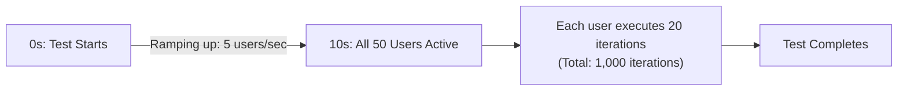

---

### 4.4 Step 3: Add HTTP Header Manager

#### What are we doing?
Instructing JMeter to include standard HTTP headers on every outgoing request.

#### Why do it?
Spring Boot REST controllers inspect incoming headers. If a POST request sends a JSON body without `Content-Type: application/json`, Spring Boot rejects it with an `HTTP 415 Unsupported Media Type` error.

#### How to configure:
1. Right-click **Shoppers Workload** $\rightarrow$ **Add** $\rightarrow$ **Config Element** $\rightarrow$ **HTTP Header Manager**.
2. Click the **Add** button at the bottom of the table twice to insert these two headers:

| Name | Value | Purpose |
| :--- | :--- | :--- |
| `Content-Type` | `application/json` | Informs Spring Boot that request body is JSON |
| `Accept` | `application/json` | Informs Spring Boot we expect JSON response |

---

### 4.5 Step 4: Add HTTP Request Samplers (GET & POST)

Now we define the actual API requests our simulated shoppers will perform.

#### Request 1: Browse Product Catalog (GET)
1. Right-click **Shoppers Workload** $\rightarrow$ **Add** $\rightarrow$ **Sampler** $\rightarrow$ **HTTP Request**.
2. Set:
   - **Name**: `1. GET /api/products`
   - **Method**: `GET`
   - **Path**: `/api/products`
   *(Leave Server Name and Port blank — they are inherited from HTTP Request Defaults!)*

#### Request 2: Create a New Product (POST)
1. Right-click **Shoppers Workload** $\rightarrow$ **Add** $\rightarrow$ **Sampler** $\rightarrow$ **HTTP Request**.
2. Set:
   - **Name**: `2. POST /api/products`
   - **Method**: `POST`
   - **Path**: `/api/products`
3. Click the **Body Data** tab below the path, and paste:
   ```json
   {
     "name": "Wireless Mouse Model ${__UUID()}",
     "price": 29.99,
     "stockQuantity": 100
   }
   ```

> [!NOTE]
> **Why `${__UUID()}`?**:
> If your database has a unique constraint on product names, sending a hardcoded `"name": "Wireless Mouse"` will fail after the first request with `HTTP 500 Duplicate Key`. The built-in `${__UUID()}` function generates a unique string (e.g., `4a3b2c1d-...`) for every single request!

---

### 4.6 Step 5: Realistic User Pacing with Timers (Think Time)

#### What are we doing?
Adding an artificial delay between requests.

#### Why do it?
Real human users do not click links $0\text{ ms}$ after receiving a response. They read the screen, scroll, and think for 1–2 seconds. Without timers, 50 virtual users will send thousands of requests in seconds, simulating an aggressive DDoS attack rather than realistic user traffic.

#### How to configure:
1. Right-click **Shoppers Workload** $\rightarrow$ **Add** $\rightarrow$ **Timer** $\rightarrow$ **Uniform Random Timer**.
2. Set:
   - **Random Delay Maximum (in ms)**: `1000`
   - **Constant Delay Offset (in ms)**: `1000`

$$\text{Total Pause} = \text{Constant Offset} + \text{Random}(0, \text{Max}) = 1000\text{ms} + [0\text{ms} \dots 1000\text{ms}] = 1.0\text{s} \text{ to } 2.0\text{s}$$

---

### 4.7 Step 6: Validating Responses with Assertions

#### What are we doing?
Adding rules to verify that the server returned the correct response code and content.

#### Why do it?
By default, JMeter treats any response as successful as long as a network socket connection occurred—even if your Spring Boot app returns `HTTP 500 Internal Server Error`! Assertions ensure that errors are properly flagged and counted in your error rate.

#### Adding Response Code Assertion (Verify 201 Created):
1. Right-click `2. POST /api/products` $\rightarrow$ **Add** $\rightarrow$ **Assertions** $\rightarrow$ **Response Assertion**.
2. In **Field to Test**: Select **Response Code**.
3. In **Pattern Matching Rules**: Select **Equals**.
4. In **Patterns to Test**: Click **Add** and enter `201`.

#### Adding JSON Assertion (Verify Response Payload):
1. Right-click `2. POST /api/products` $\rightarrow$ **Add** $\rightarrow$ **Assertions** $\rightarrow$ **JSON Assertion**.
2. In **Assert JSON Path exists**: enter `$.id`.
3. Check the box **[x] Additionally assert value**.
4. Select **[ ] Match as regular expression** (unchecked), and check **[ ] Expect null** (unchecked) to verify `$.id` exists and is non-null.

---

### 4.8 Step 7: Running the Test in GUI & Inspecting Debug Results

To verify your test plan works before running a full test:

1. Right-click **Shoppers Workload** $\rightarrow$ **Add** $\rightarrow$ **Listener** $\rightarrow$ **View Results Tree**.
2. Temporarily set **Thread Group** properties to:
   - **Number of Threads**: `1`
   - **Loop Count**: `1`
3. Click the green **Start** button (`▶`) in the top toolbar (or press `Cmd+R` / `Ctrl+R`).
4. Click **View Results Tree** in the left menu.
5. You should see green checkmarks:
   - 🟢 `1. GET /api/products`
   - 🟢 `2. POST /api/products`
6. Click on each sampler to inspect **Request Headers**, **Request Body**, and **Response Data**.
7. If all requests show green, your test plan is valid and ready for full load testing!

---

### 4.9 Beginner Troubleshooting: Common Errors & Fixes

| Symptom / Error | Root Cause | How to Fix |
| :--- | :--- | :--- |
| **`java.net.ConnectException: Connection refused`** | Spring Boot is not running or port is incorrect. | Ensure your Spring Boot app is running on port 8080 (`./mvnw spring-boot:run`). |
| **`HTTP 415 Unsupported Media Type`** | Missing `Content-Type` header on POST/PUT requests. | Add an **HTTP Header Manager** with `Content-Type: application/json`. |
| **`HTTP 400 Bad Request`** | Malformed JSON payload or missing required DTO fields. | Inspect the JSON body in the HTTP Sampler; test payload syntax with curl or Postman. |
| **`HTTP 404 Not Found`** | URL path mismatch (e.g., `/products` instead of `/api/products`). | Verify endpoint path matching your `@RequestMapping` in Spring Boot. |
| **`HTTP 500 Internal Server Error`** | Server-side unhandled exception (e.g., duplicate key, null pointer). | Check the Spring Boot console log / stack trace for the exact exception. |
| **`Assertion Failure: Test failed: code expected to equal /201/`** | Server returned a different status code (e.g., 200 or 500). | Check View Results Tree to see what status code was actually returned. |

---

## 5. Advanced JMeter Workflows

### 5.1 Parameterization with CSV Data Set Config (Dynamic Test Data)

#### What is it?
Parameterization reads test data from an external file (e.g., `.csv`) and injects unique values into each request.

#### Why do we need it?
If 100 virtual users post the exact same hardcoded product name or log in with the exact same username, caches hide real database performance, or unique constraints cause false errors. Real load testing requires realistic, varied data.

```
CSV File (products.csv):
name,price,stockQuantity
UltraWide Monitor,499.99,25
Noise Cancelling Headset,199.50,40
Mechanical Keyboard,129.00,80
Ergonomic Mouse,59.99,150
USB-C Docking Station,89.95,65
```

#### How to configure:
1. Create a `products.csv` file on your machine.
2. In JMeter, right-click **Shoppers Workload** $\rightarrow$ **Add** $\rightarrow$ **Config Element** $\rightarrow$ **CSV Data Set Config**.
3. Configure the fields:
   - **Filename**: Path to your CSV file (e.g., `products.csv` or `/Users/pushkar/test-data/products.csv`).
   - **Variable Names (comma-delimited)**: `csvName,csvPrice,csvStock`
   - **Delimiter**: `,`
   - **Recycle on EOF?**: `True` (Loops back to row 1 when the file ends)
   - **Stop thread on EOF?**: `False`
   - **Sharing mode**: `All threads` (Threads share the file, each taking the next row)
4. Reference these variables in your HTTP Sampler body:
   ```json
   {
     "name": "${csvName} - ${__Random(1,999)}",
     "price": ${csvPrice},
     "stockQuantity": ${csvStock}
   }
   ```

> [!TIP]
> **Pro Tip on File Paths**:
> If you save `products.csv` in the exact same directory as your test plan (`.jmx`), you can simply enter `products.csv` in the Filename field instead of an absolute path. This makes your test script portable across team members' computers and CI/CD pipelines!

---

### 5.2 Dynamic Correlation: JSON Extractor (Chaining Requests)

#### What is it?
**Correlation** is the process of capturing a dynamic value generated by the server in Request 1 and passing it into Request 2.

#### Everyday Analogy: The Airport Boarding Pass
When you check in at the airline counter (Request 1), the agent hands you a boarding pass with a Gate Number (Server-generated value). You cannot go to Gate 14 (Request 2) until the airline tells you which gate your flight is at!

```
Request 1: POST /api/products  -----> Server returns: { "id": 842, "name": "Desk" }
                                                    |
                                      (JSON Extractor extracts 842)
                                                    v
Request 2: GET /api/products/842 <--- JMeter calls: GET /api/products/${createdId}
```

#### Why do we need it?
In realistic user journeys, actions depend on previous actions:
1. User logs in $\rightarrow$ Server returns a JWT `access_token` $\rightarrow$ Subsequent requests must pass `Authorization: Bearer <token>`.
2. User creates an order $\rightarrow$ Server assigns Order ID `98124` $\rightarrow$ User checks status of Order `98124`.

#### How to configure:
1. In JMeter, right-click `2. POST /api/products` $\rightarrow$ **Add** $\rightarrow$ **Post Processors** $\rightarrow$ **JSON Extractor**.
2. Configure the fields:
   - **Names of created variables**: `createdProductId`
   - **JSON Path expressions**: `$.id`
   - **Match No. (0 for Random)**: `1`
   - **Default Values**: `NOT_FOUND`
3. Now add a 3rd Sampler:
   - **Name**: `3. GET /api/products/{id}`
   - **Method**: `GET`
   - **Path**: `/api/products/${createdProductId}`

---

### 5.3 End-to-End Correlation Flow (Diagram)

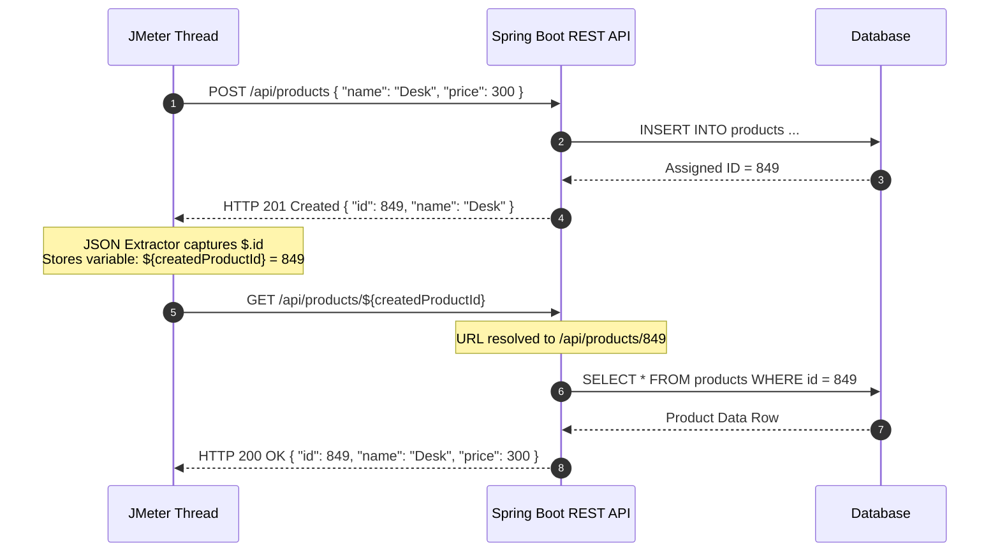

---

### 5.4 Regular Expression Extractor (Extracting from Headers or HTML)

If your backend returns authentication tokens inside HTTP Response Headers (e.g., `Set-Cookie` or `Location`) or in plain HTML rather than JSON:

1. Right-click the Sampler $\rightarrow$ **Add** $\rightarrow$ **Post Processors** $\rightarrow$ **Regular Expression Extractor**.
2. Configure:
   - **Field to check**: `Response Headers` (or `Body`)
   - **Reference Name**: `authToken`
   - **Regular Expression**: `Bearer\s+([A-Za-z0-9-_.]+)`
   - **Template**: `$1$`
   - **Match No.**: `1`
3. Access later via: `${authToken}`.

---

## 6. The Golden Rule: Running JMeter in Non-GUI Mode

### 6.1 Why the GUI Must Never Run Heavy Tests

> [!CAUTION]
> **THE GOLDEN RULE OF JMETER**:
> **NEVER run performance tests using the JMeter Graphical User Interface!**
> 
> The JMeter GUI is built using Java Swing. When running hundreds of virtual users, rendering GUI trees, color updates, and graph pixels consumes massive amounts of CPU and memory. JMeter itself will experience Java Garbage Collection freezes, distorting test results and reporting false latency spikes caused by your testing client, not your server!
> 
> - **GUI Mode**: Used *only* for building, editing, and debugging test plans (1 to 2 threads).
> - **Non-GUI (CLI) Mode**: Used for *all* actual performance, load, and stress test runs.

---

### 6.2 The CLI Command & Flags

Once your test plan is saved (e.g., `product_api_load_test.jmx`), open your terminal and run:

```bash
jmeter -n -t product_api_load_test.jmx -l results.jtl -e -o ./html-report
```

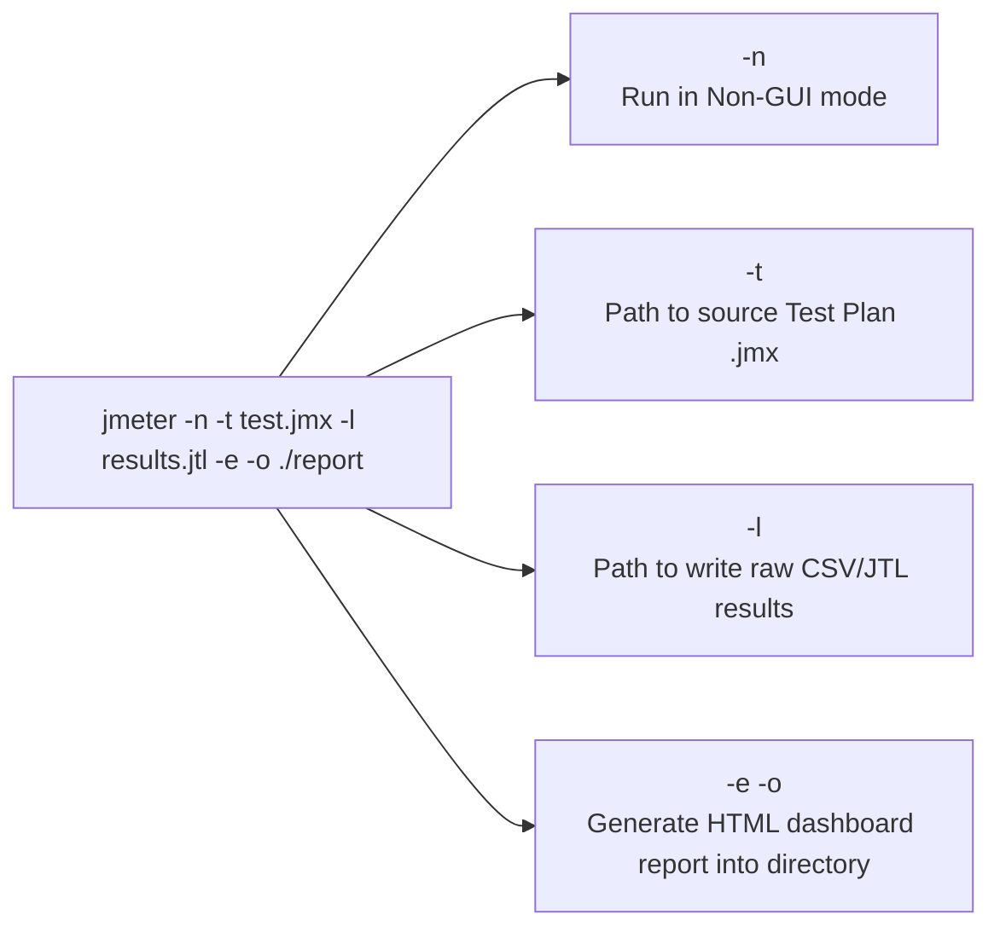

#### Parameter Breakdown:

| Flag | Name | Purpose |
| :--- | :--- | :--- |
| `-n` | **Non-GUI** | Instructs JMeter to run headlessly without opening the Java Swing window. |
| `-t <file.jmx>` | **Test File** | Path to the `.jmx` test plan file to execute. |
| `-l <file.jtl>` | **Log Results** | Raw output file recording every sample's timestamp, latency, and status. |
| `-e` | **Export Report** | Instructs JMeter to generate a dashboard report upon completion. |
| `-o <dir>` | **Output Folder** | Destination folder where HTML report files will be written (must be empty or not exist). |
| `-Jprop=val` | **Java Property** | Passes dynamic CLI variables into the test script (e.g., `-Jthreads=200`). |

#### Pro Pattern: Parameterizing Test Execution via CLI
Instead of editing the JMX file every time you change thread counts, configure your Thread Group using properties:
- **Number of Threads**: `${__P(threads, 10)}`
- **Ramp-Up**: `${__P(rampup, 5)}`
- **Duration**: `${__P(duration, 60)}`

Now you can run different load scenarios without modifying the test script:
```bash
# Light load test (50 users)
jmeter -n -t test.jmx -l res_50.jtl -Jthreads=50 -Jrampup=10 -Jduration=120 -e -o ./report_50

# Heavy stress test (500 users)
jmeter -n -t test.jmx -l res_500.jtl -Jthreads=500 -Jrampup=30 -Jduration=300 -e -o ./report_500
```

---

### 6.3 Generating and Reading HTML Dashboard Reports

When the test finishes, open `./html-report/index.html` in your web browser. JMeter creates a rich, interactive dashboard:

```
+------------------------------------------------------------------------------------------------------------------+
| Apache JMeter Dashboard                                                                                          |
+------------------------------------------------------------------------------------------------------------------+
| Test and Report Informations:                                                                                    |
| Source: results.jtl | Start: 14:30:00 | End: 14:35:00 | Duration: 5m 0s                                          |
+------------------------------------------------------------------------------------------------------------------+
| APDEX (Application Performance Index):                                                                           |
| Toleration Threshold (T) = 500ms | Frustration Threshold (F) = 1500ms                                             |
| Score: 0.985 (Excellent)                                                                                         |
+----------------------------------------------------+-------------------------------------------------------------+
| Requests Summary (Pie Chart)                       | Statistics Table                                            |
|                                                    |                                                             |
|           [##########] 99.8% OK                    | Label             #Requests   Avg    90%    99%   Error %   |
|           [!]          0.2% KO (Errors)            | GET /products        24,500  28ms   41ms   75ms     0.00%   |
|                                                    | POST /products        4,900  62ms   95ms  140ms     0.00%   |
|                                                    | Total                29,400  34ms   52ms   92ms     0.00%   |
+----------------------------------------------------+-------------------------------------------------------------+
| Graphs Available:                                                                                                |
|  * Response Times Over Time                        * Active Threads Over Time                                    |
|  * Transactions Per Second (Throughput)            * Time vs Latency Scatter Plot                                |
+------------------------------------------------------------------------------------------------------------------+
```

---

### 6.4 Demystifying the APDEX Score

**APDEX** (Application Performance Index) is an open industry standard that converts raw response times into a standardized user satisfaction score from `0.0` (unacceptable) to `1.0` (perfect).

```
   0ms --------------- T (Tolerated, e.g. 500ms) --------------- 4*T (Frustrated, e.g. 2000ms) ---> Infinity
        Satisfied                    Tolerating                               Frustrated
  (User feels fast)             (Noticeable delay)                      (User abandons app)
```

$$\text{APDEX} = \frac{\text{Satisfied Count} + \left(\frac{\text{Tolerating Count}}{2}\right)}{\text{Total Samples}}$$

| APDEX Score | Rating | Interpretation |
| :--- | :--- | :--- |
| **0.94 – 1.00** | **Excellent** | Fast, responsive; users experience no frustrating delays. |
| **0.85 – 0.93** | **Good** | Minor delays under peak load; acceptable user experience. |
| **0.70 – 0.84** | **Fair** | Noticeable slowdowns; optimization recommended. |
| **0.50 – 0.69** | **Poor** | Severe latency; users likely to abandon carts or leave. |
| **< 0.50** | **Unacceptable** | System unusable; requests failing or timing out. |

---

## 7. Analyzing Spring Boot Bottlenecks under Load

When your JMeter test shows escalating response times ($> 2000\text{ ms}$) or error spikes under load, inspect these three classic Spring Boot architectural bottlenecks:

### 7.1 Tomcat Thread Pool Saturation

#### What is it?
Spring Boot's embedded Tomcat web server uses a worker thread pool to handle concurrent incoming requests. By default, it allocates a **maximum of 200 threads** (`server.tomcat.threads.max=200`).

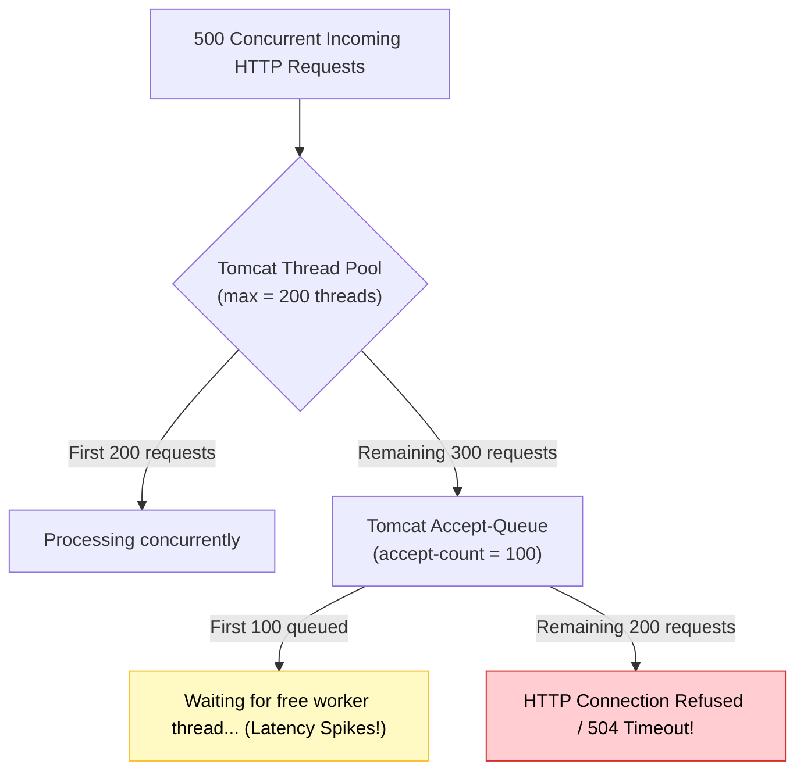

- **Symptom in JMeter**: Latency climbs steeply, CPU on the server remains low (e.g., $15\%$), and requests start timing out.
- **Diagnostic**: Check Spring Boot Actuator endpoint: `/actuator/metrics/tomcat.threads.busy`.
- **How to Fix** (in `application.properties`):
  ```properties
  # Increase worker threads if server has sufficient CPU and RAM
  server.tomcat.threads.max=400
  server.tomcat.accept-count=200

  # Or on Java 21+, enable Virtual Threads for massive concurrency with zero thread tuning!
  spring.threads.virtual.enabled=true
  ```

---

### 7.2 HikariCP Database Connection Pool Starvation

#### What is it?
By default, Spring Boot uses **HikariCP** with a default **maximum pool size of 10 database connections** (`maximum-pool-size: 10`).

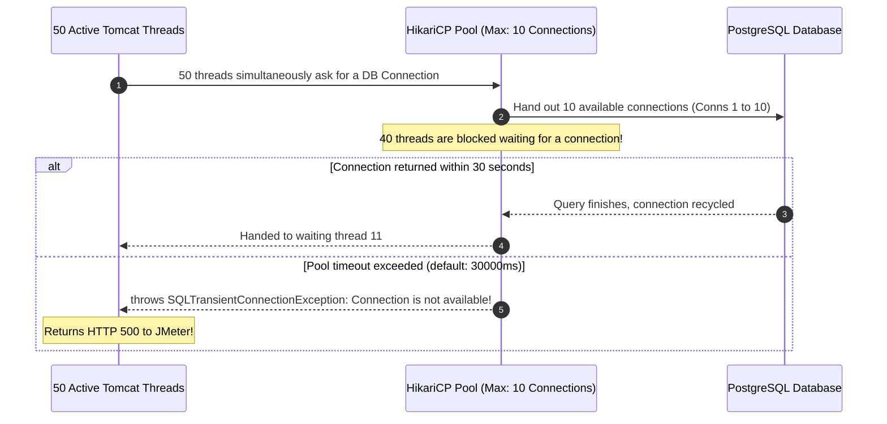

- **Symptom in JMeter**: JMeter receives HTTP 500 errors with the stack trace:
  `SQLTransientConnectionException: HikariPool-1 - Connection is not available, request timed out after 30000ms`.
- **How to Fix** (in `application.properties`):
  ```properties
  # Sizing rule: (CPU Core Count * 2) + effective_spindle_count
  spring.datasource.hikari.maximum-pool-size=30
  spring.datasource.hikari.connection-timeout=5000
  ```

---

### 7.3 JVM Heap & Garbage Collection Pauses

#### What is it?
Under high traffic, thousands of Java DTOs and entities are allocated in memory every second. When the heap fills up, the JVM triggers a **Stop-The-World (STW)** garbage collection cycle, freezing all application threads.

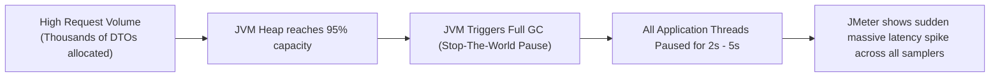

- **Symptom in JMeter**: The response time graph displays sudden, periodic saw-tooth spikes where every single request takes several seconds at fixed intervals.
- **How to Fix**:
  ```bash
  # Give adequate heap memory and use modern low-pause Garbage Collectors (G1 or ZGC)
  java -Xms2g -Xmx2g -XX:+UseG1GC -jar target/app.jar
  ```

---

### 7.4 Bottleneck Triage Decision Tree

When a test run fails or exhibits high latency, follow this systematic diagnostic path:

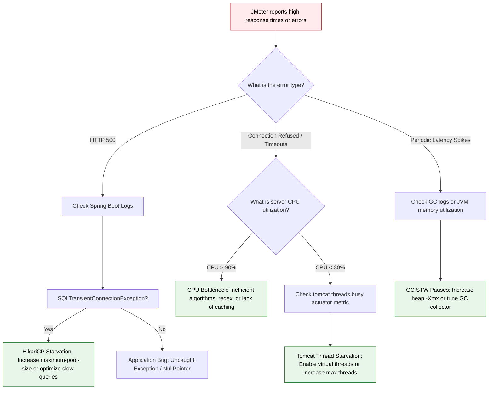

---

## 8. Quick Reference & Cheat Sheet

### 8.1 Common Built-in Functions

| Function | What It Returns | Concrete Example |
| :--- | :--- | :--- |
| `${__UUID()}` | Generates a unique 36-char UUID string | `"id": "${__UUID()}"` |
| `${__Random(min, max)}` | Random integer between min and max | `"price": ${__Random(10, 100)}` |
| `${__time(yyyy-MM-dd)}` | Formatted current date string | `"orderDate": "${__time(yyyy-MM-dd)}"` |
| `${__time(yyyy-MM-dd'T'HH:mm:ss)}` | ISO-8601 formatted timestamp | `"createdAt": "${__time(yyyy-MM-dd'T'HH:mm:ss)}"` |
| `${__P(propName, default)}` | Reads property passed via `-J` CLI flag | `${__P(threads, 50)}` |
| `${__threadNum}` | Current virtual user thread number (1 to N) | `"username": "user_${__threadNum}"` |

---

### 8.2 JMeter GUI Keyboard Shortcuts

| Shortcut (Mac) | Shortcut (Windows/Linux) | Action |
| :--- | :--- | :--- |
| `Cmd + R` | `Ctrl + R` | **Start** test execution |
| `Cmd + .` | `Ctrl + .` | **Stop** test immediately |
| `Cmd + E` | `Ctrl + E` | **Clear** results from current listener |
| `Cmd + Shift + E` | `Ctrl + Shift + E` | **Clear All** results across all listeners |
| `Cmd + T` | `Ctrl + T` | **Enable / Disable** selected tree element |
| `Cmd + S` | `Ctrl + S` | **Save** test plan (`.jmx`) |

---

### 8.3 Best Practices Checklist

- [ ] **Design in GUI, Run in CLI**: Use the GUI only to build and debug with 1–2 threads. Run all load tests headlessly with `jmeter -n -t ...`.
- [ ] **Disable Heavy Listeners Before CLI Runs**: Disable `View Results Tree` before launching load tests; it consumes significant client memory.
- [ ] **Always Include Think Time**: Add a `Uniform Random Timer` (1–2 seconds) so virtual users simulate human behavior instead of a denial-of-service attack.
- [ ] **Ramp Up Gradually**: Never launch 500 threads at second zero. Ramp up over 30 to 60 seconds to allow thread pools to warm up.
- [ ] **Parameterize Unique Data**: Use `CSV Data Set Config` or `${__UUID()}` to avoid duplicate key errors and cache distortions.
- [ ] **Correlate Dynamic Identifiers**: Extract IDs or authentication tokens using `JSON Extractor` instead of hardcoding database IDs.
- [ ] **Validate with Assertions**: Verify status codes (e.g., 200, 201) and payload fields so silent application errors are recorded.
- [ ] **Monitor the Host Under Test**: Watch server CPU, memory, Hikari connection pools, and JVM Garbage Collection alongside JMeter's throughput and response times.

### 8.3 Best Practices Checklist

- [ ] **Design in GUI, Run in CLI**: Use the GUI only to build and debug with 1–2 threads. Run all load tests headlessly with `jmeter -n -t ...`.
- [ ] **Disable Heavy Listeners Before CLI Runs**: Disable `View Results Tree` before launching load tests; it consumes significant client memory.
- [ ] **Always Include Think Time**: Add a `Uniform Random Timer` (1–2 seconds) so virtual users simulate human behavior instead of a denial-of-service attack.
- [ ] **Ramp Up Gradually**: Never launch 500 threads at second zero. Ramp up over 30 to 60 seconds to allow thread pools to warm up.
- [ ] **Parameterize Unique Data**: Use `CSV Data Set Config` or `${__UUID()}` to avoid duplicate key errors and cache distortions.
- [ ] **Correlate Dynamic Identifiers**: Extract IDs or authentication tokens using `JSON Extractor` instead of hardcoding database IDs.
- [ ] **Validate with Assertions**: Verify status codes (e.g., 200, 201) and payload fields so silent application errors are recorded.
- [ ] **Monitor the Host Under Test**: Watch server CPU, memory, Hikari connection pools, and JVM Garbage Collection alongside JMeter's throughput and response times.

