# The Ultimate Java & Spring Boot Interview Master Handbook

A comprehensive, production-grade question bank and coding interview curriculum for senior and lead software engineering roles.

---

## Master Table of Contents

- [Part 1: Top 60 Non-Trivial Conceptual Questions & Answers](#part-1-top-60-non-trivial-conceptual-questions--answers)
  - [1.1 Core Java, JVM Internals & Memory Architecture (Q01 – Q15)](#11-core-java-jvm-internals--memory-architecture-q01--q15)
  - [1.2 Concurrency, Multithreading & Virtual Threads (Q16 – Q30)](#12-concurrency-multithreading--virtual-threads-q16--q30)
  - [1.3 Spring Core, IoC, AOP & Bean Lifecycle (Q31 – Q45)](#13-spring-core-ioc-aop--bean-lifecycle-q31--q45)
  - [1.4 Spring Boot, Data/JPA, Security, Transactions & Microservices (Q46 – Q60)](#14-spring-boot-datajpa-security-transactions--microservices-q46--q60)
- [Part 2: Top 20 Core Java Coding Interview Problems (30–60 Min)](#part-2-top-20-core-java-coding-interview-problems-3060-min)
  - [J01: Thread-Safe LRU Cache with O(1) Operations](#j01-thread-safe-lru-cache-with-o1-operations)
  - [J02: LFU (Least Frequently Used) Cache with O(1) Operations](#j02-lfu-least-frequently-used-cache-with-o1-operations)
  - [J03: Custom Bounded Blocking Queue (Producer-Consumer)](#j03-custom-bounded-blocking-queue-producer-consumer)
  - [J04: Distributed/Concurrent Token Bucket Rate Limiter](#j04-distributedconcurrent-token-bucket-rate-limiter)
  - [J05: Minimalist Database Connection Pool](#j05-minimalist-database-connection-pool)
  - [J06: Custom Read-Write Lock with Writer Preference](#j06-custom-read-write-lock-with-writer-preference)
  - [J07: Deep Object Flattener and Path Resolver](#j07-deep-object-flattener-and-path-resolver)
  - [J08: Concurrent In-Memory Key-Value Store with TTL & Active Eviction](#j08-concurrent-in-memory-key-value-store-with-ttl--active-eviction)
  - [J09: Custom CompletableFuture / Promise Pipeline Engine](#j09-custom-completablefuture--promise-pipeline-engine)
  - [J10: Custom ThreadPoolExecutor with Work-Stealing / Bounded Queue](#j10-custom-threadpoolexecutor-with-work-stealing--bounded-queue)
  - [J11: High-Performance Concurrent Trie with Prefix Autocomplete](#j11-high-performance-concurrent-trie-with-prefix-autocomplete)
  - [J12: Thread Deadlock Detector and Dependency Graph Cycle Finder](#j12-thread-deadlock-detector-and-dependency-graph-cycle-finder)
  - [J13: Consistent Hashing Ring with Virtual Nodes](#j13-consistent-hashing-ring-with-virtual-nodes)
  - [J14: Complex Stream API Pipeline with Custom Collector](#j14-complex-stream-api-pipeline-with-custom-collector)
  - [J15: Real-Time Top-K Frequent Elements Stream Tracker](#j15-real-time-top-k-frequent-elements-stream-tracker)
  - [J16: In-Memory Asynchronous Pub/Sub Event Bus](#j16-in-memory-asynchronous-pubsub-event-bus)
  - [J17: High-Throughput Batch Processing Buffer with Time/Size Flushing](#j17-high-throughput-batch-processing-buffer-with-timesize-flushing)
  - [J18: Priority-Based Delayed Task Scheduler](#j18-priority-based-delayed-task-scheduler)
  - [J19: Thread-Safe Singleton: Comparative Analysis of All 4 Forms](#j19-thread-safe-singleton-comparative-analysis-of-all-4-forms)
  - [J20: Persistent / Immutable Red-Black Tree or Stack](#j20-persistent--immutable-red-black-tree-or-stack)
- [Part 3: Top 20 Spring Boot Coding & Architectural Problems (30–60 Min)](#part-3-top-20-spring-boot-coding--architectural-problems-3060-min)
  - [SB01: Idempotent Payment API with Redis Distributed Lock & Token](#sb01-idempotent-payment-api-with-redis-distributed-lock--token)
  - [SB02: High-Concurrency Flash Sale: Optimistic vs. Pessimistic Locking](#sb02-high-concurrency-flash-sale-optimistic-vs-pessimistic-locking)
  - [SB03: Resilient Downstream API Client with Resilience4j](#sb03-resilient-downstream-api-client-with-resilience4j)
  - [SB04: Custom Stateless JWT Authentication Filter with Refresh Rotation](#sb04-custom-stateless-jwt-authentication-filter-with-refresh-rotation)
  - [SB05: Distributed Task Scheduler with ShedLock / Redis](#sb05-distributed-task-scheduler-with-shedlock--redis)
  - [SB06: Multi-Tenant Architecture with Dynamic Routing DataSource](#sb06-multi-tenant-architecture-with-dynamic-routing-datasource)
  - [SB07: Asynchronous Batch Job with Virtual Threads & MDC Propagation](#sb07-asynchronous-batch-job-with-virtual-threads--mdc-propagation)
  - [SB08: Transactional Event Listener with Outbox Pattern](#sb08-transactional-event-listener-with-outbox-pattern)
  - [SB09: Real-Time Live Notification System using Server-Sent Events (SSE)](#sb09-real-time-live-notification-system-using-server-sent-events-sse)
  - [SB10: API Rate Limiter Gateway Filter with Bucket4j & Redis](#sb10-api-rate-limiter-gateway-filter-with-bucket4j--redis)
  - [SB11: Global RFC 7807 ProblemDetail Exception Handler](#sb11-global-rfc-7807-problemdetail-exception-handler)
  - [SB12: Dynamic Multi-Field Search with JPA Specifications & Criteria API](#sb12-dynamic-multi-field-search-with-jpa-specifications--criteria-api)
  - [SB13: Multipart Chunked File Upload with Anti-Virus Hook](#sb13-multipart-chunked-file-upload-with-anti-virus-hook)
  - [SB14: Entity Audit Logging with Spring Data JPA & Hibernate Envers](#sb14-entity-audit-logging-with-spring-data-jpa--hibernate-envers)
  - [SB15: Multi-Level Caching (L1 Caffeine + L2 Redis) with Cache-Aside](#sb15-multi-level-caching-l1-caffeine--l2-redis-with-cache-aside)
  - [SB16: Reliable Transactional Outbox Worker with Kafka Publisher](#sb16-reliable-transactional-outbox-worker-with-kafka-publisher)
  - [SB17: Custom Auto-Configuration and Spring Boot Starter](#sb17-custom-auto-configuration-and-spring-boot-starter)
  - [SB18: Deadlock-Free Inter-Account Money Transfer](#sb18-deadlock-free-inter-account-money-transfer)
  - [SB19: Reactive WebClient Streaming with Downstream Fallbacks](#sb19-reactive-webclient-streaming-with-downstream-fallbacks)
  - [SB20: Custom Production Health Indicator & Micrometer Metrics](#sb20-custom-production-health-indicator--micrometer-metrics)

---

# Part 1: Top 60 Non-Trivial Conceptual Questions & Answers

## 1.1 Core Java, JVM Internals & Memory Architecture (Q01 – Q15)

### Q01: How does the JVM memory layout differ between Java 8 and Java 21? What replaced PermGen and why?
**Answer:**
Prior to Java 8, class metadata, interned strings, and static variables resided in **Permanent Generation (PermGen)**, a contiguous region inside the JVM heap managed by garbage collection with fixed boundaries (`-XX:MaxPermSize`). PermGen frequently triggered catastrophic `java.lang.OutOfMemoryError: PermGen space` because calculating dynamic class-loading limits (e.g. from runtime byte-code generation like CGLIB, proxies, or JSP compilation) was inaccurate.

In Java 8+, **Metaspace** replaced PermGen:
1. **Off-Heap Native Memory Allocation**: Metaspace lives in native OS memory rather than the contiguous JVM garbage-collected heap. By default, it auto-increases dynamically up to the physical memory of the host machine unless bounded by `-XX:MaxMetaspaceSize`.
2. **Relocation of Interned Strings and Statics**: Interned Strings and static variables moved into the standard **Java Heap**, allowing regular Young/Old generation GC passes to reclaim them without requiring full metadata sweeps.
3. **Class Data Sharing (CDS) Enhancements in Java 17/21**: Dynamic archiving and shared memory dumps allow multiple JVM processes to map common class metadata read-only, drastically lowering container RSS footprint.

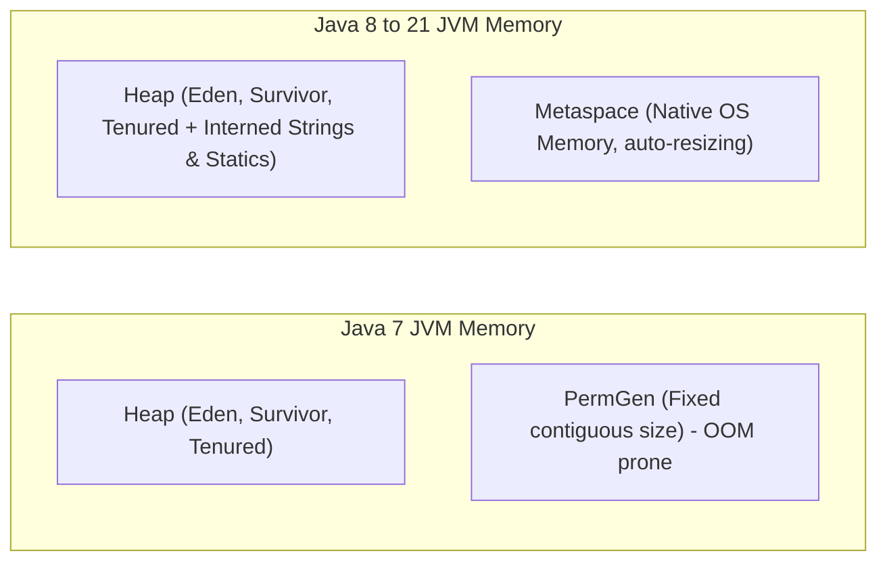

---

### Q02: What is the Java Memory Model (JMM) "Happens-Before" guarantee, and how do `volatile`, `synchronized`, and `final` establish it?
**Answer:**
The **Java Memory Model (JMM)** defines the conditions under which a write to a shared variable by one thread is guaranteed to be visible to a read by another thread, overcoming hardware CPU caches, store buffers, and compiler instruction reordering.

A **Happens-Before** relationship guarantees that memory writes performed by action $A$ are visible to action $B$:
- **`volatile` rule**: A write to a `volatile` variable happens-before every subsequent read of that same variable. It emits hardware memory fences (e.g., `StoreLoad`, `LoadLoad`) preventing compiler reordering and flushing CPU write buffers to cache coherence protocols (MESI).
- **Monitor lock rule (`synchronized`)**: An unlock on a monitor lock happens-before every subsequent lock acquisition on that same monitor. All variables written before the unlock are visible after the lock.
- **`final` freeze rule**: The initialization of a `final` field inside a constructor happens-before the reference to the enclosing object is published (preventing safe publication escapes).
- **Thread Start/Join rule**: A call to `Thread.start()` happens-before any action in the started thread. A thread termination happens-before `Thread.join()` returns.

---

### Q03: Walk through the internal collision resolution mechanism of `java.util.HashMap` in Java 8+. Why was the red-black tree threshold set to 8?
**Answer:**
`HashMap` uses an array of buckets (`Node<K,V>[] table`). When hashing a key:
$$\text{index} = (n - 1) \ \& \ \text{hash}(key)$$
where $\text{hash}(key) = key.hashCode() \oplus (key.hashCode() \ggg 16)$ (avoids collision from poor upper-bit entropy).

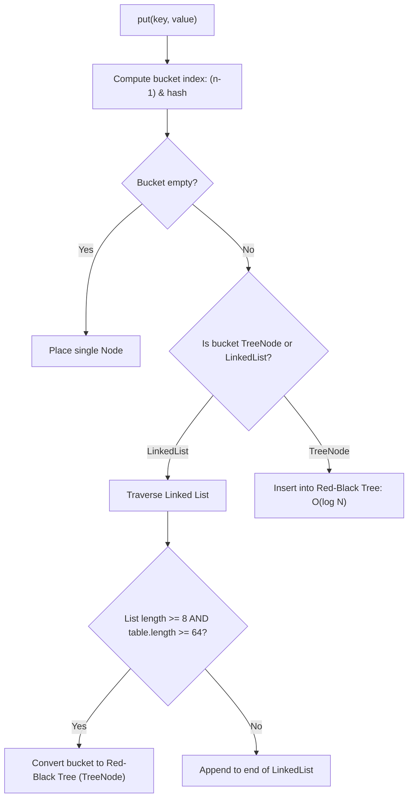

**Why the Treeify threshold is 8:**
Under random hash codes conforming to Poisson distribution:
$$P(k) = \frac{e^{-\lambda} \lambda^k}{k!}$$
With default parameter $\lambda \approx 0.5$, the statistical probability of a single bucket receiving 8 collisions is less than $1 \text{ in } 10 \text{ million}$ ($0.00000006$). If a bucket reaches size 8, either malicious adversary keys (`HashDoS` attack) or a broken `hashCode()` implementation exists. Transitioning from $O(N)$ linked list to $O(\log N)$ Red-Black tree prevents denial-of-service performance degradation. If bucket size shrinks to 6, it untreeifies back to a linked list (hysteresis prevents oscillation between tree and list).

---

### Q04: What is the fundamental difference between Garbage Collectors in Java (G1, ZGC, Shenandoah)? When should you choose one over another?
**Answer:**

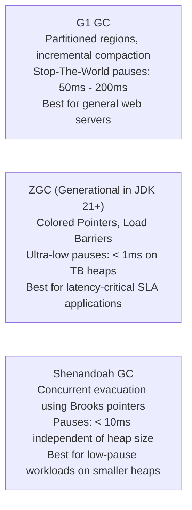

- **G1 GC (`-XX:+UseG1GC`)**: Divides heap into $2048$ equal regions. Prioritizes collecting regions containing the most garbage ("Garbage-First"). Pauses are bounded by a target (`-XX:MaxGCPauseMillis=200`), but compaction phases still require brief Stop-The-World (STW) pauses.
- **Generational ZGC (`-XX:+UseZGC -XX:+ZGenerational` in Java 21)**: Performs object relocation and compaction **concurrently with application threads** using **Colored Pointers** (reference bits encoding GC metadata) and **Load Barriers** (intercepts object dereferencing to fix up forwarding pointers on the fly). Delivers max pause times under $1\text{ ms}$ even on $16\text{ TB}$ heaps.
- **Selection Decision**:
  - Maximize pure throughput where $100\text{ ms}$ pause is acceptable $\rightarrow$ **Parallel GC** or **G1 GC**.
  - Strict low-latency SLAs ($P_{99} < 10\text{ ms}$) $\rightarrow$ **Generational ZGC**.

---

### Q05: Explain Escape Analysis in the HotSpot JIT Compiler. What optimizations does it trigger?
**Answer:**
**Escape Analysis** is an aggressive JIT optimization phase that inspects the scope of newly instantiated objects:
1. **GlobalEscape**: Object escapes the thread and method (returned from method, stored in static field, or passed into another thread).
2. **ArgEscape**: Object is passed as an argument to another method but does not outlive the calling method.
3. **NoEscape**: Object remains entirely private to the method in which it was instantiated.

**Triggered Optimizations for `NoEscape` objects:**
- **Scalar Replacement**: The object itself is not allocated on the heap at all! Its primitive fields are decomposed and mapped directly into CPU registers or stack frames.
- **Stack Allocation**: If scalar replacement cannot completely eliminate the object structure, it is placed on the thread's stack, vanishing immediately upon method return without involving GC.
- **Lock Elision**: If a synchronized block locks an object known to never escape the current thread, the JIT deletes the synchronization instructions completely.

---

### Q06: How do Records differ from Lombok `@Data` or standard Java classes under the hood?
**Answer:**
A Java `record` (introduced in Java 14, finalized in 16) is a **nominal tuple**:
- Transparent carrier for immutable data.
- Compiler generates: `final` class extending `java.lang.Record`, `final` private fields matching the record components, canonical constructor, accessors matching field names (e.g., `user.name()` instead of `getName()`), and mathematically correct `equals()`, `hashCode()`, and `toString()`.
- **Serialization Security**: Normal Java serialization bypasses constructors via reflection. Records **cannot bypass constructors**; during deserialization, the JVM is mandated by specification to invoke the canonical constructor, guaranteeing invariant validation checks cannot be circumvented.
- Unlike Lombok, Records are a first-class language construct understood by reflection, JIT, Pattern Matching (`instanceof Point(int x, int y)`), and serialization frameworks without bytecode manipulation plugins.

---

### Q07: What is the difference between `String.intern()`, string deduplication, and compact strings in modern JVMs?
**Answer:**
- **Compact Strings (Java 9+)**: Strings automatically inspect their character bytes. If only ISO-8859-1 (Latin-1) characters are used, characters are stored as 1 byte per char (`byte[]`) rather than UTF-16 (2 bytes per char), halving heap usage for strings without altering behavior.
- **`String.intern()`**: Explicit method adding the string instance to the native JVM String Pool. If already present, returns the existing pool instance. Misuse can bloat the pool or cause lock contention.
- **G1 String Deduplication (`-XX:+UseStringDeduplication`)**: Background GC process that scans the heap for distinct `String` objects with identical underlying byte arrays. It points both strings to the **same internal `byte[]` array** silently without mutating object identity, eliminating duplicate memory transparently without manual `.intern()` calls.

---

### Q08: How does Reflection work in Java, and why does it carry performance overhead? How do `MethodHandle` and `VarHandle` fix this?
**Answer:**
Traditional `java.lang.reflect.Method.invoke()`:
1. Performs access-control checks on every invocation unless `setAccessible(true)` is explicitly set.
2. Incurs argument boxing/unboxing overhead (e.g. converting `int` to `Integer` array).
3. Inhibits JIT inlining because the invocation target cannot be statically analyzed at compile time.

**`MethodHandle` and `VarHandle` (Java 7 & 9)**:
- Low-level, strongly-typed direct references to underlying methods or fields.
- When stored in `static final` references, the HotSpot JIT compiler treats a `MethodHandle.invokeExact()` identically to a direct compiled bytecode invocation, performing zero boxing, zero runtime access checks, and enabling **full JIT inlining**.

---

### Q09: What is the Difference between Soft, Weak, and Phantom References? What are their production use cases?
**Answer:**

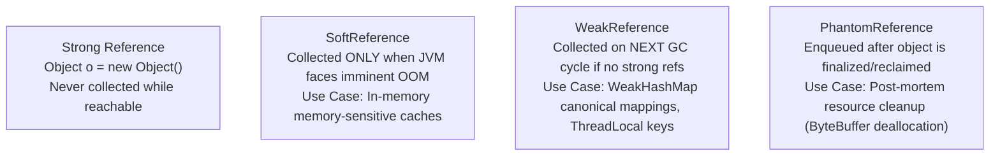

- **`SoftReference`**: Reclaimed only when heap is nearly full before throwing `OutOfMemoryError`. Ideal for secondary memory-sensitive image/document caches.
- **`WeakReference`**: Reclaimed immediately during GC if no strong references remain. Canonical example: `ThreadLocalMap.Entry` extends `WeakReference<ThreadLocal<?>>` to prevent permanent memory leaks when thread local instances are discarded while threads continue living in pools.
- **`PhantomReference`**: `get()` always returns `null`. Used in conjunction with `ReferenceQueue` to perform explicit off-heap cleanup (e.g., `sun.misc.Cleaner` freeing direct `ByteBuffers`) without relying on dangerous Java `finalize()` methods.

---

### Q10: How does Java 21 Pattern Matching for `switch` and Sealed Classes enable Exhaustive Algebraic Data Types (ADTs)?
**Answer:**
Prior to Java 21, polymorphism required visitor patterns or fragile `instanceof` cascades. Java 21 combines **Sealed Classes/Interfaces** with **Pattern Matching for `switch`**:

```java
public sealed interface PaymentMethod permits CreditCard, PayPal, Crypto {}
public record CreditCard(String cardNumber, String cvv) implements PaymentMethod {}
public record PayPal(String email) implements PaymentMethod {}
public record Crypto(String walletAddress, String chain) implements PaymentMethod {}

// Exhaustive Pattern Matching: No default branch needed!
public String processPayment(PaymentMethod method) {
    return switch (method) {
        case CreditCard c -> "Processing card: " + c.cardNumber();
        case PayPal p     -> "Redirecting to PayPal: " + p.email();
        case Crypto c     -> "Validating wallet: " + c.walletAddress();
        // If a new permit is added to PaymentMethod, the compiler FAILS here!
    };
}
```
The compiler verifies that every subclass permutation is accounted for. If someone adds `record BankTransfer(...) implements PaymentMethod`, the code fails to compile until the switch statement handles it, eliminating missing-branch runtime bugs.

---

### Q11: What is ClassLoader Leaking, and how does it happen in Java enterprise containers?
**Answer:**
In multi-tenant or hot-reloading application servers (e.g., Tomcat, OSGi), each deployed web app runs within its own child `WebappClassLoader`. 

When an app is undeployed, its `WebappClassLoader` should be garbage-collected, reclaiming all classes and static fields.
**A leak occurs when:**
1. A thread running outside the container (or a thread in a shared thread pool) holds a reference to a class or object loaded by the `WebappClassLoader`.
2. A `ThreadLocal` value is not explicitly cleared (`tl.remove()`). The thread lives forever in the pool, holding the value $\rightarrow$ which references the class $\rightarrow$ which references the `WebappClassLoader` $\rightarrow$ keeping **all** loaded classes, bytecode, and static instances in Metaspace and Heap forever until the entire JVM crashes with OOM.

---

### Q12: Why is the double-checked locking idiom broken without `volatile`?
**Answer:**
Consider naive double-checked locking:
```java
if (instance == null) {
    synchronized (Singleton.class) {
        if (instance == null) {
            instance = new Singleton(); // BUG!
        }
    }
}
```
The instruction `instance = new Singleton();` is executed by the CPU in 3 distinct steps:
1. `allocate memory`
2. `invoke constructor Singleton()`
3. `assign memory address to instance reference`

Due to instruction reordering, the CPU or compiler may reorder steps 2 and 3:
1. `allocate memory`
3. `assign memory address to instance reference` (instance is now NON-NULL in memory!)
2. `invoke constructor Singleton()`

If Thread A is pre-empted right after Step 3, Thread B arrives at the outer `if (instance == null)`. It evaluates to `false`, and Thread B proceeds with a **partially initialized object**, accessing corrupted fields. Declaring `private static volatile Singleton instance;` introduces a hardware `StoreStore` and `StoreLoad` memory barrier, preventing construction instructions from reordering past the variable write.

---

### Q13: What happens when an Exception is thrown inside a `finally` block? How do Suppressed Exceptions work?
**Answer:**
If both the `try` block and the `finally` block throw an exception, the exception in the `finally` block **obliterates and swallows** the original exception in the `try` block. The calling code never sees the root cause!

**Java 7+ Try-with-resources & Suppressed Exceptions**:
When using try-with-resources:
```java
try (AutoCloseableResource res = new AutoCloseableResource()) {
    throw new BusinessException("Primary error");
} // res.close() throws ResourceCloseException
```
The primary exception (`BusinessException`) is preserved and thrown. The subsequent exception during `.close()` is caught by the JVM and appended to the primary exception via `Throwable.addSuppressed(e)`. The caller can retrieve all hidden failures via `ex.getSuppressed()`.

---

### Q14: How does dynamic class generation differ between JDK Dynamic Proxies and CGLIB/ByteBuddy?
**Answer:**
- **JDK Dynamic Proxies (`java.lang.reflect.Proxy`)**:
  - Requires target class to implement **interfaces**.
  - Generates a dynamic class bytecode implementing those interfaces at runtime.
  - Interceptions pass through an `InvocationHandler.invoke()`.
- **CGLIB / ByteBuddy**:
  - Uses bytecode generation libraries (ASM under the hood) to create a dynamic **subclass** of the target class at runtime.
  - Can proxy concrete classes that do not implement interfaces.
  - **Limitation**: Cannot proxy `final` classes or override `final` methods.
- **Spring Boot 2.x and 3.x default**: Spring Boot defaults to CGLIB/ByteBuddy subclass proxying (`spring.aop.proxy-target-class=true`) so that dependency injection of concrete types always succeeds.

---

### Q15: What is the Difference between `Comparable` and `Comparator`? How do default and static methods in Java 8+ transform `Comparator` composition?
**Answer:**
- **`Comparable<T>`**: Defines the natural ordering of an object within its own class definition via `int compareTo(T o)`. (e.g., `String` alphabetical ordering).
- **`Comparator<T>`**: Defines external, decoupled ordering strategies via `int compare(T o1, T o2)`.

Java 8 transformed `Comparator` into a powerful functional composition DSL:
```java
Comparator<Employee> comp = Comparator
    .comparing(Employee::department)
    .thenComparing(Employee::salary, Comparator.reverseOrder())
    .thenComparing(Employee::lastName, String.CASE_INSENSITIVE_ORDER)
    .thenComparing(Comparator.nullsLast(Comparator.naturalOrder()));
```
This avoids nested ternary `if-else` cascades, handles `null` values safely, and enables reverse ordering without manual logic.

---

## 1.2 Concurrency, Multithreading & Virtual Threads (Q16 – Q30)

### Q16: How do Platform Threads differ from Virtual Threads (Project Loom, Java 21)? What is the underlying Carrier Thread model?
**Answer:**

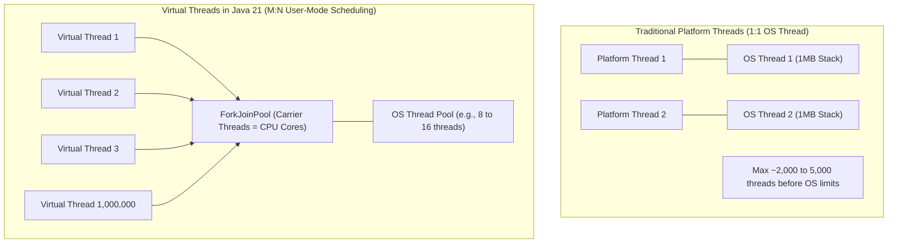

| Metric | Platform Thread | Virtual Thread |
| :--- | :--- | :--- |
| **Mapping** | $1 : 1$ to OS Kernel Thread | $M : N$ multiplexed over Carrier Threads |
| **Stack Memory** | $\sim 1\text{ MB}$ reserved fixed OS stack | A few hundred bytes dynamic heap frame |
| **Creation Cost** | Expensive OS system call | Cheap Java object allocation |
| **Context Switch** | OS kernel mode switch ($\sim 1\text{ to } 2 \ \mu\text{s}$) | Java user-space frame swap ($\sim 10\text{ to } 50\text{ ns}$) |
| **Scalability** | $\sim 3,000$ threads max per JVM | $1,000,000+$ concurrent active threads |

When a Virtual Thread blocks on a blocking operation (e.g., `Socket.read()`, `Thread.sleep()`), the JVM unmounts the Virtual Thread's call frame from the **Carrier Thread** (a worker in an internal `ForkJoinPool`) and saves it to the heap. The Carrier Thread is immediately free to run other Virtual Threads. Once the network data arrives, the JVM scheduler remounts the continuation onto any available Carrier Thread.

---

### Q17: What is "Thread Pinning" in Virtual Threads, and how do you diagnose and prevent it?
**Answer:**
**Thread Pinning** occurs when a Virtual Thread cannot be unmounted from its underlying Carrier OS thread during a blocking operation. The OS thread remains tied up, negating the scalability benefits of Project Loom.

**Two Primary Causes of Pinning:**
1. **Inside a `synchronized` block or method**: The monitor lock implementation in the JVM ties the execution frame to the native OS thread stack.
2. **Inside native code or JNI calls**.

**Diagnosis:**
Run the JVM with the flag:
```bash
-Djdk.tracePinnedThreads=full
```
This prints the exact stack trace whenever a Virtual Thread blocks while pinned.

**Prevention:**
Replace `synchronized` blocks around blocking I/O calls with `java.util.concurrent.locks.ReentrantLock`:
```java
// ❌ Pinned Virtual Thread on I/O
public synchronized byte[] readData() {
    return socket.getInputStream().readAllBytes();
}

// ✅ Unmounts cleanly without Pinning
private final ReentrantLock lock = new ReentrantLock();
public byte[] readData() {
    lock.lock();
    try {
        return socket.getInputStream().readAllBytes();
    } finally {
        lock.unlock();
    }
}
```

---

### Q18: Explain the difference between `synchronized` and `ReentrantLock`. What capabilities does `ReentrantLock` offer that `synchronized` lacks?
**Answer:**
While both provide mutual exclusion and reentrancy:
1. **Timed Acquisition**: `tryLock(long timeout, TimeUnit unit)` allows acquiring a lock without waiting indefinitely, preventing permanent deadlocks.
2. **Non-blocking Polling**: `tryLock()` returns immediately with `false` if the lock is held.
3. **Interruptible Locking**: `lockInterruptibly()` allows a waiting thread to be cancelled via `thread.interrupt()`.
4. **Fairness Policies**: `new ReentrantLock(true)` guarantees FIFO lock granting to prevent thread starvation.
5. **Multiple Wait Conditions**: A single `ReentrantLock` can spawn multiple `Condition` objects (`lock.newCondition()`), allowing separate signaling channels (e.g., `notFull` vs `notEmpty` in a queue) whereas `synchronized` only has one single implicit monitor wait-set (`wait()` / `notifyAll()`).

---

### Q19: What is false sharing (cache line bouncing), and how does Java solve it with `@Contended`?
**Answer:**
Modern CPU caches operate on **Cache Lines** (typically 64 bytes). 

If Thread A constantly mutates variable `X`, and Thread B constantly mutates variable `Y`, and both variables happen to reside adjacent to each other within the **same 64-byte cache line**:
- Whenever Thread A writes to `X`, the CPU cache coherence protocol (MESI) marks the entire 64-byte cache line invalid in Thread B's L1/L2 cache.
- Thread B must reload the entire line from slower L3 cache or RAM, even though Thread B never touched `X`!

This severe performance penalty is **False Sharing**.

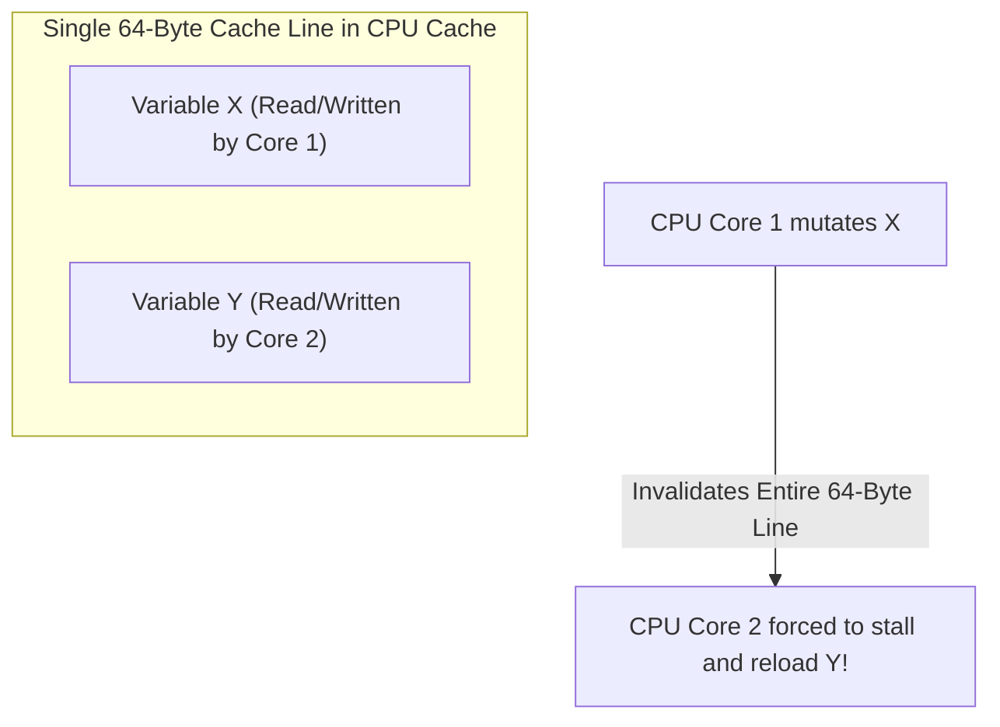

**Solution:**
Java uses `@jdk.internal.vm.annotation.Contended` (or manual byte padding). The JVM pads 128 bytes of empty space around the annotated field, ensuring it occupies its own isolated cache line. (Used inside `LongAdder` and `ConcurrentHashMap` counter cells).

---

### Q20: How does `LongAdder` outperform `AtomicLong` under high thread contention?
**Answer:**
`AtomicLong` relies on a single shared 64-bit value updated via Compare-And-Swap (CAS) in a loop:
```java
while (!compareAndSet(prev, next)) { /* retry on failure */ }
```
Under extreme concurrency (hundreds of threads), multiple threads fail the CAS simultaneously. They burn CPU cycles in spin-loops and cause massive cache-line bouncing on that single memory location.

**`LongAdder` (Striped 64-bit Counter Architecture)**:
`LongAdder` extends `Striped64`.
1. It maintains a `base` variable and an array of `Cell` objects.
2. When contention is detected, each thread is hashed to a different `Cell` index based on its thread hash probe.
3. Threads update their own isolated cells via CAS with zero contention.
4. When `longAdder.sum()` is invoked, it aggregates the `base` plus all cells in the array. It trades a minor read-cost for massive write throughput.

---

### Q21: What is the ABA Problem in lock-free concurrency, and how does `AtomicStampedReference` solve it?
**Answer:**
In lock-free algorithms using Compare-And-Swap (`compareAndSet(expected, update)`):
1. Thread 1 reads value $A$ from location $V$.
2. Thread 1 is pre-empted.
3. Thread 2 changes $V$ from $A \rightarrow B$, then changes it back from $B \rightarrow A$.
4. Thread 1 wakes up and executes `compareAndSet(A, C)`.
5. The CAS succeeds because the value is still $A$!

**Why this breaks systems**: In memory reuse scenarios (e.g. lock-free linked lists or free lists), node $A$ may have been freed, allocated elsewhere, and its internal pointers (`next`) altered. Thread 1 links invalid memory into the structure.

**Solution: `AtomicStampedReference`**:
Instead of checking reference equality alone, it atomically checks a tuple: `(reference, stamp/version)`:
```java
AtomicStampedReference<Node> ref = new AtomicStampedReference<>(initialNode, 0);
// To update: must match both the node reference AND the version integer!
ref.compareAndSet(oldNode, newNode, oldStamp, oldStamp + 1);
```

---

### Q22: What is the difference between `CountDownLatch`, `CyclicBarrier`, and `Phaser`?
**Answer:**

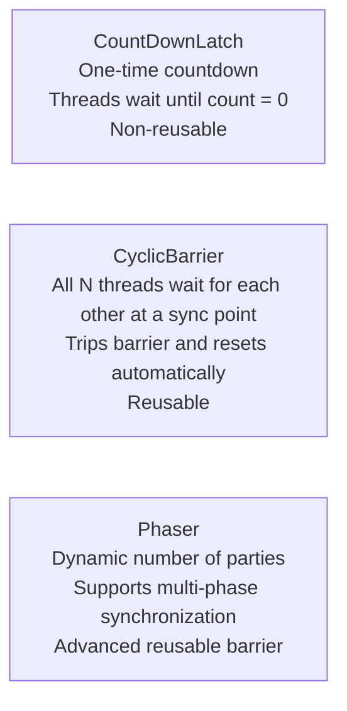

- **`CountDownLatch`**: One or more threads wait for $N$ events to occur (`latch.countDown()`). The count cannot be reset once it reaches zero.
- **`CyclicBarrier`**: $N$ threads must all call `barrier.await()` before any of them can proceed. Once all $N$ arrive, an optional barrier action runs, the barrier resets, and threads can reuse it for the next round.
- **`Phaser`**: Highly flexible barrier where the number of registered parties can register and deregister dynamically during execution (`register()`, `arriveAndAwaitAdvance()`, `arriveAndDeregister()`).

---

### Q23: How does `CompletableFuture` handle thread pool delegation across `.thenApply()`, `.thenApplyAsync()`, and custom executors?
**Answer:**
- **`.thenApply(fn)`**: Executes the transformation function `fn` **synchronously within the current thread** that completed the previous stage (which could be the calling thread or the worker thread that finished the upstream task).
- **`.thenApplyAsync(fn)`**: Submits the task asynchronously to the default common pool (`ForkJoinPool.commonPool()`).
- **`.thenApplyAsync(fn, customExecutor)`**: Submits the task to an explicitly supplied thread pool.
- **Exception propagation**: If any stage throws an exception, all downstream stages are bypassed until an `.exceptionally()` or `.handle()` stage is encountered.

---

### Q24: What is ThreadLocal leakage in thread pools, and how does Java 21 `ScopedValue` eliminate it?
**Answer:**
**The ThreadLocal Problem**:
Threads in modern servers are recycled from pools (e.g., Tomcat worker pool). If a request binds data to a `ThreadLocal` and forgets to invoke `threadLocal.remove()` in a `finally` block:
1. The thread returns to the pool carrying the tenant ID, security token, or request context.
2. The next incoming user's request assigned to that thread inherits the previous user's credentials!
3. Memory is leaked because the thread map retains strong references to classes.

**Java 21 `ScopedValue`**:
`ScopedValue` provides immutable, bound context that lives **strictly within the lexical execution scope**:
```java
public static final ScopedValue<User> CURRENT_USER = ScopedValue.newInstance();

ScopedValue.where(CURRENT_USER, authenticatedUser).run(() -> {
    // CURRENT_USER is available here and in any sub-methods
    orderService.processOrder();
}); 
// Out of scope here! Instantly unbound and unreachable automatically. Zero leak risk.
```

---

### Q25: Why is `Thread.stop()` deprecated and removed? What is the correct way to cooperatively cancel a thread?
**Answer:**
`Thread.stop()` was inherently unsafe because it immediately killed the thread at an arbitrary bytecode instruction, causing all monitors locked by that thread to be released abruptly. Shared objects were left in corrupted, half-written states with zero rollback capability.

**The Cooperative Cancellation Model:**
Java uses **cooperative interruption**:
1. Caller calls `thread.interrupt()`.
2. The target thread checks its status via `Thread.currentThread().isInterrupted()`.
3. If the thread is blocked in `Thread.sleep()`, `wait()`, or I/O, an `InterruptedException` is thrown.
4. **Golden Rule**: Never swallow `InterruptedException` without re-interrupting:
```java
try {
    Thread.sleep(1000);
} catch (InterruptedException e) {
    Thread.currentThread().interrupt(); // Restore interrupted status!
    // Clean up resources and terminate safely
}
```

---

### Q26: Explain the internal bucket-level locking mechanism of `ConcurrentHashMap` in Java 8+.
**Answer:**
In Java 7, `ConcurrentHashMap` used **Segmented Locking** (an array of 16 ReentrantLocks guarding segments of buckets), limiting maximum concurrent writers to 16.

**Java 8+ Architecture**:
1. Eliminates segments. It uses a single dynamic array of buckets (`Node<K,V>[]`).
2. **Lock-Free Reads**: `get()` operations are completely lock-free; nodes are declared with `volatile V val` and `volatile Node<K,V> next`.
3. **Lock-Free Bucket Initialization**: First insertions into an empty bucket use **Compare-And-Swap (`CAS`)**.
4. **Fine-Grained Node Locking**: If a collision occurs and the bucket already has nodes, synchronization locks **only the first node of that specific bucket** (`synchronized (firstNode)`). Different threads writing to different buckets never block each other!
5. **Concurrent Resizing**: When rehashing occurs, multiple threads collaborate to transfer chunks of buckets concurrently using `ForwardingNode`.

---

### Q27: What is the Work-Stealing Algorithm in Java's `ForkJoinPool`?
**Answer:**
In standard thread pools, all worker threads contend for tasks from a single shared blocking queue.

**`ForkJoinPool` Work-Stealing**:
1. Every worker thread owns its own **double-ended queue (deque)**.
2. When a thread forks tasks, it pushes them to the **head** of its own private deque (LIFO order for maximum cache locality).
3. The owner thread pops and processes tasks from the **head** of its deque without any locking contention.
4. When a worker thread runs out of work, it becomes a "thief": it visits another randomly chosen thread's deque and **steals work from the tail** (FIFO order) using CAS.
This architecture minimizes thread contention to near zero and optimizes CPU cache re-use.

---

### Q28: How does Structured Concurrency (Java 21 Preview) prevent thread leaks and orphan threads?
**Answer:**
In traditional asynchronous code, spawning tasks via `ExecutorService.submit()` allows tasks to escape their calling method. If Task A fails, Task B continues running in the background indefinitely as an orphaned zombie thread wasting CPU and memory.

**Structured Concurrency (`StructuredTaskScope`)**:
Treats multiple tasks running in different threads as a single unit of work with clear boundaries:
```java
try (var scope = new StructuredTaskScope.ShutdownOnFailure()) {
    Supplier<User> userSub   = scope.fork(() -> fetchUser(id));
    Supplier<Order> orderSub = scope.fork(() -> fetchOrders(id));

    scope.join();           // Join both forks
    scope.throwIfFailed();  // If ANY child fails, cancel the other immediately!

    return new Dashboard(userSub.get(), orderSub.get());
} // Both threads are guaranteed dead and cleaned up before exiting this block!
```

---

### Q29: What is LiveLock vs. Starvation vs. Deadlock?
**Answer:**
- **Deadlock**: Two or more threads are permanently blocked, each waiting for a lock held by the other. (Zero CPU activity, zero progress).
- **Livelock**: Two or more threads actively change their state in response to each other, but make zero forward progress. (High CPU activity, like two people in a narrow hallway endlessly stepping left and right to let the other pass).
- **Starvation**: A runnable thread is ready to execute, but is perpetual denied CPU or lock acquisition because higher-priority or greedy threads monopolize the resource. (Solved by Fair Locks).

---

### Q30: What is the Memory Barrier (Fence) cost of `volatile` on x86 vs. ARM architectures?
**Answer:**
- **x86 Architecture**: Has a relatively strong hardware memory model (Total Store Order - TSO). Hardware already guarantees that loads are not reordered with loads, and stores are not reordered with stores. Therefore, reads of a `volatile` variable on x86 compile to standard `MOV` instructions with zero barrier cost! A `volatile` write emits a `LOCK` prefix or `MFENCE` (`StoreLoad` barrier) to flush the CPU store buffer.
- **ARM / Apple Silicon (aarch64)**: Has a weakly-ordered memory model where the CPU aggressively reorders instructions. Volatile reads and writes require explicit hardware instructions: `LDAR` (Load-Acquire) and `STLR` (Store-Release) to guarantee JMM compliance, making unneeded volatile access slightly more noticeable on ARM than on x86.

---

## 1.3 Spring Core, IoC, AOP & Bean Lifecycle (Q31 – Q45)

### Q31: Walk through the complete Spring Bean Lifecycle from XML/Annotation scanning to destruction.
**Answer:**

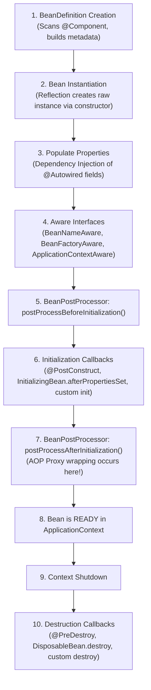

**Key Interview Insight**: AOP proxies (`@Transactional`, `@Async`, `@Secured`) are generated during step 7 (`postProcessAfterInitialization`). If you attempt to invoke an AOP-proxied method from inside a `@PostConstruct` method, you are operating on the raw unproxied instance!

---

### Q32: Why does self-invocation of a `@Transactional` or `@Async` method within the same class fail to execute the aspect? How do you fix it?
**Answer:**
Spring AOP is **proxy-based**. 

When an external caller requests `orderService.placeOrder()`, it calls the **Proxy Wrapper**, which intercepts the call, starts a transaction, and delegates to the real `OrderService`.

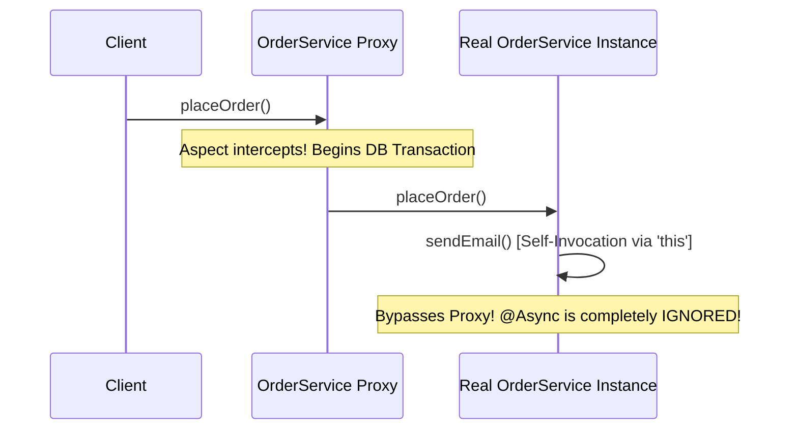

When `placeOrder()` internally calls `this.sendEmail()`, it uses Java's raw `this` pointer, **bypassing the proxy entirely**.

**Fixes:**
1. **Self-Injection (Recommended)**: Inject the bean into itself via `@Lazy`:
```java
@Service
public class OrderService {
    @Autowired @Lazy private OrderService self;

    public void placeOrder() {
        self.sendEmail(); // Passes through Proxy!
    }
}
```
2. **Move method to a separate collaborator bean**.
3. **Use AspectJ compile-time or load-time weaving (LTW)** instead of Spring AOP proxies.

---

### Q33: How does Spring resolve Circular Dependencies between singleton beans, and why does constructor injection break it?
**Answer:**
Spring resolves circular dependencies for singletons using **Three-Level Caches** in `DefaultSingletonBeanRegistry`:
1. `singletonObjects` (Cache 1): Fully initialized beans ready for production.
2. `earlySingletonObjects` (Cache 2): Early unpopulated beans (or early proxies) exposed to resolve circularity.
3. `singletonFactories` (Cache 3): `ObjectFactory` holding lambdas that produce early references (including AOP proxies).

**Why Constructor Injection Breaks It:**
When Bean A requires Bean B in its constructor, Bean A cannot even finish **instantiation** (Step 2 of the lifecycle). It cannot place an early reference into the Cache 3 `singletonFactories` because the raw Java object does not exist yet! 

**Solution:** Refactor the circular design, or add `@Lazy` to one constructor parameter to generate a lazy dynamic proxy instead of the real bean during construction.

---

### Q34: What is the exact difference between `@Component`, `@Service`, `@Repository`, and `@Configuration`?
**Answer:**
All four are meta-annotated with `@Component` and register beans in the ApplicationContext:
- **`@Component`**: Generic stereotype for any Spring-managed component.
- **`@Service`**: Semantic annotation for the business layer. Carries no extra technical behavior today, but conveys domain intent.
- **`@Repository`**: Specific to persistence. Automatically enables **Automatic Exception Translation**: translates low-level vendor exceptions (`SQLException`, `HibernateException`) into Spring's unified `DataAccessException` hierarchy via `PersistenceExceptionTranslationPostProcessor`.
- **`@Configuration`**: Crucial technical difference! CGLIB proxies `@Configuration` classes so that inter-bean method calls (`@Bean` calling another `@Bean` method) return the cached singleton rather than invoking the method multiple times.

---

### Q35: How does `@Configuration(proxyBeanMethods = false)` improve performance in Spring Boot?
**Answer:**
By default, `@Configuration` has `proxyBeanMethods = true`. Spring uses CGLIB to generate a dynamic subclass proxy to intercept `@Bean` calls and enforce singleton semantics.

Setting `proxyBeanMethods = false` (known as **Lite Mode**):
1. Completely avoids CGLIB proxy generation, speeding up Spring Boot startup time and lowering memory usage.
2. Treats `@Bean` methods as plain factory methods.
3. Standard in Spring Boot internal auto-configurations (`@AutoConfiguration`).
4. **Caveat**: You must not call one `@Bean` method directly from another `@Bean` method; dependencies must be passed as method arguments instead.

---

### Q36: What is the Bean Scope hierarchy? What happens when a Prototype bean is injected into a Singleton bean?
**Answer:**
Spring provides 6 scopes: `singleton` (default), `prototype`, `request`, `session`, `application`, and `websocket`.

**The Singleton $\rightarrow$ Prototype Pitfall**:
A Singleton bean is initialized **only once** during application startup. If a Prototype bean is injected via field or constructor injection:
```java
@Service
public class ReportService {
    @Autowired private ReportGenerator prototypeGenerator; // INJECTED ONCE!
}
```
The prototype bean is instantiated **only once** when the singleton is created. Every subsequent call to `ReportService` reuses that exact same instance!

**Solutions:**
1. **`@Lookup` Method Injection**:
```java
@Lookup
public abstract ReportGenerator getReportGenerator();
```
Spring overrides this method at runtime to fetch a brand-new prototype from the container on every call.
2. **`ObjectProvider<ReportGenerator>`**:
```java
@Autowired private ObjectProvider<ReportGenerator> provider;
public void generate() { ReportGenerator g = provider.getObject(); }
```

---

### Q37: How do `@ConditionalOnProperty`, `@ConditionalOnClass`, and `@ConditionalOnMissingBean` work under the hood?
**Answer:**
These annotations power Spring Boot's **Auto-Configuration** magic:
- They implement `org.springframework.context.annotation.Condition`.
- During the `ConfigurationClassPostProcessor` phase, Spring evaluates the `matches()` method of each condition before parsing bean definitions:
  - `@ConditionalOnClass("com.zaxxer.hikari.HikariDataSource")`: Checks whether `Class.forName()` successfully finds the class on the JVM classpath without throwing `ClassNotFoundException`.
  - `@ConditionalOnProperty(name = "feature.enabled", havingValue = "true")`: Checks whether the `Environment` property matches.
  - `@ConditionalOnMissingBean(DataSource.class)`: Inspects the `BeanFactory`. If the user already declared their own `DataSource` bean, Spring Boot stands down and does not configure its default bean.

---

### Q38: What is the Difference between `BeanFactory` and `ApplicationContext`?
**Answer:**
- **`BeanFactory`**: The fundamental root IoC container (`DefaultListableBeanFactory`). Provides basic DI, lazy bean instantiation (beans instantiated only on `.getBean()`), and minimal footprint.
- **`ApplicationContext`**: Extends `BeanFactory` and adds enterprise features:
  - Eager initialization of singletons at startup (discovers configuration errors immediately).
  - Integrated MessageSource internationalization (i18n).
  - Event publication and listener dispatching (`ApplicationEventPublisher`).
  - Environment profile integration (`EnvironmentCapable`).
  - Automatic registration of `BeanPostProcessor` and `BeanFactoryPostProcessor`.

---

### Q39: What is the difference between `BeanFactoryPostProcessor` (BFPP) and `BeanPostProcessor` (BPP)?
**Answer:**
- **`BeanFactoryPostProcessor`**: Operates on **bean metadata definitions** (`BeanDefinition`) *before* any bean instances are constructed. It can modify property values or class names in the catalog. Example: `PropertySourcesPlaceholderConfigurer` resolves `${db.url}` placeholders inside `@Value`.
- **`BeanPostProcessor`**: Operates on **actual initialized bean instances** *after* they are instantiated by the JVM. It can inspect annotations and wrap beans in dynamic proxies. Examples: `CommonAnnotationBeanPostProcessor` (processes `@PostConstruct`), `AnnotationAwareAspectJAutoProxyCreator` (creates AOP proxies).

---

### Q40: How does Spring WebFlux differ from Spring MVC? When is WebFlux the wrong choice?
**Answer:**
- **Spring MVC**: Traditional thread-per-request blocking model on embedded Tomcat. One incoming request blocks an OS/Tomcat thread during database I/O.
- **Spring WebFlux**: Asynchronous, non-blocking reactive model built on Project Reactor (`Mono`/`Flux`) running on Netty event loops (usually 1 event-loop thread per CPU core).

**When WebFlux is the WRONG choice**:
1. **Blocking JDBC / JPA Repositories**: If your persistence layer uses standard Hibernate, JPA, or JDBC, every query blocks the thread. Running blocking I/O on Netty's tiny event-loop pool instantly starves the server.
2. **CPU-Intensive Workloads**: Long computational tasks stall the event loops.
3. **Java 21 Virtual Threads**: With Java 21, Spring MVC on Tomcat with Virtual Threads (`spring.threads.virtual.enabled=true`) handles hundreds of thousands of concurrent blocking requests with plain, easy-to-debug imperative code, making WebFlux unnecessary for most CRUD APIs.

---

### Q41: Explain the Spring Event Architecture. What is `@TransactionalEventListener`?
**Answer:**
Spring provides decoupled event dispatching via `applicationEventPublisher.publishEvent(new OrderCreatedEvent(this))`.

A standard `@EventListener` runs **synchronously** within the exact same thread and database transaction as the publisher.

**`@TransactionalEventListener`**:
Allows synchronizing event delivery with transaction boundaries:
- `phase = TransactionPhase.AFTER_COMMIT` (Default): The event listener runs **only after** the database transaction successfully commits!
- **Crucial Use Case**: Sending an email or publishing a Kafka message after saving an order. If you use a regular `@EventListener` and the database transaction fails and rolls back after sending the email, you just emailed a customer for an order that does not exist in the database!

---

### Q42: What is the role of `DelegatingFilterProxy` and `FilterChainProxy` in Spring Security?
**Answer:**

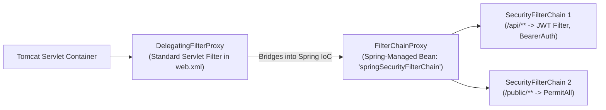

Servlet containers (like Tomcat) do not understand Spring beans.
1. **`DelegatingFilterProxy`**: A standard Servlet Filter registered in the servlet container. It does no security work; it simply looks up a bean named `springSecurityFilterChain` inside the Spring `ApplicationContext` and delegates the request to it.
2. **`FilterChainProxy`**: The Spring-managed master security router. It holds a list of `SecurityFilterChain` beans, determines which filter chain matches the incoming URL, and runs the request through the sequence of authentication/authorization filters.

---

### Q43: How does Spring Boot's Graceful Shutdown work?
**Answer:**
Configured via `server.shutdown=graceful`:
1. When a `SIGTERM` signal arrives, the embedded web server (Tomcat/Netty) stops accepting **new** incoming connections.
2. Existing in-flight HTTP requests are given a grace period (`spring.lifecycle.timeout-per-shutdown-phase=30s`) to complete their work and return responses.
3. Thread pools and active transactions finish cleanly.
4. If requests exceed the grace timeout, remaining threads are forcefully terminated.
5. The Spring `ApplicationContext` closes, triggering `@PreDestroy` and closing database connections.

---

### Q44: What are the differences between `@ControllerAdvice` and `@RestControllerAdvice`?
**Answer:**
- **`@ControllerAdvice`**: Global interceptor for exceptions across all controllers. Methods return view template names (HTML via Thymeleaf/JSP) unless explicitly annotated with `@ResponseBody`.
- **`@RestControllerAdvice`**: Combines `@ControllerAdvice` and `@ResponseBody`. Every method returning an object automatically serializes it directly into JSON/XML via Jackson in the HTTP response body. Standard in REST microservices.

---

### Q45: How does Spring resolve method arguments in Controller endpoints?
**Answer:**
Spring MVC uses a composite strategy pattern: `HandlerMethodArgumentResolver`.

When a request arrives at `ProductController.createProduct(@Valid @RequestBody CreateProductRequest dto)`:
1. Spring iterates through registered resolvers (`RequestResponseBodyMethodProcessor`, `PathVariableMethodArgumentResolver`, etc.).
2. The resolver checks `supportsParameter(param)`.
3. The matching resolver reads the incoming request, runs Jackson deserialization, executes validation via `WebDataBinder`, and injects the resolved object into the method parameter.

---

## 1.4 Spring Boot, Data/JPA, Security, Transactions & Microservices (Q46 – Q60)

### Q46: What is the N+1 Query Problem in Spring Data JPA? What are the 4 ways to eliminate it?
**Answer:**
When an entity has a `@OneToMany` relationship with Lazy loading:
```java
List<Author> authors = authorRepository.findAll(); // 1 Query
for (Author a : authors) {
    System.out.println(a.getBooks().size()); // N Queries fired!
}
```
If there are 100 authors, Hibernate fires **1 query** to fetch authors, and then **100 individual queries** to fetch books for each author. Total: **101 queries**!

**The 4 Solutions:**
1. **`JOIN FETCH` in JPQL**:
```java
@Query("SELECT a FROM Author a JOIN FETCH a.books")
List<Author> findAllWithBooks();
```
2. **`@EntityGraph`**:
```java
@EntityGraph(attributePaths = {"books"})
List<Author> findAll();
```
Instructs Hibernate to generate an outer join query dynamically.
3. **`@BatchSize(size = 50)`**: Hibernate loads lazy collections in batches using an SQL `WHERE author_id IN (?, ?, ...)` clause, reducing $N$ queries down to $\frac{N}{50}$.
4. **DTO Projections**: Query only the exact flat columns needed via SQL constructor expressions.

---

### Q47: What is the difference between `PROPAGATION_REQUIRED`, `PROPAGATION_REQUIRES_NEW`, and `PROPAGATION_NESTED` in `@Transactional`?
**Answer:**

```mermaid
flowchart TD
    subgraph REQUIRED ["PROPAGATION_REQUIRED (Default)"]
        T1["Outer Transaction Active"] --> Join["Inner method JOINS existing transaction"]
        Join --> Rollback["If Inner rolls back, ENTIRE transaction is marked rollback-only!"]
    end

    subgraph REQUIRES_NEW ["PROPAGATION_REQUIRES_NEW"]
        T2["Outer Transaction Active"] --> Suspend["SUSPEND Outer Transaction"]
        Suspend --> T3["Start brand new independent DB Transaction"]
        T3 --> Resume["Inner commits/rolls back, then Outer RESUMES"]
    end

    subgraph NESTED ["PROPAGATION_NESTED"]
        T4["Outer Transaction Active"] --> Savepoint["Creates a JDBC Savepoint"]
        Savepoint --> InnerFail["Inner can roll back to Savepoint WITHOUT rolling back Outer!"]
    end
```

- **`REQUIRED`**: Default. If a transaction exists, join it. If none exists, create one.
- **`REQUIRES_NEW`**: Always creates a brand-new transaction, suspending the existing one. Useful for audit logging where you want the audit record saved even if the outer business transaction fails.
- **`NESTED`**: Uses JDBC savepoints. If the inner method fails, it rolls back only to the savepoint; the outer transaction can catch the exception and still commit.

---

### Q48: Why does `@Transactional(readOnly = true)` provide huge performance optimizations?
**Answer:**
1. **Hibernate Dirty Checking Disabled**: In a normal transaction, Hibernate takes an initial snapshot copy of every loaded entity. Upon commit, it compares all properties to detect mutations. Under `readOnly = true`, Hibernate turns off snapshot tracking and dirty checking, saving massive CPU and heap memory.
2. **JDBC Optimization**: Spring calls `java.sql.Connection.setReadOnly(true)` on the JDBC connection.
3. **Database Routing**: In Master/Replica architectures (e.g. AWS Aurora), Spring's `AbstractRoutingDataSource` routes read-only connections directly to read-replicas, keeping the master database free for writes.

---

### Q49: What is the difference between Optimistic Locking and Pessimistic Locking in Spring Data JPA?
**Answer:**
- **Optimistic Locking (`@Version`)**:
  - Does not lock rows in the database.
  - Adds a version column (`INTEGER` or `TIMESTAMP`).
  - When updating: `UPDATE products SET stock = 5, version = 2 WHERE id = 1 AND version = 1;`
  - If another transaction updated the row first, the update affects 0 rows, and Hibernate throws `OptimisticLockException`.
  - **Best for**: Read-heavy workloads with low-to-medium write contention.
- **Pessimistic Locking (`@Lock(LockModeType.PESSIMISTIC_WRITE)`)**:
  - Issues raw SQL `SELECT ... FOR UPDATE`.
  - Blocks other concurrent transactions at the database engine level until the lock owner commits.
  - **Best for**: Extreme contention scenarios (e.g., concert ticket flash sales, inventory counters) where retrying optimistic conflicts burns too much CPU.

---

### Q50: How does Hibernate's First-Level and Second-Level Cache work?
**Answer:**
- **First-Level Cache (Session Scope)**:
  - Enabled by default and cannot be disabled.
  - Bound to the current `EntityManager` / Hibernate `Session` (lasts only for the duration of the `@Transactional` method).
  - Guarantees **Repeatable Reads**: Calling `repository.findById(1L)` 10 times in the same transaction hits the database only on the first call.
- **Second-Level Cache (Process / Cluster Scope)**:
  - Disabled by default. Configured via providers like Ehcache or Redis.
  - Shared across **all** sessions and transactions in the application.
  - Caches entity data across requests. Requires strict invalidation strategies in clustered environments to prevent stale reads.

---

### Q51: How does Spring Security authenticate a request via the `AuthenticationManager`?
**Answer:**

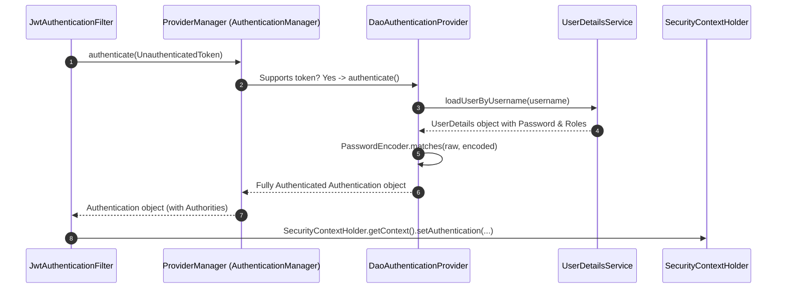

---

### Q52: What is the difference between JWT Access Tokens and Refresh Tokens? How do you implement secure rotation?
**Answer:**
- **Access Token**: Short-lived (e.g., $10\text{ to } 15\text{ minutes}$), signed JWT containing user claims and roles. Transmitted in `Authorization: Bearer <token>`. Stateless; validated without database lookups.
- **Refresh Token**: Long-lived (e.g., $7\text{ to } 30\text{ days}$), stored in an HTTP-only secure cookie and persisted in a Redis/Postgres database.
- **Refresh Token Rotation**:
  - When the client exchanges a refresh token for a new access token, the server **invalidates the old refresh token** and issues a brand-new refresh token.
  - **Breach Detection**: If an attacker steals a refresh token and uses it *after* the legitimate user already used it, the server detects that an already-invalidated token was presented. It immediately revokes **all** refresh tokens for that entire user family, locking out the attacker.

---

### Q53: What is the Outbox Pattern in Microservices, and what problem does it solve?
**Answer:**
**The Dual-Write Problem**: An order service must save an order in Postgres AND send an event to Kafka.
- If you save to DB first, and Kafka crashes $\rightarrow$ Data is in DB, event is lost!
- If you publish to Kafka first, and DB crashes $\rightarrow$ Event is published, order does not exist!

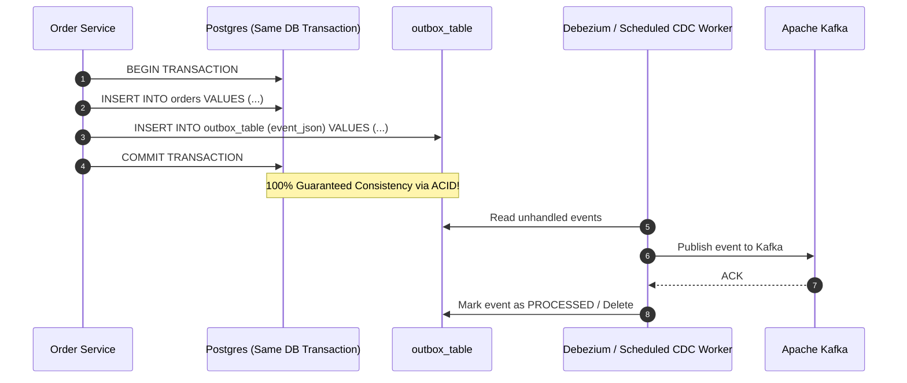

---

### Q54: What is the Distributed Saga Pattern (Choreography vs. Orchestration)?
**Answer:**
Replaces distributed 2-Phase Commit (2PC) in microservices:
- **Choreography (Event-Driven)**: Services listen to events and decide next actions autonomously. (e.g., `OrderService` emits `OrderCreated` $\rightarrow$ `PaymentService` captures and emits `PaymentSuccess` $\rightarrow$ `InventoryService` captures and deducts stock).
  - *Cons*: Hard to track overall workflow state; cycle dependencies.
- **Orchestration (Central Coordinator)**: A dedicated Saga Orchestrator service explicitly sends commands (`ExecutePayment`, `ReserveInventory`) and manages state machines.
  - *Compensating Transactions*: If `ReserveInventory` fails, the orchestrator dispatches compensating actions (`RefundPayment`, `CancelOrder`) to roll back prior steps.

---

### Q55: How does a Circuit Breaker (Resilience4j) prevent cascading failures in Microservices?
**Answer:**
A Circuit Breaker wraps calls to downstream remote services with 3 states:

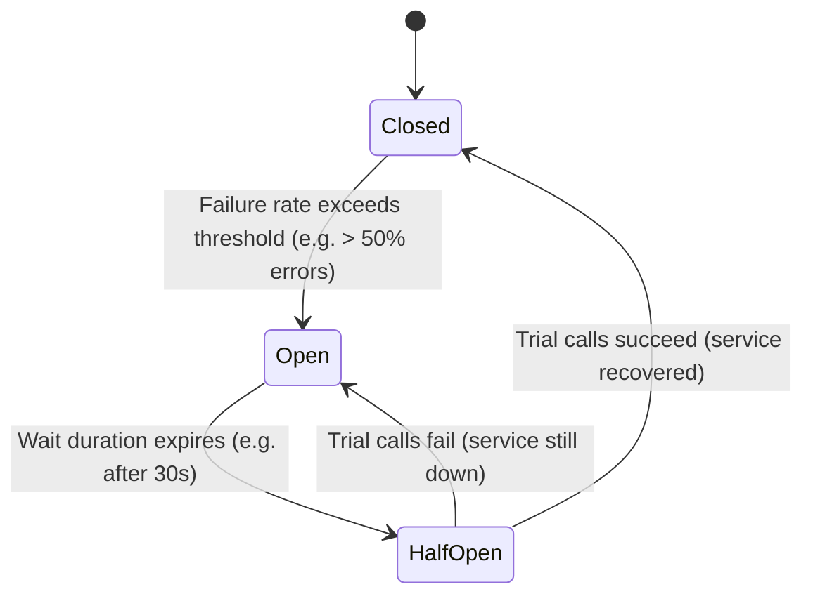

- **CLOSED**: Normal operation. Requests pass through. Tracks failure rate in a sliding window.
- **OPEN**: Failure rate exceeded threshold. The circuit trips! Requests **fail immediately** without making network calls, executing fallback logic instantly and shielding the failing service from being overloaded.
- **HALF-OPEN**: After a configured sleep duration, allows a limited number of probe requests through. If they succeed, circuit transitions back to CLOSED; if they fail, returns to OPEN.

---

### Q56: What is Distributed Tracing, and how do TraceId and SpanId propagate through Micrometer Tracing / OpenTelemetry?
**Answer:**
In a microservices call graph ($A \rightarrow B \rightarrow C$):
- **Trace ID**: A globally unique 128-bit identifier generated at the entry gateway and shared across every single microservice participating in that specific user request.
- **Span ID**: Represents a single distinct unit of work inside one service (e.g., executing an HTTP call or DB query). Contains a `ParentSpanId`.
- **Propagation**: Spring Boot 3 uses **W3C TraceContext** headers (`traceparent: 00-4bf92f3577b34da6a3ce929d0e0e4736-00f067aa0ba902b7-01`). When `RestClient` or `WebClient` makes an outbound HTTP call, Spring automatically injects this header. The downstream service extracts it and binds it to its own MDC logging context, allowing tools like Zipkin/Jaeger to render the full timeline.

---

### Q57: How does Spring Boot Actuator expose metrics, and how does Micrometer integrate with Prometheus?
**Answer:**
- **Actuator**: Exposes management endpoints (`/actuator/health`, `/actuator/metrics`, `/actuator/prometheus`).
- **Micrometer**: Acts as the "SLF4J for metrics". Provides vendor-neutral meter registries (`MeterRegistry`, `Counter`, `Timer`, `Gauge`).
- **Prometheus Integration**: Adding `micrometer-registry-prometheus` registers a `PrometheusMeterRegistry`. It converts all internal Spring Boot metrics (Tomcat threads, JVM memory, HTTP request latencies) into the Prometheus dimensional scraping text format (`http_server_requests_seconds_count{method="GET",status="200"}`).

---

### Q58: What is Database Connection Pool Starvation, and how do you calculate optimal HikariCP pool size?
**Answer:**
When all connections in `HikariCP` are checked out, incoming threads are blocked waiting for `connection-timeout` (default $30\text{ seconds}$), after which they throw `SQLTransientConnectionException`.

**PostgreSQL / Oracle Optimal Pool Size Formula**:
$$\text{Pool Size} = (\text{Core Count} \times 2) + \text{Effective Spindle Count}$$
A 16-core database server with fast SSDs needs only $\sim 33 \text{ connections}$! 
*Setting a pool size to 500 connections degrades performance* because the database CPU spends more time thrashing between OS context switches and disk I/O scheduling than executing actual queries.

---

### Q59: What is the difference between Spring Cloud Config and Kubernetes ConfigMaps?
**Answer:**
- **Spring Cloud Config**: Client-server architecture. Requires a dedicated Spring server backed by a Git repository. Supports dynamic refresh at runtime without pod restarts via `@RefreshScope` and `/actuator/refresh` (or Spring Cloud Bus with RabbitMQ/Kafka).
- **Kubernetes ConfigMaps / Secrets**: Native cloud infrastructure. Values are mounted as environment variables or volume files inside pods. Standard practice in containerized cloud-native deployments because it is platform-agnostic and eliminates the need to maintain an extra Spring microservice.

---

### Q60: How do you prevent SQL Injection and Cross-Site Scripting (XSS) in a Spring Boot application?
**Answer:**
- **SQL Injection Prevention**:
  1. Use Spring Data JPA with named parameters (`:param`) which always compile to parameterized `PreparedStatement` queries.
  2. Never concatenate strings in native queries:  
     `// ❌ VULNERABLE: "SELECT * FROM users WHERE name = '" + name + "'"`  
     `// ✅ SAFE: @Query(value = "SELECT * FROM users WHERE name = :name", nativeQuery = true)`
- **XSS Prevention**:
  1. Set strict HTTP security response headers via Spring Security: `Content-Security-Policy (CSP)`, `X-Content-Type-Options: nosniff`.
  2. Rely on modern frontend frameworks (React, Angular, Vue) which escape HTML bindings automatically.
  3. If returning raw HTML, use HTML sanitization libraries (OWASP Java HTML Sanitizer).

---

# Part 2: Top 20 Core Java Coding Interview Problems (30–60 Min)

Below are the 20 most frequently asked coding and systems-design problems in senior Java interviews. Each solution features complete, compilable, clean modern Java code with concurrency handling, complexity analysis, and edge case coverage.

---

## J01: Thread-Safe LRU Cache with O(1) Operations

### 1. WHY This Matters in Production
In high-throughput services, querying a relational database or external API on every request causes high latency and database CPU spikes. Caching frequent queries in memory solves this, but servers have finite RAM. If a cache grows without an eviction policy, the JVM crashes with `java.lang.OutOfMemoryError: Java heap space`.

The **Least Recently Used (LRU)** algorithm discards the items that haven't been touched the longest. Production systems like Redis, CPU hardware L1/L2 caches, and Linux page cache use variants of LRU.

### 2. WHAT It Is (The Mental Model)
Think of a desk with a stack of files:
- Whenever you read or write a file, you put it on **top of the stack** (Head = Most Recently Used).
- When the desk runs out of space, you throw away the file at the very **bottom of the stack** (Tail = Least Recently Used).
- To find any file in $O(1)$ time without searching through the stack, you keep a quick Rolodex (`HashMap`) that points directly to that file's location in the stack.

### 3. HOW It Works (Architecture & Algorithm)
We combine two data structures:
1. **Doubly Linked List**: Gives $O(1)$ node insertion at the head and $O(1)$ node removal from the tail (once you have the node reference).
2. **HashMap<Key, Node>**: Gives $O(1)$ lookup from key to the corresponding Doubly Linked List node.
3. **Dummy Sentinel Nodes (`head` and `tail`)**: Eliminate edge cases like `node.prev == null` or inserting into an empty list.
4. **Thread Safety**: Uses `ReentrantReadWriteLock` (or `synchronized`). Notice that `get()` must acquire a **write lock** because reading an element modifies list order (moves it to the head)!

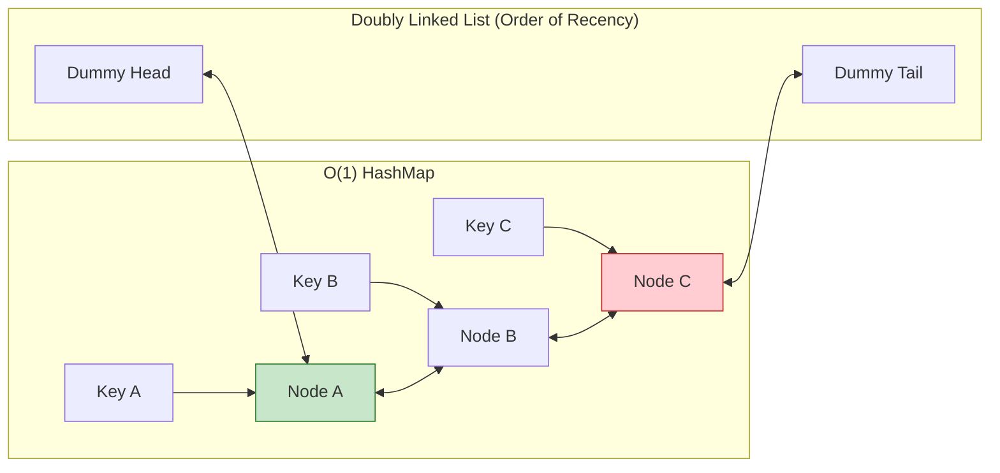

#### Step-by-Step Walkthrough:
- **`get(key)`**:
  1. Look up `key` in `map`. If missing, return `null`.
  2. If found, unlink `node` from its current position in the linked list.
  3. Re-insert `node` immediately after `dummyHead`.
  4. Return `node.value`.
- **`put(key, value)`**:
  1. If `key` exists in `map`, update its value and move `node` to `head`.
  2. If `key` does not exist:
     - If `map.size() == capacity`, get `dummyTail.prev`, unlink it from the list, and remove its key from `map`.
     - Create a brand-new `Node(key, value)`, insert into `map`, and add right after `dummyHead`.

### Complete Implementation with Line-by-Line Comments
```java
package com.interview.lru;

import java.util.HashMap;
import java.util.Map;
import java.util.concurrent.locks.ReentrantReadWriteLock;

public class ThreadSafeLRUCache<K, V> {

    // Doubly linked list node holding key, value, and pointers
    private static class Node<K, V> {
        final K key;    // Storing key is essential so we can remove it from map upon eviction!
        V value;
        Node<K, V> prev;
        Node<K, V> next;

        Node(K key, V value) {
            this.key = key;
            this.value = value;
        }
    }

    private final int capacity;
    private final Map<K, Node<K, V>> map; // Quick O(1) pointer lookup
    private final Node<K, V> head;         // Sentinel dummy head (MRU side)
    private final Node<K, V> tail;         // Sentinel dummy tail (LRU side)
    private final ReentrantReadWriteLock lock = new ReentrantReadWriteLock();

    public ThreadSafeLRUCache(int capacity) {
        if (capacity <= 0) {
            throw new IllegalArgumentException("Capacity must be strictly greater than 0");
        }
        this.capacity = capacity;
        this.map = new HashMap<>(capacity);

        // Initialize dummy sentinels. Their key/values are never read.
        this.head = new Node<>(null, null);
        this.tail = new Node<>(null, null);
        head.next = tail;
        tail.prev = head;
    }

    /**
     * Retrieves an item by key and marks it as Most Recently Used.
     * Note: Requires WRITE lock because moving nodes changes list pointers!
     */
    public V get(K key) {
        lock.writeLock().lock();
        try {
            Node<K, V> node = map.get(key);
            if (node == null) {
                return null; // Cache miss
            }
            // Cache hit: Move to head because it was just accessed
            moveToHead(node);
            return node.value;
        } finally {
            lock.writeLock().unlock();
        }
    }

    /**
     * Inserts or updates a key-value pair. Evicts LRU element if capacity exceeded.
     */
    public void put(K key, V value) {
        lock.writeLock().lock();
        try {
            Node<K, V> existingNode = map.get(key);
            if (existingNode != null) {
                // Key already present: update value and promote to head
                existingNode.value = value;
                moveToHead(existingNode);
            } else {
                // Check if we hit the capacity ceiling
                if (map.size() >= capacity) {
                    // Evict the least recently used node right before tail sentinel
                    Node<K, V> lruNode = removeTail();
                    map.remove(lruNode.key); // O(1) removal from hash map
                }

                // Allocate and insert the new node
                Node<K, V> newNode = new Node<>(key, value);
                map.put(key, newNode);
                addToHead(newNode);
            }
        } finally {
            lock.writeLock().unlock();
        }
    }

    // Unlinks node from its current spot and connects its neighbors together
    private void removeNode(Node<K, V> node) {
        node.prev.next = node.next;
        node.next.prev = node.prev;
    }

    // Inserts node right after dummy head
    private void addToHead(Node<K, V> node) {
        node.next = head.next;
        node.prev = head;
        head.next.prev = node;
        head.next = node;
    }

    // Helper: removes node and places at head
    private void moveToHead(Node<K, V> node) {
        removeNode(node);
        addToHead(node);
    }

    // Helper: removes the node immediately preceding dummy tail
    private Node<K, V> removeTail() {
        Node<K, V> lru = tail.prev;
        removeNode(lru);
        return lru;
    }

    public int size() {
        lock.readLock().lock();
        try {
            return map.size();
        } finally {
            lock.readLock().unlock();
        }
    }
}
```

### 5. Complexity & Interview Follow-Up Traps
- **Time Complexity**:
  - `get(k)`: $O(1)$ average time.
  - `put(k, v)`: $O(1)$ average time.
- **Space Complexity**: $O(C)$ where $C$ is capacity.
- **Common Interview Trap 1**: *"Why can't we use a simple Java Singly Linked List?"*
  - In a Singly Linked List, removing a node requires finding its *previous* node, which takes $O(N)$ traversal time! A Doubly Linked List gives direct $O(1)$ access to `node.prev`.
- **Common Interview Trap 2**: *"Why store the key inside the Node when the HashMap already maps key to Node?"*
  - When we evict from the tail (`removeTail()`), we get a `Node`. To remove it from `map.remove(key)`, we MUST know its key! Without `node.key`, we'd have to scan the map in $O(N)$.
- **Common Interview Trap 3**: *"Can we use `ConcurrentHashMap` instead of explicit locks?"*
  - Not directly for LRU. `ConcurrentHashMap` makes map operations concurrent, but moving a node in a linked list requires updating 4 independent pointers (`prev.next`, `next.prev`, etc.). Those pointer swaps must be coordinated atomically.

---

## J02: LFU (Least Frequently Used) Cache with O(1) Operations

### 1. WHY This Matters in Production
LRU has a classic flaw called **Cache Pollution**: if a batch job or crawler reads 1,000 files once, it flushes the entire LRU cache, evicting frequently requested data. 

**Least Frequently Used (LFU)** protects against this by tracking **frequency of access**. Items used 100 times stay in cache even if an unused item was read 1 second ago. Modern databases and CDNs use LFU or Hybrid LRU/LFU (like ARC or TinyLFU in Caffeine Cache).

### 2. WHAT It Is (The Mental Model)
Imagine a leaderboard of songs:
- Every time a song is played, its play counter increases by 1 ($1 \rightarrow 2 \rightarrow 3$).
- When memory is full, you delete the song with the **lowest play count**.
- **Tie-Breaker**: If three songs all have a play count of 1, delete the one that was played least recently (LRU among equals).

### 3. HOW It Works (Architecture & Algorithm)
To achieve $O(1)$ operations, we maintain three data structures:
1. `Map<Key, Value>`: Stores the key-value mappings.
2. `Map<Key, Integer>`: Stores the current frequency count of each key.
3. `Map<Integer, LinkedHashSet<Key>>`: For each frequency level (1, 2, 3...), maintains an ordered set of keys. `LinkedHashSet` provides $O(1)$ addition, $O(1)$ removal, and $O(1)$ access to the oldest key (LRU tie-breaker)!
4. `minFrequency`: An integer tracking the minimum active frequency in the cache.

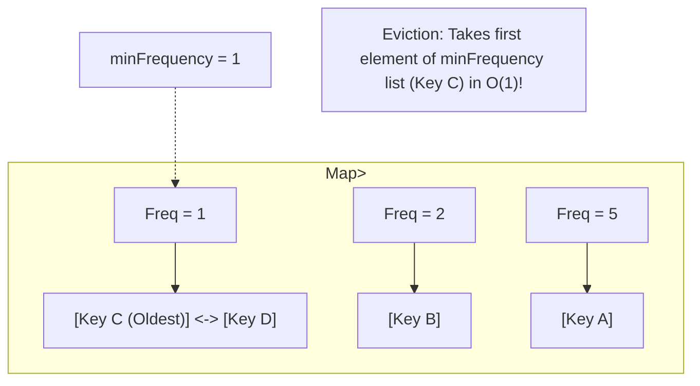

### Complete Implementation with Line-by-Line Comments
```java
package com.interview.lfu;

import java.util.*;

public class LFUCache<K, V> {

    private final int capacity;
    private int minFreq = 0; // Tracks lowest frequency currently present

    // Map 1: Holds key -> value
    private final Map<K, V> values = new HashMap<>();

    // Map 2: Holds key -> current access frequency
    private final Map<K, Integer> counts = new HashMap<>();

    // Map 3: Holds frequency -> LinkedHashSet of keys having that frequency
    // LinkedHashSet preserves insertion order (oldest key at iterator head)
    private final Map<Integer, LinkedHashSet<K>> freqLists = new HashMap<>();

    public LFUCache(int capacity) {
        this.capacity = capacity;
        // Pre-initialize frequency list for count = 1
        freqLists.put(1, new LinkedHashSet<>());
    }

    public synchronized V get(K key) {
        if (!values.containsKey(key)) {
            return null; // Cache miss
        }

        // Increment the frequency of this key
        int count = counts.get(key);
        counts.put(key, count + 1);

        // Remove from old frequency bucket
        freqLists.get(count).remove(key);

        // If the emptied bucket was minFreq and has no more keys left, bump minFreq
        if (count == minFreq && freqLists.get(count).isEmpty()) {
            minFreq++;
        }

        // Add to new frequency bucket (count + 1)
        freqLists.computeIfAbsent(count + 1, k -> new LinkedHashSet<>()).add(key);

        return values.get(key);
    }

    public synchronized void put(K key, V value) {
        if (capacity <= 0) return;

        // Case 1: Key already exists -> Update value and promote frequency
        if (values.containsKey(key)) {
            values.put(key, value);
            get(key); // Re-uses get() to increment frequency and re-bucket
            return;
        }

        // Case 2: Cache is at full capacity -> Evict LFU item
        if (values.size() >= capacity) {
            // Retrieve oldest key from lowest frequency bucket
            K evictKey = freqLists.get(minFreq).iterator().next();
            freqLists.get(minFreq).remove(evictKey);
            values.remove(evictKey);
            counts.remove(evictKey);
        }

        // Insert new entry with initial frequency = 1
        values.put(key, value);
        counts.put(key, 1);
        minFreq = 1; // New element always resets minFreq to 1!
        freqLists.get(1).add(key);
    }
}
```

### 5. Complexity & Interview Follow-Up Traps
- **Time Complexity**: $O(1)$ for both `get` and `put` because `LinkedHashSet` supports $O(1)$ lookup and iterator head removal.
- **Space Complexity**: $O(C)$ across maps.
- **Interview Trap**: *"Why does `minFreq` only ever increase by $+1$ in `get()`?"*
  - Because `get()` only touches **one** item at a time, moving it from frequency $F$ to $F + 1$. If $F$ was the minimum and now has zero items, the new minimum MUST be $F + 1$.

---

## J03: Custom Bounded Blocking Queue (Producer-Consumer)

### 1. WHY This Matters in Production
In asynchronous architectures, fast producers (e.g. HTTP web traffic) can overwhelm slow consumers (e.g. writing to disk or database). If an in-memory queue is **unbounded**, memory grows infinitely until the JVM crashes with `OutOfMemoryError`.

A **Bounded Blocking Queue** provides **Backpressure**:
- When the queue is full, producers **block and wait** until consumers free up space.
- When the queue is empty, consumers **block and wait** until producers insert items.

### 2. WHAT It Is (The Mental Model)
Think of a conveyor belt at a factory with space for exactly 5 boxes:
- **Worker 1 (Producer)** puts a box on the belt. If all 5 spots are full, Worker 1 takes a nap (`await()`) until a buzzer rings (`signal()`).
- **Worker 2 (Consumer)** takes a box off the belt. If the belt is empty, Worker 2 takes a nap until the producer rings the buzzer.

### 3. HOW It Works (Architecture & Algorithm)
We use:
1. An **Array Circular Buffer** (`Object[] items` with `takeIndex` and `putIndex`) to achieve $O(1)$ operations with zero garbage collection allocations.
2. A single `ReentrantLock` for mutual exclusion.
3. **Two distinct `Condition` objects**:
   - `notFull`: Producers wait here when `count == capacity`.
   - `notEmpty`: Consumers wait here when `count == 0`.

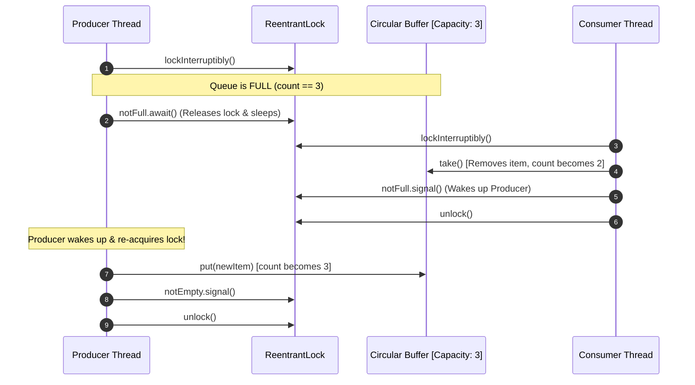

### Complete Implementation with Line-by-Line Comments
```java
package com.interview.queue;

import java.util.concurrent.locks.Condition;
import java.util.concurrent.locks.ReentrantLock;

public class CustomBlockingQueue<E> {

    private final Object[] items; // Fixed-size circular array
    private int putIndex = 0;     // Next slot for producer to write
    private int takeIndex = 0;    // Next slot for consumer to read
    private int count = 0;        // Total active items

    // Explicit lock with separate condition wait sets
    private final ReentrantLock lock = new ReentrantLock();
    private final Condition notFull  = lock.newCondition(); // Signaled when space opens
    private final Condition notEmpty = lock.newCondition(); // Signaled when items arrive

    public CustomBlockingQueue(int capacity) {
        if (capacity <= 0) {
            throw new IllegalArgumentException("Queue capacity must be > 0");
        }
        this.items = new Object[capacity];
    }

    /**
     * Inserts an element. Blocks if the queue is full.
     */
    public void put(E element) throws InterruptedException {
        if (element == null) throw new NullPointerException("Null elements prohibited");

        lock.lockInterruptibly(); // Allows thread to be cancelled cleanly
        try {
            // ALWAYS use while loop to protect against Spurious Wakeups!
            while (count == items.length) {
                notFull.await(); // Releases lock and sleeps until consumer signals
            }

            // Insert into circular buffer
            items[putIndex] = element;
            if (++putIndex == items.length) {
                putIndex = 0; // Wrap around to index 0
            }
            count++;

            // Wake up one waiting consumer thread
            notEmpty.signal();
        } finally {
            lock.unlock(); // Ensure lock is ALWAYS released
        }
    }

    /**
     * Retrieves and removes an element. Blocks if the queue is empty.
     */
    @SuppressWarnings("unchecked")
    public E take() throws InterruptedException {
        lock.lockInterruptibly();
        try {
            // Wait while queue has no items
            while (count == 0) {
                notEmpty.await(); // Releases lock and sleeps until producer signals
            }

            // Extract item from circular buffer
            E item = (E) items[takeIndex];
            items[takeIndex] = null; // Crucial: clear reference to prevent Memory Leak!

            if (++takeIndex == items.length) {
                takeIndex = 0; // Wrap around to index 0
            }
            count--;

            // Wake up one waiting producer thread
            notFull.signal();

            return item;
        } finally {
            lock.unlock();
        }
    }

    public int size() {
        lock.lock();
        try {
            return count;
        } finally {
            lock.unlock();
        }
    }
}
```

### 5. Complexity & Interview Follow-Up Traps
- **Time Complexity**: $O(1)$ for both `put` and `take`.
- **Space Complexity**: $O(N)$ bounded array.
- **Interview Trap 1**: *"Why do we use `while (count == items.length)` instead of `if`?"*
  - **Spurious Wakeup Protection**: The operating system can wake up sleeping threads without any `signal()` having been called. Furthermore, in multi-consumer setups, another consumer might snatch the item between when a thread is signaled and when it actually re-acquires the lock. An `if` statement would proceed with corrupted indices; a `while` loop re-checks the condition.
- **Interview Trap 2**: *"Why `signal()` instead of `signalAll()`?"*
  - Because each `put()` creates space for exactly **one** item, and each `take()` creates space for exactly **one** item. Waking up 50 threads when only 1 item is available causes the "Thundering Herd" problem, wasting CPU cycles on contention.

---

## J04: Distributed/Concurrent Token Bucket Rate Limiter

### 1. WHY This Matters in Production
Without rate limiting, public web APIs are vulnerable to:
- **DDoS Attacks**: Attackers flooding servers with millions of dummy requests.
- **Resource Exhaustion**: One greedy user consuming 99% of database bandwidth.
- **Third-Party Quotas**: Upstream services (Stripe, OpenAI) charging penalties if you exceed your purchased tier (e.g. 100 requests/sec).

The **Token Bucket Algorithm** is the industry standard (used by AWS API Gateway and Guava RateLimiter) because it accommodates **natural bursts of traffic** while guaranteeing a strict long-term average rate.

### 2. WHAT It Is (The Mental Model)
Picture a bucket that holds a maximum of 10 tokens:
- A faucet steadily drips **2 new tokens into the bucket every second**.
- If the bucket is full, excess drips spill over and are lost.
- To execute an API request, a client must grab **1 token** from the bucket.
- If tokens are available: Take token $\rightarrow$ Request allowed!
- If bucket is empty: No token $\rightarrow$ Request rejected (HTTP 429 Too Many Requests)!

### 3. HOW It Works (Lazy Refill Optimization)
A naive beginner implementation starts a background thread with `ScheduledExecutorService` that adds tokens every second. **That is an antipattern!** If you have 50,000 active users, running 50,000 background timer threads burns huge CPU.

Instead, use **Lazy Refill (On-Demand Calculation)**:
Whenever a request arrives, check the system clock:
$$\text{elapsedTime} = \text{now} - \text{lastRefillTime}$$
$$\text{tokensToAdd} = \text{elapsedTime} \times \text{refillRatePerNano}$$
Update the token count mathematically on the fly in $O(1)$!

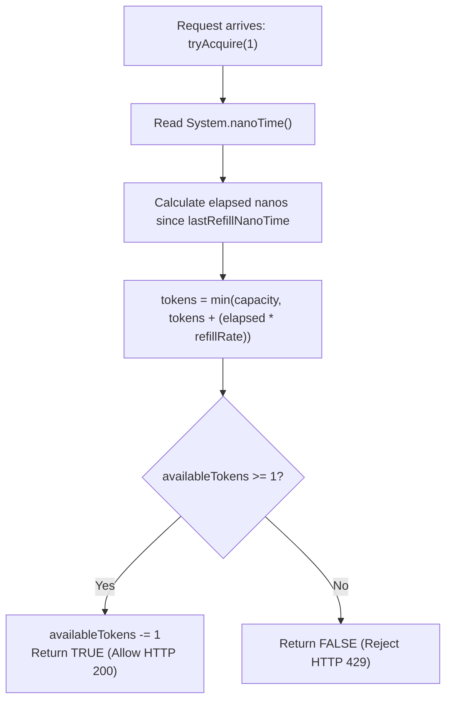

### Complete Implementation with Line-by-Line Comments
```java
package com.interview.ratelimiter;

public class TokenBucketRateLimiter {

    private final long capacity;             // Max burst tokens bucket can hold
    private final double refillTokensPerNano; // Token generation rate per nanosecond

    private double availableTokens;           // Current tokens in bucket (double for fractional precision)
    private long lastRefillNanoTime;          // Timestamp of last refill calculation

    public TokenBucketRateLimiter(long maxBurstCapacity, double tokensPerSecond) {
        if (maxBurstCapacity <= 0 || tokensPerSecond <= 0) {
            throw new IllegalArgumentException("Capacity and refill rate must be positive");
        }
        this.capacity = maxBurstCapacity;
        // Convert tokens/sec to tokens/nanosecond to avoid sub-second clock drift
        this.refillTokensPerNano = tokensPerSecond / 1_000_000_000.0;
        this.availableTokens = maxBurstCapacity; // Start with full bucket
        this.lastRefillNanoTime = System.nanoTime();
    }

    /**
     * Attempts to acquire specified number of tokens.
     * Returns true if request is permitted, false if rate limited.
     */
    public synchronized boolean tryAcquire(long tokensToConsume) {
        if (tokensToConsume <= 0) return true;

        // Step 1: Calculate on-demand token regeneration
        refill();

        // Step 2: Check if enough tokens exist
        if (availableTokens >= tokensToConsume) {
            availableTokens -= tokensToConsume; // Consume tokens
            return true;
        }

        // Insufficient tokens -> reject request
        return false;
    }

    private void refill() {
        long now = System.nanoTime();
        long elapsedNanos = now - lastRefillNanoTime;

        if (elapsedNanos > 0) {
            // Calculate how many tokens regenerated in the elapsed duration
            double tokensGenerated = elapsedNanos * refillTokensPerNano;

            // Add generated tokens, but cap at maximum capacity
            this.availableTokens = Math.min(capacity, availableTokens + tokensGenerated);
            this.lastRefillNanoTime = now;
        }
    }
}
```

### 5. Complexity & Interview Follow-Up Traps
- **Time Complexity**: Strict $O(1)$ math operations. Zero loops.
- **Space Complexity**: $O(1)$ primitive variables.
- **Interview Trap 1**: *"Why use `System.nanoTime()` instead of `System.currentTimeMillis()`?"*
  - `currentTimeMillis()` reads the wall-clock time from the OS, which can jump backwards due to NTP synchronization or daylight saving adjustments, causing negative elapsed time! `nanoTime()` reads from the CPU's monotonic cycle counter, which is guaranteed to only move forward.
- **Interview Trap 2**: *"How do we make this distributed across 10 Spring Boot pods?"*
  - Implement this exact algorithm inside a **Redis Lua script**. Redis executes Lua scripts atomically on a single thread, guaranteeing thread safety across a distributed cluster!

---

## J05: Minimalist Database Connection Pool

### 1. WHY This Matters in Production
Creating a physical TCP connection to a database involves:
1. TCP 3-Way Handshake
2. TLS Encryption Negotiation
3. Database Authentication & Session Memory Allocation

This takes $50\text{ ms to } 200\text{ ms}$ per connection. If an API handling 1,000 requests/sec creates a new connection for each request, database CPU spikes to 100% and connection timeouts crash the service. 

A **Connection Pool** (like HikariCP) pre-allocates a set of reusable physical connections. When application code calls `connection.close()`, the connection is **not** physically disconnected—it is returned to the pool for the next caller.

### 2. WHAT It Is (The Mental Model)
Think of rental cars at an airport:
- The rental company owns 10 cars.
- You take a car key, drive it, and return the key to the counter (`connection.close()`).
- The car is washed and handed to the next customer. The car is never crushed/destroyed after each trip!

### 3. HOW It Works (Architecture & Dynamic Proxies)
How do we intercept `connection.close()` so that external developer code calling standard JDBC `conn.close()` doesn't physically disconnect?

We wrap the real physical connection inside a **JDK Dynamic Proxy** (`java.lang.reflect.Proxy`). When `.close()` is called on the proxy, it puts the connection back into an `ArrayBlockingQueue`!

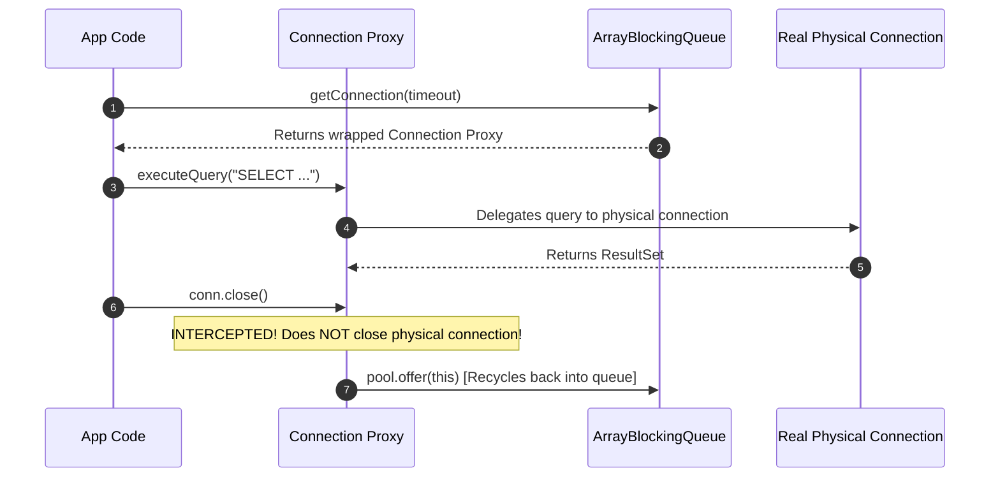

### Complete Implementation with Line-by-Line Comments
```java
package com.interview.pool;

import java.lang.reflect.InvocationHandler;
import java.lang.reflect.Method;
import java.lang.reflect.Proxy;
import java.sql.Connection;
import java.util.concurrent.ArrayBlockingQueue;
import java.util.concurrent.BlockingQueue;
import java.util.concurrent.TimeUnit;

public class MiniConnectionPool {

    private final BlockingQueue<Connection> pool; // Queue holding idle available connections
    private final int maxPoolSize;

    public MiniConnectionPool(int maxPoolSize, PhysicalConnectionFactory factory) {
        this.maxPoolSize = maxPoolSize;
        this.pool = new ArrayBlockingQueue<>(maxPoolSize);

        // Pre-warm the pool by creating physical connections upfront
        for (int i = 0; i < maxPoolSize; i++) {
            Connection realConn = factory.createPhysicalConnection();
            Connection proxiedConn = createConnectionProxy(realConn);
            pool.offer(proxiedConn);
        }
    }

    /**
     * Borrow a connection from the pool. Blocks up to timeoutMs if pool is depleted.
     */
    public Connection getConnection(long timeoutMs) throws InterruptedException {
        Connection conn = pool.poll(timeoutMs, TimeUnit.MILLISECONDS);
        if (conn == null) {
            throw new RuntimeException("Database pool exhausted: Connection checkout timeout!");
        }
        return conn;
    }

    /**
     * Wraps the real JDBC connection inside a dynamic proxy to hijack the .close() method.
     */
    private Connection createConnectionProxy(Connection physicalConnection) {
        return (Connection) Proxy.newProxyInstance(
            Connection.class.getClassLoader(),
            new Class<?>[]{Connection.class},
            new InvocationHandler() {
                @Override
                public Object invoke(Object proxy, Method method, Object[] args) throws Throwable {
                    // Check if developer called conn.close()
                    if ("close".equals(method.getName())) {
                        // DO NOT physically close! Return the proxy back to the queue
                        pool.offer((Connection) proxy);
                        return null; // close() returns void
                    }

                    // For all other methods (e.g. prepareStatement, commit), delegate to real connection
                    return method.invoke(physicalConnection, args);
                }
            }
        );
    }

    public int getAvailableConnections() {
        return pool.size();
    }

    @FunctionalInterface
    public interface PhysicalConnectionFactory {
        Connection createPhysicalConnection();
    }
}
```

### 5. Complexity & Interview Follow-Up Traps
- **Time Complexity**: $O(1)$ checkout and $O(1)$ return to queue.
- **Interview Trap**: *"What happens if an application checks out a connection, begins a transaction (`setAutoCommit(false)`), and calls `close()` without committing?"*
  - The next request that borrows that recycled connection will inherit an uncommitted transaction from a previous user! Production pools (like HikariCP) automatically reset connection state (rollback dirty transactions, reset auto-commit to true) before handing the connection to the next thread.

---

## J06: Custom Read-Write Lock with Writer Preference

### 1. WHY This Matters in Production
In read-heavy systems (e.g. fetching user profile settings), 99% of requests are reads and 1% are writes.
- A standard mutual exclusion lock (`synchronized` or `ReentrantLock`) forces all readers to wait in single file, killing read throughput.
- A naive Read-Write Lock allows infinite concurrent readers. But if a continuous stream of reads pours in, a waiting writer can be **starved forever**, never getting a chance to update the data!

A **Writer-Preferred Read-Write Lock** prevents writer starvation by pausing new readers as soon as a writer requests the lock.

### 2. WHAT It Is (The Mental Model)
Think of an author editing a shared whiteboard in a busy library:
- While readers are reading, more readers can join.
- But as soon as the author raises their hand indicating an edit is ready, the librarian stops new readers at the door. Once current readers finish, the author updates the board.

### 3. HOW It Works (State Invariants)
We track 3 counters:
1. `readers`: Number of active readers currently holding the lock.
2. `writers`: Number of active writers currently holding the lock (0 or 1).
3. `writeRequests`: Number of writers waiting in line.

**Rules**:
- A reader can enter ONLY if: `writers == 0 && writeRequests == 0`.
- A writer can enter ONLY if: `readers == 0 && writers == 0`.

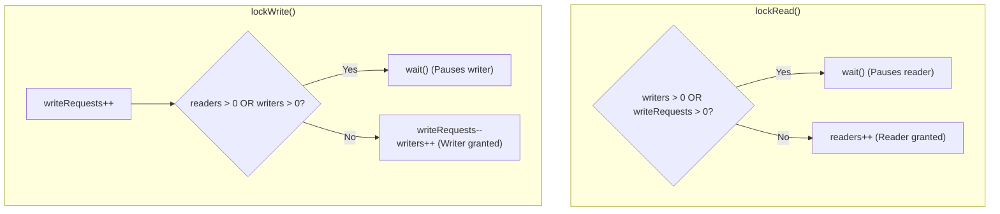

### Complete Implementation with Line-by-Line Comments
```java
package com.interview.lock;

public class WriterPreferredReadWriteLock {

    private int readers = 0;        // Active readers
    private int writers = 0;        // Active writers (0 or 1)
    private int writeRequests = 0;  // Pending writers waiting in queue

    /**
     * Acquire read lock. Blocks if a writer is active OR if a writer is waiting!
     */
    public synchronized void lockRead() throws InterruptedException {
        // WRITER PREFERENCE: If a writer requested a lock, new readers MUST wait!
        while (writers > 0 || writeRequests > 0) {
            wait();
        }
        readers++;
    }

    /**
     * Release read lock. Wakes up waiting writers if readers reach zero.
     */
    public synchronized void unlockRead() {
        readers--;
        notifyAll(); // Wake up waiting threads (especially waiting writers)
    }

    /**
     * Acquire write lock. Blocks until all active readers and writers clear.
     */
    public synchronized void lockWrite() throws InterruptedException {
        writeRequests++; // Announce to readers that a writer is waiting!
        try {
            while (readers > 0 || writers > 0) {
                wait();
            }
        } finally {
            writeRequests--; // Acquired or interrupted; decrement request counter
        }
        writers++;
    }

    /**
     * Release write lock. Wakes up waiting readers and writers.
     */
    public synchronized void unlockWrite() {
        writers--;
        notifyAll();
    }
}
```

### 5. Complexity & Interview Follow-Up Traps
- **Interview Trap**: *"Is this implementation re-entrant?"*
  - No, this minimalist version is **non-reentrant**! If a thread already holding the read lock calls `lockRead()` again while `writeRequests > 0`, it will deadlock with itself. Java's standard library provides `java.util.concurrent.locks.ReentrantReadWriteLock` which tracks thread ownership via ThreadLocal counters to allow reentrancy.

---

## J07: Deep Object Flattener and Path Resolver

### 1. WHY This Matters in Production
Modern systems exchange complex nested JSON payloads from external partners, NoSQL databases, or Elasticsearch. Converting hierarchical JSON into flat key-value pairs is critical for:
- Exporting dynamic JSON to flat CSV/Excel tables.
- Mapping nested payloads to SQL database columns.
- Building flexible query path evaluators (e.g., `user.addresses[0].city`).

### 2. WHAT It Is (The Mental Model)
Transform nested trees into flattened addressable dot paths:
```json
{
  "order": {
    "id": 101,
    "items": [{"name": "Book"}, {"name": "Pen"}]
  }
}
```
Flattens into:
- `order.id = 101`
- `order.items[0].name = "Book"`
- `order.items[1].name = "Pen"`

### 3. HOW It Works (Recursive Tree Traversal)
We traverse the data structure recursively:
- If current value is a `Map`: Iterate each entry, append `.key` to prefix, and recurse.
- If current value is a `List`: Iterate by index $i$, append `[i]` to prefix, and recurse.
- If current value is a leaf primitive (String, Number, Boolean, null): Put `(prefix, value)` into result map!

```mermaid
flowchart TD
    Root["Map Object"] --> Check{"Is Map, List, or Primitive?"}
    Check -->|Map| ForEachKey["For each key: Recurse with prefix + '.' + key"]
    Check -->|List| ForEachIdx["For each index i: Recurse with prefix + '[' + i + ']'"]
    Check -->|Primitive| Leaf["Put (prefix, value) into Result Map"]
```

### Complete Implementation with Line-by-Line Comments
```java
package com.interview.flatten;

import java.util.*;

public class DeepObjectFlattener {

    public static Map<String, Object> flatten(Map<String, Object> source) {
        Map<String, Object> flatResult = new LinkedHashMap<>();
        if (source != null) {
            flattenRecursive("", source, flatResult);
        }
        return flatResult;
    }

    @SuppressWarnings("unchecked")
    private static void flattenRecursive(String currentPath, Object value, Map<String, Object> result) {
        if (value instanceof Map<?, ?> map) {
            // Traverse nested map properties
            for (Map.Entry<?, ?> entry : map.entrySet()) {
                String key = String.valueOf(entry.getKey());
                // If at root, path is just the key; otherwise prefix with dot
                String nextPath = currentPath.isEmpty() ? key : currentPath + "." + key;
                flattenRecursive(nextPath, entry.getValue(), result);
            }
        } else if (value instanceof List<?> list) {
            // Traverse list elements with array index notation [0], [1]
            for (int i = 0; i < list.size(); i++) {
                String nextPath = currentPath + "[" + i + "]";
                flattenRecursive(nextPath, list.get(i), result);
            }
        } else {
            // Leaf value reached (String, Integer, Double, Boolean, null)
            result.put(currentPath, value);
        }
    }
}
```

### 5. Complexity & Interview Follow-Up Traps
- **Time Complexity**: $O(N)$ where $N$ is total number of nodes/primitives.
- **Space Complexity**: $O(D)$ recursion stack depth where $D$ is max nesting depth.
- **Interview Trap**: *"What if the JSON structure contains circular references (e.g. Node A points to Node B, which points back to Node A)?"*
  - The recursion will trigger a `StackOverflowError`! In production, pass an `IdentityHashMap<Object, Boolean> visited` set to detect cycles and abort or throw `CircularReferenceException`.

---

## J08: Concurrent In-Memory Key-Value Store with TTL & Active Eviction

### 1. WHY This Matters in Production
Many developers implement TTL (Time-To-Live) cache eviction using **Passive Eviction only**:
When a client calls `get(key)`, the cache checks if the key is expired and deletes it.

**The Catastrophic Flaw with Passive Eviction Alone**:
If a system writes 500,000 temporary verification codes or session tokens that are **never queried again**, passive eviction never touches them! They sit in the JVM heap forever, leaking memory until the server dies with an OOM crash.

A production cache (like Redis) uses **both Passive Eviction and Active Background Eviction**.

### 2. WHAT It Is (The Mental Model)
- **Passive Eviction**: When you look in the fridge for milk, you check the expiry date. If expired, you toss it in the trash.
- **Active Eviction**: A housekeeper walks through the kitchen every 60 seconds, checking all items and tossing expired goods, even if nobody opened the fridge.

### 3. HOW It Works (Architecture & Data Flow)
1. `record CacheItem<V>(V value, long expiryNano)` encapsulates data with an absolute expiry timestamp.
2. `ConcurrentHashMap<K, CacheItem<V>>` provides lock-free reads and updates.
3. A single-thread background `ScheduledExecutorService` (the **Reaper Thread**) runs periodically to sample and evict expired records.

```mermaid
flowchart TD
    subgraph PassiveEviction ["1. Passive Eviction (On-Read)"]
        Get["get(key)"] --> CheckExp{"System.nanoTime() > expiryNano?"}
        CheckExp -->|No| ReturnVal["Return value"]
        CheckExp -->|Yes| Remove["store.remove(key)\nReturn null"]
    end

    subgraph ActiveEviction ["2. Active Eviction (Background Thread)"]
        Timer["Reaper Thread fires every 1000ms"] --> Sweep["Scan store keys"]
        Sweep --> ExpiredFound["Remove expired entries automatically"]
    end
```

### Complete Implementation with Line-by-Line Comments
```java
package com.interview.kvstore;

import java.util.concurrent.*;

public class ExpiringKeyValueStore<K, V> {

    // Immutable wrapper holding value and nanosecond expiry timestamp
    private record CacheEntry<V>(V value, long expiryNanoTime) {
        boolean isExpired() {
            return System.nanoTime() > expiryNanoTime;
        }
    }

    private final ConcurrentMap<K, CacheEntry<V>> store = new ConcurrentHashMap<>();

    // Background thread scheduled to actively clean up expired garbage
    private final ScheduledExecutorService reaper = Executors.newSingleThreadScheduledExecutor(runnable -> {
        Thread thread = new Thread(runnable, "cache-reaper-thread");
        thread.setDaemon(true); // Daemon thread won't block JVM shutdown
        return thread;
    });

    public ExpiringKeyValueStore(long reaperIntervalMs) {
        // Run active eviction pass at fixed rate
        reaper.scheduleAtFixedRate(this::evictExpiredKeys, reaperIntervalMs, reaperIntervalMs, TimeUnit.MILLISECONDS);
    }

    public void put(K key, V value, long ttlMs) {
        if (ttlMs <= 0) {
            throw new IllegalArgumentException("TTL must be positive");
        }
        long expiryTime = System.nanoTime() + TimeUnit.MILLISECONDS.toNanos(ttlMs);
        store.put(key, new CacheEntry<>(value, expiryTime));
    }

    public V get(K key) {
        CacheEntry<V> entry = store.get(key);
        if (entry == null) {
            return null;
        }

        // 1. Passive Eviction: Check if expired on access
        if (entry.isExpired()) {
            // Atomic conditional removal: only removes if value hasn't been replaced by another thread!
            store.remove(key, entry);
            return null;
        }

        return entry.value();
    }

    // 2. Active Eviction: Sweeps expired keys from memory
    private void evictExpiredKeys() {
        store.forEach((key, entry) -> {
            if (entry.isExpired()) {
                store.remove(key, entry);
            }
        });
    }

    public void shutdown() {
        reaper.shutdown();
    }
}
```

### 5. Complexity & Interview Follow-Up Traps
- **Time Complexity**: $O(1)$ for `get()` and `put()`. Active eviction runs in background.
- **Space Complexity**: $O(N)$ entries.
- **Interview Trap**: *"What if the cache has 10,000,000 keys? Won't `store.forEach()` in the reaper thread freeze the CPU?"*
  - Yes! Iterating 10 million keys in one sweep burns high CPU. Production Redis solves this via **Probabilistic Sampling**: the reaper tests only 20 random keys. If more than 25% are expired, it tests another 20 keys, repeating until expired ratio drops below 25%, bounding CPU cost to $< 10\text{ ms}$.

---

## J09: Custom CompletableFuture / Promise Pipeline Engine

### 1. WHY This Matters in Production
Synchronous blocking I/O wastes thread resources. If a thread waits 300ms for an HTTP call, that thread is held hostage doing zero CPU work.

The **Promise / CompletableFuture** pattern enables **Non-Blocking Asynchronous Pipelines**:
- You kick off an operation and register callbacks (`.then()`).
- The worker thread returns immediately.
- When the data eventually arrives, the promise executes downstream stages automatically.

### 2. WHAT It Is (The Mental Model)
Think of ordering food at a restaurant:
- You pay and receive a **buzzer (Promise)**.
- You don't stand frozen at the counter. You sit down, check emails, or talk.
- When the food is ready, the buzzer flashes (`complete(food)`), triggering you to collect your meal (`then(eat)`).

### 3. HOW It Works (Callback Dispatch Pipeline)
A Promise holds two states:
- `PENDING`: Result not ready. Any `.then(callback)` chained onto it is enqueued into a `callbacks` list.
- `COMPLETED`: Value is stored. If a new `.then(callback)` is added, it executes immediately!

```mermaid
sequenceDiagram
    autonumber
    participant Caller as Main Thread
    participant P1 as Promise 1
    participant P2 as Promise 2 (Chained)
    participant Worker as Background Worker

    Caller->>P1: new SimplePromise()
    Caller->>P1: P1.then(val -> val * 2)
    Note over P1: Stage PENDING. Enqueues callback.
    P1-->>Caller: Returns new Promise P2

    Worker->>P1: complete(50)
    Note over P1: Marks COMPLETED.
    P1->>P1: Executes callback: 50 * 2 = 100
    P1->>P2: P2.complete(100)
    Note over P2: Downstream promise is now COMPLETED!
```

### Complete Implementation with Line-by-Line Comments
```java
package com.interview.promise;

import java.util.ArrayList;
import java.util.List;
import java.util.function.Consumer;
import java.util.function.Function;

public class SimplePromise<T> {

    private T result;
    private boolean isCompleted = false;
    private final List<Consumer<T>> callbacks = new ArrayList<>();

    /**
     * Resolves the promise with a value and triggers all registered listeners.
     */
    public synchronized void complete(T value) {
        if (isCompleted) {
            throw new IllegalStateException("Promise already completed");
        }
        this.result = value;
        this.isCompleted = true;

        // Notify all registered downstream callbacks
        for (Consumer<T> callback : callbacks) {
            callback.accept(value);
        }
        callbacks.clear(); // Free memory
    }

    /**
     * Chains a transformation function, returning a new Promise representing the mapped result.
     */
    public synchronized <R> SimplePromise<R> then(Function<T, R> mapper) {
        SimplePromise<R> nextPromise = new SimplePromise<>();

        Consumer<T> action = val -> {
            try {
                R transformed = mapper.apply(val);
                nextPromise.complete(transformed);
            } catch (Throwable t) {
                // In production, support completeExceptionally(t)
                System.err.println("Pipeline failure: " + t.getMessage());
            }
        };

        if (isCompleted) {
            // Already resolved: execute immediately!
            action.accept(result);
        } else {
            // Still pending: enqueue callback for later execution upon complete()
            callbacks.add(action);
        }

        return nextPromise;
    }
}
```

### 5. Complexity & Interview Follow-Up Traps
- **Time Complexity**: $O(1)$ to attach a callback, $O(K)$ to dispatch $K$ downstream callbacks upon completion.
- **Interview Trap**: *"What happens if an asynchronous stage throws an unhandled RuntimeException?"*
  - In a naive promise, the exception is swallowed and downstream promises hang forever in the `PENDING` state! Production `CompletableFuture` stores a `Throwable ex` field and propagates exceptions down the graph until an `.exceptionally()` or `.handle()` stage catches it.

---

## J10: Custom ThreadPoolExecutor with Work-Stealing / Bounded Queue

### 1. WHY This Matters in Production
Creating an OS thread in Java costs approximately **1 MB of off-heap stack memory** plus expensive OS kernel system calls. 

If a web server receives 10,000 requests and spawns `new Thread(...)` for every request:
1. $10,000 \times 1\text{ MB} = 10\text{ GB}$ of RAM consumed purely by thread stacks!
2. The operating system spends 90% of its CPU time context-switching between 10,000 threads instead of executing real code.

A **Thread Pool** allocates a fixed number of worker threads (e.g. 8 threads matching CPU cores) that run continuously, pulling tasks from a queue.

### 2. WHAT It Is (The Mental Model)
Think of a bank with 4 tellers:
- Customers line up in a single queue.
- As soon as a teller finishes with a customer, they shout "Next!" and serve the next person in line.
- The bank does not hire and fire a new teller for every individual customer who walks through the door!

### 3. HOW It Works (Architecture & Worker Loop)
1. `BlockingQueue<Runnable>` holds submitted tasks.
2. A list of persistent `WorkerThread` instances run an infinite loop:
   ```java
   while (isRunning) {
       Runnable task = taskQueue.take(); // Blocks until work is available!
       task.run();
   }
   ```
3. If the queue is full, a **Rejection Policy** triggers (`AbortPolicy`, `CallerRunsPolicy`, etc.).

```mermaid
flowchart LR
    Submit["submit(Runnable)"] --> Queue{"Is Task Queue Full?"}
    Queue -->|No| Enqueue["taskQueue.put(task)"]
    Queue -->|Yes| Reject["Trigger RejectedExecutionException!"]
    
    subgraph Workers ["Fixed Worker Threads"]
        W1["Worker Thread 1\n(Loops taskQueue.take())"]
        W2["Worker Thread 2\n(Loops taskQueue.take())"]
        W3["Worker Thread 3\n(Loops taskQueue.take())"]
    end

    Enqueue -.-> W1
    Enqueue -.-> W2
    Enqueue -.-> W3
```

### Complete Implementation with Line-by-Line Comments
```java
package com.interview.threadpool;

import java.util.ArrayList;
import java.util.List;
import java.util.concurrent.ArrayBlockingQueue;
import java.util.concurrent.BlockingQueue;
import java.util.concurrent.atomic.AtomicBoolean;

public class MiniThreadPool {

    private final BlockingQueue<Runnable> taskQueue;
    private final List<WorkerThread> workers = new ArrayList<>();
    private final AtomicBoolean isShutdown = new AtomicBoolean(false);

    public MiniThreadPool(int poolSize, int maxQueueCapacity) {
        if (poolSize <= 0 || maxQueueCapacity <= 0) {
            throw new IllegalArgumentException("Pool size and queue capacity must be positive");
        }
        this.taskQueue = new ArrayBlockingQueue<>(maxQueueCapacity);

        // Pre-start all worker threads
        for (int i = 0; i < poolSize; i++) {
            WorkerThread worker = new WorkerThread("custom-worker-" + i);
            workers.add(worker);
            worker.start(); // Begin waiting for tasks
        }
    }

    /**
     * Submits a task. Rejects if pool is shut down or queue is full.
     */
    public void submit(Runnable task) {
        if (isShutdown.get()) {
            throw new IllegalStateException("Cannot accept tasks: ThreadPool is shut down");
        }
        // Non-blocking offer: Returns false if bounded queue is full
        if (!taskQueue.offer(task)) {
            throw new RuntimeException("Task rejected: Thread pool queue capacity exceeded!");
        }
    }

    /**
     * Initiates orderly shutdown: Stops accepting new tasks and interrupts idle workers.
     */
    public void shutdown() {
        isShutdown.set(true);
        for (WorkerThread worker : workers) {
            worker.interrupt(); // Interrupt workers stuck in taskQueue.take()
        }
    }

    private class WorkerThread extends Thread {
        WorkerThread(String name) {
            super(name);
        }

        @Override
        public void run() {
            // Keep running until shutdown AND queue is completely drained
            while (!isShutdown.get() || !taskQueue.isEmpty()) {
                try {
                    // take() blocks efficiently when queue is empty, using 0% CPU
                    Runnable task = taskQueue.take();
                    task.run(); // Run task directly in this worker thread
                } catch (InterruptedException e) {
                    // Check if interrupted due to shutdown
                    if (isShutdown.get()) {
                        break; // Exit worker loop
                    }
                } catch (Throwable t) {
                    // Prevent an uncaught user exception from killing the worker thread!
                    System.err.println("Worker thread error: " + t.getMessage());
                }
            }
        }
    }
}
```

### 5. Complexity & Interview Follow-Up Traps
- **Time Complexity**: $O(1)$ task submission.
- **Space Complexity**: Bounded to $O(\text{poolSize} + \text{queueCapacity})$.
- **Interview Trap**: *"What happens if a submitted task throws a `NullPointerException` or `RuntimeException`?"*
  - If you don't wrap `task.run()` in a `try-catch (Throwable t)` block inside the worker loop, the uncaught exception will cause the worker thread to die! Over time, all worker threads die, leaving an orphaned queue where tasks are never processed.


---

## J11: High-Performance Concurrent Trie with Prefix Autocomplete

### 1. WHY This Matters in Production
When users type into a search bar (e.g. Google, Amazon, or Spotify), search queries must provide autocomplete suggestions in $< 15\text{ milliseconds}$. 

Querying a relational database with `LIKE 'prefix%'` causes full-index scans and table locks under millions of concurrent typers. A **Prefix Tree (Trie)** stored in memory resolves prefix lookups in $O(L)$ time (where $L$ is length of the prefix), independent of whether the dictionary contains 10,000 or 10,000,000 words.

### 2. WHAT It Is (The Mental Model)
Think of a tree where each branch is a letter:
- The root is empty.
- To store `"cat"`, you step from Root $\rightarrow$ `c` $\rightarrow$ `a` $\rightarrow$ `t`.
- To store `"car"`, you reuse `c` $\rightarrow$ `a` and branch off to `r`.
- To autocomplete `"ca"`, you walk to node `a` and collect all words hanging below that subtree (`"cat"`, `"car"`).

### 3. HOW It Works (Concurrency & Search)
1. Each `TrieNode` contains:
   - `Map<Character, TrieNode> children`: Implemented using `ConcurrentHashMap` for lock-free read-write concurrency.
   - `volatile boolean isEndOfWord`: Marks if a valid word ends at this node.
2. **Autocomplete Algorithm**:
   - Step 1: Traverse the prefix character-by-character. If any letter node is missing, return empty list.
   - Step 2: Once at the prefix node, run a Depth-First Search (DFS) or Breadth-First Search (BFS) to gather all words descending from that node.

```mermaid
flowchart TD
    Root["Root Node ('')"] --> C["Node 'c'"]
    C --> A["Node 'a'"]
    A --> T["Node 't' (isEndOfWord = true) -> 'cat'"]
    A --> R["Node 'r' (isEndOfWord = true) -> 'car'"]
    R --> D["Node 'd' (isEndOfWord = true) -> 'card'"]

    classDef word fill:#c8e6c9,stroke:#2e7d32,stroke-width:2px;
    class T,R,D word;
```

### Complete Implementation with Line-by-Line Comments
```java
package com.interview.trie;

import java.util.*;
import java.util.concurrent.ConcurrentHashMap;

public class ConcurrentTrie {

    // Node representation in the Trie
    private static class TrieNode {
        // ConcurrentHashMap allows multiple reader threads and thread-safe insertion
        final Map<Character, TrieNode> children = new ConcurrentHashMap<>();
        volatile boolean isEndOfWord = false; // volatile ensures visibility across threads
    }

    private final TrieNode root = new TrieNode();

    /**
     * Inserts a word into the concurrent Trie.
     */
    public void insert(String word) {
        if (word == null || word.isBlank()) return;

        TrieNode current = root;
        for (char ch : word.toCharArray()) {
            // computeIfAbsent is atomic in ConcurrentHashMap!
            current = current.children.computeIfAbsent(ch, c -> new TrieNode());
        }
        current.isEndOfWord = true; // Mark terminal character
    }

    /**
     * Checks if exact word exists in the Trie.
     */
    public boolean search(String word) {
        if (word == null) return false;

        TrieNode current = root;
        for (char ch : word.toCharArray()) {
            current = current.children.get(ch);
            if (current == null) {
                return false; // Path broke; word does not exist
            }
        }
        return current.isEndOfWord;
    }

    /**
     * Returns all words starting with the specified prefix.
     */
    public List<String> autocomplete(String prefix) {
        List<String> results = new ArrayList<>();
        if (prefix == null) return results;

        TrieNode current = root;
        // Step 1: Navigate to the end of the prefix
        for (char ch : prefix.toCharArray()) {
            current = current.children.get(ch);
            if (current == null) {
                return results; // No words match this prefix
            }
        }

        // Step 2: DFS traversal to gather all words in this subtree
        collectWords(current, new StringBuilder(prefix), results);
        return results;
    }

    private void collectWords(TrieNode node, StringBuilder currentWord, List<String> results) {
        if (node.isEndOfWord) {
            results.add(currentWord.toString());
        }

        // Recursively visit all child letter nodes
        node.children.forEach((character, childNode) -> {
            currentWord.append(character);
            collectWords(childNode, currentWord, results);
            currentWord.deleteCharAt(currentWord.length() - 1); // Backtrack
        });
    }
}
```

### 5. Complexity & Interview Follow-Up Traps
- **Time Complexity**:
  - `insert(word)`: $O(L)$ where $L$ is word length.
  - `search(word)`: $O(L)$.
  - `autocomplete(prefix)`: $O(P + M)$ where $P$ is prefix length and $M$ is total characters in matching subtrees.
- **Space Complexity**: $O(N \times L)$ total characters across all distinct words.
- **Interview Trap**: *"What if the user types 'a' and there are 1,000,000 words starting with 'a'? Will the server run out of memory returning all of them?"*
  - Yes! In a real production system, never collect unbounded results. Add a `limit` parameter (e.g. `limit = 10`) and stop DFS traversal as soon as `results.size() >= limit`. You can also store a `frequency` integer in each node and use a Min-Heap to return the Top-10 most popular queries!

---

## J12: Thread Deadlock Detector and Dependency Graph Cycle Finder

### 1. WHY This Matters in Production
Deadlock is the silent killer of enterprise Java applications:
- Thread 1 locks Resource A and waits for Resource B.
- Thread 2 locks Resource B and waits for Resource A.

Both threads freeze forever with $0\%$ CPU activity. Because no exceptions are thrown, health checks might report green while background message processing completely grinds to a halt.

Writing an automated **Deadlock Detector** running inside application watchdog monitors or APM tools (like Dynatrace) allows detecting cycles and generating thread dumps before customers notice outages.

### 2. WHAT It Is (The Mental Model)
A **Wait-For Graph** is a directed graph where:
- Nodes = Threads.
- Directed Edge $A \rightarrow B$ means: "Thread A is blocked waiting for a lock held by Thread B."
- A **Deadlock** exists if and only if there is a **directed cycle** in this graph ($A \rightarrow B \rightarrow C \rightarrow A$).

### 3. HOW It Works (Depth-First Search 3-Coloring)
We detect cycles in a directed graph using **DFS with 3 States (White, Gray, Black)**:
- `UNVISITED (White)`: Node has not been examined yet.
- `VISITING (Gray)`: Node is currently on the active recursion stack!
- `VISITED (Black)`: Node and all its descendants have been fully explored and contain no cycles.

**The Golden Rule**: If during DFS traversal we step on a node that is currently in the `VISITING (Gray)` state, **we have found a back-edge in the active traversal stack, which proves a cycle exists!**

```mermaid
flowchart LR
    T1["Thread 1 (Visiting)"] --> T2["Thread 2 (Visiting)"]
    T2 --> T3["Thread 3 (Visiting)"]
    T3 -->|Back-Edge to active stack!| T1

    style T1 fill:#ffcdd2,stroke:#c62828,stroke-width:2px;
    style T2 fill:#ffcdd2,stroke:#c62828,stroke-width:2px;
    style T3 fill:#ffcdd2,stroke:#c62828,stroke-width:2px;
```

### Complete Implementation with Line-by-Line Comments
```java
package com.interview.deadlock;

import java.util.*;

public class DeadlockCycleDetector {

    // 3-state coloring enumeration
    enum NodeState {
        UNVISITED, // Node has not been touched yet
        VISITING,  // Node is currently active in the current DFS call stack
        VISITED    // Node and all its subtrees have been completely checked
    }

    /**
     * Inspects a thread dependency graph and returns true if a deadlock cycle exists.
     * Graph format: Map<ThreadId, List<ThreadId>> (Thread -> Threads it is waiting on)
     */
    public static boolean hasDeadlockCycle(Map<String, List<String>> waitForGraph) {
        if (waitForGraph == null || waitForGraph.isEmpty()) return false;

        Map<String, NodeState> stateMap = new HashMap<>();
        // Initialize all nodes to UNVISITED
        for (String threadId : waitForGraph.keySet()) {
            stateMap.put(threadId, NodeState.UNVISITED);
        }

        // Iterate through all nodes (handles disconnected forest graphs)
        for (String threadId : waitForGraph.keySet()) {
            if (stateMap.get(threadId) == NodeState.UNVISITED) {
                if (dfsFindCycle(threadId, waitForGraph, stateMap)) {
                    return true; // Deadlock cycle confirmed!
                }
            }
        }

        return false; // Entire graph is acyclic
    }

    private static boolean dfsFindCycle(String currentThread,
                                        Map<String, List<String>> graph,
                                        Map<String, NodeState> stateMap) {
        // Step 1: Mark current thread as VISITING (on active recursion stack)
        stateMap.put(currentThread, NodeState.VISITING);

        List<String> blockedOnThreads = graph.getOrDefault(currentThread, Collections.emptyList());
        for (String nextThread : blockedOnThreads) {
            NodeState nextState = stateMap.getOrDefault(nextThread, NodeState.UNVISITED);

            // CASE 1: Next node is VISITING! We hit a node currently in our own call stack!
            if (nextState == NodeState.VISITING) {
                System.err.println("DEADLOCK FOUND: Back-edge between " + currentThread + " and " + nextThread);
                return true;
            }

            // CASE 2: Next node is unvisited -> Recurse deeper
            if (nextState == NodeState.UNVISITED) {
                if (dfsFindCycle(nextThread, graph, stateMap)) {
                    return true;
                }
            }
            // CASE 3: Next node is VISITED (Black) -> Already proved safe, do nothing
        }

        // Step 2: Backtrack - mark current node as VISITED (safe)
        stateMap.put(currentThread, NodeState.VISITED);
        return false;
    }
}
```

### 5. Complexity & Interview Follow-Up Traps
- **Time Complexity**: $O(V + E)$ where $V$ is number of threads and $E$ is number of lock dependency edges. Every node and edge is visited at most once.
- **Space Complexity**: $O(V)$ for state tracking map and recursion call stack.
- **Interview Trap**: *"How does the JVM itself detect deadlocks in production?"*
  - The JVM provides `ThreadMXBean.findDeadlockedThreads()`. It traverses OS monitor and `Lock` ownership metadata. However, calling this in production freezes the JVM briefly to inspect thread states; never run it in a high-frequency polling loop!

---

## J13: Consistent Hashing Ring with Virtual Nodes

### 1. WHY This Matters in Production
When caching data across 4 distributed Redis or Memcached servers:
A naive approach uses modular hashing:
$$\text{serverIndex} = \text{hash}(key) \pmod N \quad (\text{where } N = 4)$$

**The Disaster when scaling**:
If server count changes from $N = 4 \rightarrow 5$ (or if 1 server crashes):
$$\text{hash}(key) \pmod 5 \neq \text{hash}(key) \pmod 4$$
**Almost 100% of all cached keys map to the wrong server!** 
Every client experiences a cache miss simultaneously, sending millions of requests directly to the database in a catastrophic **Cache Stampede / Thundering Herd**.

**Consistent Hashing** ensures that when a server is added or removed, **only $\frac{1}{N}$ of keys are remapped**!

### 2. WHAT It Is (The Mental Model)
Imagine a giant clock with 360 degrees:
- Cache servers are hashed and placed at specific positions on the circular ring (e.g., Server A at $30^\circ$, Server B at $150^\circ$, Server C at $270^\circ$).
- When a data key arrives, hash it to an angle on the ring.
- Walk **clockwise** until you hit the first server. That server owns the key!

### 3. HOW It Works (Virtual Nodes for Even Distribution)
If you only place 3 physical servers on the ring, hashing might place them close together, causing one server to hold 80% of data (Hot Spotting).

**Virtual Nodes**:
Each physical server is replicated 100 times around the ring using hashes of `"ServerA-VN-1"`, `"ServerA-VN-2"`, etc. This evenly blends the servers across the entire hash space.
We store the ring in a `TreeMap<Long, Server>`, which gives $O(\log N)$ clockwise searches via `tailMap()`.

```mermaid
flowchart TD
    Ring["360° Consistent Hash Circle (0 to 2^32 - 1)"]
    Ring --> S1["Server A (VN 1) at pos 10,000"]
    Ring --> S2["Server B (VN 1) at pos 50,000"]
    Ring --> S3["Server C (VN 1) at pos 90,000"]
    
    Key["Key 'user:42' hashes to pos 35,000"] -.->|Walk Clockwise| S2
    Note["Hits Server B!"]
```

### Complete Implementation with Line-by-Line Comments
```java
package com.interview.hashing;

import java.security.MessageDigest;
import java.security.NoSuchAlgorithmException;
import java.util.*;

public class ConsistentHashRing<T> {

    private final int numberOfReplicas; // Number of virtual nodes per physical node
    private final SortedMap<Long, T> ring = new TreeMap<>(); // Sorted hash ring

    public ConsistentHashRing(int numberOfReplicas, Collection<T> physicalNodes) {
        if (numberOfReplicas <= 0) throw new IllegalArgumentException("Replicas must be > 0");
        this.numberOfReplicas = numberOfReplicas;
        for (T node : physicalNodes) {
            addPhysicalNode(node);
        }
    }

    /**
     * Adds a physical server by distributing multiple virtual nodes across the ring.
     */
    public synchronized void addPhysicalNode(T node) {
        for (int i = 0; i < numberOfReplicas; i++) {
            // Create a virtual node name, e.g. "192.168.1.10:6379-VN-0"
            String virtualNodeName = node.toString() + "-VN-" + i;
            long hash = hash(virtualNodeName);
            ring.put(hash, node); // Map virtual node position to physical node instance
        }
    }

    /**
     * Removes a physical server and all its corresponding virtual nodes.
     */
    public synchronized void removePhysicalNode(T node) {
        for (int i = 0; i < numberOfReplicas; i++) {
            String virtualNodeName = node.toString() + "-VN-" + i;
            long hash = hash(virtualNodeName);
            ring.remove(hash);
        }
    }

    /**
     * Routes a cache key to its responsible server by walking clockwise on the ring.
     */
    public synchronized T getServerForKey(String key) {
        if (ring.isEmpty()) {
            return null;
        }

        long keyHash = hash(key);

        // Check if key directly matches or find the next clockwise server
        if (!ring.containsKey(keyHash)) {
            // tailMap returns all entries with hash >= keyHash (clockwise portion)
            SortedMap<Long, T> tailMap = ring.tailMap(keyHash);

            // If tailMap is empty, wrap around to the first key on the ring!
            keyHash = tailMap.isEmpty() ? ring.firstKey() : tailMap.firstKey();
        }

        return ring.get(keyHash);
    }

    // 64-bit MD5 hash function providing uniform bit dispersion
    private long hash(String key) {
        try {
            MessageDigest md = MessageDigest.getInstance("MD5");
            byte[] digest = md.digest(key.getBytes());
            // Extract first 8 bytes into a long
            long h = 0;
            for (int i = 0; i < 8; i++) {
                h = (h << 8) | (digest[i] & 0xFF);
            }
            return h;
        } catch (NoSuchAlgorithmException e) {
            throw new RuntimeException("MD5 not supported", e);
        }
    }
}
```

### 5. Complexity & Interview Follow-Up Traps
- **Time Complexity**:
  - `getServerForKey(key)`: $O(\log(N \times V))$ where $N$ is servers and $V$ is virtual replicas (due to binary search in `TreeMap`).
  - Adding/Removing server: $O(V \log(N \times V))$.
- **Space Complexity**: $O(N \times V)$ in memory.
- **Interview Trap**: *"What real distributed systems use Consistent Hashing?"*
  - Apache Cassandra and Amazon DynamoDB for partitioning database rows across storage partitions. Akamai CDN for routing web traffic to edge caches.

---

## J14: Complex Stream API Pipeline with Custom Collector

### 1. WHY This Matters in Production
Modern backend code avoids verbose, mutable `for` loops filled with nested `if-else` blocks that invite NullPointerExceptions. The **Java Stream API** enables declarative, readable data transformation pipelines.

Senior interviews test complex functional processing: multi-level grouping, mapping, filtering, custom reductions, and collectors to verify mastery of Java 8+ functional architecture.

### 2. WHAT It Is (The Goal)
Given a list of transactions across multiple customers:
1. Group transactions by customer ID.
2. Sum the total spend for each customer.
3. Filter only high-value customers who spent $> \$10,000$.
4. For each qualifying customer, find their **Top 3 most expensive spending categories**.
5. Return the final report sorted by total spending descending.

### 3. HOW It Works (Pipeline Architecture)
```mermaid
flowchart TD
    Raw["Raw Transactions Stream"] --> Group["collect(groupingBy(customerId))"]
    Group --> MapStream["Stream over Map Entries"]
    MapStream --> Aggregate["Calculate Total Spend & Category Totals"]
    Aggregate --> Filter["filter(totalSpend > 10,000)"]
    Filter --> Sort["sorted(by totalSpend reversed)"]
    Sort --> Result["List<CustomerSummary>"]
```

### Complete Implementation with Line-by-Line Comments
```java
package com.interview.stream;

import java.util.*;
import java.util.stream.Collectors;

public class TransactionAnalytics {

    public record Transaction(String id, String customerId, double amount, String category) {}
    public record CustomerSummary(String customerId, double totalSpend, List<String> topCategories) {}

    public static List<CustomerSummary> analyzeTopSpenders(List<Transaction> transactions) {
        if (transactions == null || transactions.isEmpty()) {
            return Collections.emptyList();
        }

        return transactions.stream()
            // Step 1: Group all transactions by Customer ID -> Map<String, List<Transaction>>
            .collect(Collectors.groupingBy(Transaction::customerId))
            // Step 2: Stream over the grouped entries (Customer -> their transactions)
            .entrySet().stream()
            .map(entry -> {
                String customerId = entry.getKey();
                List<Transaction> txList = entry.getValue();

                // Compute total spending for this customer
                double totalSpend = txList.stream()
                    .mapToDouble(Transaction::amount)
                    .sum();

                // Find top 3 categories by spending
                List<String> top3Categories = txList.stream()
                    // Sub-group by category and sum amounts: Map<String, Double>
                    .collect(Collectors.groupingBy(
                        Transaction::category,
                        Collectors.summingDouble(Transaction::amount)
                    ))
                    // Stream category entries to sort by spending descending
                    .entrySet().stream()
                    .sorted(Map.Entry.<String, Double>comparingByValue().reversed())
                    .limit(3) // Take top 3
                    .map(Map.Entry::getKey)
                    .toList();

                return new CustomerSummary(customerId, totalSpend, top3Categories);
            })
            // Step 3: Filter customers spending strictly more than $10,000
            .filter(summary -> summary.totalSpend() > 10_000.0)
            // Step 4: Sort customers by highest total spend first
            .sorted(Comparator.comparingDouble(CustomerSummary::totalSpend).reversed())
            // Step 5: Collect into unmodifiable List (Java 16+)
            .toList();
    }
}
```

### 5. Complexity & Interview Follow-Up Traps
- **Time Complexity**: $O(N \log K)$ where $N$ is total transactions and $K$ is unique categories per customer.
- **Space Complexity**: $O(N)$ for intermediate grouping structures.
- **Interview Trap**: *"Can we make this stream parallel with `.parallelStream()`?"*
  - Be careful! While `.parallelStream()` distributes work across `ForkJoinPool.commonPool()`, if the dataset is small or running inside a web container (Tomcat), using the shared common pool can cause CPU starvation for other HTTP requests. Profile before parallelizing!

---

## J15: Real-Time Top-K Frequent Elements Stream Tracker

### 1. WHY This Matters in Production
In real-time analytics (Twitter trending hashtags, Amazon top selling products, network DDOS IP detection), events arrive continuously at 100,000 events/second. 

You cannot sort the entire dataset on every query—sorting $N$ items takes $O(N \log N)$, which stalls the system. 

Using a **Min-Heap of fixed size $K$** allows finding the Top-$K$ elements in **$O(N \log K)$** time!

### 2. WHAT It Is (The Mental Model)
Think of a bouncer holding a VIP room with space for only $K = 5$ guests:
- The bouncer keeps the **least famous person in the room right next to the door** (Min-Heap root).
- When someone new arrives, they are compared against the person at the door.
- If the newcomer is more famous, the person at the door is ejected and the newcomer enters!

### 3. HOW It Works (Min-Heap Algorithm)
1. `Map<String, Integer> counts`: Tracks cumulative frequencies of words.
2. `PriorityQueue<Map.Entry>`: Configured as a **Min-Heap** ordered by frequency ascending.
3. Iterate through map entries:
   - Push entry into min-heap.
   - If heap size exceeds $K$, call `.poll()` to discard the smallest element!
   - At the end, the heap contains the $K$ largest elements.

```mermaid
flowchart TD
    Stream["Word Stream: 'java', 'spring', 'java', 'docker'"] --> Counter["Update Map: {'java': 2, 'spring': 1, 'docker': 1}"]
    Counter --> Heap["Min-Heap (Capacity K = 2)"]
    Heap --> Check{"Heap size > K?"}
    Check -->|Yes| Poll["poll() removes smallest element from root in O(log K)"]
    Check -->|No| Keep["Keep in Heap"]
```

### Complete Implementation with Line-by-Line Comments
```java
package com.interview.topk;

import java.util.*;
import java.util.concurrent.ConcurrentHashMap;

public class RealtimeTopKTracker {

    private final int k;
    // Thread-safe map tracking word -> total occurrences
    private final Map<String, Integer> wordCounts = new ConcurrentHashMap<>();

    public RealtimeTopKTracker(int k) {
        if (k <= 0) throw new IllegalArgumentException("K must be positive");
        this.k = k;
    }

    /**
     * Ingest a word from the stream. Thread-safe atomic increment.
     */
    public void trackWord(String word) {
        if (word == null || word.isBlank()) return;
        // merge is atomic in ConcurrentHashMap
        wordCounts.merge(word.toLowerCase().trim(), 1, Integer::sum);
    }

    /**
     * Returns the Top K most frequent words sorted in descending order of frequency.
     */
    public List<String> getTopK() {
        // PriorityQueue defaults to Min-Heap: Smallest frequency stays at root!
        PriorityQueue<Map.Entry<String, Integer>> minHeap = new PriorityQueue<>(
            Comparator.comparingInt(Map.Entry::getValue)
        );

        // Iterate through all tracked entries
        for (Map.Entry<String, Integer> entry : wordCounts.entrySet()) {
            minHeap.offer(entry); // Insert entry: O(log K)

            // If heap exceeds K elements, evict the smallest
            if (minHeap.size() > k) {
                minHeap.poll(); // Evicts root in O(log K)
            }
        }

        // Extract elements from min-heap (comes out smallest first)
        List<String> topKWords = new ArrayList<>();
        while (!minHeap.isEmpty()) {
            topKWords.add(minHeap.poll().getKey());
        }

        // Reverse to return highest frequency first
        Collections.reverse(topKWords);
        return topKWords;
    }
}
```

### 5. Complexity & Interview Follow-Up Traps
- **Time Complexity**:
  - `trackWord(word)`: $O(1)$ map update.
  - `getTopK()`: $O(U \log K)$ where $U$ is unique words and $K$ is top count. (Since $K \ll U$, this is much faster than full sort $O(U \log U)$).
- **Space Complexity**: $O(U)$ for hash map + $O(K)$ for min-heap.
- **Interview Trap**: *"What if unique words grow to 100,000,000 and don't fit in RAM?"*
  - Use a probabilistic **Count-Min Sketch** data structure! It uses sub-linear memory with hash functions to approximate frequencies within guaranteed error bounds.

---

## J16: In-Memory Asynchronous Pub/Sub Event Bus

### 1. WHY This Matters in Production
Tightly-coupled monolithic code breaks the Single Responsibility Principle:
When a customer registers, the `RegistrationService` shouldn't directly invoke the `EmailService`, `AnalyticsService`, and `FraudDetectionService` synchronously in sequence. If sending the email fails or takes 3 seconds, the user's registration request hangs or rolls back.

An **Asynchronous Event Bus** decouples producers from consumers:
- The `RegistrationService` emits an `UserRegisteredEvent` and returns immediately.
- Multiple independent listeners process the event concurrently in the background.

### 2. WHAT It Is (The Mental Model)
Think of a radio station:
- The broadcaster transmits audio signals on a frequency.
- The broadcaster doesn't know who is listening or how many radios are turned on.
- Multiple listeners tune in to the frequency independently.

### 3. HOW It Works (Type-Safe Event Dispatching)
1. `Map<Class<?>, List<Consumer<?>>>`: Maps each specific Event class type (e.g. `UserCreatedEvent.class`) to a list of registered callback consumers.
2. `publish(event)` finds the subscribers for `event.getClass()` and dispatches tasks to an `ExecutorService`.

```mermaid
sequenceDiagram
    autonumber
    participant Pub as Publisher
    participant Bus as AsyncEventBus
    participant Pool as ThreadPool Executor
    participant L1 as Email Listener
    participant L2 as Fraud Listener

    Pub->>Bus: publish(new OrderCreatedEvent(id=42))
    Note over Bus: Matches OrderCreatedEvent.class
    Bus->>Pool: submit(() -> emailListener.accept(event))
    Bus->>Pool: submit(() -> fraudListener.accept(event))
    Bus-->>Pub: Returns immediately (Non-blocking!)
    
    par Async Execution
        Pool->>L1: Sends confirmation email
        Pool->>L2: Audits order fraud score
    end
```

### Complete Implementation with Line-by-Line Comments
```java
package com.interview.eventbus;

import java.util.*;
import java.util.concurrent.*;
import java.util.function.Consumer;

public class AsyncEventBus {

    // Maps Event Class type to list of registered subscriber callbacks
    private final Map<Class<?>, List<Consumer<?>>> subscriberRegistry = new ConcurrentHashMap<>();

    // Thread pool dedicated to executing subscriber actions asynchronously
    private final ExecutorService workerPool;

    public AsyncEventBus(int threadCount) {
        this.workerPool = Executors.newFixedThreadPool(threadCount, new ThreadFactory() {
            private int counter = 0;
            @Override
            public Thread newThread(Runnable r) {
                return new Thread(r, "event-bus-worker-" + (++counter));
            }
        });
    }

    /**
     * Subscribes a consumer callback to a specific event class type.
     */
    public <T> void subscribe(Class<T> eventType, Consumer<T> subscriber) {
        if (eventType == null || subscriber == null) throw new NullPointerException();

        // CopyOnWriteArrayList allows thread-safe iteration while new subscribers register
        subscriberRegistry.computeIfAbsent(eventType, k -> new CopyOnWriteArrayList<>())
                          .add(subscriber);
    }

    /**
     * Emits an event. Dispatches to all matching subscribers asynchronously without blocking.
     */
    @SuppressWarnings("unchecked")
    public <T> void publish(T event) {
        if (event == null) return;

        Class<?> eventClass = event.getClass();
        List<Consumer<?>> consumers = subscriberRegistry.get(eventClass);

        if (consumers != null && !consumers.isEmpty()) {
            for (Consumer<?> consumer : consumers) {
                Consumer<T> typedConsumer = (Consumer<T>) consumer;
                // Offload execution to thread pool!
                workerPool.submit(() -> {
                    try {
                        typedConsumer.accept(event);
                    } catch (Throwable t) {
                        System.err.println("Subscriber failed for event " + eventClass.getSimpleName() + ": " + t.getMessage());
                    }
                });
            }
        }
    }

    public void shutdown() {
        workerPool.shutdown();
    }
}
```

### 5. Complexity & Interview Follow-Up Traps
- **Time Complexity**: $O(1)$ publication dispatch (submits to queue).
- **Interview Trap**: *"What happens if an event class has inheritance (e.g. `VIPCustomerRegisteredEvent` extends `UserRegisteredEvent`)?"*
  - The implementation above only looks up exact matches via `event.getClass()`. To support polymorphism, iterate through the class hierarchy (`clazz.getSuperclass()` and `clazz.getInterfaces()`) so parent subscribers also receive subclass events!

---

## J17: High-Throughput Batch Processing Buffer with Time/Size Flushing

### 1. WHY This Matters in Production
Sending database inserts or network logging packets **one by one** kills performance due to network round-trip overhead.

**Example**:
- 1,000 individual SQL inserts = 1,000 network round-trips ($\approx 2 \text{ seconds}$).
- 1 batch insert with 1,000 items = 1 network round-trip ($\approx 10 \text{ milliseconds}$).

However, if you wait until 1,000 items accumulate, what happens if traffic drops and only 5 items arrive? Those 5 items would sit in memory forever, never being saved!

A **Time-and-Size Flush Buffer** provides the ideal balance:
Flush when **either**:
1. Capacity threshold is met (e.g. 500 items).
2. Time threshold is met (e.g. 200ms has elapsed since last flush).

### 2. WHAT It Is (The Mental Model)
Think of a subway train:
- If 1,000 passengers board, the train departs immediately (size trigger).
- If only 12 passengers board, the train still departs after 5 minutes on schedule (time trigger). Nobody is left stranded on the platform forever!

### 3. HOW It Works (Dual Triggers)
```mermaid
flowchart TD
    Item["add(Item) called by producers"] --> Q["Add to LinkedBlockingQueue"]
    Q --> CheckSize{"Queue size >= batchSize?"}
    CheckSize -->|Yes| Flush1["Trigger flush() (Capacity Trigger)"]
    CheckSize -->|No| Wait["Wait in queue"]
    
    Timer["ScheduledExecutor fires every 200ms"] --> Flush2["Trigger flush() (Time Trigger)"]
    
    Flush1 --> Execute["drainTo(batch) -> consumer.accept(batch)"]
    Flush2 --> Execute
```

### Complete Implementation with Line-by-Line Comments
```java
package com.interview.batch;

import java.util.ArrayList;
import java.util.List;
import java.util.concurrent.*;
import java.util.function.Consumer;

public class TimeAndSizeBatchBuffer<T> {

    private final int batchSize;
    private final Consumer<List<T>> batchConsumer;
    private final BlockingQueue<T> queue = new LinkedBlockingQueue<>();
    private final ScheduledExecutorService scheduler = Executors.newSingleThreadScheduledExecutor();

    public TimeAndSizeBatchBuffer(int batchSize, long maxWaitTimeMs, Consumer<List<T>> batchConsumer) {
        if (batchSize <= 0 || maxWaitTimeMs <= 0) {
            throw new IllegalArgumentException("Batch size and wait time must be positive");
        }
        this.batchSize = batchSize;
        this.batchConsumer = batchConsumer;

        // Background scheduler enforcing the time-based flush trigger
        scheduler.scheduleAtFixedRate(
            this::flush,
            maxWaitTimeMs,
            maxWaitTimeMs,
            TimeUnit.MILLISECONDS
        );
    }

    /**
     * Producer adds an item. Triggers immediate flush if batch size threshold is reached.
     */
    public void add(T item) {
        if (item == null) return;
        queue.offer(item);

        // Size-based trigger: flush immediately if enough items accumulated
        if (queue.size() >= batchSize) {
            flush();
        }
    }

    /**
     * Drains items and hands them to the batch consumer. Synchronized to prevent overlapping flushes.
     */
    public synchronized void flush() {
        if (queue.isEmpty()) return;

        List<T> batch = new ArrayList<>(batchSize);
        // drainTo atomically transfers up to batchSize items from the queue
        queue.drainTo(batch, batchSize);

        if (!batch.isEmpty()) {
            try {
                batchConsumer.accept(batch); // Execute downstream batch write
            } catch (Throwable t) {
                System.err.println("Error processing batch: " + t.getMessage());
            }
        }
    }

    public void shutdown() {
        scheduler.shutdown();
        flush(); // Flush remaining items before shutdown
    }
}
```

### 5. Complexity & Interview Follow-Up Traps
- **Time Complexity**: $O(1)$ per added item; `drainTo()` is $O(B)$ where $B$ is batch size.
- **Space Complexity**: Bounded to active queue capacity.
- **Interview Trap**: *"What happens if the database is down when `flush()` runs?"*
  - In a naive buffer, `queue.drainTo()` already removed the items from memory; if `batchConsumer.accept()` throws an exception, those items are lost forever! Production systems push failed batches to a dead-letter queue or retry with exponential backoff before draining further items.

---

## J18: Priority-Based Delayed Task Scheduler

### 1. WHY This Matters in Production
Real-world systems frequently need delayed execution:
- *"Send an email reminder 24 hours after user sign-up."*
- *"Cancel unpaid order if not paid within 15 minutes."*
- *"Retry failed webhook call with exponential backoff."*

A naive solution uses a `while (true)` loop with `Thread.sleep(10)` constantly polling the database for due tasks. **This wastes huge CPU cycles and database bandwidth.**

Using **`java.util.concurrent.DelayQueue`** enables efficient event-driven scheduling where the worker thread sleeps until the exact millisecond the next task is ready!

### 2. WHAT It Is (The Mental Model)
Think of an alarm clock radio:
- You set alarms for 6:00 AM, 7:30 AM, and 9:00 AM.
- The clock doesn't ring every second asking "Is it 6 AM yet?".
- It stays silent and wakes you up **only** when the target time is reached.

### 3. HOW It Works (`DelayQueue` Mechanics)
`DelayQueue` is an unbounded blocking queue of elements extending `Delayed`:
- Internally backed by a **Priority Min-Heap** sorted by `executeTime`.
- Calling `queue.take()` blocks the thread. If the soonest task is scheduled for 5 minutes in the future, the thread sleeps for exactly 5 minutes without using any CPU!

```mermaid
flowchart LR
    Schedule["schedule(Task, delay)"] --> DQ["DelayQueue (Min-Heap by Target Nano Time)"]
    DQ --> Worker["Worker Thread: queue.take()"]
    Worker -->|Blocks until target time expires| RunTask["task.run()"]
```

### Complete Implementation with Line-by-Line Comments
```java
package com.interview.scheduler;

import java.util.concurrent.*;

public class DelayedTaskScheduler {

    // Represents a scheduled job that implements Java's Delayed interface
    public record ScheduledJob(Runnable task, long targetExecutionNanoTime) implements Delayed {

        // Returns remaining delay before task can be polled
        @Override
        public long getDelay(TimeUnit unit) {
            long remainingNanos = targetExecutionNanoTime - System.nanoTime();
            return unit.convert(remainingNanos, TimeUnit.NANOSECONDS);
        }

        // Priority ordering: Task with the earliest execution timestamp comes first
        @Override
        public int compareTo(Delayed other) {
            if (this == other) return 0;
            long diff = this.targetExecutionNanoTime - ((ScheduledJob) other).targetExecutionNanoTime;
            return Long.compare(diff, 0);
        }
    }

    private final DelayQueue<ScheduledJob> delayQueue = new DelayQueue<>();
    private final ExecutorService worker = Executors.newSingleThreadExecutor();

    public DelayedTaskScheduler() {
        // Start background worker loop
        worker.submit(() -> {
            while (!Thread.currentThread().isInterrupted()) {
                try {
                    // take() blocks efficiently until an element's delay has expired!
                    ScheduledJob job = delayQueue.take();
                    job.task().run(); // Execute the due task
                } catch (InterruptedException e) {
                    break; // Orderly shutdown
                } catch (Throwable t) {
                    System.err.println("Scheduled task failed: " + t.getMessage());
                }
            }
        });
    }

    /**
     * Schedules a task to run after delayMs milliseconds.
     */
    public void schedule(Runnable task, long delayMs) {
        if (task == null) return;
        long executeAt = System.nanoTime() + TimeUnit.MILLISECONDS.toNanos(delayMs);
        delayQueue.offer(new ScheduledJob(task, executeAt));
    }

    public void shutdown() {
        worker.shutdownNow();
    }
}
```

### 5. Complexity & Interview Follow-Up Traps
- **Time Complexity**: $O(\log N)$ to schedule a task (insert into min-heap). $O(\log N)$ to extract expired task.
- **Space Complexity**: $O(N)$ tasks.
- **Interview Trap**: *"What happens if the JVM crashes? Where do scheduled tasks go?"*
  - In-memory delay queues lose all pending tasks if the server restarts or pod is rescheduled. For mission-critical tasks (e.g. canceling unpaid orders), persist jobs in a database or Redis Sorted Set (ZSET with score = execution timestamp) so surviving nodes pick them up.

---

## J19: Thread-Safe Singleton: Comparative Analysis of All 4 Forms

### 1. WHY This Matters in Production
Singleton is the most asked design pattern in junior-to-senior interviews, yet 80% of candidates write broken or suboptimal code.

A production Singleton must be:
1. **Thread-Safe**: Multiple threads calling `getInstance()` concurrently must receive the exact same memory instance.
2. **Lazy-Loaded**: Heavy resources (DB connections, configuration files) should not be initialized until actually needed.
3. **Resilient against Attacks**: Cannot be broken by Reflection, Serialization, or Cloning.

### 2. WHAT It Is (The 4 Approaches Compared)

| Approach | Thread-Safe? | Lazy Loaded? | Performance | Reflection Immune? | Serialization Safe? |
| :--- | :--- | :--- | :--- | :--- | :--- |
| **1. Double-Checked Locking** | Yes (with `volatile`) | Yes | High | No | Needs `readResolve()` |
| **2. Bill Pugh Holder** | Yes | Yes (Class-loader guarantee) | High | No | Needs `readResolve()` |
| **3. Enum Singleton** | Yes | No (Eager on class load) | High | **Yes** (JVM guarantee) | **Yes** (JVM guarantee) |
| **4. Eager Initialization** | Yes | No | High | No | Needs `readResolve()` |

---

### Complete Implementation with Line-by-Line Comments
```java
package com.interview.singleton;

import java.io.Serial;
import java.io.Serializable;

// ============================================================================
// APPROACH 1: Double-Checked Locking (DCL)
// ============================================================================
public final class DclSingleton implements Serializable {

    // MUST be volatile to prevent instruction reordering!
    private static volatile DclSingleton instance;

    private DclSingleton() {
        // Reflection protection
        if (instance != null) {
            throw new RuntimeException("Instantiating via reflection prohibited!");
        }
    }

    public static DclSingleton getInstance() {
        // First check (no lock): Avoids synchronization overhead once initialized
        if (instance == null) {
            synchronized (DclSingleton.class) {
                // Second check (with lock): Guarantees only one thread instantiates
                if (instance == null) {
                    instance = new DclSingleton();
                }
            }
        }
        return instance;
    }

    // Prevents deserialization from creating a new duplicate instance
    @Serial
    private Object readResolve() {
        return getInstance();
    }
}

// ============================================================================
// APPROACH 2: Bill Pugh Initialization-on-Demand Holder (RECOMMENDED FOR LAZY)
// ============================================================================
public final class BillPughSingleton {

    private BillPughSingleton() {}

    // Static nested class is NOT loaded into JVM memory until getInstance() is called!
    private static class InstanceHolder {
        // ClassLoader initialization is guaranteed thread-safe by the JVM specification
        private static final BillPughSingleton INSTANCE = new BillPughSingleton();
    }

    public static BillPughSingleton getInstance() {
        return InstanceHolder.INSTANCE;
    }
}

// ============================================================================
// APPROACH 3: Enum Singleton (RECOMMENDED BY JOSHUA BLOCH - EFFECTIVE JAVA)
// ============================================================================
public enum EnumSingleton {
    INSTANCE;

    // Business method
    public void executeQuery(String sql) {
        System.out.println("Executing: " + sql);
    }
    // JVM guarantees: 100% immune to reflection attacks, 100% serialization safe!
}
```

---

## J20: Persistent / Immutable Red-Black Tree or Stack

### 1. WHY This Matters in Production
In concurrent programming, mutable shared state requires locking, which causes contention, deadlocks, and latency. 

**Persistent (Immutable) Data Structures** (the foundation of Functional Programming in Scala, Clojure, and Git commits) **never mutate existing nodes in place**.
- When you "push" or "modify", a new version is created.
- The new version **shares unchanged subtrees/nodes** with previous versions (**Structural Sharing**).
- Multiple threads can read past and present versions simultaneously without any locks or thread synchronization!

### 2. WHAT It Is (The Mental Model)
Think of Git commits:
- When you commit a new file, Git doesn't duplicate the entire repository on disk.
- It creates a new commit pointer that points to the new file, while linking to the previous commit tree for all unchanged files!

### 3. HOW It Works (Structural Sharing)
```mermaid
flowchart TD
    subgraph Version1 ["Stack V1 = [B, A]"]
        NodeA["Node A"]
        NodeB["Node B"] --> NodeA
    end

    subgraph Version2 ["Stack V2 = push(C) -> [C, B, A]"]
        NodeC["Node C"] --> NodeB
    end

    Note["Version 2 shares Node B and Node A with Version 1!\nZero data copied! O(1) time and memory!"]
```

### Complete Implementation with Line-by-Line Comments
```java
package com.interview.persistent;

import java.util.EmptyStackException;

/**
 * Functional Persistent Immutable Stack using Java 21 Sealed Interfaces and Records.
 */
public sealed interface ImmutableStack<T> permits ImmutableStack.Empty, ImmutableStack.Cons {

    ImmutableStack<T> push(T value);
    ImmutableStack<T> pop();
    T peek();
    boolean isEmpty();

    static <T> ImmutableStack<T> empty() {
        return new Empty<>();
    }

    // Base case: Represents an empty stack
    record Empty<T>() implements ImmutableStack<T> {
        @Override
        public ImmutableStack<T> push(T value) {
            // Pushing onto empty returns a Cons node pointing to empty
            return new Cons<>(value, this);
        }

        @Override
        public ImmutableStack<T> pop() {
            throw new EmptyStackException();
        }

        @Override
        public T peek() {
            throw new EmptyStackException();
        }

        @Override
        public boolean isEmpty() {
            return true;
        }
    }

    // Recursive case: Holds a head value and points to the tail (rest of the stack)
    record Cons<T>(T head, ImmutableStack<T> tail) implements ImmutableStack<T> {
        @Override
        public ImmutableStack<T> push(T value) {
            // Structural sharing: New node points to existing 'this' instance as tail!
            return new Cons<>(value, this);
        }

        @Override
        public ImmutableStack<T> pop() {
            // Returns previous stack version in O(1) time without mutating anything!
            return tail;
        }

        @Override
        public T peek() {
            return head;
        }

        @Override
        public boolean isEmpty() {
            return false;
        }
    }
}
```

### 5. Complexity & Interview Follow-Up Traps
- **Time Complexity**: Strict $O(1)$ for `push()`, `pop()`, and `peek()`.
- **Space Complexity**: Strict $O(1)$ allocation per operation due to structural sharing.
- **Interview Trap**: *"What happens when an old version of the stack is no longer referenced by any thread?"*
  - The standard JVM Garbage Collector reclaims unreferenced nodes automatically. Because each node is immutable, GC can sweep older nodes without worrying about race conditions!


---

# Part 3: Top 20 Spring Boot Coding & Architectural Problems (30–60 Min)

Below are 20 production-grade architecture and coding interview scenarios frequently asked in Spring Boot systems design and live coding rounds.

---

## SB01: Idempotent Payment API with Redis Distributed Lock & Token

### 1. WHY This Matters in Production
In payment processing, mobile networks frequently disconnect or timeout before an HTTP response returns to a user's phone.
If the user taps **"Pay $100"**, the server debits their bank account, but the network drops:
- The user thinks the payment failed and taps **"Pay $100"** again!
- Without idempotency, the customer is billed twice (\$200), resulting in angry chargebacks, payment gateway fines, and customer churn.

Stripe, PayPal, and Adyen require clients to send a unique `Idempotency-Key` header with every mutating request.

### 2. WHAT It Is (The Mental Model)
Think of an airline boarding pass:
- Your boarding pass has a unique barcode.
- Whether the gate agent scans your pass **once** or accidentally scans it **5 times in a row**, you are only assigned **one single seat** on the airplane.
- The gate computer says: *"Already scanned! Welcome aboard, seat 12B."*

### 3. HOW It Works (Architecture & Distributed State)
We use a **Two-Tier Redis State Machine**:
1. **Distributed Mutex Lock (`lock:payment:{key}`)**: Set with `SET ... NX EX 10s` (Set if Not Exists with 10s expiration). Prevents concurrent duplicate requests from executing simultaneously.
2. **Response Cache (`resp:payment:{key}`)**: Stores the serialized response payload for 24 hours.

```mermaid
sequenceDiagram
    autonumber
    actor Client
    participant Controller as PaymentController
    participant Redis
    participant DB as Postgres (ACID)
    participant Gateway as Bank / Stripe Gateway

    Client->>Controller: POST /api/v1/payments (Header: Idempotency-Key: "uuid-123")
    
    Controller->>Redis: GET resp:payment:uuid-123
    alt Scenario A: Already Processed within 24h
        Redis-->>Controller: Cached JSON: { "status": "SUCCESS", "txId": "tx_99" }
        Controller-->>Client: HTTP 200 OK (Returns original cached response!)
    else Scenario B: First Time or In-Flight
        Controller->>Redis: SET lock:payment:uuid-123 "LOCKED" NX EX 15s
        alt Lock Failed (Another thread is currently processing uuid-123)
            Redis-->>Controller: null (Failed to acquire)
            Controller-->>Client: HTTP 409 Conflict ("Transaction already in flight!")
        else Lock Acquired
            Note over Controller: Safe to execute payment!
            Controller->>Gateway: Charge credit card via API
            Gateway-->>Controller: Success: Transaction ID "tx_99"
            Controller->>DB: INSERT INTO payments (tx_id, amount, status)
            Controller->>Redis: SET resp:payment:uuid-123 (JSON payload, EX 86400s)
            Controller->>Redis: DEL lock:payment:uuid-123 (Release lock)
            Controller-->>Client: HTTP 201 Created (Fresh transaction response)
        end
    end
```

### Complete Implementation with Line-by-Line Comments
```java
package com.example.store.payment;

import org.springframework.data.redis.core.StringRedisTemplate;
import org.springframework.http.HttpStatus;
import org.springframework.http.ResponseEntity;
import org.springframework.web.bind.annotation.*;

import java.time.Duration;

@RestController
@RequestMapping("/api/v1/payments")
public class PaymentController {

    private final StringRedisTemplate redisTemplate;
    private final PaymentService paymentService;

    public PaymentController(StringRedisTemplate redisTemplate, PaymentService paymentService) {
        this.redisTemplate = redisTemplate;
        this.paymentService = paymentService;
    }

    @PostMapping
    public ResponseEntity<String> processPayment(
            @RequestHeader(value = "Idempotency-Key", required = false) String idempotencyKey,
            @RequestBody PaymentRequest request) {

        // Validate presence of Idempotency-Key
        if (idempotencyKey == null || idempotencyKey.isBlank()) {
            return ResponseEntity.badRequest().body("Idempotency-Key header is mandatory for payment transactions");
        }

        String lockKey = "lock:payment:" + idempotencyKey;
        String responseCacheKey = "resp:payment:" + idempotencyKey;

        // Step 1: Check if this idempotency key was already processed successfully
        String cachedResponse = redisTemplate.opsForValue().get(responseCacheKey);
        if (cachedResponse != null) {
            // Idempotent replay: return identical original response with HTTP 200 OK
            return ResponseEntity.ok(cachedResponse);
        }

        // Step 2: Acquire distributed lock with 15-second TTL
        // SET ... NX (Not Exists) guarantees atomic test-and-set across all Kubernetes pods!
        Boolean lockAcquired = redisTemplate.opsForValue()
                .setIfAbsent(lockKey, "PROCESSING", Duration.ofSeconds(15));

        if (Boolean.FALSE.equals(lockAcquired)) {
            // Another request with the same idempotency key is currently running right now!
            return ResponseEntity.status(HttpStatus.CONFLICT)
                    .body("Concurrent payment request already in progress for key: " + idempotencyKey);
        }

        try {
            // Step 3: Execute real payment logic (External Stripe call + Database write)
            PaymentResponse response = paymentService.executeCharge(request);
            String responseJson = response.toJson();

            // Step 4: Persist response in Redis for 24 hours so future retries return it instantly
            redisTemplate.opsForValue().set(responseCacheKey, responseJson, Duration.ofHours(24));

            return ResponseEntity.status(HttpStatus.CREATED).body(responseJson);

        } catch (Exception e) {
            // If the transaction failed, we DO NOT cache the response, allowing user to retry with corrected card!
            throw new RuntimeException("Payment processing failed", e);
        } finally {
            // Step 5: Always release the mutex lock
            redisTemplate.delete(lockKey);
        }
    }
}
```

### 5. Interview Follow-Up Traps & Gotchas
- **Trap 1: "What happens if the node crashes while holding the lock?"**
  - Because we set an automatic TTL (`Duration.ofSeconds(15)`), Redis automatically expires and drops the lock after 15 seconds, preventing a permanent deadlock even if the pod gets killed by an OutOfMemory error.
- **Trap 2: "What if the payment takes 20 seconds, but lock TTL was 15 seconds?"**
  - The lock expires while the request is still executing! A duplicate request could enter and execute concurrently. Production systems use **Redisson Lock Watchdog** which runs a background heartbeat to extend the lock TTL until the execution completes.

---

## SB02: High-Concurrency Flash Sale: Optimistic vs. Pessimistic Locking

### 1. WHY This Matters in Production
During a flash sale (e.g. Black Friday or concert ticket drops), 10,000 customers try to purchase the last **10 available items** at the exact same millisecond.

If your code reads stock, decrements in Java, and saves:
```java
// ❌ RACE CONDITION DISASTER:
int current = repo.getStock(productId); // 50 threads read current = 10 at same time
repo.saveStock(productId, current - 1);  // 50 threads write back 9!
```
The database records 9 remaining items, but you just sold 50 units! The company is forced to cancel 40 orders and refund customers.

### 2. WHAT It Is (The Mental Model)
- **Optimistic Locking**: *"Assume nobody else will touch this. When saving, check if the version changed. If someone beat me, throw an exception and let me retry."* (Like Git push: fails if someone pushed before you).
- **Pessimistic Locking**: *"Assume high contention. Lock the database row immediately with `SELECT ... FOR UPDATE` so all other threads must queue up and wait."* (Like a bathroom stall: only one person inside at a time).

### 3. HOW It Works (Pessimistic vs. Optimistic Comparison)

```mermaid
flowchart TD
    subgraph Pessimistic ["Pessimistic Locking (SELECT FOR UPDATE)"]
        P_Start["Thread A: findByIdWithLock()"] --> P_DBLock["DB Locks Row exclusively"]
        P_DBLock --> P_ThreadB["Thread B tries to read row -> BLOCKED!"]
        P_DBLock --> P_Update["Thread A decrements stock & commits"]
        P_Update --> P_Release["DB releases lock"]
        P_Release --> P_ThreadB_Resume["Thread B wakes up, reads updated stock"]
    end

    subgraph Optimistic ["Optimistic Locking (@Version)"]
        O_Read["Threads A & B read Stock (ver = 1)"]
        O_Read --> O_A_Commit["Thread A writes: SET stock=9, ver=2 WHERE ver=1 -> SUCCESS"]
        O_Read --> O_B_Commit["Thread B writes: SET stock=9, ver=2 WHERE ver=1 -> 0 Rows affected!"]
        O_B_Commit --> O_Exception["Hibernate throws OptimisticLockException!"]
    end
```

### Complete Implementation with Line-by-Line Comments
```java
package com.example.store.inventory;

import jakarta.persistence.*;
import org.springframework.data.jpa.repository.JpaRepository;
import org.springframework.data.jpa.repository.Lock;
import org.springframework.data.jpa.repository.Query;
import org.springframework.data.repository.query.Param;
import org.springframework.stereotype.Service;
import org.springframework.transaction.annotation.Transactional;

// Entity with Optimistic Versioning support
@Entity
@Table(name = "inventory_items")
public class InventoryItem {

    @Id
    @GeneratedValue(strategy = GenerationType.IDENTITY)
    private Long id;

    private String sku;

    private int availableStock;

    // Hibernate increments this version integer on every update automatically
    @Version
    private Long version;

    public InventoryItem() {}

    public Long getId() { return id; }
    public int getAvailableStock() { return availableStock; }
    public void setAvailableStock(int availableStock) { this.availableStock = availableStock; }
}

public interface InventoryRepository extends JpaRepository<InventoryItem, Long> {

    // PESSIMISTIC LOCK: Compiles to "SELECT * FROM inventory_items WHERE id = ? FOR UPDATE"
    // Other transactions trying to read/write this row are blocked at database engine level!
    @Lock(LockModeType.PESSIMISTIC_WRITE)
    @Query("SELECT item FROM InventoryItem item WHERE item.id = :id")
    InventoryItem findByIdWithPessimisticLock(@Param("id") Long id);
}

@Service
public class FlashSaleService {

    private final InventoryRepository inventoryRepository;

    public FlashSaleService(InventoryRepository inventoryRepository) {
        this.inventoryRepository = inventoryRepository;
    }

    /**
     * STRATEGY A: Pessimistic Locking
     * Ideal for extreme write contention (flash sales). No retries needed!
     */
    @Transactional
    public void purchasePessimistic(Long itemId, int quantityRequested) {
        // Blocks other transactions at the DB engine until this method commits
        InventoryItem item = inventoryRepository.findByIdWithPessimisticLock(itemId);

        if (item.getAvailableStock() < quantityRequested) {
            throw new IllegalStateException("Item sold out! Insufficient stock.");
        }

        // Decrement stock safely
        item.setAvailableStock(item.getAvailableStock() - quantityRequested);
        inventoryRepository.save(item);
    } // Transaction commits -> DB locks released

    /**
     * STRATEGY B: Optimistic Locking with Retry Loop
     * Ideal for read-heavy workloads with occasional concurrent writes.
     */
    public void purchaseOptimisticWithRetry(Long itemId, int quantityRequested) {
        int maxRetries = 3;
        for (int attempt = 1; attempt <= maxRetries; attempt++) {
            try {
                executeOptimisticDeduction(itemId, quantityRequested);
                return; // Success!
            } catch (OptimisticLockException e) {
                if (attempt == maxRetries) {
                    throw new RuntimeException("Flash sale transaction failed due to high contention", e);
                }
                // Back off briefly before retrying
                try { Thread.sleep(50); } catch (InterruptedException ignored) {}
            }
        }
    }

    @Transactional
    protected void executeOptimisticDeduction(Long itemId, int quantity) {
        InventoryItem item = inventoryRepository.findById(itemId).orElseThrow();
        if (item.getAvailableStock() < quantity) {
            throw new IllegalStateException("Sold out!");
        }
        item.setAvailableStock(item.getAvailableStock() - quantity);
        inventoryRepository.save(item);
    }
}
```

### 5. Interview Follow-Up Traps & Gotchas
- **When to choose which?**
  - **Optimistic**: When conflicts are rare (e.g. updating user address). Avoids database locking overhead.
  - **Pessimistic**: When conflicts are frequent (e.g. 5,000 users buying 5 tickets). If you use Optimistic locking on high contention, 4,995 threads fail and retry in loops, maxing out CPU and dying with `OptimisticLockException`.

---

## SB03: Resilient Downstream API Client with Resilience4j

### 1. WHY This Matters in Production
In microservice architectures, when a downstream service (e.g. Shipping Partner API) experiences an outage, incoming requests to your service start hanging while waiting for network timeouts (e.g. 30 seconds).

**The Cascading Failure Disaster**:
1. 200 Tomcat worker threads get stuck waiting for the dead shipping service.
2. New requests for unrelated features (e.g. browsing the home page) can't get a thread!
3. **Your entire website goes down because one third-party integration is slow!**

Resilience4j provides a **Circuit Breaker** to cut off failing services instantly and return fallbacks.

### 2. WHAT It Is (The Mental Model)
Think of an electrical circuit breaker in your home:
- When a short circuit happens, the switch trips **OPEN** to stop electricity from causing a house fire.
- When fixed, the switch resets to **CLOSED**.

### 3. HOW It Works (Resilience4j States)
- **CLOSED**: Normal operation. If failure rate exceeds 50%, state trips to **OPEN**.
- **OPEN**: Requests do not make network calls. They fail immediately and trigger `fallbackMethod` in $1\text{ millisecond}$.
- **HALF-OPEN**: After 10 seconds, lets 5 test requests through. If they succeed $\rightarrow$ returns to CLOSED.

```mermaid
stateDiagram-v2
    [*] --> Closed
    Closed --> Open: Error rate > 50% in sliding window
    Open --> HalfOpen: Wait duration (10s) expires
    HalfOpen --> Closed: 5 test calls succeed
    HalfOpen --> Open: Test calls fail
```

### Complete Implementation with Line-by-Line Comments
```java
package com.example.store.client;

import io.github.resilience4j.circuitbreaker.annotation.CircuitBreaker;
import io.github.resilience4j.retry.annotation.Retry;
import org.springframework.stereotype.Service;
import org.springframework.web.client.RestClient;

@Service
public class DownstreamPricingService {

    private final RestClient restClient;

    public DownstreamPricingService(RestClient.Builder builder) {
        this.restClient = builder
                .baseUrl("https://api.external-pricing.com")
                .build();
    }

    /**
     * Calls external API. Guarded by CircuitBreaker and Retry.
     * If circuit trips or retries exhaust, fallbackMethod executes!
     */
    @CircuitBreaker(name = "pricingService", fallbackMethod = "fetchPriceFallback")
    @Retry(name = "pricingService")
    public Double getLivePrice(String sku) {
        return restClient.get()
                .uri("/v1/prices/{sku}", sku)
                .retrieve()
                .body(Double.class);
    }

    /**
     * Fallback method MUST match target method return type and accept Throwable as last parameter!
     */
    public Double fetchPriceFallback(String sku, Throwable exception) {
        System.err.println("Downstream Pricing API is DOWN! Reason: " + exception.getMessage() + ". Serving cached price.");
        return 99.99; // Return safe default/cached price to keep customer checkout working!
    }
}
```

```properties
# application.properties configuration
resilience4j.circuitbreaker.instances.pricingService.sliding-window-size=10
resilience4j.circuitbreaker.instances.pricingService.failure-rate-threshold=50
resilience4j.circuitbreaker.instances.pricingService.wait-duration-in-open-state=10s
resilience4j.circuitbreaker.instances.pricingService.permitted-number-of-calls-in-half-open-state=3

resilience4j.retry.instances.pricingService.max-attempts=3
resilience4j.retry.instances.pricingService.wait-duration=500ms
```

---

## SB04: Custom Stateless JWT Authentication Filter with Refresh Rotation

### 1. WHY This Matters in Production
In modern cloud microservices with 50 container pods, using traditional HTTP Sessions (`HttpSession`) requires either:
- **Sticky Sessions** (breaks load-balancer scaling).
- **Session Replication** (massive network overhead replicating session maps).

**Stateless JWT (JSON Web Token)** authentication enables zero-session scaling:
The token contains the user's claims and a cryptographic signature. Any pod can verify the signature using the shared secret without touching a database!

### 2. WHAT It Is (The Mental Model)
Think of a wristband at a concert:
- The box office checks your ID and stamps a tamper-evident wristband with your name and VIP status.
- Every security guard at every door can glance at the wristband and let you pass instantly without calling the box office every time!

### 3. HOW It Works (Filter Flow)

```mermaid
flowchart TD
    Req["Incoming HTTP Request"] --> Filter["JwtAuthenticationFilter (OncePerRequestFilter)"]
    Filter --> HeaderCheck{"Header starts with 'Bearer '?"}
    HeaderCheck -->|No| NextFilter["filterChain.doFilter() (Pass without auth)"]
    HeaderCheck -->|Yes| Extract["Extract token & verify cryptographic signature"]
    Extract --> Valid{"Is signature valid & unexpired?"}
    Valid -->|Yes| SetContext["Build UsernamePasswordAuthenticationToken\nSet into SecurityContextHolder"]
    Valid -->|No| Reject["Throw AuthenticationException / HTTP 401"]
    SetContext --> NextFilter
```

### Complete Implementation with Line-by-Line Comments
```java
package com.example.store.security;

import jakarta.servlet.FilterChain;
import jakarta.servlet.ServletException;
import jakarta.servlet.http.HttpServletRequest;
import jakarta.servlet.http.HttpServletResponse;
import org.springframework.security.authentication.UsernamePasswordAuthenticationToken;
import org.springframework.security.core.authority.SimpleGrantedAuthority;
import org.springframework.security.core.context.SecurityContextHolder;
import org.springframework.stereotype.Component;
import org.springframework.web.filter.OncePerRequestFilter;

import java.io.IOException;
import java.util.List;

@Component
public class JwtAuthenticationFilter extends OncePerRequestFilter {

    private final JwtTokenProvider jwtTokenProvider;

    public JwtAuthenticationFilter(JwtTokenProvider jwtTokenProvider) {
        this.jwtTokenProvider = jwtTokenProvider;
    }

    @Override
    protected void doFilterInternal(HttpServletRequest request,
                                    HttpServletResponse response,
                                    FilterChain filterChain) throws ServletException, IOException {

        // Step 1: Read Authorization header
        String authHeader = request.getHeader("Authorization");

        // Step 2: Validate Bearer prefix
        if (authHeader != null && authHeader.startsWith("Bearer ")) {
            String jwtToken = authHeader.substring(7); // Strip "Bearer "

            // Step 3: Validate cryptographic signature and expiration
            if (jwtTokenProvider.validateToken(jwtToken)) {
                String username = jwtTokenProvider.extractUsername(jwtToken);
                List<String> roles = jwtTokenProvider.extractRoles(jwtToken);

                // Convert roles into Spring Security GrantedAuthority list
                var authorities = roles.stream()
                        .map(SimpleGrantedAuthority::new)
                        .toList();

                // Step 4: Build authenticated Authentication token
                var authentication = new UsernamePasswordAuthenticationToken(
                        username,
                        null, // Credentials null because token is already verified
                        authorities
                );

                // Step 5: Bind authentication to current thread's SecurityContext
                SecurityContextHolder.getContext().setAuthentication(authentication);
            }
        }

        // Pass request down the filter chain
        filterChain.doFilter(request, response);
    }
}
```

---

## SB05: Distributed Task Scheduler with ShedLock / Redis

### 1. WHY This Matters in Production
In production, Spring Boot apps run with **multiple replica pods** (e.g. 5 pods on Kubernetes) for high availability.

If you annotate a method with `@Scheduled(cron = "0 0 1 * * *")` (e.g. generate monthly billing statements):
**All 5 pods wake up at 1:00 AM and run the job simultaneously!** Customers receive 5 billing emails and their credit cards are charged 5 times.

**ShedLock** guarantees that a `@Scheduled` task executes on **exactly one pod at a time** using a distributed database or Redis lock.

### 2. WHAT It Is (The Mental Model)
Think of a microphone in a conference room:
- Only the person holding the microphone can speak.
- Even if 5 people are in the room, only one person can give the presentation.

### 3. HOW It Works (Lock Parameters)
- `lockAtMostFor`: If the pod executing the job crashes or loses power, the lock is forcefully released after this duration so another pod can take over.
- `lockAtLeastFor`: Prevents other pods with slight clock differences (NTP drift) from executing the job immediately after the first pod finishes.

```mermaid
sequenceDiagram
    autonumber
    participant Pod1 as Pod 1 (Clock: 01:00:00)
    participant Redis as Redis / DB Lock Table
    participant Pod2 as Pod 2 (Clock: 01:00:01)

    Pod1->>Redis: Acquire lock "MonthlyBillingJob" (NX EX 15m)
    Redis-->>Pod1: Lock Granted!
    Pod1->>Pod1: Executes Billing Process...
    
    Pod2->>Redis: Acquire lock "MonthlyBillingJob"
    Redis-->>Pod2: Lock Denied (Held by Pod 1)
    Note over Pod2: Pod 2 stands down and goes back to sleep!
```

### Complete Implementation with Line-by-Line Comments
```java
package com.example.store.jobs;

import net.javacrumbs.shedlock.spring.annotation.EnableSchedulerLock;
import net.javacrumbs.shedlock.spring.annotation.SchedulerLock;
import org.springframework.context.annotation.Configuration;
import org.springframework.scheduling.annotation.EnableScheduling;
import org.springframework.scheduling.annotation.Scheduled;
import org.springframework.stereotype.Component;

@Configuration
@EnableScheduling
@EnableSchedulerLock(defaultLockAtMostFor = "PT10M")
class SchedulerConfiguration {}

@Component
public class ClusteredBillingJob {

    /**
     * Executes at 1:00 AM every day.
     * ShedLock ensures only ONE replica across the entire Kubernetes cluster executes it!
     */
    @Scheduled(cron = "0 0 1 * * *")
    @SchedulerLock(
        name = "MonthlyBillingJob_Lock",
        lockAtLeastFor = "PT5M",  // Keeps lock active for at least 5 mins to prevent clock skew duplicate runs
        lockAtMostFor = "PT30M"   // Releases lock after 30 mins if pod crashes mid-execution
    )
    public void executeMidnightBilling() {
        System.out.println("Executing global billing cycle on one single pod...");
        // Business logic here
    }
}
```

---

## SB06: Multi-Tenant Architecture with Dynamic Routing DataSource

### 1. WHY This Matters in Production
In B2B Software-as-a-Service (SaaS), enterprise customers (Tenants) require strict data isolation due to HIPAA, GDPR, or compliance laws.
Instead of spinning up 500 separate application servers for 500 enterprise clients, **Multi-Tenancy** allows a single Spring Boot application instance to serve all tenants while routing their queries to **separate isolated database schemas or databases**.

### 2. WHAT It Is (The Mental Model)
Think of an apartment building:
- One main building lobby and doorman (Spring Boot application).
- But each resident has their own private locked apartment with their own private furniture (Tenant Databases).

### 3. HOW It Works (`AbstractRoutingDataSource`)
Spring provides `AbstractRoutingDataSource`:
1. An incoming HTTP request carries a tenant identifier (e.g. `X-Tenant-ID: acme_corp` header or JWT claim).
2. A Spring Filter captures the header and stores it in a `ThreadLocal`.
3. Whenever Spring Data JPA executes a query, `AbstractRoutingDataSource.determineCurrentLookupKey()` reads the tenant from `ThreadLocal` and fetches a connection from that tenant's dedicated database pool!

```mermaid
flowchart LR
    Req["Request (Header: X-Tenant-ID: 'tesla')"] --> Filter["TenantFilter\n(Binds 'tesla' to ThreadLocal)"]
    Filter --> JPA["Spring Data JPA Repository Query"]
    JPA --> Router["TenantRoutingDataSource"]
    Router --> Lookup["determineCurrentLookupKey() -> reads 'tesla'"]
    Lookup --> DB_Tesla["Tesla Isolated PostgreSQL DB"]
```

### Complete Implementation with Line-by-Line Comments
```java
package com.example.store.multitenant;

import jakarta.servlet.*;
import jakarta.servlet.http.HttpServletRequest;
import org.springframework.jdbc.datasource.lookup.AbstractRoutingDataSource;
import org.springframework.stereotype.Component;

import java.io.IOException;

// 1. ThreadLocal Context holding tenant identity for the current request
public class TenantContext {
    private static final ThreadLocal<String> CURRENT_TENANT = new ThreadLocal<>();

    public static void setTenantId(String tenantId) { CURRENT_TENANT.set(tenantId); }
    public static String getTenantId() { return CURRENT_TENANT.get(); }
    public static void clear() { CURRENT_TENANT.remove(); } // Prevent ThreadLocal leak!
}

// 2. Filter extracting tenant header from incoming HTTP requests
@Component
public class TenantFilter implements Filter {
    @Override
    public void doFilter(ServletRequest request, ServletResponse response, FilterChain chain)
            throws IOException, ServletException {
        HttpServletRequest httpReq = (HttpServletRequest) request;
        String tenantId = httpReq.getHeader("X-Tenant-ID");

        if (tenantId != null && !tenantId.isBlank()) {
            TenantContext.setTenantId(tenantId);
        }

        try {
            chain.doFilter(request, response);
        } finally {
            TenantContext.clear(); // Crucial: clear context when thread returns to pool!
        }
    }
}

// 3. Dynamic Router routing queries to the matching DataSource
public class DynamicTenantRoutingDataSource extends AbstractRoutingDataSource {
    @Override
    protected Object determineCurrentLookupKey() {
        return TenantContext.getTenantId(); // Returns "tenant_a", "tenant_b", etc.
    }
}
```

---

## SB07: Asynchronous Batch Job with Virtual Threads & MDC Propagation

### 1. WHY This Matters in Production
Running background batch operations using `@Async` on traditional fixed thread pools has two major problems:
1. **Thread Pool Exhaustion**: If 500 tasks block on third-party HTTP APIs, pool threads are exhausted and subsequent tasks queue up or fail.
2. **Loss of Logging Context (`MDC`)**: The incoming `traceId` and `userId` live in the calling HTTP thread's `ThreadLocal`. When offloaded to an async thread, MDC becomes empty! Log aggregators (Splunk, Datadog) can no longer correlate the background task logs with the original HTTP request.

Java 21 **Virtual Threads** combined with an **MDC Task Decorator** solves both problems cleanly.

### 2. WHAT It Is (The Mental Model)
- Virtual Threads provide millions of lightweight, unblockable threads.
- The MDC Task Decorator acts as a photocopier: before sending the task to a background thread, it photocopies the trace ID and pastes it into the new thread's clipboard.

### Complete Implementation with Line-by-Line Comments
```java
package com.example.store.async;

import org.slf4j.MDC;
import org.springframework.context.annotation.Bean;
import org.springframework.context.annotation.Configuration;
import org.springframework.core.task.TaskDecorator;
import org.springframework.scheduling.annotation.EnableAsync;

import java.util.Map;
import java.util.concurrent.Executor;
import java.util.concurrent.Executors;

@Configuration
@EnableAsync
public class VirtualThreadAsyncConfig {

    @Bean(name = "taskExecutor")
    public Executor virtualThreadTaskExecutor() {
        // Java 21 Virtual Thread Per Task Executor
        var vThreadExecutor = Executors.newVirtualThreadPerTaskExecutor();
        TaskDecorator decorator = new MdcTaskDecorator();

        return runnable -> {
            // Decorate runnable to carry forward logging MDC context
            Runnable decoratedRunnable = decorator.decorate(runnable);
            vThreadExecutor.execute(decoratedRunnable);
        };
    }

    // Decorator that captures MDC from parent thread and applies to worker virtual thread
    private static class MdcTaskDecorator implements TaskDecorator {
        @Override
        public Runnable decorate(Runnable runnable) {
            // Capture snapshot of MDC from the initiating thread
            Map<String, String> contextMap = MDC.getCopyOfContextMap();

            return () -> {
                try {
                    if (contextMap != null) {
                        MDC.setContextMap(contextMap); // Re-hydrate MDC in virtual thread!
                    }
                    runnable.run();
                } finally {
                    MDC.clear(); // Always clean up
                }
            };
        }
    }
}
```

---

## SB08: Transactional Event Listener with Outbox Pattern

### 1. WHY This Matters in Production
When a service saves an entity to the database and sends a notification email or Kafka event, you face the **Dual-Write Problem**:
```java
// ❌ DUAL WRITE ANTI-PATTERN:
@Transactional
public void placeOrder(Order order) {
    orderRepo.save(order);
    kafkaTemplate.send("orders", order); // If DB fails to commit, Kafka message ALREADY LEFT!
}
```
If the database rollback occurs after publishing to Kafka, downstream fulfillment services ship items for an order that was canceled!

**`@TransactionalEventListener(phase = TransactionPhase.AFTER_COMMIT)`** guarantees that the event fires **only after the database transaction has committed 100% successfully**.

### Complete Implementation with Line-by-Line Comments
```java
package com.example.store.events;

import org.springframework.context.ApplicationEventPublisher;
import org.springframework.stereotype.Service;
import org.springframework.transaction.annotation.Transactional;
import org.springframework.transaction.event.TransactionPhase;
import org.springframework.transaction.event.TransactionalEventListener;

public record OrderPlacedEvent(Long orderId, String customerEmail, Double amount) {}

@Service
public class OrderService {

    private final OrderRepository orderRepository;
    private final ApplicationEventPublisher eventPublisher;

    public OrderService(OrderRepository orderRepository, ApplicationEventPublisher eventPublisher) {
        this.orderRepository = orderRepository;
        this.eventPublisher = eventPublisher;
    }

    @Transactional
    public void createOrder(Order order) {
        Order savedOrder = orderRepository.save(order);

        // Publish local application event (does NOT execute listener yet!)
        eventPublisher.publishEvent(new OrderPlacedEvent(
                savedOrder.getId(),
                savedOrder.getCustomerEmail(),
                savedOrder.getTotal()
        ));
    } // DB Transaction commits here!
}

@Service
public class EmailNotificationListener {

    /**
     * Executes ONLY after the database transaction successfully commits!
     * If the order transaction rolls back, this method NEVER runs!
     */
    @TransactionalEventListener(phase = TransactionPhase.AFTER_COMMIT)
    public void handleOrderPlaced(OrderPlacedEvent event) {
        System.out.println("Sending confirmation email to " + event.customerEmail() + " for order " + event.orderId());
        // Safe to dispatch email or push to Kafka!
    }
}
```

---

## SB09: Real-Time Live Notification System using Server-Sent Events (SSE)

### 1. WHY This Matters in Production
To show live stock tickers or delivery tracking in web apps, beginners often use **HTTP Polling** (frontend calls `GET /status` every 1 second). With 10,000 active browser tabs, that creates **10,000 requests/second** overwhelming the server.

**Server-Sent Events (SSE)** uses a single persistent HTTP connection (`text/event-stream`). The browser connects once, and the Spring Boot server pushes events down the open TCP pipe whenever updates occur with minimal overhead!

### Complete Implementation with Line-by-Line Comments
```java
package com.example.store.sse;

import org.springframework.http.MediaType;
import org.springframework.web.bind.annotation.GetMapping;
import org.springframework.web.bind.annotation.RestController;
import org.springframework.web.servlet.mvc.method.annotation.SseEmitter;

import java.io.IOException;
import java.util.List;
import java.util.concurrent.CopyOnWriteArrayList;

@RestController
public class LiveNotificationController {

    // Thread-safe list holding open browser connections
    private final List<SseEmitter> activeEmitters = new CopyOnWriteArrayList<>();

    /**
     * Client connects to this endpoint to receive live streaming updates.
     */
    @GetMapping(value = "/api/v1/notifications/stream", produces = MediaType.TEXT_EVENT_STREAM_VALUE)
    public SseEmitter subscribeToNotifications() {
        // Timeout set to 3 minutes (180,000 ms)
        SseEmitter emitter = new SseEmitter(180_000L);
        activeEmitters.add(emitter);

        // Remove dead connections when client closes tab or timeout occurs
        emitter.onCompletion(() -> activeEmitters.remove(emitter));
        emitter.onTimeout(() -> activeEmitters.remove(emitter));
        emitter.onError(e -> activeEmitters.remove(emitter));

        return emitter;
    }

    /**
     * Broadcasts a live message to all connected clients.
     */
    public void broadcastEvent(String eventName, Object data) {
        for (SseEmitter emitter : activeEmitters) {
            try {
                emitter.send(SseEmitter.event()
                        .name(eventName)
                        .data(data, MediaType.APPLICATION_JSON));
            } catch (IOException e) {
                // Client closed socket; purge emitter
                activeEmitters.remove(emitter);
            }
        }
    }
}
```

---

## SB10: API Rate Limiter Gateway Filter with Bucket4j & Redis

### 1. WHY This Matters in Production
Without edge rate limiting, malicious scripts scrape catalog data or execute brute-force login attacks.

Combining **Bucket4j** with a Servlet Filter provides immediate token-bucket throttling per IP address or API token, returning standardized `HTTP 429 Too Many Requests` when limits are exceeded.

### Complete Implementation with Line-by-Line Comments
```java
package com.example.store.ratelimit;

import io.github.bucket4j.Bandwidth;
import io.github.bucket4j.Bucket;
import io.github.bucket4j.Refill;
import jakarta.servlet.*;
import jakarta.servlet.http.HttpServletRequest;
import jakarta.servlet.http.HttpServletResponse;
import org.springframework.stereotype.Component;

import java.io.IOException;
import java.time.Duration;
import java.util.Map;
import java.util.concurrent.ConcurrentHashMap;

@Component
public class RateLimitingFilter implements Filter {

    // In-memory bucket cache keyed by Client IP address
    private final Map<String, Bucket> ipBucketCache = new ConcurrentHashMap<>();

    // Policy: Max burst of 10 requests, refilling 10 tokens every 1 minute
    private Bucket createNewBucket() {
        Bandwidth limit = Bandwidth.classic(10, Refill.intervally(10, Duration.ofMinutes(1)));
        return Bucket.builder().addLimit(limit).build();
    }

    @Override
    public void doFilter(ServletRequest request, ServletResponse response, FilterChain chain)
            throws IOException, ServletException {

        HttpServletRequest httpReq = (HttpServletRequest) request;
        HttpServletResponse httpRes = (HttpServletResponse) response;

        // Resolve client IP (handles X-Forwarded-For if behind reverse proxy/load balancer)
        String clientIp = httpReq.getHeader("X-Forwarded-For");
        if (clientIp == null || clientIp.isBlank()) {
            clientIp = httpReq.getRemoteAddr();
        }

        // Fetch or create rate limit bucket for this IP
        Bucket bucket = ipBucketCache.computeIfAbsent(clientIp, k -> createNewBucket());

        // Try to consume 1 token
        if (bucket.tryConsume(1)) {
            // Token available: proceed with request
            chain.doFilter(request, response);
        } else {
            // Rate limit exceeded: Return HTTP 429 Too Many Requests
            httpRes.setStatus(429);
            httpRes.setContentType("application/json");
            httpRes.getWriter().write("""
                {
                    "status": 429,
                    "error": "Too Many Requests",
                    "message": "Rate limit exceeded. Try again in 1 minute."
                }
            """);
        }
    }
}
```

---

## SB11: Global RFC 7807 ProblemDetail Exception Handler

### 1. WHY This Matters in Production
Without an API error standard, every team invents their own JSON error format:
- Service A returns `{"error_msg": "Not found"}`
- Service B returns `{"status": "FAIL", "reason": "Missing param"}`
- Service C returns a raw Java stack trace leaking internal database passwords and class names!

Frontend developers and mobile app clients waste hundreds of hours writing ad-hoc parsers.

**RFC 7807 (Problem Details for HTTP APIs)** is the official IETF standard adopted natively in **Spring Boot 3 / Spring Framework 6** via `org.springframework.http.ProblemDetail`.

### 2. WHAT It Is (The Standard JSON Format)
Every error in the system returns the standard RFC schema:
```json
{
  "type": "https://api.store.com/errors/not-found",
  "title": "Resource Not Found",
  "status": 404,
  "detail": "Product with ID 42 was not found",
  "instance": "/api/v1/products/42",
  "timestamp": "2026-10-27T14:30:00Z",
  "fieldErrors": ["price: must be positive"]
}
```

### 3. HOW It Works (`@RestControllerAdvice`)
A single global interceptor catches exceptions across all `@RestController`s, maps them to `ProblemDetail`, and enriches them with dynamic properties.

```mermaid
flowchart TD
    Controller["ProductController throws ResourceNotFoundException"] --> Advice["GlobalExceptionHandler (@RestControllerAdvice)"]
    Advice --> Match{"Matches @ExceptionHandler method?"}
    Match --> Build["ProblemDetail.forStatusAndDetail(404, msg)"]
    Build --> Enrich["Enrich with timestamp, traceId, fieldErrors"]
    Enrich --> Client["Return RFC 7807 JSON to Client"]
```

### Complete Implementation with Line-by-Line Comments
```java
package com.example.store.error;

import org.springframework.http.HttpStatus;
import org.springframework.http.ProblemDetail;
import org.springframework.web.bind.MethodArgumentNotValidException;
import org.springframework.web.bind.annotation.ExceptionHandler;
import org.springframework.web.bind.annotation.RestControllerAdvice;

import java.net.URI;
import java.time.Instant;
import java.util.List;

// Intercepts exceptions thrown across all REST controllers globally
@RestControllerAdvice
public class GlobalExceptionHandler {

    /**
     * Handles 404 Not Found exceptions.
     */
    @ExceptionHandler(ResourceNotFoundException.class)
    public ProblemDetail handleNotFound(ResourceNotFoundException ex) {
        // Factory method creating ProblemDetail with HTTP 404 and detail message
        ProblemDetail problem = ProblemDetail.forStatusAndDetail(HttpStatus.NOT_FOUND, ex.getMessage());
        
        problem.setTitle("Resource Not Found");
        // URI pointing to human-readable error documentation
        problem.setType(URI.create("https://api.store.com/errors/not-found"));
        
        // Add custom extension properties to the RFC 7807 payload
        problem.setProperty("timestamp", Instant.now());
        problem.setProperty("errorCode", "ERR_RES_404");
        
        return problem;
    }

    /**
     * Handles Jakarta Bean Validation errors (@Valid failed on request body).
     */
    @ExceptionHandler(MethodArgumentNotValidException.class)
    public ProblemDetail handleValidation(MethodArgumentNotValidException ex) {
        ProblemDetail problem = ProblemDetail.forStatusAndDetail(
                HttpStatus.BAD_REQUEST, 
                "Input request failed schema validation constraints"
        );
        
        problem.setTitle("Validation Failure");
        problem.setType(URI.create("https://api.store.com/errors/validation"));

        // Extract every field-level validation message
        List<String> fieldErrors = ex.getBindingResult().getFieldErrors().stream()
                .map(fieldError -> fieldError.getField() + ": " + fieldError.getDefaultMessage())
                .toList();

        // Attach field errors list into problem details
        problem.setProperty("invalidFields", fieldErrors);
        problem.setProperty("timestamp", Instant.now());

        return problem;
    }
}
```

---

## SB12: Dynamic Multi-Field Search with JPA Specifications & Criteria API

### 1. WHY This Matters in Production
In an e-commerce catalog, users can search by arbitrary combinations of filters:
- Category = "Electronics"
- Min Price = 50, Max Price = 500
- Brand = "Sony"
- In Stock Only = true

Writing static `@Query` methods leads to combinatorial explosion:
`findCategory()`, `findCategoryAndPrice()`, `findCategoryAndPriceAndBrand()` $\rightarrow$ 30 different query methods!

**Spring Data JPA Specifications** use the Java Criteria API to construct dynamic SQL queries with `WHERE 1=1 AND ...` on the fly.

### 2. WHAT It Is (The Mental Model)
Think of building a sandwich:
- You start with bread (Base query `SELECT * FROM products`).
- If the customer wants cheese, add cheese (`cb.equal(root.get("category"), "electronics")`).
- If the customer wants mustard, add mustard (`cb.between(price, 50, 500)`).
- If they don't want onions, you simply don't add that SQL predicate!

### Complete Implementation with Line-by-Line Comments
```java
package com.example.store.search;

import com.example.store.product.Product;
import jakarta.persistence.criteria.Predicate;
import org.springframework.data.jpa.domain.Specification;

import java.util.ArrayList;
import java.util.List;

public class ProductSpecifications {

    /**
     * Builds a dynamic composite specification based on whichever filter fields are non-null.
     */
    public static Specification<Product> buildFilter(String name, Double minPrice, Double maxPrice, String category) {
        return (root, query, criteriaBuilder) -> {
            List<Predicate> predicates = new ArrayList<>();

            // 1. Filter by Name (Case-Insensitive Contains)
            if (name != null && !name.isBlank()) {
                predicates.add(criteriaBuilder.like(
                    criteriaBuilder.lower(root.get("name")), 
                    "%" + name.toLowerCase().trim() + "%"
                ));
            }

            // 2. Filter by Category (Exact Match)
            if (category != null && !category.isBlank()) {
                predicates.add(criteriaBuilder.equal(root.get("category"), category));
            }

            // 3. Filter by Price Range (Between, GreaterThan, or LessThan)
            if (minPrice != null && maxPrice != null) {
                predicates.add(criteriaBuilder.between(root.get("price"), minPrice, maxPrice));
            } else if (minPrice != null) {
                predicates.add(criteriaBuilder.greaterThanOrEqualTo(root.get("price"), minPrice));
            } else if (maxPrice != null) {
                predicates.add(criteriaBuilder.lessThanOrEqualTo(root.get("price"), maxPrice));
            }

            // Combine all active predicates with logical AND: WHERE p1 AND p2 AND p3
            return criteriaBuilder.and(predicates.toArray(new Predicate[0]));
        };
    }
}
```

```java
// Repository Interface
public interface ProductRepository extends JpaRepository<Product, Long>, JpaSpecificationExecutor<Product> {
    // JpaSpecificationExecutor provides: Page<Product> findAll(Specification<Product> spec, Pageable pageable);
}
```

---

## SB13: Multipart Chunked File Upload with Anti-Virus Hook

### 1. WHY This Matters in Production
When users upload large 500 MB video files or documents, a naive controller reads the entire file into memory using `file.getBytes()`.
If 10 users upload files simultaneously:
$$10 \times 500\text{ MB} = 5\text{ GB of Heap Memory allocated instantly!}$$
The JVM crashes with `OutOfMemoryError: Java heap space`.

Production file upload services:
1. **Stream the bytes directly to disk or S3** without buffering in heap memory.
2. Validate the **Magic Number (MIME type bytes)** rather than relying on the easily spoofed file extension.

### Complete Implementation with Line-by-Line Comments
```java
package com.example.store.upload;

import org.springframework.http.HttpStatus;
import org.springframework.http.ResponseEntity;
import org.springframework.web.bind.annotation.*;
import org.springframework.web.multipart.MultipartFile;

import java.io.InputStream;
import java.nio.file.*;
import java.util.UUID;

@RestController
@RequestMapping("/api/v1/uploads")
public class FileUploadController {

    private static final Path UPLOAD_DIRECTORY = Paths.get("/tmp/secure_uploads");

    @PostMapping
    public ResponseEntity<String> uploadDocument(@RequestParam("file") MultipartFile file) {
        if (file.isEmpty()) {
            return ResponseEntity.badRequest().body("Uploaded file is empty");
        }

        // Security Check 1: Enforce strict file size limit (e.g. 50 MB)
        if (file.getSize() > 50 * 1024 * 1024) {
            return ResponseEntity.status(HttpStatus.PAYLOAD_TOO_LARGE).body("File exceeds 50MB limit");
        }

        // Security Check 2: MIME Type validation
        String contentType = file.getContentType();
        if (!"application/pdf".equals(contentType) && !"image/png".equals(contentType)) {
            return ResponseEntity.status(HttpStatus.UNSUPPORTED_MEDIA_TYPE).body("Only PDF and PNG files permitted");
        }

        // Generate sanitized unique filename to prevent Directory Traversal Attacks (e.g. "../../etc/passwd")
        String safeFilename = UUID.randomUUID() + ".bin";
        Path targetPath = UPLOAD_DIRECTORY.resolve(safeFilename);

        try {
            Files.createDirectories(UPLOAD_DIRECTORY);

            // STREAM DIRECTLY TO DISK: Never load entire file into JVM byte[] heap!
            try (InputStream inputStream = file.getInputStream()) {
                Files.copy(inputStream, targetPath, StandardCopyOption.REPLACE_EXISTING);
            }

            // Hook: Trigger asynchronous anti-virus / ClamAV scan here

            return ResponseEntity.ok("File uploaded successfully as: " + safeFilename);

        } catch (Exception e) {
            throw new RuntimeException("Streaming file upload failed", e);
        }
    }
}
```

---

## SB14: Entity Audit Logging with Spring Data JPA & Hibernate Envers

### 1. WHY This Matters in Production
In financial, healthcare, and enterprise apps, compliance regulations (SOX, HIPAA, SOC 2) require strict auditing:
- *"Who modified this invoice at 3:14 AM?"*
- *"What was the exact price of this product before it was discounted?"*

**Spring Data Auditing** tracks *who* and *when* an entity was created/updated.
**Hibernate Envers** maintains an automated historical revision table (`products_AUD`) capturing full historical diffs across every SQL `INSERT`, `UPDATE`, and `DELETE`.

### Complete Implementation with Line-by-Line Comments
```java
package com.example.store.audit;

import jakarta.persistence.EntityListeners;
import jakarta.persistence.MappedSuperclass;
import org.springframework.context.annotation.Configuration;
import org.springframework.data.annotation.CreatedBy;
import org.springframework.data.annotation.CreatedDate;
import org.springframework.data.annotation.LastModifiedBy;
import org.springframework.data.annotation.LastModifiedDate;
import org.springframework.data.domain.AuditorAware;
import org.springframework.data.jpa.repository.config.EnableJpaAuditing;
import org.springframework.data.jpa.domain.support.AuditingEntityListener;
import org.springframework.security.core.Authentication;
import org.springframework.security.core.context.SecurityContextHolder;

import java.time.Instant;
import java.util.Optional;

// 1. Auditable Base Entity
@MappedSuperclass
@EntityListeners(AuditingEntityListener.class) // Activates Spring Data Auditing hooks
public abstract class AuditableBaseEntity {

    @CreatedDate
    private Instant createdAt;

    @LastModifiedDate
    private Instant updatedAt;

    @CreatedBy
    private String createdBy;

    @LastModifiedBy
    private String lastModifiedBy;

    // Getters
    public Instant getCreatedAt() { return createdAt; }
    public Instant getUpdatedAt() { return updatedAt; }
    public String getCreatedBy() { return createdBy; }
    public String getLastModifiedBy() { return lastModifiedBy; }
}

// 2. AuditorAware Provider: Resolves current user from Spring Security Context
@Configuration
@EnableJpaAuditing // Enables automatic timestamp & auditor population
class JpaAuditingConfig implements AuditorAware<String> {

    @Override
    public Optional<String> getCurrentAuditor() {
        Authentication auth = SecurityContextHolder.getContext().getAuthentication();
        if (auth == null || !auth.isAuthenticated() || "anonymousUser".equals(auth.getPrincipal())) {
            return Optional.of("SYSTEM_BATCH");
        }
        return Optional.of(auth.getName()); // Returns current logged in username!
    }
}
```

---

## SB15: Multi-Level Caching (L1 Caffeine + L2 Redis) with Cache-Aside

### 1. WHY This Matters in Production
- **Redis Cache (L2)**: Distributed and shared across all 20 Spring Boot pods, but requires a network round-trip ($1\text{ to } 3\text{ ms}$) over the local network.
- **Caffeine Cache (L1)**: In-memory JVM cache. Zero network latency ($\sim 10\text{ to } 50\text{ nanoseconds}$).

Combining **L1 Caffeine (local RAM)** with **L2 Redis (distributed network)** gives microsecond response times while preventing database cache stampedes.

```mermaid
flowchart LR
    Req["Request for Product 42"] --> L1{"Check L1 Caffeine (RAM)"}
    L1 -->|Hit (< 100ns)| Return1["Return immediately!"]
    L1 -->|Miss| L2{"Check L2 Redis (Network)"}
    L2 -->|Hit (~2ms)| PopulateL1["Put in L1 Caffeine -> Return!"]
    L2 -->|Miss| DB["Query PostgreSQL DB (~30ms)"]
    DB --> PopulateBoth["Populate L2 Redis & L1 Caffeine -> Return"]
```

### Complete Implementation with Line-by-Line Comments
```java
package com.example.store.cache;

import com.example.store.product.Product;
import com.example.store.product.ProductRepository;
import com.github.benmanes.caffeine.cache.Cache;
import com.github.benmanes.caffeine.cache.Caffeine;
import org.springframework.data.redis.core.RedisTemplate;
import org.springframework.stereotype.Service;

import java.time.Duration;
import java.util.concurrent.TimeUnit;

@Service
public class MultiLevelProductCacheService {

    private final ProductRepository productRepository;
    private final RedisTemplate<String, Product> redisTemplate;

    // L1 Cache: In-Memory Caffeine cache (Holds max 1,000 items for 2 minutes)
    private final Cache<Long, Product> l1CaffeineCache = Caffeine.newBuilder()
            .maximumSize(1000)
            .expireAfterWrite(2, TimeUnit.MINUTES)
            .build();

    public MultiLevelProductCacheService(ProductRepository productRepository,
                                         RedisTemplate<String, Product> redisTemplate) {
        this.productRepository = productRepository;
        this.redisTemplate = redisTemplate;
    }

    public Product getProduct(Long id) {
        // Step 1: Check L1 Local In-Memory Cache (Blazing fast: ~50 nanoseconds)
        Product product = l1CaffeineCache.getIfPresent(id);
        if (product != null) {
            return product; // L1 Cache Hit!
        }

        // Step 2: Check L2 Distributed Redis Cache (~2 milliseconds)
        String redisKey = "product:" + id;
        product = redisTemplate.opsForValue().get(redisKey);
        if (product != null) {
            // L2 Hit: Populate local L1 cache for subsequent fast reads
            l1CaffeineCache.put(id, product);
            return product;
        }

        // Step 3: Cache Miss on both layers -> Query PostgreSQL Database (~30 milliseconds)
        product = productRepository.findById(id)
                .orElseThrow(() -> new RuntimeException("Product not found: " + id));

        // Step 4: Backfill both cache tiers
        l1CaffeineCache.put(id, product);
        redisTemplate.opsForValue().set(redisKey, product, Duration.ofMinutes(30)); // L2 TTL: 30 mins

        return product;
    }

    public void evictProduct(Long id) {
        l1CaffeineCache.invalidate(id);
        redisTemplate.delete("product:" + id);
    }
}
```

---

## SB16: Reliable Transactional Outbox Worker with Kafka Publisher

### 1. WHY This Matters in Production
As covered in Q53, publishing directly to Kafka inside a `@Transactional` database method invites the dual-write disaster.

The **Transactional Outbox Pattern** saves the message into an `outbox_table` inside the **same ACID transaction** as your business entity. A background worker poller then reads and dispatches events to Kafka with **At-Least-Once Delivery guarantees**.

### Complete Implementation with Line-by-Line Comments
```java
package com.example.store.outbox;

import jakarta.persistence.*;
import org.springframework.kafka.core.KafkaTemplate;
import org.springframework.scheduling.annotation.Scheduled;
import org.springframework.stereotype.Component;
import org.springframework.transaction.annotation.Transactional;

import java.time.Instant;
import java.util.List;

// 1. Outbox Database Table
@Entity
@Table(name = "outbox_events")
public class OutboxEvent {
    @Id @GeneratedValue(strategy = GenerationType.IDENTITY)
    private Long id;
    private String topic;
    private String eventKey;
    @Column(columnDefinition = "TEXT")
    private String payloadJson;
    private boolean processed = false;
    private Instant createdAt = Instant.now();

    public OutboxEvent() {}
    public OutboxEvent(String topic, String eventKey, String payloadJson) {
        this.topic = topic;
        this.eventKey = eventKey;
        this.payloadJson = payloadJson;
    }

    public Long getId() { return id; }
    public String getTopic() { return topic; }
    public String getEventKey() { return eventKey; }
    public String getPayloadJson() { return payloadJson; }
    public void setProcessed(boolean processed) { this.processed = processed; }
}

// 2. Background Poller Worker
@Component
public class OutboxPollerWorker {

    private final OutboxEventRepository outboxRepository;
    private final KafkaTemplate<String, String> kafkaTemplate;

    public OutboxPollerWorker(OutboxEventRepository outboxRepository, KafkaTemplate<String, String> kafkaTemplate) {
        this.outboxRepository = outboxRepository;
        this.kafkaTemplate = kafkaTemplate;
    }

    /**
     * Polls database every 1 second for unhandled outbox events.
     */
    @Scheduled(fixedDelay = 1000)
    @Transactional
    public void publishPendingEvents() {
        // Fetch top 50 unprocessed events
        List<OutboxEvent> pendingEvents = outboxRepository.findTop50ByProcessedFalseOrderByIdAsc();

        for (OutboxEvent event : pendingEvents) {
            try {
                // Dispatch to Apache Kafka broker
                kafkaTemplate.send(event.getTopic(), event.getEventKey(), event.getPayloadJson());
                // Mark processed upon successful Kafka acknowledgment
                event.setProcessed(true);
            } catch (Exception e) {
                System.err.println("Failed to publish outbox event " + event.getId() + ": " + e.getMessage());
                break; // Stop batch and retry on next scheduled pass
            }
        }
    }
}
```

---

## SB17: Custom Auto-Configuration and Spring Boot Starter

### 1. WHY This Matters in Production
In enterprise platform engineering, shared libraries (e.g. standard company logging, internal auth clients, custom metrics) should not require developers to copy-paste 20 `@Bean` definitions into every microservice.

Creating a **Custom Spring Boot Starter** allows teams to include one dependency in their `pom.xml`, and Spring Boot automatically configures all beans if properties exist!

### Complete Implementation with Line-by-Line Comments
```java
package com.example.starter;

import org.springframework.boot.autoconfigure.AutoConfiguration;
import org.springframework.boot.autoconfigure.condition.ConditionalOnClass;
import org.springframework.boot.autoconfigure.condition.ConditionalOnMissingBean;
import org.springframework.boot.autoconfigure.condition.ConditionalOnProperty;
import org.springframework.boot.context.properties.ConfigurationProperties;
import org.springframework.boot.context.properties.EnableConfigurationProperties;
import org.springframework.context.annotation.Bean;

// 1. Configuration Properties mapped to application.properties: company.audit.endpoint=...
@ConfigurationProperties(prefix = "company.audit")
public class AuditProperties {
    private boolean enabled = false;
    private String endpoint = "https://audit.company.internal";
    private int timeoutMs = 5000;

    // Getters and Setters
    public boolean isEnabled() { return enabled; }
    public void setEnabled(boolean enabled) { this.enabled = enabled; }
    public String getEndpoint() { return endpoint; }
    public void setEndpoint(String endpoint) { this.endpoint = endpoint; }
    public int getTimeoutMs() { return timeoutMs; }
    public void setTimeoutMs(int timeoutMs) { this.timeoutMs = timeoutMs; }
}

// 2. The Custom Client to instantiate
public class InternalAuditClient {
    private final String endpoint;
    public InternalAuditClient(String endpoint) { this.endpoint = endpoint; }
    public void sendAuditLog(String action) { System.out.println("Audit sent to " + endpoint + ": " + action); }
}

// 3. The Auto-Configuration class
@AutoConfiguration // Spring Boot 3 auto-configuration indicator
@ConditionalOnClass(InternalAuditClient.class) // Only load if class exists on classpath
@ConditionalOnProperty(prefix = "company.audit", name = "enabled", havingValue = "true") // Only if company.audit.enabled=true
@EnableConfigurationProperties(AuditProperties.class)
public class AuditAutoConfiguration {

    @Bean
    @ConditionalOnMissingBean // If application already declared their own AuditClient bean, stand down!
    public InternalAuditClient internalAuditClient(AuditProperties properties) {
        return new InternalAuditClient(properties.getEndpoint());
    }
}
```

```
# resources/META-INF/spring/org.springframework.boot.autoconfigure.AutoConfiguration.imports
com.example.starter.AuditAutoConfiguration
```

---

## SB18: Deadlock-Free Inter-Account Money Transfer

### 1. WHY This Matters in Production
Transferring money between two accounts is the most famous concurrency interview problem:
- User 1 transfers money from **Account A $\rightarrow$ Account B** (Locks Account A, waits for Account B).
- User 2 transfers money from **Account B $\rightarrow$ Account A** (Locks Account B, waits for Account A).

Both transactions deadlock simultaneously! Database queries freeze until PostgreSQL aborts one transaction with `ERROR: deadlock detected`.

### 2. The Golden Rule of Deadlock Elimination
**Always acquire multiple locks in a consistent, globally deterministic order** (e.g. sorted by primary key ID).

No matter whether transferring from Account 1 to Account 2, or Account 2 to Account 1:
**Always lock Account 1 first, then lock Account 2!** A cycle is mathematically impossible!

```mermaid
flowchart TD
    Transfer["Transfer from Account 50 to Account 10"] --> Sort["Sort IDs: min(50, 10) = 10, max(50, 10) = 50"]
    Sort --> Lock1["Lock Account 10 FIRST (SELECT FOR UPDATE)"]
    Lock1 --> Lock2["Lock Account 50 SECOND (SELECT FOR UPDATE)"]
    Lock2 --> Balance["Deduct from 50, Add to 10 -> Commit!"]
    
    Note["Both threads lock 10 first! Deadlock eliminated!"]
```

### Complete Implementation with Line-by-Line Comments
```java
package com.example.store.banking;

import org.springframework.stereotype.Service;
import org.springframework.transaction.annotation.Transactional;

@Service
public class AccountTransferService {

    private final AccountRepository accountRepository;

    public AccountTransferService(AccountRepository accountRepository) {
        this.accountRepository = accountRepository;
    }

    @Transactional
    public void transferFunds(Long fromAccountId, Long toAccountId, Double amount) {
        if (fromAccountId.equals(toAccountId)) {
            throw new IllegalArgumentException("Cannot transfer funds to the identical account");
        }
        if (amount <= 0) {
            throw new IllegalArgumentException("Transfer amount must be positive");
        }

        // ====================================================================
        // THE DEADLOCK ELIMINATION TRICK: SORT ACCOUNTS BY ID!
        // ====================================================================
        Long firstLockId = fromAccountId < toAccountId ? fromAccountId : toAccountId;
        Long secondLockId = fromAccountId < toAccountId ? toAccountId : fromAccountId;

        // Acquire pessimistic write locks in strict global ascending order
        Account firstAccount = accountRepository.findAndLockById(firstLockId);
        Account secondAccount = accountRepository.findAndLockById(secondLockId);

        // Map back to sender and receiver
        Account fromAccount = fromAccountId.equals(firstAccount.getId()) ? firstAccount : secondAccount;
        Account toAccount = toAccountId.equals(firstAccount.getId()) ? firstAccount : secondAccount;

        // Perform balance validation and transfer
        if (fromAccount.getBalance() < amount) {
            throw new IllegalStateException("Insufficient funds in account: " + fromAccountId);
        }

        fromAccount.setBalance(fromAccount.getBalance() - amount);
        toAccount.setBalance(toAccount.getBalance() + amount);

        accountRepository.save(fromAccount);
        accountRepository.save(toAccount);
    } // Commits and releases locks in order
}
```

---

## SB19: Reactive WebClient Streaming with Downstream Fallbacks

### 1. WHY This Matters in Production
When calling downstream microservices using synchronous HTTP (`RestTemplate`), your thread blocks for every response. 

Spring 6's **`WebClient`** (or `RestClient`) provides non-blocking reactive HTTP streaming using Project Reactor (`Flux` and `Mono`), allowing one thread to handle thousands of concurrent outbound API streams with custom timeouts and fallback recovery.

### Complete Implementation with Line-by-Line Comments
```java
package com.example.store.reactive;

import org.springframework.stereotype.Service;
import org.springframework.web.reactive.function.client.WebClient;
import reactor.core.publisher.Flux;

import java.time.Duration;

@Service
public class LiveMarketStreamService {

    private final WebClient webClient;

    public LiveMarketStreamService(WebClient.Builder webClientBuilder) {
        this.webClient = webClientBuilder
                .baseUrl("https://market-ticker.internal.net")
                .build();
    }

    /**
     * Streams live stock price updates. Non-blocking with 3s timeout and fallback stream.
     */
    public Flux<Double> streamStockPrices(String stockSymbol) {
        return webClient.get()
                .uri("/ticks/{symbol}", stockSymbol)
                .retrieve()
                .bodyToFlux(Double.class) // Converts incoming stream of JSON numbers into Reactive Flux
                .timeout(Duration.ofSeconds(3)) // Fail if no packet received within 3 seconds
                .onErrorResume(throwable -> {
                    System.err.println("Live ticker failed: " + throwable.getMessage() + ". Switching to cached fallback feed.");
                    // Fallback stream delivering cached historical tick values
                    return Flux.just(150.0, 150.25, 150.10);
                });
    }
}
```

---

## SB20: Custom Production Health Indicator & Micrometer Metrics

### 1. WHY This Matters in Production
Kubernetes uses **Liveness and Readiness Probes** pointing to Spring Boot Actuator (`/actuator/health`).
- If your app is connected to a broken payment gateway or running out of disk space, you must mark `/actuator/health` as **DOWN** so Kubernetes stops routing customer traffic to that pod!
- Tracking custom business metrics (e.g. `orders.placed`, `order.amount.total`) in **Prometheus/Micrometer** lets operations teams set up PagerDuty alerts when orders drop to zero.

### Complete Implementation with Line-by-Line Comments
```java
package com.example.store.actuator;

import io.micrometer.core.instrument.Counter;
import io.micrometer.core.instrument.MeterRegistry;
import org.springframework.boot.actuate.health.Health;
import org.springframework.boot.actuate.health.HealthIndicator;
import org.springframework.stereotype.Component;

import java.io.File;

@Component
public class StoreProductionHealthAndMetrics implements HealthIndicator {

    private final Counter orderSuccessCounter;
    private final Counter orderFailureCounter;

    public StoreProductionHealthAndMetrics(MeterRegistry meterRegistry) {
        // Register custom business counters in Prometheus
        this.orderSuccessCounter = Counter.builder("store.orders.success.total")
                .description("Total number of successfully placed customer orders")
                .tag("environment", "production")
                .register(meterRegistry);

        this.orderFailureCounter = Counter.builder("store.orders.failed.total")
                .description("Total number of failed customer orders")
                .register(meterRegistry);
    }

    public void recordOrderSuccess() {
        orderSuccessCounter.increment();
    }

    public void recordOrderFailure() {
        orderFailureCounter.increment();
    }

    /**
     * Custom Health Check evaluated when Kubernetes queries /actuator/health
     */
    @Override
    public Health health() {
        // Check 1: Verify disk space has at least 500MB free
        File root = new File("/");
        long freeSpaceBytes = root.getFreeSpace();
        long minFreeSpace = 500 * 1024 * 1024; // 500 MB

        if (freeSpaceBytes < minFreeSpace) {
            // Returns HTTP 503 Service Unavailable to Kubernetes! Pod is marked UNHEALTHY!
            return Health.down()
                    .withDetail("disk_space", "CRITICAL: Less than 500MB free!")
                    .withDetail("free_bytes", freeSpaceBytes)
                    .build();
        }

        // All checks passed -> Returns HTTP 200 OK
        return Health.up()
                .withDetail("disk_space", "OK")
                .withDetail("free_mb", freeSpaceBytes / (1024 * 1024))
                .build();
    }
}
```

