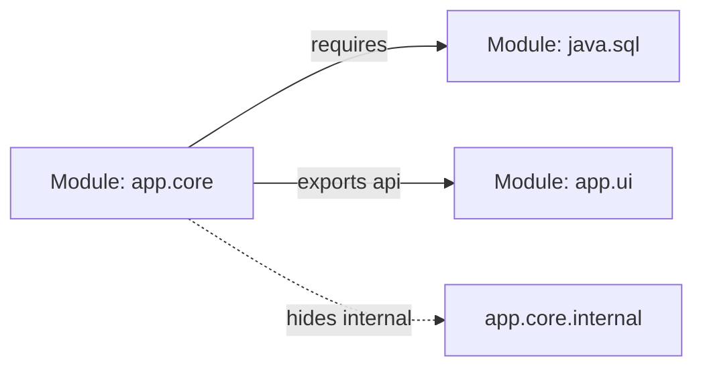
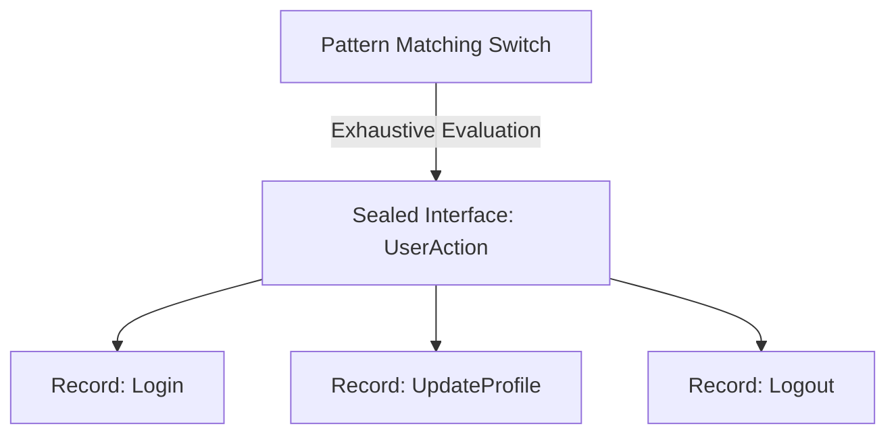

# Java Modern Cookbook & Revision Guide

A comprehensive, recipe-driven reference for everyday Java engineering—covering core language fundamentals, modern language evolutions (Java 17, 21, and 22), robust systems design, concurrency, I/O, data pipelines, networking, and polyglot integration.

---

## Table of Contents
1. [Getting Started: Compiling and Running Java](#1-getting-started-compiling-and-running-java)
2. [Software Development, Testing, and Maintenance](#2-software-development-testing-and-maintenance)
3. [Strings and Things](#3-strings-and-things)
4. [String Matching with Regular Expressions](#4-string-matching-with-regular-expressions)
5. [Numbers](#5-numbers)
6. [Dates and Times](#6-dates-and-times)
7. [Structuring Data with Java](#7-structuring-data-with-java)
8. [Object-Oriented Techniques](#8-object-oriented-techniques)
9. [Functional Programming Techniques: Functional Interfaces, Streams, and Parallel Collections](#9-functional-programming-techniques-functional-interfaces-streams-and-parallel-collections)
10. [Input and Output: Reading, Writing, and Directory Tricks](#10-input-and-output-reading-writing-and-directory-tricks)
11. [Threaded Java](#11-threaded-java)
12. [Data Science and R](#12-data-science-and-r)
13. [Machine Learning / Artificial Intelligence](#13-machine-learning-artificial-intelligence)
14. [Network Clients](#14-network-clients)
15. [Server-Side Java](#15-server-side-java)
16. [Processing JSON Data](#16-processing-json-data)
17. [Reflection, or 'A Class Named Class'](#17-reflection-or-a-class-named-class)
18. [Using Java with Other Languages](#18-using-java-with-other-languages)
19. [Cumulative Coding Exercises (Comprehensive Mastery)](#19-cumulative-coding-exercises-comprehensive-mastery)

---

# 1. Getting Started: Compiling and Running Java

This chapter covers the foundational mechanics of the Java execution model—from running your first console application and using the Java 21 classless main syntax to working with Classpath, Javadoc, JAR archives, GraalVM AOT native compilation, and system runtime introspection.

### 1.0 Introduction

Computers do not natively understand English-like programming text. They only execute binary machine code tailored to a specific CPU (such as x86_64 or ARM). Many traditional languages (like C or C++) compile directly into native binaries, requiring recompilation for every different operating system.
Java solves this with a two-step execution model:
1. The **Java Compiler (`javac`)** translates human-written Java source code (`.java`) into intermediate, platform-independent bytecode (`.class`).
2. The **Java Virtual Machine (JVM)** interprets and compiles this bytecode at runtime into native machine instructions for the host hardware.

This architecture enables Java's historic promise: *"Write Once, Run Anywhere"* (WORA).

```
+----------------+      javac        +-------------------+       JVM        +-----------------+
|  Source Code   | --------------->  |  Bytecode (.class) | ---------------> | Host OS / CPU   |
|  (App.java)    |  Java Compiler    |  (Platform-Indep) |  JIT Interpreter | (Native Machine)|
+----------------+                   +-------------------+                  +-----------------+
```

#### Key Terminologies

Before exploring the implementation, familiarize yourself with these fundamental technical terms and runtime concepts:

- **JDK (Java Development Kit)**: The full developer package containing the compiler (`javac`), archiver (`jar`), documentation generator (`javadoc`), and the runtime.
- **JRE (Java Runtime Environment)**: The minimal environment needed to run compiled Java programs (in modern Java 9+, the standalone JRE is replaced by customized modular runtimes).
- **JVM (Java Virtual Machine)**: The abstract computing machine that executes bytecode instructions on physical hardware.
- **JIT (Just-In-Time) Compiler**: A core part of the JVM that monitors running bytecode. It identifies "hot" (frequently executed) methods and compiles them into direct CPU machine code on the fly for maximum speed.
- **Bytecode**: An optimized set of instructions designed to be executed efficiently by the JVM, stored inside `.class` files.

---

### 1.1 Hello, World: Compiling and Running Java with the Standard JDK

To run any Java program, the JVM needs an unambiguous starting point. In classical Java, this entry point is defined as a method named `main` with a very specific signature located inside a class.

#### Key Terminologies

Before exploring the implementation, familiarize yourself with these fundamental technical terms and runtime concepts:

- **Class**: A blueprint or container for data and methods. In Java, all executable code must reside inside a class.
- **Entry Point**: The predetermined method where program execution begins (`public static void main(String[] args)`).
- **Standard Output (`System.out`)**: The default stream used to print text output to the user's terminal console.

#### How to Build It

Here is the complete, runnable implementation demonstrating this technique in modern Java:

Create a file named `HelloWorld.java`:

```java
public class HelloWorld {
    public static void main(String[] args) {
        System.out.println("Hello, World!");
    }
}
```

#### Code Breakdown

Let us examine the mechanics of the implementation component by component:

- `public class HelloWorld`: Declares a class named `HelloWorld`. Because it is marked `public`, the file name must match exactly: `HelloWorld.java`.
- `public static void main(String[] args)`:
  - `public`: Visible to any caller, allowing the external JVM process to access and execute it.
  - `static`: Can be invoked directly on the class blueprint without needing to instantiate an object using `new`.
  - `void`: Returns no value upon completion.
  - `main`: The exact method identifier the JVM searches for when booting.
  - `String[] args`: An array of text strings representing any command-line parameters passed when launching the program.
- `System.out.println(...)`: Calls the `println` method on `System.out`, printing the text followed by a new line.

#### How to Compile & Run

Execute the following terminal commands to compile the source code and run the resulting application:

```bash
# Step 1: Compile the source file into bytecode (creates HelloWorld.class)
javac HelloWorld.java

# Step 2: Run the compiled class file on the JVM
java HelloWorld

# Modern Shortcut (Java 11+ Single-File Execution):
# Directly compiles in memory and runs without creating a .class file on disk
java HelloWorld.java
```

#### Why this way & Common Pitfalls

Understanding the design trade-offs and common developer mistakes helps avoid subtle bugs in production systems:

- **Never include `.class` when running**: Run `java HelloWorld`, **not** `java HelloWorld.class`. The `java` launcher expects the logical class name, not a file path.
- **Case Sensitivity**: Java is strictly case-sensitive. `helloworld` is considered completely different from `HelloWorld`.

---

### 1.2 Hello, World of Classless Main (Java 21/22 Preview)

For newcomers and for writing quick automation scripts, the classical `public class HelloWorld` and `public static void main(String[] args)` involves heavy cognitive overhead. 
Java 21/22 introduced **Instance Main Methods and Unnamed Classes** (JEP 445 / 463). This feature allows developers to write top-level statements and simple `main()` methods without wrapping them in explicit class declarations.

#### Key Terminologies

Before exploring the implementation, familiarize yourself with these fundamental technical terms and runtime concepts:

- **Unnamed Class**: A compilation unit where the Java compiler automatically synthesizes an enclosing class behind the scenes.
- **Instance Main**: A `main` method that does not need to be declared `static` or take `String[] args`.
- **Preview Feature**: A fully implemented language feature included in standard JDK releases for developer testing, requiring the `--enable-preview` flag to compile and run.

#### How to Build It

Here is the complete, runnable implementation demonstrating this technique in modern Java:

Create a file named `HelloSimple.java`:

```java
// HelloSimple.java
void main() {
    println("Hello, Modern Java!");
}
```

#### Code Breakdown

Let us examine the mechanics of the implementation component by component:

- `void main()`: The method has no `public`, no `static`, and no parameters. The JVM automatically instantiates the synthetic class and calls this method.
- `println(...)`: Standard I/O methods from `java.lang.System` are automatically in scope for unnamed classes, eliminating the need to type `System.out.println`.

#### How to Run

Execute the following terminal commands to launch the application with modern preview features enabled:

```bash
java --enable-preview --source 21 HelloSimple.java
```

#### Why this way & Common Pitfalls

Understanding the design trade-offs and common developer mistakes helps avoid subtle bugs in production systems:

- Use this for scripts, prototyping, and educational learning.
- For production enterprise applications with multiple packages, stick to explicit classes and structured packages.

---

### 1.3 Downloading and Using the Code Examples

Real-world Java code is rarely built by manually invoking `javac` on individual files in a terminal. Instead, projects use **Build Automation Tools** like Maven or Gradle. These tools manage library dependencies, compile source files in bulk, run tests, and package deployable artifacts. To ensure reproducibility across different machines, projects include **Wrappers** (`mvnw` or `gradlew`).

#### Key Terminologies

Before exploring the implementation, familiarize yourself with these fundamental technical terms and runtime concepts:

- **Build Tool**: A program (e.g., Maven, Gradle) that automates the steps required to build and verify software.
- **Wrapper (`mvnw` / `gradlew`)**: A lightweight script committed into version control that automatically downloads the exact required version of the build tool on the target machine without manual installation.
- **Repository**: A central storage server (like Maven Central) where open-source Java libraries (JARs) are published and downloaded.

#### How to Use It

Follow these steps to configure, build, and execute the application in your environment:

```bash
# 1. Clone a remote git repository
git clone https://github.com/example/java-recipes.git
cd java-recipes

# 2. Build and verify using the Maven wrapper (Unix/macOS)
./mvnw clean test

# 3. Or using the Gradle wrapper
./gradlew test
```

#### Why this way & Common Pitfalls

Understanding the design trade-offs and common developer mistakes helps avoid subtle bugs in production systems:

- Always prefer `./mvnw` or `./gradlew` over globally installed `mvn` or `gradle` commands. This avoids build failures caused by mismatched build-tool versions.

---

### 1.4 Compiling, Running, and Testing with an IDE

An **Integrated Development Environment (IDE)** (such as IntelliJ IDEA, Eclipse, or VS Code with Language Support for Java) provides a unified interface combining text editing, syntax highlighting, real-time error checking, refactoring, debugging, and test runners.

```
+--------------------------------------------------------------+
|                         Modern IDE                           |
|  +---------------------+           +----------------------+  |
|  | Source Editor (AST) | <-------> | Language Server (LSP)|  |
|  +---------------------+           +----------------------+  |
|            |                                  |              |
|            v                                  v              |
|  +---------------------+           +----------------------+  |
|  | Build Tool (Gradle) | <-------> | JVM Debugger HotSwap |  |
|  +---------------------+           +----------------------+  |
+--------------------------------------------------------------+
```

#### Key Terminologies

Before exploring the implementation, familiarize yourself with these fundamental technical terms and runtime concepts:

- **HotSwap**: A JVM debugging capability that allows developers to edit code inside method bodies while an application is running and see the changes immediately without restarting the entire server.
- **Run/Debug Configuration**: A profile in the IDE defining which class to run, VM arguments (e.g., `-Xmx2g`), and command-line arguments.
- **AST (Abstract Syntax Tree)**: The in-memory structural representation of source code used by IDEs to suggest instant code completions and detect errors before compilation.

#### Why this way & Common Pitfalls

Understanding the design trade-offs and common developer mistakes helps avoid subtle bugs in production systems:

- Keep your IDE project model synchronized with your build tool (`pom.xml` or `build.gradle`). Never manually add JARs directly into IDE project settings, as other teammates won't get them.

---

### 1.5 Exploring Java with JShell

Before Java 9, testing a simple single-line idea required creating a dummy class, writing a `main` method, compiling with `javac`, and running with `java`. 
**JShell** is Java's official **REPL (Read-Eval-Print Loop)**. It reads user input line-by-line, evaluates the statement immediately, and prints the result back to the screen.

#### Key Terminologies

Before exploring the implementation, familiarize yourself with these fundamental technical terms and runtime concepts:

- **REPL**: An interactive programming shell that executes code snippets without compilation scaffolding.
- **Scratch Variables**: Automatically generated variables (e.g., `$1`, `$2`) created by JShell to store the results of unassigned expressions.

#### How to Use It

Follow these steps to configure, build, and execute the application in your environment:

Start JShell from your terminal:
```bash
$ jshell
|  Welcome to JShell -- Version 21
```

Interactive session:
```java
jshell> int x = 10 * 5;
x ==> 50

jshell> String greeting = "Hello " + "World";
greeting ==> "Hello World"

jshell> Math.sqrt(144)
$3 ==> 12.0

jshell> /vars       // Lists all defined variables in this session
jshell> /methods    // Lists all custom methods created in this session
jshell> /imports    // Displays default imports (java.io, java.util, etc.)
jshell> /exit       // Exits JShell
```

#### Why this way

Consider these architectural advantages and operational best practices when adopting this pattern:

Use JShell for rapid API experimentation, testing regular expressions, and verifying date-time formatting patterns without polluting your codebase.

---

### 1.6 Using CLASSPATH Effectively

When the JVM runs bytecode, it needs to locate the `.class` files for both your code and any external libraries. The **Classpath** is the search path given to the JVM telling it which directories and `.jar` archive files contain these compiled classes.

#### Key Terminologies

Before exploring the implementation, familiarize yourself with these fundamental technical terms and runtime concepts:

- **Classpath**: An environment variable or command-line option (`-cp` or `--class-path`) specifying file paths for class lookup.
- **Fully Qualified Name (FQN)**: The complete package plus class name (e.g., `com.company.util.Calculator`).
- **NoClassDefFoundError / ClassNotFoundException**: The error thrown when the JVM searches all directories and JARs listed on the Classpath but cannot find the requested class.

```
Classpath: "bin:libs/helper.jar"
   |
   +---> Look in ./bin/com/app/Main.class
   +---> Look inside ./libs/helper.jar!/com/helper/Tool.class
```

#### How to Use It

Follow these steps to configure, build, and execute the application in your environment:

```bash
# 1. Compile Main.java which depends on an external library in the libs folder
javac -cp "libs/json-simple-1.1.1.jar" -d bin src/com/app/Main.java

# 2. Run Main specifying both your compiled bin folder and the library
# Note: On macOS/Linux use ':' as path separator. On Windows use ';'
java -cp "bin:libs/json-simple-1.1.1.jar" com.app.Main

# Wildcard shortcut: Include all JAR files in the libs directory
java -cp "bin:libs/*" com.app.Main
```

#### Why this way & Common Pitfalls

Understanding the design trade-offs and common developer mistakes helps avoid subtle bugs in production systems:

- **Wildcard Pitfall**: Use `libs/*`, **never** `libs/*.jar`. The wildcard `*` automatically expands to match all `.jar` files in that folder.
- **Order Matters**: The JVM searches the Classpath from left to right; the first matching class name encountered is loaded, which can cause version conflicts (called "JAR Hell").

---

### 1.7 Documenting Classes with Javadoc

Good software requires documentation that stays up-to-date with code changes. **Javadoc** is Java's built-in tool that reads structured comments directly from source code (`/** ... */`) and generates comprehensive, hyperlinked HTML documentation.

#### Key Terminologies

Before exploring the implementation, familiarize yourself with these fundamental technical terms and runtime concepts:

- **Javadoc Comment**: A comment block beginning with `/**` and ending with `*/` placed immediately above classes, interfaces, methods, or fields.
- **Block Tags**: Special keywords prefixed by `@` (like `@param`, `@return`, `@throws`) that structure documentation into standard sections.
- **Inline Tags**: Tags enclosed in braces (like `{@code ...}` or `{@link ...}`) used inside sentences to format code or create hyperlinks.

#### How to Build It

Here is the complete, runnable implementation demonstrating this technique in modern Java:

```java
/**
 * Calculates discounts and final prices for shopping cart items.
 * 
 * @author Pushkar
 * @version 1.0
 */
public class PricingCalculator {

    /**
     * Applies a percentage discount to the given base price.
     *
     * @param basePrice the original positive price of the item
     * @param discountPercent the discount percentage between 0 and 100
     * @return the final price after discount
     * @throws IllegalArgumentException if basePrice is negative or discountPercent is invalid
     */
    public double applyDiscount(double basePrice, double discountPercent) {
        if (basePrice < 0 || discountPercent < 0 || discountPercent > 100) {
            throw new IllegalArgumentException("Invalid price or discount arguments");
        }
        return basePrice - (basePrice * (discountPercent / 100.0));
    }
}
```

Generate HTML documentation:
```bash
javadoc -d docs -sourcepath src com.example
```

#### Why this way

Consider these architectural advantages and operational best practices when adopting this pattern:

Placing documentation directly next to the code ensures developers update documentation whenever method signatures or behaviors change.

---

### 1.8 Beyond Javadoc: Annotations/Metadata

While Javadoc produces documentation meant for human reading, **Annotations** attach structured metadata to code meant for consumption by compilers, static analysis tools, and runtime frameworks (such as Spring, Hibernate, or Jackson).

#### Key Terminologies

Before exploring the implementation, familiarize yourself with these fundamental technical terms and runtime concepts:

- **Annotation**: A syntactic metadata tag starting with `@` (e.g., `@Override`, `@Deprecated`).
- **Retention Policy**: Determines how long an annotation is preserved:
  - `SOURCE`: Discarded during compilation (e.g., `@Override` only used by the compiler).
  - `CLASS`: Recorded in `.class` bytecode, but ignored by the JVM at runtime.
  - `RUNTIME`: Retained in `.class` and accessible at runtime through Reflection.
- **Target**: Specifies which language elements (methods, classes, fields, parameters) the annotation may be applied to.

#### How to Build It

Here is the complete, runnable implementation demonstrating this technique in modern Java:

```java
import java.lang.annotation.ElementType;
import java.lang.annotation.Retention;
import java.lang.annotation.RetentionPolicy;
import java.lang.annotation.Target;

// Define a custom annotation that stays available at runtime
@Retention(RetentionPolicy.RUNTIME)
@Target(ElementType.METHOD)
public @interface AuditLog {
    String action();
    boolean critical() default false;
}

// Applying the annotation to a service method
public class AccountService {

    @AuditLog(action = "USER_WITHDRAWAL", critical = true)
    public void withdraw(double amount) {
        // Business logic...
    }
}
```

#### Why this way

Consider these architectural advantages and operational best practices when adopting this pattern:

Annotations eliminate repetitive boilerplate code. Frameworks can automatically inspect annotations to handle security checks, transaction management, and logging transparently.

---

### 1.9 Packaging and Running JAR Files

Distributing hundreds of individual `.class` files and resource images across servers is error-prone. A **JAR (Java ARchive)** aggregates all compiled class files, configuration files, and metadata into a single compressed ZIP-format archive.

#### Key Terminologies

Before exploring the implementation, familiarize yourself with these fundamental technical terms and runtime concepts:

- **JAR**: A single archive file ending in `.jar` bundling an entire application or library.
- **Manifest (`META-INF/MANIFEST.MF`)**: A special text file inside the JAR specifying metadata, such as the `Main-Class` entry point.
- **Executable JAR**: A JAR containing a manifest with a defined `Main-Class`, allowing execution with `java -jar app.jar`.

```
my-app.jar (Zip Format)
  ├── META-INF/
  │    └── MANIFEST.MF  (Specifies: Main-Class: com.example.MainApp)
  └── com/
       └── example/
            └── MainApp.class
```

#### How to Build It

Here is the complete, runnable implementation demonstrating this technique in modern Java:

```bash
# 1. Compile source files into an 'out' folder
javac -d out src/com/example/MainApp.java

# 2. Create the executable JAR
# Flags:
#   c = create archive
#   v = verbose output (list files processed)
#   f = file name of output JAR
#   e = specify the entry point class (Main-Class)
#   -C out . = change to directory 'out' and include everything inside it
jar cvfe my-app.jar com.example.MainApp -C out .

# 3. View the table of contents of the JAR
jar tf my-app.jar

# 4. Run the executable JAR directly
java -jar my-app.jar
```

---

### 1.10 Creating a JAR That Supports Multiple Versions of Java (Multi-Release JARs)

When new Java versions introduce modern performance-enhancing APIs, library authors face a dilemma: if they upgrade to the new Java version, users on older Java versions cannot run the library.
**Multi-Release JARs (MR-JARs)** solve this by allowing a single JAR file to contain a baseline version of a class (e.g., for Java 17) alongside an optimized version of the exact same class for newer Java versions (e.g., Java 21). When running on Java 21, the JVM loads the Java 21 version; when running on Java 17, it falls back to the baseline.

#### Key Terminologies

Before exploring the implementation, familiarize yourself with these fundamental technical terms and runtime concepts:

- **MR-JAR**: An archive marked with `Multi-Release: true` in its manifest, containing versioned directory trees under `META-INF/versions/<release>/`.

```
library.jar
  ├── com/example/DataHasher.class       <-- Baseline (Java 17)
  └── META-INF/
       ├── MANIFEST.MF                   <-- Multi-Release: true
       └── versions/
            └── 21/
                 └── com/example/DataHasher.class <-- Java 21 implementation
```

#### How to Build It

Here is the complete, runnable implementation demonstrating this technique in modern Java:

```bash
jar --create --file library-mr.jar -C base-classes . \
    --release 21 -C java21-classes .
```

---

### 1.11 Packaging Web Tier Components into a WAR File

While desktop apps and microservices use JARs, traditional Java enterprise web applications running inside servlet containers (like Apache Tomcat, Jetty, or WildFly) require a standardized directory layout called a **WAR (Web Application Archive)**.

#### Key Terminologies

Before exploring the implementation, familiarize yourself with these fundamental technical terms and runtime concepts:

- **WAR**: A zip-compatible package containing web assets (HTML, CSS, JavaScript) alongside backend servlets and compiled classes.
- **`WEB-INF`**: A private directory inside the WAR inaccessible directly by web browsers. It contains server configurations and compiled classes.
- **`WEB-INF/classes`**: Holds application `.class` files.
- **`WEB-INF/lib`**: Holds third-party library `.jar` files.

```
shop.war
  ├── index.html        (Public web asset)
  ├── styles.css
  └── WEB-INF/
       ├── web.xml      (Deployment configuration)
       ├── classes/     (Compiled servlets & business code)
       └── lib/         (Third-party dependencies)
```

Create via command line:
```bash
jar cvf shop.war *
```

---

### 1.12 Compiling and Running Java: GraalVM for Better Performance

Standard Java applications compile to bytecode and require the JVM to load classes, interpret bytecode, and JIT-compile hot loops into native instructions during runtime. This causes startup delays (JVM warmup) and requires significant baseline memory.
**GraalVM Native Image** uses **Ahead-Of-Time (AOT)** compilation to analyze your application, discard unused classes, and compile bytecode directly into a standalone, native OS binary (like a C++ executable) before the application ever runs.

```
Standard JVM:    Bytecode (.class) ---> JVM Boot ---> Warmup/JIT ---> CPU Instructions (Takes ~1-2s)
GraalVM Native:  Bytecode (.class) ---> AOT Compiler ---> Native Executable (Starts in < 5ms)
```

#### Key Terminologies

Before exploring the implementation, familiarize yourself with these fundamental technical terms and runtime concepts:

- **AOT (Ahead-of-Time) Compilation**: Compiling code into target platform machine instructions prior to execution.
- **Closed-World Assumption**: The static analysis presumption that all bytecode classes that will ever be executed are known and analyzed during the native build step.
- **Substrate VM**: The minimal runtime embedded inside the native binary handling memory management and garbage collection without needing an external JVM.

#### How to Build It

Here is the complete, runnable implementation demonstrating this technique in modern Java:

```bash
# Compile directly to a standalone native binary
native-image -cp out com.example.MainApp -o myapp-native

# Execute directly as a native OS program (No 'java' command required!)
./myapp-native
```

#### Why this way

Consider these architectural advantages and operational best practices when adopting this pattern:

Native compilation is ideal for serverless cloud functions (AWS Lambda) and containerized microservices (Kubernetes), where instant startup and low memory footprint are critical.

---

### 1.13 Getting Information About the Environment, OS, and Runtime

Enterprise applications must frequently adapt their behavior based on the underlying operating system, available CPU cores, allocated memory limits, and environment variables. Java provides three built-in gateways for system telemetry:
1. `System.getProperty(...)`: JVM and OS system properties.
2. `System.getenv(...)`: Host environment variables.
3. `Runtime.getRuntime()`: Resource monitoring (RAM, CPU cores).
4. `ProcessHandle.current()`: Native operating system process inspection.


#### Prerequisite Concepts & Terminologies

Before working with the implementation, familiarize yourself with these foundational concepts and runtime mechanics:

- **Operating System Process**: An independent executing instance of a computer program, isolated in memory by the host OS kernel and identified by a unique Process ID (PID).
- **ProcessHandle (Java 9+)**: A native representation of an OS process that allows querying PID, process hierarchy (parent/children), start time, CPU usage, and issuing termination signals.
- **System Properties vs Environment Variables**: *Environment variables* are global key-value strings defined by the host OS shell and inherited by child processes. *System properties* are JVM-specific configuration flags set at startup using `-Dproperty=value` or modified at runtime via `System.setProperty()`.
- **Heap Memory Runtime Limits**: The JVM heap manages dynamic object allocations. `Runtime.getRuntime().maxMemory()` returns the maximum heap threshold before an `OutOfMemoryError` occurs.

#### How to Build It

Here is the complete, runnable implementation demonstrating this technique in modern Java:

```java
public class SystemInspector {
    public static void main(String[] args) {
        // 1. JVM & Operating System Properties
        String os = System.getProperty("os.name");
        String javaVer = System.getProperty("java.version");
        String userHome = System.getProperty("user.home");
        
        // 2. Host Environment Variables
        String path = System.getenv("PATH");

        // 3. JVM Memory & CPU Metrics
        Runtime runtime = Runtime.getRuntime();
        int availableProcessors = runtime.availableProcessors();
        long maxMemoryMB = runtime.maxMemory() / (1024 * 1024);
        long totalMemoryMB = runtime.totalMemory() / (1024 * 1024);

        // 4. Native OS Process Information (Java 9+)
        long pid = ProcessHandle.current().pid();

        System.out.printf("OS: %s | Java: %s | Home: %s%n", os, javaVer, userHome);
        System.out.printf("PID: %d | Cores: %d | Max Memory: %d MB | Total Heap: %d MB%n",
                pid, availableProcessors, maxMemoryMB, totalMemoryMB);
    }
}
```

---

### Chapter 1: Exercises & Solutions

Test your practical understanding of the concepts covered in this chapter with these targeted exercises. Expand each solution to verify your approach.

#### Exercise 1.1
Write a single terminal command that compiles `App.java` and places the resulting `.class` file inside a directory named `bin`.

<details>
<summary>Solution</summary>

```bash
javac -d bin App.java
```
**Explanation**: The `-d` (destination) flag tells `javac` where to place generated class files. If the `bin` directory does not exist, `javac` automatically creates it.
</details>

#### Exercise 1.2
How do you write a Java program that prints the operating system's temporary directory path?

<details>
<summary>Solution</summary>

```java
public class TempDirCheck {
    public static void main(String[] args) {
        String tempDir = System.getProperty("java.io.tmpdir");
        System.out.println("System Temp Directory: " + tempDir);
    }
}
```
**Explanation**: `java.io.tmpdir` is the standard cross-platform system property for locating the OS scratch directory.
</details>

---

# 2. Software Development, Testing, and Maintenance

This chapter focuses on production software engineering practices—designing modular applications with JPMS, automating builds with Maven and Gradle, writing isolated unit tests with JUnit 5 and Mockito, setting up structured logging with SLF4J and Log4j 2, and packaging custom runtimes with jlink and jpackage.
### 2.0 Introduction

Writing code that compiles on your laptop is only the first step. Long-term software engineering requires structured modular boundaries, automated dependency management, comprehensive unit testing, mocking out third-party systems, observable logging, performance benchmarks, and packaging for target OS platforms.


#### Prerequisite Concepts & Terminologies

Before exploring this chapter, familiarize yourself with these foundational software engineering concepts:

- **Build Automation**: The scripting or configuration of developer workflows (compiling, running tests, resolving libraries, creating packages) so builds are reproducible and independent of an IDE.
- **Test Doubles**: Abstract stand-ins for real system dependencies during unit testing (including stubs that return canned responses and mocks that verify method calls).
- **Semantic Versioning (SemVer)**: The standardized versioning convention `MAJOR.MINOR.PATCH` where major bumps signal breaking API changes, minor bumps add backward-compatible features, and patch bumps provide backward-compatible bug fixes.
- **Continuous Integration (CI)**: The automated practice where developers frequently merge code changes into a central repository, triggering automated builds and test suites to detect regressions early.

---
### 2.1 Designing Applications: Packages, Modules

As a project grows to thousands of classes, placing all files in one flat folder causes naming clashes and destroys code readability. Java provides a two-level organizational hierarchy:
1. **Packages**: Group related classes and interfaces using reverse-domain namespaces (e.g., `com.company.project.billing`).
2. **Modules (JPMS)**: Introduced in Java 9, modules group packages into explicit architectural layers, controlling which packages are visible to the outside world.

```
Application
  └── Module (com.company.billing)
        ├── Package (com.company.billing.api)      <-- Exported (Public API)
        └── Package (com.company.billing.internal) <-- Encapsulated (Private)
```

#### Key Terminologies

Before exploring the implementation, familiarize yourself with these fundamental technical terms and runtime concepts:

- **Encapsulation**: Hiding internal implementation details so external code cannot directly mutate or rely on unstable private components.
- **Access Modifiers**: Keywords governing accessibility:
  - `public`: Visible everywhere.
  - `protected`: Visible within package and subclasses.
  - *Package-Private* (no keyword): Visible only within the same package.
  - `private`: Visible only within the declaring class.

---

### 2.2 Using the Java Modules System (JPMS)

Before Java 9, every `public` class on the Classpath was accessible to any other class in the entire application. The **Java Platform Module System (JPMS)** introduces a file named `module-info.java` at the root of a module that explicitly defines access boundaries.



#### Key Directives

The module declaration file uses several core directives to configure dependencies and control encapsulation boundaries:

- `exports <pkg>;`: Makes public types inside `<pkg>` available to other modules at compile time and runtime.
- `requires <module>;`: Declares that this module depends on another module.
- `requires transitive <module>;`: Downstream modules that require this module automatically gain access to `<module>` as well.
- `opens <pkg>;`: Permits runtime reflection (used by Jackson, Spring) without exposing compile-time types.

---

### 2.3 Using JPMS to Create a Module

Creating a modular project requires defining a `module-info.java` file at the root of the source hierarchy and compiling with the module-path flag (`-p` or `--module-path`) instead of the traditional classpath.


#### Prerequisite Concepts & Terminologies

Before working with the implementation, familiarize yourself with these foundational concepts and runtime mechanics:

- **Module Path (`--module-path` or `-p`)**: The modern replacement for the traditional Classpath that tells `javac` and `java` where to locate compiled module artifacts (`.jar` or directories with `module-info.class`).
- **Module Source Path (`--module-source-path`)**: A directory pattern told to the compiler indicating where multi-module source files are structured (e.g., `src/<module-name>/...`).
- **Strong Encapsulation**: A JPMS runtime guarantee that non-exported packages cannot be accessed by external code, even using reflection, unless explicitly permitted via an `opens` directive.
- **Modular JAR**: A standard JAR archive that contains a compiled `module-info.class` in its root directory, enabling it to act as an explicit module when placed on the module path.

#### How to Build It

Here is the complete, runnable implementation demonstrating this technique in modern Java:

Create `src/com.store.inventory/module-info.java`:

```java
module com.store.inventory {
    // Declare dependencies
    requires java.net.http;
    requires com.fasterxml.jackson.databind;

    // Expose only the public API
    exports com.store.inventory.api;

    // Allow Jackson to inspect private fields via reflection for JSON mapping
    opens com.store.inventory.model to com.fasterxml.jackson.databind;
}
```

Compile on module-path:
```bash
javac -p libs -d out/com.store.inventory $(find src/com.store.inventory -name "*.java")
java -p libs:out -m com.store.inventory/com.store.inventory.api.InventoryLauncher
```

---
### 2.4 Automating Compilation, Testing, and Deployment with Apache Maven

**Apache Maven** is the most widely adopted build tool in the Java ecosystem. It relies on **Convention over Configuration**: if you follow Maven's standardized directory structure, you do not need to write complex build scripts.

#### The Standard Directory Layout

Maven organizes files into a standardized directory hierarchy that separates production source code, configuration resources, and test fixtures:

```
my-app/
  ├── pom.xml                  (Project Object Model build descriptor)
  └── src/
       ├── main/
       │    ├── java/          (Application production source code)
       │    └── resources/     (Production configs: application.properties)
       └── test/
            ├── java/          (Unit & integration test source code)
            └── resources/     (Test fixtures and test mock configs)
```

#### Key Lifecycles

Maven structures the build process into standard sequential phases, where invoking any phase automatically triggers all prior lifecycle steps:

```
validate -> compile -> test -> package -> verify -> install -> deploy
```
- `mvn clean`: Deletes the `target/` build directory.
- `mvn compile`: Compiles production classes in `src/main/java`.
- `mvn test`: Runs test suites located in `src/test/java`.
- `mvn package`: Bundles compiled code into a JAR/WAR artifact in `target/`.

---

### 2.5 Automating Compilation, Testing, and Deployment with Gradle

**Gradle** is a high-performance build automation tool that uses a Directed Acyclic Graph (DAG) of tasks. Rather than XML, it uses a programmatic Domain-Specific Language (DSL) written in Kotlin (`build.gradle.kts`) or Groovy (`build.gradle`).


#### Prerequisite Concepts & Terminologies

Before working with the implementation, familiarize yourself with these foundational concepts and runtime mechanics:

- **Task-Based Directed Acyclic Graph (DAG)**: Gradle models a build as a network of individual tasks with dependencies. It evaluates the dependency graph to determine task execution order and execute independent tasks concurrently.
- **Domain-Specific Language (DSL)**: A specialized, readable syntax designed for build declarations. Gradle supports both Groovy DSL (`build.gradle`) and Kotlin DSL (`build.gradle.kts`).
- **Gradle Daemon**: A long-lived background background JVM process that keeps compiler caches and build metadata in memory, drastically reducing subsequent build times.
- **Incremental Build**: An optimization where Gradle checks task inputs and outputs; if neither has changed since the previous execution, the task is marked `UP-TO-DATE` and skipped.

#### How to Build It

Here is the complete, runnable implementation demonstrating this technique in modern Java:

```kotlin
// build.gradle.kts
plugins {
    java
    application
}

repositories {
    mavenCentral() // Download dependencies from Maven Central repository
}

dependencies {
    implementation("com.google.guava:guava:33.0.0-jre")
    testImplementation("org.junit.jupiter:junit-jupiter:5.10.2")
}

application {
    mainClass.set("com.example.Main")
}

tasks.test {
    useJUnitPlatform() // Use JUnit 5 test runner
}
```
Run build:
```bash
./gradlew build
```

---
### 2.6 Automating Dependency Management with Maven and Gradle

Modern applications rely on open-source libraries. Build tools automatically download specified libraries from central servers along with all the transitive libraries those libraries depend upon.


#### Prerequisite Concepts & Terminologies

Before working with the implementation, familiarize yourself with these foundational concepts and runtime mechanics:

- **Transitive Dependency**: If your application depends on Library A, and Library A requires Library B, Library B is a transitive dependency that your build tool automatically downloads and includes.
- **Dependency Conflict (Diamond Problem)**: Occurs when two dependencies require different, incompatible versions of the same third library. Build tools resolve this using conflict resolution rules (e.g., Maven uses "nearest definition in tree", Gradle prefers newest version).
- **Dependency Scope**: Determines during which phases a library is placed on the compilation, testing, or execution path (e.g., `compileClasspath`, `testImplementation`, `runtimeOnly`).
- **Artifact Repository**: A centralized server holding versioned dependencies (e.g., Maven Central). The build tool downloads artifacts to a local cache on your computer (`~/.m2/repository` or `~/.gradle/caches`).

#### Maven Dependency Scopes

Dependencies in Maven are assigned scopes that govern which classpaths (compile, test, runtime) include the library and whether it gets bundled into the final packaged JAR:

| Scope | Compile Time | Test Execution | Packaging in JAR | Example Use Case |
|---|---|---|---|---|
| `compile` (default) | Yes | Yes | Yes | Core utility libraries (`commons-lang3`) |
| `provided` | Yes | Yes | No | Provided by container/JDK (`servlet-api`) |
| `runtime` | No | Yes | Yes | JDBC Driver implementations (`postgresql`) |
| `test` | No | Yes | No | Testing frameworks (`junit-jupiter`, `mockito`) |

---
### 2.7 Dealing with Deprecation Warnings

As APIs evolve, older methods are phased out in favor of better, safer alternatives. Java tags these using `@Deprecated`.

#### Key Terminologies

Before exploring the implementation, familiarize yourself with these fundamental technical terms and runtime concepts:

- `@Deprecated(since = "X", forRemoval = true)`:
  - `since`: The release version when it was deprecated.
  - `forRemoval`: If `true`, this method will be permanently deleted in a future JDK/library release.
- `-Xlint:deprecation`: Compiler flag forcing `javac` to print line-by-line warnings whenever deprecated methods are used.

```bash
javac -Xlint:deprecation -Xlint:removal App.java
```

---

### 2.8 Batch Refactoring for Warnings and Migrations

When upgrading a codebase across major Java versions (e.g., from Java 8 or 11 to Java 21), thousands of lines need updating (e.g., migrating `javax.*` to `jakarta.*`, replacing anonymous classes with lambdas).
**OpenRewrite** is an automated refactoring engine that analyzes code syntax trees and applies deterministic transformation recipes.


#### Prerequisite Concepts & Terminologies

Before working with the implementation, familiarize yourself with these foundational concepts and runtime mechanics:

- **Abstract Syntax Tree (AST)**: A tree-shaped data structure representing the syntactic and structural meaning of source code. Compilers construct ASTs to analyze code without executing it.
- **Lossless Semantic Tree (LST)**: An enriched AST (used by OpenRewrite) that preserves exact source formatting, indentation, and comments so automated rewrites do not destroy stylistic conventions.
- **Refactoring Recipe**: A deterministic transformation rule that queries an AST for deprecated or legacy patterns (e.g., `junit.framework.Assert`) and rewrites them into modern target equivalents (e.g., `org.junit.jupiter.api.Assertions`).
- **Static Analysis**: Evaluating code without running it to detect potential bugs, security flaws, performance antipatterns, and deprecation compliance.

#### How to Use It

Follow these steps to configure, build, and execute the application in your environment:

Add the OpenRewrite plugin to `pom.xml`:
```xml
<plugin>
    <groupId>org.openrewrite.maven</groupId>
    <artifactId>rewrite-maven-plugin</artifactId>
    <version>5.20.0</version>
    <configuration>
        <activeRecipes>
            <recipe>org.openrewrite.java.migrate.UpgradeToJava21</recipe>
        </activeRecipes>
    </configuration>
</plugin>
```
Run refactoring:
```bash
mvn rewrite:run
```

---
### 2.9 Maintaining Code Correctness with Unit Testing: JUnit 5

A **Unit Test** exercises an isolated unit of source code (typically a single method) with specific inputs and asserts that the actual output matches the expected result.
**JUnit 5 (Jupiter)** is the standard unit testing framework for Java.

#### Key Terminologies

Before exploring the implementation, familiarize yourself with these fundamental technical terms and runtime concepts:

- `@Test`: Marks a method as an executable test case.
- `@BeforeEach` / `@AfterEach`: Methods executed before and after every individual `@Test`.
- `Assertions`: Static methods (like `assertEquals`, `assertThrows`, `assertTrue`) verifying program correctness.

#### How to Build It

Here is the complete, runnable implementation demonstrating this technique in modern Java:

```java
import org.junit.jupiter.api.*;
import org.junit.jupiter.params.ParameterizedTest;
import org.junit.jupiter.params.provider.ValueSource;
import static org.junit.jupiter.api.Assertions.*;

class MathEngineTest {

    private MathEngine engine;

    @BeforeEach
    void init() {
        engine = new MathEngine();
    }

    @Test
    @DisplayName("Division by zero should throw ArithmeticException")
    void testDivisionByZero() {
        assertThrows(ArithmeticException.class, () -> engine.divide(10, 0));
    }

    @ParameterizedTest
    @ValueSource(ints = {2, 4, 6, 8, 100})
    void testEvenNumbers(int value) {
        assertTrue(engine.isEven(value));
    }
}
```

---

### 2.10 Isolating the Test Target with Mock Objects and Mockito

When testing a class (e.g., `OrderService`), you want to test *only* its business logic—not whether the external database or payment provider API is currently online.
**Mockito** creates fake (mock) implementations of dependencies that return predetermined canned responses and verify whether methods were called.

```
Unit Test ---> [OrderService (Real Code Under Test)]
                      |
                      v
             [Mock PaymentGateway] (Simulates success without charging real money)
```


#### Prerequisite Concepts & Terminologies

Before working with the implementation, familiarize yourself with these foundational concepts and runtime mechanics:

- **System Under Test (SUT)**: The specific class or method whose behavior is being verified in isolation during a unit test.
- **Mock vs Stub vs Spy**: A *Stub* supplies predefined, canned return values to calls. A *Mock* is a stub that also records interactions so your test can verify that specific methods were invoked. A *Spy* wraps a real object, delegating calls to actual methods while allowing selected methods to be overridden or verified.
- **Bytecode Instrumentation**: Mockito generates dynamic proxy subclasses in memory at runtime (using ByteBuddy) to intercept method invocations and record telemetry.
- **Interaction Verification**: The assertion phase of a mock-driven test where you verify that a dependency was called with the exact expected arguments and number of times (`verify(mock, times(1)).doAction()`).

#### How to Build It

Here is the complete, runnable implementation demonstrating this technique in modern Java:

```java
import static org.mockito.Mockito.*;
import org.junit.jupiter.api.Test;
import org.junit.jupiter.api.extension.ExtendWith;
import org.mockito.Mock;
import org.mockito.InjectMocks;
import org.mockito.junit.jupiter.MockitoExtension;
import static org.junit.jupiter.api.Assertions.*;

@ExtendWith(MockitoExtension.class)
class OrderServiceTest {

    @Mock
    private PaymentGateway mockGateway; // Fake dependency

    @InjectMocks
    private OrderService orderService;  // Real service with mock injected

    @Test
    void testCheckoutSuccess() {
        // Arrange: Train mock behavior
        when(mockGateway.charge("user_123", 45.0)).thenReturn(true);

        // Act: Execute test target
        boolean success = orderService.checkout("user_123", 45.0);

        // Assert: Verify outcome & mock interaction
        assertTrue(success);
        verify(mockGateway, times(1)).charge("user_123", 45.0);
    }
}
```

---
### 2.11 Logging: Network or Local

In production systems, `System.out.println` is forbidden:
1. It is synchronous and acquires an internal lock, slowing down high-throughput systems.
2. It cannot be easily redirected to external log servers.
3. It has no concept of severity levels (e.g., errors vs debug info).
Instead, developers use **Structured Logging Frameworks**.


#### Prerequisite Concepts & Terminologies

Before working with the implementation, familiarize yourself with these foundational concepts and runtime mechanics:

- **Logging Severity Hierarchy**: Standardized levels that classify the urgency of messages: `TRACE` < `DEBUG` < `INFO` < `WARN` < `ERROR`. Loggers discard messages below their configured runtime threshold.
- **String Concatenation Cost**: Writing `logger.debug("Val: " + slowCalc())` concatenates strings and executes `slowCalc()` even if debug logging is disabled, wasting CPU cycles. Parameterized logging solves this.
- **Standard Streams vs Log Sinks**: While `System.out` prints unformatted text directly to the console terminal, production logging engines write structured messages to files, rotating archives, or remote network collectors.
- **Log Rotation**: The automatic process of closing the active log file when it reaches a certain size or time limit, compressing it into an archive, and creating a fresh file to prevent disk exhaustion.

#### Log Levels

Logging frameworks structure message severity into standard hierarchical levels, allowing administrators to filter verbosity dynamically without code changes:

- `TRACE`: Fine-grained diagnostic information.
- `DEBUG`: Internal state information useful during development.
- `INFO`: Normal operational events (e.g., service started, user logged in).
- `WARN`: Unexpected situations that are not yet fatal errors (e.g., retry attempt 2 of 3).
- `ERROR`: Failures requiring developer investigation (e.g., database unavailable).

---
### 2.12 Setting Up SLF4J

**SLF4J (Simple Logging Facade for Java)** is an abstraction layer (interface). By writing code against SLF4J rather than a concrete implementation, you can swap the underlying logging engine (Logback, Log4j2) at any time without changing a single line of application source code.


#### Prerequisite Concepts & Terminologies

Before working with the implementation, familiarize yourself with these foundational concepts and runtime mechanics:

- **Facade Pattern**: An architectural design pattern where a single unified interface abstracts away different underlying complex subsystems or third-party implementations.
- **SLF4J (Simple Logging Facade for Java)**: A vendor-neutral API that provides a common logging abstraction. Your application code depends only on `slf4j-api`, allowing you to swap logging backends (Logback, Log4j 2) without changing source code.
- **Service Provider Interface (SPI)**: The mechanism in modern SLF4J (v2.0+) that automatically discovers and binds to an available logging provider on the classpath via `java.util.ServiceLoader`.
- **Parameterized Logging**: Using curly brace `{}` placeholders (e.g., `logger.info("Created user with ID {}", id)`) that postpone string construction until the logger verifies that the target log level is active.

#### How to Build It

Here is the complete, runnable implementation demonstrating this technique in modern Java:

```java
import org.slf4j.Logger;
import org.slf4j.LoggerFactory;

public class UserService {
    // Standard static logger declaration idiom
    private static final Logger log = LoggerFactory.getLogger(UserService.class);

    public void registerUser(String username, int age) {
        // Parameterized logging: '{}' placeholders prevent string concatenation costs
        log.debug("Attempting to register user: {} with age: {}", username, age);

        if (age < 18) {
            log.warn("Registration rejected: user {} is underage ({})", username, age);
            return;
        }

        try {
            // Save to database...
            log.info("Successfully registered user: {}", username);
        } catch (Exception ex) {
            log.error("Failed to persist user: {}", username, ex);
        }
    }
}
```

---
### 2.13 Network Logging with Log4j 2

In modern cloud architectures, microservices run inside ephemeral containers that can terminate at any second. Writing log files to a local container disk means logs are lost when the container stops.
Log4j 2 supports **Socket Appenders**, streaming structured log events asynchronously across the network to centralized aggregators (e.g., Elasticsearch, Logstash, Datadog).


#### Prerequisite Concepts & Terminologies

Before working with the implementation, familiarize yourself with these foundational concepts and runtime mechanics:

- **Log4j Appender**: A pipeline component responsible for delivering formatted log events to a destination (e.g., `ConsoleAppender`, `RollingFileAppender`, `SocketAppender`).
- **Async Logger & LMAX Disruptor**: A high-performance lock-free ring-buffer concurrency library that Log4j 2 uses to hand off log events from application threads to background writer threads, achieving sub-microsecond logging latency.
- **TCP / Syslog Protocol**: Network protocols commonly used to stream log messages in real time across the local network to centralized observability platforms (e.g., ELK Stack, Splunk, Graylog).
- **Structured Logging (JSON)**: Formatting log records as machine-readable JSON objects with standard fields (`timestamp`, `level`, `thread`, `message`, `stackTrace`) for automated querying and indexing.

```xml
<!-- log4j2.xml -->
<Configuration status="WARN">
    <Appenders>
        <!-- Send logs over TCP to log server -->
        <Socket name="LogstashSocket" host="logs.corp.internal" port="5044">
            <JsonLayout compact="true" eventEol="true" />
        </Socket>
        <!-- Async wrapper prevents network latency from blocking application threads -->
        <Async name="AsyncLogger">
            <AppenderRef ref="LogstashSocket" />
        </Async>
    </Appenders>
    <Loggers>
        <Root level="INFO">
            <AppenderRef ref="AsyncLogger" />
        </Root>
    </Loggers>
</Configuration>
```

---
### 2.14 Network Logging with java.util.logging

If an environment strictly prohibits third-party logging JARs, Java's built-in `java.util.logging` (JUL) provides network logging out of the box using `SocketHandler`.


#### Prerequisite Concepts & Terminologies

Before working with the implementation, familiarize yourself with these foundational concepts and runtime mechanics:

- **JUL (java.util.logging)**: The default logging framework bundled directly into the core Java Development Kit since Java 1.4, requiring zero external dependencies.
- **Logger Hierarchy**: Loggers are organized in a dot-separated tree hierarchy (e.g., `com.company.app`). Child loggers inherit level settings and handlers from parent loggers up to the root logger `""`.
- **Handler & Formatter**: In JUL, a `Handler` exports log records to a destination (like `ConsoleHandler` or `SocketHandler`), while a `Formatter` translates a `LogRecord` into formatted text (like `SimpleFormatter` or `XMLFormatter`).
- **LogManager**: The centralized JVM singleton that reads `logging.properties` at startup and configures the logger hierarchy.

```properties
# logging.properties
handlers = java.util.logging.SocketHandler
java.util.logging.SocketHandler.host = 127.0.0.1
java.util.logging.SocketHandler.port = 9090
java.util.logging.SocketHandler.formatter = java.util.logging.XMLFormatter
```

---
### 2.15 Maintaining Your Code with Continuous Integration (CI)

**Continuous Integration (CI)** automatically builds your project and executes all unit/integration tests every time a developer opens a Pull Request or pushes code to version control, catching bugs before they reach production.


#### Prerequisite Concepts & Terminologies

Before working with the implementation, familiarize yourself with these foundational concepts and runtime mechanics:

- **Headless Build Runner**: A containerized or virtual machine environment running in the cloud (such as GitHub Actions or GitLab CI) that compiles code and runs tests without a graphical desktop interface.
- **Webhook Trigger**: An automated HTTP notification sent by a Git platform (GitHub/GitLab) to a CI runner whenever code is pushed or a pull request is opened.
- **Fail-Fast Pipeline**: A CI design practice where rapid, essential checks (linting, compilation, unit tests) execute first; if any step fails with a non-zero exit code, the pipeline terminates immediately to provide prompt developer feedback.
- **Build Artifact**: A packaged binary output (such as a `.jar`, `.war`, or test coverage report) created during a CI workflow and saved for subsequent deployment.

#### GitHub Actions Workflow Example
Create `.github/workflows/ci.yml`:
```yaml
name: Java CI Build

on: [push, pull_request]

jobs:
  build-and-test:
    runs-on: ubuntu-latest
    steps:
      - name: Checkout Code
        uses: actions/checkout@v4

      - name: Setup JDK 21
        uses: actions/setup-java@v4
        with:
          java-version: '21'
          distribution: 'temurin'
          cache: maven

      - name: Compile and Test
        run: ./mvnw clean verify
```

---
### 2.16 Performance Timing

Measuring how long a piece of code takes to execute requires a reliable clock.
- **Never use `System.currentTimeMillis()` for duration measurements**: It measures wall-clock time, which can jump backward or forward if the operating system synchronizes its clock with an NTP time server.
- **Always use `System.nanoTime()`**: It reads a monotonic hardware timer that moves strictly forward.


#### Prerequisite Concepts & Terminologies

Before working with the implementation, familiarize yourself with these foundational concepts and runtime mechanics:

- **Monotonic Clock (`System.nanoTime()`)**: A high-resolution hardware counter that strictly advances forward at a steady tick, unaffected by wall-clock adjustments, leap seconds, or NTP time synchronization. Always use it to measure elapsed intervals.
- **Wall-Clock Time (`System.currentTimeMillis()`)**: Reports the current calendar date and time. It should never be used for micro-benchmarks because NTP clock synchronization can jump time backward or forward.
- **JIT Compiler Optimization Hazards**: During micro-benchmarks, the JVM JIT compiler can optimize away loops or calculations whose results are never read (dead-code elimination), producing misleading zero-nanosecond timings.
- **JMH (Java Microbenchmark Harness)**: The official OpenJDK framework designed to prevent benchmarking pitfalls by handling JVM warmup iterations, preventing dead-code elimination, and calculating statistical variances.

```java
long startNanos = System.nanoTime();

performComplexCalculation();

long elapsedNanos = System.nanoTime() - startNanos;
double elapsedMillis = elapsedNanos / 1_000_000.0;

System.out.printf("Execution took: %.3f ms%n", elapsedMillis);
```

*For rigorous scientific benchmarking, use JMH (Java Microbenchmark Harness) to account for JVM warmup iterations and JIT optimizations.*

---
### 2.17 Creating a Custom JDK Distribution with `jlink`

A standard JDK download is over 300MB because it includes the entire Java standard library (desktop GUI tools, CORBA legacy, SQL modules). If your microservice only needs core collections and networking, shipping the full JDK inside a Docker image wastes bandwidth and disk space.
`jlink` reads your application's `module-info.java`, extracts only the specific JDK modules your code requires, and bundles them into a tiny custom runtime (often 35–45MB).


#### Prerequisite Concepts & Terminologies

Before working with the implementation, familiarize yourself with these foundational concepts and runtime mechanics:

- **`jlink` (Java Linker)**: An OpenJDK CLI tool introduced in Java 9 that assembles a custom, minimal, self-contained Java runtime image containing only the platform and application modules your project actually uses.
- **Tree-Shaking (Module Pruning)**: The process of traversing module dependency declarations starting from your root module and discarding all unused JDK modules (e.g., dropping `java.desktop` or `java.sql` if your microservice does not need them).
- **Modular Image Size Reduction**: While a full JDK installation often occupies 300MB to 500MB on disk, a customized `jlink` runtime typically shrinks to between 30MB and 60MB, dramatically reducing container image sizes.
- **Debug Symbol Stripping (`--strip-debug`)**: A linker flag that strips debugging tables and source line attributes from compiled bytecode inside the custom runtime to minimize disk footprint.

```bash
jlink --module-path $JAVA_HOME/jmods:target/modules \
      --add-modules com.store.inventory \
      --strip-debug \
      --compress 2 \
      --no-header-files \
      --output minimal-runtime
```

---
### 2.18 Creating Platform-Specific Installers with `jpackage`

Distributing desktop software to non-technical end users by telling them to "Install Java 21, configure JAVA_HOME, and run `java -jar app.jar`" leads to poor user experience.
The `jpackage` tool bundles your application JAR together with a stripped runtime into a native OS installer format (`.dmg` or `.pkg` on macOS, `.msi` or `.exe` on Windows, `.deb` or `.rpm` on Linux).


#### Prerequisite Concepts & Terminologies

Before working with the implementation, familiarize yourself with these foundational concepts and runtime mechanics:

- **`jpackage`**: A packaging tool introduced in Java 14 that packages a Java application into a platform-native installer or desktop bundle (`.msi`/`.exe` on Windows, `.dmg`/`.pkg` on macOS, `.deb`/`.rpm` on Linux).
- **Self-Contained Application Bundle**: An application distribution model where the application bytecode and a tailored Java runtime (created via `jlink`) are bundled together, allowing end users to run your software without installing Java on their computer.
- **Application Launcher**: A native executable stub created by `jpackage` that boots the bundled JVM and executes your application entry point directly when clicked or launched from the terminal.

```bash
jpackage --name "InvoiceMaker" \
         --input target/ \
         --main-jar invoice-app.jar \
         --main-class com.app.Main \
         --type pkg
```

---

### Chapter 2: Exercises & Solutions

Test your practical understanding of the concepts covered in this chapter with these targeted exercises. Expand each solution to verify your approach.

#### Exercise 2.1
What is the difference between `@Mock` and `@InjectMocks` in Mockito?

<details>
<summary>Solution</summary>

- `@Mock`: Creates a simulated, fake instance of a dependency class where all methods return default empty values unless programmed with `when(...).thenReturn(...)`.
- `@InjectMocks`: Creates a real instance of the class you want to test and automatically injects all declared `@Mock` fields into its constructor or fields.
</details>

#### Exercise 2.2
Why should `log.info("Result: " + calculate())` be avoided when the logging level is set to `WARN`?

<details>
<summary>Solution</summary>

In Java, method arguments are evaluated eagerly before the method call occurs. Even though the logger will discard the message because `INFO` is below `WARN`, `calculate()` will still execute, wasting CPU cycles, and the string concatenation will still allocate memory on the heap.
</details>

---

# 3. Strings and Things

This chapter explores textual processing in Java—from string slicing, tokenizing, and Unicode-safe stripping to formatting with printf, high-performance string construction with StringBuilder, Text Blocks, internationalization (I18N), and resource bundles.
### 3.0 Introduction

Text in Java is represented by the `String` class. Two foundational architectural rules define Java strings:
1. **Strings are Immutable**: Once created, a `String` object's content can never be modified. Any method that appears to modify a string (`replace`, `substring`, `toLowerCase`) actually returns an entirely new `String` object.
2. **The String Constant Pool**: To save memory, the JVM maintains an internal pool in the heap. When string literals are declared, identical string values point to the exact same memory reference.

```
String s1 = "Coffee";
String s2 = "Coffee";        // Reuses existing "Coffee" from String Pool (s1 == s2 is true)
String s3 = new String("Coffee"); // Bypasses pool, forces new Heap object (s1 == s3 is false)
```


#### Prerequisite Concepts & Terminologies

Before exploring this chapter, familiarize yourself with these foundational string concepts:

- **String Immutability**: In Java, `String` objects cannot be modified after creation. Operations that seem to alter a string (like `replace` or `toLowerCase`) always return a brand-new `String` instance in memory.
- **String Constant Pool**: A dedicated storage area in the JVM heap where identical string literals are cached and shared (string interning) to save memory.
- **Compact Strings (Java 9+)**: An internal optimization where `String` stores characters in a 1-byte-per-character `byte[]` array if all characters fit in ISO-8859-1 (Latin-1), only allocating 2 bytes per character for UTF-16 when necessary.
- **Surrogate Pairs**: A pair of 16-bit `char` code units used by UTF-16 to represent a single Unicode character (such as emojis and rare symbols) whose code point exceeds `0xFFFF`.

#### Under the Hood: Compact Strings (Java 9+)
Historically, Java stored characters as 16-bit `char[]` arrays (UTF-16), consuming 2 bytes for every character even for pure ASCII English text. Modern Java uses **Compact Strings**: internal representation uses a 1-byte `byte[]` array (`LATIN1`) if all characters fit in standard Latin-1, cutting string heap usage by half.

---
### 3.1 Taking Strings Apart with Substrings, Tokenizing, and Trimming Methods

Breaking down formatted raw text (e.g., CSV rows or transaction codes) requires extracting slices by index, splitting by delimiters, and stripping away dirty whitespace.


#### Prerequisite Concepts & Terminologies

Before working with the implementation, familiarize yourself with these foundational concepts and runtime mechanics:

- **Zero-Based Indexing**: String character positions begin at index `0` and terminate at index `length() - 1`.
- **Half-Open Interval `[start, end)`**: In methods like `substring(start, end)`, the character at `start` is included, but the character at `end` is excluded.
- **ASCII Whitespace vs Unicode Whitespace**: Legacy `trim()` only removes characters with codepoints less than or equal to space (`U+0020`). Modern `strip()` (Java 11+) removes all characters recognized as whitespace by the full Unicode standard.
- **Delimiter Tokenization**: Dividing continuous text into discrete chunks (tokens) by splitting on separator symbols (e.g., commas in CSV files).

#### Key Methods

These are the essential methods provided by the API for everyday manipulation and validation:

- `substring(start, end)`: Extracts characters from `start` index (inclusive) to `end` index (exclusive).
- `split(regex)`: Breaks a string into an array of tokens based on a delimiter expression.
- `strip()`: (Java 11+) Unicode-aware whitespace removal, replacing legacy `trim()`.

#### How to Build It

Here is the complete, runnable implementation demonstrating this technique in modern Java:

```java
public class StringParser {
    public static void main(String[] args) {
        String logRecord = "  TX-9872:SUCCESS:499.95  ";

        // 1. Unicode-aware trimming
        String clean = logRecord.strip(); // "TX-9872:SUCCESS:499.95"

        // 2. Extract transaction ID via substring
        String txId = clean.substring(0, 7); // "TX-9872"

        // 3. Splitting into tokens
        String[] parts = clean.split(":");
        String status = parts[1];            // "SUCCESS"
        double amount = Double.parseDouble(parts[2]); // 499.95

        System.out.printf("Transaction: %s | Status: %s | Amount: $%.2f%n", txId, status, amount);
    }
}
```

---
### 3.2 String Formatting with Formatter and printf()

Constructing complex strings by concatenating multiple variables with `+` is difficult to read and error-prone. Java provides `String.format()` and (in Java 15+) the `.formatted(...)` method using standard format specifiers.


#### Prerequisite Concepts & Terminologies

Before working with the implementation, familiarize yourself with these foundational concepts and runtime mechanics:

- **Format Specifier**: A placeholder in a template string beginning with `%` (e.g., `%s` for strings, `%d` for integers, `%f` for floating-point decimals).
- **Field Width and Precision**: Formatting modifiers that specify the minimum column width and number of decimal places (e.g., `%10.2f` means at least 10 total characters with 2 decimal digits).
- **Alignment Flags**: By default, formatters right-align text; adding a minus sign (`%-15s`) left-aligns the output.
- **Argument Indexing**: Syntax allowing reuse or reordering of format parameters (e.g., `%1$s` refers explicitly to the first argument).

#### Format Specifiers

The table below summarizes the most commonly used format specifiers for formatting textual and numerical output:

- `%s`: String
- `%d`: Integer
- `%f`: Floating-point decimal
- `%,.2f`: Floating-point formatted with comma grouping and 2 decimal digits
- `%-15s`: Left-justified text padded to a minimum of 15 characters
- `%04d`: Zero-padded integer to 4 digits

#### How to Build It

Here is the complete, runnable implementation demonstrating this technique in modern Java:

```java
String product = "Mechanical Keyboard";
int quantity = 3;
double unitPrice = 129.50;

// Modern Java 15+ .formatted() method
String lineItem = "Item: %-20s | Qty: %03d | Price: $%,8.2f"
        .formatted(product, quantity, unitPrice);

System.out.println(lineItem);
// Output: Item: Mechanical Keyboard  | Qty: 003 | Price: $  129.50
```

---
### 3.3 Building Strings with StringBuilder

Because `String` is immutable, concatenating strings in a loop creates a new temporary string object on every single iteration:

#### Prerequisite Concepts & Terminologies

Before working with the implementation, familiarize yourself with these foundational concepts and runtime mechanics:

- **Heap Garbage Generation in Loops**: Because `String` is immutable, repeatedly appending strings inside loops (`str += item`) creates unnecessary intermediate `String` objects on every iteration, burdening the Garbage Collector.
- **Dynamic Buffer Resizing**: `StringBuilder` maintains an internal resizable character buffer. When the buffer fills, it automatically doubles its internal capacity, providing an amortized `O(1)` append operation.
- **`StringBuilder` vs `StringBuffer`**: `StringBuilder` is unsynchronized and designed for single-threaded high performance. `StringBuffer` is a legacy synchronized class with thread-locking overhead that is rarely needed in modern code.
- **Initial Capacity**: Pre-allocating the buffer size (`new StringBuilder(1024)`) avoids repeated memory reallocations when the final text size is known in advance.

```java
// ANTI-PATTERN: Creates O(N^2) garbage objects on the heap!
String s = "";
for (int i = 0; i < 1000; i++) {
    s += i; 
}
```
`StringBuilder` provides a **mutable** array buffer where characters are appended in place, operating in `O(N)` linear time.

#### How to Build It

Here is the complete, runnable implementation demonstrating this technique in modern Java:

```java
// Pre-allocate buffer capacity if approximate size is known to avoid internal array resizing
StringBuilder sb = new StringBuilder(256);

sb.append("SELECT id, name, email FROM users ");
sb.append("WHERE active = true ");
sb.append("ORDER BY id DESC;");

String sqlQuery = sb.toString();
```

---
### 3.4 Processing a String One Character at a Time

A standard Java `char` is a 16-bit value. However, modern Unicode contains over 149,000 characters—including emojis (🚀) and historical scripts—which require 32 bits (called **Surrogate Pairs**). If you iterate by `char`, a single emoji counts as two separate corrupted characters!


#### Prerequisite Concepts & Terminologies

Before working with the implementation, familiarize yourself with these foundational concepts and runtime mechanics:

- **16-bit `char` Code Unit**: Java's `char` primitive represents a 16-bit integer (0 to 65,535), corresponding to the Basic Multilingual Plane (BMP) of Unicode.
- **Unicode Code Point**: An integer identifying a distinct Unicode character across the entire 21-bit range (from `U+0000` to `U+10FFFF`). Characters beyond `0xFFFF` require two `char` units (a surrogate pair).
- **Surrogate Splitting Hazards**: Iterating by raw `char` can split a surrogate pair, causing an emoji or mathematical symbol to become two broken, non-renderable characters.
- **`codePoints()` IntStream**: A Java 8+ method that returns an integer stream where supplementary Unicode characters are read as single, complete 32-bit code points.

#### How to Build It

Here is the complete, runnable implementation demonstrating this technique in modern Java:

```java
String text = "Java☕🚀";

// 1. Traditional char-by-char (Safe ONLY for basic ASCII text)
for (int i = 0; i < text.length(); i++) {
    char c = text.charAt(i);
    // Caution: Will split the rocket emoji into two meaningless surrogate halves!
}

// 2. Modern Unicode Code Points (Safely handles all emojis and international scripts)
text.codePoints().forEach(cp -> {
    String character = Character.toString(cp);
    System.out.println("Unicode Symbol: " + character);
});
```

---
### 3.5 Aligning, Indenting, and Unindenting Strings

Java 15 introduced **Text Blocks** (`"""`) for multiline strings (JSON, SQL, HTML) alongside dynamic indentation helper methods.


#### Prerequisite Concepts & Terminologies

Before working with the implementation, familiarize yourself with these foundational concepts and runtime mechanics:

- **Text Blocks (Java 15+)**: Multi-line string literals enclosed by triple quotes `"""` that preserve line breaks and formatting without requiring escape sequences (`\n`).
- **Incidental vs Essential Indentation**: *Incidental indentation* is the leading whitespace added to align code inside an IDE. The compiler calculates the minimum common indentation of all non-empty lines and strips it automatically via `stripIndent()`.
- **String Indent Method (`indent(n)`)**: Adds `n` spaces to the beginning of each line (or removes up to `n` spaces if negative) and normalizes all line breaks to standard `\n`.
- **Vertical Whitespace Normalization**: Stripping trailing spaces from each line while preserving deliberate paragraph breaks.

#### How to Build It

Here is the complete, runnable implementation demonstrating this technique in modern Java:

```java
// Multiline Text Block: Automatic stripping of common incidental leading whitespace
String htmlSnippet = """
        <div class="card">
            <h1>Product</h1>
        </div>
        """;

// Dynamic programmatic indentation (Java 12+)
String indented = htmlSnippet.indent(4);       // Shifts entire block right by 4 spaces
String stripped = htmlSnippet.stripIndent();   // Normalizes leading whitespace
```

---
### 3.6 Converting Between Unicode Characters and Strings

Computers store bytes (`0`s and `1`s). When sending text across a network or writing to disk, characters must be encoded into bytes using an encoding standard. **UTF-8** is the global web standard.


#### Prerequisite Concepts & Terminologies

Before working with the implementation, familiarize yourself with these foundational concepts and runtime mechanics:

- **Character Encoding**: A defined mapping between numerical code points and a sequence of bytes. Common encodings include ASCII (7-bit), ISO-8859-1 (8-bit), UTF-8 (variable 1 to 4 bytes), and UTF-16 (variable 2 or 4 bytes).
- **Unicode Code Point Notation (`U+XXXX`)**: The universal hexadecimal notation representing a character in the Unicode standard.
- **Java Unicode Escapes (`\uXXXX`)**: A lexical escape sequence that allows encoding any 16-bit Unicode character in Java source code regardless of file encoding.
- **Character Class Conversion Utilities**: The static methods `Character.toChars(int codePoint)` and `Character.codePointAt(CharSequence seq, int index)` used to bridge raw integers and character arrays.

#### How to Build It

Here is the complete, runnable implementation demonstrating this technique in modern Java:

```java
import java.nio.charset.StandardCharsets;

String original = "Café au lait";

// Encode string to UTF-8 byte array
byte[] utf8Bytes = original.getBytes(StandardCharsets.UTF_8);

// Decode UTF-8 bytes back into a Java String
String restored = new String(utf8Bytes, StandardCharsets.UTF_8);

System.out.println(restored.equals(original)); // true
```
*Always pass `StandardCharsets.UTF_8` explicitly to avoid relying on platform-dependent default encodings.*

---
### 3.7 Reversing a String by Word or by Character

Reversing text can mean inverting individual character sequences or reversing the order of words in a sentence. While `StringBuilder.reverse()` provides an in-place character inversion, word-level reversal requires splitting by whitespace and rearranging tokens.


#### Prerequisite Concepts & Terminologies

Before working with the implementation, familiarize yourself with these foundational concepts and runtime mechanics:

- **Grapheme Cluster**: A user-perceived character glyph that may be composed of a base character and one or more combining marks (e.g., 'e' + combining acute accent = 'é').
- **Reversal Pitfall with Combining Characters**: Simply reversing raw characters causes combining accent marks to shift from their base letter to the adjacent letter, distorting the text.
- **Word Tokenization Boundary**: Separating words using regular expression boundary matching (`\s+` or `\b`) while preserving punctuation.
- **In-Place Buffer Reversal**: `StringBuilder.reverse()` operates on the internal buffer, correctly handling 16-bit surrogate pairs so supplementary characters are not inverted into invalid surrogates.

#### How to Build It

Here is the complete, runnable implementation demonstrating this technique in modern Java:

```java
// 1. Reversing characters using StringBuilder
String word = "Algorithms";
String reversedChars = new StringBuilder(word).reverse().toString(); // "smhtiroglA"

// 2. Reversing words in a sentence
String sentence = "Java concurrency makes systems resilient";
String[] words = sentence.split(" ");
Collections.reverse(Arrays.asList(words));
String reversedWords = String.join(" ", words);
// "resilient systems makes concurrency Java"
```

---
### 3.8 Expanding and Compressing Tabs

Monospace displays and terminals align columns based on tab stops (typically 4 or 8 spaces). Converting tabs to spaces ensures consistent indentation across all editors.


#### Prerequisite Concepts & Terminologies

Before working with the implementation, familiarize yourself with these foundational concepts and runtime mechanics:

- **Tab Stop**: A predefined column position across a display screen (commonly positioned at intervals of every 4 or 8 columns). A tab character (`\t`) advances the cursor to the *next* tab stop, not by a fixed number of spaces.
- **Column Tracking Arithmetic**: Calculating remaining spaces to the next tab stop requires tracking the current line column `col`: `spacesToAdd = tabWidth - (col % tabWidth)`.
- **Tab Expansion**: Replacing each tab character with the exact number of spaces required to align with the next tab column.
- **Tab Compression (Untabification)**: Analyzing consecutive space runs and converting them into tab characters to reduce file size while preserving identical visual column alignment.

```java
public class TabExpander {
    public static String expandTabs(String input, int tabWidth) {
        StringBuilder out = new StringBuilder();
        int column = 0;

        for (char c : input.toCharArray()) {
            if (c == '\t') {
                int spaces = tabWidth - (column % tabWidth);
                out.append(" ".repeat(spaces));
                column += spaces;
            } else {
                out.append(c);
                column = (c == '\n' || c == '\r') ? 0 : column + 1;
            }
        }
        return out.toString();
    }
}
```

---
### 3.9 Controlling Case

Upper and lower case conversion varies depending on human culture. For example, in the Turkish language, the uppercase version of `i` is `İ` (dotted capital I). If your code converts system keywords using default locale, protocol bugs occur.


#### Prerequisite Concepts & Terminologies

Before working with the implementation, familiarize yourself with these foundational concepts and runtime mechanics:

- **Locale-Sensitive Casing**: Casing rules vary by human language and culture. For example, in the Turkish locale, the uppercase of lowercase 'i' is dotted 'İ', while the uppercase of dotless 'ı' is 'I'.
- **Root Locale (`Locale.ROOT`)**: A language-neutral locale designed for machine-readable identifiers, SQL keywords, and protocol tokens to ensure case conversions behave identically regardless of the host OS locale.
- **1-to-N Character Expansion**: Some characters expand in length when converted to uppercase (e.g., the German lowercase sharp 's' `ß` expands into two uppercase letters `SS`).
- **`String.equalsIgnoreCase()`**: Compares two strings character-by-character using Unicode case-folding rules without creating intermediate uppercase/lowercase string objects in memory.

#### How to Build It

Here is the complete, runnable implementation demonstrating this technique in modern Java:

```java
// Machine / Protocol Strings (HTTP headers, JSON keys, SQL keywords):
// Always use Locale.ROOT!
String header = "content-type".toUpperCase(Locale.ROOT); // "CONTENT-TYPE"

// User-facing text: Use explicit target language Locale
String localized = "title".toUpperCase(Locale.forLanguageTag("tr-TR"));
```

---
### 3.10 Adding Nonprintable Characters into a String

Common escape sequences:
- `\n`: Linefeed (moves down a line)
- `\r`: Carriage return (returns cursor to left margin)
- `\t`: Horizontal tab
- `\b`: Backspace
- `\"`: Double quote inside a string literal
- `\\`: Literal backslash
- `\u20AC`: 4-digit hexadecimal Unicode escape for Euro (€)
- `\s`: Preserves explicit trailing spaces in text blocks


#### Prerequisite Concepts & Terminologies

Before working with the implementation, familiarize yourself with these foundational concepts and runtime mechanics:

- **ASCII Control Characters**: Non-renderable command bytes in the range 0 to 31 (such as null `NUL`, backspace `BS`, line feed `LF`, carriage return `CR`, and escape `ESC`).
- **Standard Escape Sequences**: Shorthand notations in Java source code for common control characters: `\n` (Line Feed), `\r` (Carriage Return), `\t` (Horizontal Tab), `\b` (Backspace), `\f` (Form Feed).
- **Octal and Hexadecimal Escapes**: Specifying arbitrary bytes directly via octal escapes (`\033` for ESC) or Unicode escapes (`\u001B`).
- **ANSI Terminal Escape Codes**: Formatted sequences (starting with ESC `[`) sent to terminal emulators to control text coloring, bolding, and cursor positioning.

---
### 3.11 Creating a Message to the World with I18N Resources

**Internationalization (I18N)** separates text content from application logic. Using `MessageFormat`, templates contain numeric placeholders (`{0}`, `{1}`) that dynamically format dates, currencies, and numbers according to regional conventions.


#### Prerequisite Concepts & Terminologies

Before working with the implementation, familiarize yourself with these foundational concepts and runtime mechanics:

- **Internationalization (I18N)**: The engineering practice of designing software so it can be adapted to various languages and regions without requiring source code modifications.
- **Localization (L10N)**: The process of adapting internationalized software for a specific locale by providing translated text, regional date formats, currency symbols, and cultural conventions.
- **MessageFormat Placeholders**: Parameterized templates containing index markers (e.g., `"At {1,time} on {1,date}, there was {2} on planet {0}."`) that format dynamic arguments according to regional rules.
- **Externalized String Catalog**: Storing user-facing UI strings in external key-value properties files instead of hardcoding text inside Java classes.

```java
import java.text.MessageFormat;
import java.util.Date;

String pattern = "On {0,date,long}, user {1} downloaded {2,number,integer} files.";
MessageFormat formatter = new MessageFormat(pattern, Locale.US);

String result = formatter.format(new Object[]{new Date(), "Pushkar", 42});
System.out.println(result);
// "On October 27, 2026, user Pushkar downloaded 42 files."
```

---
### 3.12 Using a Particular Locale

A `Locale` identifies a geographical, political, or cultural region. It controls how numbers, currencies, dates, and percentages are formatted.


#### Prerequisite Concepts & Terminologies

Before working with the implementation, familiarize yourself with these foundational concepts and runtime mechanics:

- **`java.util.Locale`**: An object identifying a specific geographical, political, or cultural region. It encapsulates language (e.g., English `en`), country/region (e.g., United States `US`), and optional script or variant.
- **IETF BCP 47 Language Tags**: The international standard string format for language tags (e.g., `en-US`, `fr-CA`, `zh-Hans-CN`), parsed in Java via `Locale.forLanguageTag(tag)`.
- **Default Locale**: The locale initialized from host operating system environment variables at JVM boot, accessible via `Locale.getDefault()`.
- **Format vs Display Locale**: Java allows setting separate locales for displaying user-facing language text versus formatting numbers and dates (`Locale.Category.FORMAT` vs `Locale.Category.DISPLAY`).

```java
// Modern Java 19+ factory method: Locale.of(language, country)
Locale germany = Locale.of("de", "DE");
Locale us = Locale.US;

double price = 12500.50;

NumberFormat germanFormat = NumberFormat.getCurrencyInstance(germany);
NumberFormat usFormat = NumberFormat.getCurrencyInstance(us);

System.out.println("DE: " + germanFormat.format(price)); // "12.500,50 €"
System.out.println("US: " + usFormat.format(price));     // "$12,500.50"
```

---
### 3.13 Creating a Resource Bundle

Instead of hardcoding user-facing messages in Java source files, store translations in separate `.properties` files. At runtime, Java automatically selects the matching bundle file based on the user's active locale.


#### Prerequisite Concepts & Terminologies

Before working with the implementation, familiarize yourself with these foundational concepts and runtime mechanics:

- **`ResourceBundle`**: A Java class used to look up locale-specific resources (such as translated text messages) using key-value pairs stored in `.properties` files or compiled classes.
- **Bundle Family Naming Convention**: Resource files follow the pattern `basename_language_country.properties` (e.g., `Messages_fr_FR.properties`, `Messages_fr.properties`, and fallback `Messages.properties`).
- **ResourceBundle Fallback Chain**: If a key is missing in the requested dialect (e.g., `fr_CA`), Java automatically searches the language file (`fr`), then the default host locale, and finally the base bundle (`Messages.properties`).
- **UTF-8 Resource Bundles (Java 9+)**: Modern Java loads `.properties` files as UTF-8 by default, eliminating the legacy requirement to escape accented characters using `native2ascii`.

#### File Setup in Resources:

Resource bundles follow a naming convention where the base name is appended with language and country codes to provide localized message fallbacks:

- `i18n/Messages.properties` (Default fallback):
  `greeting=Welcome to our application!`
- `i18n/Messages_es.properties` (Spanish translation):
  `greeting=¡Bienvenido a nuestra aplicación!`

#### How to Load It

Use the `ResourceBundle.getBundle` factory method to load the matching localized properties file dynamically based on the target locale:

```java
ResourceBundle bundle = ResourceBundle.getBundle("i18n.Messages", Locale.of("es"));
String welcomeMsg = bundle.getString("greeting"); // "¡Bienvenido a nuestra aplicación!"
```

---
### 3.14 Program: A Simple Text Formatter

Word-wrapping utility that wraps long text paragraphs into fixed column widths without splitting words in half.


#### Prerequisite Concepts & Terminologies

Before working with the implementation, familiarize yourself with these foundational concepts and runtime mechanics:

- **Word Wrapping**: The algorithmic process of breaking continuous lines of text into multiple lines so that no line exceeds a maximum character column width.
- **Greedy Line Breaking**: A straightforward, fast formatting algorithm that packs as many words into the current line as possible before breaking to the next line.
- **Word Boundary Detection**: Distinguishing between printable words and intervening whitespace so words are never split across lines in an awkward manner.
- **Punctuation and Line Invariants**: Ensuring that terminating punctuation marks stay attached to their preceding word during wrapping.

```java
import java.util.*;

public class TextWrapper {
    public static List<String> wrap(String input, int maxColumnWidth) {
        List<String> formattedLines = new ArrayList<>();
        StringTokenizer tokenizer = new StringTokenizer(input);
        StringBuilder currentLine = new StringBuilder();

        while (tokenizer.hasMoreTokens()) {
            String word = tokenizer.nextToken();
            
            // If adding this word exceeds line limit, flush the current line
            if (currentLine.length() + word.length() + 1 > maxColumnWidth) {
                formattedLines.add(currentLine.toString());
                currentLine.setLength(0); // Reset buffer
            }
            
            if (!currentLine.isEmpty()) {
                currentLine.append(" ");
            }
            currentLine.append(word);
        }
        
        if (!currentLine.isEmpty()) {
            formattedLines.add(currentLine.toString());
        }
        return formattedLines;
    }

    public static void main(String[] args) {
        String paragraph = "Java strings are immutable, highly optimized with compact byte arrays, and support comprehensive Unicode operations.";
        wrap(paragraph, 30).forEach(System.out::println);
    }
}
```

---

### Chapter 3: Exercises & Solutions

Test your practical understanding of the concepts covered in this chapter with these targeted exercises. Expand each solution to verify your approach.

#### Exercise 3.1
Why does `str1 == str2` evaluate to `false` when `str1 = "Java"` and `str2 = new String("Java")`?

<details>
<summary>Solution</summary>

The `==` operator compares **memory references** (object addresses), not character content. `str1` references the string literal in the JVM's String Constant Pool, while `new String(...)` explicitly allocates a distinct new object instance on the heap. To compare textual content, always use `str1.equals(str2)`.
</details>

#### Exercise 3.2
Write a method that tests whether a given string is a palindrome (reads the same backwards and forwards, ignoring case and non-alphanumeric characters).

<details>
<summary>Solution</summary>

```java
public static boolean isPalindrome(String text) {
    String clean = text.replaceAll("[^a-zA-Z0-9]", "").toLowerCase(Locale.ROOT);
    String reversed = new StringBuilder(clean).reverse().toString();
    return clean.equals(reversed);
}
```
**Explanation**: `replaceAll` strips spaces and punctuation, `toLowerCase` normalizes casing, and `StringBuilder.reverse()` compares the inverted string.
</details>

---
# 4. String Matching with Regular Expressions

This chapter covers regular expressions in Java using the Pattern and Matcher APIs—including metacharacters, boundary matching, greedy vs. reluctant quantifiers, named capturing groups, search loops, functional stream extraction, and building a command-line Grep utility.
### 4.0 Introduction

Searching for complex textual patterns (like validating an email address, finding credit card numbers, or scraping phone numbers) is nearly impossible using simple string methods like `indexOf()`.
A **Regular Expression (Regex)** is a compact domain-specific language used to describe search patterns. In Java, regex is implemented in the `java.util.regex` package using a two-class architecture:
1. **`Pattern`**: A compiled, immutable representation of a regular expression. Compiling a pattern translates the regex string into a state-machine engine. Compiling is computationally expensive, so `Pattern` instances are thread-safe and should be created once and reused.
2. **`Matcher`**: An engine that interprets the compiled pattern against a specific input string. A `Matcher` is stateful (tracks the current search position) and is **not** thread-safe.

```
Regex String ("\\d{3}-\\d{4}")
         |
         v Pattern.compile(...)  [Expensive compilation, thread-safe]
   +---------------+
   | Pattern Object|
   +---------------+
         |
         v .matcher(input)       [Stateful cursor engine, per-thread]
   +---------------+
   | Matcher Object| ---> .find() / .matches() / .replaceAll()
   +---------------+
```

#### Key Terminologies

Before exploring the implementation, familiarize yourself with these fundamental technical terms and runtime concepts:

- **Metacharacters**: Characters with special meaning in regex syntax (e.g., `.`, `*`, `+`, `?`, `^`, `$`, `[`, `]`, `(`, `)`).
- **Escaping**: Because backslash `\` is both a Java string escape and a regex escape, a literal regex `\d` must be written in Java code as `"\\d"`.
- **Greedy Quantifier**: Consumes as much text as possible, backtracking only if the rest of the pattern fails.
- **Reluctant / Lazy Quantifier**: Consumes the minimum amount of text necessary to satisfy the match.

---

### 4.1 Regular Expression Syntax

Regular expressions in Java use a rich set of metacharacters, character classes, boundaries, and quantifiers to describe complex text patterns. Understanding these building blocks is essential for accurate pattern matching.

#### Core Metacharacters

The following metacharacters define the core syntax for character matching, boundary assertions, and wildcards:

| Pattern | Meaning | Example Match | Non-Matching |
|---|---|---|---|
| `.` | Any single character (except line breaks) | `c.t` matches `cat`, `c-t` | `cart` |
| `\d` | Any digit `[0-9]` | `\d\d` matches `42` | `4a` |
| `\D` | Any non-digit character `[^0-9]` | `\D+` matches `abc` | `123` |
| `\w` | Word character `[a-zA-Z_0-9]` | `\w+` matches `user_1` | `user@1` |
| `\s` | Whitespace character (space, tab, newline) | `\s+` matches `   \t` | `text` |
| `^` / `$` | Beginning / End of input (or line) | `^start` | `at start` |
| `\b` | Word boundary (transition between `\w` and `\W`) | `\bcat\b` matches `cat` | `catch`, `scat` |

#### Quantifiers

Quantifiers control how many times a character, character class, or subexpression must appear to produce a match:

- `a*`: Zero or more times (greedy).
- `a+`: One or more times (greedy).
- `a?`: Zero or one time (optional).
- `a{3}`: Exactly 3 times.
- `a{2,5}`: Between 2 and 5 times.
- `a*?`: Zero or more times (reluctant / lazy).
- `a*+`: Zero or more times (possessive: never backtracks, used for high performance).

---

### 4.2 Checking If a String Matches a Regex

To verify whether an entire input string strictly matches a pattern (such as checking if a form field is a valid 5-digit US ZIP code).


#### Prerequisite Concepts & Terminologies

Before working with the implementation, familiarize yourself with these foundational concepts and runtime mechanics:

- **Full Match vs Partial Match**: `String.matches(regex)` requires the entire string from start to finish to conform to the pattern (implicitly anchored as `^pattern$`), whereas `Matcher.find()` searches for any matching substring.
- **Pattern Compilation Overhead**: `String.matches()` creates and compiles a brand-new `Pattern` object on every single invocation. For performance-critical code or loops, always precompile into a `static final Pattern`.
- **Thread Safety of `Pattern`**: A compiled `Pattern` object is immutable and completely thread-safe; it can be shared across all threads in your application.
- **Thread Unsafety of `Matcher`**: A `Matcher` maintains mutable cursor state (current position, captured groups) for a specific input string and must never be shared across concurrent threads.

#### How to Build It

Here is the complete, runnable implementation demonstrating this technique in modern Java:

```java
import java.util.regex.Pattern;

public class ZipValidator {
    // Compile once into a static constant for maximum performance!
    private static final Pattern ZIP_PATTERN = Pattern.compile("^\\d{5}(-\\d{4})?$");

    public static boolean isValidZip(String zip) {
        if (zip == null) return false;
        return ZIP_PATTERN.matcher(zip).matches();
    }

    public static void main(String[] args) {
        System.out.println(isValidZip("94043"));      // true
        System.out.println(isValidZip("94043-1234")); // true
        System.out.println(isValidZip("9404"));       // false
    }
}
```

#### Code Breakdown

Let us examine the mechanics of the implementation component by component:

- `private static final Pattern ZIP_PATTERN`: Pre-compiles the regex. Avoid calling `"string".matches(regex)` inside high-frequency loops because `String.matches()` re-compiles the pattern on every invocation.
- `^\\d{5}`: Requires exactly 5 digits at the start.
- `(-\\d{4})?`: An optional group matching a hyphen followed by 4 digits.
- `$`: Anchors to the end of the string.
- `matcher(zip).matches()`: Returns `true` only if the **entire** string matches the pattern from start to finish.

---
### 4.3 Grouping: Specifying Parts of the Regex

Parentheses `(...)` in a regex create **Capturing Groups**. They allow you to extract specific subcomponents from a matching string (e.g., separating the area code from a phone number, or the username from an email). Modern Java also supports **Named Capturing Groups** for self-documenting code.


#### Prerequisite Concepts & Terminologies

Before working with the implementation, familiarize yourself with these foundational concepts and runtime mechanics:

- **Capturing Groups `(...)`**: Enclosing parts of a regex in parentheses treats that subpattern as a unit and saves the matched text in a indexed memory buffer for later extraction.
- **Group 0 vs Indexed Groups**: Group `0` always represents the complete text matched by the entire regex. Group `1` represents the match of the first opening parenthesis, group `2` the second, and so on.
- **Non-Capturing Groups `(?:...)`**: Groups subpatterns for repetition or alternation without storing the matched characters in memory, improving parsing performance.
- **Named Capturing Groups `(?<name>...)` (Java 7+)**: Allows assigning readable identifiers to captured groups, making parsing logic self-documenting and resilient to regex restructuring.

#### How to Build It

Here is the complete, runnable implementation demonstrating this technique in modern Java:

```java
import java.util.regex.Matcher;
import java.util.regex.Pattern;

public class LogParser {
    // Regex using named capturing groups: (?<name>pattern)
    private static final Pattern LOG_PATTERN = 
        Pattern.compile("^\\[(?<level>INFO|WARN|ERROR)\\]\\s+(?<message>.*)$");

    public static void main(String[] args) {
        String logLine = "[ERROR] Database connection refused on port 5432";
        Matcher matcher = LOG_PATTERN.matcher(logLine);

        if (matcher.matches()) {
            String level = matcher.group("level");     // Extracts "ERROR"
            String message = matcher.group("message"); // Extracts "Database connection refused..."
            
            System.out.printf("Severity: %s | Details: %s%n", level, message);
        }
    }
}
```

#### Why this way

Consider these architectural advantages and operational best practices when adopting this pattern:

Named capturing groups (`(?<level>...)`) make regex maintainable. If another developer adds an extra group earlier in the regex, existing group index numbers (`group(1)`, `group(2)`) break, but named groups remain stable.

---
### 4.4 Finding the Matching Text

While `matches()` evaluates the entire string, `find()` scans through a large body of text and locates substring occurrences one by one (like a search cursor).


#### Prerequisite Concepts & Terminologies

Before working with the implementation, familiarize yourself with these foundational concepts and runtime mechanics:

- **Matcher Internal State Cursor**: A `Matcher` acts as an iterator over the input string, maintaining an internal index pointing to the end of the previous match.
- **`Matcher.find()`**: Advances the cursor through the input string and returns `true` each time a substring matches the pattern, until the end of the text is reached.
- **Boundary Index Methods (`start()` / `end()`)**: Report the starting index (inclusive) and ending index (exclusive) of the matched text or specific capturing group in the source string.
- **`IllegalStateException` Pitfall**: Calling `start()`, `end()`, or `group()` before invoking `find()` (or after a failed match) throws an `IllegalStateException` because the cursor is unpositioned.

#### How to Build It

Here is the complete, runnable implementation demonstrating this technique in modern Java:

```java
import java.util.regex.Matcher;
import java.util.regex.Pattern;

public class EmailExtractor {
    public static void main(String[] args) {
        String document = "Inquiries: support@acme.com, Billing: billing@acme.com, Admin: root@acme.org";
        Pattern emailPattern = Pattern.compile("[a-zA-Z0-9._%+-]+@[a-zA-Z0-9.-]+\\.[a-zA-Z]{2,}");
        Matcher matcher = emailPattern.matcher(document);

        // find() moves the cursor to the next match
        while (matcher.find()) {
            System.out.printf("Found email: %-18s at indices [%d, %d)%n",
                    matcher.group(), matcher.start(), matcher.end());
        }
    }
}
```

---
### 4.5 Replacing the Matched Text

Replacing matched patterns can range from simple substitutions (`replaceAll`) to dynamic evaluations where each replacement string is computed based on what was matched.


#### Prerequisite Concepts & Terminologies

Before working with the implementation, familiarize yourself with these foundational concepts and runtime mechanics:

- **Literal Replacement vs Regex Replacement**: `String.replace()` replaces literal character sequences without regex processing, while `String.replaceAll()` evaluates regular expressions.
- **Replacement Backreferences**: Inside a replacement string, `$1` or `${name}` references the text matched by capturing groups during the substitution.
- **`Matcher.quoteReplacement()`**: Escapes literal dollar signs (`$`) and backslashes (`\`) in replacement text so they are not misinterpreted as backreference operators.
- **Dynamic Lambda Replacement (Java 9+)**: `Matcher.replaceAll(Function<MatchResult, String>)` allows computing replacement strings dynamically on-the-fly using custom Java code for each match.

#### How to Build It

Here is the complete, runnable implementation demonstrating this technique in modern Java:

```java
import java.util.Map;
import java.util.regex.Pattern;

public class TemplateRenderer {
    public static void main(String[] args) {
        String template = "Dear ${name}, your order ${orderId} has shipped!";
        Map<String, String> values = Map.of(
            "name", "Pushkar",
            "orderId", "ORD-8821"
        );

        Pattern placeholderPattern = Pattern.compile("\\$\\{(\\w+)\\}");

        // Java 9+ lambda-based replaceAll
        String rendered = placeholderPattern.matcher(template).replaceAll(matchResult -> {
            String key = matchResult.group(1); // Group 1 captures the identifier inside ${...}
            return values.getOrDefault(key, "UNKNOWN");
        });

        System.out.println(rendered);
        // "Dear Pushkar, your order ORD-8821 has shipped!"
    }
}
```

---
### 4.6 Printing All Occurrences of a Pattern

Instead of writing imperative `while(matcher.find())` loops, Java 9 introduced `matcher.results()`, which returns a modern functional `Stream<MatchResult>`.


#### Prerequisite Concepts & Terminologies

Before working with the implementation, familiarize yourself with these foundational concepts and runtime mechanics:

- **Streaming Regex Results (Java 9+)**: `Matcher.results()` returns a lazy `Stream<MatchResult>`, allowing you to process all matches sequentially or collect them using modern Stream collectors without writing manual while loops.
- **`MatchResult` Interface**: An immutable snapshot of a single match containing start/end indices and captured groups, decoupled from the mutable `Matcher` cursor.
- **Lazy Evaluation**: The regex engine only scans forward through the string as elements are consumed downstream from the Stream pipeline, preventing unnecessary work.

#### How to Build It

Here is the complete, runnable implementation demonstrating this technique in modern Java:

```java
import java.util.List;
import java.util.regex.MatchResult;
import java.util.regex.Pattern;

public class TagExtractor {
    public static void main(String[] args) {
        String text = "Trending: #java #concurrency #graalvm #backend";

        List<String> hashtags = Pattern.compile("#\\w+")
                .matcher(text)
                .results()                     // Returns Stream<MatchResult>
                .map(MatchResult::group)       // Extract the matched string
                .toList();

        System.out.println(hashtags); // [#java, #concurrency, #graalvm, #backend]
    }
}
```

---
### 4.7 Controlling Case in Regular Expressions

By default, regex matching is strictly case-sensitive. You can enable case-insensitive matching either via code flags or directly inside the pattern string.


#### Prerequisite Concepts & Terminologies

Before working with the implementation, familiarize yourself with these foundational concepts and runtime mechanics:

- **`Pattern.CASE_INSENSITIVE` Flag**: Directs the regex compiler to match ASCII letters without regard to uppercase or lowercase distinctions.
- **`Pattern.UNICODE_CASE` Flag**: Enables case-insensitive matching across the entire Unicode character set (e.g., correctly matching accented characters or Greek letters).
- **Inline Regex Flags**: Flags can be embedded directly inside the regex pattern string: `(?i)` turns on case insensitivity, while `(?-i)` turns it off for subsequent characters.
- **Scoped Flag Modifiers**: Syntax such as `(?i:pattern)` enables case insensitivity strictly for the subpattern enclosed within the parentheses.

```java
// Method 1: Flag passed to Pattern.compile
Pattern p1 = Pattern.compile("apple", Pattern.CASE_INSENSITIVE);

// Method 2: Embedded flag inline in regex: (?i)
Pattern p2 = Pattern.compile("(?i)apple");

// Selective case-insensitivity: only part of pattern is case-insensitive
Pattern p3 = Pattern.compile("(?i:GET|POST) /api/data");
```

---
### 4.8 Matching Accented, or Composite, Characters

In Unicode, accented characters can be represented in two equivalent ways:
1. Precomposed character: `é` (`\u00E9`, a single code point).
2. Decomposed composite sequence: `e` (`\u0065`) followed by the combining acute accent `´` (`\u0301`).

If your regex expects precomposed letters, decomposed input will fail to match.


#### Prerequisite Concepts & Terminologies

Before working with the implementation, familiarize yourself with these foundational concepts and runtime mechanics:

- **Unicode Equivalence**: The property where two different byte sequences represent identical visual characters. For example, 'é' can be encoded as a single precomposed character (NFC: `U+00E9`) or as base 'e' followed by a combining acute accent (NFD: `U+0065 U+0301`).
- **Canonical Equivalence Flag (`Pattern.CANON_EQ`)**: Compiles the regex so that canonically equivalent character sequences match, even if their underlying UTF-16 byte sequences differ.
- **Combining Character Property (`\p{M}`)**: A Unicode regex character class that matches any combining diacritical mark (accents, tildes, umlauts) attached to a preceding base letter.

#### How to Build It

Here is the complete, runnable implementation demonstrating this technique in modern Java:

```java
import java.text.Normalizer;
import java.util.regex.Pattern;

public class UnicodeMatcher {
    public static void main(String[] args) {
        String input = "résumé";

        // Step 1: Normalize to Canonical Composition (NFC)
        String normalized = Normalizer.normalize(input, Normalizer.Form.NFC);

        // Step 2: Match Unicode letters using \\p{L} property
        Pattern letterPattern = Pattern.compile("^\\p{L}+$");
        System.out.println("Valid Unicode Word: " + letterPattern.matcher(normalized).matches()); // true
    }
}
```

---
### 4.9 Matching Newlines in Text

By default:
1. `.` matches any character **except** line terminators (`\n`, `\r`).
2. `^` and `$` match only at the absolute beginning and end of the **entire** input string.

To match across lines:
- **`Pattern.DOTALL` (`(?s)`)**: Causes `.` to match line breaks as well.
- **`Pattern.MULTILINE` (`(?m)`)**: Causes `^` and `$` to match at the beginning and end of every single line within the text.


#### Prerequisite Concepts & Terminologies

Before working with the implementation, familiarize yourself with these foundational concepts and runtime mechanics:

- **Line Terminators**: Operating system newline characters, including Unix line feed (`\n`), Windows carriage return + line feed (`\r\n`), and Unicode line breaks (`\u2028`).
- **`Pattern.DOTALL` Flag (Single-Line Mode)**: By default, the dot `.` matches any character *except* line terminators. When `DOTALL` is active (or using `(?s)`), the dot matches all characters including newlines.
- **`Pattern.MULTILINE` Flag**: By default, `^` and `$` anchor strictly to the beginning and end of the entire input string. When `MULTILINE` is active (or using `(?m)`), `^` and `$` anchor to the beginning and end of *every individual line*.

```java
String multilineCode = """
    /*
     * Multi-line license header
     */
    package com.example;
    """;

// (?s) allows .*? to span across newlines
Pattern commentPattern = Pattern.compile("(?s)/\\*.*?\\*/");
Matcher m = commentPattern.matcher(multilineCode);

if (m.find()) {
    System.out.println("Extracted Comment:\n" + m.group());
}
```

---
### 4.10 Program: Full Grep

A pure-Java implementation of the Unix `grep` utility that streams through files line-by-line, compiling a regex pattern once and printing matching lines with line numbers.


#### Prerequisite Concepts & Terminologies

Before working with the implementation, familiarize yourself with these foundational concepts and runtime mechanics:

- **Unix Grep Utility**: A classic command-line tool named after the ed command `g/re/p` (globally search a regular expression and print) that searches files for matching lines of text.
- **Memory-Efficient File Streaming**: Reading massive multi-gigabyte log files line-by-line using `Files.lines()` or `BufferedReader` ensures the entire file is never loaded into heap memory at once.
- **Line-Oriented Pattern Matching**: Testing regex patterns against individual line buffers rather than the entire file text, avoiding unnecessary multiline cursor tracking.

```java
import java.io.IOException;
import java.nio.file.Files;
import java.nio.file.Path;
import java.util.regex.Pattern;

public class JavaGrep {
    public static void main(String[] args) throws IOException {
        if (args.length < 2) {
            System.err.println("Usage: java JavaGrep <regex> <filepath>");
            System.exit(1);
        }

        Pattern pattern = Pattern.compile(args[0]);
        Path filePath = Path.of(args[1]);

        try (var lines = Files.lines(filePath)) {
            var lineNumber = new int[]{1};
            lines.forEach(line -> {
                if (pattern.matcher(line).find()) {
                    System.out.printf("%4d: %s%n", lineNumber[0], line);
                }
                lineNumber[0]++;
            });
        }
    }
}
```

---

### Chapter 4: Exercises & Solutions

Test your practical understanding of the concepts covered in this chapter with these targeted exercises. Expand each solution to verify your approach.

#### Exercise 4.1
Write a regex pattern that matches a valid 24-hour time string in the format `HH:MM` (from `00:00` to `23:59`).

<details>
<summary>Solution</summary>

```java
Pattern TIME_24H = Pattern.compile("^(?:[01]\\d|2[0-3]):[0-5]\\d$");
```
**Explanation**:
- `(?:[01]\\d|2[0-3])`: Non-capturing group matching `00` through `19` or `20` through `23`.
- `[0-5]\\d`: Matches minutes from `00` through `59`.
</details>

#### Exercise 4.2
Why does the regex `".*?"` match differently from `".*"` when executed against `"`&lt;div&gt;First&lt;/div&gt;&lt;div&gt;Second&lt;/div&gt;`"?`

<details>
<summary>Solution</summary>

`.*` is **greedy**: it consumes as many characters as possible, matching from the first `&lt;div&gt;` all the way to the last `&lt;/div&gt;` (yielding the whole string). `.*?` is **reluctant (lazy)**: it stops at the very first closing `&lt;/div&gt;`, matching each HTML tag pair independently.
</details>

---

# 5. Numbers

This chapter explores numerical computation in Java—from primitive integer and floating-point data types, autoboxing mechanics, and IEEE 754 precision caveats to financial math with BigDecimal, random number generation, matrix arithmetic, and SIMD hardware acceleration with the Vector API.
### 5.0 Introduction

Java provides primitive numerical data types stored directly on the execution stack for raw performance, alongside wrapper classes on the heap.

```
Primitive Numeric Types:
  Integral:
    byte   ( 8-bit signed, range: -128 to 127)
    short  (16-bit signed, range: -32,768 to 32,767)
    int    (32-bit signed, range: -2^31 to 2^31-1)  <-- Default for integer literals
    long   (64-bit signed, range: -2^63 to 2^63-1)  <-- Suffix 'L' (e.g. 100L)
  Floating-Point:
    float  (32-bit IEEE 754 decimal)               <-- Suffix 'f' (e.g. 3.14f)
    double (64-bit IEEE 754 decimal)               <-- Default for decimal literals
```


#### Prerequisite Concepts & Terminologies

Before exploring this chapter, familiarize yourself with these foundational numerical concepts:

- **Primitive Numerical Types**: Low-level machine representations stored directly on the stack or in array memory: `byte` (8-bit), `short` (16-bit), `int` (32-bit), `long` (64-bit), `float` (32-bit IEEE 754), `double` (64-bit IEEE 754).
- **Two's Complement Representation**: The binary encoding scheme used by all Java signed integer types where the most significant bit serves as the sign flag and negative values are computed by inverting all bits and adding one.
- **IEEE 754 Floating-Point Standard**: The international hardware specification for representing real numbers as a sign bit, exponent, and mantissa (significand).
- **Arbitrary-Precision Numbers**: Software-emulated numerical classes (`BigInteger`, `BigDecimal`) that can hold numbers of unlimited size and decimal precision, constrained only by available heap memory.

---
### 5.1 Checking Whether a String Is a Valid Number

User input arrives as text strings. Parsing invalid strings using `Integer.parseInt()` or `Double.parseDouble()` throws an unchecked `NumberFormatException`. Clean code provides safe, non-throwing validation.


#### Prerequisite Concepts & Terminologies

Before working with the implementation, familiarize yourself with these foundational concepts and runtime mechanics:

- **`NumberFormatException`**: An unchecked exception thrown by parsing methods like `Integer.parseInt()` or `Double.parseDouble()` when input text cannot be converted into a valid number.
- **Exception Handling Performance Cost**: Using try-catch blocks to validate numbers in high-frequency loops is slow because generating the exception stack trace requires a JVM runtime inspection.
- **Regular Expression Number Validation**: Validating digit structure using a regex pattern (e.g., `-?\d+(\.\d+)?`) tests validity without throwing exceptions or allocating stack traces.
- **Leading/Trailing Whitespace & Radix Indicators**: Parsing methods fail if input contains unexpected whitespace, commas, or prefix symbols like `$` unless pre-sanitized.

#### How to Build It

Here is the complete, runnable implementation demonstrating this technique in modern Java:

```java
import java.util.OptionalDouble;

public class NumberValidator {
    public static OptionalDouble tryParseDouble(String text) {
        if (text == null || text.isBlank()) {
            return OptionalDouble.empty();
        }
        try {
            return OptionalDouble.of(Double.parseDouble(text.strip()));
        } catch (NumberFormatException ex) {
            return OptionalDouble.empty();
        }
    }
}
```

---
### 5.2 Converting Numbers to Objects and Vice Versa

Java collections (`List`, `Map`, `Set`) can only store objects, not raw primitives.
- **Autoboxing**: Automatic conversion of primitive types to wrapper objects (`int` → `Integer`).
- **Unboxing**: Automatic extraction of primitive values from wrapper objects (`Integer` → `int`).


#### Prerequisite Concepts & Terminologies

Before working with the implementation, familiarize yourself with these foundational concepts and runtime mechanics:

- **Wrapper Classes**: Object representations of primitives (`Integer`, `Double`, `Boolean`) required when storing numbers inside Java Collections (e.g., `List<Integer>`).
- **Autoboxing and Unboxing**: The automatic compiler conversion between primitive types and their corresponding wrapper object classes (e.g., `int` to `Integer` and vice versa).
- **Integer Cache Pool**: An internal JVM optimization where `Integer.valueOf(int)` caches and returns shared objects for values in the range `-128` to `127`. Comparing cached wrappers with `==` returns `true`, while values outside the range return `false`. Always compare wrappers with `equals()`.
- **NullPointerException on Unboxing**: Attempting to unbox a wrapper variable whose reference is `null` (e.g., `int x = nullInteger`) throws a `NullPointerException` at runtime.

#### The Integer Cache Trap
To optimize memory, the JVM caches `Integer` objects for values in the range `[-128, 127]`.

```java
Integer a = 100;
Integer b = 100;
System.out.println(a == b); // true (points to cached flyweight object)

Integer x = 200;
Integer y = 200;
System.out.println(x == y); // FALSE! (Outside cache range: two distinct heap objects)
System.out.println(x.equals(y)); // TRUE! Always use .equals() for wrapper objects!
```

---
### 5.3 Taking a Fraction of an Integer Without Using Floating Point

Integer division in Java truncates any fractional remainder: `3 / 4` evaluates to `0`. If you divide before multiplying, values collapse to zero.


#### Prerequisite Concepts & Terminologies

Before working with the implementation, familiarize yourself with these foundational concepts and runtime mechanics:

- **Integer Division Truncation**: In Java, dividing two integers (`7 / 2`) discards the fractional remainder, yielding `3` rather than `3.5`.
- **Arithmetic Operation Ordering**: To compute a fraction $(n 	imes a) / b$ without floating-point conversion, perform the multiplication *first* before division: `(value * numerator) / denominator`.
- **Integer Arithmetic Overflow**: Multiplying two large 32-bit `int` values can exceed `Integer.MAX_VALUE` ($2,147,483,647$), wrapping around into negative numbers. Promote intermediate operands to 64-bit `long` to prevent overflow.
- **`Math.multiplyExact()`**: A standard library method that performs integer arithmetic and throws an `ArithmeticException` if the result overflows, catching calculation bugs early.

```java
int totalAmount = 500;

// WRONG: (3 / 4) evaluates to 0, so 0 * 500 = 0!
int wrong = (3 / 4) * totalAmount; 

// CORRECT: Multiply first, then divide: (1500 / 4) = 375
int correct = (totalAmount * 3) / 4;
```

---
### 5.4 Working with Floating-Point Numbers

Standard `double` and `float` follow the binary IEEE 754 standard. Because powers of 2 cannot precisely represent base-10 fractions (like `0.1` or `0.01`), precision drift occurs:

```java
System.out.println(1.0 - 0.9); // Prints: 0.09999999999999998 !
```
*Golden Rule: **Never** use `float` or `double` for monetary, banking, or financial calculations. Always use `BigDecimal`.*

#### Special IEEE 754 Values

Floating-point computations define special numerical edge cases when calculations exceed finite ranges or violate mathematical operations:

```java
double divZero = 1.0 / 0.0;         // Double.POSITIVE_INFINITY
double notANumber = Math.sqrt(-1);  // Double.NaN

System.out.println(Double.isInfinite(divZero)); // true
System.out.println(Double.isNaN(notANumber));   // true

// Gotcha: NaN is not equal to anything, including itself!
System.out.println(notANumber == Double.NaN);   // FALSE! Always use Double.isNaN()
```

---

### 5.5 Formatting Numbers

Formatting numbers into currency, percentages, or fixed-decimal patterns based on national conventions.


#### Prerequisite Concepts & Terminologies

Before working with the implementation, familiarize yourself with these foundational concepts and runtime mechanics:

- **`NumberFormat`**: The abstract base class for localized number, currency, and percentage formatting that adapts to regional decimal separators (e.g., period `.` in the US vs comma `,` in Germany).
- **`DecimalFormat`**: A concrete subclass of `NumberFormat` that applies custom pattern strings to control digit padding, grouping separators, and decimal precision.
- **Pattern Grammar Characters**: In `DecimalFormat`, `0` indicates a required digit (padded with zero if absent), `#` indicates an optional digit (omitted if zero), and `,` indicates the localized grouping separator.
- **Rounding Mode**: The mathematical rule applied when formatting truncates digits (e.g., `RoundingMode.HALF_UP` for standard commercial rounding).

```java
import java.text.DecimalFormat;
import java.text.NumberFormat;
import java.util.Locale;

// Custom pattern: '#' omits leading/trailing zeros, '0' enforces digit padding
DecimalFormat df = new DecimalFormat("#,##0.00");
System.out.println(df.format(12450.7)); // "12,450.70"

// Currency Formatting per Locale
NumberFormat usd = NumberFormat.getCurrencyInstance(Locale.US);
NumberFormat jpy = NumberFormat.getCurrencyInstance(Locale.JAPAN);

System.out.println(usd.format(1500.50)); // "$1,500.50"
System.out.println(jpy.format(1500.50)); // "￥1,501"
```

---
### 5.6 Converting Among Binary, Octal, Decimal, and Hexadecimal

Java represents numbers internally in binary, but programs frequently need to display or parse numerical data in octal, decimal, or hexadecimal representations. The `Integer` and `Long` utility classes provide dedicated radix conversion methods.


#### Prerequisite Concepts & Terminologies

Before working with the implementation, familiarize yourself with these foundational concepts and runtime mechanics:

- **Positional Numeral Systems**: Systems representing numbers using different bases (radixes): Base-2 (Binary), Base-8 (Octal), Base-10 (Decimal), Base-16 (Hexadecimal).
- **Java Literal Prefixes**: Source code syntax for defining numbers directly in different bases: Binary starts with `0b` (e.g., `0b1010`), Octal starts with `0` (e.g., `012`), and Hexadecimal starts with `0x` (e.g., `0x0A`).
- **Radix Conversion Methods**: `Integer.toString(int val, int radix)` formats an integer into a specific base string, while `Integer.parseInt(String s, int radix)` parses an arbitrary base string into an integer.
- **Two's Complement Bit Masking**: When converting negative numbers to binary strings, bitwise masking (`& 0xFFFFFFFFL`) preserves leading sign bits for unsigned display.

#### How to Build It

Here is the complete, runnable implementation demonstrating this technique in modern Java:

```java
int number = 255;

// Convert integer to radix strings
String bin = Integer.toBinaryString(number); // "11111111"
String hex = Integer.toHexString(number);    // "ff"
String oct = Integer.toOctalString(number);  // "377"

// Parse radix strings back to integer
int parsedHex = Integer.parseInt("FF", 16);  // 255
int parsedBin = Integer.parseInt("1010", 2); // 10
```

---
### 5.7 Operating on a Range of Integers

Iterating through sequential integer ranges in modern Java can be accomplished without verbose index loops using functional primitive streams like `IntStream.range` and `IntStream.rangeClosed`.


#### Prerequisite Concepts & Terminologies

Before working with the implementation, familiarize yourself with these foundational concepts and runtime mechanics:

- **Primitive Specialized Streams (`IntStream`, `LongStream`)**: Streams optimized specifically for numerical primitives that eliminate autoboxing overhead and provide direct statistical operations (`sum()`, `average()`, `summaryStatistics()`).
- **Half-Open Range (`IntStream.range(start, end)`)**: Generates an ordered sequential stream from `start` (inclusive) to `end` (exclusive).
- **Closed Range (`IntStream.rangeClosed(start, end)`)**: Generates an ordered sequential stream from `start` (inclusive) to `end` (inclusive).
- **Parallel Range Partitioning**: Primitive streams can be switched to `.parallel()` to automatically partition numerical ranges across available CPU cores for concurrent processing.

#### How to Build It

Here is the complete, runnable implementation demonstrating this technique in modern Java:

```java
import java.util.stream.IntStream;

// Range exclusive: [1, 5) -> 1, 2, 3, 4
int sumExclusive = IntStream.range(1, 5).sum(); // 10

// Range inclusive: [1, 5] -> 1, 2, 3, 4, 5
int sumInclusive = IntStream.rangeClosed(1, 5).sum(); // 15
```

---
### 5.8 Formatting with Correct Plurals

Using `ChoiceFormat` to select grammatical forms (e.g., "no items", "1 item", "5 items") based on a numerical value.


#### Prerequisite Concepts & Terminologies

Before working with the implementation, familiarize yourself with these foundational concepts and runtime mechanics:

- **Grammatical Number Inflection**: Linguistic rules where word forms change depending on count (e.g., "0 items", "1 item", "2 items").
- **`ChoiceFormat`**: A legacy formatting class that maps ranges of numbers to corresponding format strings using step boundaries (e.g., `0#no files|1#one file|1<many files`).
- **MessageFormat Choice Integration**: Embedding choice patterns directly within internationalized string templates (`"{0,choice,0#zero items|1#one item|1<{0,number} items}"`).
- **International Pluralization Complexity**: Many human languages (such as Russian, Arabic, or Polish) possess complex pluralization rules with distinct categories for singular, dual, few, and many that require specialized libraries like ICU4J.

```java
import java.text.ChoiceFormat;
import java.text.MessageFormat;

double[] limits = {0, 1, 2};
String[] phrases = {"no active alerts", "1 active alert", "{0,number} active alerts"};

ChoiceFormat choice = new ChoiceFormat(limits, phrases);
MessageFormat mf = new MessageFormat("Status: {0}");
mf.setFormatByArgumentIndex(0, choice);

System.out.println(mf.format(new Object[]{0})); // "Status: no active alerts"
System.out.println(mf.format(new Object[]{1})); // "Status: 1 active alert"
System.out.println(mf.format(new Object[]{8})); // "Status: 8 active alerts"
```

---
### 5.9 Generating Random Numbers

Generating random values in Java depends on the use case: casual simulations benefit from lightweight pseudo-random generators, multi-threaded workloads need thread-isolated generators, and security-sensitive tokens require cryptographic randomness.


#### Prerequisite Concepts & Terminologies

Before working with the implementation, familiarize yourself with these foundational concepts and runtime mechanics:

- **PRNG (Pseudorandom Number Generator)**: An algorithm that generates a deterministic sequence of numbers approximating true randomness based on an initial mathematical seed value.
- **Thread Contention in `java.util.Random`**: Classic `Random` uses a single shared `AtomicLong` seed updated via CAS (Compare-And-Swap) loops; under heavy multithreaded contention, threads repeatedly fail to update the seed and spin-wait, degrading performance.
- **`ThreadLocalRandom`**: A high-performance lock-free PRNG introduced in Java 7 where each thread maintains its own independent seed, eliminating thread contention.
- **CSPRNG (`SecureRandom`)**: A Cryptographically Secure PRNG that gathers unpredictable entropy from the underlying OS kernel (`/dev/urandom` or Windows CryptoAPI) to generate tokens, passwords, and cryptographic keys.

#### Choosing the Right Generator
1. **`ThreadLocalRandom`**: Best for multi-threaded applications. Avoids thread contention.
2. **`SecureRandom`**: Cryptographically secure. Use for auth tokens, salt generation, passwords.
3. **`RandomGenerator` (Java 17+)**: Modern unified interface supporting algorithms like LXM and Xoroshiro.

```java
// 1. ThreadLocalRandom for fast simulation/games
int dice = ThreadLocalRandom.current().nextInt(1, 7); // Range [1, 6]

// 2. SecureRandom for security tokens
SecureRandom secure = new SecureRandom();
byte[] sessionToken = new byte[16];
secure.nextBytes(sessionToken);

// 3. Modern Java 17 RandomGenerator
RandomGenerator l64 = RandomGenerator.of("L64X128MixRandom");
double val = l64.nextDouble();
```

---
### 5.10 Multiplying Matrices

Because 2D arrays in Java are arrays of array references laid out in row-major order, iterating through rows sequentially preserves CPU L1 data cache lines.


#### Prerequisite Concepts & Terminologies

Before working with the implementation, familiarize yourself with these foundational concepts and runtime mechanics:

- **2D Arrays in Java**: Java does not have true contiguous 2D memory matrices; a 2D array (`int[][]`) is an array of references pointing to separate 1D array objects scattered on the heap.
- **Matrix Multiplication Condition**: To multiply matrix $A$ ($m 	imes k$) by matrix $B$ ($k 	imes n$), the number of columns in $A$ must equal the number of rows in $B$, producing a matrix of dimensions $m 	imes n$.
- **CPU Cache Locality (Row-Major Order)**: Iterating through matrix rows sequentially reads adjacent memory addresses, hitting fast L1/L2 CPU caches. Iterating down columns jumps across separate heap arrays, causing CPU cache misses and slowing execution.
- **Loop Interchange Optimization**: Reordering the inner loops of matrix multiplication from $i-j-k$ to $i-k-j$ keeps the memory access patterns sequential in the innermost loop, yielding up to a 10x performance speedup.

```java
public class MatrixOps {
    public static double[][] multiply(double[][] a, double[][] b) {
        int rA = a.length, cA = a[0].length, cB = b[0].length;
        double[][] c = new double[rA][cB];

        // Loop order i-k-j optimizes CPU memory cache hits
        for (int i = 0; i < rA; i++) {
            for (int k = 0; k < cA; k++) {
                for (int j = 0; j < cB; j++) {
                    c[i][j] += a[i][k] * b[k][j];
                }
            }
        }
        return c;
    }
}
```

---
### 5.11 Optimizing Large Arithmetic Operations with Vector Operations (Java 22 Incubator)

Standard loops process numbers one-by-one (SISD: Single Instruction Single Data). Modern CPUs feature **SIMD (Single Instruction Multiple Data)** vector registers capable of processing 4, 8, or 16 numbers in a single CPU clock cycle. The **Vector API** (`jdk.incubator.vector`) exposes direct CPU SIMD instructions to Java.

```
Standard Loop:   [a1 + b1] -> [a2 + b2] -> [a3 + b3] -> [a4 + b4] (4 Clock Cycles)
SIMD Vector:     [a1, a2, a3, a4] + [b1, b2, b3, b4] = [c1, c2, c3, c4] (1 Clock Cycle)
```

```java
// Requires: --add-modules jdk.incubator.vector
import jdk.incubator.vector.*;

public class VectorAddition {
    static final VectorSpecies<Float> SPECIES = FloatVector.SPECIES_PREFERRED;

    public static void addArrays(float[] a, float[] b, float[] c) {
        int i = 0;
        int upper = SPECIES.loopBound(a.length);

        for (; i < upper; i += SPECIES.length()) {
            var va = FloatVector.fromArray(SPECIES, a, i);
            var vb = FloatVector.fromArray(SPECIES, b, i);
            va.add(vb).intoArray(c, i); // Single SIMD hardware instruction!
        }
        // Cleanup remainder
        for (; i < a.length; i++) c[i] = a[i] + b[i];
    }
}
```

---

### 5.12 Using Complex Numbers

While Java does not include a primitive complex number type in its standard library, modern Java records provide an elegant, immutable data carrier for representing complex numbers and implementing arithmetic operations on real and imaginary parts.


#### Prerequisite Concepts & Terminologies

Before working with the implementation, familiarize yourself with these foundational concepts and runtime mechanics:

- **Complex Number**: A mathematical number consisting of a real component $a$ and an imaginary component $b$, expressed as $a + bi$, where $i$ is the imaginary unit satisfying $i^2 = -1$.
- **Complex Arithmetic**: Addition is performed component-wise ($(a + bi) + (c + di) = (a+c) + (b+d)i$), while multiplication follows polynomial expansion ($(a+bi)(c+di) = (ac - bd) + (ad + bc)i$).
- **Magnitude (Modulus)**: The Euclidean distance from the origin in the complex plane, calculated as $\sqrt{a^2 + b^2}$.
- **Immutability in Numerical Value Objects**: Designing numerical types (or Java Records) as immutable values ensures thread-safety and prevents unintended mutation during complex calculations.

```java
// A complex number has the form: real + imag * i (where i^2 = -1)
public record Complex(double real, double imag) {
    public Complex add(Complex o) {
        return new Complex(this.real + o.real, this.imag + o.imag);
    }

    public Complex multiply(Complex o) {
        return new Complex(
            this.real * o.real - this.imag * o.imag,
            this.real * o.imag + this.imag * o.real
        );
    }

    @Override
    public String toString() {
        return "%.2f + %.2fi".formatted(real, imag);
    }
}
```

---
### 5.13 Handling Very Large Numbers

When integer calculations exceed the 64-bit capacity of `long` or financial calculations demand exact decimal precision without floating-point rounding errors, Java provides the `BigInteger` and `BigDecimal` classes.


#### Prerequisite Concepts & Terminologies

Before working with the implementation, familiarize yourself with these foundational concepts and runtime mechanics:

- **64-bit Primitive Limits**: The largest value representable by primitive `long` is $2^{63} - 1$ ($9,223,372,036,854,775,807$). Calculations exceeding this threshold silently overflow into negative values.
- **`BigInteger` Representation**: An immutable class that represents arbitrary-precision integers backed internally by a dynamically allocated `int[]` magnitude array.
- **Performance Trade-Off**: Because `BigInteger` operations are implemented in software algorithms rather than single CPU hardware register instructions, they incur memory allocation and processing overhead compared to primitive arithmetic.
- **Modular Arithmetic & Cryptography**: `BigInteger` provides optimized mathematical routines for prime generation (`probablePrime`), modular exponentiation (`modPow`), and modular inverse (`modInverse`), which are fundamental to RSA and elliptic-curve cryptography.

#### BigInteger & BigDecimal

Both classes belong to `java.math` and represent immutable numbers of arbitrary length backed by byte arrays:

- **`BigInteger`**: Arbitrary-precision integers that never overflow (limited only by available RAM).
- **`BigDecimal`**: Exact decimal arithmetic with configurable rounding modes.

```java
import java.math.BigDecimal;
import java.math.BigInteger;
import java.math.RoundingMode;

// 1. Factorial calculation with BigInteger
BigInteger factorial = BigInteger.ONE;
for (int i = 2; i <= 40; i++) {
    factorial = factorial.multiply(BigInteger.valueOf(i));
}

// 2. Exact Currency Calculation with BigDecimal
// ALWAYS pass strings to BigDecimal constructor, NEVER raw doubles!
BigDecimal itemPrice = new BigDecimal("49.99");
BigDecimal salesTax = new BigDecimal("0.0825");
BigDecimal total = itemPrice.multiply(BigDecimal.ONE.add(salesTax))
                            .setScale(2, RoundingMode.HALF_UP);

System.out.println("Final Charge: $" + total); // "$54.11"
```

---
### 5.14 Program: TempConverter

This complete console utility demonstrates numerical conversions across Celsius, Fahrenheit, and Kelvin scales, illustrating basic floating-point arithmetic and formatted printing.


#### Prerequisite Concepts & Terminologies

Before working with the implementation, familiarize yourself with these foundational concepts and runtime mechanics:

- **Temperature Scales**: Standard scientific and regional temperature measurement scales: Celsius ($^{\circ}\text{C}$), Fahrenheit ($^{\circ}\text{F}$), and absolute Kelvin ($\text{K}$).
- **Conversion Formulas**: $F = (C \times 9/5) + 32$ and $C = (F - 32) \times 5/9$.
- **Integer Truncation Hazard**: In Java, writing `5 / 9` evaluates to integer `0`, completely nullifying the calculation. Always write floating-point literals: `5.0 / 9.0`.
- **Command-Line Argument Parsing**: Converting raw string arguments (`args[0]`) into numbers while safely handling missing inputs or invalid characters.

```java
public class TempConverter {
    public static double celsiusToFahrenheit(double c) { return (c * 9.0 / 5.0) + 32.0; }
    public static double fahrenheitToCelsius(double f) { return (f - 32.0) * 5.0 / 9.0; }
    public static double celsiusToKelvin(double c) { return c + 273.15; }

    public static void main(String[] args) {
        double c = 25.0;
        System.out.printf("%.1f C = %.1f F = %.2f K%n",
                c, celsiusToFahrenheit(c), celsiusToKelvin(c));
    }
}
```

---

### Chapter 5: Exercises & Solutions

Test your practical understanding of the concepts covered in this chapter with these targeted exercises. Expand each solution to verify your approach.

#### Exercise 5.1
Why does `new BigDecimal(0.1)` produce an inaccurate decimal representation, whereas `BigDecimal.valueOf(0.1)` or `new BigDecimal("0.1")` is exact?

<details>
<summary>Solution</summary>

The floating point literal `0.1` is evaluated by Java as a binary IEEE 754 `double` *before* the constructor is invoked, passing the already-imprecise binary value `0.10000000000000000555...`. The String constructor `"0.1"` directly parses decimal characters, and `BigDecimal.valueOf(0.1)` internally calls `Double.toString(0.1)` first.
</details>

#### Exercise 5.2
Write a method that securely generates a random 6-digit one-time password (OTP) code.

<details>
<summary>Solution</summary>

```java
public static String generateOtp() {
    SecureRandom random = new SecureRandom();
    int code = random.nextInt(1_000_000); // 0 to 999999
    return "%06d".formatted(code);        // Ensures leading zeros
}
```
</details>

---

# 6. Dates and Times

This chapter delves into the modern java.time (JSR-310) date and time API—covering immutable calendar dates, timestamps with Instant, formatting with DateTimeFormatter, date arithmetic, recurring adjustments, and timezone calculations across daylight saving shifts.
### 6.0 Introduction

Legacy date handling (`java.util.Date`, `java.util.Calendar`) had severe design flaws:
1. They were mutable (modifying a date from another thread caused subtle race conditions).
2. Months were 0-indexed (January was `0`, December was `11`).
3. They mixed machine epoch time with human timezone calendars haphazardly.

Java 8 introduced the modern **`java.time` (JSR-310)** API. All types are **immutable**, **thread-safe**, and clearly separated by domain responsibility:

```
+--------------------------------------------------------------+
|                     java.time Architecture                   |
+--------------------------------------------------------------+
| Machine Time (UTC Timeline):                                 |
|   Instant (Nanoseconds since Jan 1, 1970 00:00:00 UTC)       |
|                                                              |
| Human Calendar (No Timezone):                                |
|   LocalDate (2026-10-27)                                     |
|   LocalTime (14:30:00)                                       |
|   LocalDateTime (2026-10-27T14:30:00)                        |
|                                                              |
| Human Calendar (Timezone Aware):                             |
|   ZonedDateTime (2026-10-27T14:30:00+05:30[Asia/Kolkata])    |
|   ZoneId (Identifies regional rules: "Europe/London")        |
|                                                              |
| Elapsed Time Spans:                                          |
|   Duration (Time-based: Seconds, Nanoseconds)                |
|   Period (Date-based: Years, Months, Days)                   |
+--------------------------------------------------------------+
```


#### Prerequisite Concepts & Terminologies

Before exploring this chapter, familiarize yourself with these foundational date and time concepts:

- **The `java.time` Architecture (JSR-310)**: Introduced in Java 8 to replace flawed legacy classes (`Date`, `Calendar`). All `java.time` types are completely immutable, thread-safe, and based on the ISO-8601 calendar standard.
- **Human Time vs Machine Time**: *Human time* represents calendar dates and clock times (e.g., `LocalDate`, `LocalTime`) as perceived by people on a wall clock. *Machine time* represents a continuous, instantaneous timeline count of nanoseconds since a fixed epoch (`Instant`).
- **ISO-8601 Calendar Standard**: The international standard for date and time representation using the astronomical Gregorian calendar, formatted as `YYYY-MM-DD` and `YYYY-MM-DDTHH:MM:SSZ`.
- **Time Zone Offsets vs Zone Identifiers**: An *offset* is a fixed time difference from UTC (e.g., `+05:30`), while a *Zone ID* (e.g., `America/New_York`) is a geographic region with historical and future daylight saving time transition rules.

---
### 6.1 Finding Today’s Date

Obtaining current date and time values requires choosing the class that matches your domain: `LocalDate` for calendar dates without time, `LocalTime` for clock time, `LocalDateTime` for combined timestamps, and `Instant` for UTC epoch moments.


#### Prerequisite Concepts & Terminologies

Before working with the implementation, familiarize yourself with these foundational concepts and runtime mechanics:

- **`LocalDate`**: An immutable date-time object representing a date without time or timezone (such as `2026-10-27`), ideal for birthdays and holidays.
- **System Clock Dependency**: Calling `LocalDate.now()` queries the JVM's underlying system clock in the host's default timezone. A server located in London and a client in Tokyo may report different dates simultaneously.
- **`Clock` Abstraction for Testability**: `java.time.Clock` provides an injectable time source. In production, use `Clock.systemDefaultZone()`; in unit tests, use `Clock.fixed(instant, zone)` to freeze time and ensure deterministic tests.

```java
import java.time.*;

LocalDate today = LocalDate.now();                     // 2026-10-27
LocalTime currentTime = LocalTime.now();               // 14:35:10.123
LocalDateTime currentDateTime = LocalDateTime.now();   // 2026-10-27T14:35:10.123
Instant utcTimestamp = Instant.now();                  // 2026-10-27T09:05:10.123Z
```

---
### 6.2 Formatting Dates and Times

The legacy `SimpleDateFormat` was notorious for being non-thread-safe (sharing an instance between threads corrupted dates). `DateTimeFormatter` is completely **immutable and thread-safe**.


#### Prerequisite Concepts & Terminologies

Before working with the implementation, familiarize yourself with these foundational concepts and runtime mechanics:

- **`DateTimeFormatter`**: The immutable, thread-safe formatter class in `java.time` used for printing and parsing dates and times.
- **Thread-Safety Contrast with `SimpleDateFormat`**: Legacy `SimpleDateFormat` is mutable and stores internal parsing state; sharing an instance across multiple threads produces data corruption and race conditions. `DateTimeFormatter` is completely thread-safe and can be stored in `static final` constants.
- **Pattern Letters**: Standard format letters: `y` (year), `M` (month), `d` (day of month), `H` (hour 0-23), `m` (minute), `s` (second).
- **Localized Format Styles**: `FormatStyle.SHORT`, `MEDIUM`, `LONG`, and `FULL` automatically adapt formatting order and month names to the user's specific locale.

```java
import java.time.LocalDateTime;
import java.time.format.DateTimeFormatter;
import java.util.Locale;

LocalDateTime now = LocalDateTime.now();

// 1. Standard Predefined ISO Formatter
String isoStr = now.format(DateTimeFormatter.ISO_DATE_TIME);

// 2. Custom Pattern Formatter
DateTimeFormatter customFormatter = 
    DateTimeFormatter.ofPattern("EEEE, MMM dd, yyyy 'at' hh:mm a", Locale.US);

String formatted = now.format(customFormatter);
System.out.println(formatted); // "Tuesday, Oct 27, 2026 at 02:35 PM"
```

---
### 6.3 Converting Among Dates/Times and Epoch Seconds

Interfacing between modern human-readable temporal objects and machine timestamps (epoch milliseconds or seconds) is common when storing records in databases or serializing timestamps across APIs.


#### Prerequisite Concepts & Terminologies

Before working with the implementation, familiarize yourself with these foundational concepts and runtime mechanics:

- **Unix Epoch**: The widely adopted computing baseline timestamp: midnight January 1, 1970 UTC (`1970-01-01T00:00:00Z`).
- **`Instant`**: An instantaneous point on the timeline represented as seconds since the Unix epoch plus a fractional nanosecond component.
- **Epoch Conversion Mechanics**: Converting an `Instant` to an epoch count returns a 64-bit `long` (via `getEpochSecond()` or `toEpochMilli()`).
- **Time Zone Attachment**: An `Instant` has no timezone context; converting an `Instant` into human calendar components (`LocalDate` or `LocalDateTime`) requires providing a specific `ZoneId`.

```java
Instant now = Instant.now();

// Convert Instant to Unix Epoch Milliseconds
long epochMillis = now.toEpochMilli();

// Reconstruct Instant from Milliseconds
Instant restored = Instant.ofEpochMilli(epochMillis);

// Convert Instant to localized ZonedDateTime
ZonedDateTime tokyoTime = now.atZone(ZoneId.of("Asia/Tokyo"));
```

---
### 6.4 Parsing Strings into Dates

Converting user text or API date strings into strongly-typed `LocalDate` or `ZonedDateTime` instances requires matching the input string format against predefined ISO formatters or custom pattern formatters.


#### Prerequisite Concepts & Terminologies

Before working with the implementation, familiarize yourself with these foundational concepts and runtime mechanics:

- **`DateTimeParseException`**: An unchecked runtime exception thrown when an input string fails to match the structure, tokens, or value ranges defined in the formatter.
- **Standard ISO Parsing**: All `java.time` types provide a zero-argument `parse(CharSequence)` method that parses standard ISO-8601 strings (e.g., `2026-10-27`) without configuring a custom formatter.
- **ResolverStyle Modes**: Directs the parser on how to handle lenient or invalid calendar dates (such as February 31): `STRICT` throws an exception, `SMART` adjusts to the nearest valid day (February 28), and `LENIENT` overflows into the subsequent month.

```java
// Parsing standard ISO-8601 strings
LocalDate date1 = LocalDate.parse("2026-10-27");

// Parsing custom user formats
DateTimeFormatter formatter = DateTimeFormatter.ofPattern("dd/MM/yyyy");
LocalDate date2 = LocalDate.parse("27/10/2026", formatter);
```

---
### 6.5 Difference Between Two Dates

Calculating the elapsed duration between two temporal points in Java depends on whether you are measuring human calendar units (years, months, days using `Period`) or machine clock units (hours, minutes, seconds using `Duration` or `ChronoUnit`).


#### Prerequisite Concepts & Terminologies

Before working with the implementation, familiarize yourself with these foundational concepts and runtime mechanics:

- **`Period`**: A human calendar-based date distance expressed in conceptual units of years, months, and days (e.g., "2 years, 3 months, and 4 days").
- **`Duration`**: A machine-based time distance expressed in continuous units of seconds and nanoseconds (e.g., "7,200 seconds"), unconcerned with human calendar conventions.
- **`ChronoUnit.between()`**: A versatile utility method that calculates the total difference between two temporal objects in terms of a single specific unit (e.g., `ChronoUnit.DAYS.between(date1, date2)`).
- **Duration Daylight Saving Anomaly**: In timezones with Daylight Saving Time, a day is not always exactly 24 hours (clocks may jump to 23 or 25 hours on transition days). `Period.ofDays(1)` respects calendar days, while `Duration.ofDays(1)` measures exact 86,400-second intervals.

#### Period vs Duration

Choose between calendar-based and clock-based time spans depending on whether timezone rules and human calendar units apply:

- **`Period`**: Models calendar date time (Years, Months, Days).
- **`Duration`**: Models clock time (Hours, Minutes, Seconds, Nanoseconds).
- **`ChronoUnit`**: High-level total difference calculator.

```java
LocalDate start = LocalDate.of(2024, Month.JANUARY, 1);
LocalDate end = LocalDate.of(2026, Month.OCTOBER, 27);

// 1. Calendar Difference (Years, Months, Days)
Period period = Period.between(start, end);
System.out.printf("%d years, %d months, %d days%n",
        period.getYears(), period.getMonths(), period.getDays());

// 2. Total absolute days between dates
long totalDays = ChronoUnit.DAYS.between(start, end);
System.out.println("Total elapsed days: " + totalDays);
```

---
### 6.6 Adding to or Subtracting from a Date

Because `java.time` classes are immutable, modifier methods return a fresh new instance:


#### Prerequisite Concepts & Terminologies

Before working with the implementation, familiarize yourself with these foundational concepts and runtime mechanics:

- **Immutability & Return Values**: Because `java.time` classes are immutable, methods like `plusDays()` or `minusHours()` never modify the existing instance; they return a brand-new modified temporal object.
- **`TemporalAdjuster`**: A functional strategy interface used to perform complex calendar adjustments (such as finding "the last day of the current month" or "the first Monday of next month").
- **`TemporalAdjusters` Factory**: The standard library utility providing pre-built adjusters like `lastDayOfMonth()`, `firstInMonth(DayOfWeek)`, and `next(DayOfWeek)`.

```java
LocalDate projectDeadline = LocalDate.now()
        .plusWeeks(2)
        .plusDays(3)
        .minusMonths(1);
```

---
### 6.7 Calculating Recurring Events

`TemporalAdjusters` provides calendar navigation logic (e.g., finding the first Monday of next month or the final day of the current month).


#### Prerequisite Concepts & Terminologies

Before working with the implementation, familiarize yourself with these foundational concepts and runtime mechanics:

- **Temporal Query (`TemporalQuery<R>`)**: A functional interface used to extract custom information from any temporal object, such as checking whether a date falls on a weekend or a corporate holiday.
- **Custom `TemporalAdjuster`**: Implementing business calendar logic by writing lambdas that increment dates until a condition (e.g., next valid business day) is satisfied.
- **Interval Recurrence Modeling**: Combining a start date with recurring `Period` steps to compute future schedule milestones or payment due dates.

```java
import java.time.DayOfWeek;
import java.time.LocalDate;
import java.time.temporal.TemporalAdjusters;

LocalDate today = LocalDate.now();

// Calculate the next Friday
LocalDate nextFriday = today.with(TemporalAdjusters.next(DayOfWeek.FRIDAY));

// Last day of current month
LocalDate monthEnd = today.with(TemporalAdjusters.lastDayOfMonth());

// First working day of next month
LocalDate firstOfNextMonth = today.plusMonths(1).with(TemporalAdjusters.firstDayOfMonth());
```

---
### 6.8 Computing Dates Involving Time Zones

Global flights, trading engines, and distributed databases deal with timezone offsets and Daylight Saving Time (DST). `ZonedDateTime` handles DST clock jumps automatically.


#### Prerequisite Concepts & Terminologies

Before working with the implementation, familiarize yourself with these foundational concepts and runtime mechanics:

- **`ZoneId`**: An identifier for a geographic time zone region governed by the IANA Time Zone Database (tzdb), e.g., `America/New_York` or `Europe/Paris`.
- **`ZoneOffset`**: A fixed, static time difference from UTC without geographic rules, e.g., `+02:00` or `-05:00`.
- **`ZonedDateTime`**: A complete date-time representation that includes a `LocalDateTime`, a `ZoneId`, and the resolved `ZoneOffset`.
- **Daylight Saving Time (DST) Transitions**: The twice-yearly clock adjustment where local clocks jump forward by one hour in spring (creating an invalid gap hour) or fall back by one hour in autumn (creating an ambiguous overlapping hour). `ZonedDateTime` resolves gaps and overlaps automatically.

```java
ZoneId sanFrancisco = ZoneId.of("America/Los_Angeles");
ZoneId tokyo = ZoneId.of("Asia/Tokyo");

// Flight leaves SF on Oct 27 at 11:00 AM local time
ZonedDateTime departure = ZonedDateTime.of(2026, 10, 27, 11, 0, 0, 0, sanFrancisco);

// Flight duration is 11 hours and 30 minutes
ZonedDateTime arrivalTokyo = departure.plusHours(11)
                                      .plusMinutes(30)
                                      .withZoneSameInstant(tokyo);

System.out.println("Departure (SF):    " + departure);
System.out.println("Arrival (Tokyo):   " + arrivalTokyo);
```

---
### 6.9 Interfacing with Legacy Date and Calendar Classes

When working with older libraries that expect `java.util.Date`:


#### Prerequisite Concepts & Terminologies

Before working with the implementation, familiarize yourself with these foundational concepts and runtime mechanics:

- **Legacy Date Types**: `java.util.Date` (represents milliseconds since epoch, confusingly mutable) and `java.util.Calendar` (complex, mutable calendar abstraction).
- **The Bridge Method (`toInstant()`)**: Java 8 added the `toInstant()` method directly to legacy `Date` and `Calendar` classes, providing an immediate bridge to modern `java.time.Instant`.
- **Reverse Conversion**: Converting from modern `Instant` back to legacy `Date` using `Date.from(instant)` when integrating with third-party libraries that have not yet migrated to `java.time`.
- **SQL Date Conversions**: The JDBC legacy date classes `java.sql.Date`, `java.sql.Time`, and `java.sql.Timestamp` provide direct bridge methods `toLocalDate()`, `toLocalTime()`, and `toLocalDateTime()`.

```java
// 1. Convert legacy Date to modern Instant
java.util.Date legacyDate = new java.util.Date();
Instant modernInstant = legacyDate.toInstant();

// 2. Convert modern Instant back to legacy Date
java.util.Date convertedBack = java.util.Date.from(modernInstant);
```

---

### Chapter 6: Exercises & Solutions

Test your practical understanding of the concepts covered in this chapter with these targeted exercises. Expand each solution to verify your approach.

#### Exercise 6.1
Given someone's birthdate as a `LocalDate`, how do you check if today is their birthday?

<details>
<summary>Solution</summary>

```java
public static boolean isBirthday(LocalDate birthDate) {
    LocalDate today = LocalDate.now();
    return birthDate.getMonth() == today.getMonth() &&
           birthDate.getDayOfMonth() == today.getDayOfMonth();
}
```
</details>

#### Exercise 6.2
Why does `Duration.between(date1, date2)` throw an `UnsupportedTemporalTypeException` when passed two `LocalDate` objects?

<details>
<summary>Solution</summary>

A `Duration` measures time in seconds and nanoseconds. A `LocalDate` contains only year, month, and day—it has no time-of-day information (hours, minutes, seconds). To measure difference between dates, use `Period.between(date1, date2)` or `ChronoUnit.DAYS.between(date1, date2)`.
</details>

---
# 7. Structuring Data with Java

This chapter examines the Java Collections Framework (JCF)—covering fixed and dynamic arrays, generic bounded stacks, Lists, Sets, HashMaps, sorting with Comparators, converting between arrays and collections, making custom classes Iterable, and multidimensional structures.
### 7.0 Introduction

Organizing data in memory requires selecting appropriate data structures based on search frequency, insertion patterns, and memory overhead.
The **Java Collections Framework (JCF)** provides a unified architecture of interfaces, abstract implementations, and concrete data structures.

```
                      <<interface>>
                        Iterable
                           ^
                           |
                      <<interface>>
                       Collection
         +-----------------+-----------------+
         |                                   |
   <<interface>>                       <<interface>>
       List                                 Set
 (Ordered, Indexed)                  (Unique Elements)
   ├── ArrayList (Dynamic array)       ├── HashSet (O(1) hash table)
   └── LinkedList (Doubly linked)      ├── LinkedHashSet (Insertion order)
                                       └── TreeSet (O(log N) Red-Black tree)

                      <<interface>>
                           Map
                (Key-to-Value Associations)
         ├── HashMap (O(1) hash buckets)
         ├── LinkedHashMap (Maintains entry order)
         └── TreeMap (O(log N) sorted keys)
```


#### Prerequisite Concepts & Terminologies

Before exploring this chapter, familiarize yourself with these foundational data structure concepts:

- **Collections Framework Hierarchy**: The unified Java architecture where `Collection` serves as the root interface for `List`, `Set`, and `Queue`, while `Map` defines an independent key-value hierarchy.
- **Fail-Fast Iterators**: Iterators that immediately throw a `ConcurrentModificationException` if the underlying collection is structurally modified (elements added or removed) during iteration by any means other than the iterator's own `remove()` method.
- **`modCount` Internal Counter**: An internal integer field maintained by collection classes that increments on each structural change. Iterators cache this value and verify it on every `next()` call.
- **Unmodifiable vs Immutable Collections**: An *unmodifiable* view (like `Collections.unmodifiableList(list)`) prevents changes through that reference, but reflects changes made to the underlying backing list. An *immutable* collection (like `List.of()`) is completely fixed and can never change.

#### Key Architectural Rules

Follow these essential design guidelines when designing and consuming collections in production codebases:

1. **Program to Interfaces**: Always declare variable types as the interface (`List<String> list = new ArrayList<>()`), never the concrete implementation.
2. **Generics Type Safety**: Specify the element type in angle brackets `<T>` to prevent runtime `ClassCastException`.

---
### 7.1 Using Arrays for Data Structuring

An array is a fixed-size, contiguous block of memory allocated directly on the heap.
- **Fastest Access**: `O(1)` random access by index via direct memory pointer offset.
- **Limitation**: Size is permanently fixed at creation. Cannot grow or shrink.


#### Prerequisite Concepts & Terminologies

Before working with the implementation, familiarize yourself with these foundational concepts and runtime mechanics:

- **Contiguous Heap Allocation**: Java arrays occupy a single contiguous block of heap memory, enabling instantaneous $O(1)$ element access by calculating the memory address offset: $\text{address} = \text{base} + (\text{index} \times \text{elementSize})$.
- **Fixed Size Constraint**: Once an array is instantiated, its length is immutable. Growing or shrinking requires allocating a brand-new array and copying elements over.
- **Primitive vs Reference Arrays**: An array of primitives (`int[]`) stores raw numerical bits directly in contiguous memory. An array of objects (`String[]`) stores contiguous 64-bit reference pointers pointing to distinct object instances scattered across the heap.
- **`ArrayIndexOutOfBoundsException`**: A runtime exception thrown whenever an index is negative or greater than or equal to `array.length`.

```java
// Primitive array (stores raw values directly in memory)
int[] numbers = new int[]{10, 20, 30};

// Object array (stores object references)
String[] names = new String[5];
names[0] = "Alice";
```

---
### 7.2 Resizing an Array

Because an array's size cannot change, "resizing" requires creating a new, larger array and copying all elements from the old array into the new one.


#### Prerequisite Concepts & Terminologies

Before working with the implementation, familiarize yourself with these foundational concepts and runtime mechanics:

- **Array Reallocation**: Because array memory size is fixed at allocation, "resizing" is an illusion achieved by creating a larger array and migrating existing data.
- **`System.arraycopy()`**: A native, highly optimized JVM intrinsic that uses direct CPU memory block copying instructions (`memcpy`), dramatically outperforming manual element-by-element assignment loops.
- **`Arrays.copyOf()`**: A standard utility method that internally allocates the destination array and invokes `System.arraycopy()`, padding extra slots with default values (null, 0, or false).
- **Amortized Growth Factor**: Dynamic structures (like `ArrayList`) grow by 50% (capacity $\times 1.5$) each time the buffer fills, ensuring that the average time cost per insertion remains $O(1)$ amortized over time.

```java
String[] oldArray = {"Alpha", "Beta", "Gamma"};

// Allocate new array with double the capacity and copy elements
String[] newArray = Arrays.copyOf(oldArray, oldArray.length * 2);

System.out.println("Old length: " + oldArray.length); // 3
System.out.println("New length: " + newArray.length); // 6
```
*Note: Under the hood, `ArrayList` performs this exact operation automatically when its internal buffer reaches capacity.*

---
### 7.3 Simplifying Array Handling with the Arrays Class

The `java.util.Arrays` utility class provides static convenience algorithms for sorting, searching, comparing, filling, and generating human-readable string representations of primitive and object arrays.


#### Prerequisite Concepts & Terminologies

Before working with the implementation, familiarize yourself with these foundational concepts and runtime mechanics:

- **Dual-Pivot Quicksort**: The algorithm used by `Arrays.sort()` for primitive types, using two pivot points to partition arrays into three segments for high performance.
- **Timsort**: The stable, adaptive hybrid sorting algorithm used by `Arrays.sort()` for object references, combining merge sort and insertion sort to exploit pre-existing order in real-world data.
- **Binary Search Precondition**: `Arrays.binarySearch()` operates in $O(\log N)$ time by repeatedly halving the search space, but *strictly requires* the array to be sorted beforehand; searching an unsorted array produces undefined results.
- **Deep Array Equality (`Arrays.deepEquals()`)**: Recursively evaluates multidimensional arrays to verify that all nested elements and leaf values match.

#### Key Methods in `java.util.Arrays`

These essential static methods simplify common array manipulation tasks without manual loop indexing:

```java
int[] data = {45, 12, 85, 32, 89, 39, 69};

// 1. In-place QuickSort: O(N log N)
Arrays.sort(data);

// 2. Binary Search: O(log N) - Note: Array MUST be sorted first!
int index = Arrays.binarySearch(data, 32);

// 3. Fill values
Arrays.fill(data, -1); // Fills entire array with -1

// 4. Structural equality check
int[] a1 = {1, 2, 3};
int[] a2 = {1, 2, 3};
System.out.println(Arrays.equals(a1, a2)); // true (a1 == a2 would check memory addresses!)

// 5. Deep equality for nested multidimensional arrays
int[][] m1 = {{1, 2}, {3, 4}};
int[][] m2 = {{1, 2}, {3, 4}};
System.out.println(Arrays.deepEquals(m1, m2)); // true
```

---
### 7.4 The Collections Framework

The Collections Framework provides a unified hierarchy of abstract interfaces (`List`, `Set`, `Queue`, `Map`) and concrete implementations, allowing developers to switch underlying data structures while maintaining clean interface contracts.


#### Prerequisite Concepts & Terminologies

Before working with the implementation, familiarize yourself with these foundational concepts and runtime mechanics:

- **Interfaces vs Implementations**: The architectural pattern of declaring variables using abstract interfaces (e.g., `List<String> items = new ArrayList<>()`) so the underlying concrete class can be changed without altering consumer code.
- **Defensive Copying**: Creating a new independent copy of an internal collection before returning it from a getter, preventing callers from mutating private class state.
- **Convenience Factory Methods (`List.of()`, `Set.of()`, `Map.of()`)**: Java 9+ static factory methods that return compact, truly immutable, null-hostile collection instances.
- **Null Hostility**: Modern collection factories (`List.of`, `Set.of`) throw `NullPointerException` if any element is `null`, encouraging modern null-safe programming.

#### Choosing the Right Collection

Select a collection interface and concrete class tailored to your search, ordering, and concurrency requirements:

- Need indexed random access? → **`ArrayList`**
- Need unique elements without duplicates? → **`HashSet`**
- Need unique elements kept in sorted order? → **`TreeSet`**
- Need key-value lookups? → **`HashMap`**
- Need FIFO (First-In, First-Out) queuing? → **`ArrayDeque`**

---
### 7.5 Lists: Like an Array, but More Dynamic

A `List` is an ordered, indexed sequence that allows duplicates and grows dynamically. Choosing between an array-backed `ArrayList` and a node-based `LinkedList` depends on your balance of random reads versus insertions.


#### Prerequisite Concepts & Terminologies

Before working with the implementation, familiarize yourself with these foundational concepts and runtime mechanics:

- **`ArrayList` Memory Layout**: Backed by a contiguous resizable array. Offers instantaneous $O(1)$ random access by index, but incurs $O(N)$ overhead when inserting or removing elements in the middle due to memory shifts.
- **`LinkedList` Memory Layout**: Composed of independent node objects linked by forward and backward pointers. Offers $O(1)$ insertion at the head and tail, but requires $O(N)$ traversal for random access and incurs significant memory overhead and CPU cache misses.
- **Initial Capacity Sizing**: When using `ArrayList`, passing an estimated size to the constructor (`new ArrayList<>(10_000)`) prevents multiple costly internal array reallocations as elements are added.

#### ArrayList vs LinkedList

Evaluate the performance trade-offs between contiguous array indexing and node-pointer traversal based on access patterns:

- **`ArrayList`**: Backed by a resizable array. Fast random reads `O(1)`. Slower insertions in the middle `O(N)` due to shifting elements.
- **`LinkedList`**: Doubly-linked nodes. Fast additions at ends `O(1)`. Slow random access `O(N)` because it must traverse pointers.
- *Default choice: Use `ArrayList` in 99% of applications.*

```java
// Mutable List
List<String> mutableList = new ArrayList<>();
mutableList.add("Java");
mutableList.add("Kotlin");

// Immutable List (Java 9+ Factory): Throws UnsupportedOperationException if mutated
List<String> fixedList = List.of("Spring", "Quarkus", "Micronaut");
```

---
### 7.6 Using Generic Types in Your Own Class: Stack Demo

Generics allow you to write reusable algorithms and data structures that work with any object type while preserving compile-time type safety.


#### Prerequisite Concepts & Terminologies

Before working with the implementation, familiarize yourself with these foundational concepts and runtime mechanics:

- **Compile-Time Type Safety**: Generics allow defining type parameters (`<T>`) so the compiler catches type mismatches at compile time rather than failing with `ClassCastException` at runtime.
- **Type Erasure**: The JVM mechanism where generic type parameters are erased during compilation into their bounding type (or `Object`), ensuring backward compatibility with pre-Java 5 bytecode.
- **Generic Array Creation Restriction**: In Java, writing `new T[size]` is illegal because array types must be reifiable (known at runtime), whereas generic types are erased. Generic collections use `Object[]` internally with explicit casting.
- **PECS Rule (Producer Extends, Consumer Super)**: Use `<? extends T>` when reading data from a generic structure (covariance), and `<? super T>` when writing data into it (contravariance).

#### How to Build It

Here is the complete, runnable implementation demonstrating this technique in modern Java:

```java
import java.util.EmptyStackException;

public class BoundedStack<T> {
    private final Object[] storage;
    private int top = 0;

    public BoundedStack(int capacity) {
        this.storage = new Object[capacity];
    }

    public void push(T item) {
        if (top == storage.length) {
            throw new IllegalStateException("Stack Overflow: Capacity reached.");
        }
        storage[top++] = item;
    }

    @SuppressWarnings("unchecked")
    public T pop() {
        if (top == 0) throw new EmptyStackException();
        T element = (T) storage[--top];
        storage[top] = null; // Clear reference to prevent memory leaks!
        return element;
    }
}
```

#### Code Breakdown

Let us examine the mechanics of the implementation component by component:

- `<T>`: A generic type parameter placeholder.
- `storage[top] = null`: An essential memory leak prevention technique. If the reference is not cleared, the garbage collector cannot reclaim the popped object even though the stack has logically discarded it.

---
### 7.7 How Shall I Iterate Thee? Let Me Enumerate the Ways

Java offers multiple mechanisms for traversing collections: traditional index loops, enhanced for-each loops, explicit `Iterator` objects for safe removals, and functional `forEach` operations.


#### Prerequisite Concepts & Terminologies

Before working with the implementation, familiarize yourself with these foundational concepts and runtime mechanics:

- **Enhanced For-Each Loop**: Syntactic sugar introduced in Java 5 that works on any object implementing `Iterable<T>`, hiding iterator mechanics behind clean, readable syntax.
- **Internal vs External Iteration**: Traditional for loops and `Iterator` instances use *external iteration*, where your code controls the iteration loop. Stream pipelines and `forEach(Consumer)` use *internal iteration*, allowing the library to optimize execution or run in parallel.
- **Safe Element Removal**: Modifying a collection directly while looping over it throws `ConcurrentModificationException`. Always call `Iterator.remove()` or use Java 8's `Collection.removeIf(Predicate)`.
- **Legacy `Enumeration`**: The pre-Java 2 iteration interface found in legacy classes (`Vector`, `Hashtable`), converted to modern iterators via `Collections.list()`.

```java
List<String> frameworks = List.of("Spring", "Jakarta", "Micronaut");

// 1. Enhanced for-each loop (Cleanest for standard reading)
for (String fw : frameworks) {
    System.out.println(fw);
}

// 2. Iterator (MANDATORY if removing items while iterating)
List<String> mutable = new ArrayList<>(frameworks);
Iterator<String> it = mutable.iterator();
while (it.hasNext()) {
    String item = it.next();
    if (item.startsWith("J")) {
        it.remove(); // Safe removal! (for-each would throw ConcurrentModificationException)
    }
}

// 3. Functional forEach with Method Reference
frameworks.forEach(System.out::println);
```

---
### 7.8 Avoiding Duplicate Values with a Set

A `Set` is a collection that models mathematical sets: it contains no duplicate elements.


#### Prerequisite Concepts & Terminologies

Before working with the implementation, familiarize yourself with these foundational concepts and runtime mechanics:

- **Set Contract**: A collection that models mathematical sets, containing zero duplicate elements and at most one `null` element (in implementations that permit nulls).
- **`HashSet`**: Backed internally by a `HashMap` where elements serve as keys and a dummy object serves as the value. Offers $O(1)$ average time complexity for add, contains, and remove.
- **`TreeSet`**: Backed by a Red-Black self-balancing binary search tree. Maintains elements in sorted natural order (or according to a `Comparator`) with $O(\log N)$ time complexity.
- **`LinkedHashSet`**: Maintains a doubly-linked list through all elements to preserve predictable insertion order while retaining $O(1)$ hash table performance.

```java
// 1. HashSet: O(1) performance, no guaranteed order
Set<String> hashSet = new HashSet<>();
hashSet.add("Apple");
hashSet.add("Banana");
hashSet.add("Apple"); // Returns false; duplicate ignored!

// 2. LinkedHashSet: Preserves the insertion order
Set<String> orderedSet = new LinkedHashSet<>();

// 3. TreeSet: Automatically sorts elements in natural ascending order: O(log N)
Set<Integer> treeSet = new TreeSet<>(List.of(50, 10, 40, 20));
System.out.println(treeSet); // [10, 20, 40, 50]
```

---
### 7.9 Mapping with Hashtable and HashMap

A `Map` associates unique keys with values.

#### HashMap Internals

Understanding hash bucket mechanics and treeification thresholds is crucial for predictable search and insertion performance:

A `HashMap` uses the key's `hashCode()` to determine its bucket index in an array.
- In Java 8+, if too many keys collide in the same bucket (more than 8 elements), the bucket automatically converts from a linked list (`O(N)`) into a **Red-Black Balanced Tree** (`O(log N)`) to prevent hash-collision denial-of-service attacks.

```java
Map<String, Double> stockPrices = new HashMap<>();
stockPrices.put("AAPL", 182.50);
stockPrices.put("GOOGL", 140.20);

// Modern computeIfAbsent: Computes and inserts value only if key is missing
stockPrices.computeIfAbsent("MSFT", k -> 375.00);

// Safe lookup with default fallback
Double price = stockPrices.getOrDefault("TSLA", 0.0);
```

---

### 7.10 Storing Strings in Properties and Preferences

Persisting key-value application configurations and user desktop settings is handled via the file-backed `Properties` class and the operating-system-backed `Preferences` API.

- **`Properties`**: Key-value pairs stored in `.properties` text files, used for application configuration.
- **`Preferences`**: OS-level registry/storage API for user settings (persisted across reboots).


#### Prerequisite Concepts & Terminologies

Before working with the implementation, familiarize yourself with these foundational concepts and runtime mechanics:

- **`java.util.Properties`**: A persistent key-value configuration table extending `Hashtable<Object, Object>`, specifically tailored for reading and writing `String` configuration settings to `.properties` or XML files.
- **`java.util.prefs.Preferences`**: A system-level configuration API that automatically persists user and system settings into native OS backing stores (e.g., the Windows Registry or macOS plist files).
- **Hierarchical Preference Nodes**: Preferences are organized as a dot-separated tree path matching package hierarchies (e.g., `Preferences.userNodeForPackage(MyClass.class)`).
- **Default Values in Configuration**: Preference reading methods always require specifying a fallback default value (e.g., `prefs.get("theme", "dark")`) used when a key is absent.

```java
// 1. Properties
Properties config = new Properties();
config.setProperty("server.port", "8080");
config.setProperty("server.host", "localhost");
// Write to disk
try (FileOutputStream out = new FileOutputStream("app.properties")) {
    config.store(out, "Server Settings");
}

// 2. Preferences API
Preferences userPrefs = Preferences.userNodeForPackage(getClass());
userPrefs.put("theme_color", "dark_mode");
String theme = userPrefs.get("theme_color", "light_mode");
```

---
### 7.11 Sorting a Collection

Sorting collections in Java relies on two complementary abstractions: `Comparable` for natural intrinsic ordering, and `Comparator` for flexible, chaining-based custom sorting strategies.


#### Prerequisite Concepts & Terminologies

Before working with the implementation, familiarize yourself with these foundational concepts and runtime mechanics:

- **`Comparable<T>` (Natural Ordering)**: An interface implemented by a class itself via `compareTo(T other)` to define its intrinsic, default sorting order (e.g., alphabetical order for `String`).
- **`Comparator<T>` (Custom Ordering)**: A functional strategy interface passed to sorting methods to define external or alternative sorting criteria without modifying the target class.
- **Sorting Stability**: A sort algorithm is *stable* if it preserves the relative order of items that compare as equal. Java's object sort (Timsort) is strictly stable.
- **Fluent Comparator Combinators**: Modern static factory methods (`Comparator.comparing()`, `thenComparing()`, `reversed()`) that assemble multi-field sorting pipelines cleanly.

#### Comparable vs Comparator

Distinguish between natural intrinsic ordering defined on the class itself and external pluggable sorting strategies:

- **`Comparable<T>`**: Defines the natural ordering inherent to the class by implementing `compareTo(T other)`.
- **`Comparator<T>`**: An external strategy used to sort objects in different ways without modifying the original class.

```java
record Employee(String name, int age, double salary) {}

List<Employee> staff = new ArrayList<>(List.of(
    new Employee("Charlie", 35, 75000),
    new Employee("Alice", 28, 90000),
    new Employee("Bob", 35, 60000)
));

// Chained Comparator: Sort by Age ascending, then by Salary descending
staff.sort(
    Comparator.comparingInt(Employee::age)
              .thenComparing(Comparator.comparingDouble(Employee::salary).reversed())
);
```

---
### 7.12 Finding an Object in a Collection

Searching for elements within a collection can be performed using linear equality searches (`indexOf`), logarithmic binary searches on sorted lists, or declarative predicate filtering with Streams.


#### Prerequisite Concepts & Terminologies

Before working with the implementation, familiarize yourself with these foundational concepts and runtime mechanics:

- **Linear Search ($O(N)$)**: Traversing elements one-by-one from start to finish (`List.indexOf()`), necessary for unsorted sequences.
- **Binary Search ($O(\log N)$)**: Repeatedly halving the search window using `Collections.binarySearch()`, requiring the collection to be in sorted order beforehand.
- **Hash Table Lookup ($O(1)$)**: Instantaneous key lookup in `HashSet` or `HashMap` by hashing the target object.
- **Predicate Filtering via Streams**: Finding elements matching complex business rules using `.filter(Predicate).findFirst()` or `findAny()`.

```java
List<String> cities = List.of("New York", "London", "Tokyo", "Berlin");

// 1. Exact match index lookup
int idx = cities.indexOf("Tokyo"); // 2

// 2. Predicate search with Streams
Optional<String> match = cities.stream()
                               .filter(c -> c.startsWith("L"))
                               .findFirst();
```

---
### 7.13 Converting Between Collections and Arrays

Bridges between modern collection interfaces and legacy array-based APIs are provided via `Collection.toArray` generator constructors and `Arrays.asList` or `List.of` factory methods.


#### Prerequisite Concepts & Terminologies

Before working with the implementation, familiarize yourself with these foundational concepts and runtime mechanics:

- **`Arrays.asList()`**: Returns a fixed-size `List` wrapper backed directly by the supplied array. Mutating elements in the list reflects in the array, and attempting to add or remove elements throws `UnsupportedOperationException`.
- **`List.of()` / `List.copyOf()`**: Creates a truly independent, immutable copy of the elements, decoupled from the original array or source collection.
- **Type-Safe Array Extraction**: Modern Java 11+ uses generator functions `collection.toArray(String[]::new)` to produce correctly typed arrays without legacy zero-length array allocations.

```java
List<String> list = List.of("A", "B", "C");

// Collection to Array: Modern typed array generator constructor (Java 11+)
String[] array = list.toArray(String[]::new);

// Array to List
String[] fruits = {"Apple", "Banana"};
List<String> fixedList = Arrays.asList(fruits); // Backed by array (cannot add/remove)
List<String> immutableList = List.of(fruits);    // Truly immutable snapshot
```

---
### 7.14 Making Your Own Data Structures Iterable

By implementing the `Iterable<T>` interface, your custom classes can be used directly in Java's enhanced `for (T item : myStructure)` loops.


#### Prerequisite Concepts & Terminologies

Before working with the implementation, familiarize yourself with these foundational concepts and runtime mechanics:

- **`Iterable<T>` Interface**: The foundational Java interface containing a single abstract method: `Iterator<T> iterator()`. Implementing it qualifies a custom class for the enhanced for-each loop.
- **`Iterator<T>` Contract**: Defines three core methods: `hasNext()` (checks if more elements remain), `next()` (returns the next element and advances the cursor), and optional `remove()`.
- **Independent Cursor State**: Each call to `iterator()` must return a new, independent cursor instance so multiple iterations can traverse the custom data structure concurrently without interference.

```java
import java.util.Iterator;
import java.util.NoSuchElementException;

public class NumberRange implements Iterable<Integer> {
    private final int start, end;

    public NumberRange(int start, int end) {
        this.start = start; this.end = end;
    }

    @Override
    public Iterator<Integer> iterator() {
        return new Iterator<>() {
            private int current = start;

            @Override
            public boolean hasNext() { return current <= end; }

            @Override
            public Integer next() {
                if (!hasNext()) throw new NoSuchElementException();
                return current++;
            }
        };
    }

    public static void main(String[] args) {
        // Direct enhanced for-loop usage!
        for (int n : new NumberRange(1, 5)) {
            System.out.print(n + " "); // 1 2 3 4 5
        }
    }
}
```

---
### 7.15 Multidimensional Structures

Complex nested data relationships (such as grouping records by category or modeling spatial grids) are modeled using nested collections like `Map<K, List<V>>` or multidimensional arrays.


#### Prerequisite Concepts & Terminologies

Before working with the implementation, familiarize yourself with these foundational concepts and runtime mechanics:

- **Jagged Arrays (Ragged Arrays)**: In Java, multidimensional arrays are arrays of array references, meaning each inner array can have a distinct, variable length.
- **Nested Collections**: Representing complex relationships using nested generic types (such as `Map<String, List<Order>>` for one-to-many associations).
- **Matrix Flattening**: For high-performance computing, converting 2D data into a single 1D array of size $\text{width} \times \text{height}$ indexed via $\text{index} = (y \times \text{width}) + x$ to guarantee contiguous memory allocation and maximize CPU cache hits.

```java
// Grouping: Map of Lists (One-to-many relationship)
Map<String, List<String>> departments = new HashMap<>();

departments.computeIfAbsent("Engineering", k -> new ArrayList<>()).add("Pushkar");
departments.computeIfAbsent("Engineering", k -> new ArrayList<>()).add("Sarah");

System.out.println(departments.get("Engineering")); // [Pushkar, Sarah]
```

---

### Chapter 7: Exercises & Solutions

Test your practical understanding of the concepts covered in this chapter with these targeted exercises. Expand each solution to verify your approach.

#### Exercise 7.1
Why does calling `list.remove(i)` inside a standard enhanced for-each loop throw a `ConcurrentModificationException`?

<details>
<summary>Solution</summary>

The enhanced for-each loop uses an internal `Iterator` behind the scenes. When you call `list.remove(...)` directly on the collection, the collection's internal modification count (`modCount`) increments, but the iterator's expected count (`expectedModCount`) is not updated. When the iterator checks this mismatch on the next iteration, it fails fast by throwing `ConcurrentModificationException`. To remove safely, use `iterator.remove()`.
</details>

#### Exercise 7.2
Given a list with duplicate entries `List.of("A", "B", "A", "C", "B")`, produce an ordered list containing only unique items in one line.

<details>
<summary>Solution</summary>

```java
List<String> unique = new ArrayList<>(new LinkedHashSet<>(originalList));
```
**Explanation**: `LinkedHashSet` eliminates duplicates while preserving the original insertion order. Wrapping it back in `new ArrayList<>(...)` provides indexed list access.
</details>

---

# 8. Object-Oriented Techniques

This chapter covers modern Object-Oriented and Data-Oriented Programming—including object equality contracts, constructor statements before super(), inner and nested classes, immutable Records, callbacks, polymorphism, typesafe enums, pattern matching switches, Optional, and Sealed class hierarchies.
### 8.0 Introduction

Object-Oriented Programming (OOP) models software systems around **Objects** that bundle state (fields) and behavior (methods).
Modern Java (Java 16 through 22) blends classical OOP with **Data-Oriented Programming (DOP)**:
- Modeling data plainly as immutable **Records**.
- Expressing closed domain boundaries using **Sealed Classes**.
- Deconstructing data structures using **Pattern Matching**.


#### Prerequisite Concepts & Terminologies

Before exploring this chapter, familiarize yourself with these foundational object-oriented concepts:

- **The Four Pillars of OOP**: Encapsulation (data hiding), Abstraction (simplifying interfaces), Inheritance (code reuse via hierarchies), and Polymorphism (dynamic behavior dispatch).
- **Reference vs Value Identity**: In Java, object variables hold memory address references. The `==` operator tests reference identity (whether two variables point to the exact same memory location), while `equals()` evaluates logical equivalence.
- **Virtual Method Invocation**: All non-static, non-private, non-final methods in Java are virtual by default; the JVM resolves method calls at runtime based on the actual instantiated object type rather than the reference type.

---
### 8.1 Object Methods: Formatting Objects with toString(), Comparing with Equals

Every class implicitly inherits from `java.lang.Object`.
- **`equals(Object obj)`**: Defines logical equality. By default, `Object.equals` checks pointer equality (`==`).
- **`hashCode()`**: The contract: If two objects are equal according to `equals()`, they **must** return the same `hashCode()`.
- **`toString()`**: Provides a string representation for debugging and logging.

```java
public class Customer {
    private final String id;
    private final String email;

    public Customer(String id, String email) {
        this.id = Objects.requireNonNull(id);
        this.email = Objects.requireNonNull(email);
    }

    @Override
    public boolean equals(Object o) {
        if (this == o) return true;
        // Pattern matching for instanceof (Java 16+) eliminates manual casting!
        if (!(o instanceof Customer other)) return false;
        return Objects.equals(id, other.id) && Objects.equals(email, other.email);
    }

    @Override
    public int hashCode() {
        return Objects.hash(id, email);
    }

    @Override
    public String toString() {
        return "Customer[id=" + id + ", email=" + email + "]";
    }
}
```

---

### 8.2 Constructor Simplification: Statements Before super(…) (Java 22 Preview)

Historically, if a subclass constructor needed to validate or compute an argument before passing it to `super(...)`, it was forbidden from putting any code before `super()`.
Java 22 introduced **Flexible Constructor Bodies** (JEP 447), allowing statements (validation, argument transformation) before `super(...)` as long as they do not reference the uninitialized `this` instance.


#### Prerequisite Concepts & Terminologies

Before working with the implementation, familiarize yourself with these foundational concepts and runtime mechanics:

- **The `super()` Constructor Invariant**: Traditionally, Java mandated that `super(...)` must be the absolute first statement in a subclass constructor to guarantee that parent class fields are initialized before subclass code executes.
- **Uninitialized `this` Hazard**: In legacy Java, you could not validate constructor arguments or transform parameters before invoking `super(...)`, forcing workarounds like static helper methods.
- **Flexible Constructor Bodies (JEP 447)**: Allows executing statements (such as parameter validation and calculations) *before* calling `super(...)`, provided those statements do not reference `this` or read uninitialized instance fields.

```java
public class PositiveIntList extends ArrayList<Integer> {
    public PositiveIntList(List<Integer> initial) {
        // Validation statement BEFORE super() allowed in Java 22 preview!
        for (int n : initial) {
            if (n <= 0) throw new IllegalArgumentException("Negative or zero value: " + n);
        }
        super(initial);
    }
}
```

---
### 8.3 Using Inner Classes

Java supports four types of nested classes:
1. **Static Nested Class**: A static member of the outer class. Does not hold a hidden reference to the outer instance. Best for helper classes.
2. **Member Inner Class**: Non-static member. Holds an implicit reference to `OuterClass.this`.
3. **Local Class**: Defined inside a method body, visible only within that method.
4. **Anonymous Inner Class**: An inline class with no name implementing an interface or abstract class.


#### Prerequisite Concepts & Terminologies

Before working with the implementation, familiarize yourself with these foundational concepts and runtime mechanics:

- **Member Inner Class**: A non-static class declared inside another class. It implicitly maintains a hidden reference to its enclosing outer instance (`Outer.this`), allowing direct access to the outer class's private members.
- **Static Nested Class**: A class declared with the `static` keyword inside another class. It has no reference to an outer class instance, behaves like an ordinary top-level class, and incurs zero memory overhead from outer pointers.
- **Memory Leak Pitfall**: Long-lived member inner class instances prevent their enclosing outer class instance from being garbage collected, causing memory leaks if stored in static caches or listeners.
- **Anonymous Inner Class**: An unnamed, single-use class defined and instantiated simultaneously, largely superseded by modern lambda expressions.

```java
public class BankAccount {
    private double balance = 1000.0;

    // 1. Static Nested Class
    public static class InterestRates {
        public static double getPrimeRate() { return 0.05; }
    }

    // 2. Member Inner Class (can access private outer fields)
    public class Transaction {
        public void execute(double amount) {
            balance += amount; // Directly accesses outer class's balance!
        }
    }
}
```

---
### 8.4 Simplifying Data Objects with Records (or Lombok)

Writing simple data carrier classes (DTOs, Value Objects) historically required dozens of lines of getters, constructors, `equals`, `hashCode`, and `toString`.
A **Record** is a concise syntax for declaring an **immutable data carrier**.


#### Prerequisite Concepts & Terminologies

Before working with the implementation, familiarize yourself with these foundational concepts and runtime mechanics:

- **Plain Old Java Object (POJO)**: Traditional mutable data classes requiring verbose boilerplate: private fields, constructors, getters, setters, `equals()`, `hashCode()`, and `toString()`.
- **Java Records (Java 16+)**: Transparent, immutable data carriers. The compiler automatically synthesizes private final fields, a canonical constructor, accessors, `equals()`, `hashCode()`, and `toString()`.
- **Compact Canonical Constructor**: A concise record constructor syntax used for validating or normalizing parameters before assignment without manually repeating field assignments.
- **Project Lombok Comparison**: A third-party annotation processor (`@Data`, `@Value`) that modifies ASTs during compilation to inject boilerplate methods into traditional classes.

```java
public record OrderItem(String sku, int quantity, double unitPrice) {
    // Compact Constructor: Used for validation (no field assignments needed!)
    public OrderItem {
        if (quantity <= 0) throw new IllegalArgumentException("Quantity must be positive");
        if (unitPrice < 0) throw new IllegalArgumentException("Price cannot be negative");
    }

    // Custom derived method
    public double total() {
        return quantity * unitPrice;
    }
}
```
*The compiler automatically generates private final fields, accessor methods (`sku()`, `quantity()`), canonical constructor, `equals()`, `hashCode()`, and `toString()`.*

---
### 8.5 Providing Callbacks via Interfaces

Asynchronous event handling and custom notification hooks are implemented using Single Abstract Method (SAM) interfaces, allowing callers to supply behavior dynamically via lambda expressions.


#### Prerequisite Concepts & Terminologies

Before working with the implementation, familiarize yourself with these foundational concepts and runtime mechanics:

- **Inversion of Control (IoC)**: A software design principle where a component delegates control flow or notification handling to external caller-supplied code.
- **Callback Pattern**: Passing executable behavior into a method or service so it can be invoked when a long-running or asynchronous event completes.
- **Functional Interface**: An interface defining exactly one abstract method (Single Abstract Method or SAM), eligible for implementation via lambda expressions.

```java
@FunctionalInterface
public interface DownloadCallback {
    void onProgress(int percent);
}

public class Downloader {
    public void download(DownloadCallback callback) {
        for (int i = 25; i <= 100; i += 25) {
            callback.onProgress(i);
        }
    }
}

// Client passes callback as a lambda
downloader.download(pct -> System.out.println("Progress: " + pct + "%"));
```

---
### 8.6 Polymorphism/Abstract Methods

Polymorphism allows subclasses to define specific behaviors while sharing common workflows in an abstract base class.


#### Prerequisite Concepts & Terminologies

Before working with the implementation, familiarize yourself with these foundational concepts and runtime mechanics:

- **Abstract Class**: A class declared with `abstract` that cannot be instantiated directly with `new`. It serves as a base blueprint containing shared implementation and abstract method signatures.
- **Dynamic Dispatch & VTable**: The JVM resolves method calls at runtime using a Virtual Method Table (vtable), routing the call to the subclass's overridden implementation.
- **Subtype Polymorphism**: The ability to treat instances of different derived subclasses uniformly through their common parent class reference.

```java
public abstract class DataExporter {
    // Template Method defining invariant algorithm workflow
    public final void export() {
        openStream();
        writeContent();
        closeStream();
    }

    private void openStream() { System.out.println("Opening output stream..."); }
    private void closeStream() { System.out.println("Closing output stream."); }
    
    // Abstract hook for subclasses to implement
    protected abstract void writeContent();
}

public class CsvExporter extends DataExporter {
    @Override
    protected void writeContent() {
        System.out.println("Writing CSV rows: id,name,score");
    }
}
```

---
### 8.7 Improving Interfaces with Default, Static, and Private Methods

Modern Java interfaces can contain concrete method implementations: `default` methods for backward-compatible interface evolution, `static` methods for utility factories, and `private` methods for internal helper deduplication.


#### Prerequisite Concepts & Terminologies

Before working with the implementation, familiarize yourself with these foundational concepts and runtime mechanics:

- **Interface Evolution**: Before Java 8, adding a new method to an interface broke all existing implementing classes. `default` methods allow adding new methods with default implementations safely.
- **Diamond Problem Resolution**: If a class implements two interfaces defining identical default methods, the compiler requires the class to explicitly override the method and resolve the ambiguity (e.g., `InterfaceA.super.action()`).
- **Static Interface Methods**: Utility helper methods attached directly to the interface namespace (e.g., `Comparator.comparing()`).
- **Private Interface Methods (Java 9+)**: Helper methods within an interface used to share repetitive code between multiple default methods without exposing implementation details to implementors.

```java
public interface CryptoService {
    // 1. Abstract method (implementers must provide)
    byte[] encrypt(byte[] data);

    // 2. Default method (provides backward-compatible default implementation)
    default String encryptText(String text) {
        byte[] cipher = encrypt(text.getBytes(StandardCharsets.UTF_8));
        return encodeHex(cipher);
    }

    // 3. Static utility method on the interface
    static CryptoService noOp() {
        return data -> data;
    }

    // 4. Private method (Java 9+) for sharing code between default methods
    private String encodeHex(byte[] bytes) {
        return HexFormat.of().formatHex(bytes);
    }
}
```

---
### 8.8 Using Typesafe Enumerations

Enums in Java are full-fledged classes capable of holding fields, constructors, and constant-specific method overrides.


#### Prerequisite Concepts & Terminologies

Before working with the implementation, familiarize yourself with these foundational concepts and runtime mechanics:

- **Typesafe Enum**: A specialized Java class where instances are predefined, fixed, immutable singletons extending `java.lang.Enum`.
- **Identity Comparison (`==`)**: Because enum constants are guaranteed singletons, comparing enum values with `==` is safe, null-safe, and faster than calling `equals()`.
- **Enum Fields & Methods**: Java enums can have fields, constructors (implicitly private), methods, and implement interfaces, making them rich object-oriented constructs.
- **`EnumSet` and `EnumMap`**: High-performance collection implementations backed internally by extremely compact 64-bit bitmasks (`long`), outperforming standard hash collections.

```java
public enum Operation {
    PLUS("+") {
        @Override public double apply(double a, double b) { return a + b; }
    },
    MINUS("-") {
        @Override public double apply(double a, double b) { return a - b; }
    },
    MULTIPLY("*") {
        @Override public double apply(double a, double b) { return a * b; }
    };

    private final String symbol;

    Operation(String symbol) { this.symbol = symbol; }

    public String getSymbol() { return symbol; }
    public abstract double apply(double a, double b);
}
```

---
### 8.9 Using Type Pattern Matching

Type pattern matching streamlines conditional type checks and type casts into a single operation, eliminating error-prone manual casting in `instanceof` checks and `switch` expressions.


#### Prerequisite Concepts & Terminologies

Before working with the implementation, familiarize yourself with these foundational concepts and runtime mechanics:

- **Boilerplate Type Casting**: Historically, verifying and casting types required two steps: checking with `instanceof` followed by an explicit cast (`String s = (String) obj;`), risking errors if types mismatched.
- **Pattern Matching for `instanceof` (Java 16+)**: Combines testing and extraction into a single statement: `if (obj instanceof String s)`. If true, the pattern variable `s` is automatically scoped and cast.
- **Flow Scoping**: The pattern variable is in scope only where the pattern has been proven to match (e.g., inside the `if` block, or in right-hand expressions after `&&`).

#### Switch Pattern Matching (Java 21+)

Pattern matching for switch statements and expressions allows comprehensive type switching and guard clauses without manual casting:

```java
public static String formatEntity(Object obj) {
    return switch (obj) {
        case Integer i -> "Integer: %,d".formatted(i);
        case String s && s.isBlank() -> "Blank String";
        case String s -> "String of length " + s.length();
        case OrderItem item -> "Order item: " + item.sku();
        case null -> "Null entity";
        default -> "Other type: " + obj.toString();
    };
}
```

---
### 8.10 Avoiding NPEs with “Optional”

`Optional<T>` is a container object that either contains a non-null value or is empty. It forces the caller to explicitly consider the missing case, eliminating `NullPointerException` (NPE).


#### Prerequisite Concepts & Terminologies

Before working with the implementation, familiarize yourself with these foundational concepts and runtime mechanics:

- **`NullPointerException` (NPE)**: The most frequent Java runtime exception, thrown when attempting to invoke a method or access a field on a `null` reference.
- **`Optional<T>` Container**: A monadic container object holding either a non-null reference (`Optional.of(...)`) or an empty state (`Optional.empty()`), explicitly communicating potential absence in method return types.
- **Optional Anti-Pattern**: Calling `.get()` without first verifying `.isPresent()` defeats the purpose of `Optional` by throwing `NoSuchElementException`. Always prefer `.orElse()`, `.orElseGet()`, or functional transformations (`.map()`, `.flatMap()`).

```java
public class AccountLookup {
    public Optional<Customer> findCustomerById(String id) {
        Customer c = db.lookup(id);
        return Optional.ofNullable(c);
    }
}

// Fluent consumption
String email = lookup.findCustomerById("cust_12")
                     .map(Customer::email)
                     .filter(e -> e.endsWith("@acme.com"))
                     .orElse("unverified@acme.com");
```
*Design Rule: Use `Optional` exclusively as a method return type. Do not use `Optional` as class fields or method arguments.*

---
### 8.11 Controlling Subclassing with Sealed Types (Java 17+)

A `sealed` class or interface restricts exactly which other classes or interfaces are permitted to extend it. This allows the compiler to know every possible subtype in advance.


#### Prerequisite Concepts & Terminologies

Before working with the implementation, familiarize yourself with these foundational concepts and runtime mechanics:

- **Sealed Types Hierarchy**: A mechanism allowing a class or interface to explicitly restrict which other classes or interfaces are permitted to extend or implement it using `sealed` and `permits`.
- **Algebraic Data Types (Sum Types)**: Modeling closed domain models where all possible subtype variations are known at compile time (e.g., `PaymentMethod` can only be `CreditCard`, `PayPal`, or `Crypto`).
- **Exhaustiveness Checking in Switch**: When switching over a sealed type, the compiler verifies that every permitted subtype is handled; if all cases are covered, no fallback `default:` clause is required.
- **Permitted Subclass Modifiers**: Every permitted subclass must explicitly declare whether it is `final` (cannot be extended), `sealed` (further restricts subclasses), or `non-sealed` (opens the hierarchy).

```java
// Sealed interface permits only Cash and CreditCard
public sealed interface PaymentMethod permits Cash, CreditCard {}

public final record Cash(double amount) implements PaymentMethod {}
public final record CreditCard(String cardNumber, String expiry) implements PaymentMethod {}

public class PaymentRouter {
    // Compiler guarantees exhaustiveness: NO 'default:' branch needed!
    public void process(PaymentMethod method) {
        switch (method) {
            case Cash(var amt) -> System.out.println("Tendered cash: $" + amt);
            case CreditCard(var num, var exp) -> System.out.println("Charged card: " + num);
        }
    }
}
```

---
### 8.12 Enforcing the Singleton Pattern

Ensuring a class has exactly one instance globally in the JVM.
- **Enum Singleton**: The best approach (Joshua Bloch, *Effective Java*). Guaranteed thread-safe, reflection-safe, and serialization-safe.


#### Prerequisite Concepts & Terminologies

Before working with the implementation, familiarize yourself with these foundational concepts and runtime mechanics:

- **Singleton Pattern**: A creational design pattern ensuring that a class has only one single instantiated object across the entire application runtime with a global point of access.
- **Lazy Initialization & Thread Race Conditions**: Delaying instantiation until first use requires synchronization; without proper locks, multiple threads entering simultaneously can create multiple instances.
- **Double-Checked Locking with `volatile`**: An optimization that checks the instance before and after acquiring a lock. The instance field *must* be declared `volatile` to prevent CPU instruction reordering from publishing a partially initialized object reference.
- **Enum Singleton**: The most robust, thread-safe, and serialization-proof singleton implementation in Java, guaranteed by the JVM itself.

```java
public enum AppConfig {
    INSTANCE;

    private final Properties properties = new Properties();

    public String getProperty(String key) {
        return properties.getProperty(key);
    }
}

// Usage:
AppConfig.INSTANCE.getProperty("db.url");
```

---
### 8.13 Roll Your Own Exceptions

Custom exception classes allow applications to communicate domain-specific error conditions with structured contextual metadata, enabling calling code to recover gracefully or report meaningful diagnostics.


#### Prerequisite Concepts & Terminologies

Before working with the implementation, familiarize yourself with these foundational concepts and runtime mechanics:

- **Checked vs Unchecked Exceptions**: *Checked exceptions* (extending `Exception`) are checked at compile time and must be declared in a method's `throws` clause. *Unchecked exceptions* (extending `RuntimeException`) represent programming errors and do not require explicit declaration.
- **Exception Chaining (`initCause` / Root Cause)**: Passing the underlying causing exception into the constructor of your custom exception (`super(message, cause)`) preserves the complete diagnostic stack trace across architectural layers.
- **Domain-Specific Errors**: Creating tailored exception classes (e.g., `InsufficientFundsException`) allows upstream callers to handle distinct business failure scenarios independently.

```java
public class InsufficientFundsException extends RuntimeException {
    private final double attemptedAmount;
    private final double currentBalance;

    public InsufficientFundsException(double attempted, double balance) {
        super("Cannot withdraw $%.2f. Current balance is only $%.2f.".formatted(attempted, balance));
        this.attemptedAmount = attempted;
        this.currentBalance = balance;
    }

    public double getAttemptedAmount() { return attemptedAmount; }
    public double getCurrentBalance() { return currentBalance; }
}
```

---
### 8.14 Using Dependency Injection

Classes should receive their dependencies from the outside (typically via constructor parameters) rather than creating them internally with `new`. This makes classes decoupled and easy to unit test with mocks.


#### Prerequisite Concepts & Terminologies

Before working with the implementation, familiarize yourself with these foundational concepts and runtime mechanics:

- **Tight Coupling**: When a class instantiates its own dependencies using `new DatabaseConnection()`, making it impossible to substitute mock objects during testing.
- **Dependency Inversion Principle (DIP)**: High-level modules should not depend on low-level modules; both should depend on abstractions (interfaces).
- **Constructor Injection**: Passing required dependencies directly into the constructor. This is the gold standard of DI because it guarantees dependencies are non-null and immutable (`final`).

```java
public class NotificationService {
    private final EmailClient emailClient;

    // Constructor Injection
    public NotificationService(EmailClient emailClient) {
        this.emailClient = Objects.requireNonNull(emailClient);
    }

    public void alertUser(String email, String message) {
        emailClient.send(email, message);
    }
}
```

---
### 8.15 Combining Java Features for Data-Oriented Programming

By combining **Records** (transparent immutable data) with **Sealed Hierarchies** (bounded alternatives) and **Pattern Matching**, Java provides Algebraic Data Types (ADTs) similar to functional languages like Haskell or Scala, cleanly decoupling domain models from operational business logic.



#### Prerequisite Concepts & Terminologies

Before working with the implementation, familiarize yourself with these foundational concepts and runtime mechanics:

- **Data-Oriented Programming (DOP)**: An architectural paradigm that treats data as first-class, immutable values and separates business logic functions from data representation.
- **The Modern Java DOP Quadrant**: Leveraging four modern Java language features together:
  1. *Records* for immutable data structures (product types).
  2. *Sealed types* for closed domain hierarchies (sum types).
  3. *Pattern matching* for type-safe condition extraction.
  4. *Switch expressions* for exhaustive business logic routing.
- **Exhaustive Domain Evaluation**: Guaranteeing at compile time that all edge cases and domain states are handled without runtime null pointer or unhandled type exceptions.

---

### Chapter 8: Exercises & Solutions

Test your practical understanding of the concepts covered in this chapter with these targeted exercises. Expand each solution to verify your approach.


#### Prerequisite Concepts & Terminologies

Before working with the implementation, familiarize yourself with these foundational concepts and runtime mechanics:

- **Data-Oriented Programming (DOP)**: An architectural paradigm that treats data as first-class, immutable values and separates business logic functions from data representation.
- **The Modern Java DOP Quadrant**: Leveraging four modern Java language features together:
  1. *Records* for immutable data structures (product types).
  2. *Sealed types* for closed domain hierarchies (sum types).
  3. *Pattern matching* for type-safe condition extraction.
  4. *Switch expressions* for exhaustive business logic routing.
- **Exhaustive Domain Evaluation**: Guaranteeing at compile time that all edge cases and domain states are handled without runtime null pointer or unhandled type exceptions.

#### Exercise 8.1
Create a sealed interface `TrafficLight` with three permitted records: `Red()`, `Yellow()`, and `Green()`, and write an exhaustive pattern-switch method returning the next light state.

<details>
<summary>Solution</summary>

```java
public sealed interface TrafficLight permits Red, Yellow, Green {}
public final record Red() implements TrafficLight {}
public final record Yellow() implements TrafficLight {}
public final record Green() implements TrafficLight {}

public static TrafficLight nextLight(TrafficLight current) {
    return switch (current) {
        case Red() -> new Green();
        case Green() -> new Yellow();
        case Yellow() -> new Red();
    };
}
```
</details>

---

# 9. Functional Programming Techniques: Functional Interfaces, Streams, and Parallel Collections

This chapter explores functional programming techniques in Java—including lambda expressions, built-in functional interfaces, lazy Stream pipelines, advanced Collectors, modern Stream Gatherers (Java 22), parallel stream throughput, method references, mixins, and reactive Streams with Flow.
### 9.0 Introduction

Functional programming emphasizes **pure functions** (functions with no side effects) and **declarative transformations** over imperative state mutation. Java 8+ integrates functional programming using:
1. **Lambda Expressions**: Anonymous functions passed as parameters.
2. **Streams**: Pipelines for processing data sequences lazily.


#### Prerequisite Concepts & Terminologies

Before exploring this chapter, familiarize yourself with these foundational functional programming concepts:

- **Declarative vs Imperative**: Imperative code details *how* to do work using step-by-step state mutations (loops, counters). Declarative code states *what* output is desired, delegating execution details to the runtime library.
- **Pure Functions & Immutability**: A pure function's return value depends strictly on its input arguments, producing zero side effects (no mutating external state, modifying inputs, or performing hidden I/O).
- **Referential Transparency**: An expression is referentially transparent if it can be replaced with its evaluated value without altering program behavior.
- **First-Class Functions**: The ability to treat functions like data—passing them as method arguments, returning them from other functions, and storing them in variables.

---
### 9.1 Using Lambdas/Closures Instead of Inner Classes

Lambda expressions provide a concise, functional alternative to verbose anonymous inner classes, allowing behavior to be passed as data while lexical variable scoping captures effectively final enclosing variables.


#### Prerequisite Concepts & Terminologies

Before working with the implementation, familiarize yourself with these foundational concepts and runtime mechanics:

- **Lambda Expression**: An anonymous function with concise syntax `(parameters) -> body` that implements a functional interface.
- **`invokedynamic` Bytecode Translation**: Unlike anonymous inner classes that compile into separate `.class` files on disk (e.g., `App$1.class`), lambdas use the `invokedynamic` (indy) JVM instruction and `LambdaMetafactory` to instantiate functional instances at runtime with minimal class-loading overhead.
- **Lexical Scoping of `this`**: Inside an anonymous inner class, `this` refers to the inner class instance. Inside a lambda expression, `this` refers to the enclosing outer class instance.
- **Effectively Final Variable Capture**: A lambda can access local variables from its enclosing scope only if those variables are never modified after initialization (effectively final).

#### Syntax Rules

Lambda expressions adhere to these fundamental parameter and body structure rules:

- Parameters: `(a, b)`
- Arrow operator: `->`
- Body: `a + b` (single expression) or `{ return a + b; }` (code block).

#### Variable Capture

Lambdas can access external local variables only if they adhere to scope restrictions and effective immutability:

A lambda can read variables from its enclosing scope only if those variables are **final or effectively final** (their value is never reassigned after initialization).

```java
int multiplier = 3; // Effectively final
Function<Integer, Integer> triple = x -> x * multiplier;
```

---
### 9.2 Using Predefined Lambda Interfaces or Rolling Your Own

Java provides standard functional interfaces in `java.util.function`:
| Interface | Method Signature | Purpose | Example |
|---|---|---|---|
| `Predicate<T>` | `boolean test(T t)` | Filtering / Validation | `s -> s.isEmpty()` |
| `Function<T, R>` | `R apply(T t)` | Transformation | `String::length` |
| `Consumer<T>` | `void accept(T t)` | Side effect action | `System.out::println` |
| `Supplier<T>` | `T get()` | Value generator / factory | `Instant::now` |
| `UnaryOperator<T>` | `T apply(T t)` | In-place transform | `x -> x * 2` |
| `BiFunction<T, U, R>` | `R apply(T t, U u)` | Combine 2 inputs | `(a, b) -> a + b` |


#### Prerequisite Concepts & Terminologies

Before working with the implementation, familiarize yourself with these foundational concepts and runtime mechanics:

- **`@FunctionalInterface`**: An informational annotation indicating that an interface has exactly one abstract method (Single Abstract Method or SAM), failing compilation if multiple abstract methods are declared.
- **Core Functional Signatures (`java.util.function`)**:
  - `Function<T, R>`: Transforms an input of type `T` into a result of type `R` (`R apply(T t)`).
  - `Predicate<T>`: Evaluates an input `T` and returns a boolean (`boolean test(T t)`).
  - `Consumer<T>`: Accepts an input `T` and performs a side-effect, returning nothing (`void accept(T t)`).
  - `Supplier<T>`: Takes no inputs and produces a value of type `T` (`T get()`).
- **Primitive Functional Specializations**: Types like `IntPredicate`, `LongConsumer`, and `DoubleFunction` that process raw numbers directly without autoboxing overhead.

---
### 9.3 Simplifying Processing with Streams

The Streams API allows developers to express complex data transformation pipelines declaratively, separating the sequence of operations from internal iteration and optimization.


#### Prerequisite Concepts & Terminologies

Before working with the implementation, familiarize yourself with these foundational concepts and runtime mechanics:

- **Stream Pipeline Anatomy**: A sequence of three stages: a *Source* (e.g., collection, array, I/O channel), zero or more *Intermediate Operations* (transformations), and exactly one *Terminal Operation* (result producer).
- **Lazy Evaluation**: Intermediate operations (like `filter()` and `map()`) do not execute immediately; they build an execution plan. Processing begins only when the terminal operation (like `collect()` or `toList()`) is called.
- **Single-Use Constraint**: A `Stream` can be traversed only once. Calling a terminal operation consumes the stream; attempting to reuse a consumed stream throws `IllegalStateException`.
- **Short-Circuiting Operations**: Operations (like `limit()`, `findFirst()`, `anyMatch()`) that terminate stream processing as soon as their condition is satisfied without inspecting remaining elements.

#### The Stream Lifecycle

A Stream pipeline always progresses through three distinct operational phases from data source to terminal consumption:

A stream pipeline consists of three distinct phases:
1. **Source**: An array, collection, or generator function.
2. **Intermediate Operations**: Lazy transformations (`filter`, `map`, `sorted`, `distinct`). They do not execute until a terminal operation is called!
3. **Terminal Operation**: Eager operation producing a result or side-effect (`toList`, `reduce`, `count`, `forEach`).

```
List.of("alpha", "beta", "gamma")
    .stream()                        <-- Source
    .filter(s -> s.length() > 4)     <-- Intermediate (Lazy)
    .map(String::toUpperCase)        <-- Intermediate (Lazy)
    .toList();                       <-- Terminal (Executes pipeline)
```

---
### 9.4 Simplifying Streams with Collectors

Collectors accumulate Stream pipeline elements into final container structures, supporting grouping, partitioning, mathematical averaging, and text joining.


#### Prerequisite Concepts & Terminologies

Before working with the implementation, familiarize yourself with these foundational concepts and runtime mechanics:

- **Stream Reduction**: The terminal process of folding a sequence of elements into a single summary value or container structure.
- **`Collector<T, A, R>`**: A recipe for performing mutable fold operations, defined by a supplier (creates container), accumulator (folds elements), combiner (merges parallel results), and optional finisher.
- **Grouping and Partitioning**: `Collectors.groupingBy()` organizes elements into a `Map<K, List<V>>` based on a classification function; `Collectors.partitioningBy()` divides elements into two groups based on a boolean predicate.
- **Downstream Collectors**: Passing a secondary collector inside `groupingBy()` (e.g., `groupingBy(Person::city, counting())`) to aggregate values within each bucket.

```java
record Book(String genre, String title, double price) {}

List<Book> books = List.of(
    new Book("Tech", "Effective Java", 45.0),
    new Book("Tech", "Clean Code", 40.0),
    new Book("Fiction", "Dune", 20.0)
);

// 1. Grouping books by genre
Map<String, List<Book>> byGenre = books.stream()
    .collect(Collectors.groupingBy(Book::genre));

// 2. Average price by genre
Map<String, Double> avgPrice = books.stream()
    .collect(Collectors.groupingBy(
        Book::genre,
        Collectors.averagingDouble(Book::price)
    ));

// 3. Joining titles into comma-separated text
String titles = books.stream()
    .map(Book::title)
    .collect(Collectors.joining(", ", "Books: [", "]"));
```

---
### 9.5 Simplifying Streams with Stream Gatherers (Java 22 Preview)

Standard stream operations only support 1-to-1 (`map`) or 1-to-many (`flatMap`) mappings. **Stream Gatherers (JEP 461)** introduce extensible intermediate operations like fixed windows, sliding windows, and cumulative folds.


#### Prerequisite Concepts & Terminologies

Before working with the implementation, familiarize yourself with these foundational concepts and runtime mechanics:

- **Intermediate Operation Extensibility**: Traditionally, developers could create custom terminal collectors (`Stream.collect(collector)`), but could not define custom intermediate stream operations.
- **Stream Gatherers (JEP 461 / Java 22 Preview)**: A preview feature that enables user-defined intermediate stream transformations invoked via `.gather(gatherer)`.
- **Stateful Intermediate Transformations**: Gatherers can maintain internal state across elements, enabling operations like fixed-size chunking (batching), sliding windows, and deduplication.
- **Built-in Standard Gatherers**: The JDK provides pre-built gatherers including `Gatherers.windowFixed(n)`, `Gatherers.windowSliding(n)`, `Gatherers.fold(...)`, and `Gatherers.scan(...)`.

```java
// Requires: java --enable-preview --source 22
List<Integer> numbers = List.of(1, 2, 3, 4, 5, 6, 7);

// 1. Fixed chunking window: [[1, 2, 3], [4, 5, 6], [7]]
List<List<Integer>> chunks = numbers.stream()
    .gather(Gatherers.windowFixed(3))
    .toList();

// 2. Sliding window: [[1, 2], [2, 3], [3, 4], ...]
List<List<Integer>> pairs = numbers.stream()
    .gather(Gatherers.windowSliding(2))
    .toList();
```

---
### 9.6 Simplifying Streams with Your Own Stream Gatherer (Java 22 Preview)

A custom Gatherer specifies an Initializer (state), Integrator (consumption and pushing downstream), and Finisher.


#### Prerequisite Concepts & Terminologies

Before working with the implementation, familiarize yourself with these foundational concepts and runtime mechanics:

- **Gatherer Protocol Components**:
  - *Initializer*: Allocates mutable state across elements.
  - *Integrator*: Evaluates each incoming element, updates state, and decides whether to emit downstream elements.
  - *Combiner*: Merges states when running in parallel.
  - *Finisher*: Emits any final buffered elements when the upstream terminates.
- **Downstream Flow Control**: The integrator returns a boolean: returning `true` requests more elements, while returning `false` signals early short-circuit termination.

```java
// Custom Gatherer that emits only distinct sequential elements
Gatherer<String, ?, String> deduplicateAdjacent = Gatherer.ofSequential(
    () -> new String[1], // Initial state: stores previous element
    (prev, current, downstream) -> {
        if (!Objects.equals(prev[0], current)) {
            prev[0] = current;
            return downstream.push(current);
        }
        return true; // Skip duplicate adjacent element
    }
);
```

---
### 9.7 Improving Throughput with Parallel Streams and Collections

Parallel streams split data across available CPU cores using the JVM's ForkJoin pool, speeding up computationally intensive, stateless operations on large datasets.


#### Prerequisite Concepts & Terminologies

Before working with the implementation, familiarize yourself with these foundational concepts and runtime mechanics:

- **`ForkJoinPool.commonPool()`**: The JVM-wide thread pool shared across all parallel streams. By default, it allocates worker threads equal to available CPU cores minus one.
- **`Spliterator` (Splittable Iterator)**: The underlying partitioner that splits collections recursively into independent halves for parallel worker threads.
- **Shared Mutable State Hazard**: Parallel streams process elements concurrently across multiple threads; mutating non-thread-safe external collections (like a regular `ArrayList`) causes data loss or exceptions.
- **NQ Model for Parallel Feasibility**: Parallel streams yield performance gains only when $N \times Q > 10,000$, where $N$ is element count and $Q$ is computational cost per element; otherwise, thread scheduling overhead negates benefits.

#### When to Use Parallel Streams

Parallel streams divide work across CPU cores but require careful evaluation of dataset size and splitting overhead:

Calling `.parallelStream()` partitions data across the JVM's shared `ForkJoinPool.commonPool()`.
- Use when: Dataset is large (N > 10,000), computation per element is heavy, and data structure splits evenly (arrays, `ArrayList`).
- **Never use when**: The operation accesses mutable shared state or involves blocking I/O (database/network).

```java
long sumOfSquares = LongStream.rangeClosed(1, 10_000_000)
                              .parallel()
                              .map(x -> x * x)
                              .sum();
```

---
### 9.8 Using Existing Code as Functional with Method References

Method references provide shorthand syntax for lambdas that simply call an existing method:
- **Static Method**: `Math::max` ≡ `(a, b) -> Math.max(a, b)`
- **Instance Method on Specific Object**: `System.out::println` ≡ `x -> System.out.println(x)`
- **Instance Method on Arbitrary Object**: `String::toLowerCase` ≡ `s -> s.toLowerCase()`
- **Constructor Reference**: `ArrayList::new` ≡ `() -> new ArrayList<>()`


#### Prerequisite Concepts & Terminologies

Before working with the implementation, familiarize yourself with these foundational concepts and runtime mechanics:

- **Method Reference**: A concise, readable shorthand syntax (`::`) for a lambda expression that simply forwards arguments to an existing method without modification.
- **The Four Reference Kinds**:
  1. *Static Method Reference*: `ClassName::staticMethod` (equivalent to `x -> ClassName.staticMethod(x)`).
  2. *Bound Instance Reference*: `instance::instanceMethod` (equivalent to `x -> instance.instanceMethod(x)`).
  3. *Unbound Instance Reference*: `ClassName::instanceMethod` (equivalent to `(obj, x) -> obj.instanceMethod(x)`).
  4. *Constructor Reference*: `ClassName::new` (equivalent to `() -> new ClassName()`).

---
### 9.9 Java Mixins: Mixing in Methods

Java prohibits multiple class inheritance, but a class can implement multiple interfaces containing `default` methods to "mix in" capabilities:


#### Prerequisite Concepts & Terminologies

Before working with the implementation, familiarize yourself with these foundational concepts and runtime mechanics:

- **Mixin Pattern**: An object-oriented design technique where optional behavior is "mixed in" to a class without using classical single-class inheritance hierarchies.
- **Stateless Default Interface Methods**: Java interfaces cannot hold instance state (non-static fields), but they can provide behavioral mixins by combining default methods with abstract accessor methods that the implementing class must supply.
- **Trait Composition**: A class can implement multiple mixin interfaces (e.g., `Auditable`, `Identifiable`, `Encrypted`), composing rich domain behaviors modularly.

```java
public interface Timestamped {
    Instant getCreatedAt();
    default boolean isOlderThan(Duration duration) {
        return Duration.between(getCreatedAt(), Instant.now()).compareTo(duration) > 0;
    }
}

public interface Auditable {
    String getAuthor();
    default void printAudit() { System.out.println("Created by: " + getAuthor()); }
}

// Mixed-in behaviors
public record Document(String author, Instant createdAt) implements Timestamped, Auditable {
    @Override public Instant getCreatedAt() { return createdAt; }
    @Override public String getAuthor() { return author; }
}
```

---
### 9.10 Functional Programming with Flow and Reactive Streams

Standard streams are pull-based (consumer requests data). **Reactive Streams** (`java.util.concurrent.Flow`) are push-based with **backpressure**: a subscriber requests a specific number of items (`request(n)`), ensuring fast publishers never overwhelm slow consumers.


#### Prerequisite Concepts & Terminologies

Before working with the implementation, familiarize yourself with these foundational concepts and runtime mechanics:

- **Reactive Streams Specification**: An asynchronous standard for non-blocking stream processing with backpressure, formalized in Java 9 under `java.util.concurrent.Flow`.
- **Reactive Backpressure**: The mechanism where a slow `Subscriber` controls data flow by requesting a specific number of items ($N$) from a fast `Publisher` via `Subscription.request(n)`, preventing out-of-memory crashes.
- **The Four Flow Interfaces**:
  - `Publisher<T>`: Emits items to registered subscribers.
  - `Subscriber<T>`: Consumes items and handles signals (`onNext`, `onError`, `onComplete`).
  - `Subscription`: Represents the link between publisher and subscriber, controlling demand.
  - `Processor<T, R>`: A pipeline stage that acts as both Subscriber and Publisher.

```java
import java.util.concurrent.Flow.*;
import java.util.concurrent.SubmissionPublisher;

public class ReactiveDemo {
    public static void main(String[] args) throws InterruptedException {
        try (SubmissionPublisher<String> publisher = new SubmissionPublisher<>()) {

            Subscriber<String> subscriber = new Subscriber<>() {
                private Subscription subscription;

                @Override
                public void onSubscribe(Subscription sub) {
                    this.subscription = sub;
                    subscription.request(1); // Ask for 1 item
                }

                @Override
                public void onNext(String item) {
                    System.out.println("Processing item: " + item);
                    subscription.request(1); // Request next item
                }

                @Override public void onError(Throwable t) { t.printStackTrace(); }
                @Override public void onComplete() { System.out.println("Completed!"); }
            };

            publisher.subscribe(subscriber);
            publisher.submit("Event 1");
            publisher.submit("Event 2");

            Thread.sleep(100);
        }
    }
}
```

---

### Chapter 9: Exercises & Solutions

Test your practical understanding of the concepts covered in this chapter with these targeted exercises. Expand each solution to verify your approach.

#### Exercise 9.1
Given a list of strings, write a stream pipeline that finds the longest string.

<details>
<summary>Solution</summary>

```java
Optional<String> longest = strings.stream()
                                  .max(Comparator.comparingInt(String::length));
```
</details>

#### Exercise 9.2
Why will the following code produce non-deterministic or incorrect results?
```java
List<Integer> results = new ArrayList<>();
numbers.parallelStream().forEach(n -> results.add(n));
```

<details>
<summary>Solution</summary>

`ArrayList` is not thread-safe. Multiple parallel worker threads in the common fork-join pool attempt to call `results.add(n)` concurrently without synchronization, resulting in race conditions, corrupted array elements, or `ArrayIndexOutOfBoundsException`. Instead, use `.toList()` or `.collect(Collectors.toList())`.
</details>

---
# 10. Input and Output: Reading, Writing, and Directory Tricks

This chapter covers filesystem and stream I/O—including modern NIO.2 Path and Files utilities, atomic file manipulation, character encoding with UTF-8, try-with-resources, temporary file handling, ZIP filesystems, the native OS File Watcher service, and recursive directory tree walking.
### 10.0 Introduction

Software interacts with files, sockets, pipes, and disks. Java provides two complementary I/O models:
1. **Classic I/O (`java.io`)**: Stream-based, byte-at-a-time or char-at-a-time sequential reading/writing (`InputStream`, `OutputStream`, `Reader`, `Writer`).
2. **NIO.2 (`java.nio.file`)**: Path-based, non-blocking, and high-performance filesystem utilities introduced in Java 7 (`Path`, `Files`).

```
+--------------------------------------------------------------+
|                          Java I/O                            |
+--------------------------------------------------------------+
| Classic java.io:                                             |
|   Byte Streams: InputStream / OutputStream (Raw 8-bit bytes) |
|   Character Streams: Reader / Writer (Decoded Unicode chars) |
|                                                              |
| Modern java.nio.file (NIO.2):                                |
|   Path: System-independent, immutable file address          |
|   Files: Static utility methods for reading, writing, copy   |
|   Channels & ByteBuffers: Direct OS memory mapped transfer   |
+--------------------------------------------------------------+
```


#### Prerequisite Concepts & Terminologies

Before exploring this chapter, familiarize yourself with these foundational I/O concepts:

- **OS File Descriptors**: Low-level integer handles assigned by the host operating system kernel to track open files, directories, and network sockets.
- **Kernel System Call Overhead**: Reading or writing bytes from disk requires transitioning the CPU from user space to kernel space (syscall). Unbuffered I/O making thousands of single-byte syscalls destroys performance.
- **`java.io` vs `java.nio`**: Classic `java.io` uses blocking byte/character streams. Modern `java.nio` (NIO.2) uses filesystem paths, non-blocking channels, direct memory buffers, and asynchronous operations.
- **Character Encoding Mapping**: Translating between raw 8-bit bytes on disk and 16-bit Unicode characters in memory requires an explicit `Charset` (such as `StandardCharsets.UTF_8`).

---
### 10.1 Discovering Filesystem Paths

Never use raw string manipulation to concatenate file paths (e.g. `dir + "/" + file`), which breaks across Windows and Linux. Always use `java.nio.file.Path`.


#### Prerequisite Concepts & Terminologies

Before working with the implementation, familiarize yourself with these foundational concepts and runtime mechanics:

- **`java.nio.file.Path`**: An immutable, filesystem-neutral object representing a hierarchical file or directory location on disk.
- **Absolute vs Relative Paths**: An *absolute path* starts from the filesystem root (e.g., `/var/log` or `C:\logs`). A *relative path* is resolved against the current working directory from which the JVM was launched.
- **Path Normalization**: Eliminating redundant path elements such as `.` (current directory) and `..` (parent directory) via `Path.normalize()`.
- **Path Resolution**: Combining a base directory path with a child filename using `path.resolve("child.txt")`.

#### Key Methods

These are the essential methods provided by the API for everyday manipulation and validation:

```java
import java.nio.file.Path;

// Modern Path creation (Java 11+)
Path p1 = Path.of("var", "logs", "app.log");

// Resolving child paths (cross-platform path joining)
Path child = p1.resolve("archive.zip");

// Normalizing redundant segments (. and ..)
Path messy = Path.of("a/b/../c/./d");
Path clean = messy.normalize(); // "a/c/d"

// Relativizing: Calculate path from A to B
Path base = Path.of("/var/log");
Path target = Path.of("/var/log/nginx/access.log");
Path relative = base.relativize(target); // "nginx/access.log"
```

---
### 10.2 Getting and Setting File and Directory Information: Files and Path

Querying file existence, size, permissions, and timestamps. Using `Files.readAttributes` makes a single OS system call to fetch all metadata at once, rather than querying properties one by one.


#### Prerequisite Concepts & Terminologies

Before working with the implementation, familiarize yourself with these foundational concepts and runtime mechanics:

- **Filesystem Metadata**: Attributes describing a file stored by the OS filesystem inode or directory entry, including file size, creation timestamp, last modified timestamp, and access permissions.
- **`BasicFileAttributes`**: A cross-platform view of core file attributes read in a single batch OS system call via `Files.readAttributes()`, avoiding multiple round-trips to disk.
- **POSIX File Permissions**: Standard Unix permissions representing read, write, and execute flags for User (Owner), Group, and Others, modeled via `PosixFilePermissions`.

```java
import java.nio.file.Files;
import java.nio.file.Path;
import java.nio.file.attribute.BasicFileAttributes;

Path file = Path.of("report.pdf");

boolean exists = Files.exists(file);
boolean isRegular = Files.isRegularFile(file);
long sizeInBytes = Files.size(file);

// Single-call bulk attribute retrieval
BasicFileAttributes attrs = Files.readAttributes(file, BasicFileAttributes.class);
System.out.println("Created:       " + attrs.creationTime());
System.out.println("Last Modified: " + attrs.lastModifiedTime());
System.out.println("Size:          " + attrs.size() + " bytes");
```

---
### 10.3 Creating and Deleting Files or Directories

Creating, deleting, and verifying files and directories on disk is performed using static `Files` utility methods that interact directly with the host operating system's filesystem.


#### Prerequisite Concepts & Terminologies

Before working with the implementation, familiarize yourself with these foundational concepts and runtime mechanics:

- **Atomic File Creation**: `Files.createFile()` creates a new file atomically; if the file already exists, it immediately fails with `FileAlreadyExistsException`, preventing race conditions.
- **Idempotent Directory Creation**: `Files.createDirectories()` creates the target directory and all non-existent parent directories without failing if the target already exists.
- **`DirectoryNotEmptyException`**: The OS kernel refuses to delete a directory containing files or subfolders; recursive deletion requires walking the directory tree bottom-up.

```java
Path dir = Path.of("workspace", "inbox");
// Creates directory and all non-existent parent directories
Files.createDirectories(dir);

Path file = dir.resolve("job.lock");
if (!Files.exists(file)) {
    Files.createFile(file);
}

// Safe idempotent deletion
boolean wasDeleted = Files.deleteIfExists(file);
```

---
### 10.4 Changing a File’s Name or Other Attributes

Moving or renaming files. Use `ATOMIC_MOVE` to ensure that either the entire move operation succeeds or fails completely without leaving partial files, which is critical for concurrent transactional systems.


#### Prerequisite Concepts & Terminologies

Before working with the implementation, familiarize yourself with these foundational concepts and runtime mechanics:

- **Atomic Move (`StandardCopyOption.ATOMIC_MOVE`)**: A filesystem rename operation that updates directory inode pointers instantaneously in a single OS kernel operation, ensuring that other processes never observe a partially written or missing file.
- **Cross-Filesystem Moves**: Atomic moves can only succeed within the same physical disk partition; moving across different drives requires copying bytes across partitions followed by deleting the source.
- **Attribute Modification**: Using `Files.setAttribute()` or specialized views (like `DosFileAttributeView` for hidden/read-only flags on Windows) to update file flags.

```java
Path source = Path.of("temp_upload.dat");
Path destination = Path.of("processed_upload.dat");

Files.move(source, destination,
        StandardCopyOption.ATOMIC_MOVE,
        StandardCopyOption.REPLACE_EXISTING);
```

---
### 10.5 About InputStreams/OutputStreams and Readers/Writers

Java splits low-level I/O into two complementary stream families: byte streams for raw binary data and character streams for encoded text.

- **Byte Streams (`InputStream` / `OutputStream`)**: Read/write raw 8-bit bytes without interpretation (images, video, network sockets, encrypted files).
- **Character Streams (`Reader` / `Writer`)**: Automatically decode byte arrays to Unicode `char` sequences using an explicit `Charset` (UTF-8).
- **Buffering**: Direct OS disk reads for individual bytes are slow. Always wrap streams in `BufferedInputStream` or `BufferedReader` to read chunks (typically 8KB) into RAM at once.

---

### 10.6 Reading and Writing Files

Reading and writing file contents in modern Java balances simplicity for small files with memory efficiency for massive files using NIO.2 static utilities.

#### Small Files vs Large Files

Select an I/O reading strategy based on available heap memory, latency requirements, and expected file volume:

```java
Path path = Path.of("data.txt");

// 1. Reading small files into memory (Java 11+)
String content = Files.readString(path, StandardCharsets.UTF_8);

// 2. Writing text to file
Files.writeString(path, "Status: OK\n", 
    StandardOpenOption.CREATE, StandardOpenOption.APPEND);

// 3. Large files: Stream line-by-line with Try-with-resources (Memory efficient!)
try (var lines = Files.lines(path, StandardCharsets.UTF_8)) {
    lines.filter(line -> line.contains("ERROR"))
         .forEach(System.err::println);
}
```

---

### 10.7 Scanning Input with StreamTokenizer, Scanner, Parsers

Tokenizing formatted text or structured delimiter-separated input into typed tokens is handled using `Scanner` and `StreamTokenizer`.


#### Prerequisite Concepts & Terminologies

Before working with the implementation, familiarize yourself with these foundational concepts and runtime mechanics:

- **Lexical Analysis (Tokenization)**: The process of reading a raw stream of characters and grouping them into meaningful syntactic tokens (numbers, words, operators, punctuation).
- **`Scanner`**: A versatile, regular-expression-driven parser that converts tokens into primitives (`nextInt()`, `nextDouble()`). It is convenient but incurs regex overhead.
- **`StreamTokenizer`**: A fast, low-level tokenizer introduced in Java 1.0 designed for programming languages that classifies characters into words, numbers, and comments with zero regex overhead.
- **Whitespace Delimiters**: Characters (spaces, tabs, newlines) that separate consecutive tokens.

```java
String csv = "101, Alice, 95.5\n102, Bob, 88.0";

try (Scanner scanner = new Scanner(csv)) {
    scanner.useDelimiter("[,\\n]+");
    while (scanner.hasNext()) {
        int id = scanner.nextInt();
        String name = scanner.next().trim();
        double score = scanner.nextDouble();
        System.out.printf("ID: %d | Name: %s | Score: %.1f%n", id, name, score);
    }
}
```

---
### 10.8 Reading from the Standard Input or from the Console/Controlling Terminal

Interacting with console users involves reading line-based text from `System.in` or using `System.console()` to securely mask sensitive password entry.


#### Prerequisite Concepts & Terminologies

Before working with the implementation, familiarize yourself with these foundational concepts and runtime mechanics:

- **Standard Streams (`System.in`)**: The default input byte stream inherited from the operating system, representing console keyboard input or piped data.
- **Controlling Terminal (`System.console()`)**: Represents the physical interactive terminal session attached to the JVM. If the program runs inside a background daemon, IDE runner, or piped script, `System.console()` returns `null`.
- **Secure Password Masking**: `Console.readPassword()` reads user input while disabling character echoing in the terminal, returning a `char[]` array that can be promptly overwritten in memory to prevent passwords from lingering in heap dumps.

```java
// 1. Standard Input (BufferedReader over System.in)
BufferedReader in = new BufferedReader(new InputStreamReader(System.in));
System.out.print("Enter username: ");
String username = in.readLine();

// 2. Secure Console: Masking passwords
Console console = System.console();
if (console != null) {
    char[] password = console.readPassword("Enter password: ");
    // Clear array from RAM immediately after verification for security
    Arrays.fill(password, ' ');
}
```

---
### 10.9 Copying a File

Copying files across paths is handled via `Files.copy`, supporting atomic replacement of existing files and preservation of file metadata attributes.


#### Prerequisite Concepts & Terminologies

Before working with the implementation, familiarize yourself with these foundational concepts and runtime mechanics:

- **Zero-Copy Data Transfer**: Traditional file copying reads bytes from the disk into kernel buffers, copies them to user-space JVM memory, and writes them back to kernel buffers. Zero-copy transfer (`FileChannel.transferTo()`) transfers bytes directly within the OS kernel without copying to user-space memory.
- **`StandardCopyOption.REPLACE_EXISTING`**: Overwrites the destination file if it already exists; without this flag, existing files cause a `FileAlreadyExistsException`.
- **Filesystem Hardlinks vs Symlinks**: A hardlink points directly to the underlying disk inode; a symbolic link points to the pathname of another file.

```java
Path src = Path.of("source.db");
Path dst = Path.of("backup.db");

Files.copy(src, dst, 
    StandardCopyOption.REPLACE_EXISTING, 
    StandardCopyOption.COPY_ATTRIBUTES);
```

---
### 10.10 Reassigning the Standard Streams

Redirecting `System.out` or `System.err` (useful in unit testing CLI outputs):

#### Prerequisite Concepts & Terminologies

Before working with the implementation, familiarize yourself with these foundational concepts and runtime mechanics:

- **System Stream Redirection**: The static methods `System.setOut()`, `System.setErr()`, and `System.setIn()` allow changing the targets of the standard JVM streams.
- **Test Output Interception**: Redirecting `System.out` to a `ByteArrayOutputStream` during unit testing allows automated assertions on console output printed by legacy classes.
- **Restoration Invariant**: Always cache the original stream reference before reassigning, and restore it inside a `finally` block to prevent polluting subsequent tests.

```java
ByteArrayOutputStream buffer = new ByteArrayOutputStream();
PrintStream captureOut = new PrintStream(buffer);

PrintStream originalOut = System.out;
try {
    System.setOut(captureOut); // Redirect System.out to memory buffer
    System.out.println("Captured text");
} finally {
    System.setOut(originalOut); // Always restore in finally block!
}

String captured = buffer.toString().trim();
```

---
### 10.11 Duplicating a Stream as It Is Written (TeeOutputStream)

Splits an output stream so that every byte written is sent to two different destinations simultaneously (e.g., console and a log file):

```java
public class TeeOutputStream extends OutputStream {
    private final OutputStream branch1;
    private final OutputStream branch2;

    public TeeOutputStream(OutputStream b1, OutputStream b2) {
        this.branch1 = b1; this.branch2 = b2;
    }

    @Override
    public void write(int b) throws IOException {
        branch1.write(b);
        branch2.write(b);
    }

    @Override
    public void flush() throws IOException {
        branch1.flush();
        branch2.flush();
    }
}
```

---

### 10.12 Reading/Writing a Different Character Set

Converting text between legacy character encodings (such as ISO-8859-1 or Windows-1252) and standard UTF-8 requires explicitly passing `Charset` arguments during file I/O.


#### Prerequisite Concepts & Terminologies

Before working with the implementation, familiarize yourself with these foundational concepts and runtime mechanics:

- **Character Encoding Standards**: Mappings between binary byte values and printable characters: ASCII (7-bit), ISO-8859-1 (8-bit Western European), and UTF-8 (variable 1 to 4 bytes).
- **Default Charset in Java 18+ (JEP 400)**: Since Java 18, the default charset across all operating systems is strictly UTF-8, eliminating historic bugs where files written on Windows used Windows-1252 while Linux used UTF-8.
- **Malformed Input Errors**: Attempting to decode byte sequences that violate the rules of the selected encoding throws a `MalformedInputException`.

```java
Charset latin1 = StandardCharsets.ISO_8859_1;
Path legacyFile = Path.of("legacy.txt");

// Read as Latin-1
String text = Files.readString(legacyFile, latin1);

// Write converted output as modern UTF-8
Files.writeString(Path.of("converted_utf8.txt"), text, StandardCharsets.UTF_8);
```

---
### 10.13 Those Pesky End-of-Line Characters

Windows uses CRLF (`\r\n`), while Unix/macOS uses LF (`\n`). Never hardcode `\n`.
Always use `System.lineSeparator()`:

#### Prerequisite Concepts & Terminologies

Before working with the implementation, familiarize yourself with these foundational concepts and runtime mechanics:

- **Operating System Line Terminators**: Unix and macOS use Line Feed (`\n`, LF, byte 10). Windows uses Carriage Return + Line Feed (`\r\n`, CRLF, bytes 13 and 10). Legacy classic Mac used CR (`\r`).
- **`System.lineSeparator()`**: Returns the system-dependent line separator string for the current host operating system.
- **Cross-Platform Normalization**: When reading network payloads or files, normalizing all occurrences of `\r\n` to `\n` prevents parsing anomalies.

```java
String lineEnding = System.lineSeparator();
String message = "Header" + lineEnding + "Body";
```

---
### 10.14 Beware Platform-Dependent File Code

Writing cross-platform file code requires avoiding hardcoded path separators, drive letters, and platform-specific newline assumptions.

- File Separator: `File.separator` (`/` on Unix, `\` on Windows). Prefer `Path.of("dir", "file")`.
- Path Separator: `File.pathSeparator` (`:` on Unix, `;` on Windows).
- Root Drives: Unix has a single root `/`, Windows has drive letters (`C:\`, `D:\`).


#### Prerequisite Concepts & Terminologies

Before working with the implementation, familiarize yourself with these foundational concepts and runtime mechanics:

- **Filesystem Path Separators**: POSIX systems use forward slash (`/`), while Windows uses backslash (`\`). Using hardcoded slash strings breaks portability; always use `File.separator` or `Path.of()`.
- **Case-Sensitive vs Case-Insensitive Filesystems**: Linux filesystems (ext4) are case-sensitive (`File.txt` and `file.txt` are distinct files). Windows (NTFS) and macOS (APFS default) are case-insensitive.
- **Reserved File Names on Windows**: Windows forbids filenames matching legacy device names (`CON`, `PRN`, `AUX`, `NUL`, `COM1-COM9`, `LPT1-LPT9`).

---
### 10.15 Reading and Writing JAR or ZIP Archives

Using the NIO.2 **ZipFileSystem** to navigate ZIP archives as virtual filesystems:


#### Prerequisite Concepts & Terminologies

Before working with the implementation, familiarize yourself with these foundational concepts and runtime mechanics:

- **ZIP Archive Container Format**: A compressed file format holding a central directory index and individual compressed file entries (`ZipEntry`).
- **NIO Zip FileSystem Provider**: Java allows mounting a `.zip` or `.jar` archive as a virtual `FileSystem` via `FileSystems.newFileSystem()`, allowing standard `Files` operations (`copy`, `walk`, `readString`) to work directly inside archives.
- **`ZipInputStream` / `ZipOutputStream`**: Low-level streaming classes used to read or write ZIP entries sequentially when mounting a full filesystem is unnecessary.

```java
import java.nio.file.*;
import java.util.Map;

Path zipPath = Path.of("archive.zip");

// Treat the ZIP file as a mounted in-memory filesystem
try (FileSystem zipFs = FileSystems.newFileSystem(zipPath, Map.of("create", "true"))) {
    Path internalFile = zipFs.getPath("/meta/config.json");
    Files.createDirectories(internalFile.getParent());
    Files.writeString(internalFile, "{\"version\": 1.0}");
}
```

---
### 10.16 Reading Files with getResource() and getResourceAsStream()

When an application is packaged into a JAR, files inside cannot be accessed via standard `new File("config.xml")` because they exist inside a compressed archive on the Classpath.
Use `ClassLoader.getResourceAsStream()`:


#### Prerequisite Concepts & Terminologies

Before working with the implementation, familiarize yourself with these foundational concepts and runtime mechanics:

- **Classpath Resources**: Files packaged inside an application JAR or module (e.g., config files, images, SQL scripts) that do not exist as standalone files on the host disk filesystem.
- **ClassLoader Resource Loading**: `Class.getResourceAsStream()` queries the ClassLoader to locate resources relative to the class's package or root classpath.
- **Resource Stream Safety**: Resources loaded from JARs cannot be opened via `new FileInputStream()`. Always read them as an `InputStream` and close the stream via try-with-resources.

```java
try (InputStream is = getClass().getResourceAsStream("/configs/app.properties")) {
    if (is == null) throw new FileNotFoundException("Resource not on classpath");
    Properties props = new Properties();
    props.load(is);
    System.out.println("App Version: " + props.getProperty("version"));
}
```

---
### 10.17 Creating a Transient/Temporary File

Generating scratch files for temporary downloads or intermediate computation is supported via `Files.createTempFile` with automatic OS cleanup hooks.


#### Prerequisite Concepts & Terminologies

Before working with the implementation, familiarize yourself with these foundational concepts and runtime mechanics:

- **OS Temporary Directories**: Designated scratch locations managed by the OS (`/tmp` or `/var/tmp` on Unix, `C:\Users\<user>\AppData\Local\Temp` on Windows).
- **Secure File Creation**: `Files.createTempFile()` generates a randomized, collision-proof filename with restricted default POSIX permissions (read/write only by owner) to prevent symlink attacks.
- **Cleanup Strategies**: `File.deleteOnExit()` registers a shutdown hook to delete the file when the JVM exits normally, but fails if the JVM crashes or is killed (`SIGKILL`). Explicit deletion in a `finally` block or try-with-resources is safer.

```java
// Create file in OS temp folder with unique name prefix/suffix
Path tempFile = Files.createTempFile("download-", ".part");

// Mark for automatic cleanup on normal JVM shutdown
tempFile.toFile().deleteOnExit();
```

---
### 10.18 Getting the Directory Roots

Querying mounted filesystem partitions and root drives across operating systems is achieved through `FileSystems.getDefault().getRootDirectories()`.


#### Prerequisite Concepts & Terminologies

Before working with the implementation, familiarize yourself with these foundational concepts and runtime mechanics:

- **Filesystem Root Hierarchy**: The top-level ancestor of all filesystem paths. Unix systems have a single root (`/`). Windows systems have multiple roots corresponding to drive letters (`C:\`, `D:\`).
- **`FileSystems.getDefault().getRootDirectories()`**: Returns an iterable collection of all active root paths mounted on the host system.
- **Disk Space Introspection**: Each root `Path` can be queried via `Files.getFileStore(path)` to inspect total storage capacity, unallocated space, and usable bytes.

```java
for (Path root : FileSystems.getDefault().getRootDirectories()) {
    System.out.println("Mounted partition: " + root);
}
```

---
### 10.19 Using the File Watcher Service to Get Notified About File Changes

Instead of continuously polling a directory in a loop (which wastes CPU), the `WatchService` registers with the OS kernel's native filesystem event notification system (`inotify` on Linux, `FSEvents` on macOS).


#### Prerequisite Concepts & Terminologies

Before working with the implementation, familiarize yourself with these foundational concepts and runtime mechanics:

- **OS Kernel Filesystem Notifications**: Native OS mechanisms that alert user applications to filesystem events without polling: `inotify` on Linux, `kqueue` on macOS, and `ReadDirectoryChangesW` on Windows.
- **Java NIO `WatchService`**: The standard Java abstraction for monitoring directory events (`ENTRY_CREATE`, `ENTRY_MODIFY`, `ENTRY_DELETE`).
- **WatchKey Lifecycle**: When an event occurs, a `WatchKey` is signaled. The application polls or waits for keys, retrieves events, and *must* call `key.reset()` to continue receiving subsequent notifications.

```java
import java.nio.file.*;

public class FolderWatcher {
    public static void watchDirectory(Path folder) throws Exception {
        WatchService watcher = FileSystems.getDefault().newWatchService();
        folder.register(watcher, 
            StandardWatchEventKinds.ENTRY_CREATE, 
            StandardWatchEventKinds.ENTRY_DELETE);

        System.out.println("Listening for file events in: " + folder);
        while (true) {
            WatchKey key = watcher.take(); // Blocks efficiently until an event occurs!
            for (WatchEvent<?> event : key.pollEvents()) {
                System.out.println("Event: " + event.kind() + " on " + event.context());
            }
            if (!key.reset()) break;
        }
    }
}
```

---
### 10.20 Walking a File Tree (like Find)

Recursively searching filesystems for files matching specific criteria (like modified times or size thresholds) is supported via `Files.walk` and `Files.find`.


#### Prerequisite Concepts & Terminologies

Before working with the implementation, familiarize yourself with these foundational concepts and runtime mechanics:

- **Recursive Directory Traversal**: Systematically visiting every directory, subdirectory, and file starting from a root path.
- **Depth-First Search (DFS)**: The traversal algorithm used by `Files.walk()`, exploring each branch to its leaf files before backtracking to sibling directories.
- **Symbolic Link Loop Hazard**: Circular symlinks pointing back to parent directories cause infinite traversal loops unless protected by cycle detection (`FileVisitOption.FOLLOW_LINKS`).
- **Lazy Stream Traversal**: `Files.walk()` returns a lazy `Stream<Path>` populated on-demand as directories are read, requiring proper closure with try-with-resources to release open directory handles.

```java
Path startDir = Path.of("/var/log");

// Recursively walk directory up to depth 5 and filter .log files larger than 1MB
try (var stream = Files.find(startDir, 5, (path, attrs) -> 
        path.toString().endsWith(".log") && attrs.size() > 1024 * 1024)) {
    
    stream.forEach(p -> System.out.println("Large log: " + p));
}
```

---

### Chapter 10: Exercises & Solutions

Test your practical understanding of the concepts covered in this chapter with these targeted exercises. Expand each solution to verify your approach.

#### Exercise 10.1
Write a method that copies all lines from `source.txt` to `dest.txt` while converting each line to uppercase.

<details>
<summary>Solution</summary>

```java
public static void copyUppercase(Path src, Path dst) throws IOException {
    try (var lines = Files.lines(src)) {
        Files.write(dst, (Iterable<String>) lines.map(String::toUpperCase)::iterator);
    }
}
```
</details>

---

# 11. Threaded Java

This chapter covers concurrent and multi-threaded programming in Java—from platform threads, thread pools, and locks to lightweight Virtual Threads (Project Loom), countdown latches, Scoped Values, blocking queues, the Fork/Join framework, and task scheduling.
### 11.0 Introduction

Concurrency enables programs to execute multiple independent tasks out of order or simultaneously across multiple CPU cores.
Modern Java (Java 21+) features two thread models:
1. **Platform Threads**: Direct 1:1 wrappers around operating system kernel threads. Heavyweight (~1MB call stack), expensive to create and context-switch.
2. **Virtual Threads (Project Loom)**: Lightweight M:N user-mode threads managed directly by the JVM. Near-zero memory overhead (~few KB), unmounting automatically when blocking on I/O.

```
Platform Thread Model (1:1 with OS):
 [Java Thread] ---> [OS Kernel Thread] ---> [CPU Core]

Virtual Thread Model (M:N with OS):
 [Virtual Thread 1] \
 [Virtual Thread 2]  ---> [Carrier Platform Thread] ---> [OS Kernel Thread]
 [Virtual Thread 3] /
```


#### Prerequisite Concepts & Terminologies

Before exploring this chapter, familiarize yourself with these foundational concurrency concepts:

- **Concurrency vs Parallelism**: *Concurrency* is about dealing with lots of things at once (structuring a program into independent tasks). *Parallelism* is about doing lots of things at once (executing multiple tasks simultaneously on multiple physical CPU cores).
- **Process vs Thread**: An OS *process* has its own private virtual memory space. *Threads* are lightweight execution units that live inside a single process and share heap memory, allowing high-speed communication but risking race conditions.
- **Java Memory Model (JMM)**: The formal specification defining how and when changes to shared memory made by one thread become visible to other threads, governed by the "happens-before" relationship.
- **Race Condition**: A bug occurring when the outcome of a program depends on the unpredictable timing or interleaving of multiple concurrent threads.

---
### 11.1 Running Code in a Different Thread

Executing concurrent code in Java can be done by managing raw `Thread` objects or by decoupling task submission from thread management using `ExecutorService` thread pools.


#### Prerequisite Concepts & Terminologies

Before working with the implementation, familiarize yourself with these foundational concepts and runtime mechanics:

- **OS Platform Threads**: Traditional Java threads mapped 1:1 to operating system kernel threads. Each platform thread allocates a fixed memory stack (typically 1MB), capping maximum concurrent threads at a few thousand before exhausting OS memory.
- **`Runnable` vs `Callable<V>`**: `Runnable` represents a task that returns no value and cannot throw checked exceptions; `Callable<V>` returns a typed result `V` and can throw checked exceptions.
- **`ExecutorService` Thread Pool**: Reusing a fixed pool of worker threads to execute tasks from a work queue rather than constantly creating and destroying expensive OS threads.
- **Thread Lifecycle States**: The states a thread transitions through: `NEW`, `RUNNABLE`, `BLOCKED`, `WAITING`, `TIMED_WAITING`, and `TERMINATED`.

```java
// 1. Raw Thread (Caution: Do not spawn directly in production loops!)
Thread t = new Thread(() -> System.out.println("Running in: " + Thread.currentThread()));
t.start();

// 2. Modern ExecutorService (Recommended: Manages thread pooling)
try (ExecutorService pool = Executors.newFixedThreadPool(4)) {
    Future<Integer> task = pool.submit(() -> {
        Thread.sleep(100);
        return 42;
    });
    System.out.println("Result: " + task.get());
}
```

---
### 11.2 Using Virtual Threads for Better Performance (Java 21+)

Under the legacy thread-per-request model, running 50,000 concurrent web requests exhausted OS thread limits. With Virtual Threads, you can launch millions of concurrent blocking tasks. When a virtual thread blocks (e.g. waiting for a database response), the JVM **unmounts** it from the carrier thread and assigns another virtual thread to that carrier!

```java
// Launches 100,000 concurrent tasks effortlessly!
try (var executor = Executors.newVirtualThreadPerTaskExecutor()) {
    for (int i = 0; i < 100_000; i++) {
        final int taskId = i;
        executor.submit(() -> {
            Thread.sleep(Duration.ofSeconds(1)); // Unmounts virtual thread!
            return taskId;
        });
    }
} // Auto-closes and waits for all 100,000 tasks to finish
```

---

### 11.3 Rendezvous and Timeouts

Coordinating the completion of concurrent worker threads or timing out stuck background operations is managed using `CountDownLatch`, `CyclicBarrier`, and `Future.get(timeout)`.

- **`CountDownLatch`**: A one-time gate. Threads wait until other threads count the latch down to 0.
- **`CyclicBarrier`**: A reusable synchronization point where multiple threads meet before proceeding.


#### Prerequisite Concepts & Terminologies

Before working with the implementation, familiarize yourself with these foundational concepts and runtime mechanics:

- **Synchronization Barrier**: A concurrency primitive that coordinates multiple threads, forcing them to pause until a specified set of operations or participant count has been satisfied.
- **`CountDownLatch`**: A one-shot rendezvous barrier initialized with an integer count. Worker threads decrement the count via `countDown()`, while coordinator threads pause via `await()` until the count reaches zero.
- **Thread Deadlock**: A catastrophic state where two or more threads are permanently blocked, each waiting for a lock or signal held by the other.
- **Bounded Timeout Invariant**: Never block indefinitely on asynchronous operations; always provide bounded timeouts (e.g., `future.get(5, TimeUnit.SECONDS)`) to fail fast when external systems stall.

```java
CountDownLatch latch = new CountDownLatch(3);

for (int i = 0; i < 3; i++) {
    Thread.ofVirtual().start(() -> {
        // Perform initialization work...
        latch.countDown();
    });
}

// Main thread blocks for up to 5 seconds
boolean allReady = latch.await(5, TimeUnit.SECONDS);
```

---
### 11.4 Synchronizing Threads with the synchronized Keyword

The `synchronized` keyword enforces mutual exclusion using an object's intrinsic monitor lock:


#### Prerequisite Concepts & Terminologies

Before working with the implementation, familiarize yourself with these foundational concepts and runtime mechanics:

- **Intrinsic Lock (Monitor)**: Every object in Java has an internal lock (monitor). A thread entering a `synchronized` block acquires that object's monitor and releases it upon exiting the block.
- **Critical Section**: A block of code accessing shared mutable state that must only be executed by one thread at a time to prevent state corruption.
- **Memory Visibility & Happens-Before**: Unlocking a monitor "happens-before" every subsequent acquisition of that same monitor, guaranteeing that writes made by the releasing thread are visible to the acquiring thread.
- **Reentrancy**: If a thread already holds an object's monitor, it can enter other synchronized blocks locking the same object without deadlocking itself.

```java
public class SafeCounter {
    private int count = 0;

    // Synchronized method locks on 'this'
    public synchronized void increment() { count++; }
    public synchronized int getCount() { return count; }

    // Synchronized block locking on a private dedicated object
    private final Object lock = new Object();
    public void add(int amount) {
        synchronized (lock) {
            count += amount;
        }
    }
}
```

---
### 11.5 Simplifying Synchronization with Locks

`ReentrantLock` allows non-blocking lock acquisition (`tryLock`) and timeouts:


#### Prerequisite Concepts & Terminologies

Before working with the implementation, familiarize yourself with these foundational concepts and runtime mechanics:

- **`java.util.concurrent.locks.Lock`**: An explicit locking interface offering advanced capabilities beyond standard `synchronized` blocks.
- **`ReentrantLock`**: The standard concrete implementation of `Lock`, providing explicit `lock()` and `unlock()` operations.
- **Non-Blocking Lock Acquisition (`tryLock()`)**: Attempts to acquire the lock immediately or within a timeout; returns `false` if unavailable, allowing threads to avoid blocking and perform alternate work.
- **Lock Acquisition / Release Invariant**: Always place `lock.unlock()` inside a `finally` block immediately following `lock.lock()` to guarantee the lock is released even if an exception occurs.

```java
ReentrantLock lock = new ReentrantLock();

if (lock.tryLock(500, TimeUnit.MILLISECONDS)) {
    try {
        // Critical Section
    } finally {
        lock.unlock(); // Always release inside finally!
    }
} else {
    System.out.println("Could not acquire lock; taking alternative action");
}
```

---
### 11.6 Locking with One Writer, Many Readers

`ReadWriteLock` allows multiple concurrent readers, but gives exclusive access to writers:


#### Prerequisite Concepts & Terminologies

Before working with the implementation, familiarize yourself with these foundational concepts and runtime mechanics:

- **Read-Write Lock Pattern**: A concurrency optimization for data structures where reads dramatically outnumber writes. Multiple threads can read concurrently, but write operations require exclusive access.
- **`ReentrantReadWriteLock`**: Maintains a pair of locks: a shared read lock (`readLock()`) and an exclusive write lock (`writeLock()`).
- **Reader/Writer Starvation**: A scenario where continuous incoming readers prevent a waiting writer from ever acquiring the lock (or vice versa), mitigated by configuring fairness flags.
- **Lock Downgrading**: Safely transitioning from an exclusive write lock to a shared read lock without releasing synchronization in between.

```java
ReadWriteLock rwLock = new ReentrantReadWriteLock();
Lock rLock = rwLock.readLock();
Lock wLock = rwLock.writeLock();

public String readCache(String key) {
    rLock.lock();
    try { return cache.get(key); }
    finally { rLock.unlock(); }
}

public void writeCache(String key, String val) {
    wLock.lock();
    try { cache.put(key, val); }
    finally { wLock.unlock(); }
}
```

---
### 11.7 Sharing Data Among Threads—ThreadLocal and ScopedValue

Passing context (like user IDs or transaction tokens) implicitly down an execution call stack has evolved from mutable `ThreadLocal` storage to modern, lightweight `ScopedValue` containers.


#### Prerequisite Concepts & Terminologies

Before working with the implementation, familiarize yourself with these foundational concepts and runtime mechanics:

- **`ThreadLocal`**: Provides thread-confined variables where each accessing thread has its own independently initialized copy.
- **Thread Pool Memory Leak Pitfall**: In thread pools, threads are reused indefinitely; if a task sets a `ThreadLocal` and fails to call `remove()`, the data lingers in memory, leaking references across unrelated tasks.
- **`ScopedValue` (Java 21+ Preview / JEP 446)**: An immutable, lightweight alternative to `ThreadLocal` designed specifically for virtual threads, bound strictly to a call stack scope with zero memory leak risk.
- **Inherited Scoped Values**: Child threads spawned within a structured concurrency scope automatically inherit parent scoped values safely without copying.

#### Problems with ThreadLocal

Understand why ThreadLocal introduces scaling bottlenecks and memory leak hazards in high-concurrency virtual thread workloads:

- Memory leaks when threads are pooled.
- Incur large memory overhead when millions of virtual threads exist.

#### Scoped Values (Java 21/22 Preview - JEP 446)

Scoped values provide a modern, lightweight alternative to ThreadLocal for sharing immutable context safely across call frames:

Immutable context values safely shared across call stacks:
```java
public class SecurityContext {
    public static final ScopedValue<String> USER_ID = ScopedValue.newInstance();

    public void process() {
        ScopedValue.where(USER_ID, "usr_100").run(() -> {
            execute();
        });
    }

    private void execute() {
        System.out.println("Current user: " + USER_ID.get());
    }
}
```

---
### 11.8 Simplifying Producer/Consumer with the Queue Interface

`BlockingQueue` handles thread coordination without manual `wait()` / `notify()`:

#### Prerequisite Concepts & Terminologies

Before working with the implementation, familiarize yourself with these foundational concepts and runtime mechanics:

- **Producer-Consumer Pattern**: A design pattern decoupling tasks that generate data (producers) from tasks that process data (consumers) using a shared buffer.
- **`BlockingQueue<E>`**: A thread-safe queue interface supporting blocking operations: `put(e)` waits if the queue is full, and `take()` waits if the queue is empty.
- **Bounded vs Unbounded Queues**: A *bounded* queue (e.g., `ArrayBlockingQueue(1000)`) has a fixed capacity that provides backpressure when producers outpace consumers; an *unbounded* queue grows until memory is exhausted.
- **Poison Pill Pattern**: A designated marker object placed onto a queue by a producer to signal consumers that processing is complete and they should shut down.

```java
BlockingQueue<String> queue = new ArrayBlockingQueue<>(10);

// Producer Thread
queue.put("Order-1"); // Blocks if buffer is full

// Consumer Thread
String order = queue.take(); // Blocks if buffer is empty
```

---
### 11.9 Optimizing Parallel Processing with Fork/Join

The Fork/Join framework divides recursive tasks across CPU cores using a **work-stealing algorithm**:


#### Prerequisite Concepts & Terminologies

Before working with the implementation, familiarize yourself with these foundational concepts and runtime mechanics:

- **Fork/Join Framework**: An implementation of `ExecutorService` designed for divide-and-conquer recursive parallel algorithms.
- **Work-Stealing Algorithm**: Each worker thread maintains its own double-ended queue (deque) of tasks. When a worker finishes its own tasks, it "steals" tasks from the tail of another busy worker's deque, maximizing CPU core utilization.
- **`RecursiveTask<V>` vs `RecursiveAction`**: `RecursiveTask<V>` returns a calculated value `V`, while `RecursiveAction` represents a parallel task that returns no result.
- **Sequential Threshold**: The base case where a task becomes small enough that subdividing it further adds more fork overhead than executing it sequentially.

```java
public class ArraySumTask extends RecursiveTask<Long> {
    private final long[] data;
    private final int start, end;
    private static final int THRESHOLD = 10_000;

    public ArraySumTask(long[] data, int start, int end) {
        this.data = data; this.start = start; this.end = end;
    }

    @Override
    protected Long compute() {
        if (end - start <= THRESHOLD) {
            long total = 0;
            for (int i = start; i < end; i++) total += data[i];
            return total;
        }
        int mid = (start + end) / 2;
        ArraySumTask left = new ArraySumTask(data, start, mid);
        ArraySumTask right = new ArraySumTask(data, mid, end);

        left.fork(); // Asynchronous branch
        return right.compute() + left.join(); // Compute right and wait for left
    }
}
```

---
### 11.10 Scheduling Tasks: Future Times, Background Saving in an Editor

Executing tasks periodically or delaying execution until a future time is supported using `ScheduledExecutorService` with fixed-rate or fixed-delay repetition.


#### Prerequisite Concepts & Terminologies

Before working with the implementation, familiarize yourself with these foundational concepts and runtime mechanics:

- **Task Scheduler**: A concurrency service capable of delaying task execution until a future point in time or repeating tasks on a periodic interval.
- **`ScheduledExecutorService`**: The standard Java concurrency interface for scheduled execution, backed by a priority queue ordered by next execution timestamp.
- **Fixed Rate vs Fixed Delay**:
  - `scheduleAtFixedRate()`: Schedules executions at fixed clock intervals (e.g., every 5 seconds), regardless of how long each run takes.
  - `scheduleWithFixedDelay()`: Enforces a fixed idle delay *between* the termination of one run and the start of the next.
- **Unhandled Exception Suppression**: If a repeating scheduled task throws an unhandled exception, future executions are silently cancelled. Always wrap task logic in try-catch blocks.

```java
ScheduledExecutorService scheduler = Executors.newScheduledThreadPool(1);

// Run every 2 minutes with a fixed delay between completion and next start
scheduler.scheduleWithFixedDelay(() -> {
    System.out.println("Auto-saving document to disk...");
}, 0, 2, TimeUnit.MINUTES);
```

---

### Chapter 11: Exercises & Solutions

Test your practical understanding of the concepts covered in this chapter with these targeted exercises. Expand each solution to verify your approach.

#### Exercise 11.1
Why should you never use `synchronized` blocks around long-running blocking socket calls in Java 21 Virtual Threads?

<details>
<summary>Solution</summary>

In Java 21, entering a `synchronized` block "pins" the virtual thread to its underlying carrier OS platform thread. If the code then blocks on a slow network socket while pinned, the carrier OS thread is frozen and cannot execute other virtual threads. Use `ReentrantLock` instead, which allows virtual threads to unmount safely during blocking operations.
</details>

---

# 12. Data Science and R

This chapter explores data science and analytical computing on the JVM—including big data processing with Apache Spark, interactive R workflows, comparing JVM R interpreters (Renjin, FastR), invoking R from Java, and embedding statistical models into web applications.
### 12.0 Introduction

While exploratory data science often happens in Python and R, production-scale big data processing engines (Apache Spark, Kafka, Flink) run on the JVM. Java integrates with data science workflows through embedded interpreters and polyglot runtimes.


#### Prerequisite Concepts & Terminologies

Before exploring this chapter, familiarize yourself with these foundational data science concepts:

- **Polyglot Data Pipelines**: Architectures combining the high-throughput systems infrastructure of Java with the rich statistical and modeling libraries of languages like R or Python.
- **Tabular Data Structures**: Organizing data into rows and columns (DataFrames) with heterogeneous column data types (strings, doubles, dates).
- **In-Memory Distributed Datasets**: Distributing massive datasets across cluster RAM to perform interactive analytics without repeated disk I/O bottlenecks.

---
### 12.1 Using Data in Apache Spark

Apache Spark distributes dataset transformations across clusters of JVM worker nodes:


#### Prerequisite Concepts & Terminologies

Before working with the implementation, familiarize yourself with these foundational concepts and runtime mechanics:

- **Apache Spark**: A high-performance distributed computing engine designed for big data processing, SQL analytics, and machine learning.
- **RDD (Resilient Distributed Dataset)**: Spark's fundamental abstraction: an immutable, partitioned collection of records that can be operated on in parallel across a cluster with automatic failure recovery.
- **Spark DataFrame & Dataset**: Distributed tables with named columns and schema enforcement, optimized under the hood by Spark's Catalyst optimizer.
- **Lazy DAG Evaluation**: Spark operations are divided into *transformations* (lazy: builds a Directed Acyclic Graph plan) and *actions* (eager: triggers distributed execution across worker nodes).

```java
import org.apache.spark.sql.*;

SparkSession spark = SparkSession.builder()
    .appName("SalesAnalysis")
    .master("local[*]")
    .getOrCreate();

Dataset<Row> sales = spark.read().json("sales.json");

// SQL-like transformation pipeline
sales.filter(sales.col("amount").gt(100.0))
     .groupBy("region")
     .agg(functions.sum("amount").as("total_revenue"))
     .show();

spark.stop();
```

---
### 12.2 Using R Interactively

Data scientists prototype statistical calculations interactively in R before engineering teams productionize algorithms inside Java services.


#### Prerequisite Concepts & Terminologies

Before working with the implementation, familiarize yourself with these foundational concepts and runtime mechanics:

- **R Programming Language**: A specialized open-source language and environment designed specifically for statistical computing, data analysis, and graphical visualization.
- **R Vectors & DataFrames**: In R, the fundamental data unit is a vector (a sequence of elements of the same basic type); matrices and data frames are built on vectors.
- **R REPL Console**: The interactive Read-Eval-Print Loop terminal used by data scientists to explore datasets, prototype statistical models, and generate plots.

---
### 12.3 Comparing/Choosing an R Implementation

1. **GNU R**: Standard C reference interpreter. Interacts with Java via JNI (`rJava`).
2. **Renjin**: A pure 100% JVM interpreter for R. Directly compiles R scripts to Java bytecode without native C libraries.
3. **FastR**: Built on GraalVM's Truffle framework, executing R code with high-performance JIT optimization.


#### Prerequisite Concepts & Terminologies

Before working with the implementation, familiarize yourself with these foundational concepts and runtime mechanics:

- **GNU R**: The official reference implementation written in C and Fortran, featuring complete CRAN package support but requiring IPC or JNI to communicate with Java.
- **Renjin**: A pure JVM-based R interpreter written in Java that executes R code directly on the JVM, allowing zero-overhead memory sharing with Java objects.
- **FastR**: A high-performance R implementation built on GraalVM's Truffle framework, JIT-compiling R abstract syntax trees directly into optimized machine code.

---
### 12.4 Using R from Within a Java App: Renjin

Executing R statistical scripts directly inside a Java application without native C bindings is achieved using Renjin, a 100% JVM-based R interpreter.


#### Prerequisite Concepts & Terminologies

Before working with the implementation, familiarize yourself with these foundational concepts and runtime mechanics:

- **Java Scripting API (`javax.script`)**: A standard Java framework (JSR 223) that allows embedding and executing scripts in languages like JavaScript, Groovy, or R from within a running Java application.
- **`ScriptEngine`**: An evaluation engine that compiles and executes script source strings or files, exposing a shared variable binding context.
- **Type Marshaling**: The automatic conversion between Java collections (`List`, `double[]`) and R vector structures (e.g., `DoubleVector`).

```java
import org.renjin.script.RenjinScriptEngineFactory;
import javax.script.*;

public class RenjinDemo {
    public static void main(String[] args) throws ScriptException {
        RenjinScriptEngineFactory factory = new RenjinScriptEngineFactory();
        ScriptEngine engine = factory.getScriptEngine();

        // Pass Java array into R environment
        double[] observations = {14.2, 18.5, 21.0, 19.3, 25.4};
        engine.put("data", observations);

        // Execute R statistical expressions
        engine.eval("meanResult <- mean(data)");
        engine.eval("sdResult <- sd(data)");

        System.out.println("Mean: " + engine.get("meanResult"));
    }
}
```

---
### 12.5 Using Java from Within an R Session

Using the `rJava` CRAN package:

#### Prerequisite Concepts & Terminologies

Before working with the implementation, familiarize yourself with these foundational concepts and runtime mechanics:

- **`rJava` Package**: An R package that provides a low-level JNI interface from R into the JVM, allowing R scripts to instantiate Java classes, invoke methods, and pass data structures.
- **JVM Initialization in R**: `rJava` initializes an embedded JVM inside the native R process using `java.init()`.
- **R-to-Java Reflection Overhead**: Invoking Java methods from R relies on reflection and native JNI crossings; bulk data transfers should be batched to minimize crossing overhead.

```R
library(rJava)
.jinit() # Bootstraps JVM inside the R session

# Instantiate a Java StringBuilder object
sb <- .jnew("java.lang.StringBuilder", "Calculated in R: ")
sb$append("100")
print(sb$toString())
```

---
### 12.6 Using R in a Web App

Deploy trained R models (e.g., forecasting, clustering) behind Java REST microservices using Renjin or FastR, combining Java's server-side concurrency with R's analytical packages.

---

### Chapter 12: Exercises & Solutions

Test your practical understanding of the concepts covered in this chapter with these targeted exercises. Expand each solution to verify your approach.


#### Prerequisite Concepts & Terminologies

Before working with the implementation, familiarize yourself with these foundational concepts and runtime mechanics:

- **Stateless Model Serving**: Structuring statistical R routines as stateless functions exposed over HTTP REST endpoints so web microservices can score incoming requests.
- **R Process Concurrency Limitations**: GNU R is single-threaded; serving concurrent web requests requires managing a pool of isolated worker processes or using thread-safe embedded engines like Renjin.
- **Serialization Formats**: Exchanging data between web clients and R engines using standardized lightweight JSON or protocol buffers.

#### Exercise 12.1
What is the advantage of Renjin over GNU R for microservice deployments?

<details>
<summary>Solution</summary>

Renjin is packaged as a standard Maven dependency in pure Java. It requires zero native C library installations, avoiding OS-level compilation and environment headaches inside Docker containers.
</details>

---
# 13. Machine Learning / Artificial Intelligence

This chapter covers machine learning and artificial intelligence in the Java ecosystem—including deep learning inference engines (DJL, ONNX), direct OpenAI REST client calls, and orchestrating Generative AI agents, chat memory, structured services, and local models with LangChain4j and Ollama.
### 13.0 Introduction

While Python is widely used for training deep neural networks, Java is the dominant platform for deploying models at enterprise scale. Production AI in Java consists of:
1. **Low-Latency Inference**: Running pre-trained neural networks (ONNX, PyTorch) via high-performance C++ bindings (DJL, ONNX Runtime).
2. **Generative AI & LLM Orchestration**: Building agents, memory systems, Retrieval-Augmented Generation (RAG), and function-calling workflows via **LangChain4j**.

```
+--------------------------------------------------------------+
|                    LangChain4j Architecture                  |
+--------------------------------------------------------------+
| AI Services (Declarative Java Interfaces with Typed Outputs)  |
|                      |                                       |
| ChatLanguageModel (OpenAI, Anthropic, Ollama, Google Gemini)  |
|                      |                                       |
| ChatMemory (Sliding Context Window, Message Persistence)     |
|                      |                                       |
| Tools (@Tool Methods executed dynamically by the LLM)        |
+--------------------------------------------------------------+
```


#### Prerequisite Concepts & Terminologies

Before exploring this chapter, familiarize yourself with these foundational machine learning concepts:

- **Model Training vs Inference**: *Training* is the computationally intensive process of feeding vast datasets into algorithms to optimize neural network weights. *Inference* is the production deployment step where a pre-trained model evaluates new inputs and generates predictions.
- **Tensors**: Multidimensional numerical arrays (generalizing scalars, vectors, and matrices) that represent data, neural network weights, and activations.
- **Pre-Trained Model Weights**: Serialized binary files holding billions of floating-point parameters learned during training, ready to be loaded by runtime engines for immediate inference.

---
### 13.1 Some Major AI Software

The Java artificial intelligence ecosystem spans deep learning inference engines, classical machine learning libraries, and modern Generative AI orchestration toolkits:

- **LangChain4j**: The standard LLM library for Java. Provides declarative prompts, memory retention, RAG embeddings, and tool-calling agents.
- **Deep Java Library (DJL)**: Open-source, engine-agnostic framework developed by Amazon supporting PyTorch, TensorFlow, and ONNX.
- **ONNX Runtime Java**: Microsoft’s high-performance native inference engine with zero-overhead Java bindings.
- **Tribuo**: Oracle’s machine learning library for classification, clustering, and regression in pure Java.


#### Prerequisite Concepts & Terminologies

Before working with the implementation, familiarize yourself with these foundational concepts and runtime mechanics:

- **Model Serialization Formats**: Standardized file standards that allow models trained in Python (PyTorch, TensorFlow) to be loaded seamlessly in Java (e.g., ONNX, PyTorch TorchScript, TensorFlow SavedModel).
- **Native Hardware Acceleration**: Using C/C++ engine bridges to execute matrix math on specialized hardware: CPU vector instructions (AVX-512), GPUs (NVIDIA CUDA), or Apple Silicon Neural Engines.
- **Java ML Frameworks**: Libraries providing high-level Java APIs for machine learning: Deep Java Library (DJL), ONNX Runtime Java, Tribuo, and LangChain4j.

---
### 13.2 Using ChatGPT Directly

Communicating with LLM providers without heavy dependencies can be done using Java 11's built-in `HttpClient` and JSON payloads:


#### Prerequisite Concepts & Terminologies

Before working with the implementation, familiarize yourself with these foundational concepts and runtime mechanics:

- **RESTful LLM Endpoints**: Cloud AI APIs that expose endpoints (e.g., `/v1/chat/completions`) accepting JSON payloads containing conversation histories and hyper-parameters.
- **API Key Authentication**: Passing secret bearer tokens in the HTTP `Authorization: Bearer <token>` header to authenticate requests with AI providers.
- **JSON Request / Response Schemas**: Structuring prompt messages into typed roles (`system`, `user`, `assistant`) and parsing returned choices and token usage metadata.

```java
import java.net.URI;
import java.net.http.*;

public class DirectOpenAIClient {
    public static void main(String[] args) throws Exception {
        String apiKey = System.getenv("OPENAI_API_KEY");
        String jsonPayload = """
            {
                "model": "gpt-4o",
                "messages": [{"role": "user", "content": "Explain Java bytecode in 1 sentence."}]
            }
            """;

        HttpClient client = HttpClient.newHttpClient();
        HttpRequest request = HttpRequest.newBuilder()
            .uri(URI.create("https://api.openai.com/v1/chat/completions"))
            .header("Authorization", "Bearer " + apiKey)
            .header("Content-Type", "application/json")
            .POST(HttpRequest.BodyPublishers.ofString(jsonPayload))
            .build();

        HttpResponse<String> response = client.send(request, HttpResponse.BodyHandlers.ofString());
        System.out.println("HTTP Response:\n" + response.body());
    }
}
```

---
### 13.3 Using ChatGPT via LangChain4j

LangChain4j abstracts raw HTTP requests, serialization, and error handling into type-safe builders:


#### Prerequisite Concepts & Terminologies

Before working with the implementation, familiarize yourself with these foundational concepts and runtime mechanics:

- **LangChain4j**: An open-source Java library designed to standardize integration with Large Language Models, vector stores, and AI services.
- **ChatLanguageModel Abstraction**: A unified Java interface allowing developers to write AI logic once and swap underlying LLM providers (OpenAI, Gemini, Ollama, Anthropic) simply by changing constructor instantiation.
- **Token Usage Telemetry**: Tracking prompt tokens and completion tokens returned by API responses to monitor inference costs and latency.

```java
import dev.langchain4j.model.chat.ChatLanguageModel;
import dev.langchain4j.model.openai.OpenAiChatModel;

public class LangChain4jQuickstart {
    public static void main(String[] args) {
        ChatLanguageModel model = OpenAiChatModel.builder()
            .apiKey(System.getenv("OPENAI_API_KEY"))
            .modelName("gpt-4o")
            .temperature(0.3) // Lower values = more deterministic
            .build();

        String response = model.generate("What is the difference between a Record and a Class in Java?");
        System.out.println(response);
    }
}
```

---
### 13.4 Making an AI Service with LangChain4j

LangChain4j allows you to define a plain Java `interface` annotated with `@UserMessage`. LangChain4j generates the implementation at runtime, calling the LLM and mapping the response directly to strongly-typed Java objects or enums!


#### Prerequisite Concepts & Terminologies

Before working with the implementation, familiarize yourself with these foundational concepts and runtime mechanics:

- **Declarative AI Services**: In LangChain4j, an AI Service is a plain Java interface annotated with `@SystemMessage` and `@UserMessage` where the library dynamically generates proxy implementations.
- **Structured Output Extraction**: The AI Service can automatically parse unstructured LLM text responses into strongly typed Java POJOs or Records without manual JSON parsing code.
- **Prompt Parameter Binding**: Annotating interface method arguments with `@V("name")` binds dynamic runtime variables directly into template prompt placeholders.

```java
import dev.langchain4j.service.*;

public class DeclarativeAiDemo {
    public enum Sentiment { POSITIVE, NEUTRAL, NEGATIVE }

    public interface SentimentReviewer {
        @UserMessage("Analyze sentiment of the following customer text: {{review}}")
        Sentiment evaluate(@V("review") String review);
    }

    public static void main(String[] args) {
        ChatLanguageModel model = OpenAiChatModel.withApiKey(System.getenv("OPENAI_API_KEY"));
        SentimentReviewer reviewer = AiServices.create(SentimentReviewer.class, model);

        Sentiment outcome = reviewer.evaluate("The app deployed in 2 seconds. Incredibly fast!");
        System.out.println("Detected Sentiment: " + outcome); // POSITIVE
    }
}
```

---
### 13.5 Conversing with Shadows (Memory & Chat History)

LLMs are stateless: each HTTP request is independent and has no memory of previous messages. To maintain a multi-turn conversation, previous user prompts and model responses must be sent along with every new prompt.
`ChatMemory` maintains this context window automatically.


#### Prerequisite Concepts & Terminologies

Before working with the implementation, familiarize yourself with these foundational concepts and runtime mechanics:

- **Statelessness of LLMs**: LLM APIs are completely stateless; each HTTP request is independent, meaning the model retains zero memory of past turns unless the caller resends the full conversation history.
- **ChatMemory**: A LangChain4j abstraction that stores the ongoing sequence of `UserMessage` and `AiMessage` objects in memory or persistent storage (e.g., Redis).
- **Eviction Policies (`MessageWindowChatMemory`)**: Bounding memory retention to the last $N$ messages to avoid exceeding the model's maximum context window limit.

```java
import dev.langchain4j.memory.ChatMemory;
import dev.langchain4j.memory.chat.MessageWindowChatMemory;

public class ConversationalAssistant {
    interface Assistant {
        String chat(@UserMessage String message);
    }

    public static void main(String[] args) {
        ChatLanguageModel model = OpenAiChatModel.withApiKey(System.getenv("OPENAI_API_KEY"));
        
        // Retain rolling window of the last 10 messages
        ChatMemory memory = MessageWindowChatMemory.withMaxMessages(10);

        Assistant assistant = AiServices.builder(Assistant.class)
            .chatLanguageModel(model)
            .chatMemory(memory)
            .build();

        assistant.chat("Hello, my favorite language is Java.");
        String reply = assistant.chat("What was my favorite language?");
        System.out.println(reply); // "Your favorite language is Java."
    }
}
```

---
### 13.6 Generating Images with LangChain4j

Interfacing with text-to-image AI models (like DALL-E) is accomplished through LangChain4j's `ImageModel` abstraction, generating images from natural language prompts.


#### Prerequisite Concepts & Terminologies

Before working with the implementation, familiarize yourself with these foundational concepts and runtime mechanics:

- **Text-to-Image Generation**: Diffusion models (such as DALL-E 3 or Imagen) that synthesize photorealistic images from descriptive text prompts.
- **`ImageModel` Abstraction**: The LangChain4j interface for image synthesis returning image URLs or raw Base64-encoded byte arrays.
- **Image Generation Parameters**: Configuring image dimensions (e.g., $1024 \times 1024$), quality profiles (standard vs hd), and style options (vivid vs natural).

```java
import dev.langchain4j.model.image.ImageModel;
import dev.langchain4j.model.openai.OpenAiImageModel;
import dev.langchain4j.data.image.Image;

ImageModel imageModel = OpenAiImageModel.builder()
    .apiKey(System.getenv("OPENAI_API_KEY"))
    .modelName("dall-e-3")
    .build();

dev.langchain4j.model.output.Response<Image> result = 
    imageModel.generate("A Duke Java mascot floating in a cyberpunk computer server room");

System.out.println("Generated Image URL: " + result.content().url());
```

---
### 13.7 Mixed Media Prompts: Inferences from Images with LangChain4j

Multimodal LLMs (GPT-4o, Gemini Flash) accept both text and images in the same prompt.


#### Prerequisite Concepts & Terminologies

Before working with the implementation, familiarize yourself with these foundational concepts and runtime mechanics:

- **Multimodal LLMs**: Vision-capable models (e.g., GPT-4o, Gemini 1.5 Pro) that accept interleaved sequences of text prompts and visual images.
- **Image Content Representation**: Images can be passed to multimodal models as remote HTTP URLs or directly embedded as Base64 data strings with explicit MIME types (`image/jpeg`, `image/png`).
- **Visual Question Answering (VQA)**: Prompting multimodal models to inspect diagram structures, extract OCR text, or describe scene details.

```java
import dev.langchain4j.data.message.*;

UserMessage multimodalPrompt = UserMessage.from(
    TextContent.from("What exception is shown in this terminal screenshot?"),
    ImageContent.from("https://example.com/stacktrace.png")
);

Response<AiMessage> analysis = model.generate(multimodalPrompt);
System.out.println(analysis.content().text());
```

---
### 13.8 Running AI Locally with Ollama

In privacy-critical environments (healthcare, finance), sending sensitive data to cloud APIs is prohibited. **Ollama** runs open-source LLMs (Llama 3, Mistral) locally on your workstation GPU/CPU without internet connectivity.


#### Prerequisite Concepts & Terminologies

Before working with the implementation, familiarize yourself with these foundational concepts and runtime mechanics:

- **Ollama**: An open-source tool that packages and executes large language models (Llama 3, Mistral, Phi-3) locally on consumer CPUs and Apple Silicon GPUs.
- **Model Quantization (GGUF)**: Compressing 16-bit floating point weights into 4-bit integers to run 7B or 8B parameter models in under 8GB of RAM.
- **Local HTTP Inference API**: Ollama exposes a standard local REST endpoint (`http://localhost:11434`) allowing LangChain4j's `OllamaChatModel` to perform zero-cost, private offline inference.

```java
import dev.langchain4j.model.ollama.OllamaChatModel;

ChatLanguageModel localLlm = OllamaChatModel.builder()
    .baseUrl("http://localhost:11434")
    .modelName("llama3")
    .temperature(0.5)
    .build();

String answer = localLlm.generate("Why is Virtual Threads a game changer for Java?");
System.out.println("Local LLM Output:\n" + answer);
```

---

### Chapter 13: Exercises & Solutions

Test your practical understanding of the concepts covered in this chapter with these targeted exercises. Expand each solution to verify your approach.

#### Exercise 13.1
Why is a `TokenWindowChatMemory` preferred over an unbounded in-memory list for long-running LLM chat sessions?

<details>
<summary>Solution</summary>

LLMs have strict maximum input context window limits (e.g. 8k, 32k, 128k tokens) and charge per token. An unbounded chat history will eventually exceed the LLM's maximum context limit (causing API errors) and make every prompt increasingly expensive and slow. A `TokenWindowChatMemory` evicts the oldest messages while keeping recent context within the token budget.
</details>

---

# 14. Network Clients

This chapter explores network client development in Java—from high-level HTTP/2 and WebSocket communication using the modern HttpClient to low-level TCP Sockets, UDP Datagram packets, IP resolution, resilient retry backoff, and building a multi-threaded chat client.
### 14.0 Introduction

Network clients communicate across hosts using standardized communication protocols:
- **Low-level TCP (`Socket`)**: Reliable, connection-oriented, ordered byte streams.
- **Low-level UDP (`DatagramSocket`)**: Fast, connectionless, packet-oriented, unordered datagrams.
- **High-level HTTP/REST (`HttpClient`)**: Application layer protocol for web services.


#### Prerequisite Concepts & Terminologies

Before exploring this chapter, familiarize yourself with these foundational networking concepts:

- **The TCP/IP Networking Stack**: The layered communication architecture consisting of IP (Internet Protocol: addressing and routing packets) and TCP (Transmission Control Protocol: reliable, ordered, error-checked stream delivery).
- **Socket and Port**: A *socket* is a software endpoint for network communication identified by an IP address and a 16-bit *port number* (e.g., 80 for HTTP, 443 for HTTPS).
- **HTTP (HyperText Transfer Protocol)**: The stateless application-level protocol governing web communication, structured as Client Requests and Server Responses.

---
### 14.1 HTTP/REST Web Client—Modern API (Java 11+)

The modern `java.net.http.HttpClient` supports HTTP/1.1, HTTP/2, WebSockets, and asynchronous non-blocking requests with `CompletableFuture`.


#### Prerequisite Concepts & Terminologies

Before working with the implementation, familiarize yourself with these foundational concepts and runtime mechanics:

- **`java.net.http.HttpClient` (Java 11+)**: The modern, non-blocking HTTP client replacing legacy `HttpURLConnection`, natively supporting HTTP/2 and WebSockets.
- **HTTP/1.1 vs HTTP/2**: HTTP/1.1 transmits plaintext requests sequentially, suffering from head-of-line blocking. HTTP/2 uses binary framing and multiplexes multiple bidirectional request/response streams concurrently over a single underlying TCP connection.
- **Asynchronous Execution (`CompletableFuture`)**: Calling `client.sendAsync()` returns a `CompletableFuture<HttpResponse<T>>`, allowing network I/O to run in the background without blocking the calling thread.
- **BodyHandlers**: Reactive subscribers that determine how incoming response byte streams are transformed (e.g., `BodyHandlers.ofString()`, `ofFile()`, or `ofByteArray()`).

```java
import java.net.URI;
import java.net.http.*;
import java.time.Duration;

public class WebClientDemo {
    public static void main(String[] args) throws Exception {
        HttpClient client = HttpClient.newBuilder()
            .version(HttpClient.Version.HTTP_2)
            .connectTimeout(Duration.ofSeconds(5))
            .build();

        HttpRequest request = HttpRequest.newBuilder()
            .uri(URI.create("https://httpbin.org/get"))
            .header("Accept", "application/json")
            .GET()
            .build();

        // 1. Synchronous Send (Blocks current thread)
        HttpResponse<String> syncResponse = 
            client.send(request, HttpResponse.BodyHandlers.ofString());
        System.out.println("Status: " + syncResponse.statusCode());

        // 2. Asynchronous Send (Non-blocking CompletableFuture)
        client.sendAsync(request, HttpResponse.BodyHandlers.ofString())
              .thenApply(HttpResponse::body)
              .thenAccept(body -> System.out.println("Async body: " + body));
    }
}
```

---
### 14.2 Contacting a Socket Server

Connecting to remote network services over raw TCP streams is accomplished using `java.net.Socket`, enabling low-level byte and text communication.


#### Prerequisite Concepts & Terminologies

Before working with the implementation, familiarize yourself with these foundational concepts and runtime mechanics:

- **`java.net.Socket`**: The low-level Java class representing a client-side TCP connection to a remote host and port.
- **Three-Way Handshake**: The underlying TCP connection establishment sequence: `SYN` (client request), `SYN-ACK` (server acknowledgment), `ACK` (connection established).
- **Socket Stream Flushing**: TCP buffers outgoing data before transmission; calling `outputStream.flush()` forces the buffered bytes to be transmitted immediately across the wire.
- **Socket Options**: Configuration flags controlling network behavior: `SO_TIMEOUT` (read timeout), `TCP_NODELAY` (disables Nagle's algorithm to reduce latency for interactive traffic), and `SO_KEEPALIVE`.

```java
import java.io.*;
import java.net.Socket;

public class DaytimeClient {
    public static void main(String[] args) throws IOException {
        // Connect to public NIST time service on port 13 (Daytime Protocol)
        try (Socket socket = new Socket("time.nist.gov", 13);
             BufferedReader in = new BufferedReader(new InputStreamReader(socket.getInputStream()))) {
            
            socket.setSoTimeout(5000); // Set 5-second socket read timeout
            String line;
            while ((line = in.readLine()) != null) {
                System.out.println("Server says: " + line);
            }
        }
    }
}
```

---
### 14.3 Finding and Reporting Network Addresses

Resolving hostnames to IP addresses and querying local network adapters is handled by the `InetAddress` class.


#### Prerequisite Concepts & Terminologies

Before working with the implementation, familiarize yourself with these foundational concepts and runtime mechanics:

- **`InetAddress`**: The Java class representing an IP address (IPv4 32-bit or IPv6 128-bit).
- **DNS Resolution**: The process of resolving human-readable hostnames (e.g., `google.com`) into routable numerical IP addresses (`142.250.190.46`) via `InetAddress.getByName()`.
- **Loopback Address**: The standard localhost IP (`127.0.0.1` or `::1`) that routes network packets internally within the host OS without transmitting them across physical network hardware.
- **Network Interface Introspection**: Enumerating physical network interface cards (NICs), Wi-Fi adapters, and virtual network tunnels using `NetworkInterface.getNetworkInterfaces()`.

```java
import java.net.InetAddress;

public class DnsLookup {
    public static void main(String[] args) throws Exception {
        // Lookup all IP addresses associated with a domain
        InetAddress[] addresses = InetAddress.getAllByName("wikipedia.org");
        for (InetAddress addr : addresses) {
            System.out.println("IP: " + addr.getHostAddress());
        }

        // Local machine information
        InetAddress localHost = InetAddress.getLocalHost();
        System.out.println("Local Hostname: " + localHost.getHostName());
    }
}
```

---
### 14.4 Handling Network Errors

Network calls are prone to transient packet drops and temporary server hiccups. Resilient clients retry failed requests with exponentially increasing delays.


#### Prerequisite Concepts & Terminologies

Before working with the implementation, familiarize yourself with these foundational concepts and runtime mechanics:

- **`SocketTimeoutException`**: Thrown when a socket read or connect operation exceeds its configured timeout threshold (`SO_TIMEOUT`).
- **`ConnectException`**: Thrown when the target host actively refuses the connection (e.g., no server process is listening on the target port).
- **`UnknownHostException`**: Thrown when DNS resolution fails to find an IP address for the specified hostname.
- **Transient vs Fatal Network Errors**: Distinguishing between brief network glitches (which warrant retry attempts with backoff) and permanent errors like invalid hostnames or authentication rejections.

```java
int maxRetries = 3;
long backoffDelayMs = 200;

for (int attempt = 1; attempt <= maxRetries; attempt++) {
    try {
        HttpResponse<String> res = client.send(request, HttpResponse.BodyHandlers.ofString());
        if (res.statusCode() < 500) break; // Success or client error (do not retry 4xx errors!)
    } catch (IOException ex) {
        if (attempt == maxRetries) throw ex;
        Thread.sleep(backoffDelayMs);
        backoffDelayMs *= 2; // Double delay: 200ms -> 400ms -> 800ms
    }
}
```

---
### 14.5 Reading and Writing Textual Data

Streaming textual messages over network sockets requires wrapping raw socket input and output streams in buffered readers and auto-flushing print writers.


#### Prerequisite Concepts & Terminologies

Before working with the implementation, familiarize yourself with these foundational concepts and runtime mechanics:

- **Line-Oriented Protocols**: Text protocols (like HTTP, SMTP, or POP3) where commands and headers are delimited by carriage return + line feed (`\r\n`).
- **`BufferedReader` & `PrintWriter`**: Wrapping socket byte streams in character readers and writers to read and write text lines directly.
- **Autoflush Invariant**: Initializing `new PrintWriter(socket.getOutputStream(), true)` ensures that calling `println()` immediately flushes the TCP buffer across the network.
- **Explicit Charset Specification**: Always bind character readers to `StandardCharsets.UTF_8` to prevent platform-dependent encoding mismatches across client and server.

```java
try (Socket socket = new Socket("echo.websocket.events", 80);
     PrintWriter out = new PrintWriter(new OutputStreamWriter(socket.getOutputStream()), true);
     BufferedReader in = new BufferedReader(new InputStreamReader(socket.getInputStream()))) {

    // Send HTTP Handshake
    out.println("GET / HTTP/1.1");
    out.println("Host: echo.websocket.events");
    out.println("Connection: close");
    out.println(); // Blank line terminates headers!

    String responseLine;
    while ((responseLine = in.readLine()) != null) {
        System.out.println(responseLine);
    }
}
```

---
### 14.6 Reading and Writing Binary or Serialized Data

Writing binary integers and floats directly across the socket without text formatting overhead:


#### Prerequisite Concepts & Terminologies

Before working with the implementation, familiarize yourself with these foundational concepts and runtime mechanics:

- **`DataInputStream` & `DataOutputStream`**: Streams that read and write binary representations of Java primitives (`readInt()`, `writeDouble()`) using big-endian network byte order.
- **Network Byte Order**: The standard TCP/IP binary convention (Big-Endian: most significant byte transmitted first).
- **Java Object Serialization (`ObjectOutputStream`)**: Serializing complete Java object graphs into binary byte streams; considered a security risk for untrusted networks and superseded by JSON/Protobuf in modern systems.

```java
// Writing raw binary values
DataOutputStream dos = new DataOutputStream(socket.getOutputStream());
dos.writeInt(1024);         // Exactly 4 bytes
dos.writeDouble(99.95);     // Exactly 8 bytes
dos.writeUTF("Alice");      // Length-prefixed string
dos.flush();

// Reading raw binary values on client
DataInputStream dis = new DataInputStream(socket.getInputStream());
int id = dis.readInt();
double price = dis.readDouble();
String name = dis.readUTF();
```

---
### 14.7 Postcards of the Internet: Using UDP Datagrams

For low-latency applications that tolerate packet loss, UDP datagram communication sends and receives connectionless packets using `DatagramSocket` and `DatagramPacket`.


#### Prerequisite Concepts & Terminologies

Before working with the implementation, familiarize yourself with these foundational concepts and runtime mechanics:

- **UDP (User Datagram Protocol)**: A connectionless, lightweight transport protocol that sends independent packets (datagrams) without handshakes, retransmissions, or ordering guarantees.
- **`DatagramSocket` & `DatagramPacket`**: The Java abstractions for sending and receiving raw UDP packets across a network.
- **Use Cases for UDP**: Scenarios prioritizing sub-millisecond low latency over absolute delivery guarantees (DNS lookups, live video/audio streaming, multiplayer gaming).
- **Maximum Packet Size Limits**: Keeping UDP packet payloads below the Maximum Transmission Unit (MTU: typically 1500 bytes) prevents IP packet fragmentation.

#### TCP vs UDP

Compare transport-layer protocols to match your application's reliability, ordering, and latency requirements:

- **TCP**: Like a telephone call. Requires a handshake, guarantees delivery, preserves order, has packet retransmission overhead.
- **UDP**: Like sending a postcard. Fire-and-forget, connectionless, no delivery guarantee, minimal latency.

```java
import java.net.*;

// Sending a UDP Datagram Packet
byte[] payload = "PING_PAYLOAD".getBytes();
InetAddress destination = InetAddress.getByName("localhost");
DatagramPacket packet = new DatagramPacket(payload, payload.length, destination, 9999);

try (DatagramSocket socket = new DatagramSocket()) {
    socket.send(packet);
}
```

---
### 14.8 URI, URL, or URN?

Understanding the distinctions between uniform resource identifiers, locators, and names is essential for writing robust web client code without deprecated constructors:

- **URI**: Identifies a resource syntax structure (`scheme:[//authority][/path][?query][#fragment]`).
- **URL**: Specifies *how* to access the resource (`https://...`).
- **URN**: Identifies a resource by name (`urn:isbn:0451450523`).

*Best Practice: Construct and validate paths with `URI.create("https://...")`. Call `uri.toURL()` only if opening an active network connection.*


#### Prerequisite Concepts & Terminologies

Before working with the implementation, familiarize yourself with these foundational concepts and runtime mechanics:

- **URI (Uniform Resource Identifier)**: The overarching syntax standard identifying a resource by name, location, or both (RFC 3986).
- **URL (Uniform Resource Locator)**: A URI specifying *how* and *where* to retrieve a resource over a network (e.g., `https://example.com/api`).
- **URN (Uniform Resource Name)**: A URI identifying a resource by persistent name regardless of location (e.g., `urn:isbn:0451450523`).
- **`URI` vs `URL` in Java**: Legacy `java.net.URL.equals()` performs blocking DNS lookups; modern Java deprecates `URL` constructors in favor of parsing with `URI.create()` and converting via `uri.toURL()`.

---
### 14.9 Program: Sockets-Based Chat Client

This complete interactive console program demonstrates multi-threaded socket communication, using a background virtual thread to listen for server broadcasts while the main thread sends user inputs.


#### Prerequisite Concepts & Terminologies

Before working with the implementation, familiarize yourself with these foundational concepts and runtime mechanics:

- **Full-Duplex Console Client**: An architecture where reading user keyboard input and printing incoming server broadcasts happen simultaneously without blocking each other.
- **Virtual Threads for Chat Concurrency**: Running the incoming socket listener on a lightweight virtual thread while the main thread handles keyboard input.
- **Graceful Client Disconnect**: Catching socket closure exceptions and cleanly notifying the server when the user types a quit command.

```java
import java.io.*;
import java.net.Socket;

public class ConsoleChatClient {
    public static void main(String[] args) throws IOException {
        Socket socket = new Socket("localhost", 8888);
        System.out.println("Connected to Chat Server!");

        // Virtual thread listens for incoming server broadcasts
        Thread.ofVirtual().start(() -> {
            try (BufferedReader in = new BufferedReader(new InputStreamReader(socket.getInputStream()))) {
                String serverMsg;
                while ((serverMsg = in.readLine()) != null) {
                    System.out.println("[Chat] " + serverMsg);
                }
            } catch (IOException ignored) {}
        });

        // Main thread reads user typing from console and sends to server
        BufferedReader console = new BufferedReader(new InputStreamReader(System.in));
        PrintWriter out = new PrintWriter(socket.getOutputStream(), true);

        String userText;
        while ((userText = console.readLine()) != null) {
            out.println(userText);
            if (userText.equalsIgnoreCase("/exit")) break;
        }
        socket.close();
    }
}
```

---

### Chapter 14: Exercises & Solutions

Test your practical understanding of the concepts covered in this chapter with these targeted exercises. Expand each solution to verify your approach.

#### Exercise 14.1
How do you perform a non-blocking asynchronous POST request using `HttpClient`?

<details>
<summary>Solution</summary>

```java
HttpClient client = HttpClient.newHttpClient();
HttpRequest request = HttpRequest.newBuilder()
    .uri(URI.create("https://api.example.com/data"))
    .header("Content-Type", "application/json")
    .POST(HttpRequest.BodyPublishers.ofString("{\"key\":\"value\"}"))
    .build();

client.sendAsync(request, HttpResponse.BodyHandlers.ofString())
      .thenApply(HttpResponse::body)
      .thenAccept(System.out::println);
```
</details>

---

# 15. Server-Side Java

This chapter covers server-side network engineering—including raw TCP ServerSockets, multi-client concurrency with Virtual Threads, serving HTTP with the built-in JDK server, securing connections with TLS/JSSE, RESTful services with JAX-RS, and high-throughput Unix Domain Sockets.
### 15.0 Introduction

Server-side Java powers high-throughput enterprise infrastructure. Servers bind to specific network ports, accept incoming client TCP socket connections, read client requests, and return formatted responses according to higher-level protocols (HTTP, REST, gRPC).


#### Prerequisite Concepts & Terminologies

Before exploring this chapter, familiarize yourself with these foundational server-side concepts:

- **Server Concurrency Models**:
  - *Thread-per-request*: Allocates one platform thread per incoming client; fails under high concurrency due to thread memory overhead.
  - *Event-loop / Non-blocking*: Uses a small pool of selector threads managing thousands of sockets asynchronously (e.g., Netty).
  - *Virtual-thread-per-request*: Spawns lightweight JVM virtual threads per connection, combining simple synchronous code with massive concurrency.
- **Server Socket Backlog**: An OS kernel queue holding incoming TCP connection requests that have arrived but have not yet been accepted by the application via `accept()`.

---
### 15.1 Opening a Server Socket for Business

`ServerSocket` binds to a specific TCP port and enters a listening state. Calling `accept()` blocks the executing thread until an incoming client initiates a TCP handshake, returning a regular `Socket` dedicated to that client.


#### Prerequisite Concepts & Terminologies

Before working with the implementation, familiarize yourself with these foundational concepts and runtime mechanics:

- **`ServerSocket`**: The server-side socket that binds to a local port and listens for incoming connections.
- **`serverSocket.accept()`**: A blocking call that pauses the executing thread until an incoming client connection is established, returning an active client `Socket`.
- **Port Binding Conflicts**: Attempting to bind to a port already in use by another running process throws a `BindException: Address already in use`.
- **Privileged Ports**: On Unix/Linux systems, binding to ports below 1024 requires root superuser privileges.

```java
import java.io.*;
import java.net.*;

public class EchoServer {
    public static void main(String[] args) throws IOException {
        int port = 9090;
        try (ServerSocket serverSocket = new ServerSocket(port)) {
            System.out.println("Server listening on port: " + port);

            while (true) {
                Socket clientSocket = serverSocket.accept(); // Blocks until client arrives
                handleClient(clientSocket);
            }
        }
    }

    private static void handleClient(Socket socket) {
        try (socket;
             BufferedReader in = new BufferedReader(new InputStreamReader(socket.getInputStream()));
             PrintWriter out = new PrintWriter(socket.getOutputStream(), true)) {

            String input;
            while ((input = in.readLine()) != null) {
                out.println("ECHO: " + input);
            }
        } catch (IOException ignored) {}
    }
}
```

---
### 15.2 Finding Network Interfaces

A server machine often has multiple physical network cards (NICs), VPN adapters, and loopback devices. Inspecting network interfaces allows a server to bind exclusively to a private intranet IP rather than public interfaces.


#### Prerequisite Concepts & Terminologies

Before working with the implementation, familiarize yourself with these foundational concepts and runtime mechanics:

- **`NetworkInterface`**: Represents a physical or virtual network adapter (Ethernet, Wi-Fi, loopback, Docker bridge).
- **MAC Address (Hardware Address)**: The unique 48-bit physical identifier assigned to a network interface card (NIC) by its manufacturer.
- **Binding to Specific Interfaces**: Binding a server socket to `0.0.0.0` (wildcard) listens on all available interfaces; binding to a specific `InetAddress` restricts traffic to that single adapter.

```java
import java.net.*;
import java.util.Enumeration;

public class InterfaceLister {
    public static void main(String[] args) throws SocketException {
        Enumeration<NetworkInterface> interfaces = NetworkInterface.getNetworkInterfaces();
        while (interfaces.hasMoreElements()) {
            NetworkInterface netIf = interfaces.nextElement();
            if (netIf.isUp()) {
                System.out.println("Interface: " + netIf.getName() + " (" + netIf.getDisplayName() + ")");
                netIf.getInterfaceAddresses().forEach(addr -> 
                    System.out.println("   Address: " + addr.getAddress().getHostAddress()));
            }
        }
    }
}
```

---
### 15.3 Returning a Response (String or Binary)

Writing raw HTTP responses over TCP sockets requires manually formatting HTTP status lines, headers, delimiter line feeds, and payload bytes according to wire protocol standards.


#### Prerequisite Concepts & Terminologies

Before working with the implementation, familiarize yourself with these foundational concepts and runtime mechanics:

- **Half-Close (`shutdownOutput()` / `shutdownInput()`)**: Closing only the output stream of a socket to send an End-Of-File (EOF) marker to the client while keeping the input stream open to receive a final response.
- **Protocol Framing**: Mechanisms to tell the receiver where a message ends: line delimiters (`\n`), fixed-length message headers, or length-prefixed binary payloads.
- **Stream Auto-Closing**: Enclosing client sockets in try-with-resources blocks guarantees socket file descriptors are closed upon request completion.

#### Writing HTTP/1.1 Wire Protocol
Writing raw HTTP responses requires adhering strictly to the HTTP specification:
1. Status line (`HTTP/1.1 200 OK\r\n`)
2. Headers (`Content-Type`, `Content-Length`)
3. Empty line delimiter (`\r\n`)
4. Raw body bytes

```java
OutputStream out = socket.getOutputStream();
String html = "<html><body><h1>Hello World</h1></body></html>";
byte[] bodyBytes = html.getBytes(StandardCharsets.UTF_8);

String responseHeader = """
    HTTP/1.1 200 OK\r
    Content-Type: text/html; charset=UTF-8\r
    Content-Length: %d\r
    Connection: close\r
    \r
    """.formatted(bodyBytes.length);

out.write(responseHeader.getBytes(StandardCharsets.US_ASCII));
out.write(bodyBytes);
out.flush();
```

---
### 15.4 Handling Multiple Clients

Scaling server applications to thousands of concurrent client connections has transitioned from thread-pool worker architectures to lightweight virtual-thread-per-client execution.


#### Prerequisite Concepts & Terminologies

Before working with the implementation, familiarize yourself with these foundational concepts and runtime mechanics:

- **Client Dispatching Loop**: The standard server architecture: an infinite while-loop calling `accept()` and immediately dispatching each accepted `Socket` to a concurrency pool.
- **Virtual Thread Per Connection (Java 21+)**: In Java 21+, passing each connection to `Executors.newVirtualThreadPerTaskExecutor()` allows handling hundreds of thousands of concurrent client connections with straightforward blocking code.
- **Connection Resource Limits**: Protecting servers against file descriptor exhaustion by enforcing connection timeouts and maximum concurrent connection limits.

#### Virtual Thread Per Client (Java 21+)

Modern server architectures assign a dedicated virtual thread to each client connection without thread-pool starvation:

In legacy Java, servers maintained a bounded thread pool (e.g. 200 threads). Under high load, threads became exhausted. With Virtual Threads, every incoming client gets its own lightweight virtual thread:

```java
try (ServerSocket serverSocket = new ServerSocket(8080)) {
    while (true) {
        Socket client = serverSocket.accept();
        // Spawns a virtual thread for each client without exhausting RAM!
        Thread.ofVirtual().start(() -> handleClient(client));
    }
}
```

---
### 15.5 Serving the HTTP Protocol (Built-in JDK Server)

You don't need Tomcat or Spring Boot for lightweight microservices. The JDK includes a built-in HTTP server (`com.sun.net.httpserver`):


#### Prerequisite Concepts & Terminologies

Before working with the implementation, familiarize yourself with these foundational concepts and runtime mechanics:

- **`com.sun.net.httpserver.HttpServer`**: A lightweight, zero-dependency HTTP server built directly into the standard Java runtime since Java 6, ideal for microservices, testing, and health checks.
- **`HttpHandler` & Contexts**: Route endpoints defined by matching URI paths (e.g., `/api/status`) to handler callbacks implementing `handle(HttpExchange exchange)`.
- **`HttpExchange` Lifecycle**: Encapsulates the entire request-response transaction: reading headers/body, sending response headers with status code and body length, writing the output stream, and closing the exchange.

```java
import com.sun.net.httpserver.*;
import java.io.IOException;
import java.io.OutputStream;
import java.net.InetSocketAddress;

public class EmbeddedHttpServer {
    public static void main(String[] args) throws IOException {
        HttpServer server = HttpServer.create(new InetSocketAddress(8080), 0);

        server.createContext("/api/health", exchange -> {
            String json = "{\"status\": \"HEALTHY\"}";
            exchange.getResponseHeaders().set("Content-Type", "application/json");
            exchange.sendResponseHeaders(200, json.length());
            try (OutputStream os = exchange.getResponseBody()) {
                os.write(json.getBytes());
            }
        });

        server.start();
        System.out.println("Server running on http://localhost:8080/api/health");
    }
}
```

---
### 15.6 Securing a Web Server with TLS and JSSE

Encrypting traffic via TLS (HTTPS) requires loading a cryptographic Keystore containing certificates and private keys using the **Java Secure Socket Extension (JSSE)**:


#### Prerequisite Concepts & Terminologies

Before working with the implementation, familiarize yourself with these foundational concepts and runtime mechanics:

- **TLS (Transport Layer Security)**: Cryptographic protocol that provides authentication, privacy (encryption), and data integrity over TCP.
- **JSSE (Java Secure Socket Extension)**: The underlying JDK security architecture providing SSL/TLS support.
- **Keystore vs Truststore**:
  - *Keystore*: Holds the server's private key and SSL identity certificate (`.p12` or `.jks`).
  - *Truststore*: Holds public root certificates of trusted Certificate Authorities (CAs) used to verify connecting clients or remote servers.
- **`SSLServerSocket`**: A specialized server socket created via `SSLServerSocketFactory` that performs the TLS handshake automatically before exchanging application bytes.

```java
import javax.net.ssl.*;
import java.io.FileInputStream;
import java.security.KeyStore;

char[] password = "changeit".toCharArray();
KeyStore keystore = KeyStore.getInstance("PKCS12");
keystore.load(new FileInputStream("server.p12"), password);

KeyManagerFactory kmf = KeyManagerFactory.getInstance("SunX509");
kmf.init(keystore, password);

SSLContext sslContext = SSLContext.getInstance("TLSv1.3");
sslContext.init(kmf.getKeyManagers(), null, null);

SSLServerSocketFactory ssf = sslContext.getServerSocketFactory();
SSLServerSocket httpsServer = (SSLServerSocket) ssf.createServerSocket(8443);
```

---
### 15.7 Creating a REST Service with JAX-RS

**Jakarta RESTful Web Services (JAX-RS)** uses declarative annotations to build REST endpoints:


#### Prerequisite Concepts & Terminologies

Before working with the implementation, familiarize yourself with these foundational concepts and runtime mechanics:

- **JAX-RS (Jakarta RESTful Web Services)**: The standardized Java specification for building RESTful microservices using declarative annotations.
- **Core JAX-RS Annotations**:
  - `@Path("/api/resource")`: Maps a URI path pattern to a resource class or method.
  - `@GET`, `@POST`, `@PUT`, `@DELETE`: Binds methods to specific HTTP verbs.
  - `@Produces` & `@Consumes`: Declares supported media types (`MediaType.APPLICATION_JSON`).
  - `@PathParam` & `@QueryParam`: Extracts variables from the URL path or query string.

```java
import jakarta.ws.rs.*;
import jakarta.ws.rs.core.MediaType;
import jakarta.ws.rs.core.Response;

@Path("/customers")
public class CustomerApi {

    @GET
    @Path("/{id}")
    @Produces(MediaType.APPLICATION_JSON)
    public Response getCustomer(@PathParam("id") String id) {
        Customer c = customerService.find(id);
        return Response.ok(c).build();
    }

    @POST
    @Consumes(MediaType.APPLICATION_JSON)
    public Response createCustomer(Customer customer) {
        customerService.save(customer);
        return Response.status(Response.Status.CREATED).build();
    }
}
```

---
### 15.8 Unix Domain Sockets—Even on Windows! (Java 16+)

When two processes run on the same physical host (e.g. your Java service communicating with a local Docker daemon or Redis instance), routing traffic through the TCP loopback network stack (`127.0.0.1:6379`) incurs network protocol overhead.
**Unix Domain Sockets (UDS)** communicate directly through the OS filesystem inode cache, achieving dramatically higher throughput and lower latency.


#### Prerequisite Concepts & Terminologies

Before working with the implementation, familiarize yourself with these foundational concepts and runtime mechanics:

- **Unix Domain Socket (UDS)**: A bidirectional Inter-Process Communication (IPC) mechanism available on Unix-like operating systems (Linux, macOS) and modern Windows where communication occurs via filesystem inode addresses rather than network IP/ports.
- **Filesystem Socket Address (`UnixDomainSocketAddress`)**: The socket endpoint is bound to a filesystem path (e.g., `/var/run/app.sock`) rather than a TCP port number.
- **Bypassing the TCP/IP Network Stack**: UDS operates entirely within the OS kernel memory without packet routing, checksum generation, or loopback network latency, yielding significantly higher throughput and eliminating port collision risks.

```java
import java.net.*;
import java.nio.channels.*;
import java.nio.file.Path;

Path socketFile = Path.of(System.getProperty("java.io.tmpdir"), "service.sock");
UnixDomainSocketAddress address = UnixDomainSocketAddress.of(socketFile);

// Open a Unix Domain Server Channel
ServerSocketChannel serverChannel = ServerSocketChannel.open(StandardProtocolFamily.UNIX);
serverChannel.bind(address);

// Open a Unix Domain Client Channel
SocketChannel clientChannel = SocketChannel.open(StandardProtocolFamily.UNIX);
clientChannel.connect(address);
```

---

### Chapter 15: Exercises & Solutions

Test your practical understanding of the concepts covered in this chapter with these targeted exercises. Expand each solution to verify your approach.

#### Exercise 15.1
Why is `\r\n\r\n` (CRLF CRLF) required at the end of an HTTP header payload before the response body starts?

<details>
<summary>Solution</summary>

The HTTP protocol specification (RFC 7230) defines a blank line composed of two consecutive carriage-return line-feed sequences (`\r\n\r\n`) as the definitive delimiter signaling that the header metadata section is finished and the message body payload begins.
</details>

---
# 16. Processing JSON Data

This chapter explores JSON processing in Java—from manual formatting pitfalls and object mapping with Jackson and Records to tree navigation with org.json, Jakarta JSON-B standards, and querying nested documents using RFC 6901 JSON Pointers.
### 16.0 Introduction

JSON (JavaScript Object Notation) is the universal format for web APIs, microservices, and document databases. In Java, processing JSON involves three distinct architectural models:
1. **Data Binding (Object Mapping)**: Automatically converting JSON directly to and from strongly-typed Java objects / Records (**Jackson**, **JSON-B**).
2. **Tree Model**: Representing JSON as a hierarchy of nodes (`JsonNode`, `JSONObject`) navigated at runtime.
3. **Streaming Model**: High-performance, memory-efficient token-by-token parsing (`JsonParser`).


#### Prerequisite Concepts & Terminologies

Before exploring this chapter, familiarize yourself with these foundational JSON concepts:

- **JSON (JavaScript Object Notation)**: A lightweight, human-readable data-interchange format standardized under RFC 8259, consisting of Objects (key-value pairs), Arrays (ordered lists), Strings, Numbers, Booleans, and `null`.
- **The Three Parsing Paradigms**:
  1. *Data Binding (Object Mapping)*: Direct conversion between JSON text and Java domain classes (POJOs/Records).
  2. *Tree Model (DOM)*: Reading the entire JSON structure into an in-memory tree of nodes (`JsonNode`) for dynamic querying.
  3. *Streaming (Token-based)*: High-performance pull-parser reading raw tokens one-by-one with minimal memory footprint.

---
### 16.1 Generating JSON Directly

Constructing JSON by manually formatting strings using string interpolation is an anti-pattern. If a user's name contains a quote (`"`), backslash (`\`), or newline, invalid JSON is produced.


#### Prerequisite Concepts & Terminologies

Before working with the implementation, familiarize yourself with these foundational concepts and runtime mechanics:

- **JSON String Escaping**: JSON requires escaping special characters inside strings: quotation marks (`\"`), backslashes (`\\`), and control characters (`\n`, `\r`, `\t`).
- **Direct String Generation Hazards**: Manually assembling JSON via string concatenation is prone to syntax errors (trailing commas, unescaped quotes) and security vulnerabilities (JSON injection).
- **JSON Writers / Builders**: Using structured builder APIs (e.g., `JsonGenerator` or `JsonObjectBuilder`) guarantees valid syntax and automated character escaping.

```java
// ANTI-PATTERN: Prone to escaping bugs and JSON injection!
String unsafeJson = "{\"name\": \"" + userInput + "\"}";
```
Always use a dedicated JSON library to serialize objects safely.

---
### 16.2 Parsing and Writing JSON with Jackson

**Jackson** is the industry standard for Java JSON processing. With Java 16+, Jackson integrates with immutable **Records**.


#### Prerequisite Concepts & Terminologies

Before working with the implementation, familiarize yourself with these foundational concepts and runtime mechanics:

- **`ObjectMapper`**: The core Jackson engine responsible for serializing Java objects to JSON and deserializing JSON text into Java objects.
- **Java Record Mapping**: Jackson (v2.12+) natively supports Java Records, automatically mapping JSON properties to the record's canonical constructor parameters without requiring annotations.
- **Jackson Annotations**: Directives controlling mapping behavior: `@JsonProperty` (custom property names), `@JsonIgnore` (excluding fields), and `@JsonFormat` (date formatting).
- **Unknown Properties Pitfall**: By default, Jackson throws an `UnrecognizedPropertyException` if incoming JSON contains fields not present in the Java target class; disable this via `FAIL_ON_UNKNOWN_PROPERTIES = false`.

```java
import com.fasterxml.jackson.annotation.JsonProperty;
import com.fasterxml.jackson.annotation.JsonIgnore;
import com.fasterxml.jackson.databind.ObjectMapper;

// Define an immutable data record
public record UserProfile(
    @JsonProperty("user_id") String id,
    String displayName,
    @JsonIgnore String internalToken // Excluded from serialization!
) {}

public class JacksonDemo {
    private static final ObjectMapper mapper = new ObjectMapper();

    public static void main(String[] args) throws Exception {
        UserProfile profile = new UserProfile("usr_42", "Pushkar", "secret-token-xyz");

        // 1. Serialize Java Object to JSON string
        String json = mapper.writeValueAsString(profile);
        System.out.println("Serialized JSON: " + json);
        // {"displayName":"Pushkar","user_id":"usr_42"}

        // 2. Deserialize JSON string back to typed Java Record
        UserProfile restored = mapper.readValue(json, UserProfile.class);
        System.out.println("Restored User: " + restored.displayName());
    }
}
```

---
### 16.3 Parsing and Writing JSON with org.json

`org.json` is a lightweight library that represents JSON as mutable in-memory maps (`JSONObject`) and lists (`JSONArray`).


#### Prerequisite Concepts & Terminologies

Before working with the implementation, familiarize yourself with these foundational concepts and runtime mechanics:

- **`org.json` Library**: A lightweight, simple DOM-style JSON library containing `JSONObject` (representing `{}`) and `JSONArray` (representing `[]`).
- **Dynamic Key Inspection**: Querying properties dynamically using `optString("key", "default")` to avoid throwing exceptions if a property is missing.
- **Memory Footprint**: `org.json` holds the entire document in memory as nested Maps and Lists, suitable for small to medium documents but inefficient for multi-gigabyte payloads.

```java
import org.json.JSONObject;
import org.json.JSONArray;

public class OrgJsonDemo {
    public static void main(String[] args) {
        JSONObject payload = new JSONObject();
        payload.put("action", "SYNC");
        payload.put("timestamp", System.currentTimeMillis());

        JSONArray items = new JSONArray();
        items.put("DOC-101");
        items.put("DOC-102");
        payload.put("documents", items);

        // Pretty print with 2-space indentation
        System.out.println(payload.toString(2));
    }
}
```

---
### 16.4 Parsing and Writing JSON with JSON-B (Jakarta JSON Binding)

**JSON-B** is the official Jakarta EE standard specification. Code written against JSON-B is portable across underlying implementations (Yasson, EclipseLink).


#### Prerequisite Concepts & Terminologies

Before working with the implementation, familiarize yourself with these foundational concepts and runtime mechanics:

- **Jakarta JSON-B (JSON Binding)**: The official enterprise Java specification (JSR 367) providing standard data-binding annotations and interfaces.
- **`Jsonb` Engine**: The standard interface created via `JsonbBuilder.create()` with methods `toJson(object)` and `fromJson(string, Class)`.
- **Vendor Decoupling**: Allows switching underlying JSON providers (e.g., Eclipse Yasson vs Jackson) without changing business code annotations (`@JsonbProperty`, `@JsonbTransient`).

```java
import jakarta.json.bind.Jsonb;
import jakarta.json.bind.JsonbBuilder;

public class JsonbDemo {
    public static void main(String[] args) {
        try (Jsonb jsonb = JsonbBuilder.create()) {
            Customer c = new Customer("C-1", "Alice");

            // Serialize
            String json = jsonb.toJson(c);

            // Deserialize
            Customer restored = jsonb.fromJson(json, Customer.class);
        } catch (Exception ignored) {}
    }
}
```

---
### 16.5 Finding JSON Elements with JSON Pointer (RFC 6901)

Instead of writing repetitive nested null-checking code (`root.get("a").get("b").get(0)...`), **JSON Pointer** defines a standardized path syntax (e.g. `/store/books/0/title`) to navigate deeply nested JSON trees directly.


#### Prerequisite Concepts & Terminologies

Before working with the implementation, familiarize yourself with these foundational concepts and runtime mechanics:

- **JSON Pointer (RFC 6901)**: A standardized syntax for identifying a specific value within a JSON document using a forward-slash separated path string (e.g., `/store/books/0/title`).
- **Index and Key Navigation**: In a JSON Pointer path, integer tokens indicate zero-based array indices (`/items/2`), while string tokens indicate object keys (`/user/profile`).
- **Direct Querying**: Evaluating the JSON Pointer path against the document in a single method call, returning the target node directly without writing nested iteration code.

```java
import com.fasterxml.jackson.databind.JsonNode;
import com.fasterxml.jackson.databind.ObjectMapper;

public class JsonPointerDemo {
    public static void main(String[] args) throws Exception {
        String json = """
            {
                "cluster": {
                    "nodes": [
                        {"id": "node-1", "ip": "10.0.0.1"},
                        {"id": "node-2", "ip": "10.0.0.2"}
                    ]
                }
            }
            """;

        ObjectMapper mapper = new ObjectMapper();
        JsonNode root = mapper.readTree(json);

        // Navigate via RFC 6901 JSON Pointer path
        JsonNode firstNodeIp = root.at("/cluster/nodes/0/ip");
        System.out.println("First Node IP: " + firstNodeIp.asText()); // "10.0.0.1"
    }
}
```

---

### Chapter 16: Exercises & Solutions

Test your practical understanding of the concepts covered in this chapter with these targeted exercises. Expand each solution to verify your approach.

#### Exercise 16.1
How do you configure Jackson to ignore unknown fields in JSON without failing with an `UnrecognizedPropertyException`?

<details>
<summary>Solution</summary>

```java
ObjectMapper mapper = new ObjectMapper();
mapper.configure(DeserializationFeature.FAIL_ON_UNKNOWN_PROPERTIES, false);
```
Or annotate the specific class/record:
```java
@JsonIgnoreProperties(ignoreUnknown = true)
public record MyDto(...) {}
```
</details>

---

# 17. Reflection, or “A Class Named Class”

This chapter examines runtime introspection with Java Reflection—including dynamic class loading, inspecting fields and methods, high-performance invocation with MethodHandles, custom runtime annotations, plugin discovery with ServiceLoader, and the Java 22 Class-File API.
### 17.0 Introduction

In standard Java programming, you know the types and method names at compile-time. **Reflection** allows a program to inspect, interrogate, and modify its own runtime structure—discovering methods, fields, constructors, and annotations dynamically.
Frameworks like Spring, Hibernate, and JUnit rely heavily on reflection to inject dependencies, map database tables, and discover test methods.

```
       Source Code (Order.java)
                 | javac
                 v
       Bytecode (Order.class)
                 | ClassLoader
                 v
   +------------------------------------+
   | Class<Order> Metadata Instance     |  <-- Stored on Heap
   +------------------------------------+
     ├── getDeclaredFields()
     ├── getDeclaredMethods()
     ├── getConstructors()
     └── getAnnotations()
```


#### Prerequisite Concepts & Terminologies

Before exploring this chapter, familiarize yourself with these foundational reflection concepts:

- **Metaprogramming**: The technique of writing programs that treat other programs or their own structure as data, enabling inspection and modification of code structures at runtime.
- **Runtime Type Information (RTTI)**: Information about classes, interfaces, fields, methods, and constructors maintained by the JVM in memory (Metaspace) during program execution.
- **Reflection Performance & Security Trade-Offs**: Reflection bypasses standard compiler type checking and access controls, incurring invocation overhead and requiring special runtime permissions in modular Java.

---
### 17.1 Loading and Instantiating a Class Dynamically

Loading classes by name at runtime and instantiating objects without compile-time dependencies is handled via `Class.forName` and constructor reflection.


#### Prerequisite Concepts & Terminologies

Before working with the implementation, familiarize yourself with these foundational concepts and runtime mechanics:

- **Dynamic Class Loading (`Class.forName()`)**: Loading a class into the JVM heap by its fully qualified name string at runtime without referencing it at compile time.
- **`ClassNotFoundException` vs `NoClassDefFoundError`**: `ClassNotFoundException` is a checked exception thrown when `Class.forName()` cannot find the class. `NoClassDefFoundError` is a fatal linkage error when a class present during compilation is missing at runtime.
- **`Constructor.newInstance()`**: Instantiating a class reflectively using its declared constructor, passing constructor arguments and handling checked exceptions.

```java
// 1. Dynamically load class by name at runtime
Class<?> clazz = Class.forName("com.app.service.BillingService");

// 2. Instantiate via constructor reflection
// (Never use clazz.newInstance() which has been deprecated since Java 9!)
Object instance = clazz.getDeclaredConstructor().newInstance();
```

---
### 17.2 Printing Class Information

Inspecting class metadata (such as package boundaries, superclasses, implemented interfaces, and access modifiers) is supported via the `Class` API.


#### Prerequisite Concepts & Terminologies

Before working with the implementation, familiarize yourself with these foundational concepts and runtime mechanics:

- **`java.lang.Class<T>` Introspection**: Querying class blueprints to inspect superclasses (`getSuperclass()`), implemented interfaces (`getInterfaces()`), and declared constructors.
- **Modifier Bitmasks**: Java represents member modifiers (`public`, `static`, `final`) as bitwise integer masks, decoded via the utility methods of `java.lang.reflect.Modifier`.
- **Package & Module Introspection**: Querying `clazz.getPackageName()` and `clazz.getModule()` to examine architectural boundaries.

```java
public static void inspectClass(Class<?> clazz) {
    System.out.println("Class: " + clazz.getName());
    System.out.println("Package: " + clazz.getPackageName());
    System.out.println("Superclass: " + clazz.getSuperclass().getName());

    for (Class<?> iface : clazz.getInterfaces()) {
        System.out.println("Implements: " + iface.getName());
    }
}
```

---
### 17.3 Getting a Class Descriptor

Obtaining class references dynamically can be done from object instances, class literals, or primitive wrapper descriptors.


#### Prerequisite Concepts & Terminologies

Before working with the implementation, familiarize yourself with these foundational concepts and runtime mechanics:

- **JVM Type Signatures**: The compact bytecode descriptor format used by the JVM (e.g., `I` for `int`, `Z` for `boolean`, `Ljava/lang/String;` for `String`, `[I` for `int[]`).
- **`java.lang.constant.ClassDesc` (Java 12+)**: A nominal descriptor representing a class, interface, or primitive type independent of class loading, used by bytecode generators and compilers.
- **Primitive Class Tokens**: Primitive types possess distinct class literals: `int.class`, `void.class`, `double.class`, distinct from their wrapper types (`Integer.TYPE`).

```java
// 1. From an object instance
Class<?> c1 = "sample".getClass();

// 2. From a class literal
Class<?> c2 = String.class;

// 3. For primitives and primitive arrays
Class<?> c3 = int.class;
Class<?> c4 = int[].class;
```

---
### 17.4 Finding and Using Methods and Fields

Reflective introspection allows programs to discover methods and fields by name, inspect their signatures, read/write field values, and invoke methods dynamically.


#### Prerequisite Concepts & Terminologies

Before working with the implementation, familiarize yourself with these foundational concepts and runtime mechanics:

- **`Method` & `Field`**: Objects representing individual members of a class.
- **`getMethods()` vs `getDeclaredMethods()`**: `getMethods()` returns all public methods including inherited ones; `getDeclaredMethods()` returns all methods declared strictly on the class regardless of visibility, excluding inherited ones.
- **Dynamic Method Invocation**: Invoking methods via `method.invoke(targetInstance, args...)`, converting checked exceptions into `InvocationTargetException`.

```java
public class Greeter {
    private String prefix = "Hello";
    public void sayHello(String name) { System.out.println(prefix + ", " + name); }
}

// Invoking method via reflection
Greeter greeter = new Greeter();
Method method = Greeter.class.getMethod("sayHello", String.class);
method.invoke(greeter, "Pushkar"); // Prints: "Hello, Pushkar"
```

---
### 17.5 Invoking Class Members via MethodHandles

Classical reflection checks security permissions and method signatures on **every single invocation**, which makes it slow.
**MethodHandles** (introduced in Java 7) perform access checks **once** during lookup. The resulting handle can be inlined directly by the HotSpot JIT compiler into native CPU machine code, running at near-native speed!


#### Prerequisite Concepts & Terminologies

Before working with the implementation, familiarize yourself with these foundational concepts and runtime mechanics:

- **`MethodHandle` (JSR 292)**: A typed, directly executable reference to an underlying method, constructor, or field that executes with near-native performance.
- **`MethodHandles.Lookup`**: The lookup context that verifies access rights at the time the handle is created rather than on every invocation.
- **JIT Inlining Optimization**: Unlike traditional reflection `Method.invoke()`, the JVM JIT compiler can inline `MethodHandle` calls directly into calling bytecode, eliminating reflection overhead.
- **`MethodType`**: The descriptor representing method return types and parameter types (`MethodType.methodType(returnType, paramTypes)`).

```java
import java.lang.invoke.*;

public class MethodHandleDemo {
    public static void main(String[] args) throws Throwable {
        MethodHandles.Lookup lookup = MethodHandles.lookup();
        
        // Define signature: void sayHello(String)
        MethodType mt = MethodType.methodType(void.class, String.class);
        MethodHandle mh = lookup.findVirtual(Greeter.class, "sayHello", mt);

        Greeter greeter = new Greeter();
        mh.invokeExact(greeter, "Modern Java");
    }
}
```

---
### 17.6 Listing Classes in a Package

Because the JVM loads classes lazily on-demand, scanning all classes in a package requires reading the directory tree or scanning the JAR file on the Classpath:


#### Prerequisite Concepts & Terminologies

Before working with the implementation, familiarize yourself with these foundational concepts and runtime mechanics:

- **ClassLoader Search Mechanics**: In Java, packages are logical namespaces, not physical directories; a ClassLoader cannot simply query "all classes in package com.example" because classes may reside in scattered JARs or remote URLs.
- **Classpath Scanning**: Iterating over classpath URLs or reading JAR file directories using ClassGraph or Reflections libraries to discover matching `.class` files.
- **Modular Package Encapsulation**: In modular Java (JPMS), packages are encapsulated within modules, restricting arbitrary classpath directory scanning.

```java
ClassLoader cl = Thread.currentThread().getContextClassLoader();
URL url = cl.getResource("com/example/api");
File folder = new File(url.toURI());

for (File f : folder.listFiles((d, name) -> name.endsWith(".class"))) {
    String className = "com.example.api." + f.getName().replace(".class", "");
    Class<?> loaded = Class.forName(className);
}
```

---
### 17.7 Accessing Nested Members of Same Class (Nestmates)

Java 11 introduced **Nestmates** (`getNestHost()`, `getNestMembers()`). It formally allows outer and inner classes to inspect each other's private fields reflectively without generating compiler bridge methods.


#### Prerequisite Concepts & Terminologies

Before working with the implementation, familiarize yourself with these foundational concepts and runtime mechanics:

- **Nestmates (Java 11+ / JEP 181)**: Classes that belong to the same nesting hierarchy (an outer class and its inner or static nested classes) share access to private members directly in bytecode without compiler-generated synthetic bridge methods (`access$000`).
- **`Class.getNestHost()` & `getNestMembers()`**: Reflection APIs used to inspect the enclosing nest host class and all participating nestmate classes.
- **Bytecode Level Security**: Nestmates align the JVM bytecode access rules with Java language semantics, simplifying reflective access across enclosing and inner classes.

```java
boolean areNestmates = Outer.class.isNestmateOf(Outer.Inner.class); // true
```

---
### 17.8 Accessing Private Methods and Fields via Reflection

Java's language access controls normally prevent external classes from reading or writing private fields and invoking private methods. However, runtime frameworks such as test runners, dependency injection containers, and serialization engines often need to inspect and mutate private state reflectively.

#### Prerequisite Concepts & Terminologies

Before working with the implementation, familiarize yourself with these foundational concepts and runtime mechanics:

- **Access Control Suppression (`setAccessible(true)`)**: A reflective method that bypasses Java's normal access language checks, allowing reading and writing of `private` fields and methods.
- **JPMS Strong Encapsulation Barriers**: In Java 9+, the JVM strictly prohibits `setAccessible(true)` on non-public members of other modules unless the target package explicitly declares an `opens` directive in its `module-info.java` or is opened via `--add-opens` at JVM startup.
- **Field Immutability Hazards**: Reflectively mutating `final` fields can cause undefined behavior because the JIT compiler often inlines constant final values.

```java
Field privateField = Greeter.class.getDeclaredField("prefix");
privateField.setAccessible(true); // Suppresses access check

privateField.set(greeter, "Bonjour");
```
*JPMS Gotcha: Under Java Platform Modules, `setAccessible(true)` on non-exported packages throws `InaccessibleObjectException` unless the module opens the package or `--add-opens` is specified at JVM startup.*

---
### 17.9 Constructing a Class from Scratch with a ClassLoader

Dynamic class loading enables programs to load raw bytecode from arbitrary byte arrays into the JVM at runtime using custom `ClassLoader` implementations.


#### Prerequisite Concepts & Terminologies

Before working with the implementation, familiarize yourself with these foundational concepts and runtime mechanics:

- **ClassLoader Delegation Hierarchy**: The tree architecture where class loaders delegate loading requests to parent loaders first (Bootstrap -> Platform -> Application/System ClassLoader).
- **Custom ClassLoader**: A subclass of `java.lang.ClassLoader` that overrides `findClass(String name)` to load raw `.class` bytecode bytes from custom sources (encrypted files, network streams, dynamic compilers).
- **`defineClass()`**: The protected JVM method that converts a raw `byte[]` array into an instantiated `Class<?>` object in the JVM heap.

```java
public class CustomByteClassLoader extends ClassLoader {
    public Class<?> createClass(String name, byte[] bytecode) {
        return defineClass(name, bytecode, 0, bytecode.length);
    }
}
```

---
### 17.10 Constructing a Class from Scratch with JavaCompiler

Compiling Java source code stored in strings dynamically at runtime using the built-in compiler:


#### Prerequisite Concepts & Terminologies

Before working with the implementation, familiarize yourself with these foundational concepts and runtime mechanics:

- **Java Compiler API (`javax.tools.JavaCompiler`)**: The programmatic interface to the JDK's built-in `javac` compiler, accessible via `ToolProvider.getSystemJavaCompiler()`.
- **In-Memory Compilation**: Compiling dynamically generated Java source strings directly into bytecode in RAM without writing intermediate `.java` or `.class` files to disk.
- **`JavaFileManager` & `JavaFileObject`**: Virtual filesystem abstractions used by the compiler to read source code from memory buffers and capture generated bytecode in memory arrays.

```java
import javax.tools.*;

JavaCompiler compiler = ToolProvider.getSystemJavaCompiler();
int exitCode = compiler.run(null, null, null, "DynamicScript.java");
if (exitCode == 0) {
    System.out.println("Dynamically compiled successfully!");
}
```

---
### 17.11 Constructing or Modifying Class Files with the Class-File API (Java 22 Preview)

Historically, bytecode manipulation required third-party libraries (ASM, ByteBuddy). Java 22 introduced the standard **Class-File API** (JEP 457) to parse, build, and transform JVM bytecode natively.


#### Prerequisite Concepts & Terminologies

Before working with the implementation, familiarize yourself with these foundational concepts and runtime mechanics:

- **Class-File API (JEP 457 / Java 22 Preview)**: The standard JDK API for parsing, generating, and transforming JVM `.class` bytecode files, eliminating external dependencies on ASM or ByteBuddy.
- **ClassFile Anatomy**: The binary specification of a compiled Java class: magic number (`0xCAFEBABE`), minor/major version, constant pool table, access flags, fields, methods, and attributes (Code, StackMapTable).
- **Bytecode Transformation Pipeline**: Reading class elements, filtering or replacing method instructions, and building a transformed `.class` byte array.

```java
import java.lang.classfile.*;

byte[] rawBytes = Files.readAllBytes(Path.of("Greeter.class"));
ClassModel classModel = ClassFile.of().parse(rawBytes);

for (MethodModel mm : classModel.methods()) {
    System.out.println("Method signature: " + mm.methodName().stringValue());
}
```

---
### 17.12 Using and Defining Annotations

Defining custom annotations and inspecting them at runtime via reflection enables declarative metadata-driven framework architectures.


#### Prerequisite Concepts & Terminologies

Before working with the implementation, familiarize yourself with these foundational concepts and runtime mechanics:

- **Custom Annotation Definition**: Declared with `@interface`. Annotations act as metadata tags on classes, methods, or fields.
- **Meta-Annotations**: Annotations applied to annotation definitions:
  - `@Retention`: Determines how long the annotation is retained: `SOURCE` (discarded by compiler), `CLASS` (stored in `.class` but discarded by JVM), `RUNTIME` (retained in VM and accessible via reflection).
  - `@Target`: Restricts which program elements the annotation can decorate (`ElementType.TYPE`, `METHOD`, `FIELD`).
- **Reflective Annotation Inspection**: Checking presence with `element.isAnnotationPresent(MyAnnotation.class)` and retrieving attributes.

```java
@Retention(RetentionPolicy.RUNTIME) // Persisted in bytecode and visible via reflection
@Target(ElementType.METHOD)
public @interface Timed {}

// Reading annotation reflectively
Method m = Service.class.getMethod("process");
if (m.isAnnotationPresent(Timed.class)) {
    System.out.println("Method marked for timing metrics");
}
```

---
### 17.13 Finding Plug-In-Like Classes via Annotations / ServiceLoader

Using the standard JDK Service Provider Interface (**`ServiceLoader`**):


#### Prerequisite Concepts & Terminologies

Before working with the implementation, familiarize yourself with these foundational concepts and runtime mechanics:

- **Service Provider Interface (SPI)**: A software design pattern where an application defines a service interface, and independent provider JARs supply concrete implementations discovered at runtime.
- **`java.util.ServiceLoader`**: The standard JDK utility that locates and instantiates service providers declared in `META-INF/services/<interface-name>` or modular `provides ... with ...` directives.
- **Loose Coupling in Plugins**: Core application code depends strictly on the service interface, allowing new plugin implementations to be dropped onto the classpath without recompilation.

```java
// Service interface
public interface ReportPlugin {
    void generate();
}

// Discovers and loads all plugins registered in META-INF/services/
ServiceLoader<ReportPlugin> plugins = ServiceLoader.load(ReportPlugin.class);
for (ReportPlugin plugin : plugins) {
    plugin.generate();
}
```

---
### 17.14 A Timing Program

Comparing the execution speed of Direct Invocation vs Reflection vs MethodHandles:

#### Prerequisite Concepts & Terminologies

Before working with the implementation, familiarize yourself with these foundational concepts and runtime mechanics:

- **Dynamic Invocation Benchmarking**: Measuring the relative execution duration of dynamic method reflection (`Method.invoke()`) versus direct method calls.
- **Warmup and JIT Compilation**: Executing methods thousands of times before timing so the JVM JIT compiler can optimize and compile bytecode into native machine instructions.
- **Reflective Invocation Overhead**: Reflection involves argument boxing, array allocation for parameters, and security access checks, making it 2x to 10x slower than direct invocations unless optimized with MethodHandles.

```java
// Direct call: ~1ms
// MethodHandle: ~1.2ms (near-direct due to JIT inlining)
// Reflection method.invoke(): ~15ms (due to security checks and argument array boxing)
```

---
### 17.15 Program: CrossRef

This diagnostic cross-reference utility reflectively analyzes any target Java class, outputting a complete inventory of its declared fields, methods, and parameter signatures.


#### Prerequisite Concepts & Terminologies

Before working with the implementation, familiarize yourself with these foundational concepts and runtime mechanics:

- **Cross-Reference Analysis**: Generating an index of all classes, interfaces, methods, and fields declared in a codebase along with their usage references.
- **Recursive Type Introspection**: Traversing method return types, parameter types, and field types to build an internal graph of type dependencies.
- **Alphabetical Sorting**: Sorting introspected class members by name using `Comparator` pipelines for clean report generation.

```java
import java.lang.reflect.*;
import java.util.Arrays;

public class ClassCrossRef {
    public static void inspect(Class<?> clazz) {
        System.out.println("=== CLASS: " + clazz.getName() + " ===");
        
        System.out.println("\nFIELDS:");
        for (Field f : clazz.getDeclaredFields()) {
            System.out.printf("  %s %s%n", f.getType().getSimpleName(), f.getName());
        }

        System.out.println("\nMETHODS:");
        for (Method m : clazz.getDeclaredMethods()) {
            System.out.printf("  %s %s(%s)%n",
                m.getReturnType().getSimpleName(),
                m.getName(),
                Arrays.toString(m.getParameterTypes()));
        }
    }

    public static void main(String[] args) {
        inspect(String.class);
    }
}
```

---

### Chapter 17: Exercises & Solutions

Test your practical understanding of the concepts covered in this chapter with these targeted exercises. Expand each solution to verify your approach.

#### Exercise 17.1
Why is `MethodHandle` significantly faster than classical `Method.invoke()`?

<details>
<summary>Solution</summary>

`Method.invoke()` performs visibility and type checks on every single invocation and requires boxing arguments into an `Object[]` array. `MethodHandle` performs security checks once during lookup; when stored in a `static final` field, the JVM HotSpot JIT compiler can inline the call into native CPU machine code just like a regular compiled method call.
</details>

---

# 18. Using Java with Other Languages

This chapter covers polyglot programming and native systems interoperability—including running external OS processes with ProcessBuilder, embedding scripting languages with javax.script, zero-overhead GraalVM polyglot execution, and calling native C libraries directly via the Java 22 Foreign Function and Memory (FFM) API.
### 18.0 Introduction

Enterprise architectures frequently require Java to interact with external programs, native C/C++ libraries, and scripting languages. Java provides three primary interoperability strategies:
1. **OS Process Execution**: Launching child operating system processes via `ProcessBuilder`.
2. **Foreign Function & Memory (FFM) API (Java 22+)**: Pure Java native invocation without C stubs.
3. **Java Native Interface (JNI)**: Legacy C/C++ bridge.


#### Prerequisite Concepts & Terminologies

Before exploring this chapter, familiarize yourself with these foundational polyglot concepts:

- **Application Binary Interface (ABI)**: The low-level binary contract governing how machine-code programs call functions, pass arguments, and manage CPU registers on a specific operating system and architecture.
- **Managed Heap vs Unmanaged Off-Heap Memory**: JVM objects live on the *managed heap*, subject to Garbage Collection (GC) pauses and memory overhead. Native C/C++ memory is allocated *off-heap*, completely outside the GC's control.
- **Foreign Function Interface (FFI)**: A mechanism allowing a program written in one language (Java) to call routines and access memory structures implemented in another language (C, C++, Rust).

---
### 18.1 Running an External Program from Java

`ProcessBuilder` configures and starts operating system processes, setting working directories and environment variables.


#### Prerequisite Concepts & Terminologies

Before working with the implementation, familiarize yourself with these foundational concepts and runtime mechanics:

- **`ProcessBuilder`**: The modern Java API used to configure and launch external host operating system processes.
- **Operating System Subprocesses**: A separate process running alongside the JVM with its own isolated address space, environment variables, and standard I/O streams.
- **Process Exit Status Code**: An integer returned by an external process when it terminates, where `0` conventionally denotes success and non-zero values indicate specific error conditions.

```java
ProcessBuilder pb = new ProcessBuilder("git", "status", "--short");
pb.directory(new File("/Users/pushkar/project"));
pb.environment().put("GIT_PAGER", "cat");

Process process = pb.start();
int exitCode = process.waitFor();
System.out.println("Exit code: " + exitCode);
```

---
### 18.2 Running a Program and Capturing Its Output

Launching external command-line utilities and capturing their stdout and stderr streams in Java is accomplished using `ProcessBuilder` and input stream readers.


#### Prerequisite Concepts & Terminologies

Before working with the implementation, familiarize yourself with these foundational concepts and runtime mechanics:

- **OS Pipe Buffering**: Operating systems assign a limited memory buffer (typically 64KB) to process I/O pipes. If the child process fills this buffer and the Java program does not read it, the child blocks indefinitely, resulting in a deadlock.
- **Standard Output (`stdout`) vs Standard Error (`stderr`)**: Reading both streams concurrently (or redirecting error stream to output stream via `builder.redirectErrorStream(true)`) prevents buffer deadlock.
- **Asynchronous Stream Draining**: Using background threads or virtual threads to drain child process streams continuously while waiting for the process to exit.

```java
ProcessBuilder pb = new ProcessBuilder("uname", "-a");
pb.redirectErrorStream(true); // Merges stderr into stdout

Process process = pb.start();
try (BufferedReader reader = new BufferedReader(new InputStreamReader(process.getInputStream()))) {
    String line;
    while ((line = reader.readLine()) != null) {
        System.out.println("[OS Output] " + line);
    }
}
process.waitFor();
```

---
### 18.3 Calling Other Languages via javax.script

The standard scripting API (`javax.script`) enables Java applications to embed and evaluate dynamic scripting languages like JavaScript within the JVM runtime.


#### Prerequisite Concepts & Terminologies

Before working with the implementation, familiarize yourself with these foundational concepts and runtime mechanics:

- **Java Scripting API (JSR 223 / `javax.script`)**: A standard framework for embedding script engines (JavaScript, Python, Groovy, Ruby) inside Java applications.
- **`ScriptEngineManager`**: Discovers available scripting engines on the classpath via the Service Provider Interface (SPI).
- **`Bindings` Shared State**: A shared key-value dictionary passing Java objects into script execution scopes and extracting script variables back into Java.

```java
import javax.script.*;

ScriptEngineManager manager = new ScriptEngineManager();
ScriptEngine engine = manager.getEngineByName("JavaScript");

if (engine != null) {
    engine.put("taxRate", 0.08);
    Object result = engine.eval("var price = 100; price + (price * taxRate);");
    System.out.println("Evaluated: " + result); // 108.0
}
```

---
### 18.4 Mixing Languages with GraalVM (Java 21+)

The **GraalVM Polyglot API** allows Java, Python, JavaScript, and Ruby to run in the same memory space, exchanging objects directly without network latency:


#### Prerequisite Concepts & Terminologies

Before working with the implementation, familiarize yourself with these foundational concepts and runtime mechanics:

- **GraalVM Truffle Framework**: An open-source language implementation framework that allows programming languages (JavaScript, Python, Ruby, R) to run within the JVM process.
- **`org.graalvm.polyglot.Context`**: The execution container representing a polyglot language environment, enabling Java to evaluate foreign source code and exchange objects.
- **Zero-Copy Polyglot Sharing**: Objects and arrays can be passed directly between Java and Python/JS in the same memory heap without JSON serialization or socket IPC overhead.

```java
import org.graalvm.polyglot.*;

try (Context context = Context.create()) {
    // Run JavaScript
    Value jsResult = context.eval("js", "[1, 2, 3].map(x => x * 2)");
    System.out.println("JS Doubled: " + jsResult.getArrayElement(0)); // 2

    // Run Python
    Value pyResult = context.eval("python", "len('Modern Java')");
    System.out.println("Python string length: " + pyResult.asInt()); // 11
}
```

---
### 18.5 Calling Between Java and Native Code with the Foreign Function and Memory API (Java 22)

The **Foreign Function & Memory (FFM) API** (JEP 454) is Java 22's modern replacement for JNI. It allows Java programs to call native C libraries and allocate off-heap memory directly from pure Java code without writing any C boilerplate or compiling `.so`/`.dylib` wrapper libraries!

```
Java Code ---> [FFM Linker / SymbolLookup] ---> Native C Library (e.g., standard libc strlen)
                         |
           Allocates native off-heap memory safely in an Arena
```


#### Prerequisite Concepts & Terminologies

Before working with the implementation, familiarize yourself with these foundational concepts and runtime mechanics:

- **FFM API (Project Panama / Java 22 Standard)**: The modern replacement for legacy JNI that provides safe, high-performance access to foreign functions and off-heap memory.
- **`Arena` & Memory Lifecycles**: Controls the allocation and deterministic deallocation of native memory off-heap: `Arena.ofConfined()` (single thread), `Arena.ofShared()` (thread-safe), and `Arena.global()` (unbounded).
- **`MemorySegment`**: A safe, bounds-checked slice of contiguous native off-heap memory that prevents buffer overruns and segmentation faults.
- **`Linker` & Downcall MethodHandles**: Bridges Java code directly to compiled C functions (e.g., standard library `strlen`) without writing C stub code.

#### How to Build It

Here is the complete, runnable implementation demonstrating this technique in modern Java:

```java
import java.lang.foreign.*;
import java.lang.invoke.MethodHandle;

public class NativeStrlen {
    public static void main(String[] args) throws Throwable {
        // 1. Locate C standard library 'strlen' function
        Linker linker = Linker.nativeLinker();
        SymbolLookup stdlib = linker.defaultLookup();
        MemorySegment strlenSymbol = stdlib.find("strlen").orElseThrow();

        // 2. Describe C function signature: size_t strlen(const char*)
        FunctionDescriptor descriptor = FunctionDescriptor.of(
            ValueLayout.JAVA_LONG, // Return type
            ValueLayout.ADDRESS    // Pointer parameter
        );
        MethodHandle strlenHandle = linker.downcallHandle(strlenSymbol, descriptor);

        // 3. Allocate native off-heap memory within a deterministic Arena
        try (Arena arena = Arena.ofConfined()) {
            MemorySegment cString = arena.allocateFrom("Hello from Modern Java FFM!");
            long length = (long) strlenHandle.invoke(cString);
            System.out.println("Native strlen result: " + length); // 27
        } // All native memory deterministically freed here!
    }
}
```

---
### 18.6 Calling Other Languages via Native Code (JNI)

The Java Native Interface (JNI) connects Java bytecode with native C/C++ libraries using native method declarations, generated headers, and compiled shared libraries.


#### Prerequisite Concepts & Terminologies

Before working with the implementation, familiarize yourself with these foundational concepts and runtime mechanics:

- **JNI (Java Native Interface)**: The classic C/C++ native bridging framework introduced in Java 1.1.
- **The `native` Keyword**: A modifier indicating that a method's implementation is written in external C/C++ code rather than Java bytecode.
- **Header Generation (`javac -h`)**: Compiles Java source files and automatically generates corresponding C header files (`.h`) containing standardized JNI function prototypes.
- **GC Safepoint & Pinning Overhead**: Traditional JNI functions risk causing memory errors if the Java Garbage Collector moves an object during a native call, requiring pinning memory buffers and adding GC latency.

#### Legacy JNI Workflow

The traditional Java Native Interface relies on this multi-step native header generation and C stub compilation process:

1. Declare method with `native` keyword in Java:
   ```java
   public class NativeMath {
       static { System.loadLibrary("nativemath"); }
       public native int multiply(int a, int b);
   }
   ```
2. Generate C header file:
   ```bash
   javac -h . NativeMath.java
   ```
3. Implement C code (`NativeMath.c`):
   ```c
   #include <jni.h>
   #include "NativeMath.h"

   JNIEXPORT jint JNICALL Java_NativeMath_multiply(JNIEnv *env, jobject obj, jint a, jint b) {
       return a * b;
   }
   ```
4. Compile native dynamic library (`.dylib` / `.so`).

---
### 18.7 Calling Java from Native Code with JNI (Invocation API)

Native C/C++ applications can embed and bootstrap an in-process JVM:


#### Prerequisite Concepts & Terminologies

Before working with the implementation, familiarize yourself with these foundational concepts and runtime mechanics:

- **JNI Invocation API**: A set of C functions (`JNI_CreateJavaVM`) allowing a native C/C++ application to embed, boot, and control a JVM instance inside its own native process space.
- **`JNIEnv*` Interface Pointer**: A thread-local pointer passed to every native function that provides access to all JVM capabilities (finding classes, instantiating objects, invoking methods).
- **Thread Attachment (`AttachCurrentThread`)**: Native OS threads created outside the JVM must attach to the JVM before making any JNI calls and detach before exiting.

```c
#include <jni.h>

int main() {
    JavaVM *jvm;
    JNIEnv *env;
    JavaVMInitArgs vm_args;
    JavaVMOption options[1];

    options[0].optionString = "-Djava.class.path=.";
    vm_args.version = JNI_VERSION_21;
    vm_args.nOptions = 1;
    vm_args.options = options;

    // Bootstraps JVM inside C process
    JNI_CreateJavaVM(&jvm, (void**)&env, &vm_args);

    jclass cls = (*env)->FindClass(env, "com/example/MainApp");
    jmethodID mid = (*env)->GetStaticMethodID(env, cls, "main", "([Ljava/lang/String;)V");
    (*env)->CallStaticVoidMethod(env, cls, mid, NULL);

    (*jvm)->DestroyJavaVM(jvm);
    return 0;
}
```

---

### Chapter 18: Exercises & Solutions

Test your practical understanding of the concepts covered in this chapter with these targeted exercises. Expand each solution to verify your approach.

#### Exercise 18.1
Why is the modern Foreign Function and Memory (FFM) API considered far safer than legacy JNI?

<details>
<summary>Solution</summary>

Legacy JNI requires writing custom C stubs where manual pointer errors lead to segmentation faults that crash the entire JVM host process. FFM API is written in 100% type-safe Java. Memory allocations are bound to an `Arena`, which provides deterministic deallocation and spatial/temporal boundary checking to prevent use-after-free and buffer overflow exploits.
</details>

#### Exercise 18.2
Write a `ProcessBuilder` snippet that executes `ls -la` and waits for it to complete.

<details>
<summary>Solution</summary>

```java
Process p = new ProcessBuilder("ls", "-la").inheritIO().start();
int exit = p.waitFor();
System.out.println("Process exited with: " + exit);
```
</details>

---# 19. Cumulative Coding Exercises (Comprehensive Mastery)

This capstone chapter provides comprehensive, end-to-end coding exercises that combine concepts across multiple cookbook chapters. Each exercise models an enterprise-level scenario, including architectural ASCII diagrams, complete modern Java implementations, and a step-by-step code walkthrough.

---

### Exercise 1: Asynchronous Resilient Multi-Source Data Aggregator

In a microservices architecture, a user dashboard service must fetch data from three separate backends: the **User Profile Service**, the **Billing Service**, and the **Audit Log Service**. These calls must happen concurrently to minimize latency. If one non-critical service fails or times out, the dashboard should still return partial data gracefully rather than failing entirely. Finally, the aggregated result must be serialized to JSON and persisted to an audit log on disk.

#### Combined Concepts

This exercise integrates multiple core topics from across the cookbook into a unified system:

- **Chapter 8**: Records, Sealed Interfaces, Pattern Matching
- **Chapter 11**: Virtual Threads, `CompletableFuture.allOf`, Timeout Handling
- **Chapter 14**: Modern `HttpClient` (HTTP/2, asynchronous non-blocking send)
- **Chapter 16**: Jackson JSON serialization with Records
- **Chapter 10**: NIO.2 (`Path`, `Files.writeString`, atomic operations)

#### Architectural Diagram

The following diagram illustrates the interaction between components and execution flow:

```
Client Request
      |
      v
[AggregatorService] (Virtual Thread Per Request)
      |
      +---> GET /profile  (CompletableFuture) ---> [Profile Service]
      +---> GET /billing  (CompletableFuture) ---> [Billing Service]
      +---> GET /activity (CompletableFuture) ---> [Audit Service]
      |
      v (Wait up to 3s with allOf)
[Sealed Result Pattern Matching] (Success / Partial / Failure)
      |
      +---> Serialize to JSON (Jackson)
      +---> Write Atomic Log to Disk (Files.writeString)
```

#### Complete Implementation

Below is the complete, runnable implementation demonstrating this architectural pattern in production-ready Java:

```java
package com.cookbook.cumulative;

import com.fasterxml.jackson.annotation.JsonProperty;
import com.fasterxml.jackson.databind.ObjectMapper;

import java.io.IOException;
import java.net.URI;
import java.net.http.HttpClient;
import java.net.http.HttpRequest;
import java.net.http.HttpResponse;
import java.nio.file.Files;
import java.nio.file.Path;
import java.nio.file.StandardOpenOption;
import java.time.Duration;
import java.time.Instant;
import java.util.Optional;
import java.util.concurrent.*;

public class DataAggregatorApp {

    // 1. Data Models (Records)
    public record UserProfile(String id, String username, String email) {}
    public record AccountBalance(String accountId, double balance, String currency) {}
    public record UserDashboard(UserProfile profile, AccountBalance billing, Instant generatedAt) {}

    // 2. Sealed Hierarchy for Type-Safe Outcome Modeling
    public sealed interface AggregationResult permits AggregationResult.Success, AggregationResult.Partial, AggregationResult.Failure {
        record Success(UserDashboard dashboard) implements AggregationResult {}
        record Partial(UserDashboard dashboard, String warning) implements AggregationResult {}
        record Failure(String reason, Throwable cause) implements AggregationResult {}
    }

    // 3. Resilient Aggregator Service
    public static class AggregatorService {
        private final HttpClient httpClient;
        private final ObjectMapper mapper;

        public AggregatorService() {
            this.httpClient = HttpClient.newBuilder()
                    .version(HttpClient.Version.HTTP_2)
                    .connectTimeout(Duration.ofSeconds(3))
                    .build();
            this.mapper = new ObjectMapper();
        }

        public CompletableFuture<Optional<UserProfile>> fetchProfileAsync(String userId) {
            HttpRequest request = HttpRequest.newBuilder()
                    .uri(URI.create("https://httpbin.org/delay/1")) // Simulated API
                    .timeout(Duration.ofSeconds(2))
                    .GET()
                    .build();

            return httpClient.sendAsync(request, HttpResponse.BodyHandlers.ofString())
                    .thenApply(res -> {
                        if (res.statusCode() == 200) {
                            return Optional.of(new UserProfile(userId, "Pushkar", "pushkar@example.com"));
                        }
                        return Optional.<UserProfile>empty();
                    })
                    .exceptionally(ex -> Optional.empty());
        }

        public CompletableFuture<Optional<AccountBalance>> fetchBillingAsync(String userId) {
            HttpRequest request = HttpRequest.newBuilder()
                    .uri(URI.create("https://httpbin.org/delay/1"))
                    .timeout(Duration.ofSeconds(2))
                    .GET()
                    .build();

            return httpClient.sendAsync(request, HttpResponse.BodyHandlers.ofString())
                    .thenApply(res -> {
                        if (res.statusCode() == 200) {
                            return Optional.of(new AccountBalance("ACC-" + userId, 1450.75, "USD"));
                        }
                        return Optional.<AccountBalance>empty();
                    })
                    .exceptionally(ex -> Optional.empty());
        }

        public AggregationResult aggregate(String userId) {
            try {
                var profileFuture = fetchProfileAsync(userId);
                var billingFuture = fetchBillingAsync(userId);

                // Wait for all asynchronous tasks with a strict overall deadline
                CompletableFuture.allOf(profileFuture, billingFuture).get(3, TimeUnit.SECONDS);

                Optional<UserProfile> profile = profileFuture.join();
                Optional<AccountBalance> billing = billingFuture.join();

                if (profile.isPresent() && billing.isPresent()) {
                    return new AggregationResult.Success(
                            new UserDashboard(profile.get(), billing.get(), Instant.now())
                    );
                } else if (profile.isPresent()) {
                    return new AggregationResult.Partial(
                            new UserDashboard(profile.get(), new AccountBalance("N/A", 0.0, "USD"), Instant.now()),
                            "Billing service was unavailable."
                    );
                } else {
                    return new AggregationResult.Failure("Critical service (Profile) unavailable", null);
                }
            } catch (Exception ex) {
                return new AggregationResult.Failure("Aggregation timed out or failed", ex);
            }
        }

        public void persistAuditReport(AggregationResult result, Path reportFile) throws IOException {
            String jsonOutput = switch (result) {
                case AggregationResult.Success(var d) -> mapper.writerWithDefaultPrettyPrinter().writeValueAsString(d);
                case AggregationResult.Partial(var d, var warn) -> mapper.writeValueAsString(d) + "\nWarning: " + warn;
                case AggregationResult.Failure(var reason, var err) -> "{\"error\": \"" + reason + "\"}";
            };

            Files.writeString(reportFile, jsonOutput + System.lineSeparator(),
                    StandardOpenOption.CREATE, StandardOpenOption.APPEND);
        }
    }

    public static void main(String[] args) throws IOException {
        AggregatorService service = new AggregatorService();
        Path auditPath = Path.of("audit_log.json");

        AggregationResult outcome = service.aggregate("user_42");

        switch (outcome) {
            case AggregationResult.Success s -> System.out.println("Full success: " + s.dashboard().profile().username());
            case AggregationResult.Partial p -> System.out.println("Partial success: " + p.warning());
            case AggregationResult.Failure f -> System.err.println("Failure: " + f.reason());
        }

        service.persistAuditReport(outcome, auditPath);
        System.out.println("Persisted to " + auditPath.toAbsolutePath());
    }
}
```

#### Code Walkthrough & Key Learnings
1. **Sealed Result Modeling**: By modeling outcomes as `AggregationResult`, calling code is forced by the Java compiler to handle all cases (`Success`, `Partial`, `Failure`). No surprise runtime nulls.
2. **Non-Blocking Futures**: `fetchProfileAsync` and `fetchBillingAsync` initiate I/O without holding platform threads.
3. **Graceful Degradation**: If `billingFuture` times out, `exceptionally(...)` yields `Optional.empty()`, permitting `Partial` dashboard rendering instead of crashing.
4. **Atomic Write Guarantee**: Writing via `Files.writeString` ensures atomic, platform-neutral file I/O with standard UTF-8 character encoding.

---

### Exercise 2: High-Performance Concurrent In-Memory Cache with TTL & Scheduled Eviction

High-throughput web servers need to cache database query results or API tokens in memory. Storing entries indefinitely leads to `OutOfMemoryError` (OOM). We need a generic, thread-safe cache where each key-value pair expires after a configurable `Duration`. An internal daemon thread should periodically purge expired entries without blocking readers.

#### Combined Concepts

This exercise integrates multiple core topics from across the cookbook into a unified system:

- **Chapter 6**: `Instant`, `Duration` for temporal expiration calculations
- **Chapter 7**: Generics (`<K, V>`), `ConcurrentHashMap`
- **Chapter 8**: `Optional<V>`, Functional Lambdas (`Supplier<V>`)
- **Chapter 11**: `ScheduledExecutorService`, Virtual Thread Safety, `AutoCloseable`

#### Architectural Diagram

The following diagram illustrates the interaction between components and execution flow:

```
User Thread 1 ---> get("user_1") User Thread 2 ---> put("user_2")  ---> [ConcurrentHashMap<K, CacheEntry<V>>]
User Thread 3 ---> computeIfAbsent/                ^
                                                   | Evicts expired every 5s
                                    [ScheduledExecutorService (Daemon)]
```

#### Complete Implementation

Below is the complete, runnable implementation demonstrating this architectural pattern in production-ready Java:

```java
package com.cookbook.cumulative;

import java.time.Duration;
import java.time.Instant;
import java.util.Objects;
import java.util.Optional;
import java.util.concurrent.*;
import java.util.function.Supplier;

public class ExpiringCache<K, V> implements AutoCloseable {

    private record CacheEntry<V>(V value, Instant expiresAt) {
        boolean isExpired() {
            return Instant.now().isAfter(expiresAt);
        }
    }

    private final ConcurrentMap<K, CacheEntry<V>> store = new ConcurrentHashMap<>();
    private final ScheduledExecutorService cleaner = Executors.newSingleThreadScheduledExecutor(r -> {
        Thread t = new Thread(r, "cache-cleaner-thread");
        t.setDaemon(true); // Does not prevent JVM shutdown
        return t;
    });

    public ExpiringCache(Duration cleanupInterval) {
        cleaner.scheduleAtFixedRate(this::evictExpired, 
                cleanupInterval.toMillis(), cleanupInterval.toMillis(), TimeUnit.MILLISECONDS);
    }

    public void put(K key, V value, Duration ttl) {
        Objects.requireNonNull(key, "Key cannot be null");
        Objects.requireNonNull(value, "Value cannot be null");
        Instant expiry = Instant.now().plus(ttl);
        store.put(key, new CacheEntry<>(value, expiry));
    }

    public Optional<V> get(K key) {
        CacheEntry<V> entry = store.get(key);
        if (entry == null) {
            return Optional.empty();
        }
        if (entry.isExpired()) {
            store.remove(key, entry); // Atomic removal only if unmodified
            return Optional.empty();
        }
        return Optional.of(entry.value());
    }

    // Atomic Read-Through Pattern
    public V computeIfAbsent(K key, Duration ttl, Supplier<V> supplier) {
        Optional<V> existing = get(key);
        if (existing.isPresent()) {
            return existing.get();
        }
        V freshValue = supplier.get();
        put(key, freshValue, ttl);
        return freshValue;
    }

    public void evictExpired() {
        Instant now = Instant.now();
        store.forEach((key, entry) -> {
            if (now.isAfter(entry.expiresAt())) {
                store.remove(key, entry);
            }
        });
    }

    public int size() {
        return store.size();
    }

    @Override
    public void close() {
        cleaner.shutdown();
        try {
            if (!cleaner.awaitTermination(1, TimeUnit.SECONDS)) {
                cleaner.shutdownNow();
            }
        } catch (InterruptedException e) {
            cleaner.shutdownNow();
            Thread.currentThread().interrupt();
        }
        store.clear();
    }

    public static void main(String[] args) throws InterruptedException {
        try (var cache = new ExpiringCache<String, String>(Duration.ofMillis(200))) {
            cache.put("token_A", "valid_secret_123", Duration.ofMillis(500));
            cache.put("token_B", "valid_secret_456", Duration.ofSeconds(5));

            System.out.println("Immediate lookup token_A: " + cache.get("token_A").orElse("MISS"));

            Thread.sleep(600); // Wait for token_A to expire

            System.out.println("After 600ms lookup token_A: " + cache.get("token_A").orElse("MISS")); // MISS
            System.out.println("After 600ms lookup token_B: " + cache.get("token_B").orElse("MISS")); // HIT

            // Read-through caching demonstration
            String computed = cache.computeIfAbsent("token_C", Duration.ofSeconds(2), () -> "dynamically_loaded_789");
            System.out.println("Read-through result: " + computed);
        }
    }
}
```

#### Code Walkthrough & Key Learnings
1. **Lock-Free Read Throughput**: `ConcurrentHashMap` provides non-blocking concurrent reads across hundreds of threads simultaneously.
2. **Lazy + Active Eviction Hybrid**:
   - **Lazy**: When `get(key)` is invoked on an expired entry, it deletes it immediately on demand.
   - **Active**: The `ScheduledExecutorService` background daemon sweeps and purges abandoned keys that are never read again, preventing memory leaks.
3. **Safe Two-Argument `store.remove(key, entry)`**: Ensures that if another thread concurrently updated the key with a newer entry and longer TTL, our cleanup pass will **not** accidentally delete the fresh value!

---

### Exercise 3: Reflection & Annotation-Driven CLI Micro-Framework

Modern frameworks like Spring, JUnit 5, and Picocli discover and route commands dynamically at startup using annotations. We will build a lightweight CLI command dispatcher that discovers `@Command` methods, inspects parameter types reflectively, converts CLI string inputs to target primitive types (`int`, `double`, `String`), and dispatches calls via high-performance `MethodHandles`.

#### Combined Concepts

This exercise integrates multiple core topics from across the cookbook into a unified system:

- **Chapter 1 & 2**: Code organization and class loading
- **Chapter 8**: Records, Functional Callbacks
- **Chapter 17**: Custom Annotations (`@Retention`, `@Target`), Reflection (`getDeclaredMethods`), `MethodHandles`

#### Complete Implementation

Below is the complete, runnable implementation demonstrating this architectural pattern in production-ready Java:

```java
package com.cookbook.cumulative;

import java.lang.annotation.*;
import java.lang.invoke.MethodHandle;
import java.lang.invoke.MethodHandles;
import java.lang.reflect.Method;
import java.util.*;

public class CliFramework {

    // 1. Custom Annotations
    @Retention(RetentionPolicy.RUNTIME)
    @Target(ElementType.METHOD)
    public @interface Command {
        String name();
        String description() default "";
    }

    // 2. Metadata representation of a registered CLI command
    public record CommandDescriptor(String name, String description, Object target, MethodHandle handle, Class<?>[] paramTypes) {
        public void execute(String[] rawArgs) throws Throwable {
            if (rawArgs.length != paramTypes.length) {
                throw new IllegalArgumentException("Expected " + paramTypes.length + " args, but got " + rawArgs.length);
            }

            Object[] convertedArgs = new Object[paramTypes.length + 1];
            convertedArgs[0] = target; // 'this' instance for virtual downcall

            for (int i = 0; i < paramTypes.length; i++) {
                convertedArgs[i + 1] = convertArg(rawArgs[i], paramTypes[i]);
            }

            handle.invokeWithArguments(convertedArgs);
        }

        private Object convertArg(String raw, Class<?> type) {
            if (type == int.class || type == Integer.class) return Integer.parseInt(raw);
            if (type == double.class || type == Double.class) return Double.parseDouble(raw);
            if (type == boolean.class || type == Boolean.class) return Boolean.parseBoolean(raw);
            return raw; // String default
        }
    }

    // 3. Command Registry Engine
    public static class CommandRegistry {
        private final Map<String, CommandDescriptor> commands = new HashMap<>();
        private final MethodHandles.Lookup lookup = MethodHandles.publicLookup();

        public void register(Object service) {
            Class<?> clazz = service.getClass();
            for (Method method : clazz.getDeclaredMethods()) {
                if (method.isAnnotationPresent(Command.class)) {
                    Command ann = method.getAnnotation(Command.class);
                    try {
                        MethodHandle mh = MethodHandles.lookup().unreflect(method);
                        commands.put(ann.name().toLowerCase(Locale.ROOT),
                                new CommandDescriptor(ann.name(), ann.description(), service, mh, method.getParameterTypes()));
                    } catch (IllegalAccessException e) {
                        throw new RuntimeException("Cannot access command method: " + method.getName(), e);
                    }
                }
            }
        }

        public void dispatch(String line) {
            String[] parts = line.strip().split("\\s+");
            if (parts.length == 0 || parts[0].isBlank()) return;

            String cmdName = parts[0].toLowerCase(Locale.ROOT);
            CommandDescriptor cmd = commands.get(cmdName);

            if (cmd == null) {
                System.err.println("Unknown command: '" + cmdName + "'. Type 'help' for options.");
                return;
            }

            String[] args = Arrays.copyOfRange(parts, 1, parts.length);
            try {
                cmd.execute(args);
            } catch (Throwable t) {
                System.err.println("Execution failed: " + t.getMessage());
            }
        }

        public void printHelp() {
            System.out.println("Available Commands:");
            commands.values().forEach(c -> 
                System.out.printf("  %-10s : %s%n", c.name(), c.description()));
        }
    }

    // 4. Sample Service Target
    public static class MathCommands {
        @Command(name = "add", description = "Adds two numbers: add <num1> <num2>")
        public void add(int a, int b) {
            System.out.printf("Result: %d + %d = %d%n", a, b, (a + b));
        }

        @Command(name = "greet", description = "Greets a user: greet <name>")
        public void greet(String name) {
            System.out.println("Hello, " + name + "! Welcome to the CLI.");
        }
    }

    public static void main(String[] args) {
        CommandRegistry registry = new CommandRegistry();
        registry.register(new MathCommands());

        registry.printHelp();
        System.out.println("\n--- Executing CLI Inputs ---");
        registry.dispatch("greet Pushkar");
        registry.dispatch("add 15 27");
        registry.dispatch("add 10 invalid_int"); // Demonstrates error handling
    }
}
```

#### Code Walkthrough & Key Learnings
1. **Annotation Discovery**: Uses `isAnnotationPresent(Command.class)` to decouple the registration engine from specific business classes.
2. **`MethodHandles.unreflect`**: Converts Java reflection `Method` objects into JIT-optimized method handles that can be inlined directly by the JVM.
3. **Automatic Type Conversion**: Dynamically checks parameter types (`paramTypes[i]`) and converts command-line strings into primitive `int`, `double`, or `boolean`.

---

### Exercise 4: High-Throughput Log Streaming Pipeline with Regex & Bounded Buffer Backpressure

A security monitoring agent processes high-volume Apache/Nginx web server logs. If logs are read faster than they can be indexed into Elasticsearch, naive queuing in an unbounded `ArrayList` causes Out-Of-Memory (OOM) crashes.
We build a resilient producer-consumer pipeline using:
- Pre-compiled **Regex with Named Capturing Groups** to parse log lines.
- A **Bounded `ArrayBlockingQueue`** that applies natural backpressure to the producer.
- A **Worker Pool of Virtual Threads** consuming records and updating atomic statistics.

#### Combined Concepts

This exercise integrates multiple core topics from across the cookbook into a unified system:

- **Chapter 4**: Regular Expressions with Named Capturing Groups
- **Chapter 10**: NIO.2 (`Files.lines`, `Path`)
- **Chapter 11**: `ArrayBlockingQueue`, Virtual Threads, `AtomicLong`
- **Chapter 8**: Records for clean domain representation

#### Architectural Diagram

The following diagram illustrates the interaction between components and execution flow:

```
Log File (access.log)
       |
       v (Producer Thread)
[Files.lines() Stream] ---> Regex Matcher ---> LogEntry(ip, method, path, status)
                                                     |
                                                     v put() [Blocks if full = Backpressure!]
                                        [ArrayBlockingQueue (Capacity: 1000)]
                                                     |
                        +----------------------------+----------------------------+
                        | take()                                                  | take()
                        v                                                         v
             [Virtual Thread Worker 1]                                 [Virtual Thread Worker 2]
```

#### Complete Implementation

Below is the complete, runnable implementation demonstrating this architectural pattern in production-ready Java:

```java
package com.cookbook.cumulative;

import java.io.IOException;
import java.nio.file.Files;
import java.nio.file.Path;
import java.util.concurrent.*;
import java.util.concurrent.atomic.AtomicLong;
import java.util.regex.Matcher;
import java.util.regex.Pattern;

public class LogProcessingPipeline {

    // 1. Structured Log Entry Model
    public record LogEvent(String ip, String method, String endpoint, int statusCode) {
        public boolean isError() {
            return statusCode >= 400;
        }
    }

    // Special Sentinel Object used to signal consumers to terminate (Poison Pill Pattern)
    private static final LogEvent POISON_PILL = new LogEvent("0.0.0.0", "NONE", "NONE", -1);

    // 2. Pre-compiled Regex matching standard HTTP access logs
    // Example: 192.168.1.1 - - [27/Oct/2026:10:00:00] "GET /api/users HTTP/1.1" 200 1024
    private static final Pattern ACCESS_LOG_PATTERN = Pattern.compile(
        "^(?<ip>\\S+)\\s+\\S+\\s+\\S+\\s+\\[[^\\]]+\\]\\s+\"(?<method>[A-Z]+)\\s+(?<path>\\S+)\\s+[^\"]+\"\\s+(?<status>\\d{3})"
    );

    public static class PipelineEngine {
        private final BlockingQueue<LogEvent> queue = new ArrayBlockingQueue<>(1000); // Bounded queue
        private final AtomicLong totalProcessed = new AtomicLong(0);
        private final AtomicLong errorCount = new AtomicLong(0);

        public void startPipeline(Path logFile, int numWorkers) throws Exception {
            CountDownLatch consumersDone = new CountDownLatch(numWorkers);

            // Launch Virtual Thread Consumers
            for (int i = 0; i < numWorkers; i++) {
                Thread.ofVirtual().name("log-worker-", i).start(() -> {
                    try {
                        while (true) {
                            LogEvent event = queue.take(); // Blocks when queue is empty
                            if (event == POISON_PILL) {
                                break; // Terminate worker cleanly
                            }
                            // Process event
                            totalProcessed.incrementAndGet();
                            if (event.isError()) {
                                errorCount.incrementAndGet();
                            }
                        }
                    } catch (InterruptedException ignored) {
                        Thread.currentThread().interrupt();
                    } finally {
                        consumersDone.countDown();
                    }
                });
            }

            // Producer: Reads file lines and parses into queue
            try (var lines = Files.lines(logFile)) {
                lines.forEach(line -> {
                    Matcher m = ACCESS_LOG_PATTERN.matcher(line);
                    if (m.find()) {
                        String ip = m.group("ip");
                        String method = m.group("method");
                        String path = m.group("path");
                        int status = Integer.parseInt(m.group("status"));

                        try {
                            queue.put(new LogEvent(ip, method, path, status)); // Applies backpressure!
                        } catch (InterruptedException e) {
                            Thread.currentThread().interrupt();
                        }
                    }
                });
            }

            // Distribute poison pills to all workers so they exit cleanly
            for (int i = 0; i < numWorkers; i++) {
                queue.put(POISON_PILL);
            }

            consumersDone.await(); // Wait for all workers to finish remaining items

            System.out.printf("Pipeline Summary: Processed = %,d | Errors = %,d (%.2f%%)%n",
                    totalProcessed.get(), errorCount.get(),
                    totalProcessed.get() == 0 ? 0 : (errorCount.get() * 100.0) / totalProcessed.get());
        }
    }

    public static void main(String[] args) throws Exception {
        // Create a temporary dummy access log file for demonstration
        Path tempLog = Files.createTempFile("access_test-", ".log");
        tempLog.toFile().deleteOnExit();

        String sampleLogs = """
            192.168.1.10 - - [27/Oct/2026:10:00:00 +0000] "GET /index.html HTTP/1.1" 200 4500
            10.0.0.5 - - [27/Oct/2026:10:00:01 +0000] "POST /api/login HTTP/1.1" 401 230
            172.16.0.2 - - [27/Oct/2026:10:00:02 +0000] "GET /dashboard HTTP/1.1" 200 8900
            192.168.1.15 - - [27/Oct/2026:10:00:03 +0000] "DELETE /user/99 HTTP/1.1" 500 120
            """;
        Files.writeString(tempLog, sampleLogs);

        PipelineEngine engine = new PipelineEngine();
        engine.startPipeline(tempLog, 4);
    }
}
```

#### Code Walkthrough & Key Learnings
1. **Backpressure**: The producer calls `queue.put()`. If consumers fall behind and the queue reaches capacity (1000 items), `put()` blocks the producer until space opens, preventing memory exhaustion.
2. **Named Capturing Groups**: `(?<ip>\S+)` and `(?<status>\d{3})` make regex extraction clean and self-explanatory.
3. **Poison Pill Termination**: To shut down consumers cleanly without using fragile thread interruptions, the producer puts a sentinel `POISON_PILL` into the queue for each worker.

---

### Exercise 5: Polyglot Native Interoperability & Unix Domain Socket Server

High-performance trading desks and low-latency microservices communicate with local sidecars using **Unix Domain Sockets (UDS)** rather than TCP loopback to avoid network protocol overhead. In this exercise, a Java service creates a Unix Domain Socket server, accepts text from local processes, calls the native C standard library's `strlen` function using the **Java 22 Foreign Function & Memory (FFM) API** (zero JNI stubs), and echoes the calculated length back over the socket.

#### Combined Concepts

This exercise integrates multiple core topics from across the cookbook into a unified system:

- **Chapter 15**: Server-Side Java (`UnixDomainSocketAddress`, `ServerSocketChannel`, `SocketChannel`)
- **Chapter 18**: Java 22 Foreign Function & Memory API (`Linker`, `SymbolLookup`, `Arena`, `MemorySegment`)
- **Chapter 10**: NIO.2 `Path` and temporary files
- **Chapter 8**: Records & Resource Management

#### Architectural Diagram

The following diagram illustrates the interaction between components and execution flow:

```
Local Client (SocketChannel)
         |
         v (Writes string: "Modern Java FFM")
[Unix Domain Socket: /tmp/native_svc.sock]
         |
         v (Reads bytes)
[Java ServerSocketChannel]
         |
         v (Allocates off-heap memory in Arena)
[Java 22 FFM Downcall] ---> [OS C Standard Library: size_t strlen(char*)]
         |
         v (Replies: "27 bytes")
Local Client
```

#### Complete Implementation

Below is the complete, runnable implementation demonstrating this architectural pattern in production-ready Java:

```java
package com.cookbook.cumulative;

import java.io.IOException;
import java.lang.foreign.*;
import java.lang.invoke.MethodHandle;
import java.net.StandardProtocolFamily;
import java.net.UnixDomainSocketAddress;
import java.nio.ByteBuffer;
import java.nio.channels.ServerSocketChannel;
import java.nio.channels.SocketChannel;
import java.nio.charset.StandardCharsets;
import java.nio.file.Files;
import java.nio.file.Path;

public class NativeUdsService {

    // 1. Native FFM Invoker
    public static class NativeStringService {
        private final MethodHandle strlenHandle;

        public NativeStringService() {
            Linker linker = Linker.nativeLinker();
            SymbolLookup stdlib = linker.defaultLookup();
            MemorySegment strlenAddress = stdlib.find("strlen")
                    .orElseThrow(() -> new IllegalStateException("strlen not found in C stdlib"));

            // C function signature: size_t strlen(const char *s);
            FunctionDescriptor descriptor = FunctionDescriptor.of(
                    ValueLayout.JAVA_LONG, // return type size_t
                    ValueLayout.ADDRESS    // const char*
            );
            this.strlenHandle = linker.downcallHandle(strlenAddress, descriptor);
        }

        public long calculateNativeLength(String input) {
            // Allocate native off-heap memory inside a confined deterministic Arena
            try (Arena arena = Arena.ofConfined()) {
                MemorySegment nativeCString = arena.allocateFrom(input);
                return (long) strlenHandle.invoke(nativeCString);
            } catch (Throwable t) {
                throw new RuntimeException("Native FFM call failed", t);
            }
        }
    }

    // 2. Unix Domain Socket Server
    public static void main(String[] args) throws Exception {
        Path socketPath = Path.of(System.getProperty("java.io.tmpdir"), "native_echo.sock");
        Files.deleteIfExists(socketPath); // Clear old socket file if present

        UnixDomainSocketAddress address = UnixDomainSocketAddress.of(socketPath);
        NativeStringService nativeService = new NativeStringService();

        System.out.println("Binding Unix Domain Socket Server to: " + socketPath);

        try (ServerSocketChannel server = ServerSocketChannel.open(StandardProtocolFamily.UNIX)) {
            server.bind(address);

            // Launch background client to test our server
            Thread.ofVirtual().start(() -> runClientTest(address));

            // Server accepts incoming connection
            try (SocketChannel client = server.accept()) {
                ByteBuffer buffer = ByteBuffer.allocate(1024);
                int bytesRead = client.read(buffer);

                if (bytesRead > 0) {
                    buffer.flip();
                    String clientMessage = StandardCharsets.UTF_8.decode(buffer).toString().trim();
                    System.out.println("[Server] Received payload: '" + clientMessage + "'");

                    // Call native C library via FFM
                    long nativeLen = nativeService.calculateNativeLength(clientMessage);
                    String reply = "Calculated via Native C stdlib: " + nativeLen + " characters.\n";

                    client.write(ByteBuffer.wrap(reply.getBytes(StandardCharsets.UTF_8)));
                }
            }
        } finally {
            Files.deleteIfExists(socketPath); // Clean up socket file on exit
        }
    }

    private static void runClientTest(UnixDomainSocketAddress address) {
        try {
            Thread.sleep(100); // Allow server to bind
            try (SocketChannel client = SocketChannel.open(StandardProtocolFamily.UNIX)) {
                client.connect(address);

                String payload = "Java 22 Native FFM and UDS";
                client.write(ByteBuffer.wrap(payload.getBytes(StandardCharsets.UTF_8)));

                ByteBuffer response = ByteBuffer.allocate(1024);
                client.read(response);
                response.flip();
                System.out.println("[Client] Response from server: " + StandardCharsets.UTF_8.decode(response));
            }
        } catch (Exception e) {
            e.printStackTrace();
        }
    }
}
```

#### Code Walkthrough & Key Learnings
1. **Zero Native Stubs**: Unlike legacy JNI, no C headers (`.h`) or shared library compilation (`clang -shared`) is needed. The `Linker.nativeLinker()` and `SymbolLookup` dynamically link to native OS libraries at runtime.
2. **Confined Memory Arena**: `Arena.ofConfined()` allocates off-heap native memory that is deterministically freed the moment the `try-with-resources` block exits, eliminating off-heap memory leaks.
3. **Unix Domain Sockets**: Bypasses the entire TCP/IP network stack for local processes, providing high-bandwidth IPC on both Linux/macOS and modern Windows 10/11 platforms.

---
