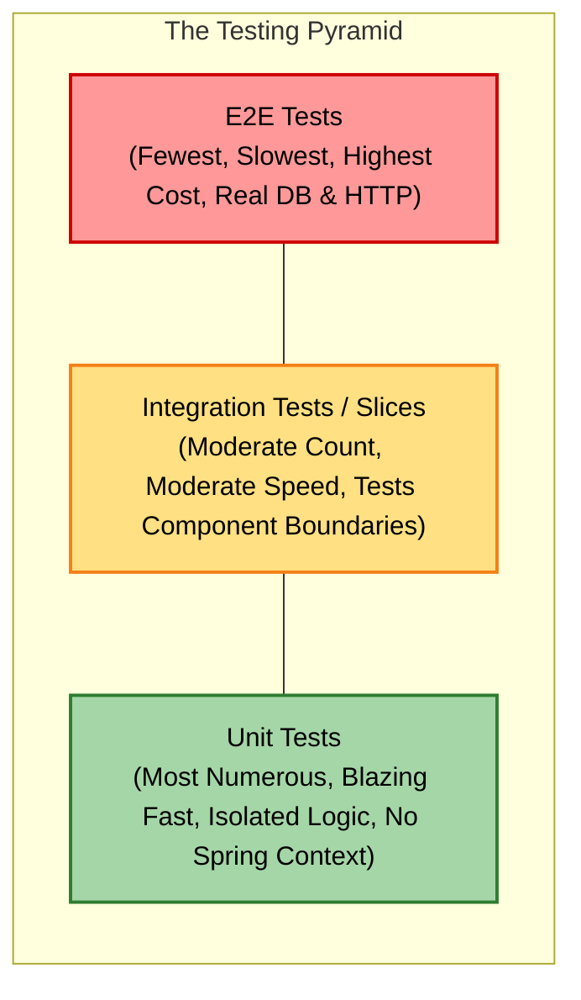
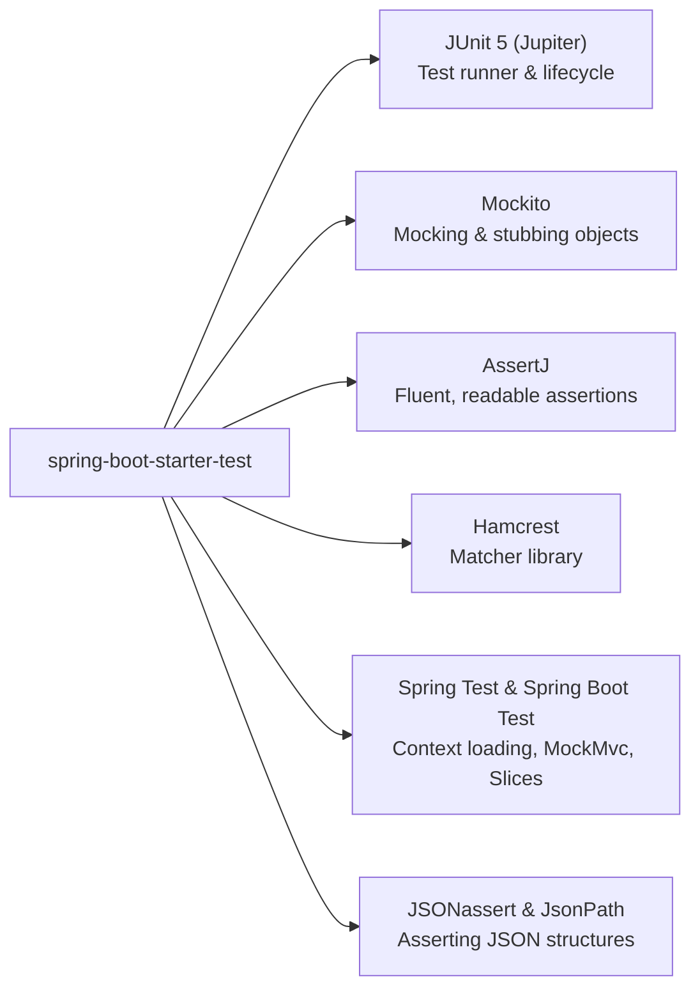
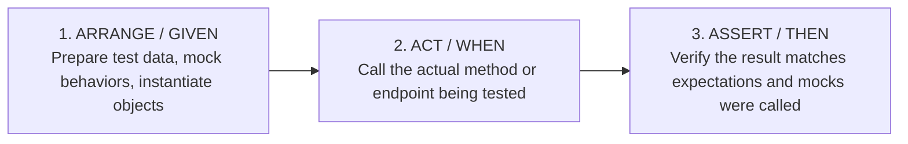
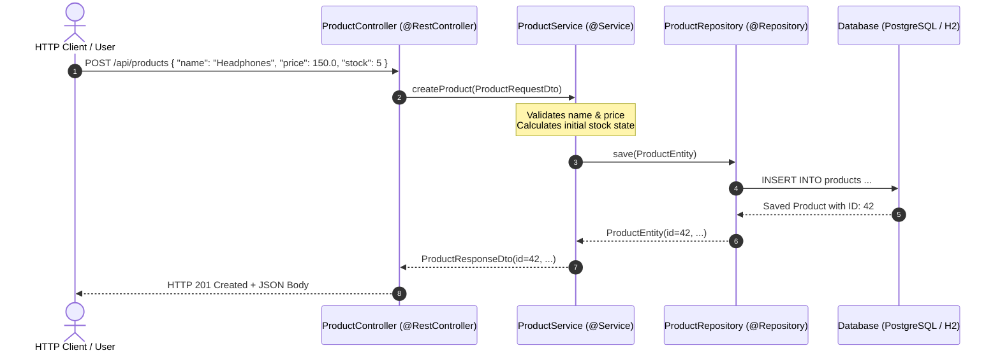
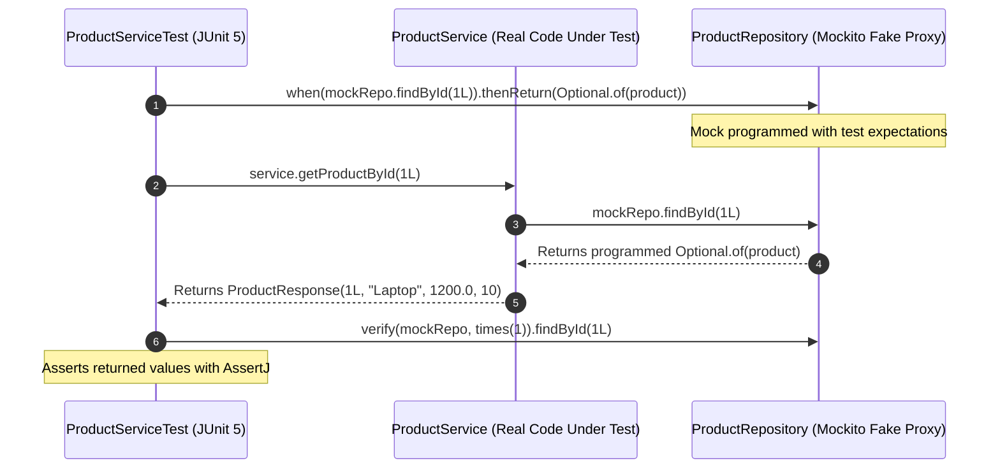
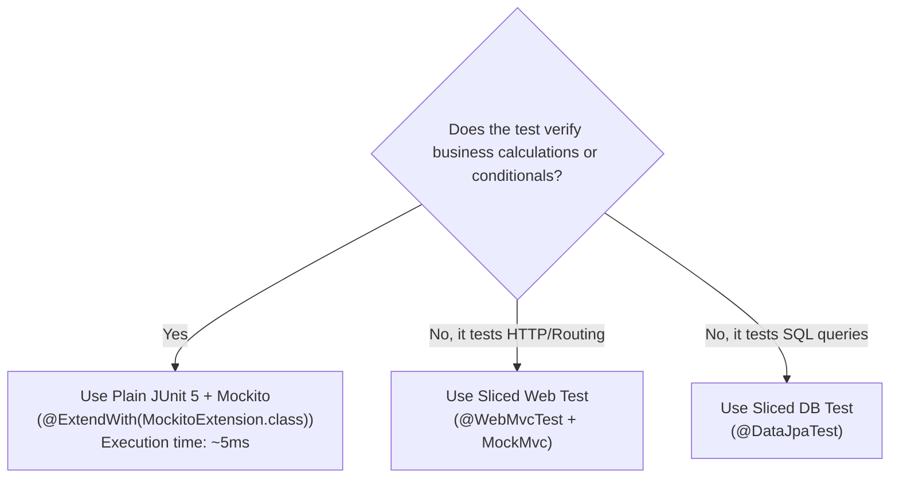
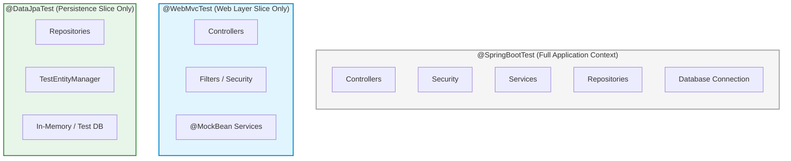
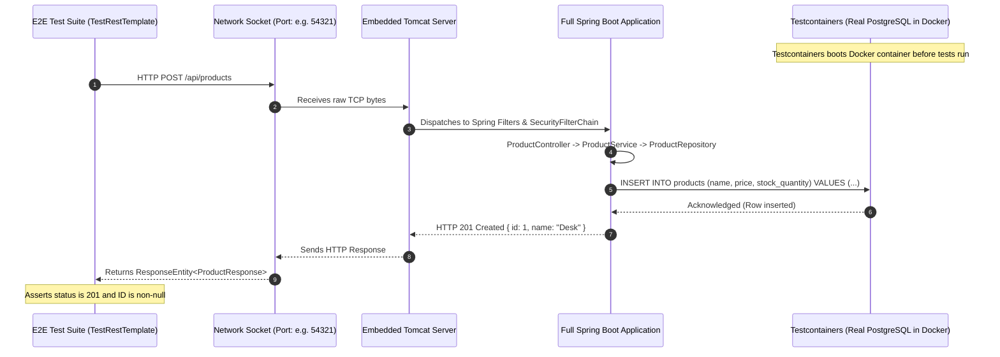
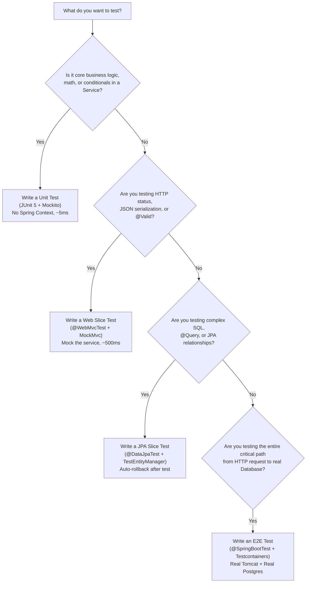
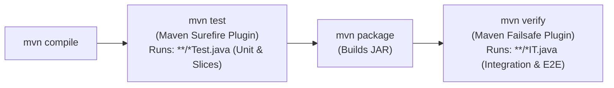

# Testing Spring Boot Applications: From Unit to Integration and End-to-End (E2E)

A comprehensive, beginner-friendly guide to testing Spring Boot applications. This guide breaks down the testing pyramid, explains core concepts with visual diagrams, and walks through a single coherent domain example with heavily annotated code.

---

## Table of Contents

- [1. The Big Picture: Why We Test & The Testing Pyramid](#1-the-big-picture-why-we-test--the-testing-pyramid)
  - [1.1 Why Automated Testing Matters](#11-why-automated-testing-matters)
  - [1.2 The Testing Pyramid](#12-the-testing-pyramid)
  - [1.3 The Spring Boot Testing Starter Toolbox](#13-the-spring-boot-testing-starter-toolbox)
  - [1.4 The Testing Mental Model: AAA & Given-When-Then](#14-the-testing-mental-model-aaa--given-when-then)
- [2. The Example Application: Product Store](#2-the-example-application-product-store)
  - [2.1 Architectural Flowchart](#21-architectural-flowchart)
  - [2.2 Entity, DTOs & Custom Exception](#22-entity-dtos--custom-exception)
  - [2.3 Repository Layer](#23-repository-layer)
  - [2.4 Service Layer](#24-service-layer)
  - [2.5 Controller Layer](#25-controller-layer)
- [3. Part 1: Unit Testing (Fast, Isolated, No Spring Context)](#3-part-1-unit-testing-fast-isolated-no-spring-context)
  - [3.1 What is a Unit Test?](#31-what-is-a-unit-test)
  - [3.2 Mocking with Mockito Explained Simply](#32-mocking-with-mockito-explained-simply)
  - [3.3 How Mockito Intercepts Calls (Diagram)](#33-how-mockito-intercepts-calls-diagram)
  - [3.4 Unit Testing the Service Layer (`ProductServiceTest`)](#34-unit-testing-the-service-layer-productservicetest)
  - [3.5 Parameterized Tests with JUnit 5](#35-parameterized-tests-with-junit-5)
  - [3.6 Unit Test Summary Checklist](#36-unit-test-summary-checklist)
- [4. Part 2: Integration Testing (Components Working Together)](#4-part-2-integration-testing-components-working-together)
  - [4.1 What is an Integration Test?](#41-what-is-an-integration-test)
  - [4.2 Sliced Testing vs. Full Context Testing](#42-sliced-testing-vs-full-context-testing)
  - [4.3 Testing the Web Layer with `@WebMvcTest` & `MockMvc`](#43-testing-the-web-layer-with-webmvctest--mockmvc)
  - [4.4 Testing the Persistence Layer with `@DataJpaTest`](#44-testing-the-persistence-layer-with-datajpatest)
  - [4.5 Multi-Layer Testing with `@SpringBootTest`](#45-multi-layer-testing-with-springboottest)
- [5. Part 3: End-to-End (E2E) Testing (Full System Over HTTP)](#5-part-3-end-to-end-e2e-testing-full-system-over-http)
  - [5.1 What is an End-to-End Test?](#51-what-is-an-end-to-end-test)
  - [5.2 E2E Architecture & Flow Diagram](#52-e2e-architecture--flow-diagram)
  - [5.3 `@SpringBootTest(webEnvironment = RANDOM_PORT)`](#53-springboottestwebenvironment--random_port)
  - [5.4 Real Databases with Testcontainers](#54-real-databases-with-testcontainers)
  - [5.5 Complete E2E Test with `TestRestTemplate`](#55-complete-e2e-test-with-testresttemplate)
- [6. Comparison Matrix & Decision Framework](#6-comparison-matrix--decision-framework)
  - [6.1 Comparison Matrix: Unit vs. Sliced vs. E2E](#61-comparison-matrix-unit-vs-sliced-vs-e2e)
  - [6.2 Which Test Should I Write? (Decision Flowchart)](#62-which-test-should-i-write-decision-flowchart)
- [7. Best Practices, Antipatterns & Pro Tips](#7-best-practices-antipatterns--pro-tips)
  - [7.1 The Spring Context Caching Gotcha](#71-the-spring-context-caching-gotcha)
  - [7.2 AssertJ: Clean, Readable Assertions](#72-assertj-clean-readable-assertions)
  - [7.3 Running Tests in Maven (`mvn test` vs `mvn verify`)](#73-running-tests-in-maven-mvn-test-vs-mvn-verify)

---

## 1. The Big Picture: Why We Test & The Testing Pyramid

### 1.1 Why Automated Testing Matters

When developing a Spring Boot application, you have two choices:

1. **Manual Testing**: Boot the app, open Postman or a browser, click buttons, inspect database tables, modify data, restart the app, and repeat for every change.
2. **Automated Testing**: Write automated code that boots your logic, verifies behavior against assertions, and executes in seconds.

Automated tests give you:

- **Confidence to refactor**: Change internal logic without fear of silently breaking existing features.
- **Living documentation**: Tests clearly document how your classes and APIs are expected to behave.
- **Fast feedback loop**: Find bugs at compile/test time rather than in production.

---

### 1.2 The Testing Pyramid

The **Testing Pyramid** is an industry-standard blueprint that guides how many tests of each kind you should write.



| Test Level                    | What It Covers                                                                   | Spring Context Started? | Speed                                       | Confidence                                     | Cost to Maintain |
| :---------------------------- | :------------------------------------------------------------------------------- | :---------------------- | :------------------------------------------ | :--------------------------------------------- | :--------------- |
| **Unit Test**                 | A single method or class in total isolation. All dependencies are mocked.        | **No**                  | Milliseconds ($\sim 5\text{ ms}$)           | Low-to-Medium (Tests logic only)               | Low              |
| **Integration Test (Sliced)** | A slice of the app (e.g., only Controller + Web layer, or only Repository + DB). | **Partial Slice**       | Seconds ($\sim 500\text{ ms} - 2\text{ s}$) | Medium-High (Tests serialization, SQL queries) | Medium           |
| **End-to-End (E2E) Test**     | Entire system from the external HTTP socket down to a real running database.     | **Full Context**        | Seconds ($\sim 5\text{ s} - 15\text{ s}$)   | Highest (Real production-like flow)            | High             |

> [!TIP]
> **The Golden Rule**: Push tests down the pyramid whenever possible. If you can test a business rule with a plain Unit test in $3\text{ ms}$, do not rely exclusively on a $10\text{ s}$ E2E test to verify it.

---

### 1.3 The Spring Boot Testing Starter Toolbox

When you add `spring-boot-starter-test` to your Maven `pom.xml`:

```xml
<dependency>
    <groupId>org.springframework.boot</groupId>
    <artifactId>spring-boot-starter-test</artifactId>
    <scope>test</scope>
</dependency>
```

Spring Boot automatically bundles several top-tier testing libraries:



---

### 1.4 The Testing Mental Model: AAA & Given-When-Then

Every well-structured test follows a 3-step rhythm:



```java
@Test
void shouldCalculateDiscountedPrice() {
    // 1. GIVEN (Arrange)
    Product product = new Product(1L, "Mechanical Keyboard", 100.0, 10);
    double discountPercentage = 20.0;

    // 2. WHEN (Act)
    double finalPrice = productService.calculateDiscount(product, discountPercentage);

    // 3. THEN (Assert)
    org.assertj.core.api.Assertions.assertThat(finalPrice).isEqualTo(80.0);
}
```

---

## 2. The Example Application: Product Store

To keep our explanations concrete, we will test a single, realistic Spring Boot application: an **Inventory Product Management System**.

### 2.1 Architectural Flowchart



---

### 2.2 Entity, DTOs & Custom Exception

```java
package com.example.store.product;

import jakarta.persistence.*;
import jakarta.validation.constraints.Min;
import jakarta.validation.constraints.NotBlank;
import jakarta.validation.constraints.Positive;

// The Database Entity
@Entity
@Table(name = "products")
public class Product {

    @Id
    @GeneratedValue(strategy = GenerationType.IDENTITY)
    private Long id;

    @Column(nullable = false)
    private String name;

    @Column(nullable = false)
    private Double price;

    @Column(nullable = false)
    private Integer stockQuantity;

    public Product() {}

    public Product(Long id, String name, Double price, Integer stockQuantity) {
        this.id = id;
        this.name = name;
        this.price = price;
        this.stockQuantity = stockQuantity;
    }

    // Getters and Setters
    public Long getId() { return id; }
    public void setId(Long id) { this.id = id; }
    public String getName() { return name; }
    public void setName(String name) { this.name = name; }
    public Double getPrice() { return price; }
    public void setPrice(Double price) { this.price = price; }
    public Integer getStockQuantity() { return stockQuantity; }
    public void setStockQuantity(Integer stockQuantity) { this.stockQuantity = stockQuantity; }
}
```

```java
package com.example.store.product;

import jakarta.validation.constraints.NotBlank;
import jakarta.validation.constraints.NotNull;
import jakarta.validation.constraints.Positive;
import jakarta.validation.constraints.PositiveOrZero;

// Record for Incoming Requests (with Validation)
public record CreateProductRequest(
    @NotBlank(message = "Product name must not be blank")
    String name,

    @NotNull(message = "Price is required")
    @Positive(message = "Price must be strictly positive")
    Double price,

    @NotNull(message = "Stock is required")
    @PositiveOrZero(message = "Stock cannot be negative")
    Integer stockQuantity
) {}
```

```java
package com.example.store.product;

// Record for Responses
public record ProductResponse(
    Long id,
    String name,
    Double price,
    Integer stockQuantity
) {
    public static ProductResponse fromEntity(Product p) {
        return new ProductResponse(p.getId(), p.getName(), p.getPrice(), p.getStockQuantity());
    }
}
```

```java
package com.example.store.product;

import org.springframework.http.HttpStatus;
import org.springframework.web.bind.annotation.ResponseStatus;

// Custom 404 Exception
@ResponseStatus(HttpStatus.NOT_FOUND)
public class ResourceNotFoundException extends RuntimeException {
    public ResourceNotFoundException(String message) {
        super(message);
    }
}
```

---

### 2.3 Repository Layer

```java
package com.example.store.product;

import org.springframework.data.jpa.repository.JpaRepository;
import org.springframework.data.jpa.repository.Query;
import org.springframework.data.repository.query.Param;
import org.springframework.stereotype.Repository;

import java.util.List;
import java.util.Optional;

@Repository
public interface ProductRepository extends JpaRepository<Product, Long> {

    // Derived Query
    Optional<Product> findByNameIgnoreCase(String name);

    // Custom JPQL Query
    @Query("SELECT p FROM Product p WHERE p.stockQuantity < :threshold")
    List<Product> findLowStockProducts(@Param("threshold") int threshold);
}
```

---

### 2.4 Service Layer

```java
package com.example.store.product;

import org.springframework.stereotype.Service;
import org.springframework.transaction.annotation.Transactional;

import java.util.List;

@Service
public class ProductService {

    private final ProductRepository productRepository;

    // Constructor Injection (easier to test with plain Java!)
    public ProductService(ProductRepository productRepository) {
        this.productRepository = productRepository;
    }

    @Transactional
    public ProductResponse createProduct(CreateProductRequest request) {
        // Business Rule: Duplicate names not permitted
        productRepository.findByNameIgnoreCase(request.name())
            .ifPresent(existing -> {
                throw new IllegalArgumentException("Product already exists with name: " + request.name());
            });

        Product product = new Product(null, request.name(), request.price(), request.stockQuantity());
        Product saved = productRepository.save(product);
        return ProductResponse.fromEntity(saved);
    }

    @Transactional(readOnly = true)
    public ProductResponse getProductById(Long id) {
        Product product = productRepository.findById(id)
            .orElseThrow(() -> new ResourceNotFoundException("Product not found with id: " + id));
        return ProductResponse.fromEntity(product);
    }

    public double applyDiscount(Long id, double discountPercentage) {
        if (discountPercentage < 0 || discountPercentage > 100) {
            throw new IllegalArgumentException("Discount percentage must be between 0 and 100");
        }

        Product product = productRepository.findById(id)
            .orElseThrow(() -> new ResourceNotFoundException("Product not found with id: " + id));

        double discountAmount = product.getPrice() * (discountPercentage / 100.0);
        return product.getPrice() - discountAmount;
    }
}
```

---

### 2.5 Controller Layer

```java
package com.example.store.product;

import jakarta.validation.Valid;
import org.springframework.http.HttpStatus;
import org.springframework.http.ResponseEntity;
import org.springframework.web.bind.annotation.*;

@RestController
@RequestMapping("/api/products")
public class ProductController {

    private final ProductService productService;

    public ProductController(ProductService productService) {
        this.productService = productService;
    }

    @PostMapping
    public ResponseEntity<ProductResponse> createProduct(@Valid @RequestBody CreateProductRequest request) {
        ProductResponse response = productService.createProduct(request);
        return ResponseEntity.status(HttpStatus.CREATED).body(response);
    }

    @GetMapping("/{id}")
    public ResponseEntity<ProductResponse> getProductById(@PathVariable Long id) {
        ProductResponse response = productService.getProductById(id);
        return ResponseEntity.ok(response);
    }

    @GetMapping("/{id}/discount")
    public ResponseEntity<Double> getDiscountedPrice(
            @PathVariable Long id,
            @RequestParam double percentage) {
        double discountedPrice = productService.applyDiscount(id, percentage);
        return ResponseEntity.ok(discountedPrice);
    }
}
```

---

## 3. Part 1: Unit Testing (Fast, Isolated, No Spring Context)

### 3.1 What is a Unit Test?

A **Unit Test** verifies a single class (the "unit") in total isolation from everything else.

- It **does NOT** start Spring Boot.
- It **does NOT** connect to a database.
- It **does NOT** start a web server or listen on any port.

Because no framework overhead is involved, a unit test runs in **$2 \text{ to } 10 \text{ milliseconds}$**. You can run thousands of them in a few seconds!

> [!IMPORTANT]
> If your test uses `@SpringBootTest`, it is **NOT** a unit test. A pure unit test uses standard JUnit 5 and Mockito.

---

### 3.2 Mocking with Mockito Explained Simply

When testing `ProductService`, it requires a `ProductRepository`. But in a unit test, we do not want a real database.

Instead, we use a **Mock**: a dummy imitation of `ProductRepository` whose behavior we control programmatically.

| Annotation / Method                     | What It Does                                                                     |
| :-------------------------------------- | :------------------------------------------------------------------------------- |
| `@ExtendWith(MockitoExtension.class)`   | Tells JUnit 5 to enable Mockito support.                                         |
| `@Mock`                                 | Creates a fake imitation of an interface or class.                               |
| `@InjectMocks`                          | Creates the real class under test and injects the `@Mock`s into its constructor. |
| `when(mock.method()).thenReturn(value)` | **Stubbing**: Instructs the mock what to answer when called.                     |
| `verify(mock, times(1)).method()`       | **Verification**: Checks whether the mock was called with exact arguments.       |

---

### 3.3 How Mockito Intercepts Calls (Diagram)



---

### 3.4 Unit Testing the Service Layer (`ProductServiceTest`)

Here is the complete unit test class for `ProductService`. Notice how clean, readable, and fast it is:

```java
package com.example.store.product;

import org.junit.jupiter.api.DisplayName;
import org.junit.jupiter.api.Test;
import org.junit.jupiter.api.extension.ExtendWith;
import org.mockito.InjectMocks;
import org.mockito.Mock;
import org.mockito.junit.jupiter.MockitoExtension;

import java.util.Optional;

import static org.assertj.core.api.Assertions.assertThat;
import static org.assertj.core.api.Assertions.assertThatThrownBy;
import static org.mockito.ArgumentMatchers.any;
import static org.mockito.Mockito.*;

// 1. Activate Mockito (No Spring Boot Context loaded!)
@ExtendWith(MockitoExtension.class)
class ProductServiceTest {

    // 2. Create a fake imitation of the repository
    @Mock
    private ProductRepository productRepository;

    // 3. Create the REAL service and automatically inject the mock repository into it
    @InjectMocks
    private ProductService productService;

    @Test
    @DisplayName("Should successfully create product when name is unique")
    void createProduct_WhenNameIsUnique_ShouldSaveAndReturnResponse() {
        // GIVEN (Arrange)
        CreateProductRequest request = new CreateProductRequest("Noise Cancelling Headphones", 250.0, 15);
        Product savedProduct = new Product(101L, request.name(), request.price(), request.stockQuantity());

        // Stub: When searching for existing name, find nothing (empty Optional)
        when(productRepository.findByNameIgnoreCase("Noise Cancelling Headphones"))
            .thenReturn(Optional.empty());

        // Stub: When save is called with any Product, return savedProduct
        when(productRepository.save(any(Product.class)))
            .thenReturn(savedProduct);

        // WHEN (Act)
        ProductResponse response = productService.createProduct(request);

        // THEN (Assert)
        assertThat(response).isNotNull();
        assertThat(response.id()).isEqualTo(101L);
        assertThat(response.name()).isEqualTo("Noise Cancelling Headphones");
        assertThat(response.price()).isEqualTo(250.0);
        assertThat(response.stockQuantity()).isEqualTo(15);

        // Verify that the mock methods were called exactly once
        verify(productRepository, times(1)).findByNameIgnoreCase("Noise Cancelling Headphones");
        verify(productRepository, times(1)).save(any(Product.class));
    }

    @Test
    @DisplayName("Should throw IllegalArgumentException when product name already exists")
    void createProduct_WhenNameAlreadyExists_ShouldThrowException() {
        // GIVEN
        CreateProductRequest request = new CreateProductRequest("Existing Keyboard", 100.0, 5);
        Product existing = new Product(1L, "Existing Keyboard", 100.0, 5);

        // Stub: Return an existing product
        when(productRepository.findByNameIgnoreCase("Existing Keyboard"))
            .thenReturn(Optional.of(existing));

        // WHEN & THEN (Assert exception is thrown)
        assertThatThrownBy(() -> productService.createProduct(request))
            .isInstanceOf(IllegalArgumentException.class)
            .hasMessageContaining("Product already exists with name: Existing Keyboard");

        // Verify that save() was NEVER called because validation failed first
        verify(productRepository, never()).save(any(Product.class));
    }

    @Test
    @DisplayName("Should return product response when product exists by ID")
    void getProductById_WhenProductExists_ShouldReturnProduct() {
        // GIVEN
        Product product = new Product(1L, "Gaming Mouse", 60.0, 30);
        when(productRepository.findById(1L)).thenReturn(Optional.of(product));

        // WHEN
        ProductResponse response = productService.getProductById(1L);

        // THEN
        assertThat(response.id()).isEqualTo(1L);
        assertThat(response.name()).isEqualTo("Gaming Mouse");
        verify(productRepository).findById(1L);
    }

    @Test
    @DisplayName("Should throw ResourceNotFoundException when product does not exist")
    void getProductById_WhenNotFound_ShouldThrowException() {
        // GIVEN
        when(productRepository.findById(999L)).thenReturn(Optional.empty());

        // WHEN & THEN
        assertThatThrownBy(() -> productService.getProductById(999L))
            .isInstanceOf(ResourceNotFoundException.class)
            .hasMessageContaining("Product not found with id: 999");
    }

    @Test
    @DisplayName("Should correctly calculate discounted price")
    void applyDiscount_WithValidPercentage_ShouldReturnDiscountedPrice() {
        // GIVEN
        Product product = new Product(1L, "UltraWide Monitor", 500.0, 10);
        when(productRepository.findById(1L)).thenReturn(Optional.of(product));

        // WHEN: Apply 20% discount on $500.00
        double discountedPrice = productService.applyDiscount(1L, 20.0);

        // THEN: Expect $400.00
        assertThat(discountedPrice).isEqualTo(400.0);
    }

    @Test
    @DisplayName("Should throw exception when discount percentage is invalid")
    void applyDiscount_WithInvalidPercentage_ShouldThrowException() {
        // WHEN & THEN
        assertThatThrownBy(() -> productService.applyDiscount(1L, 120.0))
            .isInstanceOf(IllegalArgumentException.class)
            .hasMessageContaining("Discount percentage must be between 0 and 100");

        // Repository should never be queried if percentage validation fails first
        verifyNoInteractions(productRepository);
    }
}
```

---

### 3.5 Parameterized Tests with JUnit 5

Instead of writing five separate tests for different discount percentages, JUnit 5 lets you run the same test method multiple times with different input parameters using `@ParameterizedTest`.

```java
import org.junit.jupiter.params.ParameterizedTest;
import org.junit.jupiter.params.provider.CsvSource;

@ParameterizedTest(name = "Original ${0} with {1}% discount should result in ${2}")
@CsvSource({
    "100.0,  10.0,  90.0",
    "100.0,  50.0,  50.0",
    "200.0,  25.0, 150.0",
    "50.0,    0.0,  50.0",
    "50.0,  100.0,   0.0"
})
void applyDiscount_ShouldCalculateCorrectPrice(double originalPrice, double percentage, double expectedPrice) {
    // GIVEN
    Product product = new Product(1L, "Test Product", originalPrice, 10);
    when(productRepository.findById(1L)).thenReturn(Optional.of(product));

    // WHEN
    double actualPrice = productService.applyDiscount(1L, percentage);

    // THEN
    assertThat(actualPrice).isEqualTo(expectedPrice);
}
```

---

### 3.6 Unit Test Summary Checklist



---

## 4. Part 2: Integration Testing (Components Working Together)

### 4.1 What is an Integration Test?

While a unit test checks a single class in isolation, an **Integration Test** checks whether multiple classes or subsystems work properly when wired together.

Examples of integration boundaries:

- **Web Layer**: Does Spring properly convert HTTP JSON into Java objects, run `@Valid` validations, invoke controller methods, and serialize JSON responses?
- **Data Layer**: Does Spring Data JPA translate method names or `@Query` JPQL into valid SQL that executes successfully against a database?
- **Service + Database**: Do transactions rollback properly when an exception occurs?

---

### 4.2 Sliced Testing vs. Full Context Testing

Spring Boot provides **Test Slices**. Instead of starting the entire application (which can take $10 \text{ to } 30\text{ seconds}$), a test slice configures **only** the beans needed for a specific layer.



---

### 4.3 Testing the Web Layer with `@WebMvcTest` & `MockMvc`

#### What is `MockMvc`?

`MockMvc` simulates HTTP requests and responses **without starting a real HTTP server**. It sends requests directly into Spring’s `DispatcherServlet`. It verifies:

- URL routing (`/api/products/{id}`)
- HTTP methods (`GET`, `POST`, `PUT`, `DELETE`)
- HTTP Status Codes (`200 OK`, `201 Created`, `400 Bad Request`, `404 Not Found`)
- Request Body serialization & deserialization (Jackson)
- Bean validation annotations (`@NotBlank`, `@Positive`)

#### Code Example: `ProductControllerTest`

```java
package com.example.store.product;

import com.fasterxml.jackson.databind.ObjectMapper;
import org.junit.jupiter.api.DisplayName;
import org.junit.jupiter.api.Test;
import org.springframework.beans.factory.annotation.Autowired;
import org.springframework.boot.test.autoconfigure.web.servlet.WebMvcTest;
import org.springframework.boot.test.mock.mockito.MockBean;
import org.springframework.http.MediaType;
import org.springframework.test.web.servlet.MockMvc;

import static org.mockito.ArgumentMatchers.any;
import static org.mockito.ArgumentMatchers.eq;
import static org.mockito.Mockito.when;
import static org.springframework.test.web.servlet.request.MockMvcRequestBuilders.get;
import static org.springframework.test.web.servlet.request.MockMvcRequestBuilders.post;
import static org.springframework.test.web.servlet.result.MockMvcResultMatchers.*;

// 1. Only loads the Web Layer for ProductController (Controllers, Jackson, Validation)
@WebMvcTest(ProductController.class)
class ProductControllerTest {

    @Autowired
    private MockMvc mockMvc; // Simulates HTTP requests

    @Autowired
    private ObjectMapper objectMapper; // Converts Java objects to/from JSON strings

    // 2. Put a mock of ProductService into the Spring ApplicationContext
    @MockBean
    private ProductService productService;

    @Test
    @DisplayName("POST /api/products - Should return 201 Created when payload is valid")
    void createProduct_WhenValidInput_ShouldReturn201() throws Exception {
        // GIVEN
        CreateProductRequest request = new CreateProductRequest("Bluetooth Speaker", 79.99, 20);
        ProductResponse response = new ProductResponse(1L, "Bluetooth Speaker", 79.99, 20);

        when(productService.createProduct(any(CreateProductRequest.class)))
            .thenReturn(response);

        // WHEN & THEN (Perform simulated HTTP POST)
        mockMvc.perform(post("/api/products")
                .contentType(MediaType.APPLICATION_JSON)
                .content(objectMapper.writeValueAsString(request))) // Convert record to JSON
                .andExpect(status().isCreated()) // HTTP 201
                .andExpect(content().contentType(MediaType.APPLICATION_JSON))
                .andExpect(jsonPath("$.id").value(1L))
                .andExpect(jsonPath("$.name").value("Bluetooth Speaker"))
                .andExpect(jsonPath("$.price").value(79.99))
                .andExpect(jsonPath("$.stockQuantity").value(20));
    }

    @Test
    @DisplayName("POST /api/products - Should return 400 Bad Request when name is blank")
    void createProduct_WhenNameIsBlank_ShouldReturn400() throws Exception {
        // GIVEN: Invalid payload (blank name and negative price)
        CreateProductRequest invalidRequest = new CreateProductRequest("", -10.0, 5);

        // WHEN & THEN: Spring's @Valid triggers before reaching controller method
        mockMvc.perform(post("/api/products")
                .contentType(MediaType.APPLICATION_JSON)
                .content(objectMapper.writeValueAsString(invalidRequest)))
                .andExpect(status().isBadRequest()); // HTTP 400
    }

    @Test
    @DisplayName("GET /api/products/{id} - Should return 200 OK and product JSON")
    void getProductById_WhenProductExists_ShouldReturn200() throws Exception {
        // GIVEN
        ProductResponse response = new ProductResponse(5L, "Wireless Mouse", 29.99, 50);
        when(productService.getProductById(5L)).thenReturn(response);

        // WHEN & THEN
        mockMvc.perform(get("/api/products/{id}", 5L)
                .accept(MediaType.APPLICATION_JSON))
                .andExpect(status().isOk()) // HTTP 200
                .andExpect(jsonPath("$.id").value(5L))
                .andExpect(jsonPath("$.name").value("Wireless Mouse"))
                .andExpect(jsonPath("$.price").value(29.99));
    }

    @Test
    @DisplayName("GET /api/products/{id}/discount - Should return 200 and discounted price")
    void getDiscountedPrice_ShouldReturnCalculatedValue() throws Exception {
        // GIVEN
        when(productService.applyDiscount(eq(1L), eq(15.0))).thenReturn(85.0);

        // WHEN & THEN
        mockMvc.perform(get("/api/products/1/discount")
                .param("percentage", "15.0"))
                .andExpect(status().isOk())
                .andExpect(content().string("85.0"));
    }
}
```

---

### 4.4 Testing the Persistence Layer with `@DataJpaTest`

#### What does `@DataJpaTest` do?

`@DataJpaTest` configures an isolated persistence test:

- Configures an in-memory database (like H2) or connected test database.
- Scans for `@Entity` classes and Spring Data JPA repositories.
- Disables standard `@Component`, `@Service`, and `@Controller` beans to keep tests fast.
- **Rolls back transactions automatically** at the end of each test method so tests never pollute each other!

#### Code Example: `ProductRepositoryTest`

```java
package com.example.store.product;

import org.junit.jupiter.api.DisplayName;
import org.junit.jupiter.api.Test;
import org.springframework.beans.factory.annotation.Autowired;
import org.springframework.boot.test.autoconfigure.orm.jpa.DataJpaTest;
import org.springframework.boot.test.autoconfigure.orm.jpa.TestEntityManager;

import java.util.List;
import java.util.Optional;

import static org.assertj.core.api.Assertions.assertThat;

// 1. Only boots Spring Data JPA & In-Memory Database
@DataJpaTest
class ProductRepositoryTest {

    @Autowired
    private ProductRepository productRepository;

    @Autowired
    private TestEntityManager entityManager; // Helper to insert test fixtures without using the repo

    @Test
    @DisplayName("findByNameIgnoreCase should return product regardless of casing")
    void findByNameIgnoreCase_ShouldFindMatch_CaseInsensitively() {
        // GIVEN: Seed data using TestEntityManager
        Product product = new Product(null, "Logitech MX Master", 99.0, 15);
        entityManager.persistAndFlush(product);

        // WHEN: Search with lowercase query
        Optional<Product> found = productRepository.findByNameIgnoreCase("logitech mx master");

        // THEN
        assertThat(found).isPresent();
        assertThat(found.get().getName()).isEqualTo("Logitech MX Master");
    }

    @Test
    @DisplayName("findLowStockProducts should return products with stock strictly below threshold")
    void findLowStockProducts_ShouldReturnLowStockOnly() {
        // GIVEN: Seed 3 products with different stock levels
        entityManager.persist(new Product(null, "USB-C Cable", 12.0, 2));   // Low stock (< 5)
        entityManager.persist(new Product(null, "HDMI Adapter", 15.0, 4));  // Low stock (< 5)
        entityManager.persist(new Product(null, "Webcam 4K", 120.0, 10));   // Normal stock (>= 5)
        entityManager.flush();

        // WHEN: Query for threshold = 5
        List<Product> lowStock = productRepository.findLowStockProducts(5);

        // THEN
        assertThat(lowStock).hasSize(2);
        assertThat(lowStock)
            .extracting(Product::getName)
            .containsExactlyInAnyOrder("USB-C Cable", "HDMI Adapter");
    }
}
```

---

### 4.5 Multi-Layer Testing with `@SpringBootTest`

When you want to test the **Service and Repository working together** with a real database (without mocking the repository), you can use `@SpringBootTest`:

```java
package com.example.store.product;

import org.junit.jupiter.api.BeforeEach;
import org.junit.jupiter.api.DisplayName;
import org.junit.jupiter.api.Test;
import org.springframework.beans.factory.annotation.Autowired;
import org.springframework.boot.test.context.SpringBootTest;
import org.springframework.transaction.annotation.Transactional;

import static org.assertj.core.api.Assertions.assertThat;
import static org.assertj.core.api.Assertions.assertThatThrownBy;

@SpringBootTest
@Transactional // Automatically rolls back database mutations after every test
class ProductServiceIntegrationTest {

    @Autowired
    private ProductService productService; // Real Service

    @Autowired
    private ProductRepository productRepository; // Real Repository

    @BeforeEach
    void setUp() {
        productRepository.deleteAll();
    }

    @Test
    @DisplayName("Integration: Service correctly writes to and reads from repository")
    void createProduct_ShouldPersistInRealRepository() {
        // GIVEN
        CreateProductRequest request = new CreateProductRequest("Standing Desk", 450.0, 7);

        // WHEN
        ProductResponse response = productService.createProduct(request);

        // THEN: Verify response
        assertThat(response.id()).isNotNull();

        // AND verify the entity was truly written to the database
        Product fromDb = productRepository.findById(response.id()).orElseThrow();
        assertThat(fromDb.getName()).isEqualTo("Standing Desk");
        assertThat(fromDb.getPrice()).isEqualTo(450.0);
    }
}
```

---

## 5. Part 3: End-to-End (E2E) Testing (Full System Over HTTP)

### 5.1 What is an End-to-End Test?

An **End-to-End (E2E) Test** verifies the entire application stack exactly as an external client would experience it.

- A **real embedded servlet container** (like Tomcat) is spun up on an available random port.
- Requests travel through real network sockets via HTTP.
- Filters, security chains, interceptors, exception handlers, serialization, transactions, and the database are all fully active.

---

### 5.2 E2E Architecture & Flow Diagram



---

### 5.3 `@SpringBootTest(webEnvironment = RANDOM_PORT)`

To start the embedded web server, set `webEnvironment = SpringBootTest.WebEnvironment.RANDOM_PORT`.

```java
@SpringBootTest(webEnvironment = SpringBootTest.WebEnvironment.RANDOM_PORT)
```

- `RANDOM_PORT` ensures your test suite never fails due to port conflicts (e.g., port 8080 already in use).
- Spring injects `TestRestTemplate` or `WebTestClient` configured with the right base URL automatically.

---

### 5.4 Real Databases with Testcontainers

> [!WARNING]
> **The In-Memory Database Trap**: In-memory databases like H2 are great for fast local tests, but they use different SQL dialects, lack Postgres-specific functions (e.g. JSONB, Window functions), and behave differently with concurrency.

**Testcontainers** lets your tests spin up a disposable, genuine Docker container (e.g., PostgreSQL, MySQL, Redis, Kafka) for the duration of the test.

#### Adding Testcontainers Dependencies

```xml
<dependency>
    <groupId>org.testcontainers</groupId>
    <artifactId>postgresql</artifactId>
    <scope>test</scope>
</dependency>
<dependency>
    <groupId>org.testcontainers</groupId>
    <artifactId>junit-jupiter</artifactId>
    <scope>test</scope>
</dependency>
```

In Spring Boot 3.1+, you can use the `@ServiceConnection` annotation to automatically wire container connection details (JDBC URL, username, password) directly into Spring Data JPA with zero boilerplate!

---

### 5.5 Complete E2E Test with `TestRestTemplate`

```java
package com.example.store.product;

import org.junit.jupiter.api.BeforeEach;
import org.junit.jupiter.api.DisplayName;
import org.junit.jupiter.api.Test;
import org.springframework.beans.factory.annotation.Autowired;
import org.springframework.boot.test.context.SpringBootTest;
import org.springframework.boot.test.web.client.TestRestTemplate;
import org.springframework.boot.testcontainers.service.connection.ServiceConnection;
import org.springframework.http.HttpStatus;
import org.springframework.http.ResponseEntity;
import org.testcontainers.containers.PostgreSQLContainer;
import org.testcontainers.junit.jupiter.Container;
import org.testcontainers.junit.jupiter.Testcontainers;

import static org.assertj.core.api.Assertions.assertThat;

// 1. Enable Testcontainers
@Testcontainers
// 2. Start full Spring Context with real embedded Tomcat on a random port
@SpringBootTest(webEnvironment = SpringBootTest.WebEnvironment.RANDOM_PORT)
class ProductE2ETest {

    // 3. Spin up an isolated PostgreSQL Docker container
    @Container
    @ServiceConnection // Automatically wires spring.datasource.* properties to this container!
    static PostgreSQLContainer<?> postgres = new PostgreSQLContainer<>("postgres:16-alpine");

    // 4. Spring provides a configured HTTP client pointing to the random port
    @Autowired
    private TestRestTemplate restTemplate;

    @Autowired
    private ProductRepository productRepository;

    @BeforeEach
    void cleanDatabase() {
        productRepository.deleteAll();
    }

    @Test
    @DisplayName("E2E Scenario: Create product via HTTP POST, then retrieve it via HTTP GET")
    void fullProductLifecycle_ShouldSucceed() {
        // ========================================================
        // STEP 1: POST /api/products (Create the product)
        // ========================================================
        CreateProductRequest createRequest = new CreateProductRequest("Ergonomic Chair", 349.99, 12);

        ResponseEntity<ProductResponse> postResponse = restTemplate.postForEntity(
                "/api/products",
                createRequest,
                ProductResponse.class
        );

        // Verify HTTP response
        assertThat(postResponse.getStatusCode()).isEqualTo(HttpStatus.CREATED);
        assertThat(postResponse.getBody()).isNotNull();
        Long createdId = postResponse.getBody().id();
        assertThat(createdId).isNotNull();
        assertThat(postResponse.getBody().name()).isEqualTo("Ergonomic Chair");

        // ========================================================
        // STEP 2: GET /api/products/{id} (Fetch the product)
        // ========================================================
        ResponseEntity<ProductResponse> getResponse = restTemplate.getForEntity(
                "/api/products/" + createdId,
                ProductResponse.class
        );

        assertThat(getResponse.getStatusCode()).isEqualTo(HttpStatus.OK);
        assertThat(getResponse.getBody()).isNotNull();
        assertThat(getResponse.getBody().id()).isEqualTo(createdId);
        assertThat(getResponse.getBody().price()).isEqualTo(349.99);

        // ========================================================
        // STEP 3: GET /api/products/{id}/discount (Calculate discount)
        // ========================================================
        ResponseEntity<Double> discountResponse = restTemplate.getForEntity(
                "/api/products/" + createdId + "/discount?percentage=10.0",
                Double.class
        );

        assertThat(discountResponse.getStatusCode()).isEqualTo(HttpStatus.OK);
        // $349.99 - 10% ($34.999) = $314.991
        assertThat(discountResponse.getBody()).isCloseTo(314.991, org.assertj.core.data.Offset.offset(0.01));
    }

    @Test
    @DisplayName("E2E Validation: POST invalid payload should return 400 Bad Request")
    void createProduct_WithInvalidPayload_ShouldReturn400() {
        // GIVEN: Blank name
        CreateProductRequest invalidRequest = new CreateProductRequest("", 50.0, 5);

        // WHEN
        ResponseEntity<String> errorResponse = restTemplate.postForEntity(
                "/api/products",
                invalidRequest,
                String.class
        );

        // THEN
        assertThat(errorResponse.getStatusCode()).isEqualTo(HttpStatus.BAD_REQUEST);
    }
}
```

---

## 6. Comparison Matrix & Decision Framework

### 6.1 Comparison Matrix: Unit vs. Sliced vs. E2E

| Feature              | Unit Testing                          | Sliced: `@WebMvcTest`             | Sliced: `@DataJpaTest`              | Full E2E: `@SpringBootTest`                     |
| :------------------- | :------------------------------------ | :-------------------------------- | :---------------------------------- | :---------------------------------------------- |
| **Primary Scope**    | Single class (e.g. `ProductService`)  | Web Controller & Mappings         | Repositories & SQL queries          | Entire Application                              |
| **Spring Context?**  | **None**                              | Web slice only                    | JPA slice only                      | **Full application**                            |
| **Database?**        | None (Mocked)                         | None (Mocked Service)             | In-Memory / Testcontainers          | Real DB / Testcontainers                        |
| **HTTP Server?**     | None                                  | MockMvc (Simulated)               | None                                | Embedded Tomcat (Real Port)                     |
| **Execution Time**   | $\sim 5\text{ ms}$                    | $\sim 300\text{ ms} - 1\text{ s}$ | $\sim 500\text{ ms} - 1.5\text{ s}$ | $\sim 5\text{ s} - 15\text{ s}$                 |
| **Main Annotations** | `@ExtendWith(MockitoExtension.class)` | `@WebMvcTest`, `@MockBean`        | `@DataJpaTest`                      | `@SpringBootTest(webEnvironment = RANDOM_PORT)` |
| **Client Used**      | Direct Java method call               | `MockMvc`                         | Repository interface call           | `TestRestTemplate` or `WebTestClient`           |

---

### 6.2 Which Test Should I Write? (Decision Flowchart)



---

## 7. Best Practices, Antipatterns & Pro Tips

### 7.1 The Spring Context Caching Gotcha

Spring Boot's test framework caches the `ApplicationContext` across test classes to save time.

> [!CAUTION]
> **Why do my tests run so slowly?**
> Every time you use `@MockBean` with a different configuration or use `@DirtiesContext`, Spring cannot reuse the cached context. It tears down the old context and boots a brand-new one from scratch, adding 5 to 10 seconds of startup penalty per test class.
>
> **Solution**:
>
> 1. Prefer pure Unit tests (no Spring context) for business logic.
> 2. Group tests with identical context configurations together.
> 3. Avoid `@DirtiesContext` unless absolutely necessary (e.g., when a test mutates a non-resettable singleton).

---

### 7.2 AssertJ: Clean, Readable Assertions

Spring Boot comes with **AssertJ** pre-installed. Always prefer AssertJ's fluent `assertThat(...)` syntax over older JUnit `assertEquals(...)`:

```java
// ❌ Hard to read, easy to mix up expected and actual order
assertEquals(expectedId, product.getId());
assertTrue(product.getPrice() > 0);

// ✅ AssertJ: Fluent, readable like English prose, IDE autocomplete-friendly
assertThat(product.getId()).isEqualTo(expectedId);
assertThat(product.getPrice()).isPositive();
assertThat(product.getName()).isNotBlank().startsWith("Logitech");
assertThat(productList)
    .hasSize(3)
    .extracting(Product::getName)
    .contains("Keyboard", "Mouse");
```

---

### 7.3 Running Tests in Maven (`mvn test` vs `mvn verify`)

The standard Maven build lifecycle splits unit and integration tests across two distinct plugins:



| Plugin             | Phase                        | Naming Convention | Behavior on Failure                                                                  |
| :----------------- | :--------------------------- | :---------------- | :----------------------------------------------------------------------------------- |
| **Maven Surefire** | `test`                       | `*Test.java`      | Halts build immediately                                                              |
| **Maven Failsafe** | `integration-test`, `verify` | `*IT.java`        | Runs all integration tests, tears down containers, then reports failures in `verify` |

> [!TIP]
> Name your Unit and Sliced tests ending in `Test.java` (e.g. `ProductServiceTest.java`, `ProductControllerTest.java`).
> Name your slow E2E / Testcontainer tests ending in `IT.java` (e.g. `ProductE2EIT.java`).
>
> This lets developers run fast unit tests during day-to-day coding (`mvn test`), and runs the heavy E2E tests only before committing or in CI/CD pipelines (`mvn verify`).

---

## Summary Cheat Sheet

```
+-----------------------------------------------------------------------------------+
| LEVEL        | ANNOTATION                        | DEPENDENCIES  | SPEED          |
+-----------------------------------------------------------------------------------+
| Unit         | @ExtendWith(MockitoExtension)     | @Mock, @Inject| Blazing (~5ms) |
| Web Slice    | @WebMvcTest(Controller.class)     | MockMvc       | Fast (~500ms)  |
| JPA Slice    | @DataJpaTest                      | TestEntityMgr | Fast (~800ms)  |
| Full Context | @SpringBootTest                   | Real Beans    | Slower (~3-5s) |
| E2E          | @SpringBootTest(webEnv=RANDOM)    | Testcontainers| Slowest (~10s) |
+-----------------------------------------------------------------------------------+
```
